# VisionQA Workbench

VisionQA 是给画面做**有证据的视觉评审**的工具：结论只有「通过 / 需人工确认 / 不通过」三种，每条判断都必须指向画面里的具体区域（像素锚点），定位不到证据的一律写进「无法判断」，不给模糊结论。

这个仓库是 VisionQA 的**创作与检索工作台**：把「找一条爆款 → 拆它的结构 → 换个产品复刻 → 评审产出画面 → 沉淀成可复用模板」串成一条能跑通的链路，评审语言与 VisionQA 插件共用同一套 visual-baseline 契约。

> 诚实边界（2026-11-09 17:20 线上实测）：模型链路换成**官方 DeepSeek**（`https://api.deepseek.com/v1`）后真正通了。`deepseek-flash` 自报的 `input_modalities` 是 `["text","image"]`，所以智能体对话和抽帧评审共用同一个模型，不再需要假想一个「视觉专用模型」。实测：后台「连通性自检」`可用 · 上游 2 个模型`；智能体对话 6.0 秒出成品文案；`/api/review` 本地模型路径 16.6 秒给出 verdict + 像素锚点；`analyzeFrames` 在服务器上用生产代码跑 3 帧得到合法分镜 JSON。**仍然缺**：模板库 0 条（「一键复刻」还没跑过一条真实视频）、没有队列/配额/找回密码/用户列表接口。

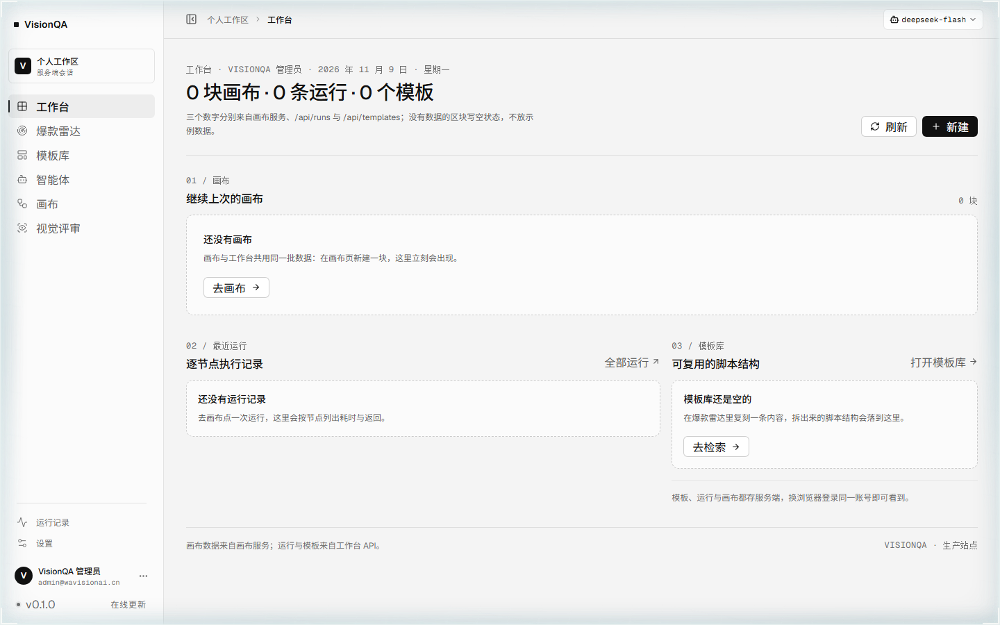

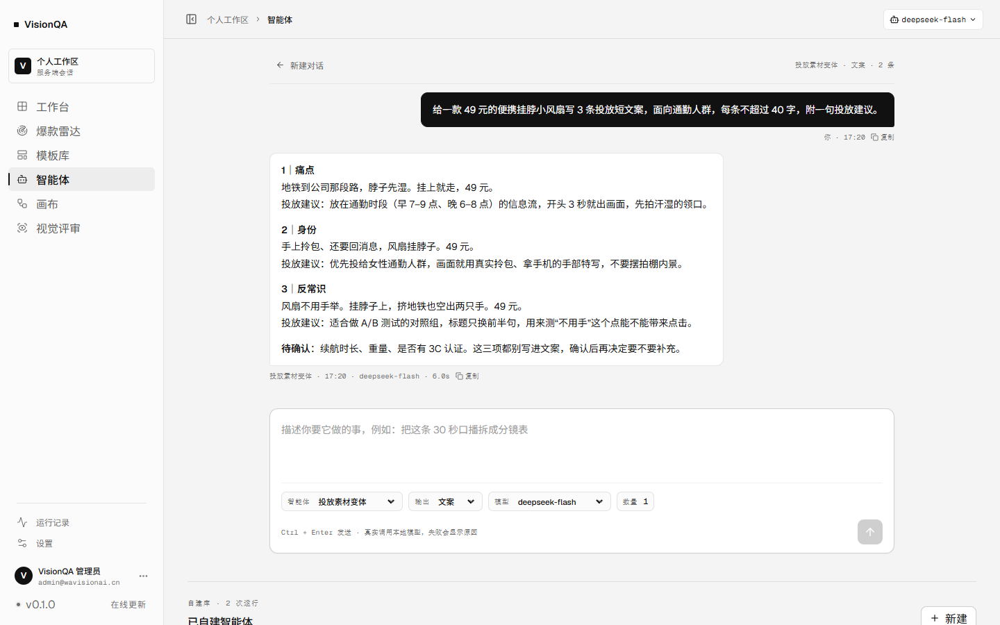

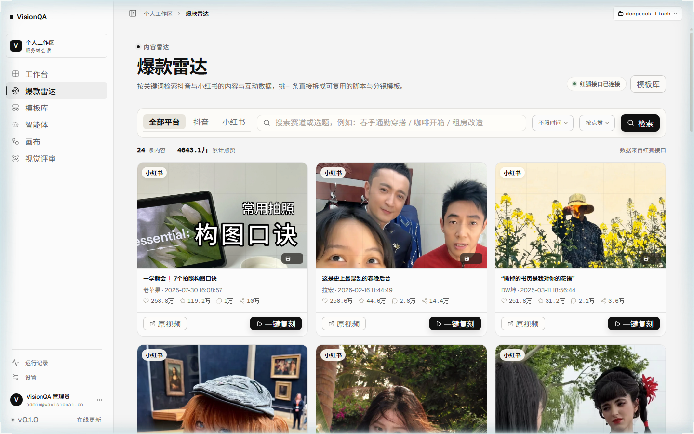

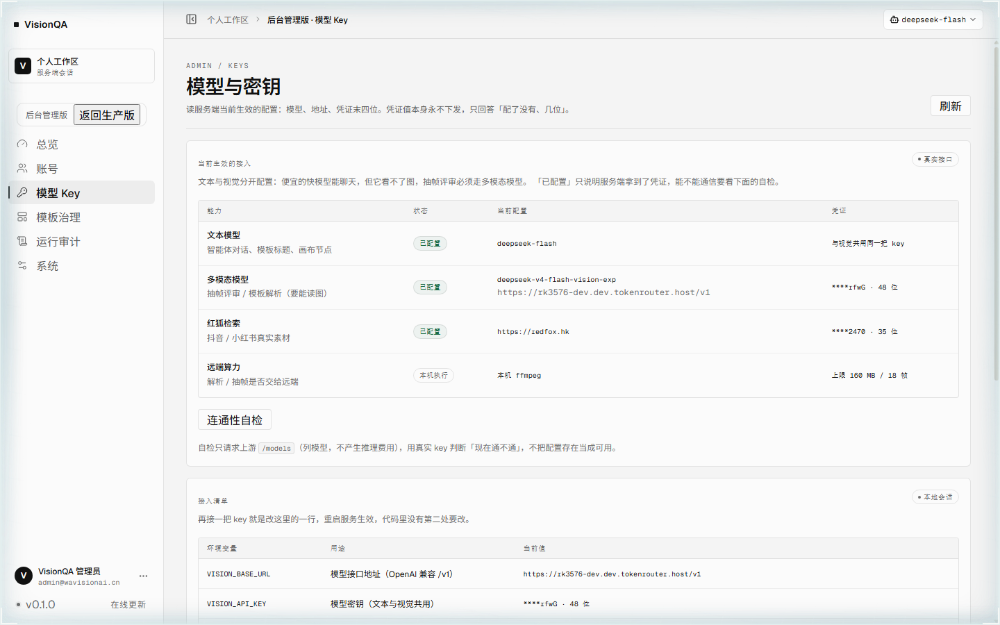

登录是**真实的服务端账号**：密码用 scrypt 存哈希，账号落在 `data/auth.db`（SQLite），会话是服务端随机 token + HttpOnly cookie，浏览器里读不到 token 也读不到密码。支持注册、登录、记住我；登录失败统一提示「邮箱或密码不正确」，不泄露邮箱是否注册过。登录状态收在**侧栏左下角**，点开可切换账号或退出。

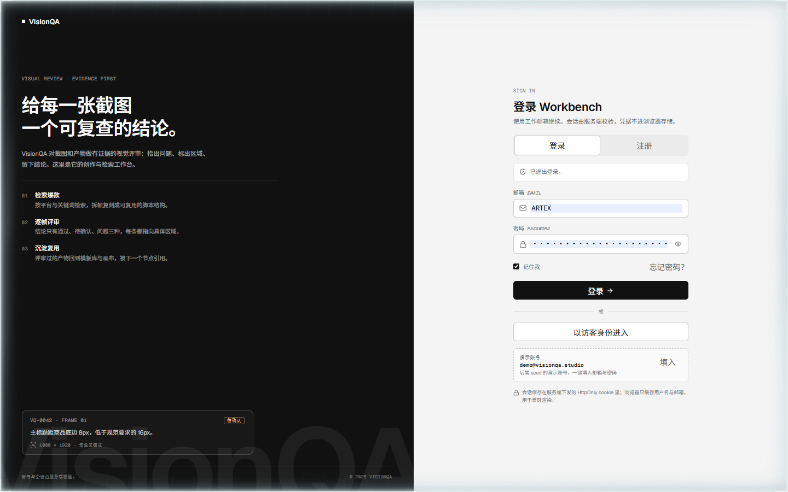

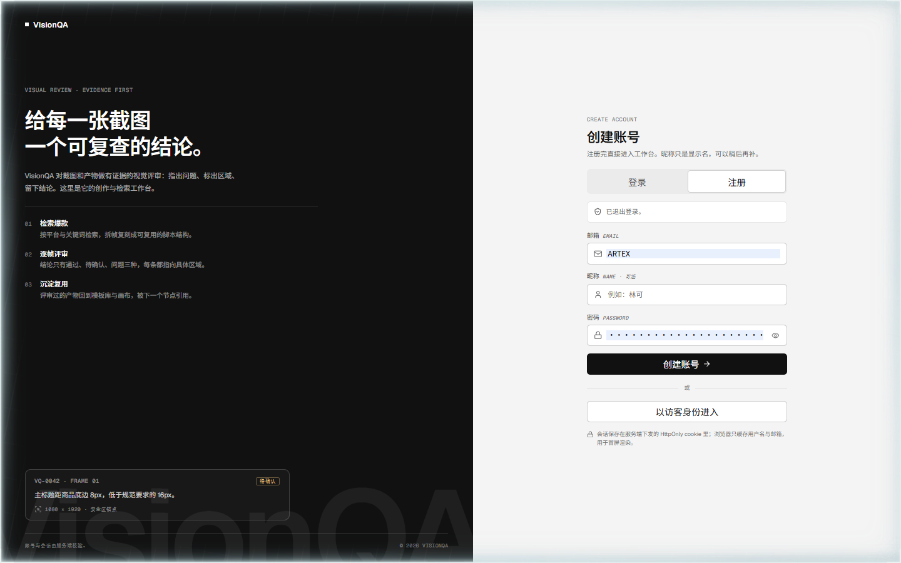

左下角是账号与版本：点账号行可设置 / 切换账号 / 退出；点版本行打开「版本与在线更新」——只读服务端 /api/version 的真实版本号，接口没接入时如实显示「未接入」，不伪造下载进度。

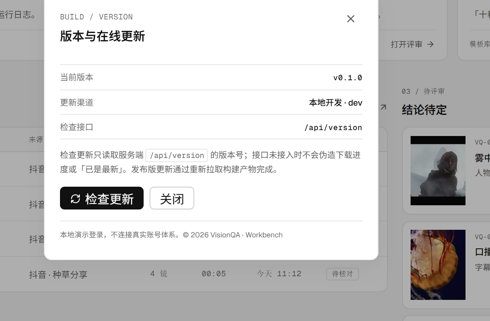

## 一、这一版做了什么

| 模块 | 真实能力 | 事实边界 |
| --- | --- | --- |
| 登录 | 注册 / 登录 / 登出 / 记住我 / 会话持久化，密码 scrypt 存哈希，会话服务端校验 | **没有找回密码、邮箱验证与角色权限**；注册默认关闭，加账号用 `npm run adduser`，见 [docs/accounts.md](docs/accounts.md) |
| 作品 | **一条内容一条记录**：`#/projects` 与 `#/projects/<id>`；只存「绑哪条模板 + 哪块画布 + 到哪一步」，脚本与分镜实时取自模板；作品页按「下一步」给一张主卡（开画布 / 送评审 / 继续改 / 交付）；改名、多版本对照、运行按作品归集、脚本 copy-on-write、**只读分享链接**都已上线 | 默认只存引用，脚本只在改过时复制一份；**没有作品级权限 / 协作 / 分享访问统计**；智能体的两个出口还没接 |
| 爆款雷达 | 进页面**不自动检索**，点「检索」才发请求；卡片给播放 / 点赞 / 收藏 / 评论 / 转发与互动率；可「加入模板库」或「一键复刻」 | 抖音有播放量，小红书没有；取不到就隐藏，不做估算 |
| 一键复刻 | 视频解析 → ffprobe → FFmpeg 拆帧 → 逐帧视觉分析 → 入库，五步进度与实时日志 | 平台链接解析依赖红狐 Key；直链兜底可用 |
| 模板库 | **只存原链接 + 互动数据 + 解析出的脚本与分镜，不保存视频文件**；待解析 / 已解析两种状态，详情抽屉里可「去解析」；类型/关键词检索；送去评审 | 待解析条目没有帧图，封面走 /api/cover 代理 |
| 智能体 | 对话框式入口、参数行（智能体/输出/模型）、已自建智能体分类卡片、新建/编辑/删除；对话带**最近 8 条 / 6000 字**的会话记忆 | 记忆由服务端截断，超出部分不带；不落库 |
| 画布 | React Flow 节点编排（input/llm/kb/tool/condition/output）、检查器、连线校验、保存、逐节点运行；节点面板默认收起，双击画布或点「节点」唤出 | 运行是真执行，耗时真实；VisionQA Canvas 部署后画布交给它接管（见第六节） |
| 视觉评审 | 选画面 → visual-baseline 七维评审 → verdict + 像素锚点 + 有界修正建议 | 未启动 VisionQA 插件服务时由本地模型出一份同契约结果，provider 会写清 |
| 运行记录 | 读 data/runs.json，逐节点状态、耗时、输出 | 只有画布执行会产生记录 |

导航分两层：主层 7 项「工作台 / 作品 / 爆款雷达 / 模板库 / 智能体 / 画布 / 视觉评审」，横线下面是设置层「运行记录 / 设置」，字号更小、颜色更淡。左上角只写 VisionQA，不放图形标记。P2 会把主层收敛到 4 项（工作台 / 作品 / 发现 / 模板库），智能体、画布、评审进工具区——等桌面端形态定了再做。

> 2026-11-09 上线体检后，整块删掉了「资产库」（6 条假资产 + 假统计，没有后端）、内测测试版、登录页演示账号与访客入口、工作台的示例待办/最近复刻/待评审。逐项清单与「哪些是真的」判定见 [docs/launch-readiness.md](docs/launch-readiness.md)。

### 2026-11-10 这一轮（已上线）

| 改动 | 之前 | 现在 |
| --- | --- | --- |
| 雷达检索时机 | 切到爆款雷达就自动检索一次（按次计费） | 进页面只读健康状态；输入关键词点「检索」才请求，未检索时给明确的空状态 |
| 卡片数据 | 点赞 / 收藏 / 评论 / 转发 | 再加播放量与互动率（(赞+藏+评+转)/播放），排序支持按播放、按转发 |
| 雷达 → 模板库 | 只有「一键复刻」入库 | 新增「加入模板库」：只存原链接、作者、互动数据，不下载视频、不抽帧 |
| 模板库 | 每条都带本地帧图 | 待解析 / 已解析两态；详情里可「去解析这条」，复刻完成后同一条目升级，不重复占格 |
| 智能体对话框 | 输入框 + 参数行 + 提示行 + 独立发送键，改一次要滚 | 一块卡片：输入区在上，参数与「Ctrl + Enter + 发送」收在底部同一行；去掉「数量 1」与「真实调用本地模型」这类给我们自己看的文案 |
| 会话记忆 | 每轮只发当前一句 | 带最近 8 条 / 6000 字上下文（服务端截断），实测追问能接住上文 |
| 字体 | 从 fonts.googleapis.com 拉 Geist + Noto Sans SC 四套字重；中文用无 hinting 的网页字体，12px 发虚 | 去掉外部字体请求，Geist 拉丁子集自托管、中文用系统黑体；10px 微标签统一抬到 11px |
| 充值 | 无 | 新增 /api/billing/*（overview / orders）与设置页「充值」按钮；通道未开通时明确显示未开通、按钮不可用，不编价格 |

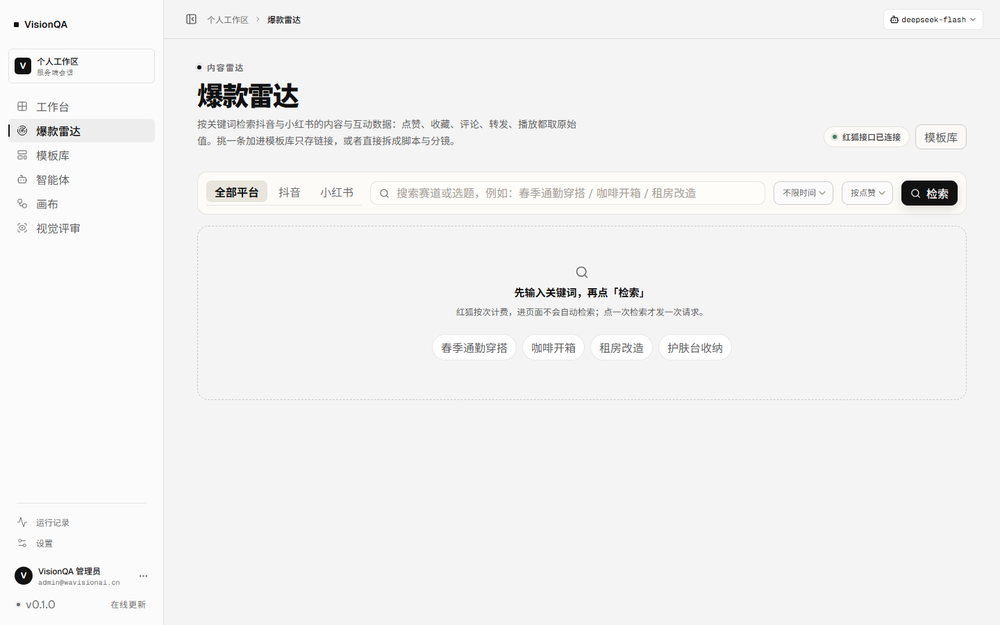


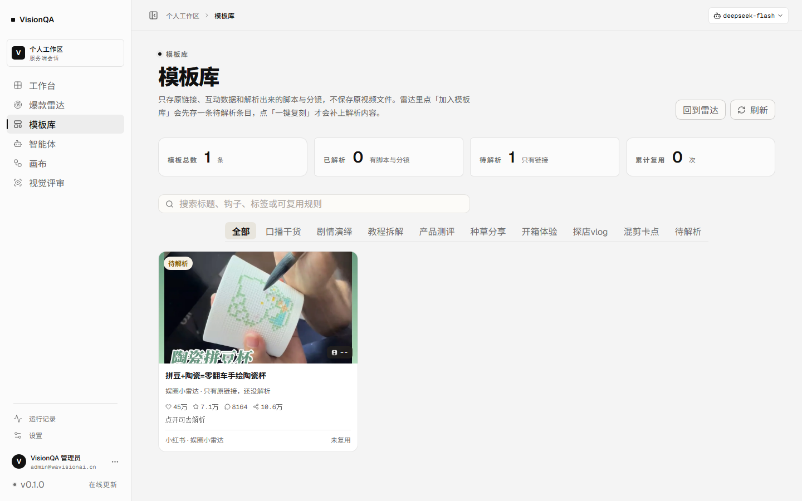

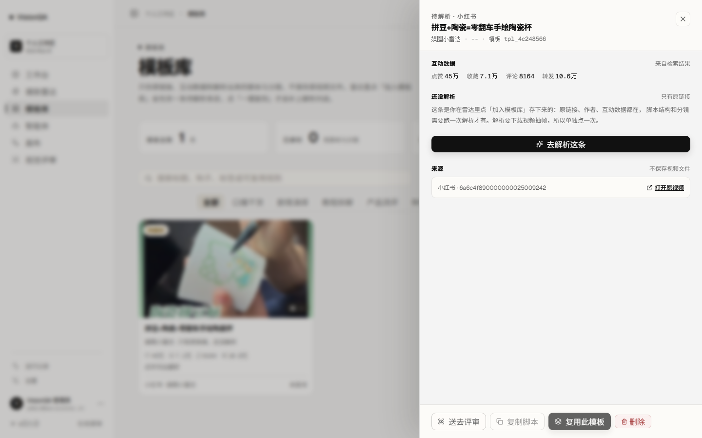

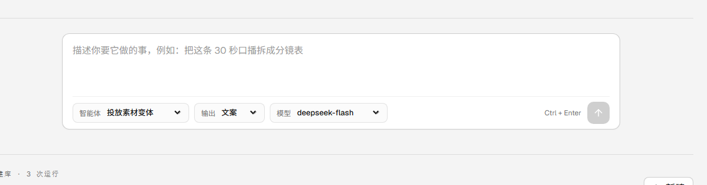

### 2026-11-10 追加：页头、运行记录溢出、入口 HTML 缓存

| 问题 | 原因 | 改法 |
| --- | --- | --- |
| 智能体页顶部「创作能力 / 智能体」 | 顶栏已经有「个人工作区 › 智能体」，页内又写了一遍虚构的上一层 | 删掉页内这行眉标（编辑页同改），全站只留顶栏一处面包屑 |
| 「已自建智能体」上方 | 「自建库 · N 次运行」和下面的标题说的是同一件事，右上角还有第二个「新建」 | 收成一行：标题 + 「N 个 · 累计 M 次运行」；新建只留页头那一个 |
| 参数胶囊的下拉 | 原生 `<select>` 弹出层会盖住输入框底部，样式也和发丝线不搭 | 换成自绘下拉：点击外部或 Esc 关闭、选中项加粗、展开时箭头翻转 |
| 运行记录页明显溢出 | `.runs-page` 漏写页面内边距，内容顶到侧栏和窗口边缘，左侧字看起来像被切掉 | 与工作台同一套 32px 内边距 + 1280 居中 |
| 工作台页头字体发虚 | 「工作台 · 用户 · 2026 年 11 月 10 日 · 星期二」整行等宽字体 + 中文混排，被 0.04em 字距拉散 | 拆成「工作台 · 用户 · 日期」，中文走界面字体、只有日期用等宽等宽数字；标题数字改 tabular-nums、分隔点降为 1px 灰 |
| 发版后仍看到旧界面 | nginx 直接托管 dist，`index.html` 没有 `Cache-Control`，浏览器按 ETag 启发式缓存旧 HTML，发版后继续加载旧 bundle | nginx 里 `location = /index.html` 写 `no-store, no-cache, must-revalidate`，`/assets/` 写 `immutable` 长缓存 |

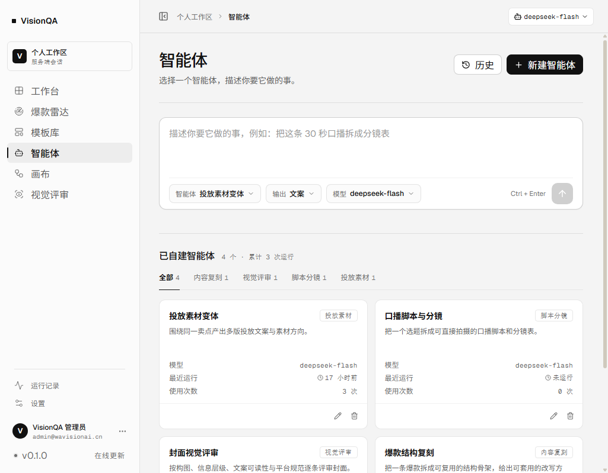

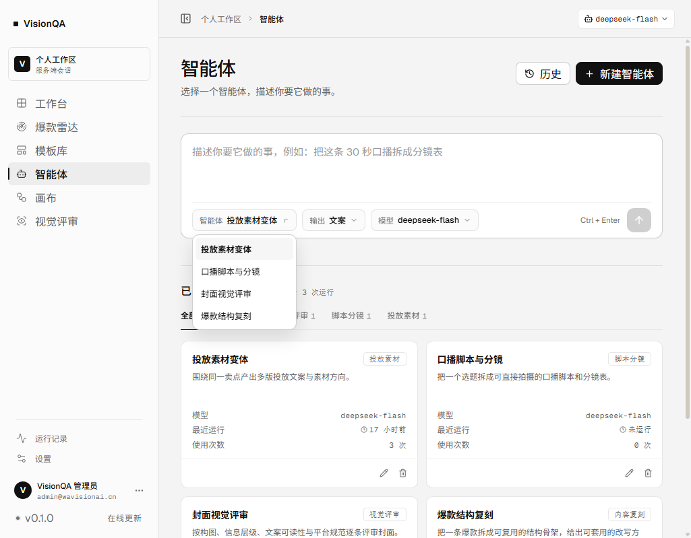

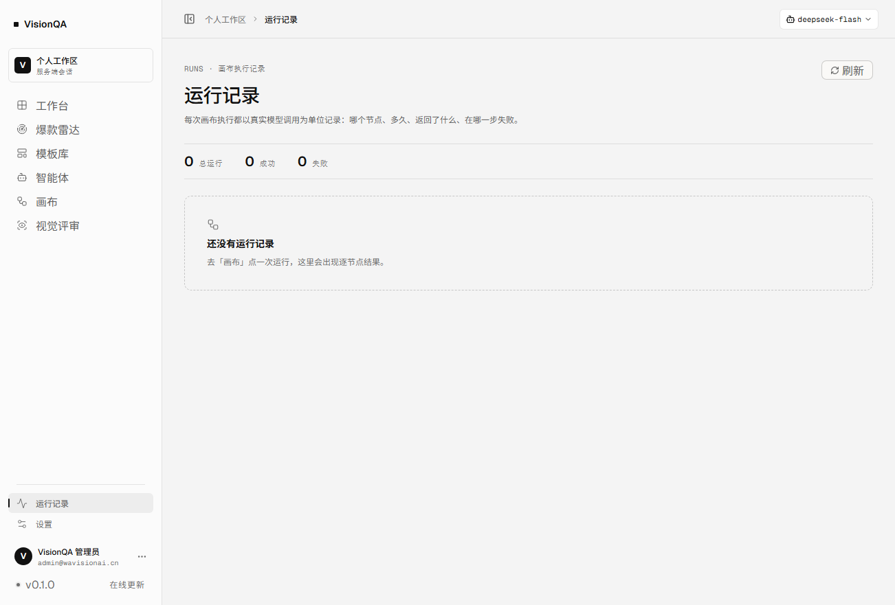

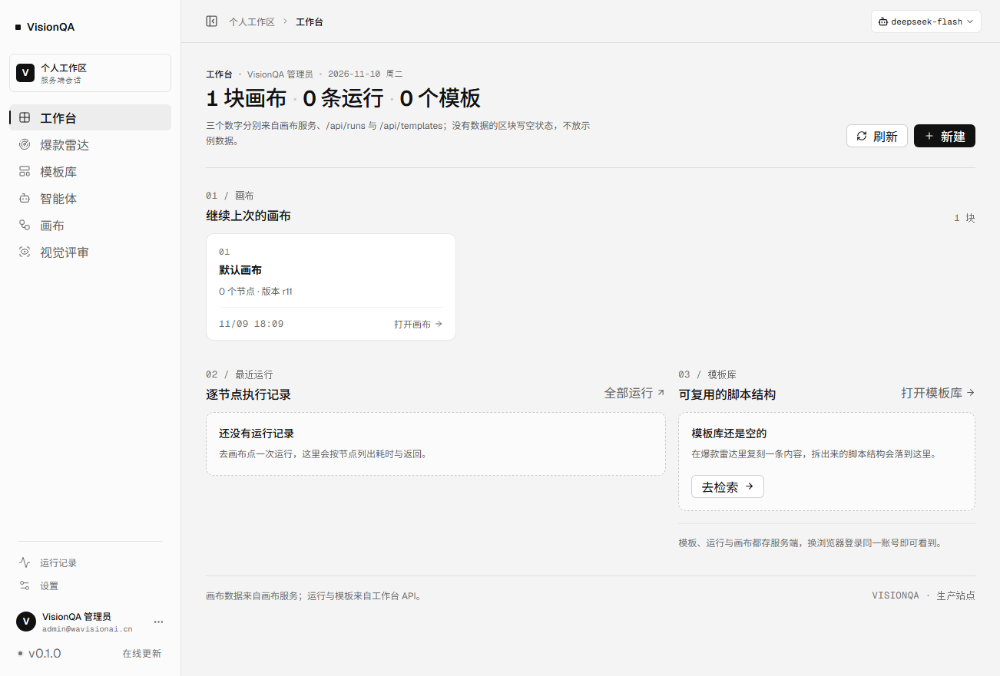

同一轮还按上线前审计修了六处**会真出事故**的地方（登录暴破绕过、模板库并发写丢条目、失败任务残留临时目录、
模板帧图送评审路径错、安全响应头、数据零备份）：
`deploy/production/backup.sh` + `visionqa-backup.timer` 每天 04:10 把 `/var/lib/visionqa` 整目录打包到
`/var/backups/visionqa` 留 7 份（含 WAL，恢复时 SQLite 自己重放），已装并跑过第一次。
审计清单、未修的 P0/P1（配额闸门、多用户 ownerId、SSRF 超时、健康检查探上游……）逐条记在
[docs/launch-readiness.md](docs/launch-readiness.md) 的「三点八」。

### 视觉基线（去 AI 味）

界面按六条硬规则约束，细则与 token 表见 [docs/design-baseline.md](docs/design-baseline.md)：

1. **间距只走 4/8pt 栅格**——`--space-1..16`（4/8/12/16/24/32/48/64），组件里不出现 13/26/29 这类随手值；
2. **禁大面积渐变**——底板是纯色（`#f4f4f4` / `#fbfbfb` / `#ffffff`），彩色只留在「通过 / 待确认 / 问题」三个语义位；
3. **图标不用 emoji**——全部 lucide 线性图标，统一 1.5px 描边；
4. **字体显式指定**——Geist 拉丁子集自托管（52KB）+ 中文走系统黑体（苹方 / 微软雅黑），不再 @import fonts.googleapis.com；标题 500、正文 14、等宽元数据 11–12；
5. **文案给信息不给寒暄**——工作台页头是「3 项待办 · 3 条待评审 · 4 条今日入库」，不是「下午好」；
6. **颜色先 token 后动手**——六件套 `--canvas / --surface / --surface-raised / --ink / --muted / --line`，组件里不现调色。

这一轮把 8 张样式表里 449 处 off-grid 间距、495 处 `font-size` 收敛到栅格与字阶，标题字重统一降到 500，并把模板库「搜索框 + 9 个类型 chip 挤一行换行」重排成搜索一行、类型一行（下划线式 tab，横向不换行）：

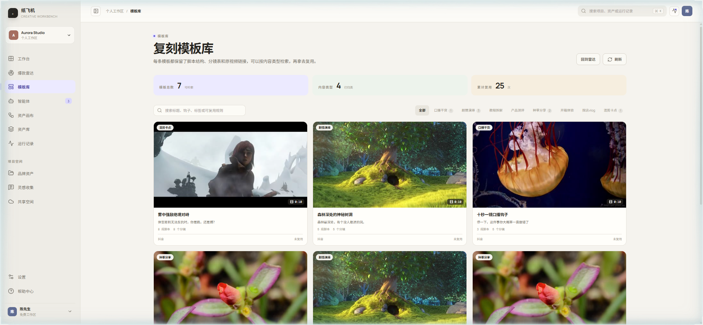

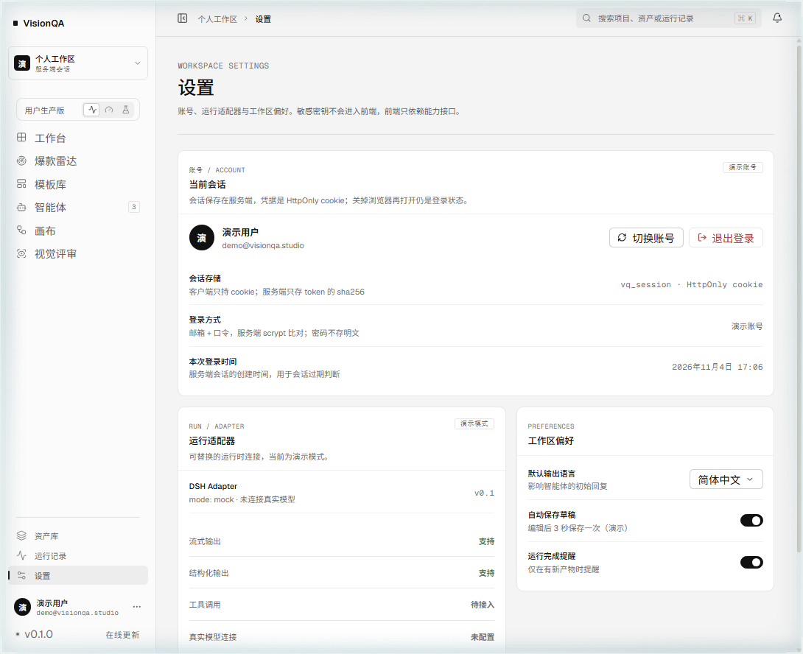

### 两个形态

对外只有一个形态：**用户生产版**。后台管理版不给普通用户看到，地址栏加 `?edition=admin` 才进得去，进去后侧栏有一条「返回生产版」。

| 形态 | 给谁 | 导航 |
| --- | --- | --- |
| 用户生产版 PRODUCTION | 内容团队日常用 | 工作台 / 爆款雷达 / 模板库 / 智能体 / 画布 / 视觉评审 +（横线下）运行记录 / 设置 |
| 后台管理版 ADMIN | 运维自己（`?edition=admin`） | 总览 / 账号 / 模型 Key / 模板治理 / 运行审计 / 系统 |

原来的「内测测试版 LAB」整块删除：接口体检、样例对照、功能开关、诊断导出四页里，开关全是「仅记录，尚未接线」，对照页的作用是把 `src/data/mock.ts` 的假数据摆在真实接口旁边——上线版不该带这种页面。
后台版每个数字都标「真实接口 / 本地会话」，没有接口的地方就写没有，见 [docs/editions.md](docs/editions.md)。

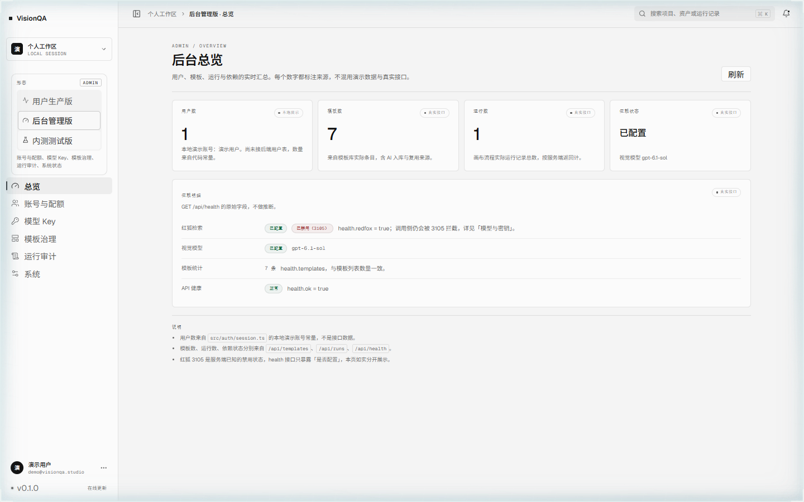

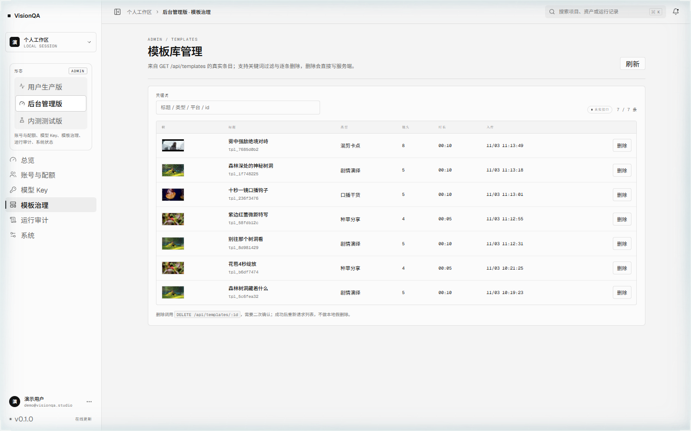

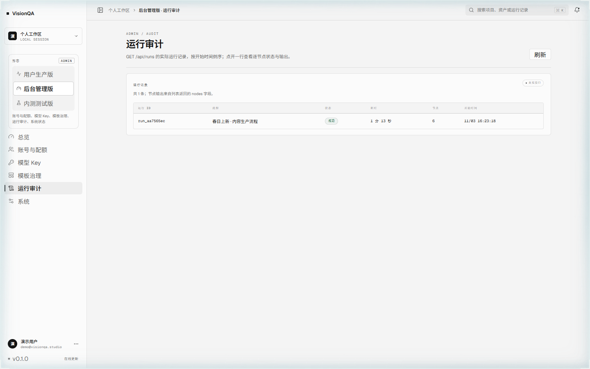

## 二、检索 → 复刻 → 模板库

爆款雷达按平台（抖音 / 小红书）、关键词、时间范围检索，卡片直接给点赞 / 收藏 / 评论 / 分享与时长；鼠标移到封面出「一键复刻」。

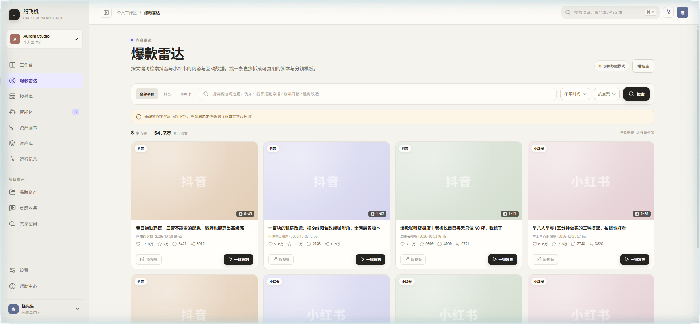

红狐账号不可用时（Key 禁用 / 积分不足 / 限流），界面明确说清并给后台链接：

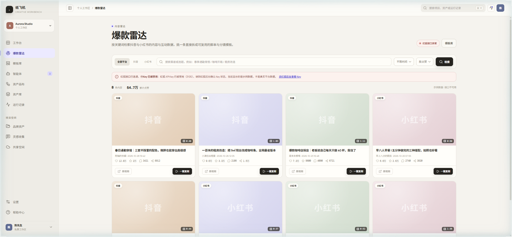

一键复刻跑五个可观测步骤：解析视频地址 → 读视频信息（ffprobe + 场景切镜）→ FFmpeg 抽帧 → 逐帧分析脚本与分镜 → 写入模板库。进度、每步状态、实时日志都在弹窗里。

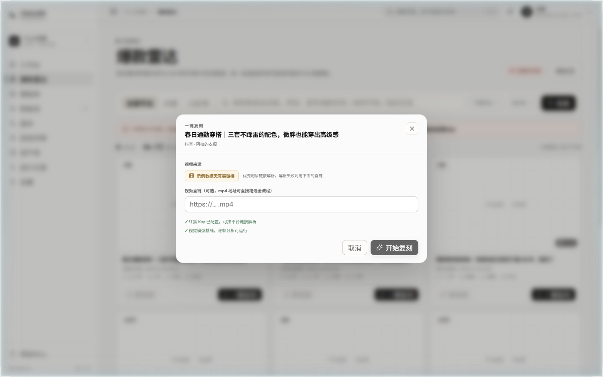


模板详情里有脚本结构（钩子 + beats + 口播 + 屏幕字）、分镜表（画面 / 机位 / 字幕 / 声音 / 叙事作用 + 对应帧图）、爆款分析、可复用规则、原视频链接，以及「送去评审」——把这条模板的首帧直接交给视觉评审。

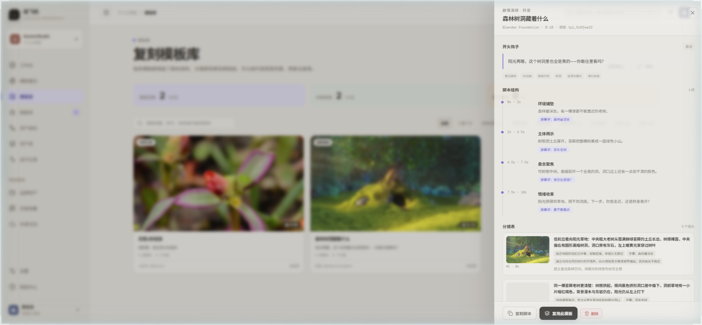

### 抽帧可以交给远端算力

「解析 → 下载 → 探测 → 抽帧」这四步默认在本机跑 FFmpeg。填一个 `REPLICATE_REMOTE_URL` 就整体挪到外部服务上，工作台只收帧、调视觉模型、入库，**服务器上不再需要跑 FFmpeg**。契约与参考实现见 [docs/remote-compute.md](docs/remote-compute.md)，仓库自带 `worker/video-worker.mjs`。

弹窗里会写明这次走的是哪条路——下图是远端算力实际跑通的一帧：`来源：远端算力 … · 5 帧 · 640×360`，前三个步骤（获取 / 探测 / 抽帧）由对方完成：

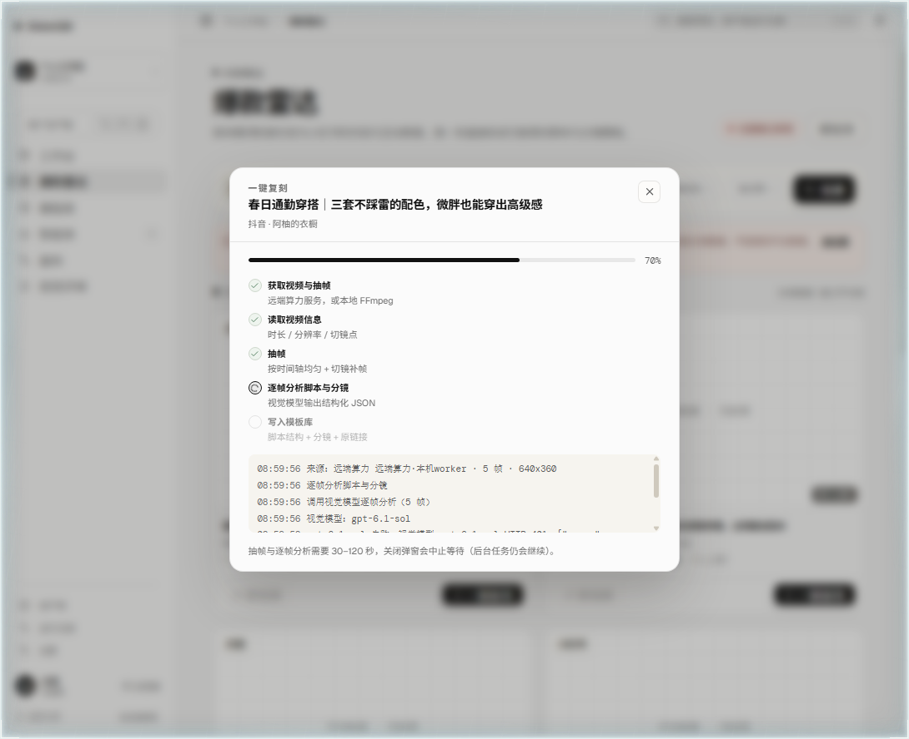

顺带把本机那两条 FFmpeg 命令也压了一轮：场景切点只解关键帧、18 次 spawn 合成一条命令，整条链路 **6.1s → 0.99s**（10 秒 640×360 实测）。

## 三、智能体：对话框入口 + 已自建智能体

进入「智能体」先看到的是一个 composer：描述你要它做的事，同一行选智能体、输出类型、模型、数量，Ctrl+Enter 发送。发送后进入对话，用户消息靠右、智能体消息靠左，运行中有计时，失败显示模型名 + 状态码 + 原因并可重试。

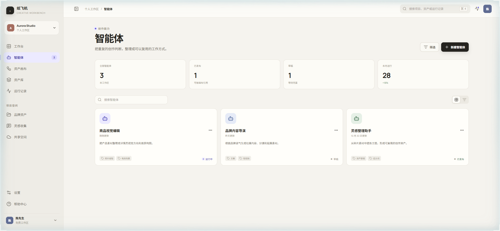

底部不是「精选作品」，而是**已自建智能体**：分类标签（全部 / 内容复刻 / 视觉评审 / 脚本分镜 / 投放素材）+ 卡片（名称、职责、模型、最近运行、使用次数），可编辑、可删除、可新建。

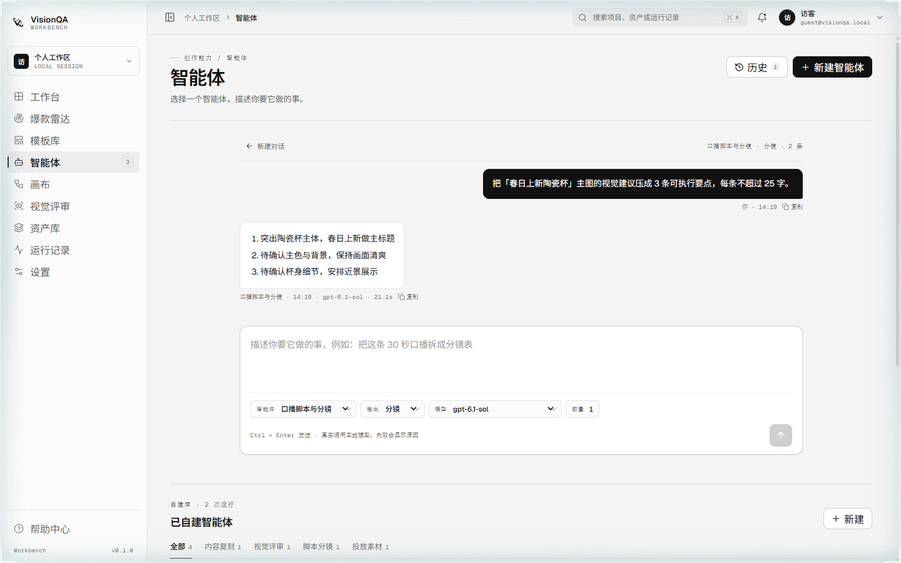

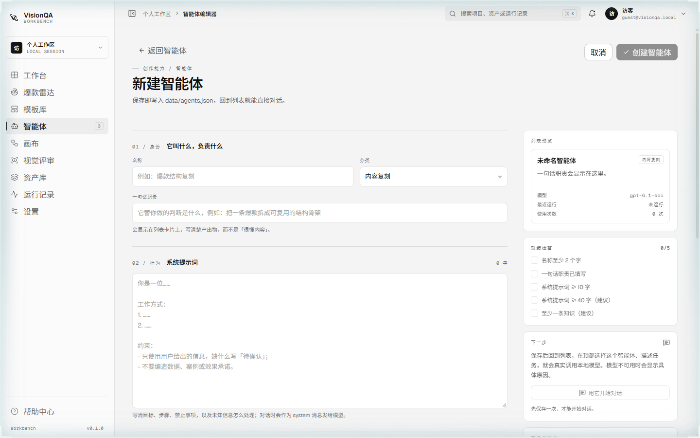

真实链路：POST /api/agents/:id/chat 把智能体的 systemPrompt、知识条目、本次输出类型和用户消息拼成 messages，调用本机模型（gpt-6.1-sol，失败按降级链换模型），返回真实回复并把 runCount 加一。实测一次口播分镜回复 44–52 秒，主模型过载时会降级到 grok-4.6 并在界面上标出实际用的模型。

## 四、画布：节点编排与真实执行

画布用 @xyflow/react 12 实现：中间画布 + 右侧检查器，**节点面板默认不显示**——双击画布空白处或点工具栏「节点」才唤出（Esc 收起），避免一进来就被一列按钮占掉焦点。连线校验（不允许自环、输入只接一根），节点可删，Ctrl+Z 撤销，画布状态存 data/flows.json。节点类型只有六类：输入 / 大模型 / 知识库 / 工具 / 条件 / 输出——**评审不进画布**，评审是独立页面（第五节）。

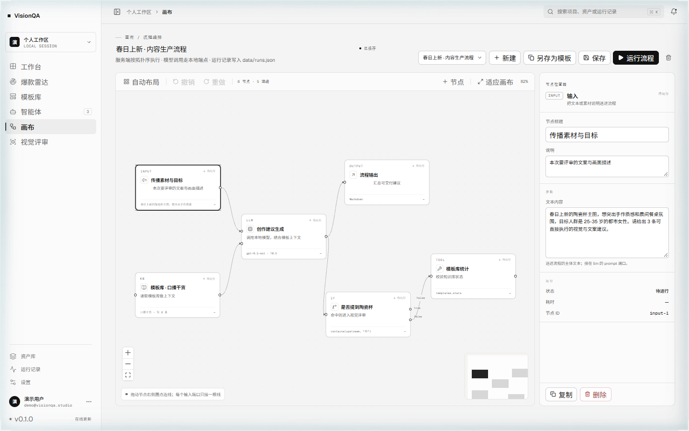

点「运行流程」由服务端按拓扑序执行：llm 节点调本地模型、kb 节点读模板库做上下文、condition 按表达式分支、output 汇总；每个节点返回 status / ms / output，节点在画布上逐个点亮，右侧抽屉同步显示每节点输出。

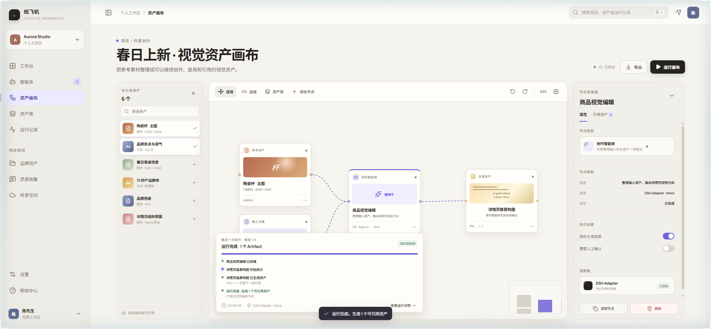

实测一条 6 节点流程（input → kb → llm → condition → tool → output）跑完 72.8 秒，llm 节点 72.8 秒（含模型调用），GET /api/runs 能查到逐节点结果。

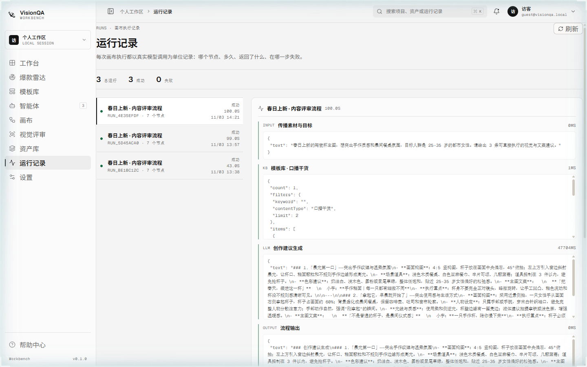

画布的参考来源与许可证（Langflow / Flowise / n8n / Dify / React Flow，未复制任何源码）写在 [docs/canvas-source-attribution.md](docs/canvas-source-attribution.md)。

## 五、视觉评审：VisionQA 的视觉能力怎么放进工作台

VisionQA 的定位不是「帮你想文案」，而是「给已经产出的画面下判断」。放进工作台后它有三个落点：

1. **独立页面**：选一张画面（模板首帧或图片地址）→ 出 verdict、逐条 observation（维度 / 严重度 / 像素锚点 / 置信度）、有界修正建议、无法判断清单。
2. **模板库出口**：模板详情里「送去评审」，把首帧直接带进评审页。
3. **画布不掺和**：评审不是流程节点，画布只做编排与执行——判断留在评审页，画布保持干净。

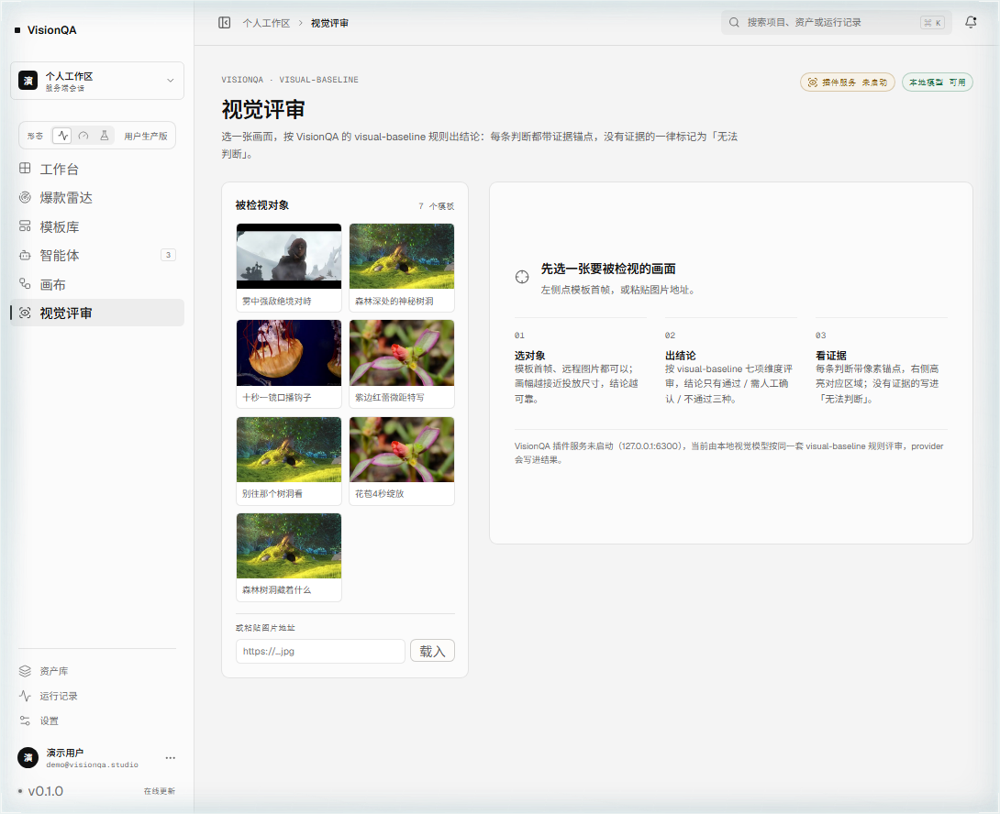

评审按 visual-baseline 七维（层级 / 对比 / 间距 / 字体 / 色彩 / 构图 / 可识别性）出结论，**每条判断必须给 bbox 锚点**，给不出锚点的降级为 info 或进「无法判断」。服务端实现见 server/review.mjs：优先调 VisionQA 插件服务（127.0.0.1:6300 的 /api/visual-review，同一套 v0.1 契约），服务没起来就退到本地模型的同口径评审，并把实际 provider 写进结果（截图里是 local-model:gpt-6.1-sol · 72.9s）。

契约映射、证据锚点格式与降级行为见 [docs/review-integration.md](docs/review-integration.md)。

## 六、VisionQA Canvas 接入（上游 BD Canvas 源码，Source-Available，不入仓）

画布这一块跑的是 **VisionQA Canvas**：源码来自 **BD Canvas**（Source-Available License v1.0，不是开源协议）的授权副本，本产品对外统一叫 VisionQA Canvas。上游条款禁止把源码或修改版以任何形式分发，也禁止把软件本身当产品卖，所以本仓库：

- **不 vendor、不提交** BD Canvas 的任何源码或构建产物（公开仓库提交就等于分发）；
- VisionQA Canvas 单独部署在本机，跑它自己的 5312（后端）/ 5313（后台管理）/ 6677（网页入口）；
- 工作台只做探活与内嵌：GET /api/bdc/status 探测这三个地址，画布页拿到 `deployed=true` 就**默认直接进 VisionQA Canvas 本体**；没有部署时仍是本仓库那套节点编排。
- 画布页是**沉浸模式**：第三方画布自带完整的顶栏与工具条，所以这一层不再叠标题和说明，只留一条 42px 状态条（署名 BD CANVAS / 连接状态 / 当前地址 / 新窗口 / 回到内置编排），画布铺满内容区、不套卡片不套圆角。画布页的主角是画布，壳让位。

部署记录、三个必踩的坑（Python 不在 PATH、requirements 少两个包、根 .env 没有代码读）与验收清单见 [docs/visionqa-canvas-integration.md](docs/visionqa-canvas-integration.md)，自检用 node scripts/check-bdc.mjs，重启用 `scripts/start-bdc.ps1`。

**当前状态（2026-11-05 实测）**：已解压到 `D:\Projects\bd-canvas`，5312 / 5313 / 6677 三端口都返回 200，`/api/bdc/status` 的 `deployed` 为 true，画布页由 VisionQA Canvas 接管，浅色纸面主题已覆盖；后台 `bdadmin` 初始密码已改。**还差模型 Key**——后台「Key 管理」为空，出图链路没通。

### 改名与顶栏对齐（2026-11-06）

产品名统一成 **VisionQA Canvas**，只改**用户看得见**的地方：网页 `<title>`、顶栏品牌、管理员登录页、新手教程页、桌面端画布标题、设置面板里的应用名、AI 人设前缀、`document.title` 动态标题。上游的版权声明（`copyrightBanner.ts` 归属串）、各文件头部的 `Source-Available License v1.0` 与 `LICENSE` 原文**一个字符都没动**——那是 §4.3 / §5.1 要求保留的署名。

顶栏几何也并进 `deploy/bd-canvas/vq-theme.css` 第 9 节，口径直接抄宿主 42px 状态条（`.cv-bdc-strip`）：**42px 高、底色 `#f4f4f4` 与宿主状态条连成一条、底边 `1px rgba(17,17,17,.10)`、页签 26px / 6px 圆角 / 12px 字、「后端未检测」做成 20px 等宽微标签**。于是「宿主状态条 + 画布顶栏」读起来是一条，而不是两层壳。

### 把它收进我们这套白纸墨线的语言

上游默认是 `#101113` + 蓝 `#6f9cff` + 青 `#22d3ee` 的深色霓虹调性，直接嵌进浅色工作台会读成「里面装了个别家的 App」。所以做了一层**只改配色与顶栏几何、不改组件结构**的主题覆盖：

- `deploy/bd-canvas/vq-theme.css`：它真正的色板在 `src/ui/styles/` 里分三层——`palette.css` → `themes.css`（`--ui-*` 语义层）→ `legacyAliases.css`（把旧 `--bg-*` / `--text-*` / `--border-*` 全部桥接上去）。所以只重定义**上游两层**（`--palette-*` 与 `--ui-*`）就能一次收口，并且是**往我们自己的浅色画布上靠**，不是另起一套深色皮肤：画布 `#f4f4f4`、卡片 `#ffffff`、次级 `#f0f0f0`、三级发丝线 `rgba(17,17,17,.06/.10/.20)`、文字 `#111 / #3f3f3f / #5d5d5d / #9a9a9a`、强调近黑、发光全 `transparent` 只留墨投影、点阵 `rgba(17,17,17,.10)`、语义色直接用我们 tokens.css 的 `#176b43 / #8a5b08 / #a33838`。
- `scripts/apply-bdc-theme.mjs`：幂等地把 css 复制进 `bd-canvas/public/`，并在 `index.html` 的 `</head>` 前插入/校正一行 `<link id="vq-bdc-theme" rel="stylesheet" href="/vq-theme.css">`（371121 → 371187 字节，去掉这一行可完整还原）。上游升级后重跑一次即可；`--check` 只校验不改。

**许可证边界**：LICENSE §3.2 允许为自用修改源码，§4.3 / §5.1 禁止删除、隐藏、篡改版权声明、水印与归属标识。所以：`src/features/license/copyrightBanner.ts` 的归属串、各文件头部的 `Source-Available License v1.0` 声明、`LICENSE` 原文**全部原样保留**；改动只限于**可见产品名**（标题、顶栏品牌、登录页、教程页、桌面端标题、AI 人设、`document.title`）与配色/顶栏几何（`deploy/bd-canvas/vq-theme.css`）。`vq-theme.css` 与脚本是我们自己写的、进本仓库，**上游源码一个字节都没进仓库**。

改色前（蓝青霓虹）：

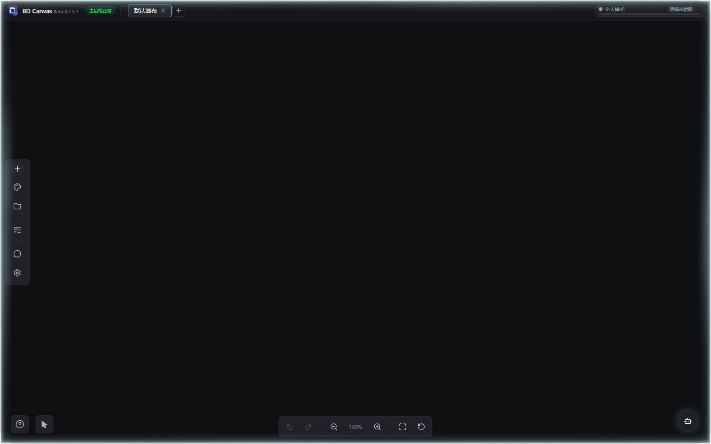

改色后（白纸 + 墨线 + 发丝节点卡，节点选中是 1.5px 近黑环）：

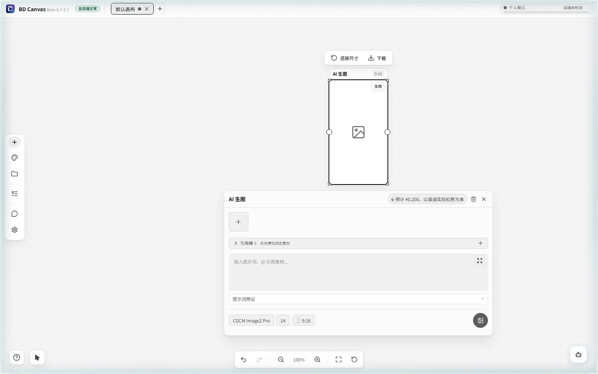

同一个画布按沉浸模式内嵌进工作台——两边现在是一套语言，不再像「里面装了个别家的 App」：

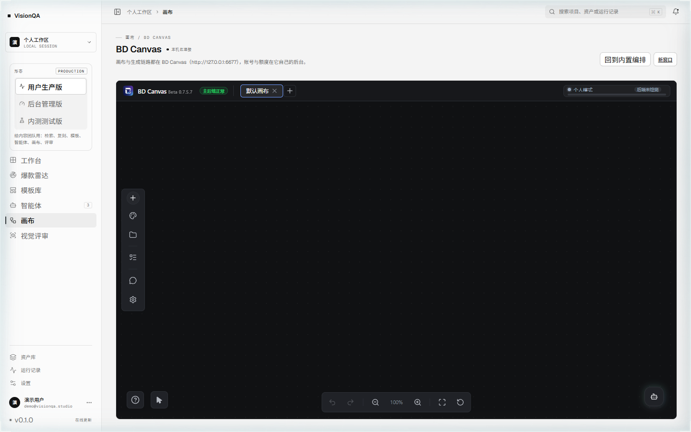

## 七、账号与会话（真实服务端）

登录不再是前端 mock。后端 `server/auth.mjs` + `server/routes/auth.mjs` 提供五个端点：`GET /api/auth/config`、`POST /api/auth/{register,login,logout}`、`GET /api/auth/me`。要点：

- **口令**：scrypt(N=16384, r=8, p=1) + 每用户随机盐，格式 `scrypt$N$r$p$salt$key`；库里没有明文密码。
- **会话**：32 字节随机 token，库里只存 `sha256(token)`；cookie 是 `HttpOnly; SameSite=Lax`，生产加 `Secure`。
- **不泄露账号存在性**：邮箱不存在时也跑一次 scrypt，登录失败统一 `field:'form'` + 「邮箱或密码不正确」。
- **限流**：同 IP + 邮箱 10 分钟失败 8 次锁；写请求校验 `Origin` 与 `Host` 一致，挡最省事的 CSRF。
- **受保护接口**：`VQ_REQUIRE_AUTH=1` 时除 `/api/auth/*`、`/api/health`、`/api/version` 外全部要登录，未登录返回 `{error:'未登录', loginRequired:true}`，前端收到就在 `src/api/client.ts` 派发 `vq:auth-required` 统一切回登录页。

**四个开关的默认值都在「不安全」一侧**（这是为了让本机演示不受影响），生产必须显式写：`VQ_REQUIRE_AUTH=1`、`VQ_SECURE_COOKIES=1`、`VQ_DEMO_ACCOUNT=0`、`VQ_REGISTRATION=0`（按需）。演示账号由后端 seed，密码通过 `/api/auth/config` 下发给登录页，**前端源码里没有任何密码**；关掉演示账号后登录页那块入口整体消失。

验收：`node scripts/test-auth.mjs` 起临时实例跑 16 项端到端断言（含「库里查不到明文 token / 明文密码」），全过；界面侧另做过一次真实点击：注册新账号 → 直接进工作台 → 退出 → 回登录页 → 错误密码给出统一提示 → 演示账号登录 → 进工作台。

没做的部分（别当成已经有了）：找回密码、邮箱验证、角色权限、多工作区、第三方登录。细节与接口契约见 [docs/accounts.md](docs/accounts.md)。

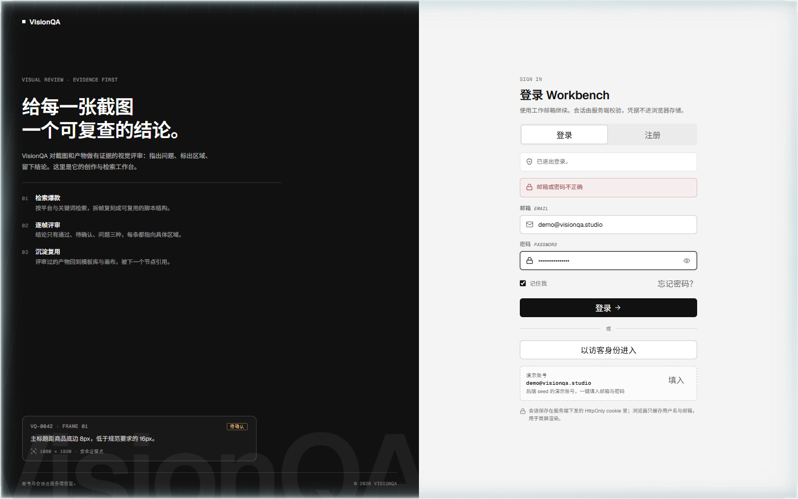

## 八、服务器配置

内测起步一台 **4C 8G / 100G ESSD / 5M 带宽**、视觉模型继续走 API、VisionQA Canvas 同机部署即可；**不需要 GPU**——评审 60–85s、智能体 20–50s 都是接口延迟。逐档配置、存储/带宽估算、以及上线前必须做的三件事（Windows 脚本换 systemd、JSON 换 SQLite、视频转对象存储）见 [docs/server-sizing.md](docs/server-sizing.md)。

**要真正对外上线**时看 [docs/deploy-production.md](docs/deploy-production.md)：域名与 DNS、Caddy 自动 HTTPS（`deploy/Caddyfile`）或 Nginx（`deploy/nginx.conf`）、systemd 守护（`deploy/vq.service`）、环境变量清单（`deploy/env.production.example`）、健康检查、备份恢复与日志轮转，都有可直接复制的命令和验收步骤。三条硬结论：node 只监听 127.0.0.1、公网只走反代；四个 `VQ_` 开关不写就等于裸奔；单机同时复刻不超过 2 路。

### 线上环境（已上线，2026-11-06）

| 项 | 值 |
| --- | --- |
| 站点 | https://visionqa.wavisionai.cn （80 端口 301 跳 https） |
| 机器 | 阿里云轻量应用服务器 2 vCPU / 2 GiB / 40 GB，华东2（上海） |
| 应用目录 | /opt/visionqa，git 部署，systemd `visionqa.service` |
| 数据目录 | /var/lib/visionqa（SQLite，含 auth.db） |
| 后端端口 | 127.0.0.1:8799（8787 被既有站点占用，所以换端口） |
| 反向代理 | nginx `/etc/nginx/conf.d/visionqa.wavisionai.cn.conf`：80 只做 ACME 挑战 + 跳转，443 终止 TLS 并反代 /api 与 /media |
| 证书 | Let's Encrypt（certbot webroot `/www/wwwroot/wavisionai.cn/acme`），到期 2027-02-04，续期不影响 443 |
| 登录账号 | 由服务器 `/opt/visionqa/.env` 的 `VQ_DEMO_EMAIL` / `VQ_DEMO_PASSWORD` 决定，改完 `systemctl restart visionqa` 生效 |

当前是**无模型 Key** 的形态：`/api/health` 里 `vision=false`，界面照常可用，模型下拉照实写「凭证未配置：选中模型也不会真正发起调用」，不假装有推理。

部署脚本（root）：

```bash
DOMAIN=visionqa.wavisionai.cn API_PORT=8799 SECURE_COOKIES=0 bash deploy/production/install.sh   # 装依赖 → 拉代码 → 构建 → systemd → nginx(80)
DOMAIN=visionqa.wavisionai.cn bash deploy/production/enable-https.sh                            # 签证书 → 换成 80 跳转 + 443 → 打开 Secure Cookie
```

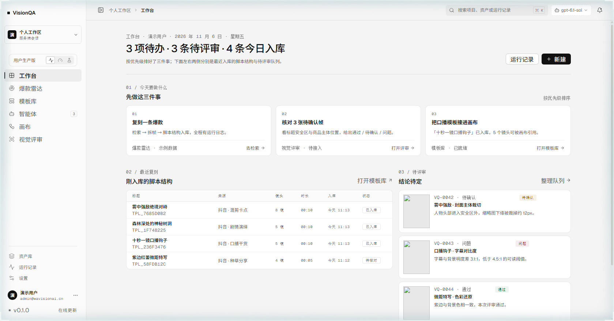

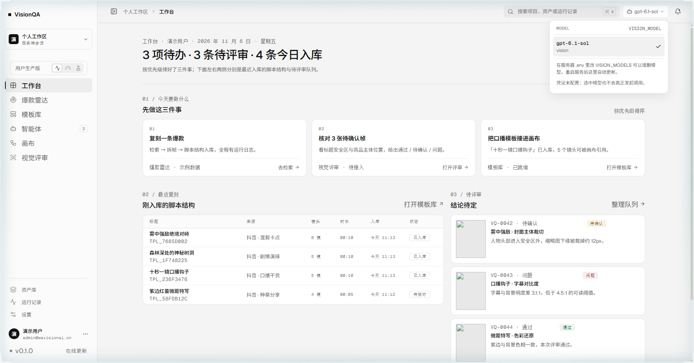

**模型切换的口子怎么用**：右上角模型下拉读 `GET /api/models`，目录来自服务器 `.env` 的 `VISION_MODELS`（逗号分隔，每项可写 `id|显示名`），没配就退回 `VISION_MODEL` + `VISION_FALLBACKS`；改完重启服务、刷新页面即可，**前端不用改一行**。公开匿名**拿不到**这份清单（`VQ_REQUIRE_AUTH=1` 时 401），只有登录后的界面能读；顶栏下拉只显示 VisionQA 产品名，真实模型 id 只用于请求。真正要发起调用时，把 `VISION_BASE_URL` / `VISION_API_KEY` 填进同一个 `.env`，`configured` 会变 true，下拉里的「凭证未配置」提示自动消失。

### VisionQA Canvas 同机部署（2026-11-06）

线上「画布」页里嵌的就是 BD Canvas 本体（真源码那套），不再是内置编排的替身。

| 项 | 值 |
| --- | --- |
| 站点 | https://canvas.wavisionai.cn （独立子域，80 跳 https） |
| 目录 | /opt/bdcanvas（git clone 私有仓库快照，venv 在 .venv，node_modules 走 npmmirror） |
| 服务 | systemd `bdc-web.service`（Vite 6677，只监听 127.0.0.1）、`bdc-api.service`（Flask 5312）、`bdc-enterprise.service`（Flask 5313） |
| 反向代理 | nginx `/etc/nginx/conf.d/canvas.wavisionai.cn.conf` → 127.0.0.1:6677；`/admin`、`/api/admin`、`/enterprise/admin` 只放行 127.0.0.1 |
| 证书 | Let's Encrypt（同一 ACME webroot），与主站互不影响 |
| 接线 | `/opt/visionqa/.env` 的 `BDC_WEB_URL=https://canvas.wavisionai.cn`，重启 visionqa 后 `/api/bdc/status` 变 `deployed: true`，画布页直接从「未发布」切成 iframe |

两个坑（都踩过）：

1. BD Canvas 的正式构建（`npm run build`）在当前源码里是坏的——`vite:esbuild-transpile` 在 `VideoFaceBlurEditor` 分块上拿到 `[object Object]` 就中断，去掉三个自定义 bridge 插件也一样。所以服务端跑的是它自己启动时用的那套 Vite dev server（6677），不是静态 dist。
2. `vite.config.ts` 默认把非 loopback Host 当「公网访客」，会 403 掉所有写接口。子域部署要把它加进 `TRUSTED_PUBLIC_HOSTS`（已改），同时加进 `server.allowedHosts`，否则整页 403。

**画布已加 Basic Auth**（2026-11-06 追加）：`canvas.wavisionai.cn` 默认 401，用户 `canvas`；iframe 走一次性入口 `/__auth?k=<token>` —— nginx 种 30 天 cookie 后所有资源请求免登录，所以嵌在 VisionQA 里不会弹登录框。`/admin`、`/api/admin`、`/enterprise/admin` 仍然只放行 127.0.0.1。VisionQA 侧新增两个环境变量：`BDC_EMBED_URL`（iframe 用，带 token）与 `BDC_WEB_PROBE_URL`（探活用本机 6677，避免 401 把 `deployed` 误判成 false）。

**外壳对齐（2026-11-06）**：主题只在 `deploy/bd-canvas/vq-theme.css`（部署方自用，不改它的组件结构），发布时拷成 `<canvas>/public/vq-theme.css`、在 `index.html` 里以 `#vq-bdc-theme` 引入。十节内容：

1. 第 1–8 节把它的 `--ui-*` 变量用 `:root:root` + `!important` 映射到 VisionQA 的 `tokens.css`——字体栈、6/10px 圆角、4/8pt 间距、`#f4f4f4` 画布 + 发丝线、单层轻阴影、等宽微标签。
2. 第 9 节管顶栏几何：`height: 42px !important`（只写 `min-height` 会被它自己的 48px 规则压住）、页签 26px/6px/12px、状态胶囊等宽 10px。
3. 第 10 节管左侧组件面板与右键菜单：面板 288px 白底 10px 圆角、44px 表头、分组标题等宽 10px/0.12em、行高 36px、图标方块 24px；右键菜单与节点创建菜单 208px 宽、行高 34px、快捷键右对齐（补了 `display:flex` + `margin-left:auto`，它原本是 `display:block`，标签和快捷键会挤在一起）。

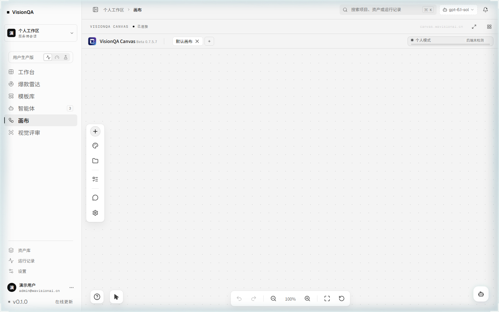

**第三轮：外壳细节（2026-11-09）** 主题层第 11 节把剩下的界面统一成一套 4pt 栅格：

- 左侧功能轨：8px 内边距、32px 方形 8px 圆角按钮（原来是灰底圆形），悬浮 5% 墨色；
- 底部控制条：46 → **40px** 高（它的 `min-height: 44px` 要一起压，只写 `height` 不生效）、按钮 32px、缩放数字等宽 10px；
- 节点卡：标题 12/500、正文 13px/1.6、页脚等宽 10px、选中转单层墨色描边；
- 悬浮工具条 28px、参数面板 12px 圆角 + 等宽分组标签、输入框 6px 圆角聚焦转墨色、滚动条细化到 8px。

**顶栏状态改报真实结果（2026-11-09）**：品牌旁那颗探的是 `/api/health`（5312），5s 超时、30s 一轮，title 带状态码与耗时；右侧连接胶囊原本归管理服务状态管，未登录时恒为 `unknown` 所以永远显示「后端未检测」——现在宿主把真实探测结果写进 `setConnectionProbe()`，未登录也报真话（后端正常 / 后端断连）。

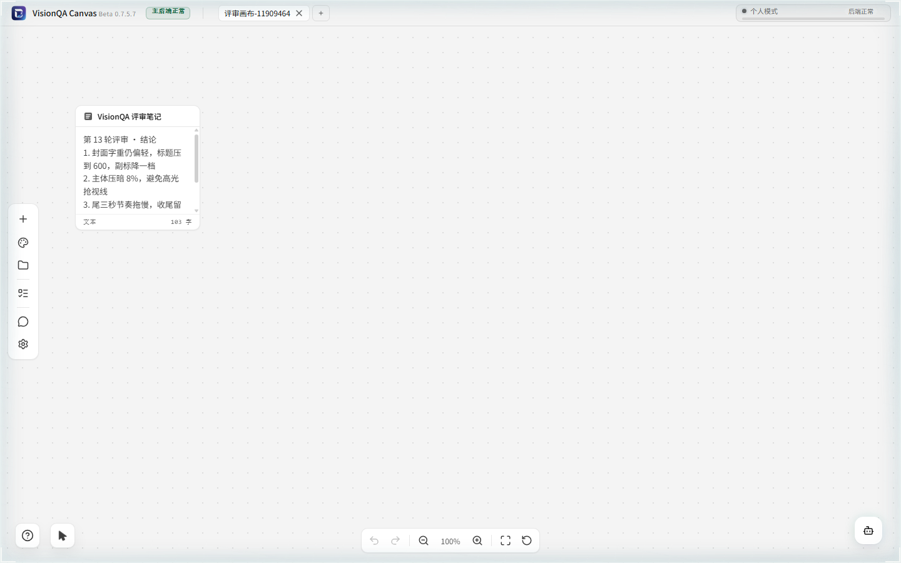

**细节第一轮：节点卡尺寸与空状态（2026-11-09）**

- **文本节点按「一页纸」定尺寸**：它自己会写 `_width/_height`（默认 360×220），但旧逻辑最后落到 `aspectRatio` 的 **1:1 方卡**上——评审结论三行就出滚动条。现在 `getNodeBaseSize()` 为 `text` 单独开一条分支按存储尺寸取值，写笔记用 420×300 + `_cardScale: 1`，五条结论一屏读完、不用滚动。
- **空白画布有了引导**：`#v2-canvas:not(:has(.v2-node))::after` 画一块虚线提示卡（13px / 白 70% / 10px 圆角 / 虚线发丝线）：「空白画布 · 左侧 + 新建节点，或把素材拖进来（Ctrl+V 粘贴）」。有节点后自动消失，纯 CSS，不动上游 DOM。

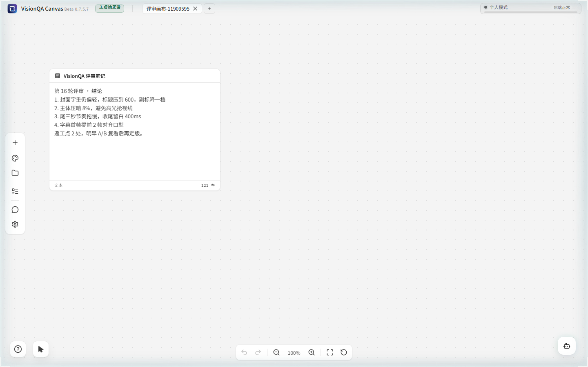

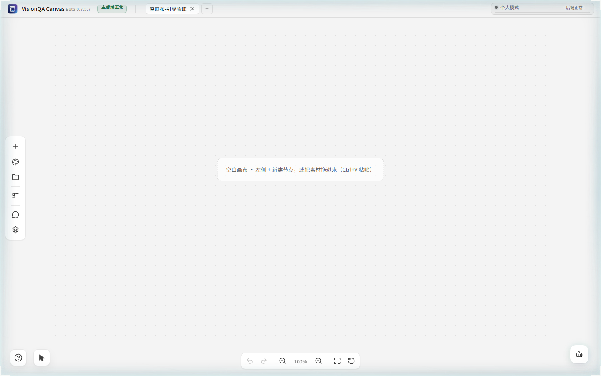

**细节第二轮：文本卡的内联样式控件（2026-11-09）** 文本节点没有模型参数面板（上游把它当「原地编辑」节点），所以样式控件直接做在卡片页脚，右对齐四颗 18px 小按钮：

- `A-` / `A+`：字号 10–22px，每次 1px；
- `LH`：行高在 1.4 / 1.6 / 1.8 之间循环；
- `M`：等宽字族开关（Geist Mono）。

样式写进 `node.params._vqText`，渲染时翻译成三支 CSS 变量（`--vq-text-size/-leading/-font`）由主题层消费；点按钮不整卡重渲染（文本框要保光标），直接把变量写到现有 textarea 上。线上实测：`13px → 16px` 时行高跟着到 `25.6px`，`M` 切到 `Geist Mono`。

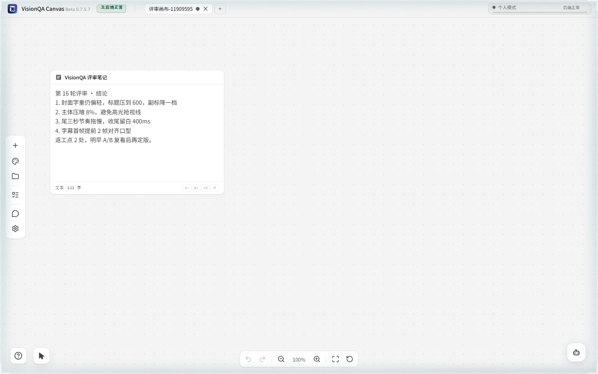

**画布与工作台数据打通（2026-11-06）**：工作台不再只是「嵌一个 iframe」，它和后端共用同一批画布。

| 工作台接口 | 干什么 | 打到的画布接口 |
| --- | --- | --- |
| `GET /api/bdc/canvases` | 列画布（名称、节点数、版本、更新时间） | `GET /api/canvas/list` |
| `POST /api/bdc/canvases` | 建一块空画布（id 形如 `vq-*`） | `POST /api/canvas/save` |
| `POST /api/bdc/canvases/note` | 把评审结论落成画布里的一个文本节点 | `GET /api/canvas/load/:id` + `POST /api/canvas/save`（带 `expected_revision` 乐观锁，别人同时改了返回冲突而不是覆盖） |

界面就在 42px 状态条里：`画布项目` 下拉（选中即用 `&loadCanvas=<id>` 深链换画布，选中项记在 `localStorage`，刷新后仍然绑着同一块）、`新建`（建完自动绑定）、`写笔记`（写完 iframe 自动重挂载，立刻能看到那条文本节点）。

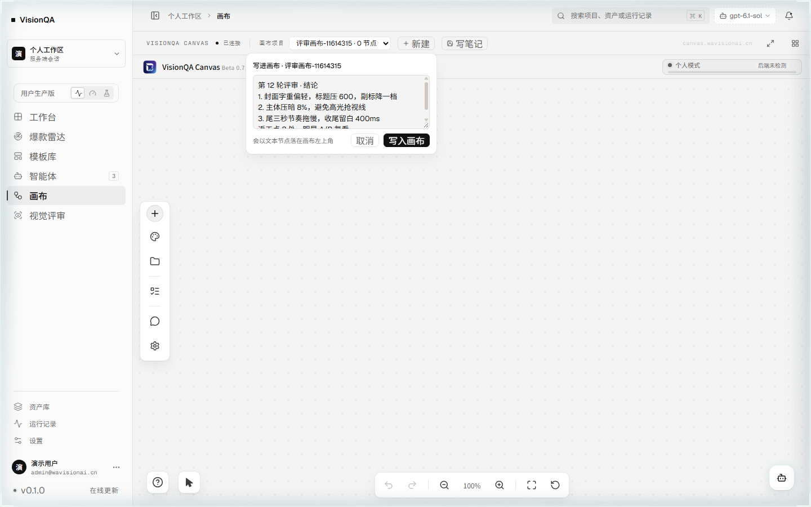

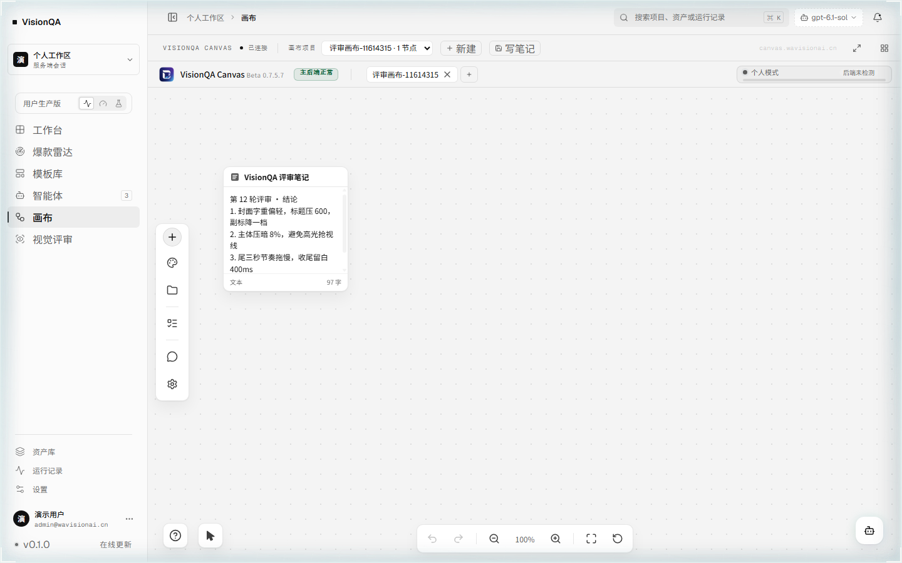

打通时踩到的三个硬点（都是上游行为，记住能省一天）：

1. **公网访客模式只读浏览器**：`isPublicWebClient()` 把任何非内网 Host 当公网访客，画布数据存 localStorage，服务端的画布永远加载不出来（深链报 `Load failed`）。改成把 `canvas.wavisionai.cn` 当「本机安装」（`runtimeMode.ts` 里加 `VITE_TRUSTED_HOSTS` 白名单），数据才落到服务端 workspace。
2. **一次性入口会吃掉查询串**：`/__auth?k=…&loadCanvas=<id>` 原本一律 `return 302 /`，深链参数直接丢。nginx 里补 `if ($arg_loadCanvas) { return 302 /?loadCanvas=$arg_loadCanvas; }`。
3. **文本节点的正文在 `prompt` 不在 `params.text`**：照它自己的 `createTextNode` 写——`{ type:'text', prompt: 正文, model:'text', params:{ _width:360, _height:220, _agentTextNode:true } }`，写进 `params.text` 的会显示成「0 字」。


## 九、怎么跑

依赖安装后起两个服务：后端 8787（同时托管 dist），前端开发 5191。守护脚本 keep-services.ps1 是单实例，掉了自动拉起，日志在 data/keeper.log。

| 命令 | 作用 |
| --- | --- |
| npm install | 装依赖 |
| node server/index.mjs | 后端 8787 |
| npm run dev -- --port 5191 --strictPort | 前端开发服务器 |
| powershell -ExecutionPolicy Bypass -File scripts/keep-services.ps1 | 常驻守护 |

环境变量放 .env（已 gitignore，模板见 .env.example）：

| 变量 | 用途 |
| --- | --- |
| REDFOX_API_KEY | 红狐检索 / 视频解析 Key（当前账号积分不足且 Key 被禁用） |
| API_PORT | 后端端口，默认 8787（监听地址写死 127.0.0.1，公网只走反向代理） |
| VISION_BASE_URL / VISION_API_KEY / VISION_MODEL | 模型通道，线上是 https://api.deepseek.com/v1 + deepseek-flash（文本与看图同一个模型） |
| VISIONQA_SERVICE_URL | VisionQA 插件服务地址，默认 http://127.0.0.1:6300 |
| VQ_REGISTRATION | 注册开关，**默认关闭**，只有显式写 1 才开放（以前是「不等于 0 就开」，漏配即公开注册） |
| VQ_ADMIN_EMAILS | 管理员邮箱（逗号分隔），可看全部数据、发放积分；库里 kind='admin' 等价 |
| VQ_CREDIT_WELCOME / VQ_CREDIT_SEARCH / VQ_CREDIT_REPLICATE / VQ_CREDIT_REVIEW / VQ_CREDIT_CHAT / VQ_CREDIT_FLOW_RUN | 初始积分与各动作单价，默认 100 / 2 / 10 / 5 / 1 / 2（画布整条流程跑一次） |
| VQ_CONCURRENCY_SEARCH / _REPLICATE / _REVIEW / _CHAT / _FLOW_RUN | 单账号并发上限，默认 1 / 2 / 1 / 2 / 1 |

## 十、接口

| 接口 | 说明 |
| --- | --- |
| GET /api/health | 服务与三个外部依赖的可用性（红狐 / 模型 / 模板数） |
| GET /api/auth/config, POST /api/auth/{register,login,logout}, GET /api/auth/me | 账号与会话（scrypt + HttpOnly cookie），契约见 [docs/accounts.md](docs/accounts.md) |
| GET /api/search | 红狐检索；不可用时返回 mode:'mock' + quota.code + 充值链接 |
| POST /api/replicate, GET /api/jobs/:id | 一键复刻流水线（五步进度） |
| GET /api/templates（含 ?kind=saved|replica）, GET /api/templates/:id, POST /api/templates/:id/reuse, DELETE /api/templates/:id | 模板库 |
| POST /api/templates/from-radar | 雷达卡片「加入模板库」：只落链接 + 互动数据，不下载视频（同一 sourceId 不会重复入库） |
| GET /api/billing/overview, GET/POST /api/billing/orders | 充值通道占位：未接入时返回 enabled:false、下单 501 BILLING_NOT_CONFIGURED，不伪造价格与订单 |
| GET/POST /api/agents, GET/PATCH/DELETE /api/agents/:id, POST /api/agents/:id/chat | 智能体与真实对话 |
| GET/POST /api/flows, PATCH/DELETE /api/flows/:id, POST /api/flows/:id/run, GET /api/runs | 画布与运行记录 |
| POST /api/review, GET /api/review/health | 视觉评审（service / local-model 两种 provider） |
| GET /media/frames/:id/:file | 抽帧静态文件 |
| GET /api/credits | 当前账号积分余额、单价、近期流水（检索 2 / 复刻 10 / 评审 5 / 对话 1，可用 VQ_CREDIT_* 改） |
| GET /api/system/health | 深度健康检查：真连数据库、数据目录、模板库、模型接口、红狐接口（结果缓存 10 秒） |
| GET /api/admin/users, POST /api/admin/users/:id/credits | 管理员：真实账号列表（含余额）、发放/扣减积分 |

## 十一、目录

前端在 src/：App.tsx 是外壳（侧栏、顶栏、登录门、vq:navigate 事件）；auth/ 是会话状态（服务端真实校验，含 RequireSession 与 useSession）；brand/ 是 VisionQA 标记；styles/tokens.css 是设计 token；api/ 是各模块轻客户端；pages/ 下是 10 个页面（登录、工作台、雷达、模板库、智能体、编辑器、画布、视觉评审、资产库、运行记录、设置）。

后端在 server/：index.mjs 做路由分发与静态托管；routes/ 下 agents、flows、review 三个路由模块；llm.mjs 统一模型调用（重试 + 降级链）；review.mjs 是评审适配；redfox.mjs 是红狐客户端（限流、缓存、单飞、错误映射）；media.mjs 与 frames.mjs 负责视频解析与抽帧；templates.mjs、agents.mjs、flows.mjs 是 JSON 原子写存储。

文档在 docs/：design-direction-v2.md（视觉方向与去 AI 味清单）、review-integration.md（评审契约）、replication-pipeline.md（复刻链路与红狐实测）、canvas-source-attribution.md（画布开源调研）。

## 十二、已知限制

- 红狐账号积分不足且 Key 被禁用：雷达只能给示例数据；重新充值并换 Key 后无需改代码。
- 视觉评审在插件服务未启动时走本地模型，结论可信度取决于模型；界面始终标出 provider，不冒充插件结果。
- 视觉评审与智能体对话需要 `VISION_API_KEY`，爆款雷达需要 `REDFOX_API_KEY`：没配就是「接口在、结果出不来」，界面按实际状态标注，不假装成功。
- 智能体「数量」固定 1；工具只声明不自动执行；会话记忆只在一次对话里生效，刷新后靠本地「最近对话」找回，不落服务端。
- 充值只有接口和按钮：价格、档位、支付通道都没接，设置页显示「未开通」，下单接口回 501，没有任何扣费。
- 模板库现在以「链接 + 解析内容」为主；解析过的模板仍保留抽帧图作为分镜缩略图，视频文件本身不进库（复刻结束即删临时目录）。
- 完整的上线差距清单（真实 / 演示逐项判定、P0–P2 补课顺序）见 [docs/launch-readiness.md](docs/launch-readiness.md)。
- 账号是真的（SQLite + scrypt + 服务端会话），但没有找回密码、邮箱验证、角色权限与多租户；后台管理版的用户列表页因此只展示当前会话。
- 单机部署：复刻任务没有队列（`startReplicate` 直接起 ffmpeg），多人同时复刻会叠加 CPU；4C8G 单机建议同时复刻 ≤2。

## 十三、验证记录

- npx tsc -p tsconfig.app.json --noEmit 通过；npx oxlint src 0 error / 0 warning（59 个文件）。
- 账号体系端到端 16 项全过（`node scripts/test-auth.mjs`）：未登录受保护接口 401、注册即登录、重复注册 409、弱密码 400、登出后旧 cookie 失效、库中无明文 token 与明文密码。
- 智能体对话实测 44.2s（gpt-6.1-sol）、52.7s（降级链生效）、123.6s（grok-4.6）。
- 画布 7 节点流程实测 99.0s / 115.5s，/api/runs 可回放逐节点输出。
- 视觉评审实测 72.9s（gpt-6.1-sol）、84.2s（gpt-6-luna），5–7 条 observation，锚点渲染与图片对齐。
- 复刻压测：5 并发 5/5 完成（163s 墙钟）、25 并发复用无丢失更新、40 并发检索 40/40 HTTP 200（p50 3.7s）。
- 2026-11-10 实测：进爆款雷达 0 次 /api/search 请求（改前是一次）；点检索后线上返回 74 条真实小红书数据；「加入模板库」后 /api/templates 返回 saved:1，详情看到「待解析」与互动数据；智能体带 history 追问 1.4s 返回且 memory.turns=1；/api/billing/overview 200 enabled:false、POST /api/billing/orders 501；/fonts/geist.woff2 200 font/woff2，document.fonts 只剩 Geist / Geist Mono 两套。
- 同轮修掉一个线上漏洞：VQ_REQUIRE_AUTH=1 时 /api/agents、/api/flows、/api/billing 曾匿名返回 200（登录门排在功能路由之后），现已前置，匿名请求一律 401。
## 十四、2026-11-10 追加二：积分制、多用户隔离、健壮性与页头统一

这一轮按你的九条落地，线上已经是新版本（bundle index-CdQxwXyC.js）。

### 十四.1 九条与结果

| # | 你要的 | 现在是什么 |
| --- | --- | --- |
| 1 | 积分制，每次检索扣积分 | 检索 2 / 一键复刻 10 / 视觉评审 5 / 智能体对话 1；余额在 users.credits、流水在 credit_ledger，同一事务里改；**先扣后调、失败原路退回**；示例数据不扣费。单账号并发上限（检索 1 / 复刻 2 / 评审 1 / 对话 2），余额不足返回 402 且不扣钱 |
| 2 | 多用户归属 | 模板、智能体、画布流程、运行记录、复刻任务都带 ownerId；列表与读取按账号过滤，改删前先校验，跨账号一律 404（不泄露存在性），管理员可见全部 |
| 3 | 修 P1 | 见下面十四.3：SSRF、超时、流式下载、全局兜底、请求日志、深度健康检查 |
| 4 | 兜底日志 | 每请求一行 JSON（方法、路径、状态、耗时、账号、IP、X-Request-Id）；5xx 另打堆栈并把同一个 id 回给前端；unhandledRejection 记录，uncaughtException 记完退出交给 systemd 重启 |
| 5 | 健康检查放到底部设置 | 设置页最下方「系统状态 / Health」，6 项逐条真探（进程、账号库、数据目录、模板库、模型接口、红狐接口），带「重新检测」与 10 秒缓存 |
| 6 | ErrorBoundary + 路由 | hash 路由 #/radar、#/agents/<id>、#/admin/users 等，刷新停留、前进后退可用、首屏不多压历史；内容区包 ErrorBoundary（切页自动复位）；5 个重页面懒加载 |
| 7 | 收尾内容（备案号不做） | 注册默认关闭（fail-closed）、口令必须字母+数字、分包、小屏表格；备案号按你说的不设置 |
| 8 | 充值先别动 | 设置页充值卡仍是「未开通」占位，/api/billing/* 一字未改，不产生任何扣费 |
| 9 | 页头字体降重并统一 | 「爆款雷达」原来 33px/800/-0.045em，现在全站页头一套 token：26px / 500 / -0.01em / line-height 1.25，kicker 11.5px，desc 12.5px；工作台、爆款雷达、模板库、智能体、画布、视觉评审、运行记录、设置、智能体编辑全部换成同一个 PageHead |

### 十四.2 真实截图（线上渲染）


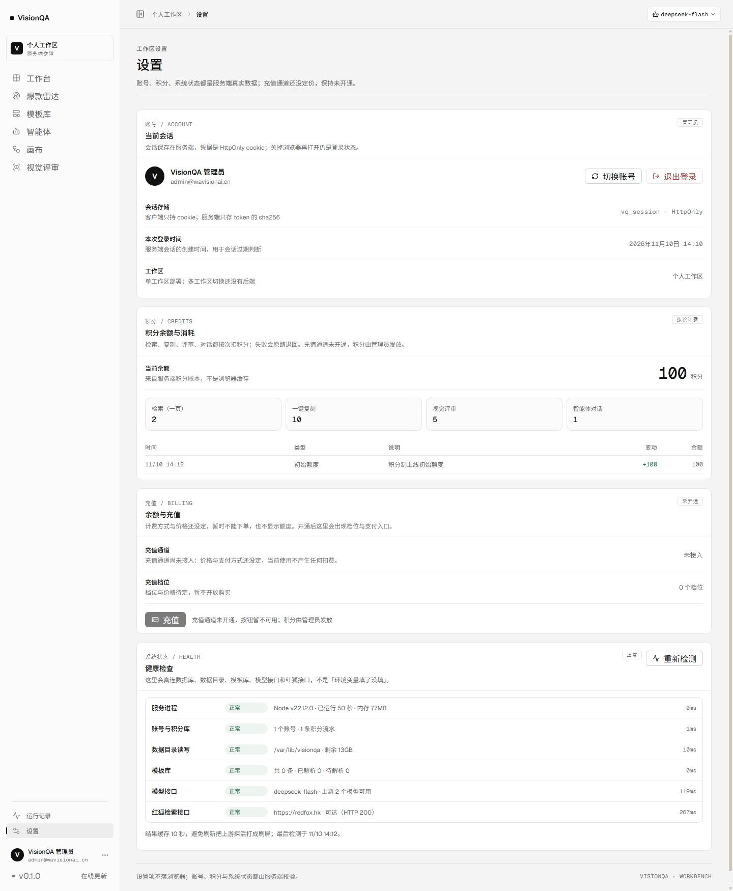

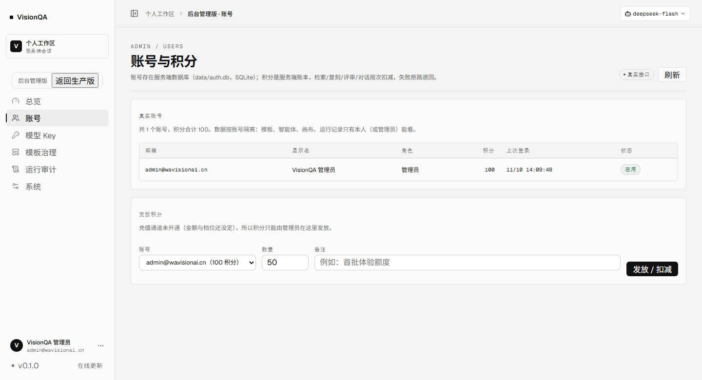

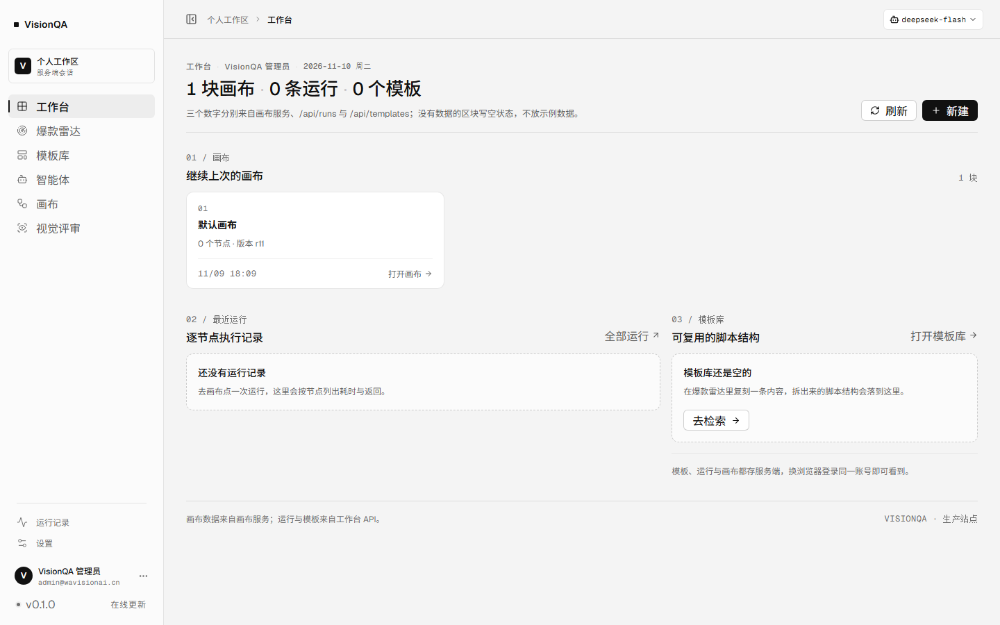

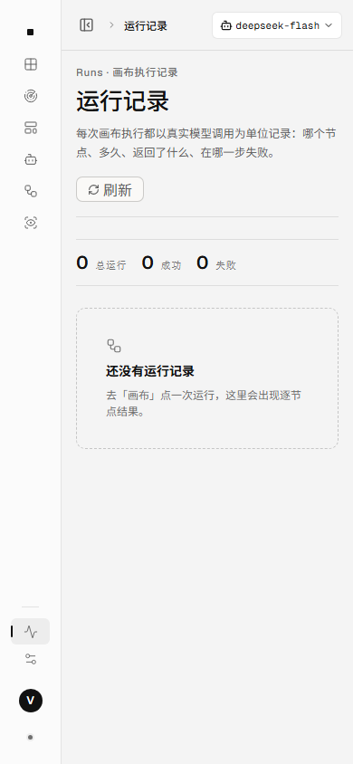

### 十四.3 实测数字

- 积分端到端 23 项全过（node scripts/test-credits.mjs，配 scripts/mock-redfox.mjs）：注册得 100 → 检索扣 2（100→98）→ 上游 3105 退款（98→98）→ 余额压到 1 分再检索得 402 且不扣费 → 管理员发放 → 3 并发检索 200/429/429 → 封面代理拒内网 404 → 评审拒内网图片 500 并退款 → 深度健康 6 项。
- 多用户隔离：A 存 1 条模板、B 看到 0 条；B 读 A 的单条 404；B 访问 /api/admin/users 403。
- 启动迁移：线上 agents:4 flows:4 templates:0 认领给管理员；老账号一次性补 100 初始积分（日志 welcome-credits accounts:1）。
- 分包：主包 604.09 kB → 315.54 kB（gzip 183.91 → 97.28 kB，−47%），画布 222 kB 等按页懒加载。
- 路由：17 组 parseRoute/toHash 用例通过；无 hash 首屏只 replace 一次（history 1 条）。
- 生产探针：/api/health ok；/api/credits、/api/admin/users、/api/system/health、/api/templates 匿名均 401；/api/auth/config → registrationEnabled:false、passwordPolicy「至少 8 位，且同时包含字母和数字」；HSTS / X-Frame-Options / 入口 HTML no-store 保持。
- 页头计算样式实测：26px / 500 / -0.26px / 32.5px，页头下边线 1px，与内容 24px。

### 十四.4 还没做的

- 充值仍是占位：金额、档位、支付方式等你定价，接口契约没动。
- 模板库真实条目还是 0：「一键复刻」没有对真实视频跑过，第一条闭环等你点头（会消耗真实红狐额度与积分）。
- 账号仍没有找回密码、邮箱验证、停用开关；多租户仍是单工作区。
- 画布流程执行没有接积分（只受并发与超时保护），要不要按次计费等你定。

完整差距清单见 [docs/launch-readiness.md](docs/launch-readiness.md) 的「三点九」。

## 十五、2026-11-10 追加三：画布图标、后端状态下线、全站口径统一

### 十五.1 三项改动

| 项 | 之前 | 现在 |
| --- | --- | --- |
| 画布图标 | 上游 BD Canvas 的紫色渐变「B」标（569×569），同时当 favicon | 换成 VisionQA 标记（V + 检视框：深墨底、奶油字、紫环），512×512、四角透明，favicon 同步；源文件 [deploy/bd-canvas/bd-canvas-app-icon.svg](deploy/bd-canvas/bd-canvas-app-icon.svg) |
| 画布顶栏「主后端正常」 | 品牌旁一颗 10px 胶囊，探 `/api/health` 后显示「主后端正常 / 断开 / 检测中」 | 主题层 `display:none`，画布里不再报后端状态；进程、数据目录、模型与检索的探活统一放「设置 → 系统状态」 |
| 画布顶栏账号/额度挂件 | 右侧「个人模式 + 后端正常 + 额度条」 | 整颗隐藏：账号、余额、积分都在 VisionQA 自己的顶栏与设置页，画布只留品牌、画布页签与工具 |
| 全站口径 | 雷达、设置、复刻、后台写着「红狐」「deepseek-flash」 | 一律以 VisionQA 为主语：检索服务 / 模型服务 / VisionQA 通用·视觉·对话模型；后台「模型与密钥」默认只露产品口径，真实模型 ID、上游地址、环境变量值收进右上角「显示技术详情」 |

### 十五.2 真实截图（线上渲染，1440 宽）

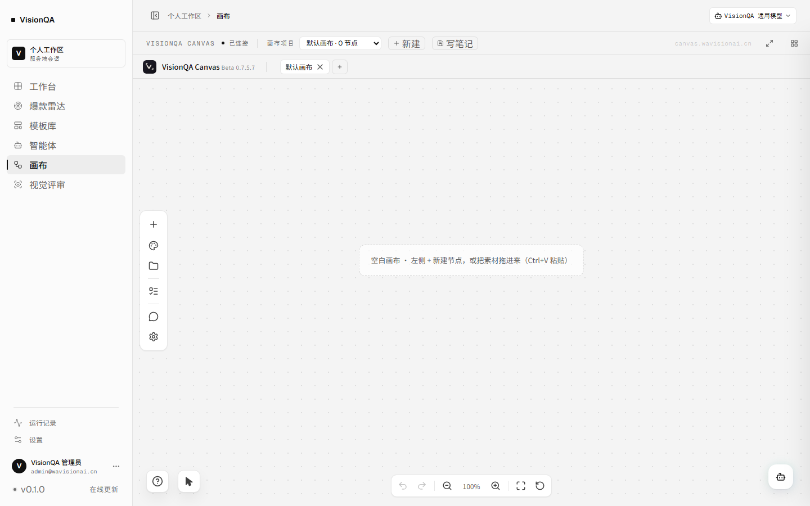


### 十五.3 验收口径（实测）

- 用无头 Chrome 带真实会话登录线上，逐页读 `document.body.innerText` 扫 `红狐|REDFOX|redfox|deepseek`：13 条路由（工作台、爆款雷达、模板库、智能体、视觉评审、运行记录、设置、后台六个分页）**全部 0 命中**。
- `/api/models` 的 label 已是「VisionQA 通用模型 / 视觉模型 / 对话模型」，id 仍只用于请求；画布检查器的模型下拉同步改成只显示名称。
## 十六、2026-11-10 追加四：生产/内部两套口径 + 待接 API 开工

### 十六.1 环境分离

同一份构建跑两套环境，差异只来自服务端 `VQ_UI_MODE`：

## 十七、2026-11-10 追加五：待接 API 第一批（积分可见性、模板套用、评审历史、账号管理）

### 十七.1 这一批做了什么

| 页面 | 之前 | 现在 |
| --- | --- | --- |
| 一键复刻 | 弹窗只有「开始复刻」，402 混在普通报错里 | 弹窗显示「本次消耗 10 积分 · 当前余额」；余额不足直接禁用并提示找管理员；完成后显示扣了多少 |
| 智能体对话 | 每次扣 1 积分，界面上看不到余额 | 输入框上方常驻「余额 / 每次对话」；402 显示差额与发放方式 |
| 视觉评审 | 每次扣 5 积分，页头只有模型状态 | 页头多一枚「每次 5 积分 · 余额」；结论落库到 `data/reviews.json`，左侧「最近评审」可回看 |
| 模板库 | 「复用此模板」只是 reuseCount +1 | 改成「套用到画布」：生成一张带输入节点 + 复刻脚本节点的流程，并直接跳转画布 |
| 后台账号 | 状态只读 | 可停用/启用、设/撤管理员；服务端拦住「把自己降级或停用」 |
| 后台总览 | 用户数写死「—」 | 取 `GET /api/admin/users` 的 total |
| 后台模板 | 只有删除 | 服务端已支持 `PATCH /api/templates/:id`（标题/类型/标签/原链接），编辑表单下一批补 |

新增接口：`POST /api/templates/:id/apply`、`GET /api/reviews`、`GET /api/reviews/:id`、`PATCH /api/admin/users/:id`。


### 十七.2 实测

- 内部环境（与生产同代码、独立数据库）：`POST /api/templates/from-radar` → 201；`POST /api/templates/:id/apply` → 201，返回流程含 2 个节点（input / llm）与 1 条连线；`GET /api/reviews` → 200；对自己的管理员账号 PATCH 停用 → 400 `SELF_LOCKOUT`，守卫生效。
- 生产 bundle `index-B7leFJhm.js`，`/api/health` ok，两个服务均 active。
- 评审历史页用一条内部测试记录验证了列表、回看与像素锚点渲染；这条记录标记为「测试」，不属于真实业务数据。

### 十七.3 当前阻塞（不是代码问题）

上游模型账号返回 `Insufficient Balance`：`deepseek-flash` 的 `/models` 正常，但真实 `chat/completions` 与视觉评审都 402。也就是说**智能体对话和视觉评审在补余额前不可用**（错误会如实显示，扣掉的积分会退回）；检索服务仍正常。需要你给上游账号充值，或换一把有余额的 key。

### 十七.4 下一批

运行记录分页/筛选、画布流程按 ID 打开、画布「另存为模板」落模板库、流程执行计积分、智能体历史接口、后台模板编辑表单。

## 十八、2026-11-10 追加六：待接 API 第二批（运行记录、画布计费、流程模板、按 ID 打开）

### 十八.1 这一批做了什么

| 位置 | 之前 | 现在 |
| --- | --- | --- |
| 运行记录 | 只拉默认 20 条，没有筛选 | 服务端分页 + 按流程 / 状态 / 关键词筛选，显示「当前区间 x–y / 总数」 |
| 运行记录详情 | 只有节点输出 | 头行显示本次消耗或退回的积分，可一键「在画布打开」对应流程 |
| 画布运行 | 点了就跑，不扣积分 | 按次扣 2 积分（`VQ_CREDIT_FLOW_RUN` 可改）；跑之前显示「运行 2 积分 · 余额」，余额不足直接禁用；有节点失败整单退回，运行结果里显示「已退回 2 积分」 |
| 画布地址 | 永远打开列表第一条 | `#/canvas/<flowId>`，刷新、复制链接、从运行记录/模板库跳转都落到同一张画布 |
| 画布「另存为模板」 | 其实是复制一张新流程，模板库找不到 | 真的写进模板库的「工作流」条目（带 blueprint），在模板库里能筛「工作流」、能看到节点清单、点「在画布打开」原样开回一张新画布 |
| 后台运行审计 | 只有列表 | 可按成功/失败筛选，一键导出当前筛选结果 CSV（带 BOM，Excel 直接可读） |
| 运行报错文案 | 上游原始报文原样透出（带模型名与余额细节） | 统一走 `server/public-error.mjs`：生产只给「模型服务额度不足，本次不计费」这类产品语言；模型名/上游状态只在内部环境与日志里 |

新增/变更接口：`POST /api/templates`（`{from:"flow", flowId}`）、`GET /api/runs?flowId=&status=&q=&limit=&offset=`、`POST /api/flows/:id/run` 计费与退款。


### 十八.2 实测（内部环境同代码、独立数据；生产同 bundle）

- 计费：跑一条 input→output 流程 → 200，`credits.cost=2`、余额 100→98；`GET /api/runs?status=success` 能查到，`offset` 翻页正确。
- 余额不足：把余额扣到 1 再跑 → 402 `CREDIT_INSUFFICIENT`（需要 2 / 余额 1），余额不变。
- 失败退款：llm 节点因上游 402 失败 → 运行记录 `status=error`、`credits.refunded=true`，余额回到运行前；界面上的报错是「模型服务额度不足，本次不计费」。
- 工作流模板：`POST /api/templates {from:"flow"}` → 201，blueprint 带 2 节点 1 连线；`apply` → 201，新流程节点与连线一致；测试模板与流程已删除。
- 生产：用现有流程跑了一次真实运行（2 积分），截图里的运行记录与模板卡片就是这次验收产生的；bundle `index-BufeDKIP.js`，两个服务 active、`/api/health` ok。

### 十八.3 下一批

智能体历史接口（`GET/POST /api/agents/:id/history`）、智能体编辑页真实运行次数、工具节点真正执行、后台模板编辑表单、设置页积分流水加载更多、后台按账号筛选运行记录。

## 十九、2026-11-10 追加七：待接 API 第三批（智能体运行历史、工具真执行、模板编辑）

### 十九.1 这一批做了什么

| 位置 | 之前 | 现在 |
| --- | --- | --- |
| 智能体历史 | 只有一个本机浏览器 `localStorage` 对话列表，换设备或清缓存就没了；运行只累加一个数字 | 「历史」弹层分两栏：「本机对话」照旧可恢复上下文；「运行记录」读服务端 `GET /api/agents/:id/history`，成功与失败都留档，含输入、回复、模型口径、耗时、扣退积分、工具读取结果；支持分页、展开、复制、清空（两次确认） |
| 智能体编辑页 | 右侧预览写死「最近运行 未运行 / 使用次数 0 次」 | 读服务端真实的最近运行、累计次数与最近模型；工具按「已接入 / 待接入」分开显示 |
| 智能体工具 | 五个工具都只写在 system 里，界面小字承认「不自动执行」 | 三个真执行：「读取模板库」「读取画布流程」在对话前读当前账号的模板与流程摘要带进上下文；「导出 JSON」把回复里的 JSON 块整理成可下载文件。响应与运行记录都回报读了什么，没读到就写「为空 / 读取失败」。图片生成、网页读取仍是待接入，界面不假装 |
| 后台模板治理 | 接口支持 PATCH，但管理页只有删除 | 就地编辑标题 / 类型 / 标签 / 原链接，保存走 `PATCH /api/templates/:id`，成功后重新请求列表；失败与成功都有明确提示 |
| 生产口径 | 智能体编辑页还露着 `data/agents.json`、`PATCH /api/agents/…`、`VISION_MODEL`、`system 消息` | 生产只讲产品语言（「保存后回到列表即可直接对话」「由平台统一配置」）；文件、接口路径、环境变量名只在 `VQ_UI_MODE=internal` 的内部环境出现 |

新增接口：`GET /api/agents/:id/history?limit=&offset=`、`DELETE /api/agents/:id/history`；`POST /api/agents/:id/chat` 响应增加 `tools`（读了什么、生成了什么文件）与 `run`（本次运行的扣费记录），并接收 `conversationId` 把同一轮对话串起来。


### 十九.2 实测

- 本地集成（同一份服务端代码 + 本地 mock 模型，真实 HTTP 与真实鉴权）：新建带三个工具的智能体 → 对话 200；`tools.used` 报「读取模板库 1 条 / 读取画布流程 1 张」（先建了一条工作流模板和一张流程，确认它真的读到），`tools.artifacts[0]` 是 156 字节的 `agent-output.json`；`GET history` → total 1、status success、`credits.cost=1`、回复 254 字、`runCount=1`、`lastModel` 有值。
- 失败路径（内部环境真实上游）：对话 502 → 运行记录 `status=error`、`credits {cost:1, balance:97, refunded:true}`、错误文案「模型服务额度不足，本次不计费」；余额保持运行前的 100；`DELETE history` 移除 1 条；未知智能体 404、匿名 401。
- 工具 id 迁移：老 `agents.json` 里的 `assets-read` / `canvas-write` 在读取时折成 `templates-read` / `canvas-read`，再次保存落盘的也是新 id（单测通过）。
- 生产：bundle `index-C7ILN4e4.js`，两个服务 active、`/api/health` ok。截图里的失败记录是上游未充值时的一次真实调用；模板编辑用的 QA 条目与流程已删除（模板库回到 0 条），积分 98 未变（扣 1 已退回）。

### 十九.3 下一批

设置页积分流水「加载更多」、后台运行记录按账号 / 流程筛选、后台系统磁盘占用、全局模型偏好、更新检查与下载、找回密码；智能体的「图片生成 / 网页读取」要等图像与网页读取通道。上游模型账号余额仍需充值，智能体成功路径与视觉评审在补余额前只能在内部环境用 mock 验证。

## 二十、2026-11-10 追加八：待接 API 第四批（生产文案收敛、积分流水分页、运行审计按账号筛选）

### 二十.1 这一批做了什么

| 位置 | 之前 | 现在 |
| --- | --- | --- |
| 生产文案 | 登录页、工作台、设置页、画布、运行抽屉、节点检查器、复刻弹窗、顶栏与更新弹窗仍会露出「服务端」「/api/version」「data/flows.json」「VISION_MODEL」这类实现细节 | 生产环境统一产品语言（「登录状态会安全保存」「数据保存在你的账号下」「平台统一维护」）；文件路径、接口地址、环境变量名只在 `VQ_UI_MODE=internal` 的内部环境保留 |
| 设置页积分流水 | 固定只取最近 12 条，多了就看不到 | `GET /api/credits?limit=&offset=` 服务端分页，返回 `ledgerTotal / ledgerOffset / ledgerLimit`；页面显示「共 N 条，已显示 M 条」并按 12 条「加载更多」，不做前端假分页 |
| 新账号初始额度 | 账号创建时直接写余额 100，账本里没有对应流水，用户看到「有余额、无来源」 | `createUser` 在同一事务里补一条 `welcome` 流水（「新账号初始额度」），余额与流水从第一条开始就对得上 |
| 后台运行审计 | 只能按状态筛选，账号一列也没有 | 账号 / 流程 / 状态三个筛选（`GET /api/runs?ownerId=&flowId=&status=`），表格新增账号列并显示邮箱提示，CSV 同步导出账号；`ownerId=__none__` 专查积分制之前没有归属的历史运行 |

新接口参数：`GET /api/runs` 增加 `ownerId`（支持 `__none__`），`GET /api/credits` 增加 `offset` 并在响应里带上总数与分页回显。


### 二十.2 实测

- 隔离环境（独立 `DATA_DIR` + 临时端口，真实 HTTP 与真实鉴权）：种子管理员登录后账本 1 条 `welcome`（+100）；再发放 20 次 → `ledgerTotal=21`，第一页 12 条、第二页 9 条、两页 id 无重复、按时间倒序；`offset=40` 返回空页；`limit=9999&offset=-5` 被夹到 200 / 0；匿名 401。
- 运行审计：建一条 input→output 流程并真实执行 → 200 success、扣 2 积分；`ownerId=<账号>` 命中 1 条且 `ownerId` 正确，`ownerId=__none__` 在写入一条无归属运行并重启后命中 2 条，未知账号 0 条，`flowId+status=success` 1 条、`flowId+status=error` 0 条。
- 生产：bundle `index-B5ffs6O4.js`，`visionqa` 与 `visionqa-internal` 均 active、`/api/health` ok；当前余额 98、流水 6 条、运行 1 条、账号 1 个、流程 4 张；截图为真实线上渲染。
- 内部环境：流水 14 条、余额 100，设置页显示「共 14 条，已显示 12 条」与「加载更多」，与生产同一份代码、只是 `VQ_UI_MODE` 不同。

### 二十.3 下一批

后台系统磁盘占用、全局模型偏好、更新检查与下载、找回密码；后台页面（总览 / 账号 / 模型 Key / 模板治理 / 系统）还留着接口路径和「真实接口」标记，下一步按同一口径收敛。上游模型账号余额仍需充值，智能体成功路径与视觉评审在补余额前只能在内部环境用 mock 验证。

## 二十一、2026-11-10 追加九：后台生产口径与数据占用

### 二十一.1 这一批做了什么

| 位置 | 之前 | 现在 |
| --- | --- | --- |
| 后台全站 | 「真实接口 / 本地会话」标记、`GET /api/...` 路径和接口错误前缀在生产环境也显示 | `SourceTag` 只在内部环境渲染；加载提示生产写「正在加载…」；错误横幅在生产自动去掉 `GET /api/...：` 前缀，只说哪块数据没取到 |
| 后台总览 / 账号 / 模型 Key / 模板治理 | 描述里写 `data/auth.db`、`GET /api/templates`、`npm run adduser`、凭证末四位 | 生产改产品语言（账号体系、模板库真实条目、平台统一维护），凭证只显示「已配置」；文件路径、接口、命令、末四位只在 `VQ_UI_MODE=internal` 出现 |
| 后台系统 | 数据目录只写「接口没有返回磁盘用量」，地址与服务名原样展示 | 新增 `GET /api/admin/storage`：真实统计 data 目录的文件数 / 字节数 / 逐条目占用，并用 `statfs` 给出磁盘余量；生产把回环地址写成「内网地址」、服务名写「VisionQA 工作台」，目录路径与 `deployed = true` 只在内部环境显示 |

新接口：`GET /api/admin/storage`（仅管理员）→ `{dataDir, bytes, files, items[{name,bytes,files}], disk{totalBytes,freeBytes}, checkedAt}`；遍历中单条失败会跳过，不让整页报错。


### 二十一.2 实测

- 隔离环境（临时 `DATA_DIR` + 临时端口）：管理员 `GET /api/admin/storage` → 200，`files=4`、`bytes=153228`，items 含 `auth.db` / `auth.db-wal` / `agents.json`，disk 返回总量与可用；匿名 401；新建普通账号访问 storage 与 users 均 403 `NOT_ADMIN`。
- 生产：`/api/admin/storage` → 200，`bytes=352718`、`files=8`，disk 39 GB 总量 / 12 GB 可用；bundle `index-BK7y7DVf.js`，两个服务 active、`/api/health` ok；截图为线上真实渲染。
- 内部环境：同一接口返回 498 KB / 10 个文件，数据目录 `/var/lib/visionqa-internal`，页面保留「真实接口」标记与 `deployed` 字段，与生产只差 `VQ_UI_MODE`。

### 二十一.3 下一批

全局模型偏好（顶栏切换目前只写 localStorage，没有任何调用方）、更新检查与下载、找回密码 / 管理员重置口令；后台账号页的删除账号仍未做。上游模型账号余额仍需充值，智能体成功路径与视觉评审在补余额前只能在内部环境用 mock 验证。
## 二十二、2026-11-10 追加十：全局模型偏好与口令管理

### 二十二.1 这一批做了什么

| 位置 | 之前 | 现在 |
| --- | --- | --- |
| 顶栏模型切换 | 选择只写浏览器 `localStorage`，全站没有任何调用方，换浏览器就丢 | 选择保存到服务端 `GET/PUT /api/preferences`（按账号），刷新、换浏览器仍是同一选择；保存失败会恢复原选择并说明原因，不假装切换成功 |
| 全局偏好生效 | 智能体对话只认请求或智能体绑定的模型，画布 llm 节点没选模型时直接吃平台默认 | 请求显式模型 > 账号偏好 > 智能体/节点自己的模型；智能体默认模型、新建智能体、画布 llm 节点都读同一份偏好，测试用本地 mock 证明上游实际收到偏好模型 |
| 设置页修改口令 | 没有入口，口令只能由管理员在服务器上改 | 「设置 → 修改口令」：当前口令 + 新口令 + 二次确认；成功后其它设备上的会话注销、当前设备保持登录，并显示注销了几个会话 |
| 后台账号 | 只能停用/启用与改角色 | 每行新增「重置口令」：由服务端生成一次性临时口令（含字母与数字），只在这次响应里返回，可复制；该账号所有旧会话立即失效，重置自己会被拦下并指向设置页 |
| 登录页忘记密码 | 弹「密码重置还没接入」，还建议用访客身份 | 生产明确写「联系工作区管理员重置，平台不通过邮件找回，也不会索要当前口令」；内部环境额外说明管理员在后台重置、临时口令只显示一次 |

新增接口：`GET/PUT /api/preferences`（`{model}`，校验模型必须在 `/api/models` 清单里）、`POST /api/auth/password`（`{currentPassword,newPassword}`）、`POST /api/admin/users/:id/password`（可选 `{password}`，不传则生成临时口令）。


### 二十二.2 实测

- 隔离环境（独立 `DATA_DIR` + 临时端口 + 本地 mock 模型，真实 HTTP 与真实鉴权）：26 项全部通过。偏好匿名 401、空值读取、非法模型 400 `MODEL_NOT_AVAILABLE`、保存/再读一致、落盘 `preferences.json`；智能体对话与画布流程都把 `model-b` 传给上游，响应记录 `model=model-b`。
- 口令：普通账号调用管理员重置接口 403；管理员重置返回 12 位临时口令、目标账号旧会话 401、临时口令可登录；重置自己 400 `SELF_RESET`；本人改口令当前密码错/太弱都是 400，成功后当前会话 200、另一会话 401、旧口令 401、新口令 200。
- 生产：`PUT /api/preferences` 保存 `deepseek-flash` → 再读一致，清空后回到 `""`；`/api/preferences` 匿名 401。生产当前只配了一个可用模型（`VisionQA 通用模型`），所以截图里只有一个选项；多模型时会按同一接口列出并保存。
- 生产 bundle `index-CCBK1hvU.js`，`visionqa` 与 `visionqa-internal` 均 active、`/api/health` ok；截图为线上真实渲染，未改动充值占位。

### 二十二.3 下一批

在线更新检查与下载/应用、后台删除账号、邮件自助找回（需要邮件通道）；智能体的图片生成 / 网页读取仍等通道。上游模型账号余额仍需充值，真实智能体成功路径与视觉评审在补余额前只能靠本地 mock 验证。

## 二十三、2026-11-10 追加十一：删除账号与工作台画布入口

### 二十三.1 这一批做了什么

| 位置 | 之前 | 现在 |
| --- | --- | --- |
| 后台账号 | 只能停用/启用、改角色、重置口令，账号建错了没有出口 | 每行新增「删除」：展开确认条，必须手动输入该账号邮箱才能提交；删除会清掉登录、会话、积分流水与账号级模型偏好，该账号创建过的模板、画布与运行记录保留；不能删除当前登录账号 |
| 工作台画布卡片 | 点哪块都只跳到画布页，打开的是上次的画布或默认流程 | 按画布项目 id 打开：`#/canvas/project/<canvasId>`，刷新、复制链接、从别的页面点回来都落到同一块；画布服务连不上时给出明确说明和返回工作台的入口，不白屏 |
| 新建 → 资产画布 | 只跳到画布页，没有真的建画布 | 直接调画布服务建一块「新画布 11/10」并打开它；服务不可用时退回画布页并如实提示失败原因 |

新增接口与地址：`DELETE /api/admin/users/:id`（管理员，自我保护 400 `SELF_DELETE`，不存在 404）、`#/canvas/project/<canvasId>`（路由解析、规范化与去重都覆盖）、`POST /api/bdc/canvases`（工作台新建入口复用已有接口）。


### 二十三.2 实测

- 隔离环境（独立 `DATA_DIR` + 临时端口，真实 HTTP 与真实鉴权）17 项全部通过：匿名删除 401、普通账号删除管理员 403、删除自己 400 `SELF_DELETE`、删除未知账号 404、管理员删除普通账号 200；被删账号旧会话立即 401、无法再登录、列表回到 1 个、`preferences.json` 里没有残留、`users` / `credit_ledger` / `sessions` 三张表计数都是 0；管理员自己的会话不受影响。
- 生产真实 UI：用后台「删除」按钮删掉一条 QA 账号（输入邮箱 → 确认删除），页面提示「已删除账号 …。该账号创建过的模板、画布与运行记录仍保留。」，列表从 2 回到 1；服务端复查三张表计数都是 0，该邮箱登录 401；删除自己 400 `SELF_DELETE`，匿名 401。
- 生产画布入口：从工作台画布卡片进入 `#/canvas/project/20261109-nmeom5h`，顶栏「画布项目」选中「默认画布 · 0 节点」，iframe 地址带 `loadCanvas=20261109-nmeom5h`；内部环境用「新建 → 资产画布」实测生成新画布（`#/canvas/project/vq-mwahph6y`，下拉里 3 个画布），建完直接打开。
- 生产 bundle `index-CNud9XQ1.js`，`visionqa` 与 `visionqa-internal` 均 active、`/api/health` ok；截图为线上真实渲染，未改动充值占位。

### 二十三.3 下一批

在线更新检查与下载/应用、邮件自助找回（需要邮件通道）、爆款雷达「加载更多」与跨页排序口径、模板库「送去评审」的按钮口径（当前是带到评审页并预填，不会自动扣积分发起）。上游模型账号余额仍需充值，真实智能体成功路径与视觉评审在补余额前只能靠本地 mock 验证。

## 二十四、2026-11-10 追加十二：雷达翻页与跨页排序、模板「去评审」口径

### 二十四.1 这一批做了什么

| 位置 | 之前 | 现在 |
| --- | --- | --- |
| 爆款雷达 | 只有第一页；排序只重排这一页，翻不到后面的内容 | 底部「加载更多」按页往后翻（每页和检索一样按次计费，按钮上直接写单价），结果按 id 去重后追加；排序作用于「已加载的全部条数」，页脚写明已加载多少、总共多少 |
| 爆款雷达排序 | 排序字段只在本页内生效，服务端固定按点赞返回 | 服务端 sort 参数按白名单校验（点赞/收藏/评论/转发/播放/互动量），未知值回落点赞；回传实际排序字段、页码与 hasMore，翻页时排序规则保持一致 |
| 爆款雷达数据口径 | 选了「按播放」但上游没回播放量时，界面静默不动 | 页脚直接写「当前结果缺少按播放所需的数据，顺序不会变化」，不假装排过 |
| 模板库详情 | 按钮写「送去评审」，实际只是带着首帧跳到评审页并预填，不会发起评审 | 改成「去评审」，悬停说明打开评审页并预填，点「开始评审」才扣积分，不再让人以为已经送出去了 |

新增/变更接口：GET /api/search 支持 page（从 1 开始）与 sort（likes / collects / comments / shares / plays / interactions，未知值回落 likes），响应新增 page、hasMore、sort 三个字段；示例数据模式固定返回 page:1、hasMore:false。


### 二十四.2 实测

- 隔离环境（独立 DATA_DIR + 临时端口 + 本地假检索服务，真实 HTTP 与真实鉴权）19 项全部通过：匿名检索 401；第一页 24 条按播放降序、回传 page:1 / sort:plays / hasMore:true 且扣 2 积分；第二页 24 条与第一页零重复、仍按播放降序；按点赞排序生效且与按播放顺序不同；未知排序回落 likes；全部平台一页 48 条且 id 不重复、合并后仍降序；第 21 页 hasMore:false；余额压到 1 分后翻页返回 402 CREDIT_INSUFFICIENT 且不扣费。
- 回归：假检索服务自带 7 项全过（限流、并发、缓存、重试、3105 短路、3210）；积分端到端 23 项全过（检索扣费、退款、402、并发 429、模板归属隔离、管理员发放、SSRF 拦截、深度健康检查）；npm run build 通过，npm run lint 0 错误 3 条既有警告。
- 生产真实 UI：检索「春季通勤」→「加载更多」后 64 条（共 889 条）；这一次两页扣 4 积分，余额 90 → 86，截图里显示的就是 86。切到「按收藏」后第一屏收藏数依次 3 万 / 7345 / 4297 递减，证明排序作用于已加载范围。本轮连同接口核对与模板取材共 7 次真实检索，余额 98 → 84。
- 生产模板库：从真实小红书条目写入一条待解析模板，详情页按钮显示「去评审」；截图后已删除，模板库回到 0 条。
- 生产 bundle index-DeG_IBD9.js，visionqa 与 visionqa-internal 均 active、/api/health ok；截图为线上真实渲染，未改动充值占位。

### 二十四.3 下一批

后台模型 Key 托管与在线更新下载/应用继续按安全口径保持只读 + 部署文档说明（不在控制台写密钥、不做无签名自更新）；邮件自助找回仍等邮件通道；多工作区、智能体图片生成 / 网页读取仍等外部条件或数据模型改造。上游模型账号余额仍需充值，真实智能体成功路径与视觉评审在补余额前只能靠本地 mock 验证。

## 二十五、2026-11-10 追加十三：管理员操作审计与内部环境排查信息（已上线）

结论：后台多了两件**我们自己排障用**的真东西——管理动作落库可查、内部环境能直接看最近请求与错误。
生产环境仍然只讲产品语言：排查接口在生产直接返回 404，操作日志也只显示 IP，不露请求 ID。

### 二十五.1 改了什么

| 位置 | 之前 | 现在 |
| --- | --- | --- |
| 后台「运行审计」 | 只有运行记录；停用账号、重置口令、发积分只在 journald 留一行 | 新增「操作日志」页签：动作、操作人、对象、详情、来源与请求 ID；按动作与关键词筛选，服务端分页，记录写进 SQLite，重启后还在 |
| 管理动作 | 只写进程日志，查一次要 SSH 翻 journald | 账号权限、删除账号、重置口令、发放积分四处动作落 `admin_audit` 表；审计写失败只记一条日志，不影响管理动作本身 |
| 后台「系统与版本」 | 版本、画布三端口、数据占用 | 内部环境新增「排查信息」：进程 / 运行时长 / 内存、模型与检索凭证是否就绪、最近错误、最近请求（状态与耗时）；生产环境没有这块，接口 404 |
| 请求日志 | 只 `console.log` 到 journald | 进程内存环形缓冲（最近 400 条请求 / 60 条错误），路由自己 catch 的 5xx 也按状态码补记；重启清空，完整日志仍在 journald |

### 二十五.2 新增接口

- `GET /api/admin/audit?action=&actorId=&q=&limit=&offset=`（仅管理员）
  返回 `{ items, total, limit, offset, actions }`；每条带操作人、动作中文名、对象、详情 JSON、IP、请求 ID。动作白名单由服务端下发，前端不另写一份中文。
- `GET /api/admin/diagnostics`（仅管理员 + `VQ_UI_MODE=internal`）
  返回当前进程、配置是否就绪（只返回布尔与模型名，**不含任何密钥明文**）、最近请求与错误。生产环境此路径恒 404。

### 二十五.3 实测

- 隔离环境（独立 DATA_DIR + 两个临时端口 + 真实 HTTP 鉴权）**29 项全部通过**：审计初始为空；匿名 401、普通账号 403；停用/发放/重置/删除四类动作全部落库；操作人、对象、IP、请求 ID、金额详情正确；按动作筛选、按对象关键词筛选、limit/offset 分页正确；内部环境诊断 200 且返回最近请求；响应里搜不到注入的测试密钥；配置就绪状态真实；内网图片触发评审 500 后进入「最近错误」；生产环境诊断 404，但操作日志仍可用。
- 回归：账号体系 16 项、检索服务 7 项全过；`npm run build` 通过；`npm run lint` 0 错误、3 条既有警告。
- 生产真实操作：给管理员发放 1 积分再扣回 1 积分（净 0，余额仍是 84），操作日志出现两条真实记录；第二次发版重启后记录仍在，证明是落库不是内存。生产截图里「来源」只显示 IP，不带请求 ID。
- 内部环境真实验收：用内网图片地址触发一次评审 500（积分已退回，余额仍 100），「排查信息」显示 1 条错误与 10 条请求，500 那一行状态标红；模型名与上游地址只在内部环境出现。
- 线上 bundle `index-Dv6syFKy.js`；`visionqa` 与 `visionqa-internal` 均 active、`/api/health` ok；充值（billing）保持占位未动。


### 二十五.4 下一批

后台模型 Key 托管与在线更新下载/应用继续按安全口径保持「只读 + 部署文档说明」；邮件自助找回仍等邮件通道；多工作区、智能体图片生成 / 网页读取仍等外部条件或数据模型改造。上游模型账号余额未充，智能体成功路径与视觉评审仍无法在真实数据上验收；模板库第一条真实复刻仍等一次真实视频的确认。

## 二十六、2026-11-10 追加十四：智能体「网页读取」真实接入（已上线）

结论：智能体工具里的「网页读取」从「待接入」变成真执行——对话里贴一个公开网页链接，服务端把标题与正文抓进本次上下文；
抓取失败、链接不是公开地址、消息里没有链接，都会在界面上如实说明，不假装读过。模型调用失败时，运行历史仍保留
「工具已执行」的证据与退款记录，排障时能分清是网页抓不到还是模型答不上来。

### 二十六.1 改了什么

| 位置 | 之前 | 现在 |
| --- | --- | --- |
| 智能体工具 | 「网页读取」只作能力声明（state=planned） | 真执行：取消息里第一个 http/https 链接，标题 + 正文进上下文；正文最多读 6000 字，本次上下文截到 4000 字 |
| 智能体编辑页 | 3 已接入 · 2 待接入 | 4 已接入 · 1 待接入；说明补上「对话里链接的公开网页」 |
| 智能体运行历史 | 模型失败时整次运行只有错误，工具记录丢失 | 失败也保留已执行工具（如「网页读取 · example.com · 171 字」）与退款，成功与失败口径一致 |
| 内部环境「排查信息」 | 进程、模型、最近请求与错误 | 多两行：网页读取最近一次结果（主机 / 字数 / 成功失败 / 时间）与智能体工具清单；新增单独自检接口，不经过模型 |
| 生产环境 | — | 同一工具照常可用；自检接口与诊断接口在生产恒 404，不暴露内部排障入口 |

安全边界（这是唯一由用户输入决定目标地址的服务端请求，所以逐条写死）：

- 只允许 `http / https`，禁止 URL 里的账号口令，只允许默认端口 80 / 443；
- 禁止 `localhost`、`.local / .internal / .lan / .home / .arpa` 与单段主机名；
- IP 字面量与 DNS 解析结果都判私网（回环、内网、链路本地、组播、IPv4 映射的 IPv6 一律拒绝），
  域名解析到 127.0.0.1 也拦得住；
- 重定向最多 3 跳，每一跳重新校验；超时 8 秒、正文最多读 400KB，只接受文字类 Content-Type；
- 诊断摘要只记主机名，不记完整地址（避免查询串里的令牌落进日志）。

### 二十六.2 接口变化

- `POST /api/admin/tools/web-read`（仅管理员 + `VQ_UI_MODE=internal`，生产 404）
  body `{ url }`，返回 `{ ok, url, title, chars, bytes, truncated, contentType, elapsedMs, excerpt }`；
  失败返回 400/502/504 与稳定错误码（`WEB_READ_BLOCKED`、`WEB_READ_UNAVAILABLE`、`WEB_READ_TIMEOUT` 等）。
- `GET /api/admin/diagnostics` 增加 `tools.list`（每个工具的 id / 名称 / 状态）与 `tools.webRead.last`（最近一次读取摘要）。
- `POST /api/agents/:id/chat`：网页读取在模型调用前执行，属于同一次对话的一部分，不额外扣积分；
  失败响应之后的运行历史会带上 `tools.used` / `tools.skipped`。
- 可调参数：`WEB_READ_TIMEOUT_MS`（默认 8000）、`WEB_READ_MAX_BYTES`（默认 409600）、`WEB_READ_MAX_CHARS`（默认 6000）。

### 二十六.3 实测

- 工具单测 **24/24**：链接提取（中文标点、括号收尾）、无链接、15 类内网/非法地址拦截（含 `169.254.169.254`、
  IPv6、`localtest.me` 解析到 127.0.0.1）、公网页面真实读取、正文长度上限与截断标记。
- 隔离环境（两个独立 DATA_DIR + 两个临时端口 + 真实 HTTP 鉴权 + 本地假模型）**33/33 全部通过**：
  带链接对话 200 且模型上下文里真有页面标题、正文与来源；无链接如实跳过；内网链接被拦且正文没进上下文；
  模型失败时工具证据仍在运行历史、积分全额退回；内部自检 200 / 内网 400 / 缺链接 400 / 匿名 401 / 普通账号 403；
  生产环境自检与诊断 404；生产对话响应不含测试密钥与上游路径。
- 回归：第九批 29 项、账号体系 16 项、检索 7 项全过；`npm run build` 通过；`npm run lint` 0 错误、3 条既有警告。
- 生产真实链路：创建一个临时智能体开启网页读取，对话里贴 `https://example.com/` 后模型仍返回
  「模型服务额度不足」，但运行历史明确记录「网页读取 · example.com · 171 字」、本次 1 积分已退回（余额回到 84）；
  临时智能体随后删除，模板库仍为 0 条。
- 内部环境真实验收：自检接口读取 `https://example.com/` 返回 200、标题 Example Domain、171 字、773ms；
  `169.254.169.254` 返回 400 `WEB_READ_BLOCKED`；「排查信息」显示最近一次成功与工具清单。
- 线上 bundle `index-DcczDgzT.js`；`visionqa` 与 `visionqa-internal` 均 active、`/api/health` ok；充值（billing）保持占位未动。


### 二十六.4 下一批

图片生成仍需要真正的图像通道与计费口径，继续标「待接入」；后台模型 Key 托管与在线更新下载/应用保持
「只读 + 部署文档说明」；邮件自助找回仍等邮件通道；多工作区仍等数据模型。上游模型账号余额未充，
智能体成功路径与视觉评审仍无法在真实数据上验收；模板库第一条真实复刻仍等一次真实视频的确认。

## 二十七、2026-11-10 追加十六：生产界面口径第二轮（15 页真实扫描，已上线）

结论：用无头浏览器按真实登录态走完生产 15 个页面，扫出 6 处仍带技术词或内部地址的文案，已全部改掉；
健康检查接口也按环境分口径——生产只回答「能不能用」，内部保留 Node 版本、数据目录、上游状态码。
改完复扫 15 页：内部词 0 命中、脚本异常 0、失败请求 0、横向溢出 0、破图 0。

### 二十七.1 怎么扫的

- Chrome headless + 生产真实会话，1440×1200，逐页读 `document.body.innerText`，匹配 40 个内部词
  （厂商名、上游、环境变量、`127.0.0.1`、数据目录、PID、HTTP 状态码、待接入、示例数据等），
  同时记录脚本异常、4xx/5xx 响应、横向溢出与破图。
- 首轮命中 6 页：工作台与爆款雷达（示例数据 / 上游）、智能体编辑（待接入）、视觉评审（`127.0.0.1:6300`、provider）、
  设置（上游、Node 版本、数据目录、HTTP 200）、后台总览（示例数据）。

### 二十七.2 改了什么

| 位置 | 之前 | 现在 |
| --- | --- | --- |
| 设置 · 健康检查 | 生产显示 Node 版本、内存、`/var/lib/...`、上游模型数、HTTP 状态码 | 六项产品状态：服务运行 / 账号与积分 / 数据存储 / 模板库 / 模型服务 / 检索服务，详情写「运行正常」「可读写 · 剩余 13GB」「2 个模型可用」「已连通」；生产失败只写「暂时不可用」，不返回原始报错 |
| 视觉评审 | 生产写「插件服务未启动（127.0.0.1:6300）」「provider」「visual-baseline」 | 生产写「本地评审插件未启动，本次由平台视觉模型按同一套评审规则完成」；技术细节只在内部环境出现 |
| 智能体编辑器 | 生产显示「4 已接入 · 1 待接入」「图片生成 · 待接入」 | 生产显示「4 项可用 · 1 项即将开放」；「已接入 / 待接入」只留在内部环境 |
| 爆款雷达 / 工作台 / 后台总览 | 「上游失败会原路退回」「不放示例数据」 | 改为「检索失败会原路退回」「示例结果」「没有数据时写清空状态」；后台说明改为「雷达会明确标注结果来源」 |
| 公开 `GET /api/health` | 匿名也能看到 `deepseek-flash` 与 `llmModel` | 生产只返回 `ok / vision / redfox / templates`；模型标识只在内部环境返回，探针脚本仍只看 `ok` |

内部环境不回退：进程、运行时长、内存、数据目录、上游模型数、HTTP 状态码、工具清单与网页读取最近一次结果都保留。

### 二十七.3 验收

- 新增隔离测试 **18/18**：三套服务（内部 / 生产 / 依赖故障的生产）各自登录后比对健康检查；
  生产标签与详情不含路径、Node 版本、HTTP 状态码、上游字样与密钥；内部保留全部细节；
  依赖故障时生产只写「模型服务暂时不可用 / 检索服务暂时不可用」，不泄露域名与错误码；
  公开探针生产不带模型标识、内部带模型标识且仍回答能不能干活。
- 生产 15 页复扫：**全部 0 命中**，0 脚本异常、0 失败请求、0 横向溢出、0 破图。
- 回归：第十批 33 项、第九批 29 项、网页读取单测 24 项、账号 16 项、检索 7 项全过；`npm run build` 通过；`npm run lint` 0 错误、3 条既有警告。
- 线上真实接口：生产 `/api/system/health` 六项分别是「运行正常 / 账号与积分数据可读 / 可读写 · 剩余 13GB /
  共 0 条模板 / 2 个模型可用 / 已连通」；内部同一接口显示 Node v22.12.0、`/var/lib/visionqa-internal`、
  上游 2 个模型可用、可达（HTTP 200）；公开 `/api/health` 已不返回模型标识。
- 线上 bundle `index-BC5Rp4Tu.js`；`visionqa` 与 `visionqa-internal` 均 active；充值（billing）保持占位未动。


### 二十七.4 下一批

图片生成仍需要真正的图像通道与计费口径；后台模型 Key 托管与在线更新下载/应用保持「只读 + 部署文档说明」；
多工作区切换、邮件自助找回仍等数据模型或邮件通道。上游模型账号余额未充，智能体成功路径与视觉评审仍无法在
真实数据上验收；模板库第一条真实复刻仍等一次真实视频的确认。

---

## 二十八、第十二批（2026-11-10 晚间）：模型服务「真能出结果」才算可用

### 二十八.1 问题

健康检查此前只探 `/models`：上游余额为 0 时它也返回 200，于是设置页写着「2 个模型可用」，
用户一点对话就 502。更别扭的是每次失败都先扣 1 积分再退回，账本里堆一串「对话 / 对话退款」；
视觉评审也一样。判断标准错了：**接口能连通不等于账号出得了结果**。

### 二十八.2 改了什么

| 位置 | 之前 | 现在 |
| --- | --- | --- |
| 服务端状态 | 没有 | `server/service-state.mjs` 记住最近一次真实调用的结果：只认「额度不足 / 凭证失效」两类账号级故障，超时、限流、单模型 404 仍按可重试处理；5 分钟自动失效 |
| 健康检查「模型服务」 | 只看 `/models` 探活 | 有真实失败时直接判不可用：生产只写「暂时不可用」；内部写「上游额度不足（Insufficient Balance / 402）· 最近一次 … · 连续 1 次 · 模型 deepseek-flash」 |
| 对话 / 评审 | 先扣积分再调上游 | 已知不可用时在扣费前返回 503 `MODEL_UNAVAILABLE`（带 `retryAfterSec`），积分账本不新增扣退流水 |
| 恢复方式 | 只能等服务重启或状态过期 | 任一次真实调用成功即清零；页面「重新检测」走 `POST /api/system/service/recheck`，放行一次真实请求，成功就恢复 |
| 生产失败文案 | 失败卡片小字显示 `UPSTREAM` 等内部码 | 内部码只在内部环境显示，生产只保留「本次未扣积分，管理员正在处理」这类产品说明 |
| 新接口 | 无 | `GET /api/system/service`（登录可见）：生产 `{ available, message, retryAfterSec }`；内部另带 `code / detail / upstream / since / count / lastModel` |

界面接线：智能体对话的输入卡片顶部、视觉评审页头下方各有一条提示条，写明「本次未扣积分」并带「重新检测」；
确认不可用时发送键与「开始评审」置灰，避免白点一次。

### 二十八.3 验收

- 新增隔离测试 **25/25**（假上游可切换「额度不足 / 凭证失效 / 正常」）：失败后状态被记住；生产状态接口只有产品说明、
  不含 `detail / upstream / code`；第二次请求在扣费前被拦下且余额与流水都不变；生产健康检查「模型服务」为
  「暂时不可用」且全文不含上游报文与模型名；内部环境保留原始报文、模型名与失败时间；重新检测后放行；
  上游恢复后对话成功且状态自动清零；凭证失效同样记为「接入异常」；评审同样被拦下；状态接口要求登录；公开探针口径不变。
- 回归：第十一批 18 项、第十批 33 项、第九批 29 项、网页读取单测 24 项、账号 16 项、检索 7 项全过；
  `npm run build` 通过；`npm run lint` 0 错误、3 条既有警告。
- 线上真实接口（生产）：余额 84，真实失败一次返回 502「模型服务额度不足，本次不计费」，扣 1 退 1（流水 17 → 19）；
  紧接着的第二次请求返回 503、余额与流水均不变；`/api/system/health` 的「模型服务」变为「异常 · 暂时不可用」，
  生产页面不出现上游报文。内部环境同一时刻显示 `Insufficient Balance / 402`、模型名与失败时间。
- 线上 bundle `index-D-z8A3x2.js`；`visionqa` 与 `visionqa-internal` 均 active；充值（billing）保持占位未动。


### 二十八.4 下一批

图片生成仍需要真正的图像通道与计费口径；后台模型 Key 托管与在线更新下载/应用保持「只读 + 部署文档说明」；
多工作区切换、邮件自助找回仍等数据模型或邮件通道。上游模型账号余额仍未充：现在系统会如实显示「模型服务不可用」
并在扣费前拦下，但智能体成功路径与视觉评审仍无法在真实数据上验收；模板库第一条真实复刻仍等一次真实视频的确认。

## 二十九、2026-11-10 追加十四：公开面收敛与全站验收（第十三批）

这一批从「全站验收」开始，先量再改。验收发现四处生产环境不该看到的东西，已修复；另外补了一个只读验收脚本，以后每次发布可以直接跑。

### 二十九.1 改了什么

| 位置 | 之前 | 现在 |
| --- | --- | --- |
| 公开 `GET /api/models` | 匿名就能拿到 `deepseek-flash` 等真实模型标识 | 生产与内部都要求登录；本地演示（`VQ_REQUIRE_AUTH=0`）不受影响 |
| 公开 `GET /api/version` | 匿名返回 npm 包名 `creator-canvas-studio` 与启动时间 | 匿名只回 `{ version, name: "VisionQA" }`；登录后才带 `startedAt`；内部环境保留包名 |
| 智能体失败建议 | 生产失败卡片会出现「建议：检查请求参数（模型名、温度、max_tokens）…」 | 生产不再返回技术建议；内部环境继续保留原文 |
| 健康检查「模型服务」 | 进程刚启动、还没真实调用过，就写「N 个模型可用」 | 没有真实调用证据时标「注意 · 接口已连通 · 待首次生成验证」；成功一次才转「正常」 |
| 顶栏模型菜单 | 生产显示英文 `Model` 与「服务端清单」 | 生产显示「模型 / 平台配置」；内部保留 `Model` / 服务端清单 |

口径没有变：内部环境继续保留模型 ID、上游地址、真实报文、建议原文与启动时间；生产环境只讲产品语言。

### 二十九.2 验收脚本

新增只读脚本 `scripts/acceptance.mjs`，不写任何数据，也不发起扣费请求：

```bash
# 生产（匿名 + 登录后）
VQ_COOKIE=<会话 token 或整条 Cookie> node scripts/acceptance.mjs

# 内部测试（通过 SSH 隧道）
VQ_SCOPE=internal VQ_BASE=http://127.0.0.1:8801 VQ_COOKIE=<内部会话> node scripts/acceptance.mjs
```

完整的验收矩阵与截图见 [docs/acceptance.md](docs/acceptance.md)。

本轮生产 25/25、内部 8/8 全过：匿名拿不到模型清单、版本只回产品名、健康检查生产不含模型标识；
登录后模型清单只用 VisionQA 产品名、积分/模板/智能体/流程/运行/评审/后台接口都有真实返回；
充值仍是 `enabled:false`、订单为空、创建订单 501；生产排查与网页读取自检 404；内部排查信息与模型原始报文可读。

### 二十九.3 验收

- 新增第十三批隔离测试 **13/13**：生产匿名 `/api/models` 401、匿名版本无启动时间、健康检查无模型标识、
  登录后模型清单用产品名且仍带请求用 id、内部匿名同样 401、内部版本保留包名、本地演示不被误伤。
- 回归：第十二批 30/30、第十一批 18/18、第十批 33/33、第九批 29/29、第八批 19/19、第七批 17/17、
  第六批 26/26、第二批 17/17、网页读取单测 24/24、账号 16/16、检索 7/7 全过；
  `npm run build` 通过；`npm run lint` 0 错误、3 条既有警告。
- 线上生产 15 个页面复扫：0 处技术词命中、0 个页面脚本报错、无横向溢出、无图片加载失败。
- 线上真实：匿名 `/api/models` 返回 401；匿名 `/api/version` 只回 `{"ok":true,"version":"0.1.0","name":"VisionQA"}`；
  登录后模型清单为「VisionQA 通用模型」。真实对话失败一次返回 502，生产响应不带 `suggestion`，
  面板只写「模型服务额度不足，本次不计费；请联系管理员充值后再试」；余额保持 84，流水 25 → 27（扣 1 退 1）。
  健康检查先显示「注意 · 接口已连通 · 待首次生成验证」，真实失败后转为「异常 · 暂时不可用」；
  内部环境同一时刻显示 `Insufficient Balance / 402`、模型名、失败时间与建议原文。
- 线上 bundle `index-BTld5fHv.js`；`visionqa` 与 `visionqa-internal` 均 active；充值（billing）保持占位未动。


### 二十九.4 仍然阻塞

上游模型账号余额仍未充：现在系统会如实显示「模型服务不可用」并在扣费前拦下，但智能体成功路径与视觉评审
仍无法在真实数据上验收；模板库第一条真实复刻仍等一次真实视频的确认。后台模型 Key 托管与在线更新下载/应用
保持「只读 + 部署文档说明」；多工作区切换、邮件自助找回、图片生成仍等数据模型、邮件通道或图像通道。

### 二十九.5 画布账号入口下线：VisionQA 成为唯一身份源（2026-11-11）

- 画布服务端不再接受自己的账号操作：登录、注册、改资料、改头像、改密码全部返回 403 `TRUST_ONLY`，文案指向 VisionQA 工作台；新增公开接口 `GET /enterprise/api/auth/mode`（只回 `trust / managed_by / host`，不含密钥），前端据此决定是否还提供入口。
- 独立打开 `canvas.wavisionai.cn` 时压一层入口门：近黑底、单卡片、一个按钮回工作台；从 VisionQA 进入（iframe）不出现这层门，账号菜单只剩「VisionQA 账号 / 账号名 / 额度由 VisionQA 统一管理 / 保存 / 另存为 / 打开画布」，`vq_` 影子用户名不再外露。
- 线上实测：VisionQA 登录 200 → 票据 120 秒 → 换画布会话 200（`trust_mode:true`，幂等同一条影子用户）→ iframe 内 `/auth/me` 200；画布密码登录与自助注册均 403；无票据 `/auth/me` 401；画布与 VisionQA 的共享密钥本批已轮换后复验通过。
- 运维记一笔：中途上传过一版不完整的 `main.ts`，vite dev 把坏模块留在内存里导致嵌入画布白屏，重启 `bdc-web` 即恢复——画布是 dev server 直服源码，改完必须重启一次。


细节见 [docs/canvas-account-gate.md](docs/canvas-account-gate.md)。

## 三十、后台「画布身份」：跨系统看人、停用画布访问（2026-11-11）

- 新增后台「画布」页：列出所有从工作台进过画布的人，显示 VisionQA 账号、画布身份、最近进入与状态；每行可「停用画布 / 恢复画布」。停用只停画布，不停工作台登录。
- 链路只走服务端：浏览器调 `/api/admin/canvas/users`（管理员鉴权）→ 服务端带 `X-VisionQA-Secret` 调画布内网 `127.0.0.1:5313/enterprise/api/visionqa/users` → 按 `external_id` 回连 VisionQA 账号表补邮箱。密钥不进浏览器，也不新开公网端口。
- 线上实测：列表 200（1 位，回连出邮箱）→ 停用 200 → 该用户换画布票据 **403** → 恢复 200 → 换票据回到 **200**；运行审计里留下两条 `canvas.access`；真点按钮状态「可用 → 已停用 → 可用」跟着翻。
- 画布没连上时页面显示「画布服务未连接」和原因，不假装空表；未配置互通时接口回 `available:false`。
- 生产 bundle `index-DXBcisLC.js`；`visionqa` / `visionqa-internal` / `bdc-enterprise` 均 active，`/api/health` ok。单测 `node scripts/test-canvas-admin.mjs` 5/5。


细节见 [docs/canvas-account-gate.md](docs/canvas-account-gate.md) 第六节。

## 三十一、2026-11-11 追加：路由看得见 —— 预演这次走哪把、刚才走了哪把（第十四批）

上一批把 Key 池做到「后台能增删改」，但改完只能等下一次失败才知道有没有生效。这一批补上可观测：
**预演**回答「现在调一次会走哪把」，**最近路由**回答「刚才那次走了哪把、为什么、多快、成没成」。

### 三十一.1 做了什么

| 能力 | 具体 |
| --- | --- |
| 预演 | `POST /api/admin/model-keys/preview`：按能力 + 模型逐把给出状态与原因，同优先级组给选中概率，末尾一句结论 |
| 决策日志 | `GET /api/admin/model-keys/routes`：每次真实调用一条（能力 / 模型 / Key / 理由 / 耗时 / 成败），失败也记；汇总成功失败、回落环境变量次数、平均耗时、按 Key 聚合 |
| 判定一致 | 预演与真实调用共用 `planRoute` 这一份判定，不允许两边各写一套 |
| 报错人话 | 上游 402 / 401 / 429 / 5xx / 截断归类成「额度不足（HTTP 402）」这类结论，原始报文留在悬停里 |
| 隐私边界 | 只记 Key id 与名称；**不记 Key 明文、不记请求正文与对话内容**（单测断言守住） |
| 生命周期 | 内存最近 200 条，重启清空，界面写明 |

### 三十一.2 线上实测（生产，2026-11-11 13:28）

- 预演（文本 / deepseek-flash）：「现在调用会用「DeepSeek 官方（原环境变量）」（优先级 P100）」，
  候选表一行「会用这把」，概率 100%。
- 真实对话一次，路由日志落两条：deepseek-flash 471 ms、deepseek-v4-pro 392 ms，
  走的都是同一把池内 Key，理由「优先级 P100 里唯一可用的一把」，结论「额度不足（HTTP 402）」。
  两条正好对应模型降级链的两次真实尝试 —— 日志记的是真发出去的请求，不是配置快照。
- 这次失败没有改动余额与流水：生产返回 502「模型服务额度不足，本次不计费」，扣费前就拦下了。
- 生产 bundle `index-Dw4ANQ4O.js`，`visionqa` / `visionqa-internal` 均 active，`/api/health` ok；
  `/api/admin/model-keys/routes` 匿名 401。

### 三十一.3 验收

- `node scripts/test-keyvault.mjs` 通过（新增：预演判定、组内概率、模型白名单不匹配的原因、
  日志聚合、人话报错、不带明文）。
- 新增 `node scripts/test-model-routes.mjs`：假上游跑真实 `chatCompletion` 链路 —— 预演与真实调用选中同一把、
  成功留痕、402 失败留痕、日志不含 Key 明文与对话内容。
- `npm run build` 通过；`npm run lint` 0 错误、5 条既有警告（本轮顺手修掉 1 条未使用导入）。


细节见 [docs/model-routing.md](docs/model-routing.md)。
## 三十二、2026-11-11 追加：出图 / 出视频也走平台 Key（第十五批）

Key 池上一版只服务文本与视觉，出图和出视频是断开的两截：画布用它自己的密钥表，
平台池里的「出图 / 出视频」能力只是个勾选框，没有调用路径。这一批把中间那段补上。

### 三十二.1 做了什么

| 能力 | 具体 |
| --- | --- |
| 生成通道 | 新增 `/api/gateway/v1/*`：出图（同步）、出视频建任务、出视频轮询；协议按火山方舟（Ark）形态实现，画布的出图 / 出视频节点本来就是这一套 |
| 鉴权 | 平台服务令牌 `VQ_GATEWAY_TOKEN`，`Authorization: Bearer`，常量时间比较；没配令牌整条通道 503，绝不退化成匿名可用。令牌与画布账号共享密钥分开两把 |
| 选 Key | 复用池里的能力路由：能力 → 模型白名单 → 跳过冷却 → 优先级最小的一组 → 组内按权重随机；每次转发写一条路由记录（含耗时与成败） |
| 视频任务 | 任务 id → Key 的对应关系记在服务端（重启失效，画布会重发）；轮询回同一把 Key；只在终态补记一条日志，中间态不刷屏 |
| 失败口径 | 无 Key `503 NO_IMAGE_KEY` / `NO_VIDEO_KEY`；上游拒绝 `502 UPSTREAM_REJECTED` + 人话；连不上 `502 UPSTREAM_UNREACHABLE`；空结果 `502 UPSTREAM_EMPTY`；未知任务 `404 TASK_NOT_FOUND` |
| 后台可见 | 「模型 Key」页新增「生成通道」卡片：开没开、令牌前后四位、出图 / 出视频 Key 各几把、可用模型、三个接口、接入地址一键复制、正在跑的视频任务 |

### 三十二.2 线上实测（生产，2026-11-11 13:34）

| 检查 | 结果 |
| --- | --- |
| 不带令牌（内网） | 401 `GATEWAY_UNAUTHORIZED` |
| 不带令牌（公网 `visionqa.wavisionai.cn`） | 401，说明 nginx 转发与 TLS 都对 |
| 带正确令牌、池里没有出图 Key | 503 `NO_IMAGE_KEY`「请在后台「模型 Key」里添加一把声明了「出图」能力的 Key」 |
| 带正确令牌、池里没有出视频 Key | 503 `NO_VIDEO_KEY` |
| 后台 `GET /api/admin/gateway` | 通道已开启、令牌 `5340••••4f5e`、出图 / 出视频各 0 把、接入地址 `https://visionqa.wavisionai.cn/api/gateway/v1` |

生产 bundle `index-KJVi7kcQ.js`，`visionqa` / `visionqa-internal` 均 active，`/api/health` ok。
令牌只在服务器 `.env` 与本机被忽略的 `deploy/env.applied` 里，没有进仓库、没有进日志、没有进浏览器。

### 三十二.3 验收

- 新增 `node scripts/test-gateway.mjs`（假方舟上游，8 项全过）：令牌鉴权三条分支、出图转发且用的是平台 Key 的凭证、
  上游 500 归因并计入健康度、上游 200 但没图不能当成功、视频建任务 + 两次轮询回到同一把 Key、终态只记一条日志、
  池里没有出图 Key 时明确报错、未配置令牌整体 503、日志里没有 Key 明文。
- 回归 `test-keyvault`、`test-model-routes`、`test-canvas-admin`、`test-canvas-session` 全过；`npm run build` 通过；`npm run lint` 0 错误 4 条既有警告。


### 三十二.4 还没做的

- **真实出图 / 出视频**：通道已就绪，池里还没有声明「出图 / 出视频」能力的 Key，等业务给。
- 通道不在积分链上扣费；只认服务令牌，不按账号计量；视频任务登记在进程内存，重启后旧任务查不到。

画布那一根线在下一节接了。

## 三十三、2026-11-11 追加：画布接进平台生成通道（第十六批）

上一节把通道做出来了，但画布还写死火山方舟地址、密钥用自己那张表 —— 平台池换了 Key 画布不知道。
这一批把画布改成「地址读环境变量、密钥表只放一把平台令牌」，并给统一登录进来的用户默认授权平台模型。

### 三十三.1 做了什么

| 项 | 具体 |
| --- | --- |
| 画布端点 | 三款 Seedream 的端点改成 `模型级环境变量 → BD_IMAGE_GATEWAY_ENDPOINT → 方舟官方地址`；Seedance 的 base 改读 `BD_SEEDANCE_BASE_URL`。不设环境变量时行为完全不变 |
| 走回环 | 画布服务的环境变量指向 `http://127.0.0.1:8799/api/gateway/v1`：同机通信，服务令牌不出网卡，也不依赖 nginx 与证书 |
| 方舟写法 | 通道加了 `/contents/generations/tasks[/<id>]` 别名，按方舟协议写死的客户端只改 base URL 就能接 |
| 画布密钥 | 画布 `enterprise_api_keys` 里放一把「VisionQA 平台生成通道」（值即平台服务令牌），模型不限；Key id 写进 `system_settings.visionqa.gateway_key_id` |
| 用户授权 | VisionQA 票据换画布会话时，影子用户若一条授权都没有，自动补 5 个平台模型（Seedream 4.5 / 5.0 Pro / 5.0 Flash、Seedance 2.0 / 2.0 Fast）；管理员之后单独收回不会被登录覆盖 |
| 三个幂等脚本 | `deploy/bd-canvas/wire_gateway.py`（改端点）、`setup_gateway_key.py`（建 Key + 写指针 + 补授权）、`grant_models.py`（登录自动授权） |

### 三十三.2 线上实测（生产，2026-11-11 13:45）

| 检查 | 结果 |
| --- | --- |
| 画布后台「Key 管理」 | 1 把：VisionQA 平台生成通道 · 火山方舟 · 按渠道共享 · `534***4f5e` · 启用 |
| 画布后台点这把 Key 的「测试」 | `success: true`，`base_url` 是 `http://127.0.0.1:8799/api/gateway/v1`，`status_code` 404 —— 画布进程确实在读新地址，令牌也过了通道鉴权 |
| 全链联调（池里临时放一把出图 Key，指向本地假上游） | 画布 `POST /enterprise/api/generate/seedream45` 回 200、`generated_images: 1`、图片落进画布媒体备份；平台路由日志 35 ms 一条成功，模型 `doubao-seedream-4-5-251128` 原样透传 |
| 池里没有出图 Key 时画布的表现 | 502，文案「没有可用的出图 Key：请在后台「模型 Key」里添加一把声明了「出图」能力的 Key」 |
| 收尾 | 临时 Key 已删、假上游已停、联调产生的生成记录 / 媒体备份 / 额度全部还原（198 张免费额度回到未用） |

联调还揪出一个真问题：通道原来把上游 body 包成 `{ data: {...} }`，画布按 `data[].url` 取图，于是
「200 但 0 张图」。现在返回上游 body 原样平铺，并加了断言 `image.data` 必须等于上游的 `data[]`。


### 三十三.3 验收

- `node scripts/test-gateway.mjs` 加了两组断言：方舟别名在路由层真的走到轮询、被拒的请求打不到上游；返回体必须平铺上游 `data[]`。全部通过；回归 `test-keyvault`、`test-model-routes`、`test-canvas-admin`、`test-canvas-session` 全过；`npm run build` 通过；`npm run lint` 0 错误 4 条既有警告。
- 画布侧 `python -m py_compile` 通过，服务重启后 `bdc-enterprise` active。

### 三十三.4 还没做的

- **还是要一把真出图 / 出视频 Key**：现在画布点生成会如实报「没有可用的出图 Key」，通道与授权都已就绪，贴 Key 即通。
- 画布出视频的真实建任务 + 轮询没跑过（通道侧已用假上游覆盖）；新模型上线时，画布前端模型目录与两个授权脚本的常量要一起改。

## 三十四、2026-11-11 追加：一把 Key 坏了自动换下一把（第十七批）

上一批把画布接进了通道，但「故障回退」还只是纸面上的：通道每次只挑一把 Key，这把 Key 挂了
（额度不足、被限流、凭证失效、上游 5xx），整次生成就直接 502 —— 池里明明还有别的 Key。
这一批把它补上：出图 / 出视频建任务都会按顺序试，一把失败就换下一把，最多试 3 把。

### 三十四.1 做了什么

| 项 | 具体 |
| --- | --- |
| 候选排序 | `resolveKeyCandidates()` 按「优先级小的先试 → 同优先级按权重随机（不放回）→ 再按更低优先级兜底」排出最多 3 把 |
| 换把重试 | 出图、出视频建任务逐把尝试；任何失败（连不上 / 4xx / 5xx / 空结果）都换下一把，调用方只看到最终结论 |
| 路由日志 | 每次尝试各记一条，带 `attempt`（第几把）；后台「最近路由」直接显示「第 2 次尝试 · 第 2 把（失败后回退，共 2 把候选）」 |
| 后台汇总 | 路由统计新增「换 Key 成功 N 次」，一眼看出回退有没有真的生效 |
| 报错文案 | 全部失败时说清试了几把：「出图失败：连续试了 2 把 Key 都没成，最后一把说 上游暂不可用（HTTP 500）」 |
| 健康度 | 与聊天链路共用同一份：每次失败都记到那把 Key 上，连续 3 次冷却 60 秒，冷却中的不再进候选 |

### 三十四.2 线上实测（生产，2026-11-11 13:57）

池里放两把演练 Key：`坏出图 Key`（优先级 P5，指向一个永远 500 的假上游）、
`备援出图 Key`（P10，指向一个正常返回图片地址的假上游），然后直接调通道：

| 检查 | 结果 |
| --- | --- |
| 第一次调用 | `200`，`attempt: 2`，`key.name = 备援出图 Key`，63 ms —— 第一把 500 之后自动换到第二把 |
| 路由日志 | 两条：`第 1 把（首选，共 2 把候选）` 失败「上游暂不可用（HTTP 500）」，「第 2 把（失败后回退，共 2 把候选）」成功 |
| 汇总 | `本次运行 4 次 · 成功 2 · 失败 2 · 换 Key 成功 2 次`（两次调用各换一次） |
| 只剩坏 Key 时 | `502 UPSTREAM_REJECTED`，文案「出图失败：上游暂不可用（HTTP 500）」，不假装成功 |
| 收尾 | 两把演练 Key 已删（池里回到只有那把 DeepSeek 文本/视觉 Key）、假上游已停（8796 / 8797 无监听）、临时会话已销毁 |


### 三十四.3 验收

- `node scripts/test-gateway.mjs` 新增故障回退用例：坏 Key 在前、好 Key 在后 → 调用成功且 `attempt === 2`、
  日志两条（第 1 把失败 / 第 2 把成功）、`summary.failover >= 1`；两把都坏 → `UPSTREAM_REJECTED`、
  `attempts === 2`、文案含「连续试了 2 把 Key」；出视频建任务同样换把、换把后轮询回到接住任务的那把 Key。全部通过；
- 回归 `test-keyvault`、`test-model-routes`、`test-canvas-admin`、`test-canvas-session` 全过；
- `npm run build` 通过、`npm run lint` 0 错误 4 条既有警告；线上 `/api/health` 200，`dist` 入口 `index-DFAKWtP6.js`。

### 三十四.4 还没做

- **还是要一把真出图 / 出视频 Key**：现在池里只有文本/视觉那把（上游 DeepSeek 仍余额不足），
  演练用的是本地假上游。贴一把真 Key 后跑真实出图 / 出视频并把结果补进这一节。
- 出视频建任务的换把只在假上游上验证过，真实上游「第一把建任务失败」的情形还没遇到过。
- 通道仍按方舟（Ark）形态转发；非方舟的视频协议（异步出图 / 各家自有轮询）还没接。

## 三十五、2026-11-11 追加：评审接判断模型 Jev（第十八批）

视觉评审原来只有一层：视觉模型出结论。这一批加了第二层——判断模型（TypeSafe / Jev）回答
「这份结论站不站得住」：结论有没有画面依据、结论与问题是否一致、建议能不能直接动手、发布前风险多高。
判断层只加依据、不改结论；没配 Key 或调用失败时评审照常出结论。

### 三十五.1 做了什么

| 项 | 具体 |
| --- | --- |
| 判断层模块 | `server/judge.mjs`：一次请求问四个判断（noul / choice / noul / score），把答案映射成结构化字段，挂在评审结果的 `judge` 上 |
| 接进评审 | `server/review.mjs` 在归一化结论之后调用判断层；`/api/review/health` 返回判断层状态（是否启用、模型） |
| Key 池扩展 | 新增能力「判断」（别名 judgment / jev / typesafe / 判断），渠道预设加「TypeSafe（Jev 判断）」，复用优先级 / 权重 / 故障回退 |
| 三种状态 | `ok` 正常；`disabled` 没配 Key（虚线框「判断模型还没接入」）；`failed` 调不通（评审不受影响，原因进路由日志） |
| 后台可见 | 「最近路由」里能力显示「判断」，能看出走了哪把 Key、用了多久、成没成 |

### 三十五.2 线上验证（内部测试环境，假视觉 + 假判断上游，2026-11-11 14:05）

| 检查 | 结果 |
| --- | --- |
| `/api/review/health` | `judge: {configured: true, provider: typesafe, model: jev-test}` |
| 一次真实评审 | 结论「需人工确认」，`judge.status: ok`：依据 78%、结论与问题一致、建议可执行 91%、发布前风险 1.3（小修后可以发布），usage 412/26 token |
| 发给判断层的请求 | 只有四个问题；`state.problems` 3 条、`state.fixes` 2 条、`state.verdict` 原样 |
| 路由日志 | 判断 23 ms 成功、视觉 32 ms 成功（能力分别记「判断」「文本」） |
| 收尾 | 自检用两把 Key、临时管理员账号、假上游全部删除，内部实例 Key 池回到 0 把；生产未受影响 |


### 三十五.3 验收

- `node scripts/test-judge.mjs`：能力别名归到「判断」、四个问题的映射、结果挂在评审上且不改结论、
  发给 TypeSafe 的请求形态（四个问题 / state 带问题清单 / 用判断 Key 凭证）、路由留痕、
  判断失败时评审结论不丢、没配 Key 时明确 disabled、日志无 Key 明文。全部通过；
- 回归 `test-keyvault`、`test-model-routes`、`test-gateway` 全过；`npm run build` 通过；`npm run lint` 0 错误 4 条既有警告；
- 两个实例（生产 8799 / 内部 8800）重启后 `/api/health` 均 200，生产 bundle `index-DoVj9TKi.js`。

### 三十五.4 还没做

- **真实 TypeSafe 账号**：现在只有假上游验证，业务方给 Key 后在后台勾「判断」即可，代码不用改；
- Jev 的图像能力（`jev-preview` + 危险区请求头）没接：当前判断只看评审文本，不看图片本身；
- 判断层的成本与配额没计量：它走平台 Key、不额外扣用户积分，按次成本要等真实账号跑一段时间再定。

详细设计见 [docs/jev-judge.md](docs/jev-judge.md)。

## 三十六、2026-11-11 追加：对着真方舟出一张真图（第十九批）

### 三十六.1 为什么做这一轮

前几轮的出图验证都用本地假上游，只能证明「通道自己的逻辑对」。真正没验过的是**请求形态对着真方舟对不对、出来的图能不能用**。
这一轮把池里的 Key 换成真实方舟模型跑了一次，一次请求同时验两件事：真实出图 + 坏 Key 自动换下一把。

### 三十六.2 怎么跑的

本地起一个独立实例（临时数据目录、端口 8901、服务令牌另配），池里放两把出图 Key，请求体照画布出图节点的真实形态发。

| Key | 优先级 | 地址 | 声明模型 |
| --- | --- | --- | --- |
| 坏 Key（演示回退） | P1 | 一个没人监听的端口 | `doubao-seedream-5-0-260128` |
| 真实方舟出图 | P10 | 方舟兼容地址 | `doubao-seedream-5-0-260128` |

### 三十六.3 结果（HTTP 200）

| 观察 | 值 |
| --- | --- |
| `attempt` | `2` —— 第 1 把连不上，自动换到第 2 把 |
| `key.name` | 火山方舟出图（真实上游） |
| `ms` | 43796 |
| `urls[0]` | 方舟 TOS 签名地址（24 小时有效） |
| `usage` | `generated_images: 1`、`output_tokens: 16384` |

把 `urls[0]` 下回来是 332 KB 的真 JPEG：


失败路径同样真跑过（不产生费用）：没有视频 Key 回 `503 NO_VIDEO_KEY`；池里的 Key 都没声明请求的模型回 `503 NO_IMAGE_KEY` 并在 `detail` 里写明缺哪个模型；两把 Key 都连不上回 `502 UPSTREAM_UNREACHABLE` 且说清「连续试了 2 把」。

### 三十六.4 顺手修的两处

- **模型名对不上时别说成「一把 Key 都没有」**：画布发的是方舟真实模型名（`doubao-seedream-4-5-251128`），管理员照产品名填 `doubao-seedream-4.5` 就匹配不上。现在调用方看到的还是人话，具体「哪个模型没被任何 Key 声明、现有 Key 声明了哪些」写进 `detail` 与后台路由日志。
- **网络错误翻成人话**：`fetch failed` / `ENOTFOUND` / 超时不再原样抛给管理员，统一说「网络不通或地址填错了」或「上游超时」。

### 三十六.5 验收

- `node scripts/test-gateway.mjs` 新增「模型名对不上」断言（人话给调用方、模型名只进 detail 与路由日志），全部通过；
- 回归 `test-keyvault` / `test-model-routes` / `test-judge` / 画布身份 5/5 全过；`npm run build` 通过；`npm run lint` 0 错误 4 条既有警告。

### 三十六.6 还没做

- **真实出视频**：通道侧建任务 + 轮询已由假上游覆盖，画布侧真实任务要等一把出视频 Key；
- **真实判断模型（TypeSafe / Jev）**：代码已就绪，等业务方给 Key，后台勾「判断」即生效；
- 计费、按用户配额、视频任务持久化仍是后话（见 [docs/generation-gateway.md](docs/generation-gateway.md) 第九节）。

## 三十七、2026-11-11 追加：后台能对账「画布要的模型现在谁接」（第二十批）

### 三十七.1 为什么

上一轮把「模型名对不上」的报错改成了人话，但那是**出了错才看见**。接 Key 的人在后台填模型清单时，
画布要的模型名是三个方舟真实模型 id，填错一个那个模型就一直缺 Key。这轮把它做成加完 Key 就能一眼对账的表。

### 三十七.2 做了什么

| 位置 | 内容 |
| --- | --- |
| 后台「模型 Key → 生成通道」 | 新增「画布要的模型 / 现在谁接 / 说明」对账表，每行标「已接入 / 通用 Key 接 / 缺 Key」，并给出一句「还不通：…」汇总 |
| 服务端 | `modelCoverage()`：按画布三个真实模型名逐个查池里有没有 Key 声明（「模型清单留空」的通用 Key 也算接得住，但会标明是靠通用 Key 接的） |
| 顺手 | 卡片副标题里「画布侧还没把地址指过来」这句过期文案改掉（画布 11-11 起已经走这套地址） |


### 三十七.3 验收

- `scripts/test-gateway.mjs` 新增模型对账断言：池里只有别的模型 → 三个都算缺；有通用 Key → 三个都算接得住；有精确声明 → 该模型优先算它。全部通过；
- 回归 keyvault / model-routes / judge / canvas-session 全过；`npm run build` 通过；`npm run lint` 0 错误 4 条既有警告；
- 生产已上线（bundle `index-DOOZS05i.js`），真实登录截图为上面的图；`/api/admin/gateway` 生产返回三条 `coverage`，当前池里没有出图 Key，所以三条都是「缺 Key」——正是现在的真实状态。

### 三十七.4 还没做

- 出视频的模型对账没做：画布出视频主要走它自己的第三方通道（CGCM），只有方舟 seedance 才回落到平台通道，模型名还在变；等真方舟视频 Key 到位再补。

## 三十八、2026-11-11 追加：把①「画布只用 VisionQA 账号」在线上又跑了一遍（第二十一批）

### 三十八.1 三个状态都对

| 场景 | 线上结果 |
| --- | --- |
| 没登录直接开 `canvas.wavisionai.cn` | 只有一张「画布已并入 VisionQA 账号 / 打开 VisionQA 工作台」的卡，没有用户名密码表单（截图见第十七批那张） |
| 登录 VisionQA 后点「画布」 | 直接进画布：iframe 地址 `/__auth?k=…&loadCanvas=…`，顶部「VISIONQA CANVAS 已连接」，控制台 0 报错、0 个 4xx/5xx |
| 画布自己的登录 / 注册入口 | 已无：画布侧只剩回 VisionQA 工作台的入口 |


### 三十八.2 顺手看了一眼评审页（④ 的线上表面）


- 页面正常：对象选择、三步流程提示、「评审模型 可用 · 每次 5 积分 · 余额 84」、最近评审空态；
- 「评审模型 可用」是按**最近一次真实调用**判的，进程重启会把状态清回可用——真调一次失败才会转「异常」，这是第十二批定的口径，不是这里退化了；
- 模板库为空，所以这次没做真实评审；判断层（Jev）的完整验证在内部实例上跑过，见第三十五节。

### 三十八.3 还没解决的一个小口子

- 画布 iframe 的地址里带一个共享口令 `k=…`（nginx 那层 Basic 认证的免密 Cookie）。已登录用户在 DOM 里能看到它；拿到它能绕过 nginx 那道门，但进不了画布的业务接口（画布接口仍要 VisionQA 票据）。
- 要彻底去掉得让 VisionQA 反向代理画布（同源），属于后续工作；它不影响「只用 VisionQA 账号」这件事本身。
## 三十九、2026-11-11 追加：SeeAPI 的 Key 进池子，画布的 CGCM 渠道也走平台通道（第二十二批）

用户给了一把 SeeAPI（CGCM）Key，要求「加到画布那边，并确认开通的模型」。
做法不是把 Key 塞进画布自己的表，而是反过来：**Key 进平台池，画布只拿平台令牌** ——
以后换 Key 只动 VisionQA 后台，画布不用再碰。

### 三十九.1 做了什么

| 项 | 具体 |
| --- | --- |
| Key 入库 | 后台「模型 Key」新增 SeeAPI · 出图出视频（`provider=cgcm`，`https://api.cgcm-api.com`，勾出图 + 出视频，模型清单 13 个）；AES-256-GCM 加密落盘，列表只回 `sk_l••••5dEA` |
| 上游协议 | 通道按 Key 的 baseUrl 自动认协议：方舟（`/images/generations`、`/contents/generations/tasks`）与 SeeAPI（`/v1/images/generations[/async]`、`/v1/video/generations`、`/v1/tasks/<id>`）。贴 Key 时不用选协议 |
| 新接口 | 异步出图建任务、SeeAPI 建视频任务、通用查任务，以及模型目录 `GET /api/gateway/v1/models`（画布「测试 Key」拿它判活） |
| 改名转发 | 画布发方舟名 `doubao-seedream-5-0-pro-260628`，SeeAPI 只认 `seedream-5.0-pro`：通道按别名换名发出去，对账表标「按 seedream-5.0-pro 发」 |
| 对账表扩到出视频 | 8 个出视频模型也进「画布要的模型 → 现在谁接」，不再只看三款 Seedream |
| 画布侧 | `deploy/bd-canvas/wire_cgcm.py`（幂等）：CGCM 的 base 改读 `BD_CGCM_BASE_URL`（不设时行为完全不变）、建一把 `provider=cgcm` 的平台令牌 Key、给 3 个账号补 13 个模型授权；systemd drop-in 把地址指到 `127.0.0.1:8799/api/gateway` |

### 三十九.2 线上实测（2026-11-11 14:40–14:50）

| 检查 | 结果 |
| --- | --- |
| 这把 Key 能调用的模型（`GET /v1/models`） | 200，14 个：Seedance 2.0 / 2.0 Fast / 2.0 Mini / 2.5、MiniMax H3、Wan 3.0 / 3.0 Prime、Happy Horse 1.1、可灵 4.0（9 个视频）+ Image2 Pro / Image2.5 / Nano Banana Flash / Pro / Seedream 5.0 Pro（5 个图片） |
| 平台池 | 2 把：DeepSeek 官方、SeeAPI · 出图出视频（`sk_l••••5dEA`，优先级 P10） |
| 对账表 | 出视频 8 个全部「已接入」；出图 Seedream 5.0 Pro「已接入 · 按 seedream-5.0-pro 发」；Seedream 4.5 / 5.0 Flash 仍「缺 Key」（这把 Key 没有这两档，如实标缺） |
| 画布「Key 管理」 | 2 把，新增 `VisionQA 平台生成通道（CGCM）`；点「测试」→ `success: true`、`base_url=http://127.0.0.1:8799/api/gateway/v1`、`status 200` —— 画布进程确实在读平台地址，令牌也过了通道鉴权 |
| 画布授权 | 3 个账号 × 13 个 CGCM 模型（`cgcm-seedance-*`、`cgcm-image2`、`cgcm-nano-banana`、`seeapi`） |
| 真跑一次出视频（`seedance-2.0-mini` / 4 秒 / 480p，走通道） | **502「出视频失败：上游额度不足（HTTP 402）」**，`detail` 为 `insufficient_credits` |

### 三十九.3 卡在哪（一句话）

**Key 开通了 14 个模型，但账户余额是 0**：选 Key、鉴权、换地址、发请求全对，
卡在 SeeAPI 的 `insufficient_credits`。充值后画布点生成即可出片，代码不用再动。

### 三十九.4 验收

- `scripts/test-gateway.mjs` 新增 SeeAPI 协议组：协议判定与地址拼接（含 `…/v1` 写法）、
  同步出图（默认要 url 不要 base64）、异步出图建任务 + 查任务、建视频任务 + 轮询、
  别名换名转发（方舟 Key 不改名）、模型目录。回归 `test-keyvault` / `test-model-routes` /
  `test-canvas-admin` / `test-canvas-session` / `test-judge` / `test-model-keys-e2e` 全过；
  `npm run build`、`npm run lint` 0 错误。
- 画布侧三处改动 `py_compile` 通过，`bdc-enterprise` / `bdc-api` 重启后 active。


## 四十、2026-11-11 追加：生成的活儿活过发版——任务台账与调用日志都落盘（第二十三批）

### 四十.1 为什么要改

画布出视频是「建任务 → 按 id 轮询」两段式，任务在上游挂在建它那把 Key 的账号下。
之前「任务 id → 那把 Key」只记在进程内存里：**一次发版重启，正在跑的片子就查不到了**，
用户只能重新生成、再付一次钱。后台「最近路由」同理，重启即清空，排障时看不到发版前发生了什么。

### 四十.2 改了什么

- 新增 `server/gateway-tasks.mjs`：任务台账写进 `DATA_DIR/gateway-tasks.json`（0600），
  记任务 id、类型、模型、走的 Key、状态与时间；跑着的留 2 小时，终态留 24 小时，最多 100 条。
- 台账里**不存明文密钥**：那一次调用用的 Key 用平台自己的 AES-256-GCM 再包一层（`sealedKey`），
  只在轮询那一刻解开。所以轮询优先用封存的那把凭证（任务就挂在这个账号下，换过 Key 也应该用它），
  封存缺失才回落到池里的活 Key；**Key 被删掉后，已付费的任务照样能查完**。
- 路由日志同样落盘（`DATA_DIR/model-routes.json`，最近 200 条），发版不再清零。
- 轮询 404 的话术改了：不再是「服务重启后需要重新发起生成」（那是旧限制），
  现在是「任务 id 对不上，或它已经超过两小时」。任务用的 Key 被删且没有封存时回 409 `TASK_KEY_GONE`。
- 后台「生成通道」的「最近任务」表加了**类型 / 状态**两列：出图 · 出视频、生成中 / 已出图 / 已出片 /
  未出片（含已退款、已取消），并有空状态说明「服务发版重启也不会丢」。

### 四十.3 线上实测（生产 https://visionqa.wavisionai.cn）

在服务器上起一个本地回环上游（只认 SeeAPI 的建任务 / 查任务两条路径，127.0.0.1:8099），
临时建一把 Key 指过去，然后按真实链路操作：

| 步骤 | 结果 |
| --- | --- |
| 1. 经公网通道建任务 `POST /api/gateway/v1/video/generations` | 200，任务 id `live-restart-2` |
| 2. `systemctl restart visionqa` 后 `/api/health` | true |
| 3. 重启后轮询 `GET /api/gateway/v1/tasks/live-restart-2` | 200，`status: succeeded`，拿到 `output.video_url` |
| 4. 后台「最近任务」 | 同一行：出视频 · seedance-2.0-mini · 已出片 |

验收完把临时 Key 删掉、台账与路由日志里那几行清掉、回环上游进程杀掉；
现在池里仍是两把真 Key（DeepSeek 官方、SeeAPI · 出图出视频），台账与路由日志已归零。
截图里那把「接入验收 · 本地回环」就是这次验收临时建的，**不在池子里**。

### 四十.4 验收

- `scripts/test-gateway.mjs` 新增重启用例：建任务 → 断言台账落盘且**不含密钥明文** →
  清空内存模拟进程重启 → 轮询仍拿到成品地址且用的是同一把凭证 → 删掉 Key 后旧任务照样查得完 →
  后台列表能读回类型 / 状态 / Key 名 → 不存在的 id 回 404 而不是「重启丢了」。
- 回归 `test-keyvault` / `test-model-routes` / `test-canvas-admin` / `test-canvas-session` /
  `test-judge` / `test-model-keys-e2e` 全过；`npm run build`、`npm run lint` 0 错误。
- 生产 bundle `assets/index-DeIISh1S.js`，五个服务 active。


## 四十一、2026-11-11 追加：判断层换得起供应商——TypeSafe 被地区限制，任何对话模型也能当判断器（第二十四批）

### 四十一.1 这轮查出来的真问题

**TypeSafe 官方接口在生产服务器上被地区拒绝**：`GET /v1/models` 与 `POST /v1/systemone` 都回
`451 {"title":"Typesafe is not available in your region."}`。就算拿到 Key，判断层在生产也调不通。
（同一份 Node 脚本在家用宽带的开发机上是 `403 Must supply an API key`，是可达的——问题在出口地区，不在域名或路径。）

### 四十一.2 改法：判断器不再是「一家供应商」

- 判断层支持两种协议，按 Key 自动选：渠道选「TypeSafe（Jev 判断）」或 baseUrl 是 typesafe.ai → 走
  `POST /v1/systemone`；其它（DeepSeek / 百炼 / 中转）→ 走 `POST /v1/chat/completions`，要求模型按固定
  JSON 回答同样四个判断。**两条协议解析与展示完全一致**，界面上只是多一句「对话形态 / TypeSafe 形态」。
- baseUrl 少写 `/v1` 也会自动补（TypeSafe 只认 `/v1/systemone`，少一段就是 404）。
- 后台「测试 Key」对判断能力**真跑一次判断**（`judgeSelfCheck`），结果显示在 Key 行：
  `判断自检通过（对话形态，风险 1/2）` 或 `判断自检失败：…按地区拒绝（HTTP 451）…`。
- 顺带修两个真实坑：上游 4xx 后掐连接会让复用连接的第二次请求抛 `fetch failed`（判断与凭证探测都加了
  网络层重试一次）；报错不再原样塞上游 JSON，451/401/402/404/429 各给人话，状态列可换行三行。
- 顺手改正一处过期文案：「最近路由」还写着「只存在内存里，重启清空」——上一批已经落盘了，改成
  「落盘、发版重启不清空，只留最近 200 条」。

### 四十一.3 线上实测（生产）

| 用例 | 结果 |
| --- | --- |
| 对话形态判断器（本机回环 stub，仅验收用） | `判断自检通过（对话形态，风险 1/2）`，四项判断全部回填：依据 0.74 / 结论偏严 / 可执行 0.61 / 风险 1 |
| TypeSafe 官方（`https://api.typesafe.ai/v1`） | 凭证探测与判断自检都回 `接口在当前网络不可用（上游按地区拒绝，HTTP 451）` |

验完删掉两把临时 Key、杀掉回环进程；池里仍是 DeepSeek 官方 + SeeAPI 两把真 Key，路由日志归零。

### 四十一.4 验收

- `scripts/test-judge.mjs` 新增：对话协议（请求打到 `/v1/chat/completions`、带 `response_format: json_object`、
  把评审一起发过去）、少写 `/v1` 自动补、451 地区限制的人话、402/404 文案、后台「测试 Key」附带判断自检。
- 回归 `test-keyvault` / `test-model-routes` / `test-gateway` / `test-model-keys-e2e` / `test-canvas-admin` 全过；
  `npm run build` 通过，`npm run lint` 0 错误（4 条历史警告）。


### 四十一.5 你要做的一步

判断层现在只差一把**能用的判断器 Key**：要么给 DeepSeek 补上余额（现有那把 Key 勾上「判断」即可，不用再买新的），
要么给一条能出国访问 TypeSafe 的出口/代理。给我其中一样，我立刻跑一次真实判断并出截图。
## 四十二、2026-11-11 追加：真实模型跑一遍判断层——它会打分，也会戳穿我们自己的评审太虚（第二十五批）

### 四十二.1 这轮补的是「真模型」这块空白

前两批判断层只被假上游验证过「链路通」。这轮用**真实模型**跑通整条链路，验证的是「判断准不准」：

- 判断器与视觉评审用的是同一个真实模型（本机 OpenCodex 上的 `gpt-5.6-luna`，OpenAI 兼容），
  判断 Key 只加在**本地验收实例**的数据目录里，生产 Key 池一把没动、也没额外花上游额度；
- 被评审的画布截图走公网地址（仓库里的 `docs/screenshot-canvas.png`）；
- 一次完整 `POST /api/review`：视觉结论 74.7 秒出来，判断层 12.1 秒、1385 token。

### 四十二.2 真实结果（不是假上游）

| 项 | 结果 |
| --- | --- |
| 视觉结论 | `needs_review`，7 条问题（3 主要 / 2 次要 / 2 信息），每条都带锚点 |
| 判断：结论有画面依据 | 45% |
| 判断：结论与问题一致 | 一致（置信 0.95） |
| 判断：建议可直接执行 | 90% |
| 判断：发布前风险 | 2 / 2（必须先解决问题再发布） |

### 四十二.3 判断器有没有区分力：三份受控样本

同一把判断 Key，喂三份明显不同的评审结论（都问同样四个问题）：

| 样本 | 内容 | 有画面依据 | 结论一致性 | 建议可执行 | 发布风险 |
| --- | --- | --- | --- | --- | --- |
| A | 三条问题都点名元素、给对比度数值、带精确锚点 | 0.95 | 一致 | 0.80 | 2 |
| B | 套话（「视觉层级需要加强」「配色可以更协调」），无锚点 | 0.05 | 一致 | 0.02 | 2 |
| C | 结论写 `pass`，却列了一条 blocker | 0.10–0.20 | **偏松（too_lenient，置信 0.98）** | 0.85 | 2 |

套话被压到 0.05、结论与问题不一致被判「偏松」，说明判断器真的在核对证据，不是复读；
同一份内容重复跑有大约 ±0.15 的波动（推理型模型），所以别把个位数百分比当法律。

### 四十二.4 判断器戳穿的其实是我们自己的评审

真实那次的「依据 45%」不是判断器乱给：评审的问题描述停在维度层（「画面缺少明确的第一视觉落点」），
锚点也只框了整块画布，判断器没法从证据推出这句话。**判断分的根子在评审提示词，不在判断层。**
下一批该做的是收紧评审提示词：每条问题必须点名「哪个元素、哪个数值、哪个区域」，做不到就降级成「信息」。

### 四十二.5 真实模型暴露并修掉的三个接口问题

1. **json 模式**：OpenAI 官方口径要求启用 `response_format: json_object` 时输入里必须出现 "json" 字样，
   第一次就撞上 400。现在命中这类 400 会**去掉 json 模式重发一次**（解析本来就能从带围栏的回复里挖 JSON）。
2. **5xx 抖动**：本机 OpenCodex 实测三次里两次回 502。判断层现在 5xx 会隔 800ms 重发一次，不再一次抖动就丢掉整层判断。
3. **超时**：12 秒会把正常的推理型判断模型判成失败（实测单次 12–25 秒），改成 30 秒。

### 四十二.6 验收

- `scripts/test-judge.mjs` 新增两例：严格上游在 json 模式回 400 → 去掉 `response_format` 重发并拿到判断；
  上游 502 一次 → 重发一次成功。
- 回归 `test-keyvault` / `test-model-routes` / `test-gateway` / `test-model-keys-e2e` /
  `test-canvas-admin` / `test-canvas-session` 全过；`npm run build` 通过、`npx oxlint` 0 错误（4 条历史警告）。


### 四十二.7 还差什么

- 生产判断器 Key 仍缺：DeepSeek 余额是 0，TypeSafe 在生产出口被 451。补余额（现有 DeepSeek Key 勾上「判断」即可）
  或给一条能出境的出口，判断层就能在生产点亮；
- TypeSafe System One 的真实判断质量同样卡在这个出口上，还没验。
## 四十三、2026-11-11 追加：判断层在生产真的亮了——DeepSeek 当判断器，顺手抓住一次「假评审」（第二十六批）

### 四十三.1 余额到账后先点亮判断层

DeepSeek 余额补足后，生产那把 DeepSeek Key 的「测试」立刻真调成功（874 ms），
于是把它的能力从「对话 + 视觉」扩成「对话 + 视觉 + 判断」（PATCH 成功），
`/api/review/health` 随即变成 `judge: {configured:true, provider:"deepseek", model:"deepseek-flash", protocol:"chat"}`。
**没有新增任何 Key，也没有再买新的**。

### 四十三.2 第一次生产评审暴露两个真问题

| 现象 | 原因 |
| --- | --- |
| 评审返回「未提供可分析的截图图像」，provider 是 `deepseek-v4-pro` | ① 生产出口取不到 GitHub raw（`gh_raw=000`），DeepSeek 报 `400 Failed to download image`；② 视觉模型失败后模型链回退到**纯文本**的 `deepseek-v4-pro`，图片被静默丢掉，于是「评审」了一个不存在的画面 |

这是一个比报错更危险的缺陷：**它会给出一份看起来正常的评审结论**。

### 四十三.3 两处修复

1. **服务端自己取图**：评审拿到图片地址后，由 VisionQA 先下载（15 秒超时、8 MB 上限、先过 SSRF 校验），
   再以 `data:` URL 发给模型；不再把远程地址交给上游，图床只有我们能访问也不影响。
2. **视觉链路独立成链**（`visionChain()`）：看图的调用只用「明确声明为视觉模型」的模型，
   文本 fallback 一律不许混进来；视觉模型全都不可用时**明确失败**（评审报错、积分退回），
   不再静默换个纯文本模型给出假结论。

### 四十三.4 评审提示词收紧（上一批判断器点出来的问题）

判断器上批给了「依据 45%」，根因是评审写得虚。这轮把规则改硬：每条问题必须写清**哪个元素 + 什么数值/位置**
（例：「节点卡片内文字约 4–5px 高」「4 个按钮挤在约 130px 宽内，间距不足 4px」），
写不出来的不放结论、进「无法判断」；锚点必须框元素本身，不许拿整幅画面凑。

| 结果 | 收紧前 | 收紧后 |
| --- | --- | --- |
| 本地（真实模型）判断依据分 | 45% | **96%** |
| 生产（DeepSeek）判断依据分 | —（先前跑不了） | **90%** |

### 四十三.5 生产实测（修复后）

| 项 | 结果 |
| --- | --- |
| 评审模型 / 耗时 | `deepseek-flash` / 43.1 秒 |
| 结论 | `needs_review`，7 条问题全部带锚点、全部落到具体元素与数值 |
| 判断层 / 耗时 | `deepseek-flash` / **3.9 秒**，1822 token |
| 四个判断 | 依据 **90%** / 一致（0.90）/ 可执行 **95%** / 风险 **2**（必须先解决） |


### 四十三.6 顺手修掉的界面坑

后台「路由预演」的能力白名单写死成 `text / vision / image / video`，界面上已经有「判断（Jev）」选项，
选它却回 400。改成与 Key 池共用同一份 `CAPABILITIES` 常量，以后加能力不会再漂。

### 四十三.7 验收

- `scripts/test-judge.mjs` 新增：`visionChain()` 只含视觉模型、文本 fallback 不进看图链路；
  评审请求确实只用视觉模型、图片以 `data:` URL 送出。
- 回归 keyvault / model-routes / gateway / model-keys-e2e / canvas-admin / canvas-session 全过；
  build 通过、lint 0 错误（4 条历史警告）。
- 生产 review 记录里那条「未提供可分析的截图图像」的假评审已从 `reviews.json` 删掉，临时测试图也已清理。

## 四十四、2026-11-11 追加：分镜时长与台词对账——hypit P0-1 落地（第二十七批）

### 四十四.1 为什么先做这个

hypit 商业授权到位后，按调研给出的顺序（P0-1 → P0-2 → P0-3）先做 P0-1：
它**不依赖 hypit 运行时**、当天能上线验收，而且治的是复刻链路里一眼能看出来的毛病——
模型把片长平均切给镜头，口播按每段 20–25 字写，两者对不上，照着这份分镜表拍出来念不完。

### 四十四.2 做法

- `server/speech.mjs`：`estimateSpeechDuration`（中文 4.5 字/秒、英文/数字 2.8 词/秒、
  句末停顿 0.35 秒、句内 0.18 秒、最短 0.8 秒、封顶 60 秒）、`speechFit` 三档
  （念不完 / 空镜 / 模型没给时长）、`reconcileTimeline` 逐段补时长并顺排、`describeTiming` 出一句人话。
- 接入 `server/vision.mjs`：段落（口播）与镜头（字幕）各对账一遍，**整条以段落口播为准**——
  那才是真念出来的内容，镜头字幕只是屏幕上的一行短字。
- 模板落库带 `timing`；模板详情抽屉在分镜表上方给一条对账，念不完的镜头单独标出；
  复用此模板的提示词逐段写「这句要念 X 秒」，复刻脚本不会再写出对不上时长的分镜。
- 片长以**真实视频时长**为准：抽帧最后一帧常常比片长短（这条片子 16.1 秒 vs 18.26 秒），
  第一版拿它当总时长，界面同时出现「0:18」和「原片 16.1s」，自相矛盾。

### 四十四.3 生产实测（真实检索 → 真实复刻）

| 项 | 结果 |
| --- | --- |
| 素材 | 抖音 18.26 秒收纳教程，8 段 8 镜 |
| 台词合计 / 片长 | **34.5 秒 / 18.3 秒**，差 16.2 秒 → `tight` |
| 每段 | 2.3 秒镜头里塞 4.1–4.5 秒口播（模型每次写 20–25 字） |
| 抽屉文案 | 「台词约需 34.5s　原片 18.3s · 台词量比原片长，照着念完大约要多 16 秒」 |
| 复用提示词 | `#1 0s–2.3s（这句要念 4.5s）：毛衣别再乱塞了…` + 「中文口播约 4.5 字/秒」 |


### 四十四.4 验收

- `scripts/test-speech.mjs`：**31 项断言**（字速线性、标点停顿、英文数字、上下限、三档判定、
  缺时长补齐与顺排、整条汇总、接进 `normalizeResult` 后每镜带 `expectedSec`、片长以真实时长为准）。
- 回归 keyvault / model-routes / gateway / model-keys-e2e / canvas-admin / canvas-session / judge 全过；
  build 通过、lint 0 错误（5 条历史警告）。
- 生产：模板库 1 条真实复刻带对账结果；「复用此模板」建出的画布提示词含逐段对账（验证后已删除测试画布）。

### 四十四.5 没验到的地方

- **4.5 字/秒没有用真实人声语料校准**，取的是中文短视频口播常识（240–300 字/分钟）；
- 这条教程片原片可能没有人声，模型给的是「建议口播」，所以「8 段全部念不完」应读作
  **建议稿放不进这条时间轴**，不是对原片主播语速的测量；
- 快/中/慢节奏未分档（`analysis.pacing` 已有，按 5.6 / 4.5 / 3.6 分档更贴近实际，
  但没有真实样本校准前不调参）；
- 只有一条真实样本，等复刻次数累积后统计「转写口播字数 / 镜头秒数」的真实分布，用数据替换常量。

详见 [docs/timing-estimation.md](docs/timing-estimation.md)。

## 四十五、2026-11-11 追加：语速口径对齐 hypit，存量模板不用重跑就能重算（第二十八批）

### 四十五.1 先跟 vendor 对一次表

上一批的 4.5 字/秒是我们自己拍的。hypit 有现成的 `@hypit/speech-estimate@0.1.1`，
装下来在**同一条真实模板的 8 段口播（135 字）**上对比：

| 口径 | 8 段合计 |
| --- | --- |
| 我们 4.5 字/秒 | 34.5 秒 |
| hypit 慢（4.2） | 32.1 秒 |
| hypit 中（5.25） | **25.7 秒** |
| hypit 快（6.5625） | 20.6 秒 |

我们比 vendor 中速慢了 17%。既然长期要向它借语义，口径必须一致，否则同一句话在两个系统里
得出两个结论。于是整段换成 vendor 的密度表（zh 4.2 / 5.25 / 6.5625，en 按音节 4.2 / 4.6 / 5.6），
并且**不再额外加标点停顿**（vendor 的密度已含停顿）、**语速档位跟着模型判断的节奏走**
（`analysis.pacing` 快/中/慢 → fast/normal/slow）。`tight` 阈值从 1.35 收到 1.2。

### 四十五.2 存量模板不用重新花积分复刻

`scripts/recalc-timing.mjs`：按已落库的脚本/分镜重算 `expectedSec`、`fit`、`timing`，
默认只试算、加 `--write` 才写回。生产上那条模板：**34.5s → 25.5s**（片长 18s，仍判「念不完，多 7.5 秒」，
8 个镜头 7 个偏多）。重算前备份到 `/root/templates-backup-*.json`。


### 四十五.3 P0-2 依赖摸底：生产机现在跑不了 hypit

| 项 | 实测 | 要求 | 结论 |
| --- | --- | --- | --- |
| Node | v22.12.0 | ≥22.15.0 | ❌ 差 3 个 patch |
| ffmpeg | 系统无（项目内 `ffmpeg-static` 可用） | 需要 | ⚠️ 可用自带 |
| Chromium | 无 | 需要 | ❌ |
| 内存 / CPU | 1.8 GB / 2 核 | README 提 64 并发 Chromium | ❌ 产能差两个数量级 |
| npm registry | 200（比 GitHub raw 通） | — | ✅ |
| 包 | `@hypit/hypit@0.3.2`，解包 1.49 MB、136 个依赖 | — | ⚠️ |

而且真正出片要 HypiHub / HiAPI / Pollo 这类 Provider 凭证，我们一个都没有——
**装上也跑不出一次真实 build**。所以这一步要么单开一台 worker + 买额度，
要么就停在「只借语义」（现在这版）。不在生产机硬装。

### 四十五.4 验收

- `scripts/test-speech.mjs` 扩到 **39 项断言**（vendor 三档密度、标点不加时、汉字/音节单位、
  上下限、三档判定、缺时长补齐、整条汇总带档位、快节奏估算更短等）。
- 回归 keyvault / model-routes / gateway / model-keys-e2e / canvas-admin / canvas-session / judge 全过；
  build 通过、lint 0 错误（5 条历史警告）。
- 生产重算 1 条模板，接口与抽屉显示同步更新。

详见 [docs/timing-estimation.md](docs/timing-estimation.md)。

## 四十六、2026-11-11 追加：多 Key 故障回退在生产真的换把了（第二十九批）

### 四十六.1 先发现一个名不副实的地方

目标里写的是「多 Key / 权重与故障回退」。后台确实有优先级、权重、冷却、预演，
判断层（judge）与出图 / 出视频也确实会「一把失败换下一把」，但**文本与视觉这两条最常用的链路只取一把**：
首选 Key 欠费或凭证失效，整条模型链直接算失败，后面明明可用的 Key 没机会上场。
换句话说，后台写着「故障回退」，实际只有一部分能力真的会回退。

改法：`chatCompletion` 改成拿候选列表（按优先级 + 权重排序、不放回、默认最多 3 把），
第 1 把失败换第 2 把，每次真实请求各记一条带 `attempt` 序号的记录。
只有两类不换把——**输出被 max_tokens 截断**（模型和参数的问题，换同模型另一把只会再截断一次）
和**上游不认 `response_format` 的 400**（同一把针去掉 json 模式原地重试，不计失败次数）。

### 四十六.2 线上演练：插一把故意写错的 Key，看第 2 把接不接得住

做法：临时往池里插一把故意写错的 Key（优先级 P0，比真 Key 的 P100 更靠前），
用管理员账号发起一次真实对话，随后立刻删除演练 Key。全程只花了「一次正常对话」的钱——
失败那次是无效凭证，上游直接 401。

| 步骤 | 线上结果（2026-11-11 16:15） |
| --- | --- |
| 调用前预演 | 「现在调用会用「演练·故意失效的 Key」（优先级 P0）」 |
| 第 1 次尝试 | `attempt 1` · 演练 Key · **凭证无效（HTTP 401）· 131 ms** |
| 第 2 次尝试 | `attempt 2` · DeepSeek 官方（原环境变量）· **成功 · 803 ms** |
| 调用结果 | 智能体正常回「收到」，模型 `deepseek-flash`，接口 200，前端无感 |
| 汇总计数 | 「换 Key 成功」1 → **2**（一次对话里两段文本调用各回退一次） |
| 删演练 Key | 200，池内恢复 2 把；预演回到「会用 DeepSeek 官方（优先级 P100）」 |


### 四十六.3 权重也验了一遍，不只是写着好看

`scripts/test-key-weights.mjs`：两把同优先级 Key，权重 100 / 300，
后台预演写 25% / 75%，本地真抽 **2000 次实测 25.3% / 74.7%**；
另外验了候选不重复、优先级小的先试（哪怕权重最小）、停用的 Key 不参与抽签。

### 四十六.4 后台可见性顺手补了两处

- 「最近路由」的说明改成真实规则（哪些错误会换把、截断为什么不换）；
- 「按 Key 汇总」遇到同名 Key（演练 Key 用过两次、换凭证重建过一把）会带末四位区分，
  不再出现两行一模一样的小结。

### 四十六.5 验收

- 新增 `scripts/test-chatcall-failover.mjs`：换把成功 / 成功那条写明第 2 把 / 失败那条写明是哪把 Key /
  冷却后不再打失效上游 / 截断不换把 / 池空回落环境变量凭证且标 `env`，全过。
- 新增 `scripts/test-key-weights.mjs`：份额、真实抽取比例、候选不重复、优先级、停用，全过。
- 回归 keyvault / model-routes / judge / gateway / model-keys-e2e / speech / canvas-admin /
  canvas-session / auth 全过；`npm run build` 通过，`npx oxlint` 0 错误（5 条历史警告）。
- 生产部署后 `/api/health` 正常、入口 `index-D52T_rBA.js`、两个服务 active。

### 四十六.6 还没验到的

- **真实多供应商同时可用**没测过：文本只有 DeepSeek 一把能真调用，SeeAPI 只声明出图出视频，
  所以回退演练用的是「故意失效的 Key」。要证明「A 家挂了自动走 B 家」，得再买一家文本额度。
- 权重只做过本地 2000 次抽样，没有在生产长时间统计真实命中比例。
- 冷却只存在进程内存，发版重启清零（设计如此，避免重启后把刚恢复的 Key 继续挡住）。

详见 [docs/key-failover.md](docs/key-failover.md)。

## 四十七、2026-11-11 收尾：四项平台化目标的线上验收（第三十批）

目标要求「每步都要有可验证的线上结果」，这一批把四项逐条在生产上复验了一遍，并把证据收进
[docs/objective-audit-2026-11-11.md](docs/objective-audit-2026-11-11.md)：

| 目标 | 线上证据（2026-11-11 复核） |
| --- | --- |
| ① 统一 VisionQA 账号登录画布 | 独立打开画布只剩「画布已并入 VisionQA 账号」的门，**企业登录按钮 0 个**；工作台内画布头像菜单只有「VisionQA 账号 / 额度由 VisionQA 统一管理」，登录·注册·退出条目 0 个；票据接口 200（iss visionqa / aud bd-canvas / TTL 120s），匿名 401 |
| ② 平台 Key 接入与路由 | 池内 2 把（DeepSeek：text+vision+judge；SeeAPI：image+video）；四种能力预演都指向正确 Key；生产演练 P0 坏 Key 401·131ms → P100 真 Key 803ms，换 Key 成功 1→2；权重 2000 次实测 25.3% / 74.7% |
| ③ 审阅 hypit 并评估融入 | P0-1 已上线：模板台词约需 25.5s / 原片 18s（fit=tight、多 7.5s、8 镜 7 个偏多）；存量模板用 recalc 脚本按新口径重算；P0-2 给出实测依赖（Node 22.12 < 22.15、无 Chromium、1.8GB/2 核、无 Provider 凭证）故不硬装 |
| ④ Jev 类判断模型 | /api/review/health → judge 已配置（deepseek-flash，chat 协议）；真实评审 43.1s、判断 3.9s；SystemOne 协议已实现，TypeSafe 生产 451 地区限制 |


**仍是业主决策、没有代做的两项**：hypit P0-2 要不要单开 worker + 买 Provider 额度（决定「真出片 A/B」做不做）；
要不要再买一家文本供应商（决定「真实多供应商回退」能不能验）。SeeAPI 出图出视频要等额度为 0 的那把 Key 充值。

## 四十八、2026-11-11 追加：Key 管理页可以改了（第三十一批）

后台「模型 Key」页此前只能：新建（含优先级 / 权重）、测试、启停、删除。**缺的是「改」**——
想给已经在用的 Key 调权重、改名、换模型或轮换凭证，只能删了重建，而删重建会丢掉调用统计与路由记录。
这一批补上行内编辑。

### 四十八.1 现在能做什么

| 操作 | 交互 |
| --- | --- |
| 增 | 顶部表单：名称 / 渠道 / 接口地址 / API Key / 模型 / 能力 / 优先级 / 权重，保存即生效 |
| 改 | 行尾「编辑」→ **在那一行下面展开**（不跳页、不弹窗），改名称·渠道·接口地址·模型·能力·优先级·权重；API Key 留空表示不换，粘贴新的即轮换 |
| 设权重 | 编辑面板里直接改权重；面板上写了「权重只在优先级相同的几把之间生效，优先级更小的那一组永远先被选中」 |
| 删 | 「删除」→ 展开「确认删除」二次确认，删完列表与路由汇总一起刷新 |
| 测 | 「测试」真打一次（出图 / 视频只验凭证并注明），带判断能力的 Key 会额外跑一次判断自检 |

### 四十八.2 线上验证（生产，2026-11-11 16:3x）

全程用**页面上的按钮**操作，接口只是用来核对真的落库了：

| 步骤 | 页面操作 | 接口核对 |
| --- | --- | --- |
| 增 | 表单填「编辑演练（临时）」、渠道自定义、地址 api.example.com、能力只勾出图、P900 · W100 → 「加入 Key 池」 | 落库 k_40aa6ca89c8d，caps=image、priority=900、weight=100 |
| 改 | 该行「编辑」→ 名称改「编辑演练（改过名）」、优先级 900→90、权重 100→300 → 「保存修改」 | 同一 id 落库 name/priority=90/weight=300 |
| 删 | 「删除」→「确认删除」 | 表格该行消失，池内回到 2 把（DeepSeek P100 · SeeAPI P10） |


### 四十八.3 验收

- `npm run build` 通过（生产入口 index-Cd29L2mO.js 已生效，两个服务 active、/api/health 正常）；
  `npx oxlint` 0 错误（5 条历史警告）。
- 演练 Key 已删除，生产 Key 池仍是 DeepSeek + SeeAPI 两把，优先级 / 权重未被改动。
- 表单字段抽成新建与编辑共用的同一个组件，避免以后一边加了字段另一边忘掉。

## 四十九、2026-11-11 审计：距离正式上线还差什么（只审不改）

把用户端 8 个页面在生产站逐屏跑了一遍（控制台异常、≥400 响应、横向溢出、坏图、正文文本），
再对着代码与生产接口核了一遍账号、额度、备份、合规这些「上线才有感觉」的项。

**结论：功能主干能真跑，卡上线的不是技术债，而是「人进不来、额度用完就死、坏了没人知道、合规页缺失」四件事。**
内部邀请制试用只差 4 件（约 3–5 个工作日）；对外公开收费还要补支付、合规、找回密码与滥用防护（约 3–4 周）。

| 巡检项 | 结果 |
| --- | --- |
| 8 个用户页（1440×1000） | 0 个 JS 异常、0 个 ≥400 响应、0 张坏图、0 处横向溢出 |
| 首屏 | DOMContentLoaded 362ms（headless，缓存未区分） |
| 390×844 窄屏 4 屏 | scrollWidth 均 390，无横向溢出 |
| 生产数据 | 账号 1 个、模板 1 条、画布 1 块、运行 1 条 —— 内容还没开始 |

P0 七条：建号入口 / 额度闭环 / 找回密码 / 合规三页 / 备份与恢复演练 / 出图额度（暂缓校验，先明示或禁用）/ 内容冷启动。
P1 八条、P2 六条见审计文。

完整结论、每条的证据与验收标准：[docs/launch-gap-audit-2026-11-11.md](docs/launch-gap-audit-2026-11-11.md)


---

**下一步建议（三件都不依赖外部决策）**：①后台加「新建账号」；②备份脚本 + 一次恢复演练（`model-keys.json` 必须与 `.model-keys.secret` 成对）；③种 20 条真实模板。

## 五十、2026-11-11 追加：把审计里的 P0 与 P1 做掉，并加新用户引导页（第三十三批）

审计列了 7 条 P0、8 条 P1。这一批把**除「内容冷启动」以外的 P0 全部做完**，P1 做完 7 条（剩外部告警卡在通道上），
另加一个 `/#/welcome` 引导页。完整证据见 [docs/launch-remediation-2026-11-11.md](docs/launch-remediation-2026-11-11.md)。

| 交付 | 生产证据 |
| --- | --- |
| 后台「新建账号」 | `POST /api/admin/users` 201；页面建号后立即能登录；口令留空自动生成、只显示一次；账本 welcome + grant 两笔 |
| 额度申请闭环 | 设置页提交 → 后台队列「发放 / 全部发放 / 忽略」；发放后余额 120 → 420；重复处理 409 |
| 合规两页 + 备案号槽位 | `/#/legal/terms`、`/#/legal/privacy` 不登录可读；`VQ_ICP`、`VQ_SUPPORT_EMAIL` 配了才显示 |
| 备份与恢复 | `scripts/backup.mjs` + `verify-restore.mjs`；生产演练 704 KB / 23 文件，解包读出 users 1、keys 2、templates 1；systemd 每日 03:30 |
| 出图出视频明示 | `VQ_GATEWAY_OPEN` 默认关：生成请求 503「生成能力暂未开放」，不再让上游 402 装成「生成失败」 |
| 限流 | 按 IP + 桶（检索 20 / 复刻 6 / 评审 10 / 对话 30 / 画布 6 / 申请 3，每分钟）；第 4 次申请实测 429 + Retry-After |
| 文案与状态 | 评审页「插件服务未启动」→「评审引擎」；设置页「健康检查」→「功能可用性」，非内部环境不再显示诊断串；「在线更新」→「版本」；去掉「多工作区暂未开放」；复刻口径写清「不出成片」 |
| 新用户引导 | 首进 `#/overview` 自动跳 `#/welcome`；三步卡片带真实单价与余额；看过按账号记住，页脚「上手指引」可回看（**2026-11-12 起改为工作台内弹窗，见五十二**） |


### 五十.1 备份为什么必须整目录

`model-keys.json` 里的 Key 是用 `.model-keys.secret` 加密的。只恢复前者，后台所有 Key 都解不开、模型全挂。
所以 `scripts/backup.mjs` 在打包后会列一次内容，缺 `auth.db`、`templates.json`，或「有 model-keys.json 却没有 secret」直接非零退出。

### 五十.2 还差的外部输入

备案号与客服邮箱（`VQ_ICP` / `VQ_SUPPORT_EMAIL`）、邮件找回口令的 SMTP、定价与支付、外部告警通道。
给了值我就能接上；没给之前这些位置不显示、不编造。种子模板见下一节（已用真实检索做掉）。

---

## 五十一、2026-11-11 收尾：25 条真实模板 + 三类告警，审计里的 P0/P1 全部落地（第三十四批）

审计剩下的两条（P0-7 内容冷启动、P1-8 可观测性）也都落了，证据见
[docs/launch-coldstart-alerts-2026-11-11.md](docs/launch-coldstart-alerts-2026-11-11.md)。

| 交付 | 生产证据 |
| --- | --- |
| 种子模板 | 雷达真实检索 8 次 + 一键复刻 23 次成功 → **25 条已解析模板、8 个类型**（穿搭分享 / 美食教程 / 家居收纳 4 / 美妆教程 / 母婴育儿 / 数码测评 / 健身跟练 / 宠物日常），净花 244 积分，约 16 分钟 |
| 公共模板 | 新加 `shared` 口径：管理员落库时 `ownerId` 为空 = 所有账号可见；实测普通账号看到 25 条、可读详情、改模板 403；启动迁移跳过 `shared`，不会被认领成私有 |
| 后台范围列 | 「模板治理」多一列 **公共 / 账号**，编辑面板可勾选或收回；用户端卡片标「官方示例」 |
| 三类告警 | 5xx（≥500 且 ≠503）、模型上游失败（额度 402 / 凭证 401·403）、磁盘剩余低于阈值；落盘 `data/alerts.json`、30 分钟去重累加、`VQ_ALERT_WEBHOOK` 配了才外推 |
| 告警后台 | 「系统」页顶部告警卡：未确认数、历史累计、磁盘剩余与阈值、外推通道状态、逐条「确认」、一键「发一条测试告警」 |
| 顺手修的 | 模板库类型标签改成按真实数据生成（不再有空标签）；「屏幕字：建议屏幕字：…」重影修掉；工作台加「拿一条模板开始」 |


### 五十一.1 为什么「公共模板」得单独做

模板是按 `ownerId` 隔离的：管理员种进去的内容归管理员，普通账号一条都看不见——种了等于没种。
所以管理员建模板时可以落成「公共」（`ownerId` 为空）。这里还有两个坑，都踩过：一是启动迁移会把
「没有归属」的老数据认领给管理员，必须让它跳过 `shared`，否则重启一次公共模板全变私有；二是
模板库类型标签原本是写死的清单，分类一改就出现「点了没结果」的空标签，现在按库里真实类型生成。

### 五十一.2 告警没通道时是什么状态

告警落盘进本站队列，后台看得到、能确认、能自己发测试告警；**没有 `VQ_ALERT_WEBHOOK` 就不会主动
推给你**，坏了仍然得有人打开后台。要真正「坏了会喊人」，给我一个飞书/钉钉/Slack 机器人地址就能
接上。

---

## 五十二、2026-11-12 追加：引导改弹窗、用户端 UI 收口、剩余缺口审计（第三十五批）

用户三句话：引导别单独成页、再审计还差什么（不含邮箱/手机号验证与真实模型测试）、UI 按「给用户看」的标准调。
完整证据见 [docs/ui-polish-and-gap-audit-2026-11-12.md](docs/ui-polish-and-gap-audit-2026-11-12.md)。

| 项 | 做法 | 生产证据 |
| --- | --- | --- |
| 引导改弹窗 | `#/welcome` 路由删除，改成工作台内弹窗 `src/components/WelcomeGuide.tsx`；首进自动弹，Esc / 点遮罩 / × /「开始使用」都记「看过」；账号菜单「使用引导」+ 工作台页脚「上手指引」可回看 | 首进自动弹；关闭后写 `vq_welcome_seen:<userId>`；reload 不再弹；`#/welcome` 自动规范成 `#/overview`；390 宽无横向溢出；0 JS 异常 |
| 登录页 | 标题「登录 Workbench」→「登录 VisionQA」 | 生产 H2 实测 |
| 工作台 | H1 从数字串改成「欢迎回来，{名}」，数量下沉到说明行；最近运行表从 6 列网格改回 4 列（原来「开始」被挤到换行）；页脚三个链接加 16px 间距（原来连成「服务条款隐私说明上手指引」）；「拿一条模板开始」与列表同宽 | 截图 |
| 运行记录 | 节点返回从裸 JSON 改成字段表 +「原始返回」折叠；节点类型 `INPUT/KB` 显示成「输入 / 检索」 | 实测 5 个字段行 + 折叠区 |
| 设置页 | 三处开发者口吻改成人话（「用于判断登录是否过期」→「这台设备本次登录的时间」等），页脚 `VisionQA · Workbench` → `VisionQA` | 截图 |


### 五十二.1 审计结论（除邮箱/手机号验证与真实模型测试）

对外收费还差：ICP 备案号、客服邮箱、支付与定价、告警 webhook、备份异地。
产品缺口最该先补：**模板/脚本导出**（编导拿不走复刻结果）、**检索历史**（每次重搜花 2 积分）。
工程缺口：无 CI 与入库的自动化测试、前端异常不回收、部署无回滚。
合规：注册没有「已读条款」留痕、无二次验证、无自助删号。


## 五十三、B/C/D 缺口修复：B 组优先（2026-11-12 起，第三十六批）

用户定下的目标：按 [docs/ui-polish-and-gap-audit-2026-11-12.md](docs/ui-polish-and-gap-audit-2026-11-12.md) 审计出的 **B 产品 / C 工程 / D 合规** 三类缺口顺序补齐并上线；A 类外部输入（ICP 备案号、客服邮箱、支付定价、告警 webhook、备份异地）与真实模型校验不在范围内。
逐条状态与证据记在 [docs/bcd-remediation-2026-11-12.md](docs/bcd-remediation-2026-11-12.md)。

### 五十三.1 B1 模板导出：Markdown + 打印 / 存 PDF

模板详情抽屉底部新增「导出」区，两个按钮：

| 按钮 | 做什么 | 实测 |
| --- | --- | --- |
| 下载 Markdown | 生成一份带互动数据、开头钩子、时长对账、脚本结构表、逐镜分镜、爆款分析与来源声明的 md 文件 | 生产点一次落盘 2390 字节，7 个二级标题齐全 |
| 打印或存 PDF | 打印版式只留抽屉内容、白底 A4、页脚与按钮不上纸，打印对话框里可另存 PDF | 794 宽实测无横向溢出；printToPDF 输出 3 页 |

实现要点：导出是纯函数（src/lib/templateExport.ts），抽屉改用 portal 直挂 body，打印时才能只留这一层；未解析模板与画布工作流模板各有降级分支，不会出现空文件。


### 五十三.2 B2 雷达检索历史与关键词收藏

雷达上方多一条「检索历史」：每个搜过的关键词是一枚 chip（平台 · 关键词 · 结果条数）+ 星标 + 右侧「清空」。

| 行为 | 实测（生产） |
| --- | --- |
| 检索成功后自动落一条 | 搜「猫咪」→ 立即出现「全部 猫咪 127.2万 条」，74 条已加载 / 共 127.2 万 |
| 点 chip | 只把条件填回表单并提示「已填回……确认后点检索」，**不自动检索**（自动重搜等于替用户扣 2 积分） |
| 星标收藏 | 点一下变金，整页 reload 后仍是收藏态 |
| 清空 | 只清没收藏的：有收藏时 removed 0 记录仍在；取消收藏后再清才 removed 1 |
| 同条件重复搜 | 只更新时间，不堆重复条目；每账号最多留 40 条非收藏记录 |

服务端按账号隔离存 data/search-history.json，接口 GET /api/search/history、POST /api/search/history/:id/favorite、DELETE /api/search/history；只在第 1 页落一条，翻页不重复记。


### 五十三.3 B3 模板回收站

删除不再直接消失：条目打上删除时间进回收站，模板库页头多了「回收站」入口，弹窗里每条可「恢复」或「彻底删除」（二次确认），30 天后自动清空。

| 行为 | 实测（生产） |
| --- | --- |
| 删除 | 返回 trashed:true，列表与四个统计数字都不再算它，提示「已移到回收站，30 天内可以恢复」 |
| 回收站列表 | 按删除时间倒序，显示「删于 11-12 10:45 · 30 天后清空」 |
| 恢复 | 行消失并回模板库，接口列表立刻能查到 |
| 彻底删除 | 先出现「彻底删除后不能恢复」，再点确认才删；只在这一步清掉抽帧 |
| 越权 | DELETE 前用 getTemplate(id, user) 校验归属，别人的模板删不掉（原来只按 id 删） |

过期清理不靠定时任务：列回收站时顺手清掉超过 30 天的条目与抽帧。


### 五十三.4 B4 模板编辑版本历史

后台改模板（标题 / 类型 / 标签 / 原链接）不再就地覆盖：每次保存前留一版快照，编辑卡里点「历史版本」能逐版回滚。

| 行为 | 实测（生产） |
| --- | --- |
| 留快照 | 改两次 → 历史 2 版（第一次改前的样子、第二次改前的样子），最多留 10 版 |
| 没改内容 | 保存一次不动受管字段，不在历史里多一条 |
| 回滚 | 回到最早那版后标题复原，历史变 3 版（回滚前的内容也存了一版，回滚也能再退回） |
| 界面 | 后台模板治理 → 编辑 → 历史版本：3 行时间 + 标题·类型 + 「回滚到这一版」 |

接口：GET /api/templates/:id/versions、POST /api/templates/:id/versions/:versionId/restore。


### 五十三.5 B5 模板只读分享链接

拆好的脚本分镜要发给剪辑、客户或甲方，对方不一定有账号：模板抽屉里点「生成只读链接」拿到一条 `#/share/<token>`，对方不用登录就能看，只能看、不能改也不能套用；随时「停止分享」，旧链接当场失效。

| 环节 | 实测（生产，入口 index-Lx5AM7-3.js） |
| --- | --- |
| 生成 | 18 字节随机 token（24 字符）落在模板记录上，抽屉里显示链接 + 复制 + 停止分享 |
| 未登录访问 | GET /api/share/<token> 不带 cookie → 200；白名单 24 个字段，ownerId / versions / blueprint / shareToken / deletedAt 全部不在里面 |
| 页面 | h1 + 元信息 + 互动数据 / 开头钩子 / 脚本结构 / 分镜表 / 爆款分析 / 来源，8/8 帧图正常解码；没有登录框、没有侧栏 |
| 帧图与封面 | 走 /api/share/<token>/frame/:index 与 /cover，不借要登录的 /media/frames、/api/cover |
| 停用 | DELETE /api/templates/:id/share → 旧地址 404 SHARE_NOT_FOUND，新开页面显示「这个分享链接已经失效」 |
| 布局 | 1440 宽正文 880px 居中；390 宽 scrollWidth 390，无横向溢出 |

只存链接的条目显示「还没解析」，画布工作流显示节点清单。页面上还有「下载 Markdown」「打印」两个出口。

已知边界：`/media/frames` 与 `/api/cover` 仍是按 id 可取（历史实现只挡了 `/api/*`），分享页没有依赖它；已打开的分享页在停用后重新加载才失效。


### 五十三.6 C1 GitHub Actions CI

push 到 master 与所有 PR 都会跑一条流水线，任何一步非零这次提交就是红的。

| 环节 | 配置 |
| --- | --- |
| 触发 | push master + PR，concurrency 按 ref 取消同分支旧 run，超时 15 分钟 |
| 步骤 | checkout@v7 → setup-node@v7（node 22、npm 缓存）→ npm ci --ignore-scripts → tsc -b → oxlint → npm test → vite build |
| 为什么跳过安装脚本 | ffmpeg-static / ffprobe-static 的 postinstall 会去 GitHub 下载二进制，CI 的检查与单测用不到，少一个失败面 |
| 实测 | 923bba1 与 d87ea0d 两次 run 都是 success；后者 22 秒（03:16:19 → 03:16:41） |

### 五十三.7 C2 回归测试入库、可离线跑

一条 `npm test` 跑 29 个离线单测，1.3 秒：不联网、不花积分、不碰生产数据。

| 文件 | 盯住什么 |
| --- | --- |
| test/speech.test.mjs | 语速表与 hypit 一致（zh 4.2 / 5.25 / 6.5625）、单位换算、0.8–60 秒钳制、1.2 与 0.55 阈值、缺结束时间补齐 |
| test/owner.test.mjs | 归属矩阵：未登录不隔离 / 他人不可见 / 公共可看 / 管理员全看 |
| test/templates.test.mjs | 软删与回收站、编辑快照（没改不留 / 10 版封顶 / 回滚也留一版）、分享 token 生命周期与公开视图白名单 |
| test/templates-trash-expiry.test.mjs | 列回收站时清掉 31 天前的条目与抽帧 |
| test/search-history.test.mjs | 重搜去重、账号隔离、收藏不被清空带走、40 条上限、14 条分页 |

隔离方式：每个测试文件在 import 服务端模块之前把 `DATA_DIR` 指到 `os.tmpdir()` 下的新目录，跑完互不影响。

### 五十三.8 C3 前端异常上报与后台可见

浏览器里的脚本报错、没接住的 Promise、挂掉的图片，现在都会送到服务端；后台「系统」页能看到是哪一页、第几次、什么堆栈，不用等用户截图。

| 环节 | 实测（生产，入口 index-Cdfjf5bD.js） |
| --- | --- |
| 上报接口 | 未登录 POST /api/client-errors → 202；同一条 10 分钟内合并计数、返回同一个 id |
| 防滥用 | 超过 16KB → 413；按 IP 每分钟 30 条（实测 13 条通过后其余 27 条 429）；「Script error.」不入库 |
| 脱敏 | 入库前把 token / ticket / key / session / share / code 参数换成 *** |
| 前端捕获 | error（含图片/脚本加载失败）+ unhandledrejection + 渲染抛错；每页最多 8 条、同一条 30 秒一次，用 sendBeacon 发 |
| 后台 | 「系统」页「前端异常」卡片：4 类、聚合条数、最近 24 小时次数、页面与版本、可展开堆栈，可清空（写管理审计） |

服务端 5xx / 上游失败 / 磁盘仍然走「告警」那条线，两边不混；不做 sourcemap 还原，堆栈是压缩后的位置。


### 五十三.9 C4 日志保留策略（轮转 + 保留天数）

日志不再只有 journal：项目自己按天写 `data/logs`，超过保留天数或总量上限就从最旧的删；systemd journal 另外给了硬上限。

| 环节 | 实测（生产，入口 index-gSJGxnIY.js） |
| --- | --- |
| 文件 | data/logs/access-YYYY-MM-DD.log / error-… / app-…，每行一条 JSON，与 stdout 同格式 |
| 轮转 | 按天分文件；访问日志不记 /api/health 与静态资源（实测 6 行里 health 0 条） |
| 保留 | 默认 14 天、200MB（VQ_LOG_RETENTION_DAYS / VQ_LOG_MAX_MB）；每小时最多清一次，启动也清一次 |
| 清理 | 手工放一个 31 天前的文件 → 立即清理返回 removed 1 个、kept 2，之后列表只剩当天文件 |
| 后台 | 「系统」页「服务端日志」卡片：保留策略、文件数、占用、文件列表，可立即清理（写审计） |
| journald | deploy/journald-visionqa.conf：SystemMaxUse=500M、KeepFree=1G、MaxFileSize=50M；装完仍是 416.9M，不触发删除 |
| 单测 | test/log-files.test.mjs：轮转命名、过期删除、总量从旧删、列表统计 |


### 五十三.10 C5 部署回滚（保留 N 个 release + 一键回滚）

服务器上现在留着最近 5 个可回滚的快照，出事一条命令回退；回滚前会自动给当前版本留档，滚错了还能滚回来。

| 命令 | 做什么 |
| --- | --- |
| `bash scripts/deploy.sh /tmp/vqdeploy.tgz "标签"` | 解包 → 先给当前版本打快照 → 替换 dist/server/scripts/package.json（data 不动）→ 重启两个服务 → 健康自检 |
| `bash /opt/visionqa/ops/rollback.sh --list` | 列出快照：序号、UTC 时间、大小、入口 index-*.js |
| `bash /opt/visionqa/ops/rollback.sh` | 回到上一个版本（= 最近一个快照） |
| `bash /opt/visionqa/ops/rollback.sh --to 2` | 回到列表里第 2 个 |
| `bash scripts/release.sh "标签"` | 只打一个快照（部署前的可选步骤，deploy.sh 会自动做） |

实测：0.1.1 上线后回滚到 0.1.0（入口 index-gSJGxnIY.js、/api/version 0.1.0）→ 再滚回来（index-Slf2XRR5.js、0.1.1），两次都重启并自检通过；KEEP_RELEASES=2 连打 4 个快照只剩 2 个。

运维脚本放 /opt/visionqa/ops/：`scripts/` 是版本内容，回滚会把它换回旧版，回滚工具自己不能放在里面（第一版踩过，回滚后 rollback.sh 消失）。

### 五十三.11 D1 注册「已读条款」留痕

注册必须真的勾选同意，服务端把「同意的条款版本 + 时间」记到账号上；后台账号表能直接查到。

| 环节 | 实测（生产，入口 index-CUhTFkEM.js） |
| --- | --- |
| 条款版本 | 服务端 VQ_TERMS_VERSION（默认 2026-11-12），/api/app 下发，登录页/条款页/注册接口同一份 |
| 未勾选 | 400 `{field:"terms", error:"请先阅读并勾选同意服务条款与隐私说明"}` |
| 版本过期 | 400「服务条款已更新，请刷新页面后重新阅读并确认」 |
| 留痕 | users 表 terms_version / terms_accepted_at；自助注册写真实版本与时间，管理员开通记 admin-created |
| 后台 | 账号表「条款同意」列：时间 + 版本 / 管理员开通 / 未留痕；表下写明口径，不补造记录 |

注册默认关闭；验证时临时打开、验证完恢复并删掉自测账号。


### 五十三.12 D2 两步验证（TOTP）

登录多了第二道门：口令 + 认证器里的 6 位数字，换手机还有 10 枚一次性备用码。算法自实现并钉了 RFC 向量。

| 环节 | 实测（生产，入口 index-B-5BX_u1.js） |
| --- | --- |
| 开启 | secret 32 位 base32 + 10 枚备用码（只显示一次，落库只存哈希）；输入当前码确认后才生效 |
| 登录 | 口令通过只回 5 分钟 challenge、**不下发 cookie**；错误码 401；正确码 200 + cookie |
| 重放 | 同一步长的码第二次提交 → 401 |
| 备用码 | 登录成功、剩余 10 → 9，同一枚不能再用 |
| 加密 | secret 用 AES-256-GCM 封存落库；/api/auth/me 只回 twoFactor:true |
| 关闭 | 口令 + 验证码；关闭后登录回到单步 |
| 单测 | 42 个（含 RFC 6238 向量、±1 窗口、重放、base32、备用码） |

实测踩到并修掉两处：开启/关闭时把「确认步长」当登录步长，导致 30 秒内第一次登录或关闭被自己的码挡住。


### 五十三.13 D3 自助数据导出 + 注销账号

数据能带走了，账号也能自己注销：导出是一份 JSON，注销要口令 + 手输「注销」，并且可以选是否连内容一起删。

| 环节 | 实测（生产，入口 index-GK2F3RBT.js） |
| --- | --- |
| 导出 | GET /api/account/export → 附件 JSON 27KB、12 个顶层键：账号资料、积分流水、偏好、模板（含回收站）、画布流程与运行记录、智能体、评审历史 |
| 不含敏感项 | password_hash / totp_secret / 备用码 / vq_session 全部不出现 |
| 注销 | 口令 + 手输「注销」；可选 deleteContent（默认删内容） |
| 删除范围 | 实测 removed.templates=1，模板总数 25→25；旧会话 401；账号从管理列表消失 |
| 守卫 | 最后一个管理员注销 → 400 LAST_ADMIN |
| 界面 | 设置页「导出与注销」卡片，危险区二次确认 |

⚠ 这次部署让生产中断约 2 分钟（account.mjs 引用了不存在的导出，ESM 链接期报错；`node --check` 查不出这类问题）。已补：`test/modules-import.test.mjs`（CI 链接期就红）与 `scripts/deploy.sh` 的 /api/health 等待（失败打印日志并非 0 退出）。


### 五十三.14 D4 公共模板来源署名 + 侵权举报通道

分享页与模板「来源」区都带上了平台与作者；被侵权的人不用登录也能举报，提交即拿受理编号。

| 环节 | 实测（生产，入口 index-Bkrw0c8w.js） |
| --- | --- |
| 匿名提交 | POST /api/reports 无 cookie → 201 + 受理编号；同 IP 重复报同一对象合并计数 |
| 防滥用 | 8KB 体积上限、按 IP 每分钟 5 条、同对象 10 分钟合并 |
| 记录内容 | 类型（版权 / 肖像 / 不当内容 / 其他）、具体情况（≥5 字）、联系方式（可选）、目标与来源链接 |
| 入口 | 分享页页脚「举报侵权」、模板抽屉「来源」区的「举报」 |


### 五十三.15 D5 UGC 举报后台审核队列

后台多了「举报处理」：待处理 / 已驳回 / 已下架 / 全部，驳回保留内容，下架会把模板从公共库收回并停掉分享链接。

| 环节 | 实测（生产，入口 index-Bkrw0c8w.js） |
| --- | --- |
| 队列 | 2 条待处理，抬头显示 待处理 / 已驳回 / 已下架 / 累计 |
| 驳回 | 状态 dismissed，模板内容不变 |
| 下架 | takedown 返回模板标题；模板 shared=false、shareToken=null（分享链接同时失效）；不物理删除，处理记进审计 |
| 收尾 | 处理后 open=0 / dismissed=1 / takedown=1；自测模板删除清理，生产队列回到 0 |


## 五十四、界面统一与观感整理（2026-11-12）

三条要求（输入区圆角、画布别乱跳、圆角与间距统一）加两条自由发挥，在生产 v0.1.2（入口 `index-dvca6tvh.js`）上线。详细对照与尺度表见 [docs/ui-polish-2026-11-12.md](docs/ui-polish-2026-11-12.md)。

| 项 | 结果 |
| --- | --- |
| 输入区那个角 | 智能体输入卡 12px → 24px（全局「主输入区」档），内边距回到 16/12 栅格，聚焦改成墨色描边 + 柔光 |
| 画布乱跳 / 反复加载 | `CanvasPage` 的 key 不再含 flowId（页面自己回写地址栏会触发重挂）；已在画布上点侧栏「画布」不再重置；`listFlows` 并发单飞。生产实测进画布 1 次请求、再点 0 次 |
| 圆角与间距 | 立 6/10/14/20/24/999 六档 token，270 处字面量清扫；模板库筛选条回到左对齐胶囊；统计卡 1440 五张 / 1280 三张，不再断词 |
| 画布状态胶囊 | 「已保存 / 已连接」与全站胶囊同一套（24px、999、发丝线、等宽微字） |
| 自由发挥 | 统一按下 1px、聚焦柔光、切页淡入、按钮 hover 抬起、卡片中性投影、滚动条与选区改墨色、骨架屏与下拉进场动效、空画布不挂空白小地图 |


## 五十五、两处界面缺陷：画布黑框与「外圆内方」（2026-11-12）

用户点出的两处都不是观感问题，是样式缺陷。生产 v0.1.3（入口 `index-BBTGNX2-.js`）已修复，详细根因与量尺见 [docs/ui-fix-2026-11-12.md](docs/ui-fix-2026-11-12.md)。

| 现象 | 根因 | 修法 |
| --- | --- | --- |
| 画布「节点拉出线」松手后冒出一块纯黑圆角框（约 240×35，没有字） | 那是 BD Canvas 的 toast：内联 `background:var(--generate-btn)` + `color:var(--text-primary)`，浅色主题把两个变量都翻成了 `#111111` → 黑底黑字。触发路径是松手在空白处要弹「创建下游节点」菜单，这个节点没有可创建的下游，退化成一句 toast | `deploy/bd-canvas/vq-theme.css` 补 `.snap-toast`：白底墨字、10px 圆角、发丝线、中性投影（内联样式优先，必须 `!important`）。只替换服务器上 `/opt/bdcanvas/public/vq-theme.css` 即生效，不重建、不重启 |
| 智能体输入卡 24px 圆角，点进去里面浮出一圈直角 1px 方框 | `.agx-page textarea:focus-visible { outline: 1px solid var(--ink); outline-offset: 2px }`，`outline` 不吃圆角，于是外圆内方 | `.agx-composer .agx-textarea:focus-visible { outline: 0 }`，焦点提示交给卡片自己（墨色描边 + 柔光）；其余字段的键盘焦点照旧 |

验收：两个服务 active、`/api/health` ok（templates 25）；画布 toast 实测白底墨字可读；输入区聚焦后 `outline: none`、卡片 `border-color: rgb(17,17,17)` + `0 0 0 4px` 柔光；`tsc -b` + `vite build` 通过、`oxlint` 0 error（8 条既有 warning）、`node --test` 43/43。

改之前：拖线松手后是一块看不见字的黑框。


改之后：


## 五十六、正式上线差距复审（2026-11-12）

站在「要对外卖」的角度又审了一遍，结论写在 [docs/launch-readiness-2026-11-12.md](docs/launch-readiness-2026-11-12.md)。**工程主干够用，阻断项只剩五件事：钱、数据、进人、收钱、出事有人知道。**

| 编号 | 缺口 | 现状 |
| --- | --- | --- |
| A1 | 任务只存在内存，重启即丢且已扣积分不退 | `jobs.mjs` 用 Map；退款只挂在进程内回调；部署脚本每次 restart |
| A2 | 备份与数据同机，且是 tar 活库 | /var/backups 与 /var/lib 同一块盘；19 MB；无自动恢复校验 |
| A3 | 没有邀请闭环 | 开号靠管理员逐个人工建，无邀请码、无来源追踪 |
| A4 | 收不了钱 | billing 关闭、档位 0 个、无定价 |
| A5 | 没有邮件通道 | 找回口令只能「找管理员」 |
| A6 | 没有外部告警与拨测 | 告警只进站内队列，无 webhook |
| A7 | 合规公示缺失 | 无备案号、无主体信息、无客服邮箱 |
| A8 | 单位经济未测算 | 积分与现金的换算、单次复刻成本都没有数 |

先做 A1 + A2 的代码部分（不依赖任何外部输入，且每次发版都在漏）；A3、A6、A7 需要邀请码、webhook、备案号；A4、A5 需要定价与 SMTP。已闭环的不再列：2FA、限流、回滚、日志保留、CI、举报下架、数据导出与删号、模板导出/分享/回收站/版本、检索历史。

## 五十七、筛选控件收口与产品结构目标模式（2026-11-12）

用户截图点出两类控件：「不限时间」展开是操作系统的蓝底弹窗、聚焦时一圈直角黑框；模板库分类条在窄屏换行，选中态几乎看不出。这一版（v0.1.4，入口 `index-C-TZo_at.js`）把这类控件收口成全站组件，同时把产品结构的目标模式定下来。

| 现象 | 根因 | 修法 |
| --- | --- | --- |
| 下拉一展开就是系统弹窗 | 雷达页用的是原生 `<select>`，展开面板由操作系统绘制：蓝色高亮、系统字号，页面样式完全够不着 | 新增 `src/components/Select.tsx`：按钮 + 自绘 listbox。14px 浮层圆角、发丝线、`--shadow-pop`、选项 32px、选中打勾；↑↓ 移动、Enter 选中、Esc 关闭并回焦、点击外部关闭 |
| 聚焦时一圈直角黑框 | 原生 select 的浏览器焦点框不吃 `border-radius`，页面也没覆盖过 | 触发器聚焦改成「墨色描边 + `--ring-soft` 柔光」；后台仍在用的原生 select 由全局 `select:focus-visible` 兜底成同一套描边 |
| 分类条换行、选中态弱 | `.template-type-tabs` 是 `width:100% + flex-wrap`，1280 宽下「美食教程」被挤到第二行；选中是白底发丝线，和未选中分不出 | 统一 `.vq-filter-row` / `.vq-filter-chip`：先保证一行放得下（9 个分类在 1280 实测一行），选中是实心墨色胶囊，计数用等宽小字、不再抢眼 |

替换范围：雷达（平台 / 时间 / 排序）、模板库分类、运行记录（流程 / 状态）、智能体编辑器（分类 / 模型）、举报弹窗（类型）。全部键盘可操作。

产品结构：五个结构性问题与目标模式写进 [docs/product-structure-2026-11-12.md](docs/product-structure-2026-11-12.md)——**从「8 个各自不错的页面」收敛到「一条作品的主线」**：作品对象串起来源、模板、脚本、画布、评审、运行；工作台只回答「下一步点哪里」；模板详情变成改编工作区；智能体从目的地降为能力。P0 五项先做，P1 落作品页，P2 收导航并等桌面端。

改之前：系统弹窗 + 直角黑框、分类条换行。


改之后（生产实拍）：


验收：生产 `/api/health` ok（templates 25）、`/api/version` 0.1.4、入口 `index-C-TZo_at.js`；`tsc -b` + `vite build` 通过，oxlint 0 error（8 warning 为既有），`npm test` 43/43 通过。

## 五十八、按目标模式开工：工作台「下一步」、模板改编工作区、画布专注模式（2026-11-12）

上一节把目标模式定下来（[docs/product-structure-2026-11-12.md](docs/product-structure-2026-11-12.md)），这一版按 P0 先做掉三项，并已上线生产 v0.1.5。核心变化只有一句话：**每个页面开始回答一个问题，而不是并列展示一堆能力。**

| 改了什么 | 之前 | 现在 |
| --- | --- | --- |
| 工作台首屏 | 三张编号区块（01 画布 / 02 运行 / 03 模板）并列，全是「你已经有什么」；右上角「新建」弹「智能体 / 资产画布」二选一 | 一张墨色「下一步」主卡：直接是最近改动的那块画布 + 主按钮「继续这块画布」，右侧三个数字（画布 / 运行 / 模板）；没有画布时主卡变成「从一条爆款开始」。下面三张场景化入口：从爆款开始 / 从模板开始 / 空白画布 |
| 模板详情 | 只读抽屉 + 复制脚本 + 套用到画布 | 多了一个「改编这条」：脚本每段的节拍、口播、屏幕字，分镜的画面、机位、字幕、声音全部可改；底栏只剩「存为我的模板 / 取消」。存下来是**你自己的新模板**（`kind: 'adapted'` + `adaptedFrom`），官方模板永不覆盖，也不复制原片的互动数据与抽帧 |
| 模板卡片 | 卡片点开才知道能干什么 | 每张卡片常驻「用这条改编」，点一下直接进改编模式；已改编的卡片标「改编版」 |
| 模板库统计 | 5 张（模板总数 / 已解析 / 待解析 / 画布工作流 / 累计复用），其中两张是运营口径 | 3 张（模板总数 / 已解析 / 累计复用），用户视角 |
| 画布页 | 侧栏 + 顶栏 + 我们的状态条 + BD Canvas 自己的工具栏，四层叠在一起 | 工具条上多一个「专注」：收起侧栏与顶栏，屏幕只留 42px 状态条和画布本身；「退出专注」始终在工具条上，离开画布自动恢复，不会把用户关在里面 |

服务端只加了一条路由 `POST /api/templates/:id/adapt`（以一条已解析模板为底生成新模板，字段逐个限长，缺结构就 400），没有改任何既有数据口径、积分与定价。


还没做的（下一批）：智能体的两个出口「存为模板 / 送到画布」——它需要智能体先按结构输出（现在是自由文本），否则存出来的模板是假的，等输出协议定了一起做；以及 P1 的作品对象（`#/projects/<id>`），把来源、模板、脚本、画布、评审、运行串到一条内容上。

验收：生产 `/api/version` 0.1.5、`/api/health` ok（templates 25）、入口 `index-BnHZqKaS.js`；改编流程在本机与服务端实测：进改编 → 改口播 → 存为我的模板 → 新条目带「改编版 · 改编自 tpl_xxx」，原模板不动；专注模式实测侧栏/顶栏 `offsetParent` 为 null，退出后恢复；`tsc -b` + `vite build` 通过、oxlint 0 error（8 warning 既有）、`npm test` 43/43。

## 五十九、作品对象落地：一条内容一条记录（2026-11-12）

上一节把 P0 三项做掉后，剩下的结构问题只有一个：**这五个东西（来源、模板、脚本、画布、评审）从来没被同一条内容串起来过**。
这一版落 P1 的第一片——作品（Project）对象与作品页，已上线生产 v0.1.7。

设计上最关键的一条取舍：**作品不复制脚本与分镜**。它只保存「绑哪条模板、绑哪块画布、到哪一步」，
脚本从模板实时读、画布从流程实时读、评审按 `projectId` 反向关联。复制一份到作品里看起来更完整，
但改模板那一刻就变成两份会分叉的真相——这正是当前混乱的来源，不再造第二个。

| 改了什么 | 之前 | 现在 |
| --- | --- | --- |
| 作品对象 | 没有这个对象：模板、画布、评审各自为政，靠人脑记住哪条模板配哪块画布 | 新增 `#/projects` 与 `#/projects/<id>`；服务端 `/api/projects` 五条路由（列表 / 新建 / 详情 / 改 / 删）。作品只记 `templateId` + `flowId` + `status`，脚本与分镜仍是模板那一份 |
| 作品页 | — | 首屏一张「下一步」主卡：没画布 → 「套用模板开画布」（真建流程并绑定）；有画布没评审 → 「用评审看这版」；评过 → 「继续画布」；交付 → 收尾。下面两栏是现场：脚本大纲 / 分镜 + 画布 / 评审 / 来源 |
| 工作台主卡 | 只认画布：有画布就「继续这块画布」，没有就去检索 | 先认作品：有没交付的作品就「继续这个作品」，没有才退回最近画布，再没有才去检索。统计也改成 作品 / 画布 / 模板 |
| 模板抽屉 | 底栏六个按钮挤成竖排文字（「去评 审」「复制脚 本」） | 主操作变「用它做作品」；「套用到画布 / 改编这条 / 删除」留在底栏；「去评审 / 复制脚本」移到「导出」区，和 Markdown、打印放一起。底栏允许换行、按钮不拆字 |
| 评审 | 结论只挂在自己身上，作品页永远显示「还没评过」 | 评审可从作品页发起：`#/review/project/<id>`，页头写明「记入作品：X，这次评的是你这一版、不是原片首帧」；落库带 `projectId`，作品页按作品列出结论。作品不存在时**先拒绝、不扣积分**（实测 404 且未扣） |
| 画布默认视图 | 地址点名了 `#/canvas/<flowId>` 也先进画布服务那块画布，刚生成的流程看不见 | 地址里点名内置流程 → 默认进内置编排；没点名或点名的是画布服务里的画布 → 仍进 VisionQA Canvas。实测 `#/canvas/flow_28f9602e` 打开的就是刚生成的两节点流程 |

服务端只加了作品这一组接口，没动既有数据口径、积分与定价；评审只是多存一个可选 `projectId`。
账号导出与注销也覆盖了作品（注销时先解绑评审、再删作品，评审留作历史）。


生产实测（v0.1.7）：从真实模板（`tpl_5323f485` 毛衣折叠收纳法）建作品 → 作品页点「套用模板开画布」→
真建出流程 `flow_28f9602e`（2 个节点：原始素材 + 复刻脚本）并绑定 → 状态胶囊从「待开画布」变「在做」、
主卡从「先开一张画布」变「画布有了，送一次评审」。开画布不扣积分，全程未花费。

验收：生产 `/api/version` 0.1.7、`/api/health` ok（templates 25）、入口 `index-DlY67niT.js`；
`tsc -b` + `vite build` 通过；oxlint 0 error（8 warning 均为既有）；
`npm test` 48/48（新增 `test/projects.test.mjs` 5 条：不复制脚本分镜、归属隔离、受管字段、按作品计数、删作品只解绑评审）。

还没做：智能体的两个出口仍在等结构化输出；P1 剩余的作品改名与多版本、运行记录按作品归集、
作品页直接改脚本、作品级分享链接——这些等作品页跑一轮真实使用再定，不先堆页面。

## 六十、作品改名与多版本对照：一条内容改几版，还翻得回去（2026-11-12）

上一节落作品对象时，一条作品只对应一块画布。真做内容不是这样：一个开头会试三版，
上一版为什么被否、这一版改了什么，隔一天就记不清。这一版（v0.1.9）补两件事：**改名**与**多版本对照**。

版本模型只有一条原则：**版本是画布指针，不是内容副本。** 开新版会复制当前画布的节点与连线生成新流程，
旧流程归档成 vN（只存 `flowId`、画布名、归档时间），作品只前进、不改写历史；脚本分镜仍读模板那一份。
所以「版本对照」比的是画布实际长什么样、每一版被评成什么样，而不是再抄一份会过期的数据。

| 改了什么 | 之前 | 现在 |
| --- | --- | --- |
| 作品改名 | 建完就固定；想换个名字只能删掉重建，还会把评审解绑 | 作品页标题就地编辑：点笔 → 输入 → 回车保存（Esc 取消）。空名被服务端拒绝（400 `TITLE_REQUIRED`）；列表、工作台、评审页头跟着变 |
| 多版本 | 一块画布一版；改坏了回不去，也没法把「上一版」留着对照 | `POST /api/projects/:id/versions`：复制当前画布（节点与连线都在）→ 旧画布归档成 vN → 作品指向新画布。一条作品最多 20 版，到顶明确报错而不是悄悄丢历史 |
| 版本对照 | 没有对照：作品只看得到「现在这一版」 | 作品页「版本对照」一行一版：版本号、节点数、评过几次、最近结论（通过 / 需人工确认 / 不通过）；旧版画布随时能打开看，当前版高亮并标「最新」 |
| 评审按版本记账 | 结论只挂在作品上，多版本时「哪一版被评过」说不清 | 评审落库时写入当时的 `version`；v1 兼容版本划分之前的记录（记在版本 0 上，读 v1 时合并），老作品不会突然变成「没评审」；评审列表每条带 vN |
| 状态胶囊 | 按整个作品算，新版刚开出来也显示「已评审」 | 只看当前这一版：新版没有评审就是「在做」，上一版评过不影响它；列表卡片的胶囊用同一口径 |

服务端只加了版本这一条路由与两个字段（`version` / `versions`），没有动既有数据口径、积分与定价；
删除作品仍然只解绑评审，不删画布。


生产实测（v0.1.9，作品 `prj_f38d68c6`「毛衣折叠收纳法」）：

- 点「开一版新的」→ 201，新画布 `flow_7d7e18af`（2 个节点，从 v1 复制过来），旧画布 `flow_28f9602e` 归档成 v1。
- 改名 `PATCH /api/projects/prj_f38d68c6` → 200，标题从「毛衣折叠收纳 · 第 1 版」改成「毛衣折叠收纳法」。
- 真实评审（记在 v2）：`rev_556d0fea`，结论「需人工确认」，18.5 秒，扣 5 积分（余额 9983 → 9978），
  落库 `version: 2`；作品页 v2 显示「需人工确认」，v1 显示「未评审」。
- 过程如实记一笔：第一次评审返回 500（模型输出被 `max_tokens` 截断，42 秒，积分已退回），重试才成功。
  这是既有评审链路的稳定性问题，不是版本功能引入；下一步给评审输出限条数再重试，而不是靠碰运气。

验收：生产 `/api/version` 0.1.9、`/api/health` ok（templates 25）、入口 `index-ce1Qv9iG.js`；
`tsc -b` + `vite build` 通过；oxlint 0 error（8 warning 均为既有）；`npm test` 50/50
（新增两条：第一张画布进 v1、开新版归档并递增；评审按版本记账、版本对照计数不串）。

还没做：P1 剩下的运行记录按作品归集、作品页直接改脚本、作品级分享链接；智能体的两个出口仍在等结构化输出；
导航收敛（P2）等桌面端形态定了一起做。生产上这条作品是真实可删的演示记录，删除只会解绑评审、不删画布与流程。

## 六十一、运行记录按作品归集 + 把「模型输出被截断」按根因修掉（2026-11-12）

上一节作品能改名、能开新版了，但运行记录还只按 `flowId` 筛：**开了一版新的，旧版跑过的运行就再也找不回来。**
这一版（v0.2.4）把运行按作品归集；并顺手把上一节记下的那个 500 修掉了——不是多试一次碰运气，是先量到根因。

归集的做法和版本、评审一致：运行仍然只存在画布服务里（`data/runs.json`），作品不复制任何运行数据。
作品详情按「当前版 + 归档版的 flowId」一次取回这些画布的全部运行，按开始时间倒序合成一条线，每条标上是第几版跑的。
所以删掉一块旧画布，历史运行也不会跟着消失（按钮变「画布已删除」，记录还在）。

| 改了什么 | 之前 | 现在 |
| --- | --- | --- |
| 运行归集 | 运行记录页只按 `flowId` 筛；作品名下哪个版本跑过几次、哪次失败，没人知道 | `GET /api/projects/:id` 多返回 `runs` / `runTotal` / `runCounts`：当前版与归档版的运行合成一条时间线，摘要不带逐节点输出，每条带 `version` 与画布是否还在 |
| 作品页 | 只有版本对照与评审 | 新增「运行记录」区块：vN、成功 / 失败、耗时、节点数、扣几积分（失败标「已退」）、失败原因，一行一次运行 |
| 版本对照 | 一行一版只有「N 次评审」 | 每版再写「N 次运行」或「没跑过」，一眼看出这版是「只评过」还是真在跑 |
| 作品列表卡 | 脚本 / 分镜 / 评审三格 | 第四格「运行」：这条作品名下所有版本一共跑过几次 |
| 「下一步」主卡 | 第四格是版本号 | 换成运行次数（版本号在页头与版本对照里，不重复占一格） |
| 评审输出 | 模型能写多少写多少，撞到上限就 500 | 提示词与服务端同时限死：问题最多 5 条、修正最多 3 条、无法判断最多 3 条 |
| 截断重试 | 同一 `max_tokens` 重试一次 → 还是半截 JSON → 换模型也白搭 | 被截断时把预算放宽 1.6 倍再试（上限 8000）；换模型时从原预算重新开始；截断日志带 `usage`，能看出是「给少了」还是「上游打了折」 |
| 用户看到的话 | 「deepseek-flash 输出被 max_tokens 截断（finish_reason=length）」 | 「模型这次没写完输出（撞到长度上限），本次不计费；稍后再试一次」 |

**根因是量出来的，不是猜的。** 修完之后我在生产真跑了一遍两版画布，结果两条都失败，日志显示：
`1200 → 1920` 截断、换 `deepseek-v4-pro` 的 `1200 → 1920` 也截断。把画布节点的起点抬到 3000（重试 4800），
v2 跑通、v1 仍截断；再抬到 6000（重试 8000），两版都在第一次调用就成功（22.6 秒 / 27.2 秒）。
原因很朴素：推理型模型的思考 token 也算在 `max_tokens` 里，1200 的预算连正文都装不下。
`max_tokens` 只是上限、按实际生成量计费，所以抬高它不会让正常调用变贵。


生产实测（v0.2.4，作品 `prj_f38d68c6`「毛衣折叠收纳法」）：

- 运行归集：v1 画布（`flow_28f9602e`）与 v2 画布（`flow_7d7e18af`）各真跑 3 次，作品页显示 6 次运行、
  `runCounts {1: 3, 2: 3}`；三次成功（`run_76e3eb0b` v2 27.2 秒、`run_eea1cd21` v1 22.6 秒、
  `run_86ad2555` v2 58.3 秒，各扣 2 积分），三次失败是修之前撞截断留下的真实记录，积分全部已退。
- 评审限条数：`rev_af034805` 记在 v2，38.2 秒，扣 5 积分（余额 9972 → 9967），
  返回 `observations 5 / fixes 3 / notAssessable 2`，正好卡在新上限内，没有再被截断。
- 过程也如实记一笔：`0.2.3` 我把「画布是否还在」的判断放在了 `versions` 计算之前，
  生产作品页直接 500（`ReferenceError`），10 分钟内定位并发布 `0.2.4` 修好；
  教训是这类「加个字段」的改动也必须在本地用真实请求打一遍，不能只看 `tsc` 与构建通过。

验收：生产 `/api/version` 0.2.4、`/api/health` ok（templates 25）、入口 `index-jV12y7Ta.js`；
`tsc -b` + `vite build` 通过；oxlint 0 error（8 warning 均为既有）；`npm test` 53/53
（新增 3 条：运行按画布归集并跨版本排序、换账号看不到别人的运行、截断与上游错误翻成产品语言且不写死成某个入口）。

还没做：P1 剩作品页直接改脚本、作品级分享链接；智能体的两个出口仍在等结构化输出；
导航收敛（P2）等桌面端形态定了一起做。生产上这条作品是真实可删的演示记录，删除只解绑评审、不删画布与流程。

## 六十二、作品页直接改脚本：脚本归作品，画布提示词跟着换（2026-11-12）

上一节的运行归集之后，P1 只剩两项，这是第一项：**作品页的脚本一直是只读的**，改一句台词要回模板库改编一条新模板，
而模板是全站复用的结构——为了改一条内容去动结构，路子是反的。

这一版（v0.3.0）把脚本做成 **copy-on-write**：默认仍跟随模板；在作品页第一次保存脚本时，才把脚本复制成这条作品自己的版本
（开头钩子 + 段落名 / 口播 / 屏幕字 + 每段「要念几秒」）。模板不动，别的作品也不动；「恢复模板脚本」删掉副本就回到跟随。
画布不能各说各话：开第一张画布改成用作品脚本生成；已有画布保存脚本时，把自动生成的「复刻脚本」提示词一起换掉——
只认我们生成的那一版（标题「复刻脚本」+ 固定开头那句），用户手改过的提示词整块跳过，提示语如实说明。

| 改了什么 | 之前 | 现在 |
| --- | --- | --- |
| 作品脚本 | 只读，跟着模板；改一句要回模板库改编一条新模板 | 作品页就地编辑：钩子、段落名、口播、屏幕字，可加段 / 删段；第一次保存复制成作品自己的版本，模板不动 |
| 恢复 | 没有退路 | 「恢复模板脚本」删掉副本，回到跟随模板，画布提示词一起回 |
| 时长 | 模板算一次就固定 | 保存时按模板语速档按口播重算「要念几秒」，段落变紧 / 变松、总口播多少都即时更新 |
| 开画布 | 走模板库的套用接口，输入节点带模板钩子 | `POST /api/projects/:id/canvas` 用作品脚本生成；已有画布直接返回，不重复建 |
| 画布提示词 | 开画布时生成一次，之后与脚本脱节 | 保存脚本时同步「复刻脚本」提示词；手改过的不覆盖，toast 说明具体发生了什么 |
| 模板不在 | 改脚本与开画布都无从谈起 | 模板删了 / 不在当前账号下也能保存脚本、开画布——脚本自己就是来源 |
| 结构串 | 取 `title` 字段，而段落字段叫 `beat` → 生产提示词的结构一直是空的（只剩「家居收纳」） | 取 `beat \|\| title`，提示词带上 8 个段落名、每段口播与要念几秒 |

**本地真打请求抓到一个崩溃，值得记一笔。** 保存脚本时如果模板取不到（删除或换账号），
`buildReplicatePrompt` 里 `template.analysis` 会对 `null` 直接抛 `TypeError`，界面只看到一句英文报错。
0.2.3 的 TDZ 之后我以为已经足够小心了，这次是「参数可以是 null」这条没走遍。已改成空模板兜底，
并补了「模板已删除也能用作品脚本开画布」的测试；保存脚本、开画布两条路都真发请求复验过。


生产实测（v0.3.0，作品 `prj_f38d68c6`「毛衣折叠收纳法」、画布 `flow_7d7e18af`）：

- 脚本从「跟随模板」变成「这条作品的版本」：钩子改成「毛衣别再乱塞，这样叠省一半空间」，第 1 段口播同口径收短；
  第 1 段「要念」从 3.4 秒重算为 3.2 秒，整条口播 25.5 → 25.3 秒（原片 18 秒，仍然偏紧 7 段）。
- 画布提示词同步：保存前开头是 `按模板结构复写一条同类型脚本：家居收纳。…`（结构串为空）；
  保存后是 `…：点题开场 → 铺平折袖 → 另一侧收袖 → 下摆上折 → 折成方块 → 整理边角 → 成品展示 → 收纳建议。…`，
  并带上 `这句要念 3.2s：毛衣别再乱塞，这样叠衣柜能省一半空间`；输入节点里的旧钩子也换成了新的。
- 这条作品的 6 次运行（`runCounts {1: 3, 2: 3}`）与 2 次评审都不受影响：改脚本只动画布提示词，不动历史记录。
- 「恢复模板脚本」也真走过一遍：恢复后 `script.source` 回到 `template`，画布提示词回到模板那一版，再保存又换回作品版本。

验收：生产 `/api/version` 0.3.0、`/api/health` ok（templates 25）、入口 `index-xPk7DDJ5.js`；
`tsc -b` + `vite build` 通过；oxlint 0 error（8 warning 均为既有）；`npm test` 62/62
（新增 9 条：copy-on-write 默认不复制 / 首次保存才落副本 / 恢复回到模板、空脚本拒绝、按口播重算时长、
自己的脚本优先与模板回退、坏数据回退、提示词用作品脚本而不是模板、模板删除也能开画布、手改提示词不覆盖）。

还没做：P1 只剩作品级分享链接；智能体的两个出口仍在等结构化输出；导航收敛（P2）等桌面端形态定了一起做。

## 六十三、排版按 Pachat 参考校准：Figtree、阅读面字阶、24px 留白（v0.3.1）

用户给了 Pachat 的聊天页当参考（https://pachat.ai/chats/gfOxWgl7RjspVTNJ，要登录）。
我没有照着截图猜，而是在用户真实浏览器里打开、把关键元素的计算样式量了一遍，再挑能用的部分映射到 VisionQA。
完整实测与映射记在 `docs/design-reference-2026-11-12.md`。

量到的主要值：Figtree（标题与正文同一套，中文回退 PingFang SC / 微软雅黑）；正文 15.5px / 行高 21.7px；
名字与按钮 13.5–14px / 600；元数据 12.5–13px / 灰色；群标题 19px / 行高 28.5px；消息列表 24px 横向留白、13px 间距；
按钮 32–38px 高；圆角 4 / 8 / 12 / 16 / 20 / 999。它不是靠颜色花哨，而是**字号、行高与留白一起放松**。

| 改了什么 | 之前 | 现在 |
| --- | --- | --- |
| 拉丁字体 | Geist（偏几何、笔画更硬） | Figtree 主字体（自托管 20KB，SIL OFL），Geist 退为回退；等宽元数据仍用 Geist Mono |
| 阅读面字阶 | 脚本 / 评审正文 12px、行高 1.75 | 新增 `--text-copy: 14px` / `--leading-copy: 1.7`、`--text-meta: 12px` / `--leading-meta: 1.6`；中文行高按可读性比 Pachat 再放宽 |
| 作品页留白 | 面板 padding 16px、区块 gap 12px | 面板 24px、区块 16px；版本 / 运行区块同步 |
| 作品列表 | 卡片 16px、间距 12px、标题 16px | 卡片 24px、间距 16px、标题 17px，元数据与动作字大一档 |
| 通用按钮 | 30px 高 / 12px 字 | 32px 高 / 13px 字、横向 padding 16px，贴近 Pachat 的 32–38px 控制高度 |
| 不照搬 | — | 整屏柔和渐变、玻璃拟态、聊天气泡仍是 Pachat 的场景语言；VisionQA 保持近黑白、发丝线、取景框 |

间距没有照抄 Pachat 的 2px 细粒度：项目规则是 4/8pt，所以把它的 13 / 18 / 24 落点映射成 12 / 16 / 24，
观感接近，栅格不乱。字体只换拉丁，中文仍用系统黑体——Windows 上小字号带 hinting，比网页中文字体清楚。


验收：生产 `/api/version` 0.3.1、`/api/health` ok（templates 25）、入口 `index-BUnXhEn-.js`、
`/fonts/figtree.woff2` 200（20,156 字节）；`npm test` 62/62；oxlint 0 error（8 warning 均为既有）；
1440 宽度下工作台、作品页、作品列表、模板库、评审、运行记录、设置都实拍看过；780 下作品页、作品列表、工作台、模板库也看过，没有换行挤压或溢出（评审与设置页在 780 复用同一套按钮与输入框，风险点相同）。

下一屏（作品分享页）直接读这套 `--text-copy` / `--text-meta`，不再另写 12px；视觉参考已落成文件，
以后新增 UI 不用再翻聊天记录。

## 六十四、作品级只读分享：把一条作品发给没有账号的人看（v0.4.0）

作品页右上角新增「分享」：生成一条只读链接 `#/share/project/<token>`，拿到链接的人**不用登录**就能看。
分享页读的是这条作品**现在的脚本**（copy-on-write 之后的版本）、分镜，以及评审与运行的次数；
停止分享立即失效，重新开启换一条新 token。

| 之前 | 现在 |
| --- | --- |
| 只有模板能分享；作品页的脚本、分镜、评审结论只能截屏发给别人 | 作品页直接生成只读链接，按作品当前的脚本与分镜展示 |
| 要分享一个作品，得先把模板发过去，对方看到的还是模板原文 | 分享页跟着作品走：改过的钩子、段落、每段口播时长都是最新的 |
| — | 分镜帧图也走带 token 的地址（`/media/frames` 要登录），8 张图在分享页正常出图 |
| — | 停止分享 = 清掉 token，旧地址当场 404；再开一次换新 token |

实现要点（都在服务端，不靠前端藏字段）：

- token 是 18 字节随机 base64url（24 字符），存在作品上（`shareToken` / `shareCreatedAt` / `shareBy`），与模板分享同一套规则。
- 公开接口 `GET /api/share/project/<token>` 走独立路由，在 `PUBLIC_API` 白名单里，不需要登录；
  视图由 `server/project-share.mjs` **逐字段挑**：标题、状态、版本号、脚本（钩子 / 分段 / 口播 / 时长）、
  分镜（画面 / 机位 / 字幕，最多 12 镜）、评审与运行次数。不带 `ownerId`、`flowId`、模板 id、作品 id（生产响应实测 grep 过）。
- 分镜帧图 `GET /api/share/project/<token>/frame/<n>`：文件名只从模板的帧记录里取（`path.basename`），
  不接受外部拼路径；停止分享后帧图一起失效。
- 分享页不套工作台外壳，单独拆包（`ProjectSharePage` 8.11 kB / gzip 2.58 kB），标签页标题写成作品名。
- 列表接口会剥掉分享 token（`projectBrief`），详情只在顶层给 `share`，卡片上不会带着一串能打开作品的凭证。

顺手修掉一个真 bug：全局打印样式 `body > *:not(.drawer-backdrop) { display:none }` 会把分享页的 `#root` 一起藏掉，
点「打印」出来是一张白纸。作品分享页的打印块里先把 `#root` 放回来，再收掉工具栏；打印预览已实测有内容。


验收：生产 `/api/version` 0.4.0、`/api/health` ok（templates 25）、入口 `index-DFh6JMe1.js`；
示例作品 `prj_f38d68c6` 的分享链接**不带 cookie 访问 200**，返回 8 段脚本 / 8 镜 / 评审 2 次 / 运行 6 次，
首帧图 200（image/jpeg，66,526 字节），8 张图 0 张加载失败；三个宽度都实拍，没有换行挤压。
`npm test` 66/66（新增 4 条：开停与 token 轮换、公开视图白名单、模板删除后仍能分享、帧路径不可穿越）；
oxlint 0 error / 8 warning（均为既有）。截图后已在生产停止分享并复验：作品页 404、帧图 404、详情 `share: null`。
示例链接不长期保留——要发给别人时在作品页点一次「分享」即可。
