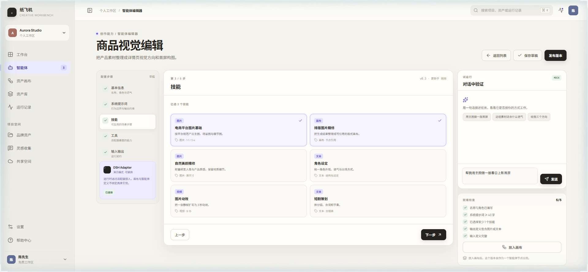
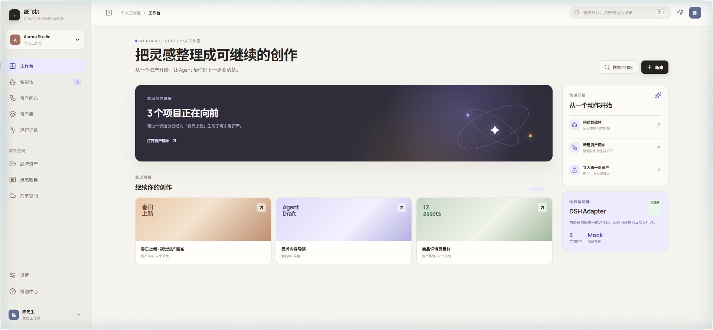
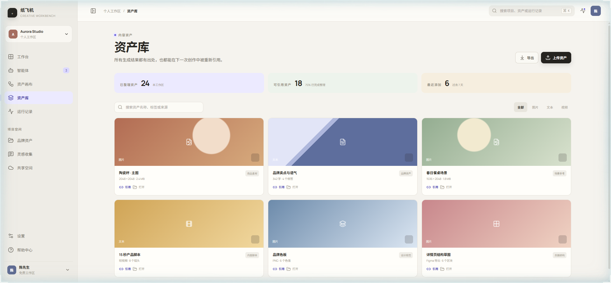

# 纸飞机 Creative Workbench

面向通用创作者与电商运营的智能体创作工作台前端框架。主链路是「生成资产整理与引用」：资产进画布 → 智能体加工 → 运行事件 → Artifact 回填 → 继续引用。DeepSeek Harness 只作为**可替换的运行时适配器**，不进入产品模型。

> 当前是**前端框架 + mock 适配器**：没有真实模型调用、账号、上传或后端。哪些能点、哪些只是展示，见下方「已实现 / 未实现」，不夸大。


## 两个核心界面

**资产画布**：左侧可引用资产栏（拖入画布）、中间节点图、右侧节点检查器（属性 / 引用资产）。连线、添加节点、复制删除、撤销重做、适应画布都在这一屏。


点「运行画布」走适配器事件流：queued → started → node-started → node-completed → completed，底部 Run Dock 显示进度、事件和生成的 Artifact。

**智能体编辑器**：5 步配置（基本信息 / 系统提示词 / 技能 / 工具 / 输入输出），右侧常驻试运行与就绪检查；就绪检查通过才允许发布版本，发布后可以放进画布当节点使用。




其余入口：工作台、智能体列表、资产库、运行记录、设置。





## 已实现（可在界面上点通）

| 模块 | 能做什么 | 事实边界 |
| --- | --- | --- |
| 资产画布 | 资产栏拖入成节点、添加资产/智能体/生成资产三类节点、连线、选中、属性与引用两个页签、添加/移除引用、复制、删除（连带边）、撤销/重做（10 步）、适应画布、小地图、窄屏资产栏转抽屉 | 无持久化，刷新回到初始 4 节点；「导出」未接 |
| 运行 Dock | 适配器事件流、进度条、节点状态切换（执行中 / 完成）、Artifact 数量与 toast | Artifact 不回填节点字段，`artifactId` 目前未写入 |
| 智能体编辑器 | 5 步配置、技能多选、工具开关、输入输出字段增删改、系统提示词变量插入、温度、试运行对话、就绪检查、发布版本号 +0.1 | 试运行是 mock 回复；发布只改本地状态 |
| 资产库 | 搜索、图片/文本/视频筛选、引用 toast | 「上传资产」「打开」未接 |
| 工作台 / 运行记录 / 设置 | 静态展示 + 适配器能力说明 | 数据全部是 mock |

## 未实现

真实模型调用与流式输出、持久化/自动保存、失败态与取消、文件上传与导出、账号与工作区、多人协作、计费与额度、⌘K 快捷键绑定。适配器 `mode` 恒为 `mock`，全仓没有 `fetch`。

## 目录结构

```
src/
  App.tsx                    应用外壳：侧栏、顶栏、页面切换、toast
  domain/types.ts            产品域模型：AgentDefinition / SkillDefinition / ToolDefinition / CanvasNodeData / RunEvent / Artifact
  runtime/types.ts           RuntimeAdapter 接口（产品域与运行时之间唯一的缝）
  runtime/mockAdapter.ts     演示实现：事件流、试运行、能力清单
  data/mock.ts               4 个初始节点、3 条边、6 条资产、智能体与运行记录
  pages/CanvasPage.tsx       资产画布 + 检查器 + 运行 Dock
  pages/AgentEditorPage.tsx  智能体编辑器
  pages/*.tsx                工作台、智能体列表、资产库、运行记录、设置
  components/ui.tsx          NavItem / StatusDot / CreateModal 等基础件
  components/CanvasCard.tsx  画布节点卡片
docs/
  canvas-contract.md         画布数据契约 v0（字段表 + 待确认语义 + 示例 JSON）
  adapter-contract.md        运行时适配器契约（事件时序 + 换真实端点的改动清单）
  ROADMAP.md                 M1 已完成 / M2 拿到画布源码 / M3 之后
```

## 本地运行

```bash
npm install
npm run dev      # 默认 http://localhost:5173
npm run build    # tsc -b && vite build
npm run lint     # oxlint
```

## 设计方向

「纸飞机工作台」：纸白底、深墨工具感、单一紫色强调智能体与运行状态，资产引用关系是视觉主线。详见 [DESIGN.md](./DESIGN.md)，产品边界见 [PRODUCT.md](./PRODUCT.md)。

## 下一步

拿到画布源码后按 [docs/ROADMAP.md](docs/ROADMAP.md) 的 M2 走：先核对 [画布数据契约](docs/canvas-contract.md) 里的「待确认」项，再按 [适配器契约](docs/adapter-contract.md) 把 mock 换成真实 DSH 端点。替换点是 `src/runtime/mockAdapter.ts` 与两处 import，不碰画布视图组件。
