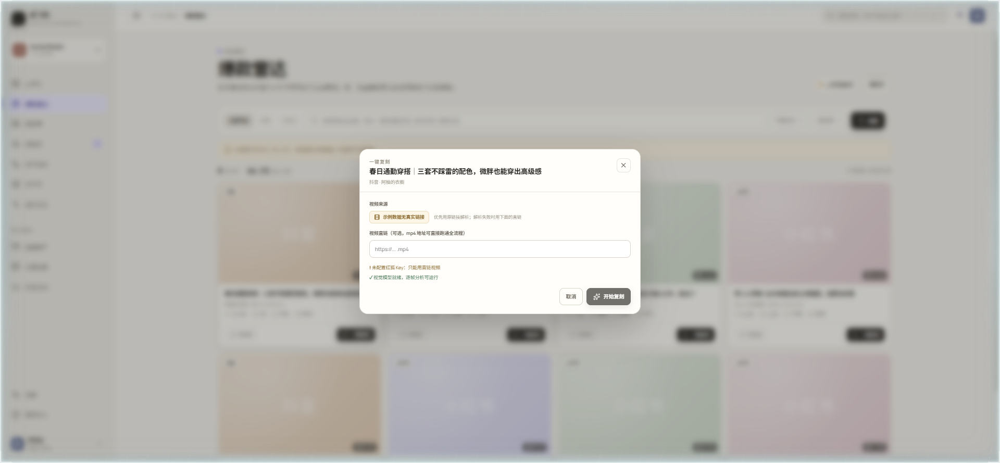
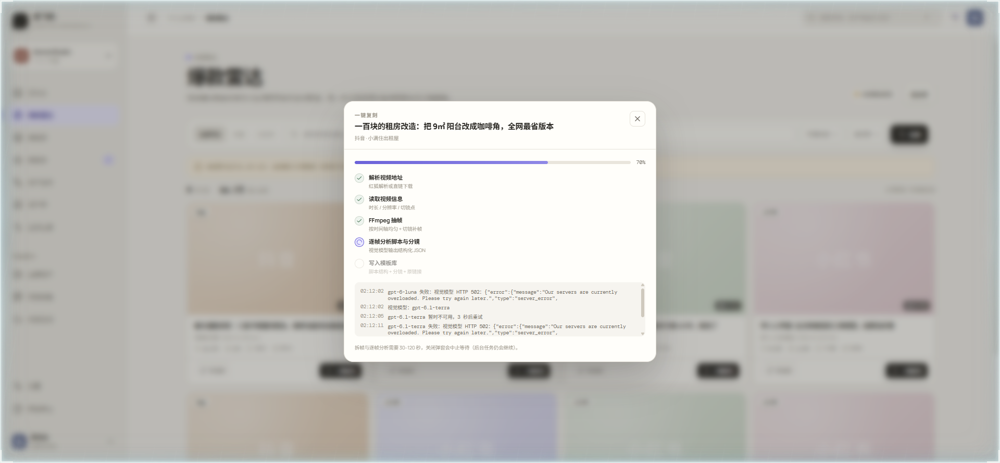
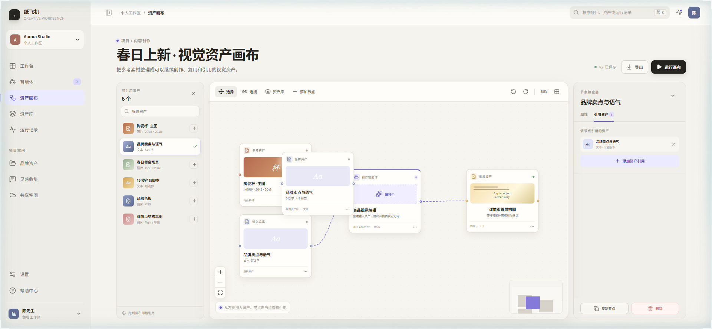

# 纸飞机 Creative Workbench

面向通用创作者与电商运营的智能体创作工作台。这一版新增了**「检索 → 一键复刻 → 模板库复用」**的真实闭环：从抖音/小红书挑一条内容，FFmpeg 拆帧 + 逐帧视觉分析，拆出脚本结构、分镜表和原视频链接，存成可按内容类型检索的模板。

> 诚实边界（2026-11-03 实测）：**红狐接口已连通，但账号积分不足（3210），随后 Key 被红狐侧禁用（3105）**，所以检索仍返回示例数据（界面红条明示，不伪装真实数据）。**视频解析、拆帧、逐帧分析、模板入库这条链路是真的跑通的**（公开测试视频 + 5 并发压测，截图都是真实运行结果）。智能体生成环节按需求暂缓。


红狐账号不可用时的状态（Key 被禁用 / 积分不足 / 限流），界面会明确说明并给后台链接，不会假装成真实数据：


## 检索 → 复刻 → 模板库（本次主线）

**1. 爆款雷达**：按平台（抖音 / 小红书 / 全部）、关键词、时间范围检索，卡片展示点赞 / 收藏 / 评论 / 分享与时长；鼠标移到封面直接出「一键复刻」，卡片底部也有常驻入口。



**2. 一键复刻**：弹窗里选来源（平台原链接，或直接粘 mp4 直链兜底），跑五个可观测步骤：解析视频地址 → 读取视频信息（ffprobe + 场景切镜检测）→ FFmpeg 抽帧 → 逐帧分析脚本与分镜 → 写入模板库。进度条百分比、每步状态、实时日志都在弹窗里。




**3. 模板库**：每条模板保存脚本结构（钩子 + 段落 beats + 口播 + 建议屏幕字 + 目的）、分镜表（画面 / 机位 / 字幕 / 声音 / 叙事作用 + 对应帧图）、爆款分析与可复用规则、**原视频链接**和来源统计，可以按内容类型 + 关键词检索，点开抽屉查看，或标记复用。


模板 JSON 结构、API 契约、真实数据怎么接见 [docs/replication-pipeline.md](docs/replication-pipeline.md)。

## 资产画布与智能体编辑器

主链路仍是「资产进画布 → 智能体加工 → 运行事件 → Artifact 回填」这一套，DeepSeek Harness 只作为**可替换的运行时适配器**，不进入产品模型。


**资产画布**：左侧可引用资产栏（拖入画布）、中间节点图、右侧节点检查器。连线、添加节点、复制删除、撤销重做、适应画布都在这一屏。




**智能体编辑器**：5 步配置（基本信息 / 系统提示词 / 技能 / 工具 / 输入输出），右侧常驻试运行与就绪检查；就绪检查通过才允许发布版本。


其余入口：工作台、智能体列表、资产库、运行记录、设置。


## 已实现（可在界面上点通）

| 模块 | 能做什么 | 事实边界 |
| --- | --- | --- |
| 爆款雷达 | 平台切换、关键词检索、时间范围、按点赞/收藏/评论排序、结果卡片与互动数据、悬停复刻 | **未配红狐 Key 时返回示例数据**（黄条提示），不是真实平台数据 |
| 一键复刻 | 平台链接解析（需 Key）或 mp4 直链、5 步流水线、实时日志、失败可重试、完成回显模板摘要 | 平台链接解析依赖红狐 Key；无 Key 时只能用直链 |
| 拆帧与分析 | ffprobe 读时长/分辨率/帧率、场景切镜检测、均匀 + 切镜补帧（4–18 帧）、逐帧结构化分析 | 视觉模型是本机 OpenCodex 通道，上游过载时会自动降级到备用模型 |
| 模板库 | 脚本结构、分镜表、原链接与统计入库；按内容类型/关键词检索；详情抽屉；复制脚本；复用计数；删除 | 生成内容（接内置智能体）按需求暂缓，字段已预留 |
| 资产画布 | 资产栏拖入成节点、连线、检查器、复制删除、撤销重做、适应画布、小地图 | 无持久化，刷新回到初始节点 |
| 运行 Dock | 适配器事件流、进度条、节点状态、Artifact 数量 | Artifact 不回填节点字段 |
| 智能体编辑器 | 5 步配置、技能多选、工具开关、输入输出增删改、试运行、就绪检查、发布版本号 | 试运行是 mock 回复 |

## 未实现

真实账号与工作区、资产上传/导出、画布持久化、多人协作、计费额度、⌘K 绑定；平台自动发布（不做，只输出模板）；接内置智能体生成新内容（等检索与复刻验收后再接）。

## 目录结构

```
src/
  App.tsx                       应用外壳：侧栏、顶栏、页面切换、toast
  domain/types.ts               产品域模型（画布 / 智能体 / 运行事件）
  domain/radar.ts               内容检索与模板类型
  api/radar.ts                  调本地 API 的轻客户端 + 数字格式化
  pages/RadarPage.tsx           爆款雷达：检索、结果卡片、悬停复刻
  pages/TemplateLibraryPage.tsx 模板库：类型检索、详情抽屉、复用
  components/ReplicateModal.tsx 一键复刻弹窗：来源选择、进度、日志、结果
  pages/CanvasPage.tsx          资产画布 + 检查器 + 运行 Dock
  pages/AgentEditorPage.tsx     智能体编辑器
  runtime/mockAdapter.ts        运行时演示实现（可替换）
server/
  index.mjs                     HTTP API：/api/search /api/replicate /api/jobs /api/templates /api/cover /media/frames
  redfox.mjs                    红狐检索适配（抖音 searchWork / 小红书 search、视频解析）
  media.mjs                     视频获取：直链下载或红狐解析后下载，带大小上限
  frames.mjs                    ffprobe 探测、场景切镜、抽帧计划与 ffmpeg 抽帧
  vision.mjs                    逐帧分析：结构化 JSON、模型降级链、失败重试
  templates.mjs                 模板库存储（data/templates.json + data/frames/<id>/）
  jobs.mjs                      复刻任务编排与进度日志
  config.mjs                    端口、数据目录、红狐与视觉模型配置
docs/
  replication-pipeline.md       检索 → 复刻 → 模板库：流程、API、模板字段
  canvas-contract.md            画布数据契约 v0
  adapter-contract.md           运行时适配器契约
  ROADMAP.md                    M1/M2/M3 进度
```

## 本地运行

```bash
npm install
npm run dev:api   # 本地 API http://127.0.0.1:8787（拆帧 / 模板 / 检索）
npm run dev       # 前端 http://localhost:5173，/api 与 /media 已代理到 8787
# 或者一条命令同时起：
npm run dev:all

npm run build     # tsc -b && vite build
npm run lint      # oxlint（当前 0 warning）
npm start         # 生产模式：node server/index.mjs，直接托管 dist/ + API（http://127.0.0.1:8787）

npm run test:redfox   # 用本地假红狐服务验证限流/缓存/重试/禁用短路（7 项，不耗真实额度）
npm run stress -- --test=search --n=40    # 压力测试：search / reuse / replicate / edge
```

`.env` 放服务端密钥（已 gitignore，模板见 `.env.example`）：

```bash
echo "REDFOX_API_KEY=你的key" > .env
```

环境变量（都只需配服务端，前端拿不到 Key）：

| 变量 | 作用 | 缺省行为 |
| --- | --- | --- |
| `REDFOX_API_KEY` | 红狐接口 Key，启用真实抖音/小红书检索 | 未配置 → 检索返回示例数据并提示 |
| `REDFOX_BASE_URL` | 红狐域名 | `https://redfox.hk` |
| `REDFOX_CACHE_TTL_MS` | 检索结果缓存时长（同参数去重） | 300000（5 分钟） |
| `VISION_BASE_URL` / `VISION_API_KEY` | 逐帧分析的视觉模型通道 | 默认本机 `http://127.0.0.1:10100/v1`，凭证回落到 `~/.codex/auth.json` |
| `VISION_MODEL` / `VISION_FALLBACKS` | 主模型与降级链 | `gpt-6.1-sol` → `gpt-6-luna` → `tokenrouter-agent/grok-4.6` → `gpt-6.1-terra` → `gpt-6-sol` |
| `MAX_FRAMES` / `MAX_VIDEO_MB` | 抽帧上限、视频体积上限 | 18 帧 / 160 MB |
| `DATA_DIR` | 模板与帧图目录 | `./data`（已 gitignore） |

## 设计方向

「纸飞机工作台」：纸白底、深墨工具感、单一紫色强调智能体与运行状态，资产引用关系是视觉主线。详见 [DESIGN.md](./DESIGN.md)，产品边界见 [PRODUCT.md](./PRODUCT.md)。
