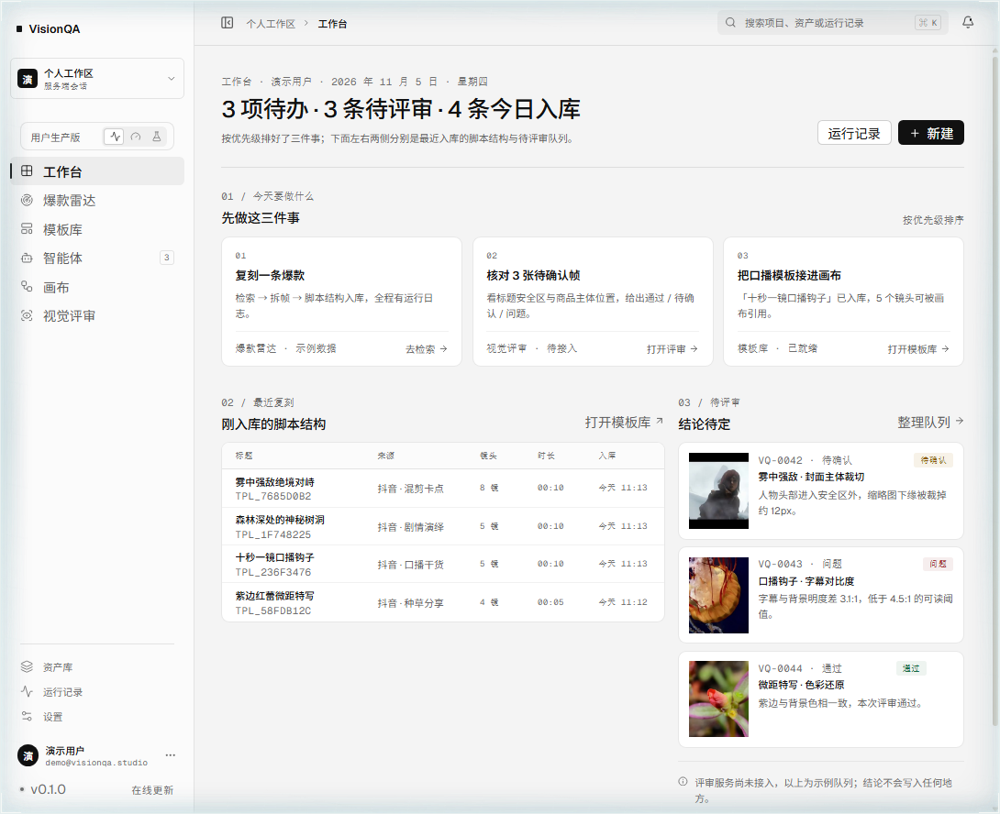
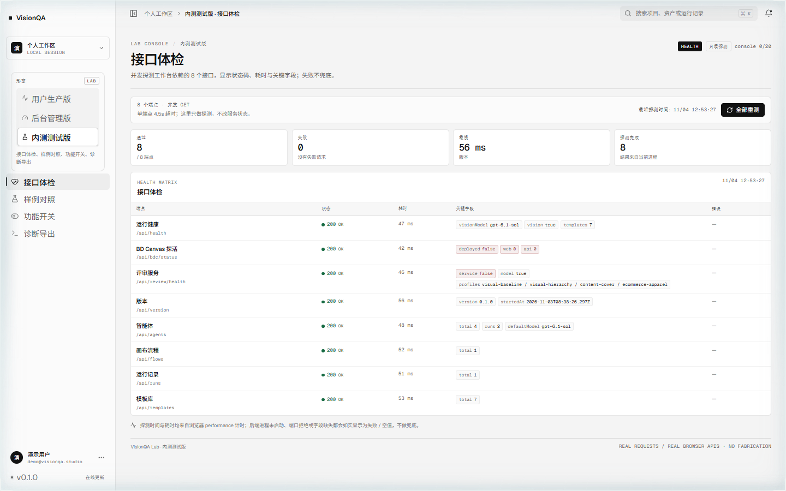

# VisionQA Workbench

VisionQA 是给画面做**有证据的视觉评审**的工具：结论只有「通过 / 需人工确认 / 不通过」三种，每条判断都必须指向画面里的具体区域（像素锚点），定位不到证据的一律写进「无法判断」，不给模糊结论。

这个仓库是 VisionQA 的**创作与检索工作台**：把「找一条爆款 → 拆它的结构 → 换个产品复刻 → 评审产出画面 → 沉淀成可复用模板」串成一条能跑通的链路，评审语言与 VisionQA 插件共用同一套 visual-baseline 契约。

> 诚实边界（2026-11-03 实测）：**红狐检索接口已连通，但账号积分不足（3210），随后 Key 被红狐侧禁用（3105）**，所以爆款雷达现在返回示例数据，界面用红条明示 REDFOX_DISABLED 并给充值入口，不伪装成真实数据。**拆帧、逐帧分析、模板入库、智能体对话、画布执行、视觉评审都是真实调用**（本机 OpenCodex 通道 + gpt-6.1-sol，截图与耗时都是实测）。



登录是**真实的服务端账号**：密码用 scrypt 存哈希，账号落在 `data/auth.db`（SQLite），会话是服务端随机 token + HttpOnly cookie，浏览器里读不到 token 也读不到密码。支持注册、登录、记住我、以访客身份进入；登录失败统一提示「邮箱或密码不正确」，不泄露邮箱是否注册过。登录状态收在**侧栏左下角**，点开可切换账号或退出。


左下角是账号与版本：点账号行可设置 / 切换账号 / 退出；点版本行打开「版本与在线更新」——只读服务端 /api/version 的真实版本号，接口没接入时如实显示「未接入」，不伪造下载进度。


## 一、这一版做了什么

| 模块 | 真实能力 | 事实边界 |
| --- | --- | --- |
| 登录 | 注册 / 登录 / 登出 / 记住我 / 访客进入 / 会话持久化，密码 scrypt 存哈希，会话服务端校验 | **没有找回密码、邮箱验证与角色权限**，见 [docs/accounts.md](docs/accounts.md) |
| 爆款雷达 | 平台/关键词/时间范围检索、卡片互动数据、悬停一键复刻、排序 | 红狐 Key 被禁用期间返回示例数据 + 明确红条 |
| 一键复刻 | 视频解析 → ffprobe → FFmpeg 拆帧 → 逐帧视觉分析 → 入库，五步进度与实时日志 | 平台链接解析依赖红狐 Key；直链兜底可用 |
| 模板库 | 脚本结构、分镜表、原链接、可复用规则入库；类型/关键词检索；详情抽屉；送去评审 | 每条模板都带真实抽帧 |
| 智能体 | 对话框式入口、参数行（智能体/输出类型/模型/数量）、已自建智能体分类卡片、新建/编辑/删除 | 对话真调本地模型；数量本期固定 1 |
| 画布 | React Flow 节点编排（input/llm/kb/tool/condition/output）、检查器、连线校验、保存、逐节点运行；节点面板默认收起，双击画布或点「节点」唤出 | 运行是真执行，耗时真实；VisionQA Canvas 部署后画布交给它接管（见第六节） |
| 视觉评审 | 选画面 → visual-baseline 七维评审 → verdict + 像素锚点 + 有界修正建议 | 未启动 VisionQA 插件服务时由本地模型出一份同契约结果，provider 会写清 |
| 运行记录 | 读 data/runs.json，逐节点状态、耗时、输出 | 只有画布执行会产生记录 |

导航分两层：主层 6 项「工作台 / 爆款雷达 / 模板库 / 智能体 / 画布 / 视觉评审」，横线下面是设置层「资产库 / 运行记录 / 设置」，字号更小、颜色更淡。左上角只写 VisionQA，不放图形标记。

### 视觉基线（去 AI 味）

界面按六条硬规则约束，细则与 token 表见 [docs/design-baseline.md](docs/design-baseline.md)：

1. **间距只走 4/8pt 栅格**——`--space-1..16`（4/8/12/16/24/32/48/64），组件里不出现 13/26/29 这类随手值；
2. **禁大面积渐变**——底板是纯色（`#f4f4f4` / `#fbfbfb` / `#ffffff`），彩色只留在「通过 / 待确认 / 问题」三个语义位；
3. **图标不用 emoji**——全部 lucide 线性图标，统一 1.5px 描边；
4. **字体显式指定**——Geist + Noto Sans SC 显式加载并带回退，标题 500、正文 14、等宽元数据 10–12；
5. **文案给信息不给寒暄**——工作台页头是「3 项待办 · 3 条待评审 · 4 条今日入库」，不是「下午好」；
6. **颜色先 token 后动手**——六件套 `--canvas / --surface / --surface-raised / --ink / --muted / --line`，组件里不现调色。

这一轮把 8 张样式表里 449 处 off-grid 间距、495 处 `font-size` 收敛到栅格与字阶，标题字重统一降到 500，并把模板库「搜索框 + 9 个类型 chip 挤一行换行」重排成搜索一行、类型一行（下划线式 tab，横向不换行）：


### 三个形态

侧栏顶部有「形态」开关——一行分段控件（三个图标 + 当前形态名，说明放在 tooltip 里），同一套设计语言切三份工作面，选择记在浏览器里（刷新保持）：

| 形态 | 给谁 | 导航 |
| --- | --- | --- |
| 用户生产版 PRODUCTION | 内容团队日常用 | 工作台 / 爆款雷达 / 模板库 / 智能体 / 画布 / 视觉评审 +（横线下）资产库 / 运行记录 / 设置 |
| 后台管理版 ADMIN | 运营与管理员 | 总览 / 账号与配额 / 模型 Key / 模板治理 / 运行审计 / 系统 |
| 内测测试版 LAB | 自己与测试 | 接口体检 / 样例对照 / 功能开关 / 诊断导出 |

三份为什么这样切（以及每块的数据来源）写在 [docs/editions.md](docs/editions.md)。要点：生产版里没有任何管理项，权限靠形态隔离不靠藏按钮；后台版每个数字都标「本地演示 / 真实接口」；内测版每条探测都写清返回了什么，不兜底。




## 二、检索 → 复刻 → 模板库

爆款雷达按平台（抖音 / 小红书）、关键词、时间范围检索，卡片直接给点赞 / 收藏 / 评论 / 分享与时长；鼠标移到封面出「一键复刻」。


红狐账号不可用时（Key 禁用 / 积分不足 / 限流），界面明确说清并给后台链接：


一键复刻跑五个可观测步骤：解析视频地址 → 读视频信息（ffprobe + 场景切镜）→ FFmpeg 抽帧 → 逐帧分析脚本与分镜 → 写入模板库。进度、每步状态、实时日志都在弹窗里。


模板详情里有脚本结构（钩子 + beats + 口播 + 屏幕字）、分镜表（画面 / 机位 / 字幕 / 声音 / 叙事作用 + 对应帧图）、爆款分析、可复用规则、原视频链接，以及「送去评审」——把这条模板的首帧直接交给视觉评审。


### 抽帧可以交给远端算力

「解析 → 下载 → 探测 → 抽帧」这四步默认在本机跑 FFmpeg。填一个 `REPLICATE_REMOTE_URL` 就整体挪到外部服务上，工作台只收帧、调视觉模型、入库，**服务器上不再需要跑 FFmpeg**。契约与参考实现见 [docs/remote-compute.md](docs/remote-compute.md)，仓库自带 `worker/video-worker.mjs`。

弹窗里会写明这次走的是哪条路——下图是远端算力实际跑通的一帧：`来源：远端算力 … · 5 帧 · 640×360`，前三个步骤（获取 / 探测 / 抽帧）由对方完成：


顺带把本机那两条 FFmpeg 命令也压了一轮：场景切点只解关键帧、18 次 spawn 合成一条命令，整条链路 **6.1s → 0.99s**（10 秒 640×360 实测）。

## 三、智能体：对话框入口 + 已自建智能体

进入「智能体」先看到的是一个 composer：描述你要它做的事，同一行选智能体、输出类型、模型、数量，Ctrl+Enter 发送。发送后进入对话，用户消息靠右、智能体消息靠左，运行中有计时，失败显示模型名 + 状态码 + 原因并可重试。


底部不是「精选作品」，而是**已自建智能体**：分类标签（全部 / 内容复刻 / 视觉评审 / 脚本分镜 / 投放素材）+ 卡片（名称、职责、模型、最近运行、使用次数），可编辑、可删除、可新建。


真实链路：POST /api/agents/:id/chat 把智能体的 systemPrompt、知识条目、本次输出类型和用户消息拼成 messages，调用本机模型（gpt-6.1-sol，失败按降级链换模型），返回真实回复并把 runCount 加一。实测一次口播分镜回复 44–52 秒，主模型过载时会降级到 grok-4.6 并在界面上标出实际用的模型。

## 四、画布：节点编排与真实执行

画布用 @xyflow/react 12 实现：中间画布 + 右侧检查器，**节点面板默认不显示**——双击画布空白处或点工具栏「节点」才唤出（Esc 收起），避免一进来就被一列按钮占掉焦点。连线校验（不允许自环、输入只接一根），节点可删，Ctrl+Z 撤销，画布状态存 data/flows.json。节点类型只有六类：输入 / 大模型 / 知识库 / 工具 / 条件 / 输出——**评审不进画布**，评审是独立页面（第五节）。


点「运行流程」由服务端按拓扑序执行：llm 节点调本地模型、kb 节点读模板库做上下文、condition 按表达式分支、output 汇总；每个节点返回 status / ms / output，节点在画布上逐个点亮，右侧抽屉同步显示每节点输出。


实测一条 6 节点流程（input → kb → llm → condition → tool → output）跑完 72.8 秒，llm 节点 72.8 秒（含模型调用），GET /api/runs 能查到逐节点结果。


画布的参考来源与许可证（Langflow / Flowise / n8n / Dify / React Flow，未复制任何源码）写在 [docs/canvas-source-attribution.md](docs/canvas-source-attribution.md)。

## 五、视觉评审：VisionQA 的视觉能力怎么放进工作台

VisionQA 的定位不是「帮你想文案」，而是「给已经产出的画面下判断」。放进工作台后它有三个落点：

1. **独立页面**：选一张画面（模板首帧或图片地址）→ 出 verdict、逐条 observation（维度 / 严重度 / 像素锚点 / 置信度）、有界修正建议、无法判断清单。
2. **模板库出口**：模板详情里「送去评审」，把首帧直接带进评审页。
3. **画布不掺和**：评审不是流程节点，画布只做编排与执行——判断留在评审页，画布保持干净。


评审按 visual-baseline 七维（层级 / 对比 / 间距 / 字体 / 色彩 / 构图 / 可识别性）出结论，**每条判断必须给 bbox 锚点**，给不出锚点的降级为 info 或进「无法判断」。服务端实现见 server/review.mjs：优先调 VisionQA 插件服务（127.0.0.1:6300 的 /api/visual-review，同一套 v0.1 契约），服务没起来就退到本地模型的同口径评审，并把实际 provider 写进结果（截图里是 local-model:gpt-6.1-sol · 72.9s）。

契约映射、证据锚点格式与降级行为见 [docs/review-integration.md](docs/review-integration.md)。

## 六、VisionQA Canvas 接入（上游 BD Canvas 源码，Source-Available，不入仓）

画布这一块跑的是 **VisionQA Canvas**：源码来自 **BD Canvas**（Source-Available License v1.0，不是开源协议）的授权副本，本产品对外统一叫 VisionQA Canvas。上游条款禁止把源码或修改版以任何形式分发，也禁止把软件本身当产品卖，所以本仓库：

- **不 vendor、不提交** BD Canvas 的任何源码或构建产物（公开仓库提交就等于分发）；
- VisionQA Canvas 单独部署在本机，跑它自己的 5312（后端）/ 5313（后台管理）/ 6677（网页入口）；
- 工作台只做探活与内嵌：GET /api/bdc/status 探测这三个地址，画布页拿到 `deployed=true` 就**默认直接进 VisionQA Canvas 本体**；没有部署时仍是本仓库那套节点编排。
- 画布页是**沉浸模式**：第三方画布自带完整的顶栏与工具条，所以这一层不再叠标题和说明，只留一条 42px 状态条（署名 BD CANVAS / 连接状态 / 当前地址 / 新窗口 / 回到内置编排），画布铺满内容区、不套卡片不套圆角。画布页的主角是画布，壳让位。

部署记录、三个必踩的坑（Python 不在 PATH、requirements 少两个包、根 .env 没有代码读）与验收清单见 [docs/visionqa-canvas-integration.md](docs/visionqa-canvas-integration.md)，自检用 node scripts/check-bdc.mjs，重启用 `scripts/start-bdc.ps1`。

**当前状态（2026-11-05 实测）**：已解压到 `D:\Projects\bd-canvas`，5312 / 5313 / 6677 三端口都返回 200，`/api/bdc/status` 的 `deployed` 为 true，画布页由 VisionQA Canvas 接管，浅色纸面主题已覆盖；后台 `bdadmin` 初始密码已改。**还差模型 Key**——后台「Key 管理」为空，出图链路没通。

### 改名与顶栏对齐（2026-11-06）

产品名统一成 **VisionQA Canvas**，只改**用户看得见**的地方：网页 `<title>`、顶栏品牌、管理员登录页、新手教程页、桌面端画布标题、设置面板里的应用名、AI 人设前缀、`document.title` 动态标题。上游的版权声明（`copyrightBanner.ts` 归属串）、各文件头部的 `Source-Available License v1.0` 与 `LICENSE` 原文**一个字符都没动**——那是 §4.3 / §5.1 要求保留的署名。

顶栏几何也并进 `deploy/bd-canvas/vq-theme.css` 第 9 节，口径直接抄宿主 42px 状态条（`.cv-bdc-strip`）：**42px 高、底色 `#f4f4f4` 与宿主状态条连成一条、底边 `1px rgba(17,17,17,.10)`、页签 26px / 6px 圆角 / 12px 字、「后端未检测」做成 20px 等宽微标签**。于是「宿主状态条 + 画布顶栏」读起来是一条，而不是两层壳。

### 把它收进我们这套白纸墨线的语言

上游默认是 `#101113` + 蓝 `#6f9cff` + 青 `#22d3ee` 的深色霓虹调性，直接嵌进浅色工作台会读成「里面装了个别家的 App」。所以做了一层**只改配色与顶栏几何、不改组件结构**的主题覆盖：

- `deploy/bd-canvas/vq-theme.css`：它真正的色板在 `src/ui/styles/` 里分三层——`palette.css` → `themes.css`（`--ui-*` 语义层）→ `legacyAliases.css`（把旧 `--bg-*` / `--text-*` / `--border-*` 全部桥接上去）。所以只重定义**上游两层**（`--palette-*` 与 `--ui-*`）就能一次收口，并且是**往我们自己的浅色画布上靠**，不是另起一套深色皮肤：画布 `#f4f4f4`、卡片 `#ffffff`、次级 `#f0f0f0`、三级发丝线 `rgba(17,17,17,.06/.10/.20)`、文字 `#111 / #3f3f3f / #5d5d5d / #9a9a9a`、强调近黑、发光全 `transparent` 只留墨投影、点阵 `rgba(17,17,17,.10)`、语义色直接用我们 tokens.css 的 `#176b43 / #8a5b08 / #a33838`。
- `scripts/apply-bdc-theme.mjs`：幂等地把 css 复制进 `bd-canvas/public/`，并在 `index.html` 的 `</head>` 前插入/校正一行 `<link id="vq-bdc-theme" rel="stylesheet" href="/vq-theme.css">`（371121 → 371187 字节，去掉这一行可完整还原）。上游升级后重跑一次即可；`--check` 只校验不改。

**许可证边界**：LICENSE §3.2 允许为自用修改源码，§4.3 / §5.1 禁止删除、隐藏、篡改版权声明、水印与归属标识。所以：`src/features/license/copyrightBanner.ts` 的归属串、各文件头部的 `Source-Available License v1.0` 声明、`LICENSE` 原文**全部原样保留**；改动只限于**可见产品名**（标题、顶栏品牌、登录页、教程页、桌面端标题、AI 人设、`document.title`）与配色/顶栏几何（`deploy/bd-canvas/vq-theme.css`）。`vq-theme.css` 与脚本是我们自己写的、进本仓库，**上游源码一个字节都没进仓库**。

改色前（蓝青霓虹）：


改色后（白纸 + 墨线 + 发丝节点卡，节点选中是 1.5px 近黑环）：


同一个画布按沉浸模式内嵌进工作台——两边现在是一套语言，不再像「里面装了个别家的 App」：


## 七、账号与会话（真实服务端）

登录不再是前端 mock。后端 `server/auth.mjs` + `server/routes/auth.mjs` 提供五个端点：`GET /api/auth/config`、`POST /api/auth/{register,login,logout}`、`GET /api/auth/me`。要点：

- **口令**：scrypt(N=16384, r=8, p=1) + 每用户随机盐，格式 `scrypt$N$r$p$salt$key`；库里没有明文密码。
- **会话**：32 字节随机 token，库里只存 `sha256(token)`；cookie 是 `HttpOnly; SameSite=Lax`，生产加 `Secure`。
- **不泄露账号存在性**：邮箱不存在时也跑一次 scrypt，登录失败统一 `field:'form'` + 「邮箱或密码不正确」。
- **限流**：同 IP + 邮箱 10 分钟失败 8 次锁；写请求校验 `Origin` 与 `Host` 一致，挡最省事的 CSRF。
- **受保护接口**：`VQ_REQUIRE_AUTH=1` 时除 `/api/auth/*`、`/api/health`、`/api/version` 外全部要登录，未登录返回 `{error:'未登录', loginRequired:true}`，前端收到就在 `src/api/client.ts` 派发 `vq:auth-required` 统一切回登录页。

**四个开关的默认值都在「不安全」一侧**（这是为了让本机演示不受影响），生产必须显式写：`VQ_REQUIRE_AUTH=1`、`VQ_SECURE_COOKIES=1`、`VQ_DEMO_ACCOUNT=0`、`VQ_REGISTRATION=0`（按需）。演示账号由后端 seed，密码通过 `/api/auth/config` 下发给登录页，**前端源码里没有任何密码**；关掉演示账号后登录页那块入口整体消失。

验收：`node scripts/test-auth.mjs` 起临时实例跑 16 项端到端断言（含「库里查不到明文 token / 明文密码」），全过；界面侧另做过一次真实点击：注册新账号 → 直接进工作台 → 退出 → 回登录页 → 错误密码给出统一提示 → 演示账号登录 → 进工作台。

没做的部分（别当成已经有了）：找回密码、邮箱验证、角色权限、多工作区、第三方登录。细节与接口契约见 [docs/accounts.md](docs/accounts.md)。


## 八、服务器配置

内测起步一台 **4C 8G / 100G ESSD / 5M 带宽**、视觉模型继续走 API、VisionQA Canvas 同机部署即可；**不需要 GPU**——评审 60–85s、智能体 20–50s 都是接口延迟。逐档配置、存储/带宽估算、以及上线前必须做的三件事（Windows 脚本换 systemd、JSON 换 SQLite、视频转对象存储）见 [docs/server-sizing.md](docs/server-sizing.md)。

**要真正对外上线**时看 [docs/deploy-production.md](docs/deploy-production.md)：域名与 DNS、Caddy 自动 HTTPS（`deploy/Caddyfile`）或 Nginx（`deploy/nginx.conf`）、systemd 守护（`deploy/vq.service`）、环境变量清单（`deploy/env.production.example`）、健康检查、备份恢复与日志轮转，都有可直接复制的命令和验收步骤。三条硬结论：node 只监听 127.0.0.1、公网只走反代；四个 `VQ_` 开关不写就等于裸奔；单机同时复刻不超过 2 路。

### 线上环境（已上线，2026-11-06）

| 项 | 值 |
| --- | --- |
| 站点 | https://visionqa.wavisionai.cn （80 端口 301 跳 https） |
| 机器 | 阿里云轻量应用服务器 2 vCPU / 2 GiB / 40 GB，华东2（上海） |
| 应用目录 | /opt/visionqa，git 部署，systemd `visionqa.service` |
| 数据目录 | /var/lib/visionqa（SQLite，含 auth.db） |
| 后端端口 | 127.0.0.1:8799（8787 被既有站点占用，所以换端口） |
| 反向代理 | nginx `/etc/nginx/conf.d/visionqa.wavisionai.cn.conf`：80 只做 ACME 挑战 + 跳转，443 终止 TLS 并反代 /api 与 /media |
| 证书 | Let's Encrypt（certbot webroot `/www/wwwroot/wavisionai.cn/acme`），到期 2027-02-04，续期不影响 443 |
| 登录账号 | 由服务器 `/opt/visionqa/.env` 的 `VQ_DEMO_EMAIL` / `VQ_DEMO_PASSWORD` 决定，改完 `systemctl restart visionqa` 生效 |

当前是**无模型 Key** 的形态：`/api/health` 里 `vision=false`，界面照常可用，模型下拉照实写「凭证未配置：选中模型也不会真正发起调用」，不假装有推理。

部署脚本（root）：

```bash
DOMAIN=visionqa.wavisionai.cn API_PORT=8799 SECURE_COOKIES=0 bash deploy/production/install.sh   # 装依赖 → 拉代码 → 构建 → systemd → nginx(80)
DOMAIN=visionqa.wavisionai.cn bash deploy/production/enable-https.sh                            # 签证书 → 换成 80 跳转 + 443 → 打开 Secure Cookie
```


**模型切换的口子怎么用**：右上角模型下拉读 `GET /api/models`，目录来自服务器 `.env` 的 `VISION_MODELS`（逗号分隔，每项可写 `id|显示名`），没配就退回 `VISION_MODEL` + `VISION_FALLBACKS`；改完重启服务、刷新页面即可，**前端不用改一行**。真正要发起调用时，把 `VISION_BASE_URL` / `VISION_API_KEY` 填进同一个 `.env`，`configured` 会变 true，下拉里的「凭证未配置」提示自动消失。

### VisionQA Canvas 同机部署（2026-11-06）

线上「画布」页里嵌的就是 BD Canvas 本体（真源码那套），不再是内置编排的替身。

| 项 | 值 |
| --- | --- |
| 站点 | https://canvas.wavisionai.cn （独立子域，80 跳 https） |
| 目录 | /opt/bdcanvas（git clone 私有仓库快照，venv 在 .venv，node_modules 走 npmmirror） |
| 服务 | systemd `bdc-web.service`（Vite 6677，只监听 127.0.0.1）、`bdc-api.service`（Flask 5312）、`bdc-enterprise.service`（Flask 5313） |
| 反向代理 | nginx `/etc/nginx/conf.d/canvas.wavisionai.cn.conf` → 127.0.0.1:6677；`/admin`、`/api/admin`、`/enterprise/admin` 只放行 127.0.0.1 |
| 证书 | Let's Encrypt（同一 ACME webroot），与主站互不影响 |
| 接线 | `/opt/visionqa/.env` 的 `BDC_WEB_URL=https://canvas.wavisionai.cn`，重启 visionqa 后 `/api/bdc/status` 变 `deployed: true`，画布页直接从「未发布」切成 iframe |

两个坑（都踩过）：

1. BD Canvas 的正式构建（`npm run build`）在当前源码里是坏的——`vite:esbuild-transpile` 在 `VideoFaceBlurEditor` 分块上拿到 `[object Object]` 就中断，去掉三个自定义 bridge 插件也一样。所以服务端跑的是它自己启动时用的那套 Vite dev server（6677），不是静态 dist。
2. `vite.config.ts` 默认把非 loopback Host 当「公网访客」，会 403 掉所有写接口。子域部署要把它加进 `TRUSTED_PUBLIC_HOSTS`（已改），同时加进 `server.allowedHosts`，否则整页 403。

**画布已加 Basic Auth**（2026-11-06 追加）：`canvas.wavisionai.cn` 默认 401，用户 `canvas`；iframe 走一次性入口 `/__auth?k=<token>` —— nginx 种 30 天 cookie 后所有资源请求免登录，所以嵌在 VisionQA 里不会弹登录框。`/admin`、`/api/admin`、`/enterprise/admin` 仍然只放行 127.0.0.1。VisionQA 侧新增两个环境变量：`BDC_EMBED_URL`（iframe 用，带 token）与 `BDC_WEB_PROBE_URL`（探活用本机 6677，避免 401 把 `deployed` 误判成 false）。

**外壳对齐（2026-11-06）**：主题只在 `deploy/bd-canvas/vq-theme.css`（部署方自用，不改它的组件结构），发布时拷成 `<canvas>/public/vq-theme.css`、在 `index.html` 里以 `#vq-bdc-theme` 引入。十节内容：

1. 第 1–8 节把它的 `--ui-*` 变量用 `:root:root` + `!important` 映射到 VisionQA 的 `tokens.css`——字体栈、6/10px 圆角、4/8pt 间距、`#f4f4f4` 画布 + 发丝线、单层轻阴影、等宽微标签。
2. 第 9 节管顶栏几何：`height: 42px !important`（只写 `min-height` 会被它自己的 48px 规则压住）、页签 26px/6px/12px、状态胶囊等宽 10px。
3. 第 10 节管左侧组件面板与右键菜单：面板 288px 白底 10px 圆角、44px 表头、分组标题等宽 10px/0.12em、行高 36px、图标方块 24px；右键菜单与节点创建菜单 208px 宽、行高 34px、快捷键右对齐（补了 `display:flex` + `margin-left:auto`，它原本是 `display:block`，标签和快捷键会挤在一起）。


**画布与工作台数据打通（2026-11-06）**：工作台不再只是「嵌一个 iframe」，它和后端共用同一批画布。

| 工作台接口 | 干什么 | 打到的画布接口 |
| --- | --- | --- |
| `GET /api/bdc/canvases` | 列画布（名称、节点数、版本、更新时间） | `GET /api/canvas/list` |
| `POST /api/bdc/canvases` | 建一块空画布（id 形如 `vq-*`） | `POST /api/canvas/save` |
| `POST /api/bdc/canvases/note` | 把评审结论落成画布里的一个文本节点 | `GET /api/canvas/load/:id` + `POST /api/canvas/save`（带 `expected_revision` 乐观锁，别人同时改了返回冲突而不是覆盖） |

界面就在 42px 状态条里：`画布项目` 下拉（选中即用 `&loadCanvas=<id>` 深链换画布，选中项记在 `localStorage`，刷新后仍然绑着同一块）、`新建`（建完自动绑定）、`写笔记`（写完 iframe 自动重挂载，立刻能看到那条文本节点）。


打通时踩到的三个硬点（都是上游行为，记住能省一天）：

1. **公网访客模式只读浏览器**：`isPublicWebClient()` 把任何非内网 Host 当公网访客，画布数据存 localStorage，服务端的画布永远加载不出来（深链报 `Load failed`）。改成把 `canvas.wavisionai.cn` 当「本机安装」（`runtimeMode.ts` 里加 `VITE_TRUSTED_HOSTS` 白名单），数据才落到服务端 workspace。
2. **一次性入口会吃掉查询串**：`/__auth?k=…&loadCanvas=<id>` 原本一律 `return 302 /`，深链参数直接丢。nginx 里补 `if ($arg_loadCanvas) { return 302 /?loadCanvas=$arg_loadCanvas; }`。
3. **文本节点的正文在 `prompt` 不在 `params.text`**：照它自己的 `createTextNode` 写——`{ type:'text', prompt: 正文, model:'text', params:{ _width:360, _height:220, _agentTextNode:true } }`，写进 `params.text` 的会显示成「0 字」。


## 九、怎么跑

依赖安装后起两个服务：后端 8787（同时托管 dist），前端开发 5191。守护脚本 keep-services.ps1 是单实例，掉了自动拉起，日志在 data/keeper.log。

| 命令 | 作用 |
| --- | --- |
| npm install | 装依赖 |
| node server/index.mjs | 后端 8787 |
| npm run dev -- --port 5191 --strictPort | 前端开发服务器 |
| powershell -ExecutionPolicy Bypass -File scripts/keep-services.ps1 | 常驻守护 |

环境变量放 .env（已 gitignore，模板见 .env.example）：

| 变量 | 用途 |
| --- | --- |
| REDFOX_API_KEY | 红狐检索 / 视频解析 Key（当前账号积分不足且 Key 被禁用） |
| API_PORT | 后端端口，默认 8787（监听地址写死 127.0.0.1，公网只走反向代理） |
| VISION_BASE_URL / VISION_API_KEY / VISION_MODEL | 本地模型通道，默认 http://127.0.0.1:10100/v1 + gpt-6.1-sol |
| VISIONQA_SERVICE_URL | VisionQA 插件服务地址，默认 http://127.0.0.1:6300 |

## 十、接口

| 接口 | 说明 |
| --- | --- |
| GET /api/health | 服务与三个外部依赖的可用性（红狐 / 模型 / 模板数） |
| GET /api/auth/config, POST /api/auth/{register,login,logout}, GET /api/auth/me | 账号与会话（scrypt + HttpOnly cookie），契约见 [docs/accounts.md](docs/accounts.md) |
| GET /api/search | 红狐检索；不可用时返回 mode:'mock' + quota.code + 充值链接 |
| POST /api/replicate, GET /api/jobs/:id | 一键复刻流水线（五步进度） |
| GET /api/templates, GET /api/templates/:id, POST /api/templates/:id/reuse, DELETE /api/templates/:id | 模板库 |
| GET/POST /api/agents, GET/PATCH/DELETE /api/agents/:id, POST /api/agents/:id/chat | 智能体与真实对话 |
| GET/POST /api/flows, PATCH/DELETE /api/flows/:id, POST /api/flows/:id/run, GET /api/runs | 画布与运行记录 |
| POST /api/review, GET /api/review/health | 视觉评审（service / local-model 两种 provider） |
| GET /media/frames/:id/:file | 抽帧静态文件 |

## 十一、目录

前端在 src/：App.tsx 是外壳（侧栏、顶栏、登录门、vq:navigate 事件）；auth/ 是会话状态（服务端真实校验，含 RequireSession 与 useSession）；brand/ 是 VisionQA 标记；styles/tokens.css 是设计 token；api/ 是各模块轻客户端；pages/ 下是 10 个页面（登录、工作台、雷达、模板库、智能体、编辑器、画布、视觉评审、资产库、运行记录、设置）。

后端在 server/：index.mjs 做路由分发与静态托管；routes/ 下 agents、flows、review 三个路由模块；llm.mjs 统一模型调用（重试 + 降级链）；review.mjs 是评审适配；redfox.mjs 是红狐客户端（限流、缓存、单飞、错误映射）；media.mjs 与 frames.mjs 负责视频解析与抽帧；templates.mjs、agents.mjs、flows.mjs 是 JSON 原子写存储。

文档在 docs/：design-direction-v2.md（视觉方向与去 AI 味清单）、review-integration.md（评审契约）、replication-pipeline.md（复刻链路与红狐实测）、canvas-source-attribution.md（画布开源调研）。

## 十二、已知限制

- 红狐账号积分不足且 Key 被禁用：雷达只能给示例数据；重新充值并换 Key 后无需改代码。
- 视觉评审在插件服务未启动时走本地模型，结论可信度取决于模型；界面始终标出 provider，不冒充插件结果。
- 资产库仍是演示数据；智能体「数量」固定 1；工具只声明不自动执行。
- 账号是真的（SQLite + scrypt + 服务端会话），但没有找回密码、邮箱验证、角色权限与多租户；后台管理版的用户列表页因此只展示当前会话。
- 单机部署：复刻任务没有队列（`startReplicate` 直接起 ffmpeg），多人同时复刻会叠加 CPU；4C8G 单机建议同时复刻 ≤2。

## 十三、验证记录

- npx tsc -p tsconfig.app.json --noEmit 通过；npx oxlint src 0 error / 0 warning（59 个文件）。
- 账号体系端到端 16 项全过（`node scripts/test-auth.mjs`）：未登录受保护接口 401、注册即登录、重复注册 409、弱密码 400、登出后旧 cookie 失效、库中无明文 token 与明文密码。
- 智能体对话实测 44.2s（gpt-6.1-sol）、52.7s（降级链生效）、123.6s（grok-4.6）。
- 画布 7 节点流程实测 99.0s / 115.5s，/api/runs 可回放逐节点输出。
- 视觉评审实测 72.9s（gpt-6.1-sol）、84.2s（gpt-6-luna），5–7 条 observation，锚点渲染与图片对齐。
- 复刻压测：5 并发 5/5 完成（163s 墙钟）、25 并发复用无丢失更新、40 并发检索 40/40 HTTP 200（p50 3.7s）。
