# VisionQA Workbench

VisionQA 是给画面做**有证据的视觉评审**的工具：结论只有「通过 / 需人工确认 / 不通过」三种，每条判断都必须指向画面里的具体区域（像素锚点），定位不到证据的一律写进「无法判断」，不给模糊结论。

这个仓库是 VisionQA 的**创作与检索工作台**：把「找一条爆款 → 拆它的结构 → 换个产品复刻 → 评审产出画面 → 沉淀成可复用模板」串成一条能跑通的链路，评审语言与 VisionQA 插件共用同一套 visual-baseline 契约。

> 诚实边界（2026-11-09 17:20 线上实测）：模型链路换成**官方 DeepSeek**（`https://api.deepseek.com/v1`）后真正通了。`deepseek-flash` 自报的 `input_modalities` 是 `["text","image"]`，所以智能体对话和抽帧评审共用同一个模型，不再需要假想一个「视觉专用模型」。实测：后台「连通性自检」`可用 · 上游 2 个模型`；智能体对话 6.0 秒出成品文案；`/api/review` 本地模型路径 16.6 秒给出 verdict + 像素锚点；`analyzeFrames` 在服务器上用生产代码跑 3 帧得到合法分镜 JSON。**仍然缺**：模板库 0 条（「一键复刻」还没跑过一条真实视频）、没有队列/配额/找回密码/用户列表接口。

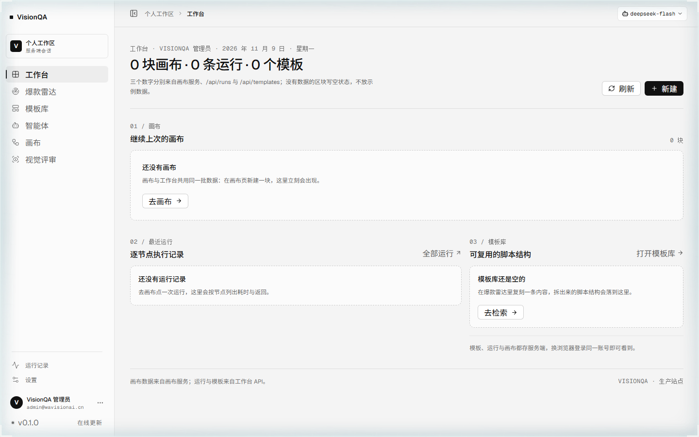


登录是**真实的服务端账号**：密码用 scrypt 存哈希，账号落在 `data/auth.db`（SQLite），会话是服务端随机 token + HttpOnly cookie，浏览器里读不到 token 也读不到密码。支持注册、登录、记住我；登录失败统一提示「邮箱或密码不正确」，不泄露邮箱是否注册过。登录状态收在**侧栏左下角**，点开可切换账号或退出。

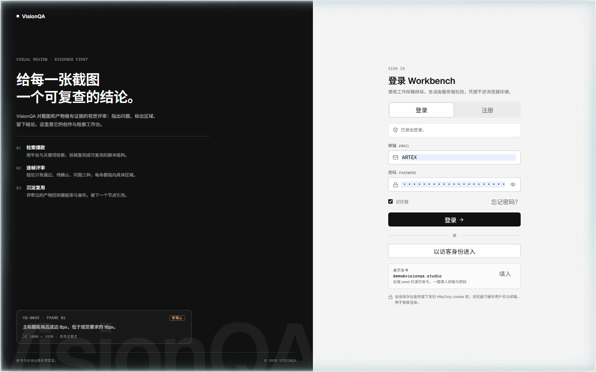

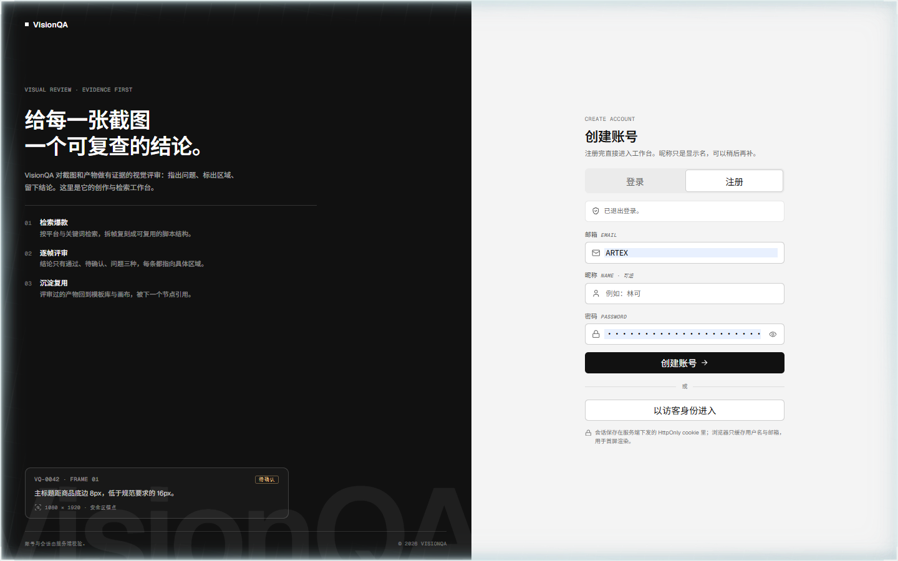

左下角是账号与版本：点账号行可设置 / 切换账号 / 退出；点版本行打开「版本与在线更新」——只读服务端 /api/version 的真实版本号，接口没接入时如实显示「未接入」，不伪造下载进度。


## 一、这一版做了什么

| 模块 | 真实能力 | 事实边界 |
| --- | --- | --- |
| 登录 | 注册 / 登录 / 登出 / 记住我 / 会话持久化，密码 scrypt 存哈希，会话服务端校验 | **没有找回密码、邮箱验证与角色权限**；注册默认关闭，加账号用 `npm run adduser`，见 [docs/accounts.md](docs/accounts.md) |
| 作品 | **一条内容一条记录**：`#/projects` 与 `#/projects/<id>`；只存「绑哪条模板 + 哪块画布 + 到哪一步」，脚本与分镜实时取自模板；作品页按「下一步」给一张主卡（开画布 / 送评审 / 继续改 / 交付）；改名、多版本对照（每版写清比上一版改了什么，任意两版可逐项看节点参数前后，并把两版评审结论、按严重度的问题数、交付状态与交时评审并排（交付后重评会单独写一条，不改写交时结论；可打印成 A4 对照纸带走，两版对照页也随交付包 `.zip` 一起给出，只读分享可另外选择带上这张纸，并可下载含现场页、评审对照与帧图的离线包；**标记交付时整套包当场封存，开新版或改模板之后旧版仍能原样下载，作品页的交付档案还能展开包内清单、复制 SHA-256，下载后拖回同一块就能在本机核对，服务器上那一份也能点「查一遍哈希」重算，丢了 / 大小变了 / 内容被换过都会直说；包里那份也不用解压：清单直接读包内目录，交付稿看原文、现场页进沙箱、帧图直接看，某一条 CRC32 对不上也会当场说；「体检整包」还会把每一条都解开重算一遍 CRC32，按偏移读、内存里最多一条，坏哪条点哪条，包被截断就说做不了；清单与单条预览也改成按偏移读，十个文件的包列一次目录只读 691 B，取一条就只读这一条；封存包还由定时任务每天自动巡检一遍，作品页写「上次巡检 …」与每一版自己的结论，坏了红字点名，不用谁记得点；交出去的包里还带一页 `校验.html`：收包人把 zip 拖进去就逐条对一遍 CRC32、并算出整包 SHA-256，不上传、不联网、不要账号；分享页的离线包也带同一页，拿到链接的人不用账号也能自己核，对不上的那条点名；核对完页面给一段**收据**（谁、哪一份、结论、整包 SHA-256、时间、坏在哪），可复制或存成 txt 发回给发件人，打印时按钮自动收起；**那段收据贴回作品页的交付档案就能跟封存包对一遍**（版次 / 包名 / 字节 / 整包 SHA-256 / 对方结论五项），结论记在那一条交付记录上，刷新还在；**回执链接让收包人自己贴，不用注册，结论直接写回同一条交付记录**，他贴过几次都留着：最新一次写在档案行，更早的在下面按时间倒序，谁贴的、差哪一项都查得到）；旧版脚本快照可点开看，归档版可**以这一版为底**再开一版）、运行按作品归集、脚本 copy-on-write、**只读分享链接**都已上线；**分镜每一镜有自己的画面槽**（v0.9.161）——可以把你出的图贴到某一镜、换一张或退回原片帧，评审页「这条作品的画面」直接挑这一镜去评，模板一个字不动；**每一镜还带一条现拼的出图提示词**（v0.9.164）——画面、机位与脚本拼成，可复制这一镜或整条，不调模型、不花额度，出图仍去无限画布；智能体草稿可**存为模板 / 送到画布** | 默认只存引用，脚本只在改过时复制一份；**没有作品级权限 / 协作 / 逐人访问明细**；分享只记打开次数与设备类别 |
| 交出去的（工作台） | 工作台把每一次交付摊成一条线：哪条作品的哪一版、什么时候交的、交时评审、现在还作不作数；**封过包的每一条带回收执的结论**（对得上 / 对不上 / 对方读不出来 / 还没收到），清单顶上按整份记录数一遍，对不上的另起一句；**点一行直接落在作品页那一版的档案上**，收据已经摊开、那一行标出来，地址带着交付记录 id（刷新 / 后退都还在这一版）；**又贴一次时，收据里多一句「和上一次比变了哪一项」**——哪一项从对不上变成对得上（或反过来）、结论怎么变、收据上换成了哪一串（v0.9.139–141）；**对不上的时候再收一句「下一步做什么」**——版次或包名不对、字节不对、只有哈希不对、哈希空着、对方读不出来各有一句判断和下一步，包对得上只是结论打架用警示色，看不出是哪一种就直说（v0.9.142）；**对不上的时候多一个「复制这段话」**——把两边值照抄收据，写清请对方怎么重验，一键复制去发（v0.9.143）；**还没回来的那一行说清等了几天、差在哪一项**——「发出 4 天」、超过三天换警示色、对不上时胶囊里写「差在整包 SHA-256」，行尾多一个「复制提醒」：复制一段带回收据链接的话，档案里记下催过几次，刷新还在（v0.9.144）；**还没回来的那一行还说这条链接送到没有**——收包人打开回执地址就记一次（只存哈希前缀、只分四类客户端、一分钟内刷新算一次），行上写「链接打开 1 次」或「链接还没打开」，一次都没打开的 title 里写「可能没送到，先把链接再发他一次」，顶上另起一句数一遍，作品页档案里写「打开过几次、最近一次」；升级前发的链接没有发出时间，一个字都不说（v0.9.145）；**知道之后下一步就在这一行上**——链接一次都没被打开过的那几行，按钮换成「再发一次链接」：点一下复制一段「那条链接你那边可能没收到，这里再发一次」，带回同一条地址与「打不开就说一声」，行尾另记「又发过 N 次」（与「催过 N 次」分开算），发到两次还没打开就直说「换个方式发（邮件 / 换个人）」，顶上另起一句数一遍（v0.9.146）；**那条地址发两遍都没打开，就地换一条新链接**——又发过两次还是没打开的那几行，按钮换成「换一条新链接」：点一下换一枚新 token（旧地址立刻打不开），复制一段说清「这是新地址、旧的那条已经作废」的话，打开次数与重发次数从零算起、换成「换过 N 次链接」，档案里带着「上一条发过 2 次没打开」；打开过的那条不给换（服务端也拦一道 409 LINK_OPENED），顶上另起一句（v0.9.147）；**换掉的那条旧地址自己会说「已经换成新的了」**——收包人从聊天记录点回旧的，得到的是「这条地址已经换成新的了 / 哪一天换的 / 旧地址从那会儿起打不开 / 用最后发给你的那条 / 手上的包不用重下」，不是「链接不在了」；换地址时只留旧 token 的哈希前缀（不留 token 本身，最多 5 条），打开旧地址不算打开那份包，也不把新地址交出去（v0.9.148）；**换掉的那条旧地址还被点着，发件人第一次看得见**——有人点回旧地址时记一次（只记次数与最近一次；五秒内连着来算一次，不记是谁、不记从哪来），行上单独一段写「旧地址还被点过 3 次」并给出下一步「他手上可能还是旧的那条，把现在这条再发一次」，收包人那一屏照旧只说「换成了新的」、不把次数说给他（v0.9.149）；**换过两次就不再给换第三条**——换地址换的是 token，不是渠道：绕不过去（工作台按钮没了、作品页那条一起消失，两个入口在服务端都回 409 LINK_ROTATE_LIMIT），行上多一段「地址换到头了」解释按钮去哪了，剩下的动作换成「问问收到没」：复制一段「是不是没收到」的话，带着现在这条地址（v0.9.150）；**收包人自己说一句话**——回执页多一个「东西收到了，正在验」：点一下只记这一刻（不比对任何东西、不改包、不改地址、不算打开次数、不顶作品排序），页面变成「已经告诉他了」、刷新还认得；工作台那一行行首从「还没收到回执」换成「他点了「收到了」，收据还没贴」，不再劝换地址 / 再发一遍，剩下的动作是「复制提醒」；清单顶上多一句「其中 N 次他自己点了「收到了」」，这几条从「可能没送到」那一堆里挪出去；作品页档案里多一行「他在回执页点了「收到了」」（v0.9.151）；**每一条交付还能写清「这是给谁的」**——同时交出去两三份时，作品页交付档案里写一个称呼（最多 24 个字），工作台那一行第一段就是「给王老师 · 内容组」，复制出去的提醒 / 重发 / 问话都用这个称呼开头；同一个称呼再存一次不写盘，清掉就回到「没写」，行上什么都不说；这个称呼只在发件人这一侧，包里没有，公开回... (line truncated to 2000 chars)
| 导航 | 一级只留四个去处：**工作台 / 作品 / 发现 / 模板库**；智能体 / **工作流** / **无限画布** / 视觉评审 / 运行记录退到「工具」区（v0.9.163 起两张画布各占一项）；可用 Ctrl / ⌘ + K 快速跳转任意页面与动作 | 智能体编辑器仍归在「智能体」项下；路由保持原样（`#/radar` 等旧地址照旧可用）；旧画布项目地址 `#/canvas/project/<id>` 自动改写成 `#/board/<id>` |
| 本地工作区（桌面端） | **loop、工具、会话记忆都在本机**：列目录 / 读文件 / 写文件 / 执行命令四个工具，写文件与执行命令必须逐次批准；会话落盘可续，上下文超预算先压成摘要；模型补全走账号会话（`/api/local-agent/complete`），密钥不下发 | 只在 Electron 外壳里出现，网页版打开 `#/local` 会如实说明不可用；**还没有安装包**（`npm run desktop` 起开发外壳，见第六十七节） |
| 发现（原爆款雷达） | 进页面**不自动检索**，点「检索」才发请求；卡片给播放 / 点赞 / 收藏 / 评论 / 转发与互动率；可「加入模板库」或「一键复刻」 | 抖音有播放量，小红书没有；取不到就隐藏，不做估算 |
| 一键复刻 | 视频解析 → ffprobe → FFmpeg 拆帧 → 逐帧视觉分析 → 入库，五步进度与实时日志 | 平台链接解析依赖红狐 Key；直链兜底可用 |
| 模板库 | **只存原链接 + 互动数据 + 解析出的脚本与分镜，不保存视频文件**；待解析 / 已解析两种状态，详情抽屉里可「去解析」；类型/关键词检索；送去评审 | 待解析条目没有帧图，封面走 /api/cover 代理 |
| 智能体 | 对话框式入口、参数行（智能体/输出/模型）、已自建智能体分类卡片、新建/编辑/删除；对话带**最近 8 条 / 6000 字**的会话记忆；脚本/分镜回复带**结构化草稿**，可存为模板、送到画布 | 记忆由服务端截断，超出部分不带；不落库；草稿只认回复里那段 ```draft JSON，模型没给就没有出口，不从正文表格反推 |
| 工作流 `#/canvas` | React Flow 节点编排（input/llm/kb/tool/condition/output）、检查器、连线校验、保存、逐节点运行；节点面板默认收起，双击画布或点「节点」唤出 | 只做编排与执行：v0.9.163 起不再嵌外部画布（见第二百三十节），运行是真执行、耗时真实 |
| 无限画布 `#/board` | 外部自由画布（canvas.wavisionai.cn）整屏嵌入：42px 状态条上换画布 / 新建 / 写笔记 / 专注 / 新窗口，`#/board/<画布ID>` 点名一块；报价按积分，余额与充值留在工作台 | 第三方应用、自带顶栏；连不上时只在这一页说明，不影响工作流与作品；画布项目与写笔记仍走 `/api/bdc/*`（本机 5312 / 5313） |
| 视觉评审 | 选画面 → visual-baseline 七维评审 → verdict + 像素锚点 + 有界修正建议 | 未启动 VisionQA 插件服务时由本地模型出一份同契约结果，provider 会写清 |
| 充值与积分口径 | **价格只有一种说法：积分**。`#/recharge` 选一档（默认体验 / 标准 / 团队，后台可改）→ 内测直充当场到账，余额、订单与积分流水三处对得上；积分口径只有一处（`VQ_POINTS_PER_CNY`，默认 1 元 = 10 积分），充值页、默认档位与外部画布的报价都读它 | 支付通道还没接入（商户号未下来）：「到账」是内测直充，不扣真实款项，页面逐字写明；`VQ_BILLING_MODE=off` 立刻退回「只能提交申请」 |
| 运行记录 | 读 data/runs.json，逐节点状态、耗时、输出；同一画布、或同一件作品另一版画布上的两次运行可逐节点对照，输出差异可按需展开 | 只有画布执行会产生记录；跨版本按节点 id 对齐；跨作品仍不可对照；差异只到行 / 160 字段落，不做字内高亮 |

导航分两层：一级 4 项「工作台 / 作品 / 发现 / 模板库」，下面是「工具」区「智能体 / 工作流 / 无限画布 / 视觉评审 / 运行记录」，底部只留设置；桌面端在这之间多一组「本机 › 本地工作区」。左上角只写 VisionQA，不放图形标记；导航只有 `src/nav.ts` 一份真源（第六十六节）。

> 2026-11-09 上线体检后，整块删掉了「资产库」（6 条假资产 + 假统计，没有后端）、内测测试版、登录页演示账号与访客入口、工作台的示例待办/最近复刻/待评审。逐项清单与「哪些是真的」判定见 [docs/launch-readiness.md](docs/launch-readiness.md)。

### 2026-11-10 这一轮（已上线）

| 改动 | 之前 | 现在 |
| --- | --- | --- |
| 雷达检索时机 | 切到爆款雷达就自动检索一次（按次计费） | 进页面只读健康状态；输入关键词点「检索」才请求，未检索时给明确的空状态 |
| 卡片数据 | 点赞 / 收藏 / 评论 / 转发 | 再加播放量与互动率（(赞+藏+评+转)/播放），排序支持按播放、按转发 |
| 雷达 → 模板库 | 只有「一键复刻」入库 | 新增「加入模板库」：只存原链接、作者、互动数据，不下载视频、不抽帧 |
| 模板库 | 每条都带本地帧图 | 待解析 / 已解析两态；详情里可「去解析这条」，复刻完成后同一条目升级，不重复占格 |
| 智能体对话框 | 输入框 + 参数行 + 提示行 + 独立发送键，改一次要滚 | 一块卡片：输入区在上，参数与「Ctrl + Enter + 发送」收在底部同一行；去掉「数量 1」与「真实调用本地模型」这类给我们自己看的文案 |
| 会话记忆 | 每轮只发当前一句 | 带最近 8 条 / 6000 字上下文（服务端截断），实测追问能接住上文 |
| 字体 | 从 fonts.googleapis.com 拉 Geist + Noto Sans SC 四套字重；中文用无 hinting 的网页字体，12px 发虚 | 去掉外部字体请求，Geist 拉丁子集自托管、中文用系统黑体；10px 微标签统一抬到 11px |
| 充值 | 无 | 新增 /api/billing/*（overview / orders）与设置页「充值」按钮；通道未开通时明确显示未开通、按钮不可用，不编价格 |


### 2026-11-10 追加：页头、运行记录溢出、入口 HTML 缓存

| 问题 | 原因 | 改法 |
| --- | --- | --- |
| 智能体页顶部「创作能力 / 智能体」 | 顶栏已经有「个人工作区 › 智能体」，页内又写了一遍虚构的上一层 | 删掉页内这行眉标（编辑页同改），全站只留顶栏一处面包屑 |
| 「已自建智能体」上方 | 「自建库 · N 次运行」和下面的标题说的是同一件事，右上角还有第二个「新建」 | 收成一行：标题 + 「N 个 · 累计 M 次运行」；新建只留页头那一个 |
| 参数胶囊的下拉 | 原生 `<select>` 弹出层会盖住输入框底部，样式也和发丝线不搭 | 换成自绘下拉：点击外部或 Esc 关闭、选中项加粗、展开时箭头翻转 |
| 运行记录页明显溢出 | `.runs-page` 漏写页面内边距，内容顶到侧栏和窗口边缘，左侧字看起来像被切掉 | 与工作台同一套 32px 内边距 + 1280 居中 |
| 工作台页头字体发虚 | 「工作台 · 用户 · 2026 年 11 月 10 日 · 星期二」整行等宽字体 + 中文混排，被 0.04em 字距拉散 | 拆成「工作台 · 用户 · 日期」，中文走界面字体、只有日期用等宽等宽数字；标题数字改 tabular-nums、分隔点降为 1px 灰 |
| 发版后仍看到旧界面 | nginx 直接托管 dist，`index.html` 没有 `Cache-Control`，浏览器按 ETag 启发式缓存旧 HTML，发版后继续加载旧 bundle | nginx 里 `location = /index.html` 写 `no-store, no-cache, must-revalidate`，`/assets/` 写 `immutable` 长缓存 |


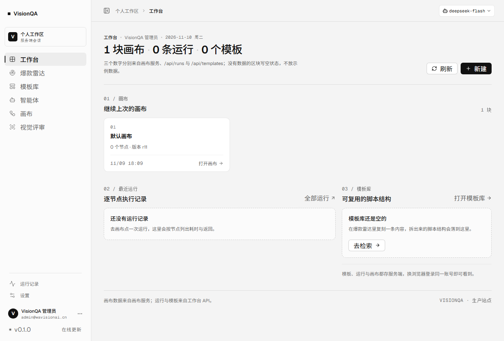

同一轮还按上线前审计修了六处**会真出事故**的地方（登录暴破绕过、模板库并发写丢条目、失败任务残留临时目录、
模板帧图送评审路径错、安全响应头、数据零备份）：
`deploy/production/backup.sh` + `visionqa-backup.timer` 每天 04:10 把 `/var/lib/visionqa` 整目录打包到
`/var/backups/visionqa` 留 7 份（含 WAL，恢复时 SQLite 自己重放），已装并跑过第一次。
审计清单、未修的 P0/P1（配额闸门、多用户 ownerId、SSRF 超时、健康检查探上游……）逐条记在
[docs/launch-readiness.md](docs/launch-readiness.md) 的「三点八」。

### 视觉基线（去 AI 味）

界面按六条硬规则约束，细则与 token 表见 [docs/design-baseline.md](docs/design-baseline.md)：

1. **间距只走 4/8pt 栅格**——`--space-1..16`（4/8/12/16/24/32/48/64），组件里不出现 13/26/29 这类随手值；
2. **禁大面积渐变**——底板是纯色（`#f4f4f4` / `#fbfbfb` / `#ffffff`），彩色只留在「通过 / 待确认 / 问题」三个语义位；
3. **图标不用 emoji**——全部 lucide 线性图标，统一 1.5px 描边；
4. **字体显式指定**——Geist 拉丁子集自托管（52KB）+ 中文走系统黑体（苹方 / 微软雅黑），不再 @import fonts.googleapis.com；标题 500、正文 14、等宽元数据 11–12；
5. **文案给信息不给寒暄**——工作台页头是「3 项待办 · 3 条待评审 · 4 条今日入库」，不是「下午好」；
6. **颜色先 token 后动手**——六件套 `--canvas / --surface / --surface-raised / --ink / --muted / --line`，组件里不现调色。

这一轮把 8 张样式表里 449 处 off-grid 间距、495 处 `font-size` 收敛到栅格与字阶，标题字重统一降到 500，并把模板库「搜索框 + 9 个类型 chip 挤一行换行」重排成搜索一行、类型一行（下划线式 tab，横向不换行）：


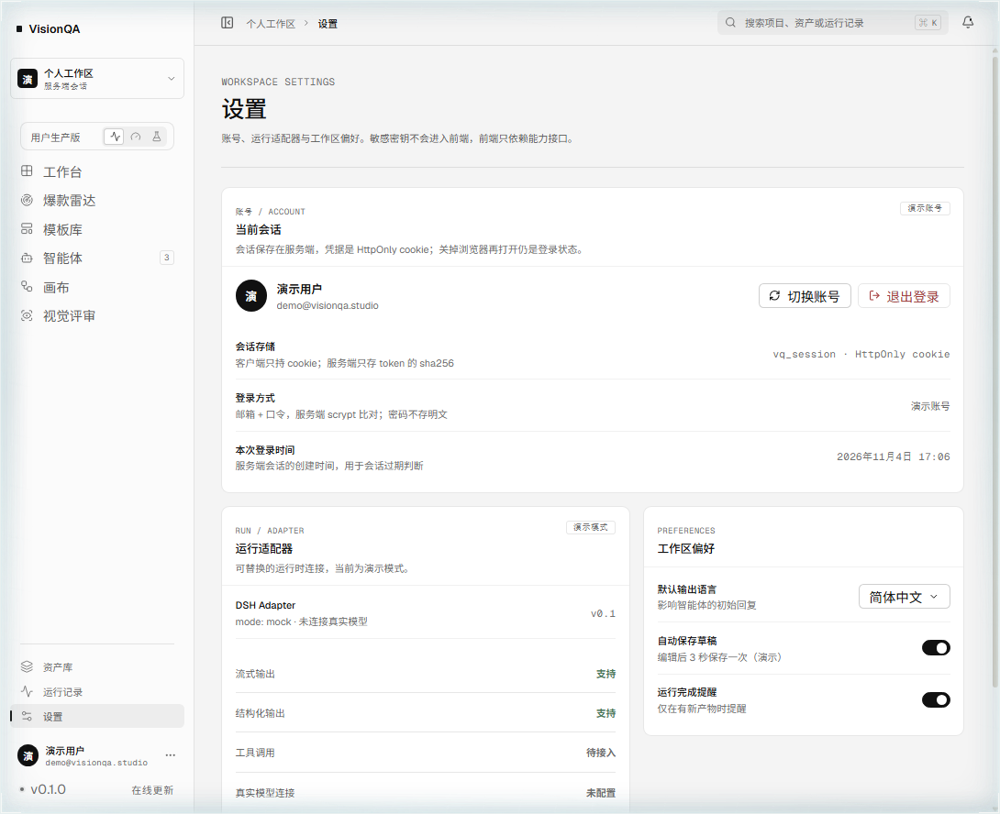

### 两个形态

对外只有一个形态：**用户生产版**。后台管理版不给普通用户看到，地址栏加 `?edition=admin` 才进得去，进去后侧栏有一条「返回生产版」。

| 形态 | 给谁 | 导航 |
| --- | --- | --- |
| 用户生产版 PRODUCTION | 内容团队日常用 | 工作台 / 爆款雷达 / 模板库 / 智能体 / 工作流 / 无限画布 / 视觉评审 +（横线下）运行记录 / 设置 |
| 后台管理版 ADMIN | 运维自己（`?edition=admin`） | 总览 / 账号 / 无限画布 / 模型 Key / 模型与上游 / 模板治理 / 成本 / 计费 / 举报处理 / 反馈 / 运行审计 / 系统 |

原来的「内测测试版 LAB」整块删除：接口体检、样例对照、功能开关、诊断导出四页里，开关全是「仅记录，尚未接线」，对照页的作用是把 `src/data/mock.ts` 的假数据摆在真实接口旁边——上线版不该带这种页面。
后台版每个数字都标「真实接口 / 本地会话」，没有接口的地方就写没有，见 [docs/editions.md](docs/editions.md)。


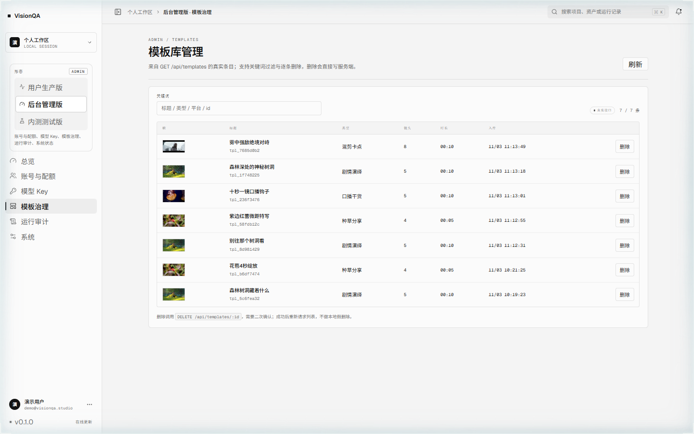


## 二、检索 → 复刻 → 模板库

爆款雷达按平台（抖音 / 小红书）、关键词、时间范围检索，卡片直接给点赞 / 收藏 / 评论 / 分享与时长；鼠标移到封面出「一键复刻」。


红狐账号不可用时（Key 禁用 / 积分不足 / 限流），界面明确说清并给后台链接：


一键复刻跑五个可观测步骤：解析视频地址 → 读视频信息（ffprobe + 场景切镜）→ FFmpeg 抽帧 → 逐帧分析脚本与分镜 → 写入模板库。进度、每步状态、实时日志都在弹窗里。


模板详情里有脚本结构（钩子 + beats + 口播 + 屏幕字）、分镜表（画面 / 机位 / 字幕 / 声音 / 叙事作用 + 对应帧图）、爆款分析、可复用规则、原视频链接，以及「送去评审」——把这条模板的首帧直接交给视觉评审。

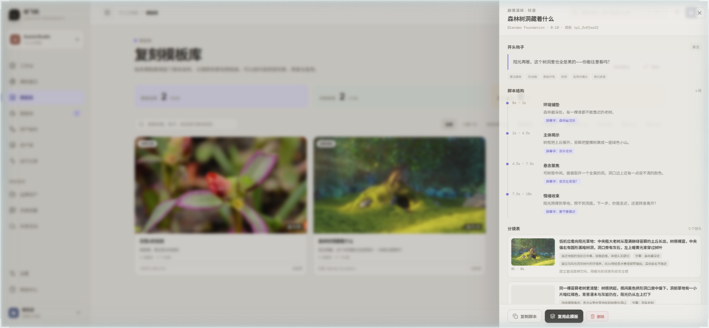

### 抽帧可以交给远端算力

「解析 → 下载 → 探测 → 抽帧」这四步默认在本机跑 FFmpeg。填一个 `REPLICATE_REMOTE_URL` 就整体挪到外部服务上，工作台只收帧、调视觉模型、入库，**服务器上不再需要跑 FFmpeg**。契约与参考实现见 [docs/remote-compute.md](docs/remote-compute.md)，仓库自带 `worker/video-worker.mjs`。

弹窗里会写明这次走的是哪条路——下图是远端算力实际跑通的一帧：`来源：远端算力 … · 5 帧 · 640×360`，前三个步骤（获取 / 探测 / 抽帧）由对方完成：


顺带把本机那两条 FFmpeg 命令也压了一轮：场景切点只解关键帧、18 次 spawn 合成一条命令，整条链路 **6.1s → 0.99s**（10 秒 640×360 实测）。

## 三、智能体：对话框入口 + 已自建智能体

进入「智能体」先看到的是一个 composer：描述你要它做的事，同一行选智能体、输出类型、模型、数量，Ctrl+Enter 发送。发送后进入对话，用户消息靠右、智能体消息靠左，运行中有计时，失败显示模型名 + 状态码 + 原因并可重试。


底部不是「精选作品」，而是**已自建智能体**：分类标签（全部 / 内容复刻 / 视觉评审 / 脚本分镜 / 投放素材）+ 卡片（名称、职责、模型、最近运行、使用次数），可编辑、可删除、可新建。

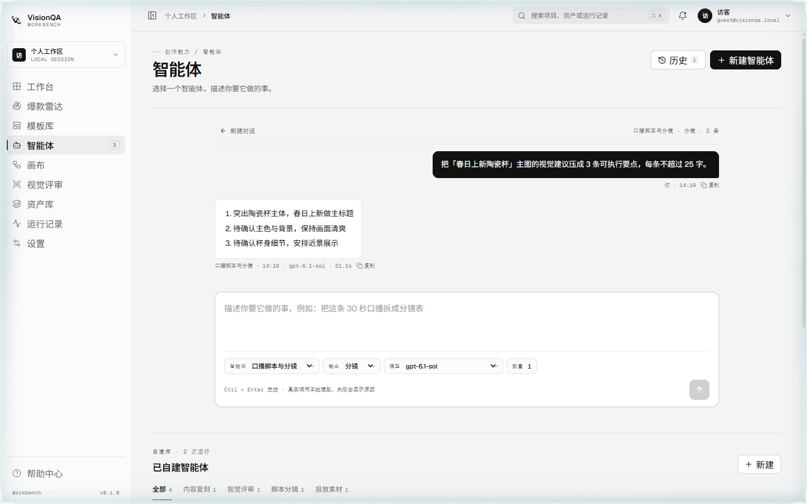


真实链路：POST /api/agents/:id/chat 把智能体的 systemPrompt、知识条目、本次输出类型和用户消息拼成 messages，调用本机模型（gpt-6.1-sol，失败按降级链换模型），返回真实回复并把 runCount 加一。实测一次口播分镜回复 44–52 秒，主模型过载时会降级到 grok-4.6 并在界面上标出实际用的模型。

## 四、画布：节点编排与真实执行

画布用 @xyflow/react 12 实现：中间画布 + 右侧检查器，**节点面板默认不显示**——双击画布空白处或点工具栏「节点」才唤出（Esc 收起），避免一进来就被一列按钮占掉焦点。连线校验（不允许自环、输入只接一根），节点可删，Ctrl+Z 撤销，画布状态存 data/flows.json。节点类型只有六类：输入 / 大模型 / 知识库 / 工具 / 条件 / 输出——**评审不进画布**，评审是独立页面（第五节）。


点「运行流程」由服务端按拓扑序执行：llm 节点调本地模型、kb 节点读模板库做上下文、condition 按表达式分支、output 汇总；每个节点返回 status / ms / output，节点在画布上逐个点亮，右侧抽屉同步显示每节点输出。


实测一条 6 节点流程（input → kb → llm → condition → tool → output）跑完 72.8 秒，llm 节点 72.8 秒（含模型调用），GET /api/runs 能查到逐节点结果。


画布的参考来源与许可证（Langflow / Flowise / n8n / Dify / React Flow，未复制任何源码）写在 [docs/canvas-source-attribution.md](docs/canvas-source-attribution.md)。

## 五、视觉评审：VisionQA 的视觉能力怎么放进工作台

VisionQA 的定位不是「帮你想文案」，而是「给已经产出的画面下判断」。放进工作台后它有三个落点：

1. **独立页面**：选一张画面（模板首帧或图片地址）→ 出 verdict、逐条 observation（维度 / 严重度 / 像素锚点 / 置信度）、有界修正建议、无法判断清单。
2. **模板库出口**：模板详情里「送去评审」，把首帧直接带进评审页。
3. **画布不掺和**：评审不是流程节点，画布只做编排与执行——判断留在评审页，画布保持干净。

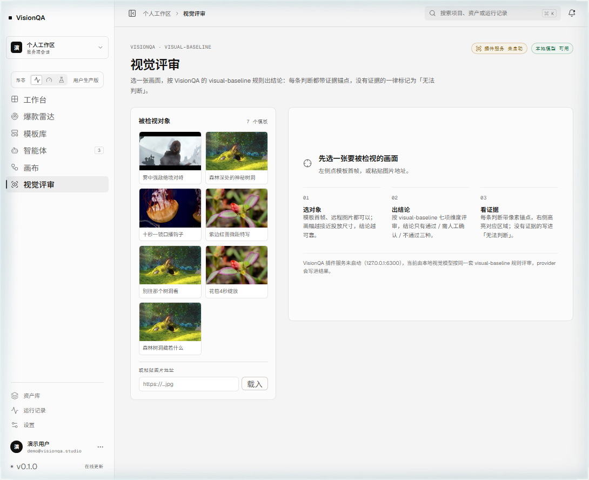

评审按 visual-baseline 七维（层级 / 对比 / 间距 / 字体 / 色彩 / 构图 / 可识别性）出结论，**每条判断必须给 bbox 锚点**，给不出锚点的降级为 info 或进「无法判断」。服务端实现见 server/review.mjs：优先调 VisionQA 插件服务（127.0.0.1:6300 的 /api/visual-review，同一套 v0.1 契约），服务没起来就退到本地模型的同口径评审，并把实际 provider 写进结果（截图里是 local-model:gpt-6.1-sol · 72.9s）。

契约映射、证据锚点格式与降级行为见 [docs/review-integration.md](docs/review-integration.md)。

## 六、VisionQA Canvas 接入（上游 BD Canvas 源码，Source-Available，不入仓）

画布这一块跑的是 **VisionQA Canvas**：源码来自 **BD Canvas**（Source-Available License v1.0，不是开源协议）的授权副本，本产品对外统一叫 VisionQA Canvas。上游条款禁止把源码或修改版以任何形式分发，也禁止把软件本身当产品卖，所以本仓库：

- **不 vendor、不提交** BD Canvas 的任何源码或构建产物（公开仓库提交就等于分发）；
- VisionQA Canvas 单独部署在本机，跑它自己的 5312（后端）/ 5313（后台管理）/ 6677（网页入口）；
- 工作台只做探活与内嵌：GET /api/bdc/status 探测这三个地址，画布页拿到 `deployed=true` 就**默认直接进 VisionQA Canvas 本体**；没有部署时仍是本仓库那套节点编排。
- 画布页是**沉浸模式**：第三方画布自带完整的顶栏与工具条，所以这一层不再叠标题和说明，只留一条 42px 状态条（署名 BD CANVAS / 连接状态 / 当前地址 / 新窗口 / 回到内置编排），画布铺满内容区、不套卡片不套圆角。画布页的主角是画布，壳让位。

部署记录、三个必踩的坑（Python 不在 PATH、requirements 少两个包、根 .env 没有代码读）与验收清单见 [docs/visionqa-canvas-integration.md](docs/visionqa-canvas-integration.md)，自检用 node scripts/check-bdc.mjs，重启用 `scripts/start-bdc.ps1`。

**当前状态（2026-11-05 实测）**：已解压到 `D:\Projects\bd-canvas`，5312 / 5313 / 6677 三端口都返回 200，`/api/bdc/status` 的 `deployed` 为 true，画布页由 VisionQA Canvas 接管，浅色纸面主题已覆盖；后台 `bdadmin` 初始密码已改。**还差模型 Key**——后台「Key 管理」为空，出图链路没通。

### 改名与顶栏对齐（2026-11-06）

产品名统一成 **VisionQA Canvas**，只改**用户看得见**的地方：网页 `<title>`、顶栏品牌、管理员登录页、新手教程页、桌面端画布标题、设置面板里的应用名、AI 人设前缀、`document.title` 动态标题。上游的版权声明（`copyrightBanner.ts` 归属串）、各文件头部的 `Source-Available License v1.0` 与 `LICENSE` 原文**一个字符都没动**——那是 §4.3 / §5.1 要求保留的署名。

顶栏几何也并进 `deploy/bd-canvas/vq-theme.css` 第 9 节，口径直接抄宿主 42px 状态条（`.cv-bdc-strip`）：**42px 高、底色 `#f4f4f4` 与宿主状态条连成一条、底边 `1px rgba(17,17,17,.10)`、页签 26px / 6px 圆角 / 12px 字、「后端未检测」做成 20px 等宽微标签**。于是「宿主状态条 + 画布顶栏」读起来是一条，而不是两层壳。

### 把它收进我们这套白纸墨线的语言

上游默认是 `#101113` + 蓝 `#6f9cff` + 青 `#22d3ee` 的深色霓虹调性，直接嵌进浅色工作台会读成「里面装了个别家的 App」。所以做了一层**只改配色与顶栏几何、不改组件结构**的主题覆盖：

- `deploy/bd-canvas/vq-theme.css`：它真正的色板在 `src/ui/styles/` 里分三层——`palette.css` → `themes.css`（`--ui-*` 语义层）→ `legacyAliases.css`（把旧 `--bg-*` / `--text-*` / `--border-*` 全部桥接上去）。所以只重定义**上游两层**（`--palette-*` 与 `--ui-*`）就能一次收口，并且是**往我们自己的浅色画布上靠**，不是另起一套深色皮肤：画布 `#f4f4f4`、卡片 `#ffffff`、次级 `#f0f0f0`、三级发丝线 `rgba(17,17,17,.06/.10/.20)`、文字 `#111 / #3f3f3f / #5d5d5d / #9a9a9a`、强调近黑、发光全 `transparent` 只留墨投影、点阵 `rgba(17,17,17,.10)`、语义色直接用我们 tokens.css 的 `#176b43 / #8a5b08 / #a33838`。
- `scripts/apply-bdc-theme.mjs`：幂等地把 css 复制进 `bd-canvas/public/`，并在 `index.html` 的 `</head>` 前插入/校正一行 `<link id="vq-bdc-theme" rel="stylesheet" href="/vq-theme.css">`（371121 → 371187 字节，去掉这一行可完整还原）。上游升级后重跑一次即可；`--check` 只校验不改。

**许可证边界**：LICENSE §3.2 允许为自用修改源码，§4.3 / §5.1 禁止删除、隐藏、篡改版权声明、水印与归属标识。所以：`src/features/license/copyrightBanner.ts` 的归属串、各文件头部的 `Source-Available License v1.0` 声明、`LICENSE` 原文**全部原样保留**；改动只限于**可见产品名**（标题、顶栏品牌、登录页、教程页、桌面端标题、AI 人设、`document.title`）与配色/顶栏几何（`deploy/bd-canvas/vq-theme.css`）。`vq-theme.css` 与脚本是我们自己写的、进本仓库，**上游源码一个字节都没进仓库**。

改色前（蓝青霓虹）：


改色后（白纸 + 墨线 + 发丝节点卡，节点选中是 1.5px 近黑环）：

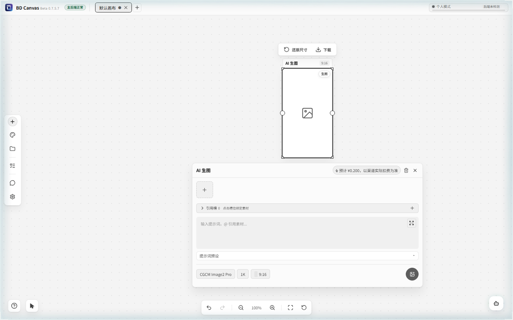

同一个画布按沉浸模式内嵌进工作台——两边现在是一套语言，不再像「里面装了个别家的 App」：


## 七、账号与会话（真实服务端）

登录不再是前端 mock。后端 `server/auth.mjs` + `server/routes/auth.mjs` 提供五个端点：`GET /api/auth/config`、`POST /api/auth/{register,login,logout}`、`GET /api/auth/me`。要点：

- **口令**：scrypt(N=16384, r=8, p=1) + 每用户随机盐，格式 `scrypt$N$r$p$salt$key`；库里没有明文密码。
- **会话**：32 字节随机 token，库里只存 `sha256(token)`；cookie 是 `HttpOnly; SameSite=Lax`，生产加 `Secure`。
- **不泄露账号存在性**：邮箱不存在时也跑一次 scrypt，登录失败统一 `field:'form'` + 「邮箱或密码不正确」。
- **限流**：同 IP + 邮箱 10 分钟失败 8 次锁；写请求校验 `Origin` 与 `Host` 一致，挡最省事的 CSRF。
- **受保护接口**：`VQ_REQUIRE_AUTH=1` 时除 `/api/auth/*`、`/api/health`、`/api/version` 外全部要登录，未登录返回 `{error:'未登录', loginRequired:true}`，前端收到就在 `src/api/client.ts` 派发 `vq:auth-required` 统一切回登录页。

**四个开关的默认值都在「不安全」一侧**（这是为了让本机演示不受影响），生产必须显式写：`VQ_REQUIRE_AUTH=1`、`VQ_SECURE_COOKIES=1`、`VQ_DEMO_ACCOUNT=0`、`VQ_REGISTRATION=0`（按需）。演示账号由后端 seed，密码通过 `/api/auth/config` 下发给登录页，**前端源码里没有任何密码**；关掉演示账号后登录页那块入口整体消失。

验收：`node scripts/test-auth.mjs` 起临时实例跑 16 项端到端断言（含「库里查不到明文 token / 明文密码」），全过；界面侧另做过一次真实点击：注册新账号 → 直接进工作台 → 退出 → 回登录页 → 错误密码给出统一提示 → 演示账号登录 → 进工作台。

没做的部分（别当成已经有了）：找回密码、邮箱验证、角色权限、多工作区、第三方登录。细节与接口契约见 [docs/accounts.md](docs/accounts.md)。


## 八、服务器配置

内测起步一台 **4C 8G / 100G ESSD / 5M 带宽**、视觉模型继续走 API、VisionQA Canvas 同机部署即可；**不需要 GPU**——评审 60–85s、智能体 20–50s 都是接口延迟。逐档配置、存储/带宽估算、以及上线前必须做的三件事（Windows 脚本换 systemd、JSON 换 SQLite、视频转对象存储）见 [docs/server-sizing.md](docs/server-sizing.md)。

**要真正对外上线**时看 [docs/deploy-production.md](docs/deploy-production.md)：域名与 DNS、Caddy 自动 HTTPS（`deploy/Caddyfile`）或 Nginx（`deploy/nginx.conf`）、systemd 守护（`deploy/vq.service`）、环境变量清单（`deploy/env.production.example`）、健康检查、备份恢复与日志轮转，都有可直接复制的命令和验收步骤。三条硬结论：node 只监听 127.0.0.1、公网只走反代；四个 `VQ_` 开关不写就等于裸奔；单机同时复刻不超过 2 路。

### 线上环境（已上线，2026-11-06）

| 项 | 值 |
| --- | --- |
| 站点 | https://visionqa.wavisionai.cn （80 端口 301 跳 https） |
| 机器 | 阿里云轻量应用服务器 2 vCPU / 2 GiB / 40 GB，华东2（上海） |
| 应用目录 | /opt/visionqa，git 部署，systemd `visionqa.service` |
| 数据目录 | /var/lib/visionqa（SQLite，含 auth.db） |
| 后端端口 | 127.0.0.1:8799（8787 被既有站点占用，所以换端口） |
| 反向代理 | nginx `/etc/nginx/conf.d/visionqa.wavisionai.cn.conf`：80 只做 ACME 挑战 + 跳转，443 终止 TLS 并反代 /api 与 /media |
| 证书 | Let's Encrypt（certbot webroot `/www/wwwroot/wavisionai.cn/acme`），到期 2027-02-04，续期不影响 443 |
| 登录账号 | 由服务器 `/opt/visionqa/.env` 的 `VQ_DEMO_EMAIL` / `VQ_DEMO_PASSWORD` 决定，改完 `systemctl restart visionqa` 生效 |

当前是**无模型 Key** 的形态：`/api/health` 里 `vision=false`，界面照常可用，模型下拉照实写「凭证未配置：选中模型也不会真正发起调用」，不假装有推理。

部署脚本（root）：

```bash
DOMAIN=visionqa.wavisionai.cn API_PORT=8799 SECURE_COOKIES=0 bash deploy/production/install.sh   # 装依赖 → 拉代码 → 构建 → systemd → nginx(80)
DOMAIN=visionqa.wavisionai.cn bash deploy/production/enable-https.sh                            # 签证书 → 换成 80 跳转 + 443 → 打开 Secure Cookie
```


**模型切换的口子怎么用**：右上角模型下拉读 `GET /api/models`，目录来自服务器 `.env` 的 `VISION_MODELS`（逗号分隔，每项可写 `id|显示名`），没配就退回 `VISION_MODEL` + `VISION_FALLBACKS`；改完重启服务、刷新页面即可，**前端不用改一行**。公开匿名**拿不到**这份清单（`VQ_REQUIRE_AUTH=1` 时 401），只有登录后的界面能读；顶栏下拉只显示 VisionQA 产品名，真实模型 id 只用于请求。真正要发起调用时，把 `VISION_BASE_URL` / `VISION_API_KEY` 填进同一个 `.env`，`configured` 会变 true，下拉里的「凭证未配置」提示自动消失。

### VisionQA Canvas 同机部署（2026-11-06）

线上「画布」页里嵌的就是 BD Canvas 本体（真源码那套），不再是内置编排的替身。

| 项 | 值 |
| --- | --- |
| 站点 | https://canvas.wavisionai.cn （独立子域，80 跳 https） |
| 目录 | /opt/bdcanvas（git clone 私有仓库快照，venv 在 .venv，node_modules 走 npmmirror） |
| 服务 | systemd `bdc-web.service`（Vite 6677，只监听 127.0.0.1）、`bdc-api.service`（Flask 5312）、`bdc-enterprise.service`（Flask 5313） |
| 反向代理 | nginx `/etc/nginx/conf.d/canvas.wavisionai.cn.conf` → 127.0.0.1:6677；`/admin`、`/api/admin`、`/enterprise/admin` 只放行 127.0.0.1 |
| 证书 | Let's Encrypt（同一 ACME webroot），与主站互不影响 |
| 接线 | `/opt/visionqa/.env` 的 `BDC_WEB_URL=https://canvas.wavisionai.cn`，重启 visionqa 后 `/api/bdc/status` 变 `deployed: true`，画布页直接从「未发布」切成 iframe |

两个坑（都踩过）：

1. BD Canvas 的正式构建（`npm run build`）在当前源码里是坏的——`vite:esbuild-transpile` 在 `VideoFaceBlurEditor` 分块上拿到 `[object Object]` 就中断，去掉三个自定义 bridge 插件也一样。所以服务端跑的是它自己启动时用的那套 Vite dev server（6677），不是静态 dist。
2. `vite.config.ts` 默认把非 loopback Host 当「公网访客」，会 403 掉所有写接口。子域部署要把它加进 `TRUSTED_PUBLIC_HOSTS`（已改），同时加进 `server.allowedHosts`，否则整页 403。

**画布已加 Basic Auth**（2026-11-06 追加）：`canvas.wavisionai.cn` 默认 401，用户 `canvas`；iframe 走一次性入口 `/__auth?k=<token>` —— nginx 种 30 天 cookie 后所有资源请求免登录，所以嵌在 VisionQA 里不会弹登录框。`/admin`、`/api/admin`、`/enterprise/admin` 仍然只放行 127.0.0.1。VisionQA 侧新增两个环境变量：`BDC_EMBED_URL`（iframe 用，带 token）与 `BDC_WEB_PROBE_URL`（探活用本机 6677，避免 401 把 `deployed` 误判成 false）。

**外壳对齐（2026-11-06）**：主题只在 `deploy/bd-canvas/vq-theme.css`（部署方自用，不改它的组件结构），发布时拷成 `<canvas>/public/vq-theme.css`、在 `index.html` 里以 `#vq-bdc-theme` 引入。十节内容：

1. 第 1–8 节把它的 `--ui-*` 变量用 `:root:root` + `!important` 映射到 VisionQA 的 `tokens.css`——字体栈、6/10px 圆角、4/8pt 间距、`#f4f4f4` 画布 + 发丝线、单层轻阴影、等宽微标签。
2. 第 9 节管顶栏几何：`height: 42px !important`（只写 `min-height` 会被它自己的 48px 规则压住）、页签 26px/6px/12px、状态胶囊等宽 10px。
3. 第 10 节管左侧组件面板与右键菜单：面板 288px 白底 10px 圆角、44px 表头、分组标题等宽 10px/0.12em、行高 36px、图标方块 24px；右键菜单与节点创建菜单 208px 宽、行高 34px、快捷键右对齐（补了 `display:flex` + `margin-left:auto`，它原本是 `display:block`，标签和快捷键会挤在一起）。


**第三轮：外壳细节（2026-11-09）** 主题层第 11 节把剩下的界面统一成一套 4pt 栅格：

- 左侧功能轨：8px 内边距、32px 方形 8px 圆角按钮（原来是灰底圆形），悬浮 5% 墨色；
- 底部控制条：46 → **40px** 高（它的 `min-height: 44px` 要一起压，只写 `height` 不生效）、按钮 32px、缩放数字等宽 10px；
- 节点卡：标题 12/500、正文 13px/1.6、页脚等宽 10px、选中转单层墨色描边；
- 悬浮工具条 28px、参数面板 12px 圆角 + 等宽分组标签、输入框 6px 圆角聚焦转墨色、滚动条细化到 8px。

**顶栏状态改报真实结果（2026-11-09）**：品牌旁那颗探的是 `/api/health`（5312），5s 超时、30s 一轮，title 带状态码与耗时；右侧连接胶囊原本归管理服务状态管，未登录时恒为 `unknown` 所以永远显示「后端未检测」——现在宿主把真实探测结果写进 `setConnectionProbe()`，未登录也报真话（后端正常 / 后端断连）。


**细节第一轮：节点卡尺寸与空状态（2026-11-09）**

- **文本节点按「一页纸」定尺寸**：它自己会写 `_width/_height`（默认 360×220），但旧逻辑最后落到 `aspectRatio` 的 **1:1 方卡**上——评审结论三行就出滚动条。现在 `getNodeBaseSize()` 为 `text` 单独开一条分支按存储尺寸取值，写笔记用 420×300 + `_cardScale: 1`，五条结论一屏读完、不用滚动。
- **空白画布有了引导**：`#v2-canvas:not(:has(.v2-node))::after` 画一块虚线提示卡（13px / 白 70% / 10px 圆角 / 虚线发丝线）：「空白画布 · 左侧 + 新建节点，或把素材拖进来（Ctrl+V 粘贴）」。有节点后自动消失，纯 CSS，不动上游 DOM。


**细节第二轮：文本卡的内联样式控件（2026-11-09）** 文本节点没有模型参数面板（上游把它当「原地编辑」节点），所以样式控件直接做在卡片页脚，右对齐四颗 18px 小按钮：

- `A-` / `A+`：字号 10–22px，每次 1px；
- `LH`：行高在 1.4 / 1.6 / 1.8 之间循环；
- `M`：等宽字族开关（Geist Mono）。

样式写进 `node.params._vqText`，渲染时翻译成三支 CSS 变量（`--vq-text-size/-leading/-font`）由主题层消费；点按钮不整卡重渲染（文本框要保光标），直接把变量写到现有 textarea 上。线上实测：`13px → 16px` 时行高跟着到 `25.6px`，`M` 切到 `Geist Mono`。


**画布与工作台数据打通（2026-11-06）**：工作台不再只是「嵌一个 iframe」，它和后端共用同一批画布。

| 工作台接口 | 干什么 | 打到的画布接口 |
| --- | --- | --- |
| `GET /api/bdc/canvases` | 列画布（名称、节点数、版本、更新时间） | `GET /api/canvas/list` |
| `POST /api/bdc/canvases` | 建一块空画布（id 形如 `vq-*`） | `POST /api/canvas/save` |
| `POST /api/bdc/canvases/note` | 把评审结论落成画布里的一个文本节点 | `GET /api/canvas/load/:id` + `POST /api/canvas/save`（带 `expected_revision` 乐观锁，别人同时改了返回冲突而不是覆盖） |

界面就在 42px 状态条里：`画布项目` 下拉（选中即用 `&loadCanvas=<id>` 深链换画布，选中项记在 `localStorage`，刷新后仍然绑着同一块）、`新建`（建完自动绑定）、`写笔记`（写完 iframe 自动重挂载，立刻能看到那条文本节点）。


打通时踩到的三个硬点（都是上游行为，记住能省一天）：

1. **公网访客模式只读浏览器**：`isPublicWebClient()` 把任何非内网 Host 当公网访客，画布数据存 localStorage，服务端的画布永远加载不出来（深链报 `Load failed`）。改成把 `canvas.wavisionai.cn` 当「本机安装」（`runtimeMode.ts` 里加 `VITE_TRUSTED_HOSTS` 白名单），数据才落到服务端 workspace。
2. **一次性入口会吃掉查询串**：`/__auth?k=…&loadCanvas=<id>` 原本一律 `return 302 /`，深链参数直接丢。nginx 里补 `if ($arg_loadCanvas) { return 302 /?loadCanvas=$arg_loadCanvas; }`。
3. **文本节点的正文在 `prompt` 不在 `params.text`**：照它自己的 `createTextNode` 写——`{ type:'text', prompt: 正文, model:'text', params:{ _width:360, _height:220, _agentTextNode:true } }`，写进 `params.text` 的会显示成「0 字」。


## 九、怎么跑

依赖安装后起两个服务：后端 8787（同时托管 dist），前端开发 5191。守护脚本 keep-services.ps1 是单实例，掉了自动拉起，日志在 data/keeper.log。

| 命令 | 作用 |
| --- | --- |
| npm install | 装依赖 |
| node server/index.mjs | 后端 8787 |
| npm run dev -- --port 5191 --strictPort | 前端开发服务器 |
| powershell -ExecutionPolicy Bypass -File scripts/keep-services.ps1 | 常驻守护 |

环境变量放 .env（已 gitignore，模板见 .env.example）：

| 变量 | 用途 |
| --- | --- |
| REDFOX_API_KEY | 红狐检索 / 视频解析 Key（当前账号积分不足且 Key 被禁用） |
| API_PORT | 后端端口，默认 8787（监听地址写死 127.0.0.1，公网只走反向代理） |
| VISION_BASE_URL / VISION_API_KEY / VISION_MODEL | 模型通道，线上是 https://api.deepseek.com/v1 + deepseek-flash（文本与看图同一个模型） |
| VISIONQA_SERVICE_URL | VisionQA 插件服务地址，默认 http://127.0.0.1:6300 |
| VQ_REGISTRATION | 注册开关，**默认关闭**，只有显式写 1 才开放（以前是「不等于 0 就开」，漏配即公开注册） |
| VQ_ADMIN_EMAILS | 管理员邮箱（逗号分隔），可看全部数据、发放积分；库里 kind='admin' 等价 |
| VQ_CREDIT_WELCOME / VQ_CREDIT_SEARCH / VQ_CREDIT_REPLICATE / VQ_CREDIT_REVIEW / VQ_CREDIT_CHAT / VQ_CREDIT_FLOW_RUN | 初始积分与各动作单价，默认 100 / 2 / 10 / 5 / 1 / 2（画布整条流程跑一次） |
| VQ_CONCURRENCY_SEARCH / _REPLICATE / _REVIEW / _CHAT / _FLOW_RUN | 单账号并发上限，默认 1 / 2 / 1 / 2 / 1 |

## 十、接口

| 接口 | 说明 |
| --- | --- |
| GET /api/health | 服务与三个外部依赖的可用性（红狐 / 模型 / 模板数） |
| GET /api/auth/config, POST /api/auth/{register,login,logout}, GET /api/auth/me | 账号与会话（scrypt + HttpOnly cookie），契约见 [docs/accounts.md](docs/accounts.md) |
| GET /api/search | 红狐检索；不可用时返回 mode:'mock' + quota.code + 充值链接 |
| POST /api/replicate, GET /api/jobs/:id | 一键复刻流水线（五步进度） |
| GET /api/templates（含 ?kind=saved|replica）, GET /api/templates/:id, POST /api/templates/:id/reuse, DELETE /api/templates/:id | 模板库 |
| POST /api/templates/from-radar | 雷达卡片「加入模板库」：只落链接 + 互动数据，不下载视频（同一 sourceId 不会重复入库） |
| GET /api/billing/overview, GET/POST /api/billing/orders | 充值通道占位：未接入时返回 enabled:false、下单 501 BILLING_NOT_CONFIGURED，不伪造价格与订单 |
| GET/POST /api/agents, GET/PATCH/DELETE /api/agents/:id, POST /api/agents/:id/chat | 智能体与真实对话 |
| GET/POST /api/flows, PATCH/DELETE /api/flows/:id, POST /api/flows/:id/run, GET /api/runs | 画布与运行记录 |
| POST /api/review, GET /api/review/health | 视觉评审（service / local-model 两种 provider） |
| GET /media/frames/:id/:file | 抽帧静态文件 |
| GET /api/credits | 当前账号积分余额、单价、近期流水（检索 2 / 复刻 10 / 评审 5 / 对话 1，可用 VQ_CREDIT_* 改） |

## 三百六十二、聊天室 1c：平台智能体在房间里能回话了（r317 / v0.9.290）

1b 之后房间里只有「接进来的连接器」会说话，平台智能体挂在成员列表里不回话——这是当时最假的一环。
这一版把它补上，同时把「工具」的骨架立起来，但只开一个。

1. **谁回**：一个平台智能体的房间接每一句；多个时只接被 @ 的那个；房主可以关「自动接话」。
   智能体之间不互相接话（maxDepth=1），否则两个智能体互道「收到」能把一屏刷满，而且每条都在花钱。
2. **多少钱**：一轮 1 积分（与快捷创作对话同价），先扣后调；失败全额退回，并把原因作为一条
   `state=error` 的消息留在房间里——静默失败会让人以为功能坏了。
3. **工具只开一个**：`templates.list`（只读、不花积分、只看自己账号）。另外六个（projects.read /
   assets.list / web.read / media.image / media.video / review.run）登记但关着，调了只回「还没开」。
   协议是模型输出一行 JSON（tool / args），最多 2 轮，不依赖上游 function calling。
4. **止血开关**：`VQ_ROOM_AGENT=0` 关掉全部平台回话，`VQ_AGENT_TOOLS_DISABLE=templates.list` 关单个工具，
   都不用改代码、不用发版。

顺手修的两处体验：打开房间落在最新一条（以前刷新后停在最上面，新回复要自己翻）；
左栏那一行预览跟着房间里的新消息走（以前一直显示你自己最后那句）。

证据（临时实例 + 真 SQLite + 真 SSE，模型用本地假 /v1 代替，0 次真实上游调用）：
[docs/r317-room-typing-1440.png](docs/r317-room-typing-1440.png)（正在看并写回复）、
[docs/r317-room-reply-1440.png](docs/r317-room-reply-1440.png)（回复落进房间，这一轮先要了模板库再回答）、
[docs/r317-room-reply-390.png](docs/r317-room-reply-390.png)（390 回复在窗口里、溢出 0、右栏写清只开了哪个工具）。
细节与 15 条单测：`docs/r317-room-agent-2026-11-26.md`、`test/room-agent.test.mjs`、`scripts/shot-r317.mjs`。

边界：逐次批准没有（写操作工具一个都没接，1d 一起做）；不做流式；连接器说的话不会引出平台智能体接话；
截图里的模型是假的，真模型下的语气未验；390 下左侧导航栏有一列被裁掉的字（r316 就有，属既有问题）。

另有一份独立审计：`docs/platform-gap-audit-2026-11-26.md`（平台还缺什么，按「最假先修」排序）。
## 第三百六十三、发版：聊天室 1c 进生产（v0.9.290）

1c（平台智能体在房间里回话、7 个工具只开 `templates.list`）已上生产：入口 `index-Cj1eOo-7.js`，
health ok templates 27，两个服务 active，**一次发布成功**。回滚 `bash /opt/visionqa/ops/rollback.sh --to 1` 回 0.9.289。

生产上真渲染验过（`scripts/shot-r317-prod.mjs`，临时管理员会话拍完撤销、临时房间拍完解散）：
输入框提示「平台智能体会接话 · 每轮 1 积分，失败自动退回」、右栏「自动接话：开」与
「平台智能体现在能用：读模板库 · 另外 6 个还没开」、1440 与 390 横向溢出 0、页面报错 none。
[docs/r317-prod-room-1440.png](docs/r317-prod-room-1440.png)、[docs/r317-prod-room-390.png](docs/r317-prod-room-390.png)。

边界：本轮 0 次真实上游调用、0 积分——**线上还没真跑过一轮平台回话**（真跑一轮要 1 积分并打真实模型，等在生产上发一句再验）；
逐个房间的验收临时房间在 `rooms` 表里留了墓碑行（列表接口不返回）。细节见 [docs/deploy-r317-2026-11-26.md](docs/deploy-r317-2026-11-26.md)。

## 第三百六十四、竞品对比：我们还缺什么（2026-11-26）

对比即梦AI、LibTV（liblib.tv）/LiblibAI、RunningHub、PixArt、picsetai.com（Picset，已改名 Picell AI），
四份带出处的原始调研 + 一份去重排序后的清单：[docs/competitive-gap-list-2026-11-26.md](docs/competitive-gap-list-2026-11-26.md)。

三个共性致命缺口：① **没有对外价格语言**（竞品明码 0.16 元/秒、US$0.22/条，我们只有内部公式，且内测直充 `auto` 会白送积分）；
② **复刻没有音轨/ASR/BGM**，口播原文是模型看画面编的（LibTV 的「视频解析」直接产出含人声与音乐节奏的分镜表）；
③ **没有组织实体**，团队席位/额度/审批只有 RunningHub 有，我们的房间智能体产物也不与人的画布共用 projectId。

我们更强、且竞品短期不会做的：复刻→评审→交付→回执→版本对比闭环、视觉评审的证据锚点、失败全额退款与断点续跑、
聊天室能接用户自己的 codex / Claude、爆款检索 + 来源足迹、单位经济学模型。

附：我方现状里更薄的几处（评审插件分支硬编码 `mock`、参考图出图 0 次真调、视频通道 11-19 回归过、数字人只有定妆图）
见清单文件的「附」一节与 [docs/competitive-our-surface-2026-11-26.md](docs/competitive-our-surface-2026-11-26.md)。

## 第三百六十五、细节层第一批：工作台运营位 + 动效细则（r319）

用户把方向拉了回来：竞品那三大缺口（价格语言、复刻音轨、组织实体）先记着，
**他真正在意的是小的细枝末节**——动效、运营位（他原话「广告模块」）、UX 的手感。
这一版就做这个，先落第一批，看得见、能量、能关。

1. **运营位**（`src/components/PromoSlot.tsx` + `src/domain/promos.ts`）：工作台顶部两条，
   左边一个方形图标、中间小标签 + 标题 + 一句话、右边一个按钮加一个关闭。
   内容与开关在 `PROMOS` 一份数据里：按 `placement` 分屏、按 `weight` 排序、按
   `from/until` 起止、`internal` 只给管理员看；一个位置最多两条。关掉记在浏览器本地
   （`vq_promos_dismissed`），**关一条下一条补位**，不是把这一块关空。
   文案三条规矩写在文件注释里：只说真跑通过的能力、涉及扣费就写明扣多少和失败怎么办、
   不写「赋能 / 一站式 / 全新升级」。
2. **动效细则**（`src/styles/motion.css`，tokens.css 之后最后一层）：列表逐条进场
   `.vq-stagger`（24ms 步进，第 8 条之后合并，长列表不一直抖）、卡片抬起 `.vq-lift`
   （2px + 一层极浅投影）、提示条滑入 `.vq-toast`，以及一条**真管得住的 reduce-motion 总闸**——
   以前只关了页面淡入和按钮位移，打字点、转圈这些无限动画照转。
3. **先上了工作台**：四张能力卡换成 `vq-stagger` + `vq-lift`，运营位卡片也能抬起。

两个真实的坑，都记在这里免得下次再踩：

- **改完 src 忘了 build，截图里运营位是 0 条**。本地 shot 脚本跑的是 `dist`，
  `node scripts/*.js` 之前必须先 `npm run build`——第一轮断言直接把它抓了出来。
- **`animation-fill-mode: both` 把 hover 焊死了**：`vq-rise` 最后一帧是 `transform: none`，
  填充模式 both 会一直持有它，而**动画值的优先级高于普通声明，`:hover` 顶不过**，
  于是悬停时描边和投影都变了、就是抬不起来。改成 `backwards`（只在延迟期用起始帧，
  动画一结束就交还普通样式）。这是本轮唯一一个真 bug，被「悬停时 transform 必须是
  `matrix(1, 0, 0, 1, 0, -2)`」这条断言抓住——如果只看截图，多半会以为「抬得不够明显」。

证据（临时实例 + 真账号 + 真渲染，0 次上游调用、0 积分）：[docs/r319-workbench-promo-1440.png](docs/r319-workbench-promo-1440.png)（两条运营位 + 能力卡）、
[docs/r319-workbench-hover-1440.png](docs/r319-workbench-hover-1440.png)（鼠标真停在第 2 张卡上，算出抬了 2px）、
[docs/r319-workbench-promo-390.png](docs/r319-workbench-promo-390.png)（390 上图标 / 关闭 / 文案 / 按钮各占一行，溢出 0）。
单测 `test/promos.test.mjs` 8 条（位置、排序、起止日、内部口径、坏数据、文案长度），
`scripts/shot-r319.mjs` 里 9 条真渲染断言。

**已上生产，两次（都一次发布成功）**：第一次 15:16 `20261126-1516-r319detail`（入口 `index-DKdEsJ3-.js`）——
发完才发现在仓库里忘了 bump 版本号，生产侧栏还是 `v0.9.290`（与 r317 同一个版本号，光看侧栏分不清装的是哪一版），
于是把 `package.json` 提到 **0.9.291** 重新构建，15:34 再发一次 `20261126-1534-r319promo`（入口 `index-qxoGzNF3.js`）。

| 项 | 值 |
| --- | --- |
| 当前生产 | `0.9.291` · 入口 `index-qxoGzNF3.js` 866,229 B · CSS `index-BQfqtB31.css` 426,893 B |
| 回滚点 | `/opt/visionqa/releases/20261126-071953-20261126-1534-r319promo.tar.gz`（`--to 1` 回 0.9.290 / r317） |
| 健康 | `/api/health` ok，templates 27；visionqa / visionqa-internal 都 active |
| 公网 | `/api/version` 200 `0.9.291`；新入口 200；上一版入口 404 |
| 部署里的新样式 | 部署后的 CSS 里 `vq-promo` / `vq-stagger` / `vq-lift` 各命中 1 |

生产上真渲染（`scripts/shot-r319-prod.mjs`：生产侧临时签一个管理员会话，令牌只写 `/root/.vq-shot-token` 0600 →
scp 回本机文件 → 脚本从文件读、不打印 → 拍完 `destroySession`）：
[docs/r319-prod-workbench-1440.png](docs/r319-prod-workbench-1440.png)（管理员真实工作台：两条运营位、`animationName=vq-rise`、
`transitionProperty` 含 transform、侧栏 `v0.9.291`、49,595 积分、溢出 0、报错 none）、
[docs/r319-prod-workbench-390.png](docs/r319-prod-workbench-390.png)（390 溢出 0）。

收尾时出过一次岔子，写下来：第一次撤销会话我只把**签发** helper 传上了服务器，`revoke` 报 `MODULE_NOT_FOUND`，
紧接着的清理脚本又把 `/root/.vq-shot-token` 删了——令牌没进过上下文（脚本从不打印），但那条会话记录还留着。
补了一个一次性脚本按 `user_agent LIKE '%prod-shot%'` 删掉（命中 1 条、删后 0 条），再用 `listLoginSessions` 核管理员活会话（余 3 条是他自己的真实登录）。
第二次签发与撤销两个 helper 一起传，撤销后复查 0 条。教训：**签发与撤销必须成对上传；清理脚本不要抢在撤销之前删令牌。**

边界：运营位内容还写在前端文件里，**后台改不了**（下一步接服务端配置 + 后台编辑，组件与页面不用动）；
动效这一批只上了工作台一处列表和一种卡片抬起，模板库/作品流还没铺；
reduce-motion 总闸只有代码与单测层面的证据，没在真开了「减弱动态效果」的浏览器里跑过；
390 下运营位正文折成三行（可读、未裁切，但还不够紧凑）。

## 第三百六十六、运营位搬到服务端 + 后台能改 + 动效铺开（r320）

r319 把运营位和动效先摆到工作台上；这一版补齐三件事——**内容由服务端给（不发版就能改）、后台有地方改、
动效铺到模板库与作品流**，顺手修掉后台 390 上一条 10px 的横向滚动条。

1. **服务端是真源**（`server/promos.mjs`）：位置枚举（工作台 / 模板库 / 充值）、字段与长度上限、
   默认内容、`resolvePromos`（`admin` 有存档 / `default` 没配过 / `error` 文件读不出来）、
   `savePromos` / `clearPromos`、`publicPromos`（`internal` 那条只给管理员）。
   存档是 `DATA_DIR/promos.json`，0600、原子替换；**读不出来不等于空**，这时保存会被拒。
2. **两个接口**：`GET /api/promos` 要登录（匿名 401），普通账号拿不到 `internal` 那条；
   `GET / PUT / DELETE /api/admin/promos` 只给管理员，PUT 是整份覆盖——顺序、权重、条数一起生效，
   逐条保存会出现「旧的删了、新的还没进」的中间态。校验失败回 400 并点名「第 N 条：…」（**不悄悄截断超长文案**）；
   存档坏掉时回 409 `conflict`，要覆盖得显式带 `force`；保存/恢复默认都记审计 `promo.save` / `promo.clear`。
3. **前端换成读接口**（`src/api/promos.ts`）：模块级 store + `useSyncExternalStore`，先出浏览器缓存
   （`vq_promos_cache`）再拉接口，拉不到保留缓存、不弹错；关掉的记 `vq_promos_dismissed`，
   **关一条下一条补位**的规则没变，组件 `PromoSlot` 对页面依旧是原来那个用法。
4. **后台「系统 → 运营位」**（`src/pages/admin/PromosCard.tsx`）：整份草稿编辑，上移下移、删除、新增、
   实时预览（直接用前台那套 `.vq-promo` 样式，所见即所得）；保存时按行序重算权重——第 1 行最高、依次 -10，
   同权重按数组顺序；存档坏掉时多一个「覆盖坏文件」，另有「恢复默认」。
5. **动效铺开**：模板库的网格与作品流都换成 `vq-stagger`（24ms 步进）+ `vq-lift`（悬停抬 2px），
   与工作台同一套细则；`fill-mode` 用 `backwards` 而不是 `both`——理由在 §365 记过。
6. **顺手修的一处细节**：后台 390 下整页会多出一条 10px 的横向滚动条，定位到「数据备份」卡里
   「备份目录」那行长路径：`.admin-mono` 没有断行规则，长串把卡片顶宽。加 `overflow-wrap: anywhere`
   （只在真要断的时候才断），修后 390 溢出 0。这条**跟 r320 的功能无关**，是量截图时顺手量出来的。

两个坑：

- **接口字段名读错**：`GET /api/promos` 回 `{ ok, promos }`，生产脚本第一版读 `api.items`，误报「生产没下发运营位」——
  页面其实一直是好的（前端读的就是 `promos`）。先分清「产品错了」和「断言错了」。
- **徽标的类名不是 `vq-badge`**：后台 `Badge` 走 `components/ui.tsx` 的 `Pill`，DOM 上是 `.vq-pill`；
  按想当然的类名取到空串，又误报「后台没标来源」。写选择器前先读组件。

证据（本地：临时实例 + 真账号 + 真 SQLite，0 次上游调用、0 积分）：[docs/r320-workbench-served-1440.png](docs/r320-workbench-served-1440.png)、
[docs/r320-templates-promo-1440.png](docs/r320-templates-promo-1440.png)、[docs/r320-projects-stagger-1440.png](docs/r320-projects-stagger-1440.png)、
[docs/r320-admin-promos-1440.png](docs/r320-admin-promos-1440.png)、[docs/r320-templates-promo-390.png](docs/r320-templates-promo-390.png)、
[docs/r320-admin-promos-390.png](docs/r320-admin-promos-390.png)。脚本 `scripts/shot-r320.mjs`（20 余条断言：
管理员 PUT 5 条含一条 `internal` → 普通账号看到 2 条 → 关一条补位且刷新不回来 → 网格与卡片动效 →
悬停算出 `matrix(1, 0, 0, 1, 0, -2)` → 后台 5 行、徽标「后台编辑」→ 两个宽度都溢出 0）。

| 门禁 | 结果 |
| --- | --- |
| `npm test` | 2090 / 2090 通过（含 `test/promos.test.mjs` 10 条、`test/promos-admin.test.mjs` 9 条） |
| `npx tsc -b` | 干净 |
| `npx oxlint src server test scripts` | 0 error / 30 warning（运营位相关文件 0 条） |
| `npm run scan:secrets` | 1175 个文件，没命中 |
| `npm run build` | 入口 `index-CfGIkiRr.js` |

**已上生产（一次成功）**，标签 `20261126-1730-r320promo`：

| 项 | 值 |
| --- | --- |
| 当前生产 | `0.9.292` · 入口 `index-CfGIkiRr.js` 866,435 B |
| 回滚点 | `/opt/visionqa/releases/20261126-091556-20261126-1730-r320promo.tar.gz`（`--to 1` 回 0.9.291 / r319） |
| 健康 | `/api/health` ok，templates 27，`uptimeSec: 2`；两个服务 active |
| 公网 | `/api/version` 200 `0.9.292`；新入口 200；上一版入口 404；匿名 `/api/promos` 401 |

生产上真渲染（`scripts/shot-r320-prod.mjs`：生产侧临时签一个管理员会话 → 令牌只写文件 0600 并 scp 回本机 →
脚本从文件读、不打印 → 拍完撤销；签发与撤销用成对的 `scripts/prod-shot-session-once.mjs` /
`prod-shot-session-revoke-once.mjs`，这次两个一起传）：[docs/r320-prod-workbench-1440.png](docs/r320-prod-workbench-1440.png)
（工作台两条运营位的标题与 `GET /api/promos` 回的逐条一致、侧栏 v0.9.292、溢出 0）、
[docs/r320-prod-templates-1440.png](docs/r320-prod-templates-1440.png)（模板库运营位 + `vq-stagger`）、
[docs/r320-prod-admin-1440.png](docs/r320-prod-admin-1440.png)（后台「运营位」卡：4 条、徽标「默认内容」、预览=第 1 条）、
[docs/r320-prod-workbench-390.png](docs/r320-prod-workbench-390.png)（390 溢出 0）。页面报错 none；
收尾 `user_agent LIKE '%r320-prod-shot%'` 的会话 before 2 / removed 2 / after 0，令牌文件已删。
完整发版记录见 [docs/deploy-r320-2026-11-26.md](docs/deploy-r320-2026-11-26.md)。

边界：生产运营位**还是默认内容**（`source=default`），「管理员保存 → 用户刷新就变」这条只有本地真渲染与单测证据，
没在生产后台真存过；`recharge` 位置进了枚举和后台下拉，但充值页还没挂 `PromoSlot`；
本轮 0 次真实上游调用、0 积分。

## 第三百六十七、复刻链路真的读了一次原片声音（r321）

复刻的产出是「脚本结构 + 分镜表」，其中每段口播过去是当**原片说过的原话**用的——可这条链路从来没读过原片的声音。
`frames.mjs` 抽帧带 `-an` 不是根因（抽出来是 jpg，本来就不需要音轨），真正的缺口是**没有任何一步去读音轨**，
而 `vision.mjs` 的提示词还明写「即使原片没有人声和字幕，也要给出可执行的建议口播」。于是模型把编的句子填进
`voiceover`，落库后与「原话」没法区分：用户拿去复刻，抄的是一段没存在过的口播。

这一版把这一层补上：

1. **`server/audio.mjs`（新）**：ffmpeg `silencedetect` + `volumedetect` **就地**读原片音频流（不落地 wav），
   拿到「有没有音轨、停顿在哪、响度多高」。阈值 `SILENCE_DB -35` / `MIN_SILENCE_SEC 0.35` / `FLAT_RANGE_DB 8` /
   `CONTINUOUS_GAP_RATIO 0.02`，每条都在注释里写了为什么是这个数。
2. **流水线多一步**：抽帧之后、调视觉模型**之前**「读取原片音轨」（`jobs.mjs` 的 `analyzeSource`），
   实测事实既写进任务日志，也作为事实喂进提示词：「音轨（ffmpeg 实测，你听不到声音，只能参考这些数字）：…」+ 停顿区间。
3. **提示词不再编原话**：删掉「没人声也要编口播」那条要求；口播只允许两种来源并必须自带 `voiceoverSource`。
   模型只有「照抄画面字幕」这一项真证据，自称做过语音识别（`asr`）的一律降级成「画面推断」——我们现在没有任何识别通道。
4. **事实落库、界面说清**：模板新增 `audio`（字段与阈值见 [docs/replicate-audio-2026-11-26.md](docs/replicate-audio-2026-11-26.md)），
   每段/每镜标 `voiceoverSource` 与 `audioGap`（这一段原片是不是基本没声音）；模板详情多一行「原片声音」，
   口播前贴小灰签（字幕实录 / 画面推断），留白段落补虚线「原片此段无声」；复刻进度多一步「读取原片音轨」。

刻意没做：**没接 ASR**（GeteAPI / SeeAPI 目录里没有可用的语音识别模型），所以 `voiceover` 仍可能是建议口播，
区别是**它现在被标出来了**；**不说「检测到人声」**（ffmpeg 测不出说话人，字段叫 `bed`=声音的连续性，宁说「像一路铺底」）；
**不改远端算力契约**（远端模式源码不在本机，读不到音轨就明说没读到，不假装读过）。

证据（本轮 **0 次上游调用、0 积分**）：

- 单测 15 条：`test/audio.test.mjs` 9 条（含两条**真跑 ffmpeg** 的：一条有停顿的片子、一条没音轨的片子）、
  `test/vision-audio.test.mjs` 6 条（含回归断言：提示词里一旦重新出现「即使原片没有人声」就失败；模型自称 asr 必须被降级）。
- 本地集成自检（真 ffmpeg 造一条 12 秒「0-3 有声 / 3-6 静音 / 6-12 有声」的片子 + 假视觉上游）：
  停顿时段 `3.02–6.01`、`template.audio` 与测量逐字段一致、3-6 秒那段 `audioGap=true`、其余 false；
  假上游收到的提示词里确实带着「音轨 12 秒 · 1 处停顿共 3 秒」「停顿区间（秒）：3.02-6.01」。
- 真渲染：[docs/audio-facts-1440.png](docs/audio-facts-1440.png)（1440×2507：抽屉 579=579、原片声音一行宽 531、
  横向溢出 0、帧图 6/6）、[docs/audio-facts-390.png](docs/audio-facts-390.png)（390×3014：390=390、抽屉 389=389）。
  图里那句「原片声音 音轨 24 秒 · 2 处停顿共 6 秒」就是 `analyzeAudio` 的返回值；五段的来源标记与两处「原片此段无声」
  是 `normalizeResult` 按真停顿算出来的（`segments [{8,11.01},{16,19.01}]` → 8–11s 与 16–19s 两段 `audioGap=true`）。
  夹具片是一条**真的** 24 秒片子（两段真静音）：`audio` 取自 `analyzeAudio`、`structure/storyboard` 取自 `normalizeResult`、
  帧图由 ffmpeg 从这条片子里真抽、模板走 `createTemplate` 落库——界面里出现的**事实字段一个都没手写**。
  其中「操作」那一段我特意让模型 JSON 写 `voiceoverSource: 'asr'`，落库后是 `inferred`（界面上不出现「语音识别」）：
  「模型不许自称做过语音识别」这条断言在真链路上就是这样生效的。
  夹具片源画面来自 Big Buck Bunny（Blender Foundation，CC-BY 3.0），只作本地 QA 夹具，不是产品素材。

| 门禁 | 结果 |
| --- | --- |
| `npm test` | 2105 / 2105 通过（新增 15 条） |
| `npx tsc -b` | 干净 |
| `npx oxlint src server test scripts` | 0 error / 30 warning |
| `npm run scan:secrets` | 1184 个文件，没命中 |
| `npm run build` | 入口 `index-C4p7ot7V.js`（866,556 B） |

CI run `45800370507` success（Node 24）。提交 `605cdf7` + `0e98635` + `6c78e01` 已推 `master`。
第一次 CI 是红的：`ffmpeg-static` 的二进制在 CI 里没装上，两条「真跑 ffmpeg」的用例 ENOENT 失败；
改成**二进制不存在就 skip**（跳过是诚实的，假装通过不是），本地仍 9/9 真跑。

**已上生产（一次成功）**，标签 `20261126-1830-r321audio`：

| 项 | 值 |
| --- | --- |
| 当前生产 | `0.9.293` · 入口 `index-C4p7ot7V.js` 866,556 B |
| 回滚点 | `/opt/visionqa/releases/20261126-101642-20261126-1830-r321audio.tar.gz`（`--to 1` 回 0.9.292 / r320） |
| 健康 | `/api/health` ok，templates 27，`uptimeSec: 58`；两个服务 active |
| 公网 | `/api/version` 200 `0.9.293`；新入口 200；上一版入口 404；匿名 `/api/promos` 401 |
| 产物 | 公网入口 JS 搜到 `读取原片音轨` 1 处 |
| 生产运行环境 | `ffmpeg-static` = 7.0.2-static，可执行（音轨这一步在生产跑得起来） |

**这一版在生产上看不到界面**：能看到的两个东西（模板详情的「原片声音」行、复刻进度里的「读取原片音轨」）
都要求「真跑过一次复刻」——生产 27 条模板都是 r321 之前建的，没有 `audio` 字段。真跑一次复刻要花 10 积分
与一次上游视觉调用，按约定由用户在用户端发起，本轮没有替他发起。等他在生产上点一次复刻，进度里就会多出
「读取原片音轨」，那条模板详情里就会出现「原片声音」事实行。生产侧本轮只核了接口、产物与服务状态。
完整发版记录见 [docs/deploy-r321-2026-11-26.md](docs/deploy-r321-2026-11-26.md)。

## 第三百六十八、充值页的运营位：配了却永远不显示（r322 / v0.9.294）

运营位（用户说的「广告模块」）的位置白名单从 r320 起就是 `['overview', 'templates', 'recharge']`，
后台「运营位」卡的下拉里也有「充值 / 积分」，服务端校验也放行——但**没有任何页面挂**
`<PromoSlot placement="recharge">`。管理员把一条运营位配到充值页、保存、刷新：什么都不会出现，
也没有任何报错，从界面上看不出哪里错了。这类「声明了但没接线」的洞不会自己暴露，只会安静地让功能作废。

这一版把它接上，并且不让它再断第二次：

1. **充值页挂上运营位**（`RechargePage`），并给这个位置一条默认内容（生产后台从没存过，
   走的是 `DEFAULT_PROMOS`）：小标签「积分能换什么」、标题「10 积分复刻一条片子」、
   正文「复刻扣 10 积分，失败原路退回；出一张图 5 积分，4 秒视频 15 积分。」、按钮「去复刻」——
   数字都是真实单价（复刻 10 / 出图 5 / 4 秒视频 15），不是估的。
2. **护栏测试**：遍历 `src` 下所有 `.ts/.tsx`，白名单里的每个位置都必须找得到挂载点，
   而且每个位置都必须有默认内容。拿一个没挂载的位置去跑同一段判断会红——护栏不是摆设。
3. **关掉一条的手感**：以前是按一下就消失，下面那条「跳」一格。现在先塌下去、淡出、再移除。

### 动效那三处，都是量出来才改对的

| 第一版的问题 | 实测 | 改法 |
| --- | --- | --- |
| 塌不到 0 | `max-height` 计算值已到 0.03px，`offsetHeight` 卡在 **34px**（= 上下内边距 16+16 + 描边 1+1），空壳挂 200ms 后被一次性跳掉 | 内边距与描边也一起过渡到 0 |
| 「淡出」没发生 | transition 里写了 `opacity`，却没有任何规则给出目标值，computed `opacity` 恒为 1，看着变淡其实是被 `max-height` 裁掉 | 补 `opacity: 0` |
| 移除时还跳 8px | 间距是容器的 `grid gap`，卡片收不掉它，移除那一刻下面那条跳最后 8px | 间距挪到 `.vq-promo:not(:last-child)` 的下边距，一起收到 0 |

本地（同一位置两条，25ms 一档采样）：`26:107 51:91 75:78 101:52 125:23 150:15 175:7 201:5 226:2 250:2 275:2 301:0 324:0 351:gone`——
高度真收到 0、`opacity` 真走到 0、**移除前后下面那条 0.00px 不动**（整段平滑上移 115.39px）。
反证：把改动前的 `.vq-promos{gap:var(--space-2)}` 注回页面，同一探针立刻量到跳 8.01px，断言会红。

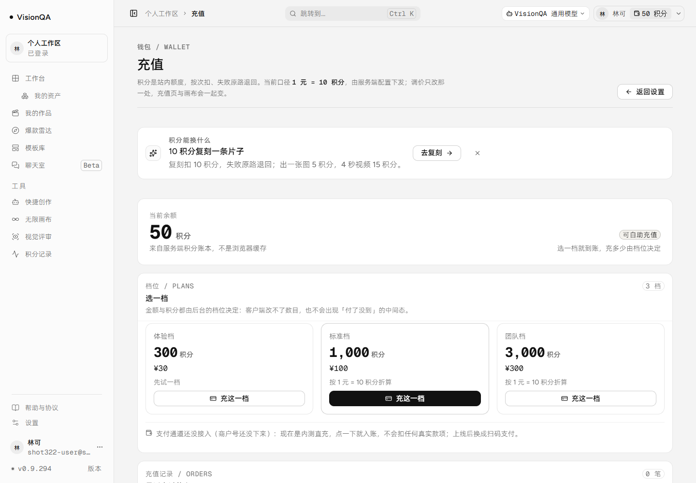

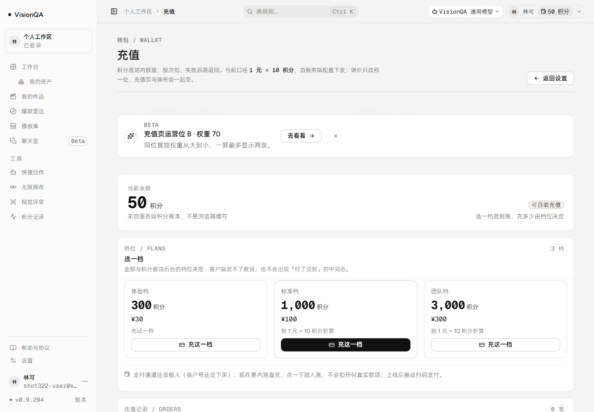

本地四张图：默认态 [docs/r322-recharge-default-1440.png](docs/r322-recharge-default-1440.png)、
管理员写入两条 [docs/r322-recharge-promo-1440.png](docs/r322-recharge-promo-1440.png)、
关闭中间帧 [docs/r322-promo-dismiss-mid-1440.png](docs/r322-promo-dismiss-mid-1440.png)（点前 107px → 截图前 92px/86%/opacity 0.3577 → 截图后 2px）、
390 [docs/r322-recharge-promo-390.png](docs/r322-recharge-promo-390.png)（`390 === 390`，关闭按钮 28×28 右边缘 357）。

**生产上也真渲染了**（临时签一个管理员会话、只发 GET、拍完撤销，见 `scripts/shot-r322-prod.mjs`）：
`GET /api/promos` 回的 `placement=recharge` 那条与页面上那条逐字一致，生产关闭动效
107→0、`opacity`→0、下面那张卡收拢过程中最大偏离 0.85px：

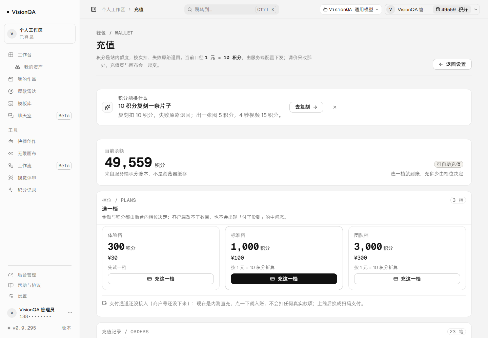

（这张图在 r323 里重拍过一版：原图侧栏底部带手机号，仓库是公开的，现在拍照前会把它与邮箱换成占位符；
重拍用的是 0.9.295，用户侧运营位代码在这两版之间一字未改，关闭动效重测 107px → 0px、最后一跳 40.00px。）

| 门禁 | 结果 |
| --- | --- |
| `npm test` | 2106 / 2106（新增 1 条位置挂载护栏） |
| `npx tsc -b` | 干净 |
| `npx oxlint src server test scripts` | 0 error / 30 warning |
| `npm run scan:secrets` | 1189 个文件，没命中 |
| `npm run build` | 入口 `index-R7L-Ypxl.js` |

CI run `45806852527` success（Node 24），提交 `2c887c9` 已推 `master`。

已上生产，标签 `20261126-1920-r322promo`，回滚点 `/opt/visionqa/releases/20261126-105516-20261126-1920-r322promo.tar.gz`
（`--to 1` 回 0.9.293 / r321）。完整记录见 [docs/r322-promo-recharge-2026-11-26.md](docs/r322-promo-recharge-2026-11-26.md)。

边界：**关掉「这一屏最后一条」时还有一个 40px 的收尾**（生产现在就是这种情形）——卡片本身平滑收拢+淡出，
但运营位区变成空区块后要被移除，它自己的外边距 24px 与页面栅格间距 16px 是结构性的。
要让这 40px 也平滑，只能让空区块继续占位，代价是页面上永远留 16px 空隙，比一次干脆的重排更像 bug，
所以这一版明确不做；同一位置还有下一条时是 0.00px。生产脚本把这 40px 写成断言，哪天做平滑了会红。

## 第三百六十九、后台「运营位」编辑卡：预览跟着你在改的那条走（r323 / v0.9.295）

r322 修的是用户侧（充值页挂上运营位、关掉一条先塌下去再移除），这一版转向配置侧——
后台「系统 → 运营位」是用户自己每天要开的屏，四件小地方都要量出来才算改对：

| 原来 | 后果 | 现在 |
| --- | --- | --- |
| 实时预览写死 `list[0]` | 改第 3 条时预览纹丝不动，看着像预览坏了 | 预览跟着焦点进到哪一行走，行头加「预览中」，预览头写「第 N 条 · 位置名」 |
| 草稿没有任何指示 | 打了十来行字、切走分区再回来，草稿没了却毫无提示 | 草稿与已保存内容按内容比（`promosDirty`），不一样就在「保存」旁挂「有未保存的改动」，改回原样自己消失 |
| 「新增一条」把新行追加到最末尾 | 列表一长，点了等于没反应 | 滚到新行眼前 + 光标放进它的 ID 输入框（开了「减弱动态效果」就直接跳） |
| 删除一按就没了 | 删错只能刷新页面、十个字段重填 | 行上给「已删掉第 N 条「标题」，还没保存」+「撤销删除」，按原位置放回、十字段原样 |

真渲染数字（`scripts/shot-r323.mjs`，临时实例 + 真管理员会话，0 次上游调用）：预览头 `第 1 条 · 工作台`
→ 点进第 2 条标题框真打字后 `第 2 条 · 充值 / 积分` 且预览标题与输入逐字相同；「有未保存的改动」打字后出现、
保存后消失（真 PUT，服务端回的就是改过的那个标题）；点「新增一条」后 `document.activeElement` 是新行的 ID 框、
新行 rect `434–770` 全在视口内、滚动容器 `scrollTop` 3322→4216（真的滚了 894px）；删第 2 条后行数 3→2、
DOM 里确实没有它（反证），撤销后回到 3 行且 10 个字段 diff 为空；反证二：把标题逐字符改回原值，徽标消失
（比的是内容不是「动过没有」）；390 宽 `scrollWidth 390 === innerWidth 390`、越界元素 0、撤销行与预览头
重叠面积 0；页面 exception 0 / console.error 0。

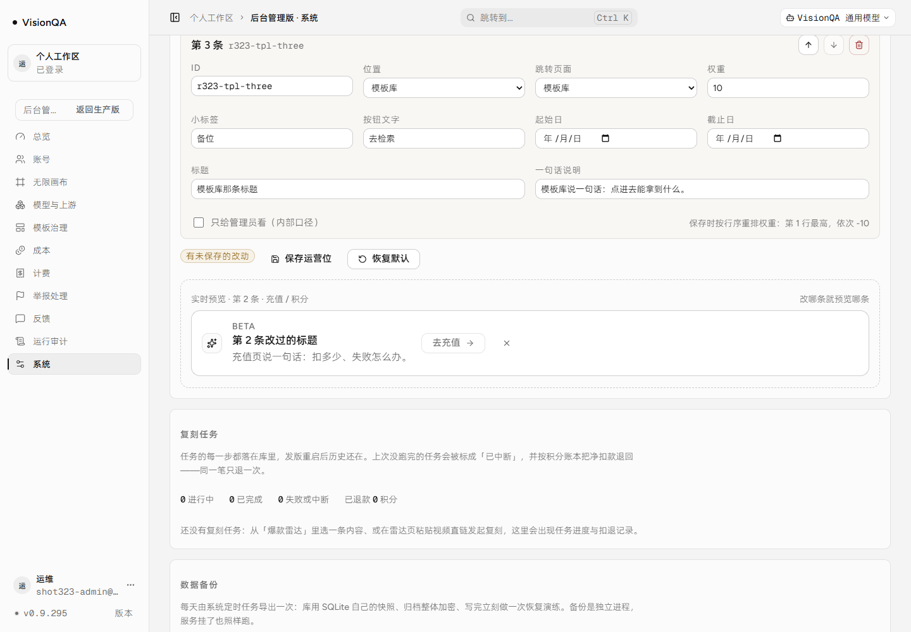


生产上也真渲染了（`scripts/shot-r323-prod.mjs`，临时管理员会话、只发 GET、拍完即撤销）：
线上入口 `index-3jw-5dtJ.js`、侧栏 `v0.9.295`、卡上 5 行（默认内容）、预览头 `实时预览 · 第 1 条 · 工作台`、
预览标题 = 第 1 行标题 = `GET /api/promos` 里权重最高的那条 `把几个智能体放进同一个房间`、
没动过所以没有「有未保存的改动」、1440 溢出 0、exception 0。顺带补了一个隐患：后台截图里侧栏底部的
登录名就是手机号，而仓库是公开的——现在拍照前会在临时浏览器里把手机号与邮箱换成占位符（r322 那张生产图
也按同一套重拍了一版，见 [docs/r322-prod-recharge-default-1440.png](docs/r322-prod-recharge-default-1440.png)）。

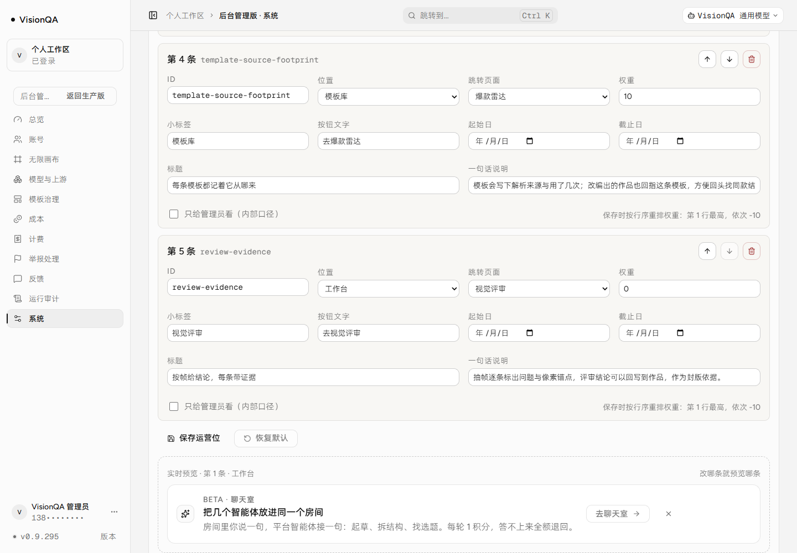

门禁：`npm test` 2107 / 2107（新增 1 条 `promosDirty` 用例）、`tsc -b` 干净、`oxlint` 0 error / 30 warning（746 文件）、
密钥扫描 1193 个文件无命中、入口 `index-3jw-5dtJ.js`（867,813 B）。

边界：撤销只留最近一条；预览按**行号**记（把正在预览的那行上移之后，预览留在同一行号、内容会换，
但行头徽标与预览头永远说的是同一行）；草稿仍然只在内存里，切后台分区 / 刷新 / 关标签页会丢——
这一版只把「有没有未保存的改动」显示出来，没有做 beforeunload 拦一次（会打断切分区，留给用户定）。
完整记录见 [docs/r323-promo-editor-2026-11-26.md](docs/r323-promo-editor-2026-11-26.md)。

## 三百七十、提示条不再是「2.4 秒后硬切」：时长跟字数走、收尾有过渡（r324 / v0.9.296）

提示条是全站最高频的一条反馈，原来只有一个行为：挂上、停 2.4 秒、直接摘掉。这一版改四件事——
**停留 = 2.4 秒 + 60ms × 字数（封顶 6 秒）**；收尾**淡出 + 下沉 8px（180ms）**走完再卸载；
**连按同一个动作会重放进场动画**（以前第二次点「保存」屏幕上什么都不变，看着像没点上）；
**长文案宽度封顶 560px、窄屏按 `100vw − 48px` 换行**；开了「减弱动态效果」时收尾时长给 0（不留 180ms 空壳）。
真源在 `src/domain/toast.ts`，计时器在 `src/App.tsx` 的 `notify`，收尾样式在 `src/styles/shell.css`。

真渲染数字（`scripts/shot-r324.mjs`，29/29，0 次上游调用）：29 字的提示停留 **4139ms**（公式 4140）、
收尾 **184ms**（采样到 5 帧 0<opacity<1）；6 字的停留 **2774ms**（公式 2760）；连按时第二次重新起算（2771ms），
第一次挂上到两条都走完 4669ms、进场动画真放了 2 次；减弱动态效果下整段生命 2776ms、半透明帧 0、`is-leaving` 一次没出现；
390 宽同一条提示宽 342px、2 行、全在视口内、页面无横向溢出；1440 宽 446px 单行、`fixed / bottom 24px` 未变。

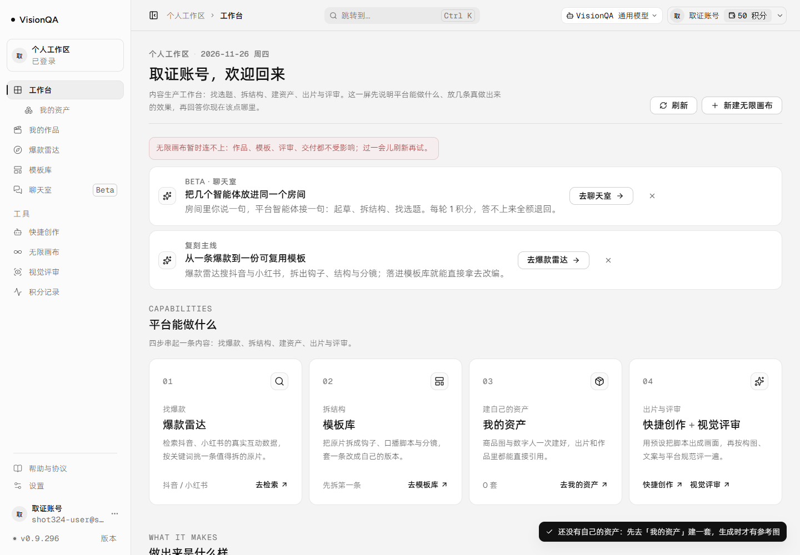

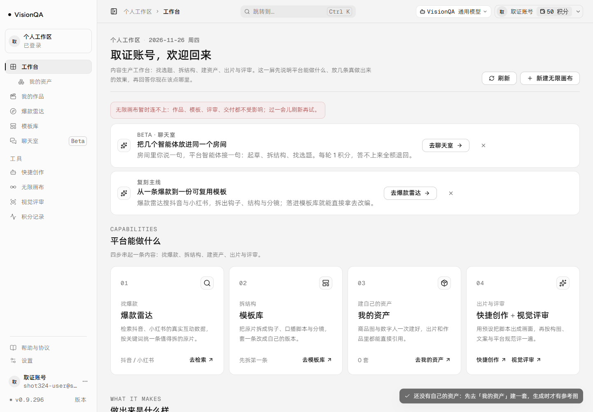

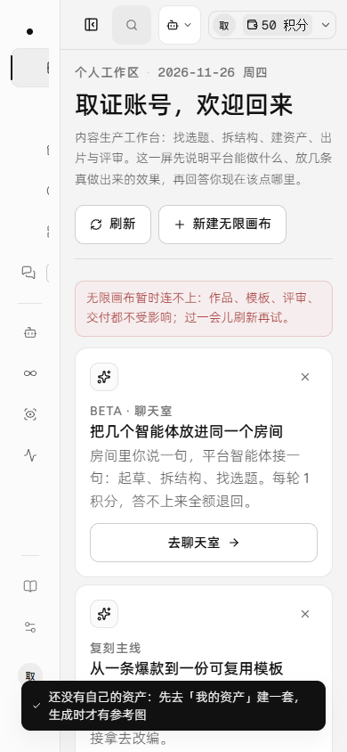

**180ms 的过渡静帧拍不到**：直接把 `Page.captureScreenshot` 打上去，请求前读到 0.49，
出来的帧里什么都没有（截图往返比过渡还慢）；上面那张是先把这条 CSS transition 按住
（`el.getAnimations().forEach(a => a.pause())`）再拍的，按住的透明度 0.60。
按住的数值取页面 rAF 采样（`Runtime.evaluate` 里同步读 `getComputedStyle` 还是 1，主线程那份计算值要等下一次渲染步）。

生产上也真渲染了（`scripts/shot-r324-prod.mjs`，临时管理员会话、只发 GET、拍完即撤销 `before 1 / removed 1 / after 0`）：
进工作流页只按一次 **Ctrl+Z**（撤销历史在内存里、进页面是空的，所以只弹「没有可撤销的操作」，不落盘、不保存、不新建），
线上入口 `index-7khOa3Rv.js`、侧栏 `v0.9.296`、提示条停留 **2891ms**（公式 2880，旧行为会是 2400）、收尾 181ms、
1440 溢出 0、exception 0；图里侧栏底部的手机号已遮成 `138••••••••`。


门禁：`npm test` 2114 / 2114（新增 7 条提示条时长用例）、`tsc -b` 干净、`oxlint` 0 error / 30 warning（749 文件）、
密钥扫描 1195 个文件无命中、入口 `index-7khOa3Rv.js`（868,339 B）；发布标签 `20261126-1957-r324toast`，
快照 `/opt/visionqa/releases/20261126-115254-20261126-1957-r324toast.tar.gz`，`ops/rollback.sh --to 1` 回 0.9.295。

边界：时长是启发式（每字 60ms、封顶 6 秒），不是阅读实验；提示条仍然只有一个，后一条顶掉前一条（连按是换节点重放，
不是叠两条），没有手动关掉；**失败提示仍然挂着 ✓**，改成按 tone 分档要给 `onToast` 加显式参数
（全站 119 处提示 / 18 处类型声明），留到下一轮，不半改。完整记录见
[docs/r324-toast-2026-11-26.md](docs/r324-toast-2026-11-26.md)。

## 三百七十一、提示条分档：失败不再挂对勾（r325 / v0.9.297）

r324 把停留时间拉长到「读得完」，副作用是把一个将就放着的问题照了出来：「复制失败：浏览器没给剪贴板权限」
前面挂着一个 ✓，等于当场说反话。这一轮把全站提示扫了一遍，给提示条加了三档语气（真源
[src/domain/toast.ts](src/domain/toast.ts) 的 `ToastTone` / `ToastFn` / `normalizeToastTone` / `toastRole`）：
`ok` ✓ 白（默认）、`fail` ✕ 浅红 + `role="alert"`、`info` ⓘ 半透明（撤销栈本来就是空的、这一条本来就写着这个称呼）。
三种语气是三个不同的 SVG path——形状先分清，颜色只补一层；图标对读屏隐藏，读屏听到的是文案本身。
深色底单开两个语义色 `--on-ink-fail #ff9b9b` / `--on-ink-muted`：原来的 `--fail #a33838` 压在提示条的 `#111` 上
对比度只有 1.9:1，等于没画，新值 **9.36:1**。全站 162 处提示里 **86 处自己带了语气**（69 失败 / 11 什么也没发生 / 6 明确成功），
其余走默认 ok。工作流页与无限画布各有一层自己的 `toast()` 包装，也要一起透传——只改 `onToast` 的话，语气到那一层就被吃掉了。

独立取证 [scripts/shot-r325.mjs](scripts/shot-r325.mjs) **14/14**（0 次上游调用，临时实例 + 真账号 + 真点）：
改名成功那条 `ok` / `M20 6 9 17l-5-5` / `rgb(255,255,255)` / `status`；名字清空那条 `fail` / `M18 6 6 18` /
`rgb(255,155,155)` / `alert`；工作流页 Ctrl+Z 那条 `info` / `M12 16v-4` / `rgba(255,255,255,0.72)` / `status`；
三条 path 与三个颜色互不相同，390 宽那条 29 字长提示仍是 342px / 2 行 / 全在视口内 / 页面无横向溢出。

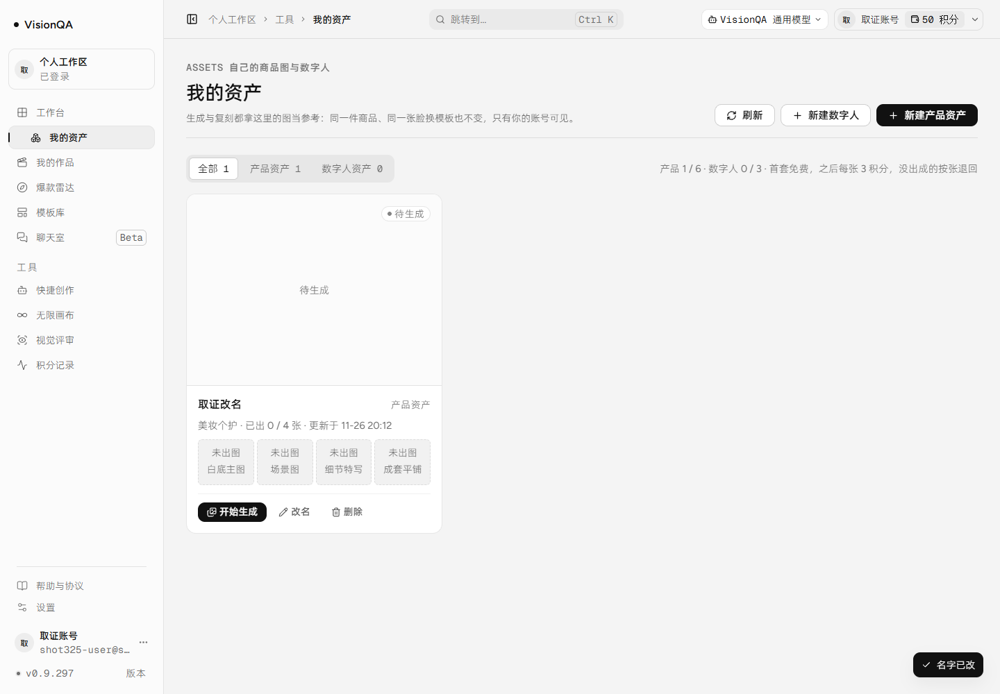

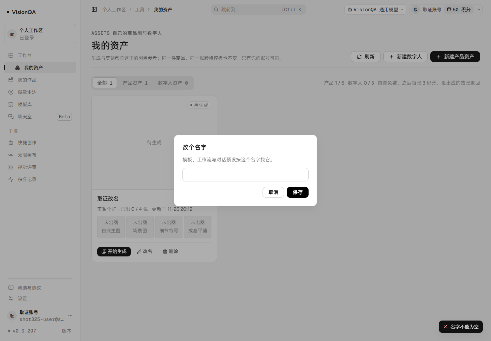

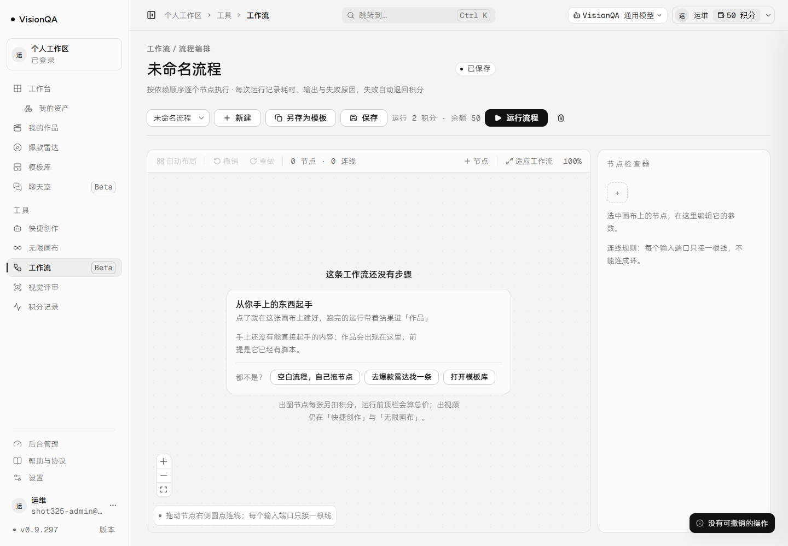

新增 [test/toast-tone.test.mjs](test/toast-tone.test.mjs)：真源码扫描 + 反证——落在 `catch {}` 或 `.catch(回调)` 里的提示
必须带语气，类型上也不许再写第二份 `(message: string) => void` 签名。第一遍门禁当场抓出 **BoardPage 两处**漏传
（「新建画布失败」「写入画布失败」，它们走的是那一层自己的 `toast()`，按 `onToast` 扫根本扫不到），
补完又抓出工作流页 catch 里两条在 catch 里却不是失败的（「已退出排队」「已停止等待这次运行」→ 改成 `info`）。

生产真渲染 [scripts/shot-r325-prod.mjs](scripts/shot-r325-prod.mjs)（临时管理员会话、只发 GET、拍完撤销
`before 1 / removed 1 / after 0`）：进工作流页只按一次 Ctrl+Z，线上入口 `index-DjO_CFA0.js`、侧栏 `v0.9.297`，
那条提示 `tone=info` / `role=status` / 图标 `M12 16v-4` / `rgba(255,255,255,0.72)` / 图标对读屏隐藏，
停留 **2888ms**（公式 2880）、收尾 **186ms**（4 帧半透明）、1440 溢出 0、exception 0；图里侧栏手机号已遮成 `138••••••••`。

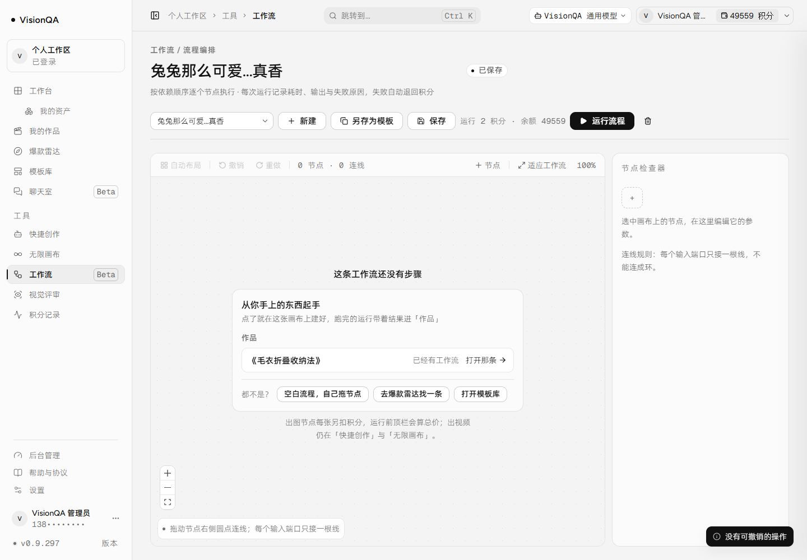

门禁：`npm test` **2126 / 2126**（新增 12 条：3 条语气纯函数 + 9 条声明与挂载绑定）、`tsc -b` 干净、
`oxlint` 0 error / 30 warning（753 文件）、密钥扫描 1200 个文件无命中、入口 `index-DjO_CFA0.js`（869202 B）；
发布标签 `20261126-2014-r325tone`，快照 `/opt/visionqa/releases/20261126-121425-20261126-2014-r325tone.tar.gz`，
`ops/rollback.sh --to 1` 回 0.9.296。

边界：只有三档没有 warn（运行「有节点失败」按 fail 算）；不传语气一律按 ok——门禁只兜得住 catch 里的，
新写的失败提示要自己带 `'fail'`；语气不影响停留时长（仍是字数 × 60ms + 2.4s）；仍然是全局一条提示、后一条顶掉前一条。
完整记录见 [docs/r325-toast-tone-2026-11-26.md](docs/r325-toast-tone-2026-11-26.md)。

## 三百七十二、运营位：点哪儿都能进，关错了能撤（r326 / v0.9.298）

这一轮只动「广告模块」（运营位）这一块，两件事都是站在真页面上看出来的：卡片悬停会抬起却只有右下那颗按钮能点；
点错 ✕ 关掉一条就再也回不来了。真源 [src/components/PromoSlot.tsx](src/components/PromoSlot.tsx) 与
[src/styles/promos.css](src/styles/promos.css)，纯函数在 [src/domain/promos.ts](src/domain/promos.ts)
（`PROMO_UNDO_MS` / `promoUndoLabel` / `withoutDismissed`）。

**整卡可点**用 CTA 按钮的 `::after` 铺一层透明热区盖住整张卡（stretched link）：不给 `<article>` 挂 `onClick`、
也不把按钮套进按钮，键盘这条路不变（Tab 一格落在按钮上、回车触发）。✕ 用 `position: relative; z-index: 1`
压在热区之上，否则点关闭会变成「跑去了那一页」。

**这一轮真正抓到的坑，只在手里才会出现**：第一版做完，DOM 里量什么都是对的（`::after` 是 `absolute` + `inset: 0`、
宽度 1138px、正文正中的 `elementFromPoint` 返回的就是那颗按钮），可一真点就是没反应。给页面挂上 click 捕获监听才看见：

```
mousedown → BUTTON.vq-promo-cta     热区还在
mouseup   → H3.vq-promo-title       热区没了
click     → ARTICLE.vq-promo        按下与抬起的共同祖先——那张卡片
```

根因是全站按钮的按下反馈 `:active { transform: translateY(1px) }`：**带 transform 的元素会成为绝对定位后代的
包含块**，按下的一瞬间 `::after` 的参照从整张卡片变成按钮自己，热区当场缩成 115×32。修法是这一颗按钮的按下反馈
换成不产生包含块的那种（`transform: none` + 底色深一档），选择器写两遍类压过 tokens.css 那条 0-2-0 的规则。

**关掉能撤**：卡片塌下去的位置上留一条虚线条子「已关掉「标题」· 撤销」（虚线是为了不被当成还没关掉）。
槽里还有别的运营位时 8 秒自己退场（光标停在条上、或键盘停在「撤销」上时不抽走）；槽被关空了就一直留着——
那时候它是唯一的入口。连关几条写条数（「已关掉 3 条动态」）。间距挂在条子自己身上、上面那张卡片的
下边距用 `:has(+ .vq-promo-undo)` 让出来，条子被移除的瞬间下面不跳。

独立取证 [scripts/shot-r326.mjs](scripts/shot-r326.mjs) **23/23**（0 次上游调用，临时实例 + 真账号 + 真点）：
悬停 `matrix(1, 0, 0, 1, 0, -2)`；正文正中命中热区；**按住不放时热区仍在、CTA `transform: none`**；
松开后地址 `#/overview` → `#/rooms` 且 click 的 target 是按钮；点 ✕ 不跳走、后面那条补位；
条子「已关掉「把几个智能体放进同一个房间」」/ `role=status`；撤销后第 1 条回来、本地记录清空；
关到空后等 9500ms 条子还在；390 无横向溢出；光标停 8500ms 不退场、移开后 **8225ms** 自己退场且关掉的仍记在本地。


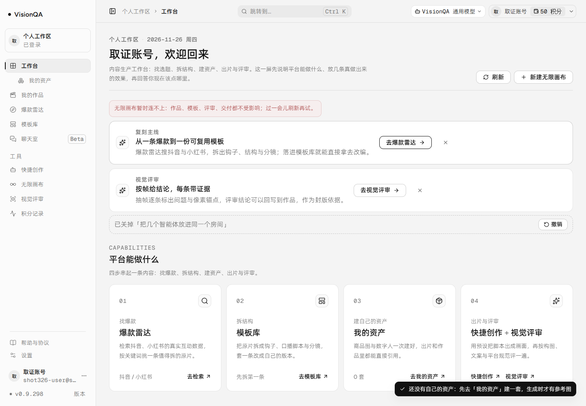

生产真渲染 [scripts/shot-r326-prod.mjs](scripts/shot-r326-prod.mjs)（临时管理员会话，拍完 `before 1 / removed 1 / after 0`）：
线上 `v0.9.298` / `index-DWJzJJ7H.js`，按住不放热区仍在、松开后 `#/rooms`；条子文案与 `status` 播报都对；
交互期间**写请求 0 个**；图里身份行遮掉 1 处手机号，且**只截运营位那一块**（首屏其余区域是生产上别人的数据）。

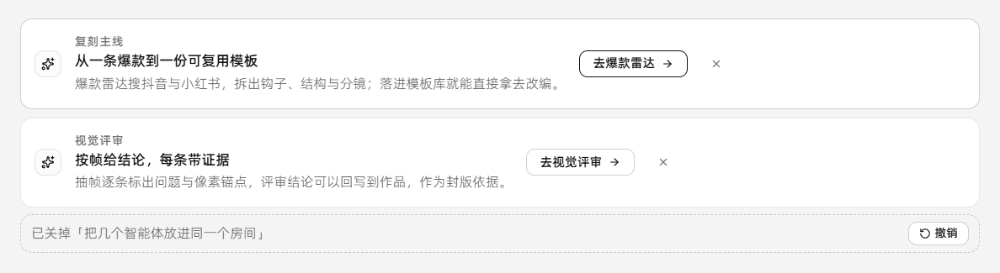

新增 [test/promo-undo.test.mjs](test/promo-undo.test.mjs)：真源码扫描 + 反证——热区的参照物、✕ 的层级、
**按下时不许有 transform**、槽空时撤销条必须还在渲染条件里、撤销要真的落盘，每一条都配一个「改坏它，
检查必须变红」。`npm test` **2132 / 2132**（+6）、`tsc -b` 干净、`oxlint` 0 error / 30 warning（755 文件）、
密钥扫描 1204 个文件无命中、入口 `index-DWJzJJ7H.js`（870,920 B）；发布标签 `20261126-2043-r326promo`，
快照 `/opt/visionqa/releases/20261126-124309-20261126-2043-r326promo.tar.gz`，`ops/rollback.sh --to 1` 回 0.9.297；
提交 `91b1a77`，CI 45822680837 success。

边界：热区让卡片上的文字点选不了（这张卡片只有一句话）；CTA 仍是 `<button>`，中键/⌘+点击开新标签页没做；
撤销窗口只有 8 秒，退场之后那条就真的不再出现（清站点数据才会回来）；条子只在这一次浏览里有效。
完整记录见 [docs/r326-promo-undo-2026-11-26.md](docs/r326-promo-undo-2026-11-26.md)。

## 三百七十三、注册后的第一屏：卡片淡上来，键盘也关在里面（r327 / v0.9.299）

身份引导弹窗是「账号」注册之后看到的第一屏，也是全站唯一**关不掉**的弹窗（第一步没有关闭入口、Esc 也拦掉）。
它以前有两处不对：**「啪」一下出现**（别的弹窗都有进场），以及**按 Tab 能一路走到遮罩后面的侧栏上**——
实测连按十次，十次全落在 `BUTTON.vq-nav-item` 上；而那时遮罩压暗、`body` 锁了滚动，背景是点不动的，
用户看到的是「按了半天什么都没变」。

现在：卡片 `vq-rise`（4px + 淡入）、遮罩 `vq-fade`（新加的一条纯淡入关键帧，整屏压暗不该跟着上浮），
换步时内容也淡上来，但**打开时的第一步不让内容动**（卡片自己在进场，两层一起上浮会显得晃）；
焦点打开就落在卡片上（`tabIndex={-1}`，读屏会念标题），Tab / Shift+Tab 在弹窗首尾之间循环、
挂在捕获阶段，换步之后再把焦点收回卡片（点「继续」那颗按钮会随着那一步一起卸载）。

动效不是「代码里写了 animation」就算的：headless 里 rAF 只在真有帧被产出时才走，按帧采样时有时无。
改用 r325 的 `pause()` 手法——把动画重来一遍、立刻暂停、读计算值，拿到的是真的第 0 帧：
卡片 `opacity: 0` / `translateY(4px)`、遮罩 `opacity: 0`。


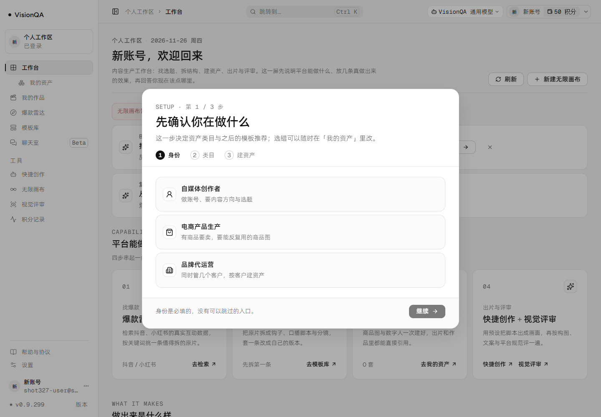

独立取证 [scripts/shot-r327.mjs](scripts/shot-r327.mjs) **21/21**（0 次上游调用、0 条页面异常）：
焦点 `DIV.vq-gate-card`；Tab ×10 + Shift+Tab ×1 跑出去 **0 次**；换到第二步焦点回到卡片、Tab ×12 仍 0 次；
第一步「继续」在没选身份时是禁用的；390 卡片 358×589 落在视口内、无横向溢出。


新增 [test/onboarding-gate.test.mjs](test/onboarding-gate.test.mjs)：真源码扫描 + 三组反证——进场被拿掉、
用 `forwards` 留在最后一帧会**永久变成一层包含块**、遮罩不淡入、换步没规则；焦点没收进卡片、Tab 没兜住、
没挂捕获阶段、换步后没收回来、少加一处 `stepSeq`。写反证时先被自己的检查绊了一下：
`@keyframes vq-fade` 改名成 `vq-fade-gone` 之后子串比对**仍然为真**，加上结尾的 `{` 再比才会红。
`npm test` **2135 / 2135**（+3）、`tsc -b` 干净、`oxlint` 0 error / 30 warning（757 文件）、
密钥扫描 1208 个文件无命中、入口 `index-CX7A3WQT.js`（871,689 B）；发布标签 `20261126-2101-r327gate`，
快照 `/opt/visionqa/releases/20261126-130115-20261126-2101-r327gate.tar.gz`，`ops/rollback.sh --to 1` 回 0.9.298；
公网 0.9.299、health ok templates 27、旧入口 `index-DiDduOYK.js` 404、
线上样式表 `index-CiUEHUA3.css` 里确有 `.vq-gate-body.is-step-in` 与 `vq-fade`；提交 `be057c5`，CI 45825286642 success。

边界：只修了身份引导这一个弹窗（全站唯一阻塞且关不掉的），其余弹窗仍可用 Tab 走到背景上；
截图来自本机临时实例，跑的是与生产同一份 dist（生产上没有「引导还没做完的普通账号」）；
只在 1440 与 390 量过。完整记录见 [docs/r327-onboarding-gate-2026-11-26.md](docs/r327-onboarding-gate-2026-11-26.md)。

## 三百七十四、把键盘关进每一个弹窗里（r328 / v0.9.300）

上一节最后那句边界——「只修了身份引导这一个弹窗，其余弹窗仍可用 Tab 走到背景上」——就是这一轮。

全站 17 个浮层写着 `aria-modal="true"`（14 个文件）。这行字是给读屏的一句承诺：弹窗外面的东西现在都不能用了。
改之前只有身份引导兑现了它，其余 16 个的实测是这样：

| 弹窗 | 打开时焦点在里面 | Tab×12 + Shift+Tab 跑出去 | 打开期间 `body.overflow` | 背景被滚 | 关掉之后焦点 |
| --- | --- | --- | --- | --- | --- |
| 版本信息 | **否**（还在版本按钮上） | **13 次** | `""` | PageDown 滚了 **952px** | 掉到页面里别处 |
| 命令面板 | 是 | 0 | `hidden` | 0 | 回到触发按钮 |
| 回收站 | **否** | **10 次** → 作品页筛选项 | `""` | 空态不可滚（量不出） | **BODY** |
| 反馈 | **否** | **9 次** → 帮助页目录链接 | `""` | 滚轮 **87px** | **BODY** |

命令面板那一列是绿的：它早就自己做了收焦、锁滚、还焦。**所以这轮不是发明机制，是把已经在一个地方跑通的东西摊开**——
`src/domain/focus-trap.ts` 放可单测的真值表（`planTab`），`src/components/useModalFocus.ts` 放接线，
16 个浮层各挂一行，把那四件事一次做完：焦点进来、Tab 首尾循环、背景不滚、关掉还焦。

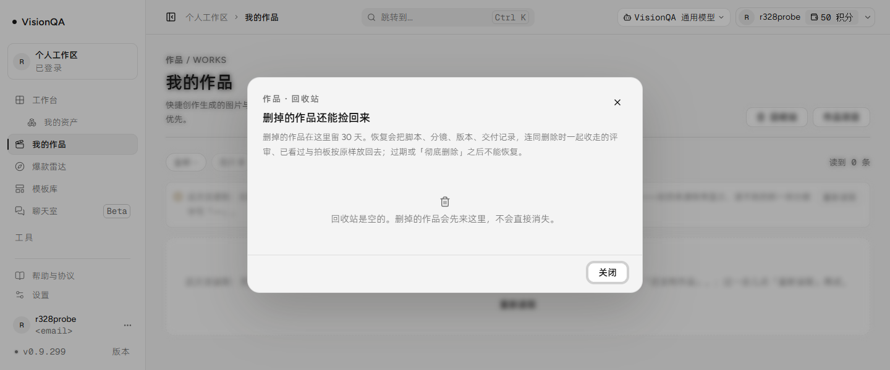


四个决定，每一个都对应一类只在特定时刻才出现的 bug：监听挂**捕获阶段**（页面上别处也有一堆 keydown，冒泡轮不到兜底）；
模块里一个 `trapStack` 让**只有最上面那层管键盘**（两层叠开时外层会把焦点从内层抢回去）；
锁滚按**引用计数**（两层都自己存 `previous` 再还原的话，谁先关谁就把另一层的锁解开）；
Esc 从命令面板输入框的 `onKeyDown` **搬到捕获阶段**（Tab 一被兜住，焦点会落在列表项上，那时 Esc 就按不动了）。
after 四个弹窗都是**一次真 Esc 就关**；关掉之后焦点回到当初打开它的那颗按钮。

独立取证 [scripts/shot-r328.mjs](scripts/shot-r328.mjs)：before **10/22**（12 条红）、after **23/23**、0 页面异常、0 上游调用。
两个量法上的坑：1440×1000 下多数页面不够长，得压到 **1440×600** 才量得到「背景在滚」；
外壳页的滚动容器是 `.vq-content` 而不是 `document`，遮罩 `position: fixed` 挂在它外面、滚轮打不到，
所以可感知证据改用真按键 PageDown；**回收站页空态只有 8px 可滚，那一格标「量不出」而不是「通过」**。

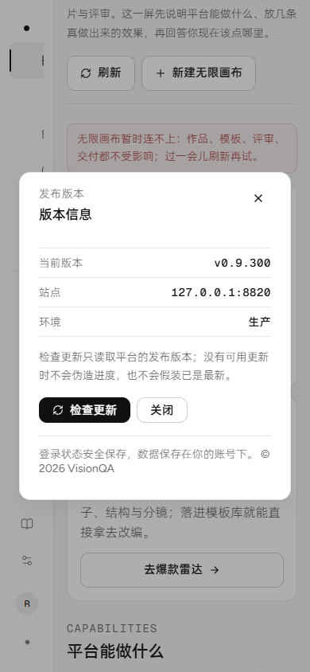

新增 [test/modal-focus.test.mjs](test/modal-focus.test.mjs)：真值表 14 个断言；覆盖扫描（每个 `aria-modal` 的**标签本身**
必须挂 `ref`，且 `useModalFocus(` 次数不少于浮层数，另数一遍文件数 ≥ 13 防止扫描走空）；反证 7 组——
凭空加一个没挂 ref 的浮层、删掉调用、拿掉 `preventDefault`、监听退回冒泡、去掉「只有最上层」判断、
`getClientRects` 换回 `offsetParent`。第一版反证没红：`replace('event.preventDefault()')` 命中的是处理 Esc 那一段。
`npm test` **2138 / 2138**（+3）、`tsc -b` 干净、`oxlint` 0 error / 30 warning（762 文件）、密钥扫描 1211 个文件无命中、
入口 `index-ByDh_Wgb.js`（873,492 B）；发布标签 `20261126-2140-r328modal`，
快照 `/opt/visionqa/releases/20261126-132139-20261126-2140-r328modal.tar.gz`，`ops/rollback.sh --to 1` 回 0.9.299；
公网 0.9.300、health ok templates 27、新入口 200、上一版入口 `index-CX7A3WQT.js` 404；提交 `ff20db0`，CI 45828579686 success。

边界：**身份引导没搬过来**（r327 刚验过 21/21，重写不值得冒险，两套实现并存是这轮唯一的结构性欠账）；
页面内画的 `role="dialog"`（后台删除/改身份展开条、聊天历史、画布便签、局部工作区记忆）没有遮罩、跟页面同流，圈焦点反而是错的；
版本脚本与两版对照的背景锁仍留在作品页那一层（两层都锁会互相覆盖恢复）；只量了 4 个弹窗 × 1440/390。
完整记录见 [docs/r328-modal-focus-2026-11-26.md](docs/r328-modal-focus-2026-11-26.md)。

## 三百七十五、抬起 = 能点：卡片的手感与键盘（r329 / v0.9.301）

用户说的还是「小的细枝末节」。这一轮盯的是一排卡片悬停抬起来时的那句潜台词：**这张卡能点**。
量完发现，全站的悬停抬起基本都在骗人——工作台首屏那四张能力卡，抬起来了却只有右下角那行小字能点，
点标题、点正文都没反应（r326 在运营位上修过同一件事，这里一直没修）；模板库卡片反过来，
鼠标点得动、**键盘永远到不了**：按 Tab 第 27 下才落进卡片，落的是「用这条改编」，
没有一条能只是打开这条卡片去看详情与分享。同一排里作品页的卡片是 `<button>`（第 7 下就到了）——
所以不是「卡片天生不可达」，是这一张写错了标签。

做法沿用 r326 那套热区，把它抽成一条共用规则 `src/styles/motion.css` 的 `.vq-card-open`：
卡片里放**一颗真按钮**，由它的 `::after` 用 `inset: 0` 铺满整张卡——鼠标在卡上任何地方都是指针、
点卡任何地方都进得去、Tab 只有这一格、回车照常触发；不给容器挂 `onClick`，也不把按钮套进按钮。
三条前提写进了门禁：热区铺满、**按下不许位移**（带 `transform` 的元素会成为绝对定位后代的包含块，
按下那一刻热区会塌回按钮那么大——r326 真机实测过：mousedown 落在按钮、mouseup 落回标题、click 落在卡片上，
点了没反应，而编译、样式、单测全都看不出来）、**按钮自己不许定位**。接线的三处：
能力卡 01–03 挂在原来那颗「去检索 / 去模板库 / 去我的资产」上，
模板库卡片新加一颗标题按钮（`<article onClick>` 拿掉），运营位那颗 CTA 复用同一层。
两处**摘掉**抬起：能力卡 04（有两个去处，点卡上哪一处都说不清该去哪）、后台运营位预览卡（只读预览）。

真浏览器前后（CDP 真输入，1440×1000，同一份脚本跑两份 dist）：
能力卡 01/02/03 点正文 before **路由没变**（命中 `H3`、`cursor: auto`、卡内入口 0 个）→
after 命中 `BUTTON.ov-cap-action.vq-card-open`、`cursor: pointer`，分别跳到 **`#/radar` / `#/templates` / `#/assets`**；
能力卡 04 仍然「没变」（故意）；运营位仍跳 `#/rooms`（r326 的回归）；模板库卡片点正文仍开抽屉。
键盘：模板库第 27 下从 `button.template-adapt`（只能进改编）变成 `button.template-open.vq-card-open`，
**回车 → `#/templates/tpl_r329_probe`、抽屉打开**；工作台第 25 下那颗带 `.vq-card-open` 的按钮回车 → `#/radar`。
0 页面异常、0 console.error、0 上游调用、5/5 自检通过。

一个量法上的坑值得记：**卡片自己的 `cursor` 会骗人**。运营位从 r326 起就是整卡可点，
但 `getComputedStyle(article).cursor` 一直是 `auto`（指针来自按钮的 `::after`），
按元素自己的 cursor 判会把所有整卡可点的卡片判成「不可点」。这轮改用 `document.elementFromPoint(卡中心)`。
另有一条假阴性如实记着：第一次量「用它做作品」时 hover 与 press 全无、0 个写请求，重跑同一份脚本就恢复正常
（有 hover、有 press、1 个 `/api/projects` 写请求）——是取样时机造成的，**没有写进结论**。

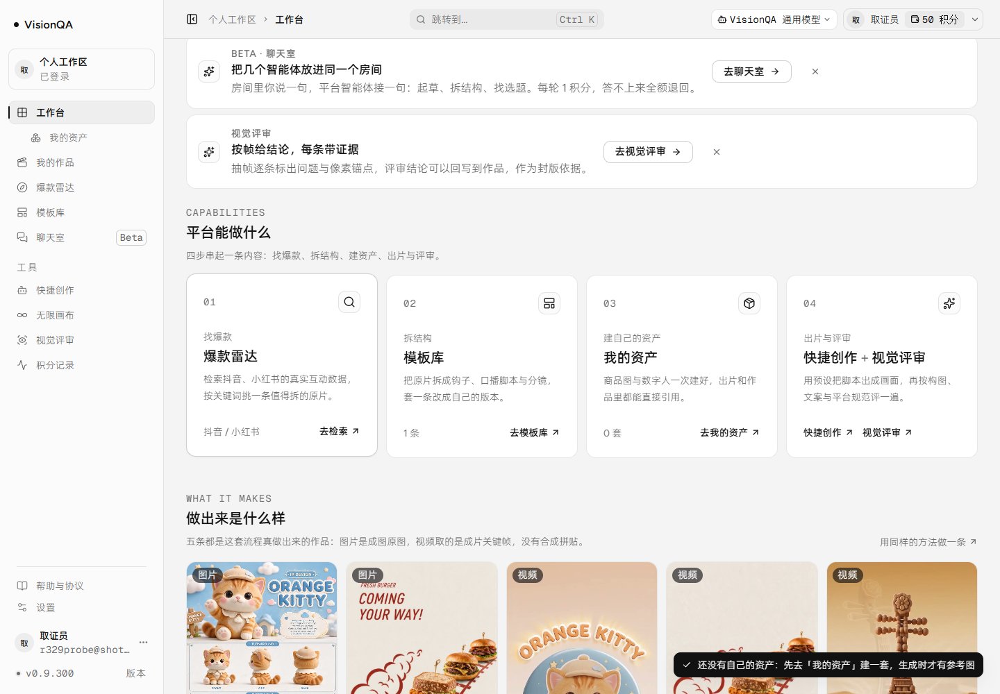

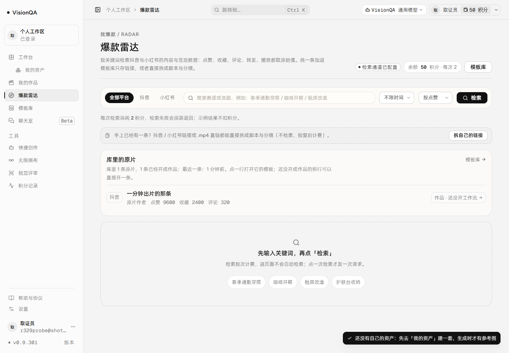

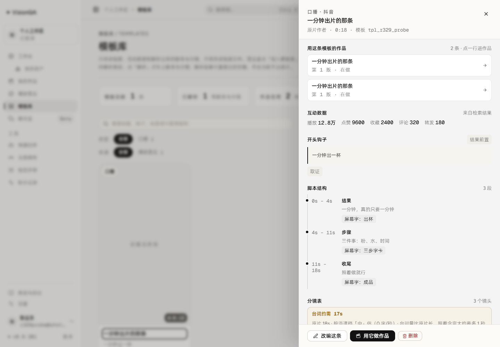

新增 [test/card-affordance.test.mjs](test/card-affordance.test.mjs)：会抬起的卡片必须有真入口（按文件内数量比，
删掉其中一颗就红）、不可点的卡片不许抬起、热区三条 CSS 前提，外加 7 组反证；
[test/promo-undo.test.mjs](test/promo-undo.test.mjs) 随重构改成盯共用层，并加了一条「CTA 没挂 `.vq-card-open` 就红」。
`npm test` **2142 / 2142**（+4；另有一轮全量并发下 `canvas-queue-visible` 偶发失败，
单跑 8/8——r184 起的老毛病，不是这一轮引入的）、`tsc -b` 干净、`oxlint` 0 error / 30 warning（766 文件）、密钥扫描 1216 个文件无命中、
入口 `index-DvhCcfhI.js`。发布标签 `20261126-2230-r329cards`，快照 `/opt/visionqa/releases/20261126-142041-20261126-2230-r329cards.tar.gz`，
`ops/rollback.sh --to 1` 回 0.9.300；公网 0.9.301、health ok templates 27、新入口 200、上一版入口 `index-ByDh_Wgb.js` 404；
提交 `28cc4b5`，CI 45840388610 success。完整记录见 [docs/r329-card-affordance-2026-11-26.md](docs/r329-card-affordance-2026-11-26.md)。

边界：能力卡 04 与后台预览卡是**故意**不整卡可点的（不变量是「抬起 = 能点」，不是「所有卡都能点」）；
只量了 1440×1000（窄屏下这批卡片是同一套 DOM，热区仍铺满整卡，但没有逐屏重量）；
模板库卡片的文字因此不能再用鼠标选（热区在上面，与运营位同一个取舍）。

## 三百七十六、通知不吃点击，按下去要有反应（r330 / v0.9.302）

用户要的还是「小的细枝末节」。这一轮三件事全是 r329 巡检顺手量出来的，都用同一把尺子改掉：
真 Chrome + CDP 真输入、前后跑同一份 [scripts/shot-r330.mjs](scripts/shot-r330.mjs)、0 次上游调用、0 页面异常。

**① 右下角提示条会吃掉点击。** 模板抽屉里「用它做作品」在提示条出现的 3 秒里被它整块压住——
提示条在场时 `elementFromPoint(1081,968)` 命中的是 `DIV.vq-toast`（`pointer-events: auto`、`z-index: 60`），
点它就是点提示条：连点两次，`vq-toast-in` 计数 1→1、写请求 **0**、路由停在 `#/templates/tpl_r330_probe`；
等提示条自己消失再点，同样是那颗按钮，立刻 1 个写请求、跳到作品页——**按钮没坏，就是被通知吃了**。
改法两条：纯通知不该是 hit target，`.vq-toast { pointer-events: none }`（条里的 `button`/`a` 单独 `auto`，
以后加「撤销」不用再想起这件事）；光不吃点击还不够——按钮仍**看得见却按不到**比按不动更迷惑，
所以抽屉打开时把提示条抬到底栏之上（桌面 88px、≤640 时 144px，两个数由底栏真高 65 / 133 推出来，
390 实测底栏正好 133）。after：命中的是 `BUTTON.vq-button--primary`「用它做作品」，
提示条与底栏交集 1440 / 390 **都是 0**，**第一次点击就真把作品建出来了**（1 个写请求 → `#/projects/prj_8b5f8571`）。

**② 后台「保存运营位」悬停一个属性都不变**（idle / hover 都是 `rgba(0,0,0,0)`，按下只有 `transform` 那 1px）。
根子是**默认档 `.vq-button`（不带语气 = 透明底）压根没有 `:hover`**：四个语气各写了悬停，默认档漏了，
而默认档恰恰是后台用得最多的一档。补一条 `--line-faint` 悬停底色，写在四个语气**之前**
（同权重按源码顺序决胜负，语气各自的 `:hover` 盖住它）；ghost 是实色底，必须在自己的 `:hover` 里
写回 `--surface-raised`，否则悬停会从实色变成半透明——这条也钉进了门禁。after：`rgba(0,0,0,0)` → `rgba(17,17,17,0.06)`。

**③ `#/agents` 预设卡的「选择」按下什么都不变**（三态 `background-color` 一模一样）。悬停靠整卡抬起、
按下没有。整块按钮自己就是热区，直接给 `:active` 一层底色加 120ms 过渡，不走 r329 那套 `::after`。
after：按下立刻 `rgba(17,17,17,0.05)` → 稳定 `rgba(17,17,17,0.06)`。

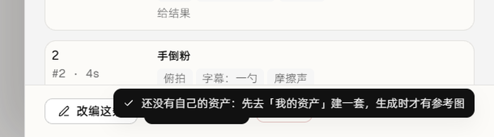


一个量法上的教训：**CSS 解析器必须按块的上界递归**。给测试写 `@media` 展开时只传了下界，
内层把文件剩下的全解析一遍、外层再来一遍，六十多个断点直接指数级重解析，单文件 80 秒后 OOM。
另两条：声明断言要**先剥掉注释**（`.vq-toast` 的注释里写着「pointer-events:none」，反证删掉声明仍命中注释，红不了）；
选择器要**从最后一段 `*/` 之后算起**（两条规则之间的注释会被 `split('}').pop()` 带进选择器，锚定匹配永远失败）。

新增 [test/toast-and-press.test.mjs](test/toast-and-press.test.mjs)：3 条断言 + **9 组反证**（拿掉 `pointer-events`、
拿掉条内放行、拿掉抬起规则、把抬起值改回 24px、删掉窄屏那条、默认档悬停改回无背景、ghost 不写回底色、
把默认档悬停挪到语气后面、拿掉预设卡按下态）。顺手修了**两条守卫的脆弱写法**：
[test/design-grid.test.mjs](test/design-grid.test.mjs) 与 [test/login-a11y.test.mjs](test/login-a11y.test.mjs)
原先都只取 shell.css 里**第一段** `@media (max-width: 640px)`，这轮新加一段 640 断点就让它们当场变红
（盯的规则一条没少）——现在取该断点的**所有**块再断言。
`npm test` **2145 / 2145**、`tsc -b` 干净、`oxlint` 0 error / 30 warning（765 文件）、密钥扫描 1219 个文件无命中、
入口 `index-BdLqYHxS.js`（873.53 kB）。发布标签 `20261126-2253-r330notice`，
快照 `/opt/visionqa/releases/20261126-145324-20261126-2253-r330notice.tar.gz`，`ops/rollback.sh --to 1` 回 0.9.301；
公网 0.9.302、health ok templates 27、新入口 200、上一版入口 `index-DvhCcfhI.js` 404；两服务 active；
提交 `8a0b6ca`，CI **45843733864 success**。
完整记录见 [docs/r330-notice-and-press-2026-11-26.md](docs/r330-notice-and-press-2026-11-26.md)。

边界：提示条只抬到**抽屉底栏**之上（画布那条底部固定条早就单独处理过，弹窗主按钮在中间，都没有这个冲突）；
它视觉上仍会盖住弹窗右下角，那里没有主按钮，暂不处理；默认档悬停是**全站生效**的一条规则，
只量了后台运营位与智能体两屏的 computed 值。
**更正（r331 量过，见 §377）**：这一节当初顺手记下的「抽屉底栏比它的容器宽」（1440 下 `r=1446~1448`、
390 下 `r=401~405`、还有 2–4px 抖动）**不成立**——那是**在抽屉入场动画没跑完时量的**，
位移就是 `drawer-in` 当时的 `translateX`。稳态下抽屉与底栏右沿正好等于 innerWidth（1440/390），
`transform: none`、`scrollWidth == clientWidth`，四个底栏按钮的右沿都在视口内，「删除」没被切。
这一节的其余结论不受影响（提示条交集判的是 y 与 x 区间，换成稳态底栏矩形后交集仍是 0）。

## 三百七十七、运营位两处手感，和一句要撤回的话（r331 / v0.9.303）

用户要的仍然是「小的细枝末节」。这一轮动手前先做了一件不太好看的事：**把上一轮自己写下的结论撤回**。

**先撤回**：§376 结尾那句「抽屉底栏比它的容器宽、『删除』右边框被切几个像素」**不成立**。
它是在**抽屉入场动画没跑完时量的**（`drawer-in`，220ms，translateX 24px→0）。判定与数字见
[scripts/shot-r331-drawer.mjs](scripts/shot-r331-drawer.mjs)：稳态下抽屉与底栏的右沿**正好等于 innerWidth**
（1440 / 390），`transform: none`、`scrollWidth == clientWidth`（无横向溢出），
四个底栏按钮右沿 1000.05 / 1137.86 / 1290.42 / 1368.98（1440）与 374 / 191.5 / 191.5 / 374（390）
——「删除」没被切。上一轮那四个读数全在 24→0 这一根曲线上：**+15px@51.6ms、+11px@68.8ms、
+8px@85.9ms、+6px@99.7ms**（在 0..220ms 上二分，两个视口数值一致），逐帧 **|位移 − computed tx| 最大 0**；
窗口为什么够大：底栏是插入后 91ms 才挂上的，而动画 25ms 才启动、`animationend` 在 322ms。
教训一句话：**拍照要停帧，量几何不能撞帧**——上一轮那 6 条检查的结论不受影响。

**① ✕「关掉这条」按下去一点反应都没有。** 它不属于 `.vq-button`，全站那条按下反馈
（`tokens.css` 的 `:where(.vq-button, .cv-bdc-action, .cv-palette-item)`）一个都不沾，
按住它 computed 值和悬停时一模一样。补一条 `:active` 底色深一档（与同一张卡上的 CTA 同一套口径；
**不走 1px 位移**——位移会给绝对定位后代造出包含块，r326 那张整卡热区就是这么在按下瞬间塌掉的）。
after：`rgb(251,251,251)` → `rgba(235,235,235,.47)`、描边 `.1` → `.157`。

**② 这颗 ✕ 在手机上只有 28×28。** 全站的触控口径是「平板 40、手机 44」，运营位这块从没被抬过。
after 实测：1440 → 28×28（桌面保持紧凑）、760 → 40×40、560 / 390 → **44×44**。

**③ 后台「权重」是个会自己变回去的输入框。** 保存时整份列表按行序重排权重
（`withOrderWeights`），手填的数字一律被覆盖——改完、保存、又变回去，比看不见它更费解。
改成只读展示（虚线框、与旁边输入框同高 32px），数字照旧显示；页面上 `type=number` 从 **2 个变 0 个**。

**差点写进仓库的一条（自查）**：本来还想给「撤销」条补进场动画，实测它**本来就有**——
它是 `.vq-promos.vq-stagger` 的孩子，父容器那条 `.vq-stagger > *` 早就给它挂了 `vq-rise`
（before 那版 dist 里它的 `animationstart` 就是 `vq-rise`，500ms 起 / 748ms 止）。重复声明**撤掉了**，
注释与测试里各留一条「别再重复声明」。这条不算修复，记下来是为了下一轮不再为它花时间。


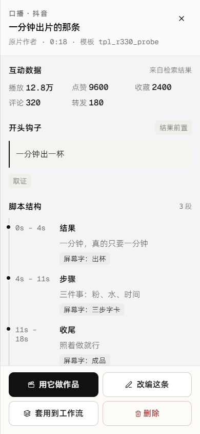


顺手把 r330 那次手工量 3 个元素的做法做成了可复用工具 [scripts/audit-press.mjs](scripts/audit-press.mjs)：
**10 屏 / 136 个按钮**，对每个按钮发**真实的** `mousePressed`、两帧后读 8 个属性，然后**把鼠标移到中性点再松开**
（不在原处松开就不会合成 click：这一趟 0 次业务写请求）。before（0.9.302）**53 有反馈 / 74 无 / 9 禁用**
→ after（0.9.303）**54 / 73 / 9**。剩下的 73 条不是都要改，最有价值的一簇是
**侧栏 18 个导航项一个都没有按下反馈**（`button.vq-nav-item`，整站用得最多的控件）——下一轮从这里接。
（这一趟里运营位第一张卡的 ✕ 取样为空 `press: null`，同一颗在上一趟 after 与专门的 `closePress` 探针里都是
has-feedback，记为**测量抖动**，不当成回归。）

[test/promo-undo.test.mjs](test/promo-undo.test.mjs) 加了 3 条断言 + 4 组反证：
✕ 的 `:active` 必须有底色、760 与 560 两段分别给到 40 / 44（**取该断点的所有块**——r330 刚踩过「只取第一段」的坑）、
后台权重只读且形状 32px、撤销条不许再写重复的 `animation`。
`npm test` **2148 / 2148**（+3）、`tsc -b` 干净、`oxlint` 0 error / 30 warning（768 文件）、密钥扫描 1222 个文件无命中、
入口 `index-D9Wtr6mf.js`（873.53 kB）。发布标签 `20261126-2333-r331promo`，
当前快照 `/opt/visionqa/releases/20261126-153219-20261126-2333-r331promo.tar.gz`（回滚演练前自动打的
`20261126-153211-before-rollback.tar.gz` 也在），
`ops/rollback.sh --to 1` 回 0.9.302 后再发布回来；公网 0.9.303、health ok templates 27、新入口 200、
上一版入口 `index-BdLqYHxS.js` 404；两服务 active；提交 `9f71fb3`，CI **45850793384 success**。
完整记录见 [docs/r331-promo-details-2026-11-26.md](docs/r331-promo-details-2026-11-26.md)。

边界：抽屉只在 1440×1000 与 390×844 两个视口重量；触控区是 computed 值（四个宽度），没有逐机型截图；
巡检判的是「按下时有没有属性变化」，不判「该不该有」；后台排序这一轮仍然只有「上移 / 下移」一条路。

## 三百七十八、按下反馈第二批：外壳 16 条、文字链接 6 条、agents 22 条（r332 / v0.9.304）

还是「小的细枝末节」。§377 把 136 个按钮里 **73 条「按下去和悬停一模一样」**列成了清单，
这一轮从**整站最常点的控件**开始清，清掉 **44 条**。

**先更正上一轮一句话**：§377 结尾写的「侧栏 18 个导航项一个都没有按下反馈」不准确——实际是
**12 个导航项 + 4 个触发器 = 16 条**。18 是外壳那一趟的按钮总数，其中 2 颗（侧栏收起、搜索触发器）本来就有。

**① 外壳 16 条**（[src/styles/shell.css](src/styles/shell.css)）：12 个 `.vq-nav-item` 与账号行、版本号、模型、顶栏账号，
按下前 `transform: none`（和悬停一模一样），现在统一 `translateY(1px)`——与 `.vq-button` 同一套口径，
**只位移、不换色**（悬停的底色还在）。权重写 `.vq-nav-item:not(:disabled):active`（0,3,0）压过
`.vq-nav-item.is-active`（0,2,0），所以**当前这一项按下去也有反应**；四家的 `transition` 里补上 `transform`，
按下与松开的 1px 有 140ms 过渡而不是瞬跳；`prefers-reduced-motion` 里关掉位移。

**② 6 个文字链接**（overview 上的「全部评审 / 全部作品 / 全部模板 / 上手指引…」）：
它是 `display: inline-flex` 的**行内元素**，位移会让整段字看起来抖一下，所以只压一层 `--line-faint` 的底
（与 `.vq-button` 悬停底色同一档）。after 实测 `background-color` 从透明变 `rgba(17,17,17,.06)`。

**③ agents 22 条**（队友 agents-chat 并行做，[src/styles/agents.css](src/styles/agents.css)）：快捷创作的
对话 / 图片 / 视频、平台对话 / 对话预设、读链接 / 思考模式 / 附件、新对话，以及对话预设页的模型胶囊与 5 个分类页签。
只改 background / border-color / color（**不用 transform**），六组选择器的权重都压过各自的 `.is-active`，
窄屏那条 `.vq-content .agx-page …` 的 4 类权重也算了进去。他另交 [test/press-agx.test.mjs](test/press-agx.test.mjs)（6 条 + 5 组反证）。

**证据是同一份巡检、同一批屏、两份产物**：before（0.9.303 / `index-D9Wtr6mf.js`）**54 有反馈 / 73 候选 / 9 禁用**
→ after（0.9.304 / `index-CDUNYuqb.js`，**就是这次发布上去的那份**）**98 / 29 / 9**。逐簇清空：
**外壳 16 → 0**、**6 个链接 → 0**、**agents 9 → 0**、**agents-presets 13 → 0**。

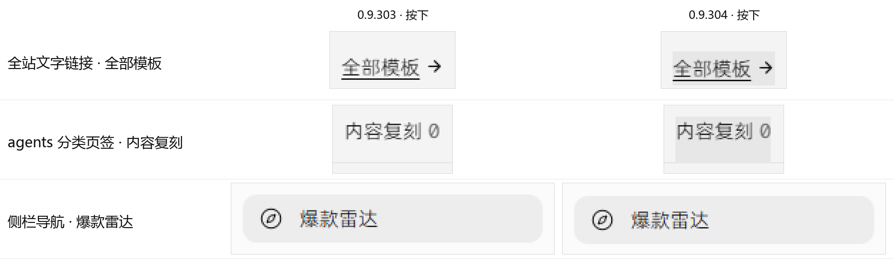

顺手把巡检的两条口径补上：**还按着、等过渡走完再读一次终值**（`pressedSettled` / `changedSettledVsHover` /
`summary.settledRescued`）——运营位那 4 颗反馈带 transition，两帧有时落在过渡开始之前，读到的就是悬停值；
r331 已经记过一次这种现象，现在把它们单列成**采样抖动**（同一份产物两次跑：候选 31 / 29，抖动 3 / 1），
判定仍按两帧那一拍，与 r331 的 73 可比。截图新增 `--shots all` 与贴元素 8px 的裁法（这张对比图就是它出的）。

门禁：`npm test` **2156 / 2156**（+8，两边都带反证）、`tsc -b` 干净、`oxlint` 0 error / 30 warning（770 文件）、
密钥扫描 1225 个文件无命中。入口 `index-CDUNYuqb.js`（873,536 B）。发布标签 `20261127-0002-r332press`，
快照 `/opt/visionqa/releases/20261126-160323-20261127-0002-r332press.tar.gz`；公网 `/api/version` **0.9.304**、
health ok templates 27、新入口 200、上一版入口 `index-D9Wtr6mf.js` 404、两服务 active；提交 `aed43f4`，
CI **45855358373 success**。
完整记录见 [docs/r332-press-details-2026-11-27.md](docs/r332-press-details-2026-11-27.md)。

边界：只量 1440×1000；判的是「按下那一刻有没有属性变化」，不判「该不该有」。剩下的 **28 条**在
`.ov-cap-action`（11）、模板筛选项（6）、作品流（10）、模板抽屉（1）；其中带 `.vq-card-open` 的那几颗
**不能照这轮补位移**——r326 量过，位移会让整卡热区在按下瞬间塌成按钮那么大，它们要照
`.vq-card-open:active::after` 的路子做，下一轮专门处理。

