# VisionQA Workbench

VisionQA 是给画面做**有证据的视觉评审**的工具：结论只有「通过 / 需人工确认 / 不通过」三种，每条判断都必须指向画面里的具体区域（像素锚点），定位不到证据的一律写进「无法判断」，不给模糊结论。

这个仓库是 VisionQA 的**创作与检索工作台**：把「找一条爆款 → 拆它的结构 → 换个产品复刻 → 评审产出画面 → 沉淀成可复用模板」串成一条能跑通的链路，评审语言与 VisionQA 插件共用同一套 visual-baseline 契约。

> 诚实边界（2026-11-09 17:20 线上实测）：模型链路换成**官方 DeepSeek**（`https://api.deepseek.com/v1`）后真正通了。`deepseek-flash` 自报的 `input_modalities` 是 `["text","image"]`，所以智能体对话和抽帧评审共用同一个模型，不再需要假想一个「视觉专用模型」。实测：后台「连通性自检」`可用 · 上游 2 个模型`；智能体对话 6.0 秒出成品文案；`/api/review` 本地模型路径 16.6 秒给出 verdict + 像素锚点；`analyzeFrames` 在服务器上用生产代码跑 3 帧得到合法分镜 JSON。**仍然缺**：模板库 0 条（「一键复刻」还没跑过一条真实视频）、没有队列/配额/找回密码/用户列表接口。


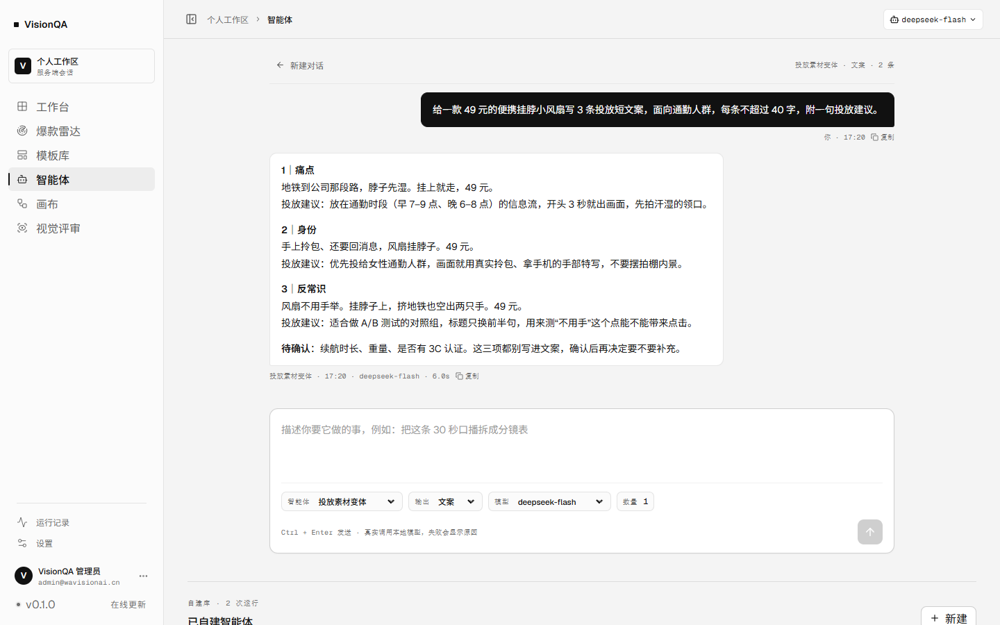


登录是**真实的服务端账号**：密码用 scrypt 存哈希，账号落在 `data/auth.db`（SQLite），会话是服务端随机 token + HttpOnly cookie，浏览器里读不到 token 也读不到密码。支持注册、登录、记住我；登录失败统一提示「邮箱或密码不正确」，不泄露邮箱是否注册过。登录状态收在**侧栏左下角**，点开可切换账号或退出。


左下角是账号与版本：点账号行可设置 / 切换账号 / 退出；点版本行打开「版本与在线更新」——只读服务端 /api/version 的真实版本号，接口没接入时如实显示「未接入」，不伪造下载进度。


## 一、这一版做了什么

| 模块 | 真实能力 | 事实边界 |
| --- | --- | --- |
| 登录 | 注册 / 登录 / 登出 / 记住我 / 会话持久化，密码 scrypt 存哈希，会话服务端校验 | **没有找回密码、邮箱验证与角色权限**；注册默认关闭，加账号用 `npm run adduser`，见 [docs/accounts.md](docs/accounts.md) |
| 作品 | **一条内容一条记录**：`#/projects` 与 `#/projects/<id>`；只存「绑哪条模板 + 哪块画布 + 到哪一步」，脚本与分镜实时取自模板；作品页按「下一步」给一张主卡（开画布 / 送评审 / 继续改 / 交付）；改名、多版本对照（每版写清比上一版改了什么，任意两版可逐项看节点参数前后，并把两版评审结论、按严重度的问题数、交付状态与交时评审并排（交付后重评会单独写一条，不改写交时结论；可打印成 A4 对照纸带走，两版对照页也随交付包 `.zip` 一起给出，只读分享可另外选择带上这张纸，并可下载含现场页、评审对照与帧图的离线包；**标记交付时整套包当场封存，开新版或改模板之后旧版仍能原样下载，作品页的交付档案还能展开包内清单、复制 SHA-256，下载后拖回同一块就能在本机核对，服务器上那一份也能点「查一遍哈希」重算，丢了 / 大小变了 / 内容被换过都会直说；包里那份也不用解压：清单直接读包内目录，交付稿看原文、现场页进沙箱、帧图直接看，某一条 CRC32 对不上也会当场说；「体检整包」还会把每一条都解开重算一遍 CRC32，按偏移读、内存里最多一条，坏哪条点哪条，包被截断就说做不了；清单与单条预览也改成按偏移读，十个文件的包列一次目录只读 691 B，取一条就只读这一条；封存包还由定时任务每天自动巡检一遍，作品页写「上次巡检 …」与每一版自己的结论，坏了红字点名，不用谁记得点；交出去的包里还带一页 `校验.html`：收包人把 zip 拖进去就逐条对一遍 CRC32、并算出整包 SHA-256，不上传、不联网、不要账号；分享页的离线包也带同一页，拿到链接的人不用账号也能自己核，对不上的那条点名；核对完页面给一段**收据**（谁、哪一份、结论、整包 SHA-256、时间、坏在哪），可复制或存成 txt 发回给发件人，打印时按钮自动收起；**那段收据贴回作品页的交付档案就能跟封存包对一遍**（版次 / 包名 / 字节 / 整包 SHA-256 / 对方结论五项），结论记在那一条交付记录上，刷新还在；**回执链接让收包人自己贴，不用注册，结论直接写回同一条交付记录**，他贴过几次都留着：最新一次写在档案行，更早的在下面按时间倒序，谁贴的、差哪一项都查得到）；旧版脚本快照可点开看，归档版可**以这一版为底**再开一版）、运行按作品归集、脚本 copy-on-write、**只读分享链接**都已上线；**分镜每一镜有自己的画面槽**（v0.9.161）——可以把你出的图贴到某一镜、换一张或退回原片帧，评审页「这条作品的画面」直接挑这一镜去评，模板一个字不动；**每一镜还带一条现拼的出图提示词**（v0.9.164）——画面、机位与脚本拼成，可复制这一镜或整条，不调模型、不花额度，出图仍去无限画布；智能体草稿可**存为模板 / 送到画布** | 默认只存引用，脚本只在改过时复制一份；**没有作品级权限 / 协作 / 逐人访问明细**；分享只记打开次数与设备类别 |
| 交出去的（工作台） | 工作台把每一次交付摊成一条线：哪条作品的哪一版、什么时候交的、交时评审、现在还作不作数；**封过包的每一条带回收执的结论**（对得上 / 对不上 / 对方读不出来 / 还没收到），清单顶上按整份记录数一遍，对不上的另起一句；**点一行直接落在作品页那一版的档案上**，收据已经摊开、那一行标出来，地址带着交付记录 id（刷新 / 后退都还在这一版）；**又贴一次时，收据里多一句「和上一次比变了哪一项」**——哪一项从对不上变成对得上（或反过来）、结论怎么变、收据上换成了哪一串（v0.9.139–141）；**对不上的时候再收一句「下一步做什么」**——版次或包名不对、字节不对、只有哈希不对、哈希空着、对方读不出来各有一句判断和下一步，包对得上只是结论打架用警示色，看不出是哪一种就直说（v0.9.142）；**对不上的时候多一个「复制这段话」**——把两边值照抄收据，写清请对方怎么重验，一键复制去发（v0.9.143）；**还没回来的那一行说清等了几天、差在哪一项**——「发出 4 天」、超过三天换警示色、对不上时胶囊里写「差在整包 SHA-256」，行尾多一个「复制提醒」：复制一段带回收据链接的话，档案里记下催过几次，刷新还在（v0.9.144）；**还没回来的那一行还说这条链接送到没有**——收包人打开回执地址就记一次（只存哈希前缀、只分四类客户端、一分钟内刷新算一次），行上写「链接打开 1 次」或「链接还没打开」，一次都没打开的 title 里写「可能没送到，先把链接再发他一次」，顶上另起一句数一遍，作品页档案里写「打开过几次、最近一次」；升级前发的链接没有发出时间，一个字都不说（v0.9.145）；**知道之后下一步就在这一行上**——链接一次都没被打开过的那几行，按钮换成「再发一次链接」：点一下复制一段「那条链接你那边可能没收到，这里再发一次」，带回同一条地址与「打不开就说一声」，行尾另记「又发过 N 次」（与「催过 N 次」分开算），发到两次还没打开就直说「换个方式发（邮件 / 换个人）」，顶上另起一句数一遍（v0.9.146）；**那条地址发两遍都没打开，就地换一条新链接**——又发过两次还是没打开的那几行，按钮换成「换一条新链接」：点一下换一枚新 token（旧地址立刻打不开），复制一段说清「这是新地址、旧的那条已经作废」的话，打开次数与重发次数从零算起、换成「换过 N 次链接」，档案里带着「上一条发过 2 次没打开」；打开过的那条不给换（服务端也拦一道 409 LINK_OPENED），顶上另起一句（v0.9.147）；**换掉的那条旧地址自己会说「已经换成新的了」**——收包人从聊天记录点回旧的，得到的是「这条地址已经换成新的了 / 哪一天换的 / 旧地址从那会儿起打不开 / 用最后发给你的那条 / 手上的包不用重下」，不是「链接不在了」；换地址时只留旧 token 的哈希前缀（不留 token 本身，最多 5 条），打开旧地址不算打开那份包，也不把新地址交出去（v0.9.148）；**换掉的那条旧地址还被点着，发件人第一次看得见**——有人点回旧地址时记一次（只记次数与最近一次；五秒内连着来算一次，不记是谁、不记从哪来），行上单独一段写「旧地址还被点过 3 次」并给出下一步「他手上可能还是旧的那条，把现在这条再发一次」，收包人那一屏照旧只说「换成了新的」、不把次数说给他（v0.9.149）；**换过两次就不再给换第三条**——换地址换的是 token，不是渠道：绕不过去（工作台按钮没了、作品页那条一起消失，两个入口在服务端都回 409 LINK_ROTATE_LIMIT），行上多一段「地址换到头了」解释按钮去哪了，剩下的动作换成「问问收到没」：复制一段「是不是没收到」的话，带着现在这条地址（v0.9.150）；**收包人自己说一句话**——回执页多一个「东西收到了，正在验」：点一下只记这一刻（不比对任何东西、不改包、不改地址、不算打开次数、不顶作品排序），页面变成「已经告诉他了」、刷新还认得；工作台那一行行首从「还没收到回执」换成「他点了「收到了」，收据还没贴」，不再劝换地址 / 再发一遍，剩下的动作是「复制提醒」；清单顶上多一句「其中 N 次他自己点了「收到了」」，这几条从「可能没送到」那一堆里挪出去；作品页档案里多一行「他在回执页点了「收到了」」（v0.9.151）；**每一条交付还能写清「这是给谁的」**——同时交出去两三份时，作品页交付档案里写一个称呼（最多 24 个字），工作台那一行第一段就是「给王老师 · 内容组」，复制出去的提醒 / 重发 / 问话都用这个称呼开头；同一个称呼再存一次不写盘，清掉就回到「没写」，行上什么都不说；这个称呼只在发件人这一侧，包里没有，公开回... (line truncated to 2000 chars)
| 导航 | 一级只留四个去处：**工作台 / 作品 / 发现 / 模板库**；智能体 / **工作流** / **无限画布** / 视觉评审 / 运行记录退到「工具」区（v0.9.163 起两张画布各占一项）；可用 Ctrl / ⌘ + K 快速跳转任意页面与动作 | 智能体编辑器仍归在「智能体」项下；路由保持原样（`#/radar` 等旧地址照旧可用）；旧画布项目地址 `#/canvas/project/<id>` 自动改写成 `#/board/<id>` |
| 本地工作区（桌面端） | **loop、工具、会话记忆都在本机**：列目录 / 读文件 / 写文件 / 执行命令四个工具，写文件与执行命令必须逐次批准；会话落盘可续，上下文超预算先压成摘要；模型补全走账号会话（`/api/local-agent/complete`），密钥不下发 | 只在 Electron 外壳里出现，网页版打开 `#/local` 会如实说明不可用；**还没有安装包**（`npm run desktop` 起开发外壳，见第六十七节） |
| 发现（原爆款雷达） | 进页面**不自动检索**，点「检索」才发请求；卡片给播放 / 点赞 / 收藏 / 评论 / 转发与互动率；可「加入模板库」或「一键复刻」 | 抖音有播放量，小红书没有；取不到就隐藏，不做估算 |
| 一键复刻 | 视频解析 → ffprobe → FFmpeg 拆帧 → 逐帧视觉分析 → 入库，五步进度与实时日志 | 平台链接解析依赖红狐 Key；直链兜底可用 |
| 模板库 | **只存原链接 + 互动数据 + 解析出的脚本与分镜，不保存视频文件**；待解析 / 已解析两种状态，详情抽屉里可「去解析」；类型/关键词检索；送去评审 | 待解析条目没有帧图，封面走 /api/cover 代理 |
| 智能体 | 对话框式入口、参数行（智能体/输出/模型）、已自建智能体分类卡片、新建/编辑/删除；对话带**最近 8 条 / 6000 字**的会话记忆；脚本/分镜回复带**结构化草稿**，可存为模板、送到画布 | 记忆由服务端截断，超出部分不带；不落库；草稿只认回复里那段 ```draft JSON，模型没给就没有出口，不从正文表格反推 |
| 工作流 `#/canvas` | React Flow 节点编排（input/llm/kb/tool/condition/output）、检查器、连线校验、保存、逐节点运行；节点面板默认收起，双击画布或点「节点」唤出 | 只做编排与执行：v0.9.163 起不再嵌外部画布（见第二百三十节），运行是真执行、耗时真实 |
| 无限画布 `#/board` | 外部自由画布（canvas.wavisionai.cn）整屏嵌入：42px 状态条上换画布 / 新建 / 写笔记 / 专注 / 新窗口，`#/board/<画布ID>` 点名一块；报价按积分，余额与充值留在工作台 | 第三方应用、自带顶栏；连不上时只在这一页说明，不影响工作流与作品；画布项目与写笔记仍走 `/api/bdc/*`（本机 5312 / 5313） |
| 视觉评审 | 选画面 → visual-baseline 七维评审 → verdict + 像素锚点 + 有界修正建议 | 未启动 VisionQA 插件服务时由本地模型出一份同契约结果，provider 会写清 |
| 充值与积分口径 | **价格只有一种说法：积分**。`#/recharge` 选一档（默认体验 / 标准 / 团队，后台可改）→ 内测直充当场到账，余额、订单与积分流水三处对得上；积分口径只有一处（`VQ_POINTS_PER_CNY`，默认 1 元 = 10 积分），充值页、默认档位与外部画布的报价都读它 | 支付通道还没接入（商户号未下来）：「到账」是内测直充，不扣真实款项，页面逐字写明；`VQ_BILLING_MODE=off` 立刻退回「只能提交申请」 |
| 运行记录 | 读 data/runs.json，逐节点状态、耗时、输出；同一画布、或同一件作品另一版画布上的两次运行可逐节点对照，输出差异可按需展开 | 只有画布执行会产生记录；跨版本按节点 id 对齐；跨作品仍不可对照；差异只到行 / 160 字段落，不做字内高亮 |

导航分两层：一级 4 项「工作台 / 作品 / 发现 / 模板库」，下面是「工具」区「智能体 / 工作流 / 无限画布 / 视觉评审 / 运行记录」，底部只留设置；桌面端在这之间多一组「本机 › 本地工作区」。左上角只写 VisionQA，不放图形标记；导航只有 `src/nav.ts` 一份真源（第六十六节）。

> 2026-11-09 上线体检后，整块删掉了「资产库」（6 条假资产 + 假统计，没有后端）、内测测试版、登录页演示账号与访客入口、工作台的示例待办/最近复刻/待评审。逐项清单与「哪些是真的」判定见 [docs/launch-readiness.md](docs/launch-readiness.md)。

### 2026-11-10 这一轮（已上线）

| 改动 | 之前 | 现在 |
| --- | --- | --- |
| 雷达检索时机 | 切到爆款雷达就自动检索一次（按次计费） | 进页面只读健康状态；输入关键词点「检索」才请求，未检索时给明确的空状态 |
| 卡片数据 | 点赞 / 收藏 / 评论 / 转发 | 再加播放量与互动率（(赞+藏+评+转)/播放），排序支持按播放、按转发 |
| 雷达 → 模板库 | 只有「一键复刻」入库 | 新增「加入模板库」：只存原链接、作者、互动数据，不下载视频、不抽帧 |
| 模板库 | 每条都带本地帧图 | 待解析 / 已解析两态；详情里可「去解析这条」，复刻完成后同一条目升级，不重复占格 |
| 智能体对话框 | 输入框 + 参数行 + 提示行 + 独立发送键，改一次要滚 | 一块卡片：输入区在上，参数与「Ctrl + Enter + 发送」收在底部同一行；去掉「数量 1」与「真实调用本地模型」这类给我们自己看的文案 |
| 会话记忆 | 每轮只发当前一句 | 带最近 8 条 / 6000 字上下文（服务端截断），实测追问能接住上文 |
| 字体 | 从 fonts.googleapis.com 拉 Geist + Noto Sans SC 四套字重；中文用无 hinting 的网页字体，12px 发虚 | 去掉外部字体请求，Geist 拉丁子集自托管、中文用系统黑体；10px 微标签统一抬到 11px |
| 充值 | 无 | 新增 /api/billing/*（overview / orders）与设置页「充值」按钮；通道未开通时明确显示未开通、按钮不可用，不编价格 |


### 2026-11-10 追加：页头、运行记录溢出、入口 HTML 缓存

| 问题 | 原因 | 改法 |
| --- | --- | --- |
| 智能体页顶部「创作能力 / 智能体」 | 顶栏已经有「个人工作区 › 智能体」，页内又写了一遍虚构的上一层 | 删掉页内这行眉标（编辑页同改），全站只留顶栏一处面包屑 |
| 「已自建智能体」上方 | 「自建库 · N 次运行」和下面的标题说的是同一件事，右上角还有第二个「新建」 | 收成一行：标题 + 「N 个 · 累计 M 次运行」；新建只留页头那一个 |
| 参数胶囊的下拉 | 原生 `<select>` 弹出层会盖住输入框底部，样式也和发丝线不搭 | 换成自绘下拉：点击外部或 Esc 关闭、选中项加粗、展开时箭头翻转 |
| 运行记录页明显溢出 | `.runs-page` 漏写页面内边距，内容顶到侧栏和窗口边缘，左侧字看起来像被切掉 | 与工作台同一套 32px 内边距 + 1280 居中 |
| 工作台页头字体发虚 | 「工作台 · 用户 · 2026 年 11 月 10 日 · 星期二」整行等宽字体 + 中文混排，被 0.04em 字距拉散 | 拆成「工作台 · 用户 · 日期」，中文走界面字体、只有日期用等宽等宽数字；标题数字改 tabular-nums、分隔点降为 1px 灰 |
| 发版后仍看到旧界面 | nginx 直接托管 dist，`index.html` 没有 `Cache-Control`，浏览器按 ETag 启发式缓存旧 HTML，发版后继续加载旧 bundle | nginx 里 `location = /index.html` 写 `no-store, no-cache, must-revalidate`，`/assets/` 写 `immutable` 长缓存 |


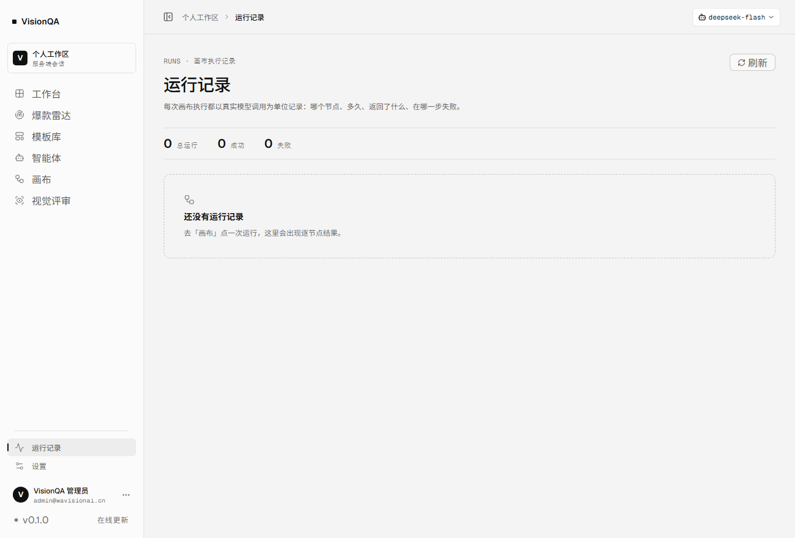


同一轮还按上线前审计修了六处**会真出事故**的地方（登录暴破绕过、模板库并发写丢条目、失败任务残留临时目录、
模板帧图送评审路径错、安全响应头、数据零备份）：
`deploy/production/backup.sh` + `visionqa-backup.timer` 每天 04:10 把 `/var/lib/visionqa` 整目录打包到
`/var/backups/visionqa` 留 7 份（含 WAL，恢复时 SQLite 自己重放），已装并跑过第一次。
审计清单、未修的 P0/P1（配额闸门、多用户 ownerId、SSRF 超时、健康检查探上游……）逐条记在
[docs/launch-readiness.md](docs/launch-readiness.md) 的「三点八」。

### 视觉基线（去 AI 味）

界面按六条硬规则约束，细则与 token 表见 [docs/design-baseline.md](docs/design-baseline.md)：

1. **间距只走 4/8pt 栅格**——`--space-1..16`（4/8/12/16/24/32/48/64），组件里不出现 13/26/29 这类随手值；
2. **禁大面积渐变**——底板是纯色（`#f4f4f4` / `#fbfbfb` / `#ffffff`），彩色只留在「通过 / 待确认 / 问题」三个语义位；
3. **图标不用 emoji**——全部 lucide 线性图标，统一 1.5px 描边；
4. **字体显式指定**——Geist 拉丁子集自托管（52KB）+ 中文走系统黑体（苹方 / 微软雅黑），不再 @import fonts.googleapis.com；标题 500、正文 14、等宽元数据 11–12；
5. **文案给信息不给寒暄**——工作台页头是「3 项待办 · 3 条待评审 · 4 条今日入库」，不是「下午好」；
6. **颜色先 token 后动手**——六件套 `--canvas / --surface / --surface-raised / --ink / --muted / --line`，组件里不现调色。

这一轮把 8 张样式表里 449 处 off-grid 间距、495 处 `font-size` 收敛到栅格与字阶，标题字重统一降到 500，并把模板库「搜索框 + 9 个类型 chip 挤一行换行」重排成搜索一行、类型一行（下划线式 tab，横向不换行）：


### 两个形态

对外只有一个形态：**用户生产版**。后台管理版不给普通用户看到，地址栏加 `?edition=admin` 才进得去，进去后侧栏有一条「返回生产版」。

| 形态 | 给谁 | 导航 |
| --- | --- | --- |
| 用户生产版 PRODUCTION | 内容团队日常用 | 工作台 / 爆款雷达 / 模板库 / 智能体 / 工作流 / 无限画布 / 视觉评审 +（横线下）运行记录 / 设置 |
| 后台管理版 ADMIN | 运维自己（`?edition=admin`） | 总览 / 账号 / 无限画布 / 模型 Key / 模型与上游 / 模板治理 / 成本 / 计费 / 举报处理 / 反馈 / 运行审计 / 系统 |

原来的「内测测试版 LAB」整块删除：接口体检、样例对照、功能开关、诊断导出四页里，开关全是「仅记录，尚未接线」，对照页的作用是把 `src/data/mock.ts` 的假数据摆在真实接口旁边——上线版不该带这种页面。
后台版每个数字都标「真实接口 / 本地会话」，没有接口的地方就写没有，见 [docs/editions.md](docs/editions.md)。


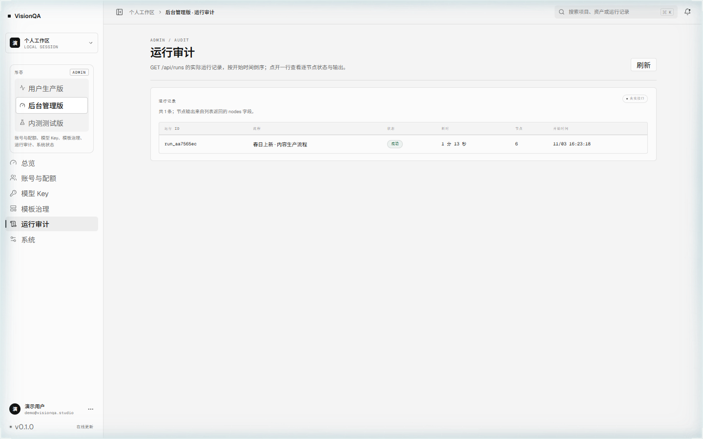

## 二、检索 → 复刻 → 模板库

爆款雷达按平台（抖音 / 小红书）、关键词、时间范围检索，卡片直接给点赞 / 收藏 / 评论 / 分享与时长；鼠标移到封面出「一键复刻」。


红狐账号不可用时（Key 禁用 / 积分不足 / 限流），界面明确说清并给后台链接：


一键复刻跑五个可观测步骤：解析视频地址 → 读视频信息（ffprobe + 场景切镜）→ FFmpeg 抽帧 → 逐帧分析脚本与分镜 → 写入模板库。进度、每步状态、实时日志都在弹窗里。


模板详情里有脚本结构（钩子 + beats + 口播 + 屏幕字）、分镜表（画面 / 机位 / 字幕 / 声音 / 叙事作用 + 对应帧图）、爆款分析、可复用规则、原视频链接，以及「送去评审」——把这条模板的首帧直接交给视觉评审。


### 抽帧可以交给远端算力

「解析 → 下载 → 探测 → 抽帧」这四步默认在本机跑 FFmpeg。填一个 `REPLICATE_REMOTE_URL` 就整体挪到外部服务上，工作台只收帧、调视觉模型、入库，**服务器上不再需要跑 FFmpeg**。契约与参考实现见 [docs/remote-compute.md](docs/remote-compute.md)，仓库自带 `worker/video-worker.mjs`。

弹窗里会写明这次走的是哪条路——下图是远端算力实际跑通的一帧：`来源：远端算力 … · 5 帧 · 640×360`，前三个步骤（获取 / 探测 / 抽帧）由对方完成：


顺带把本机那两条 FFmpeg 命令也压了一轮：场景切点只解关键帧、18 次 spawn 合成一条命令，整条链路 **6.1s → 0.99s**（10 秒 640×360 实测）。

## 三、智能体：对话框入口 + 已自建智能体

进入「智能体」先看到的是一个 composer：描述你要它做的事，同一行选智能体、输出类型、模型、数量，Ctrl+Enter 发送。发送后进入对话，用户消息靠右、智能体消息靠左，运行中有计时，失败显示模型名 + 状态码 + 原因并可重试。

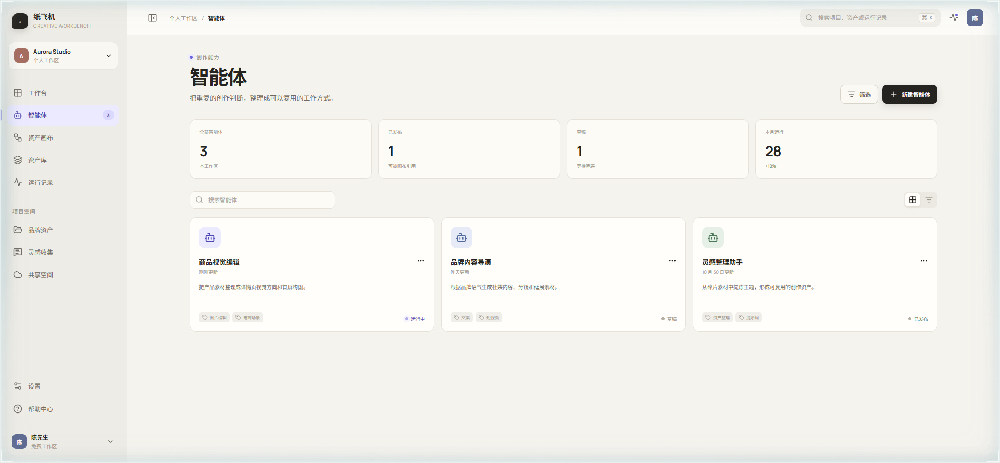

底部不是「精选作品」，而是**已自建智能体**：分类标签（全部 / 内容复刻 / 视觉评审 / 脚本分镜 / 投放素材）+ 卡片（名称、职责、模型、最近运行、使用次数），可编辑、可删除、可新建。


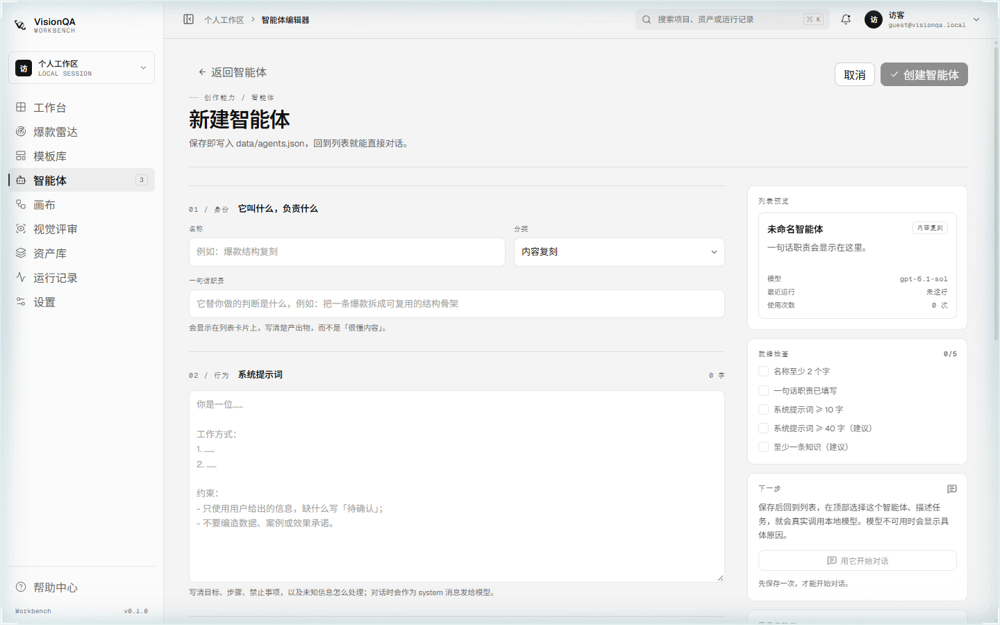

真实链路：POST /api/agents/:id/chat 把智能体的 systemPrompt、知识条目、本次输出类型和用户消息拼成 messages，调用本机模型（gpt-6.1-sol，失败按降级链换模型），返回真实回复并把 runCount 加一。实测一次口播分镜回复 44–52 秒，主模型过载时会降级到 grok-4.6 并在界面上标出实际用的模型。

## 四、画布：节点编排与真实执行

画布用 @xyflow/react 12 实现：中间画布 + 右侧检查器，**节点面板默认不显示**——双击画布空白处或点工具栏「节点」才唤出（Esc 收起），避免一进来就被一列按钮占掉焦点。连线校验（不允许自环、输入只接一根），节点可删，Ctrl+Z 撤销，画布状态存 data/flows.json。节点类型只有六类：输入 / 大模型 / 知识库 / 工具 / 条件 / 输出——**评审不进画布**，评审是独立页面（第五节）。


点「运行流程」由服务端按拓扑序执行：llm 节点调本地模型、kb 节点读模板库做上下文、condition 按表达式分支、output 汇总；每个节点返回 status / ms / output，节点在画布上逐个点亮，右侧抽屉同步显示每节点输出。


实测一条 6 节点流程（input → kb → llm → condition → tool → output）跑完 72.8 秒，llm 节点 72.8 秒（含模型调用），GET /api/runs 能查到逐节点结果。


画布的参考来源与许可证（Langflow / Flowise / n8n / Dify / React Flow，未复制任何源码）写在 [docs/canvas-source-attribution.md](docs/canvas-source-attribution.md)。

## 五、视觉评审：VisionQA 的视觉能力怎么放进工作台

VisionQA 的定位不是「帮你想文案」，而是「给已经产出的画面下判断」。放进工作台后它有三个落点：

1. **独立页面**：选一张画面（模板首帧或图片地址）→ 出 verdict、逐条 observation（维度 / 严重度 / 像素锚点 / 置信度）、有界修正建议、无法判断清单。
2. **模板库出口**：模板详情里「送去评审」，把首帧直接带进评审页。
3. **画布不掺和**：评审不是流程节点，画布只做编排与执行——判断留在评审页，画布保持干净。


评审按 visual-baseline 七维（层级 / 对比 / 间距 / 字体 / 色彩 / 构图 / 可识别性）出结论，**每条判断必须给 bbox 锚点**，给不出锚点的降级为 info 或进「无法判断」。服务端实现见 server/review.mjs：优先调 VisionQA 插件服务（127.0.0.1:6300 的 /api/visual-review，同一套 v0.1 契约），服务没起来就退到本地模型的同口径评审，并把实际 provider 写进结果（截图里是 local-model:gpt-6.1-sol · 72.9s）。

契约映射、证据锚点格式与降级行为见 [docs/review-integration.md](docs/review-integration.md)。

## 六、VisionQA Canvas 接入（上游 BD Canvas 源码，Source-Available，不入仓）

画布这一块跑的是 **VisionQA Canvas**：源码来自 **BD Canvas**（Source-Available License v1.0，不是开源协议）的授权副本，本产品对外统一叫 VisionQA Canvas。上游条款禁止把源码或修改版以任何形式分发，也禁止把软件本身当产品卖，所以本仓库：

- **不 vendor、不提交** BD Canvas 的任何源码或构建产物（公开仓库提交就等于分发）；
- VisionQA Canvas 单独部署在本机，跑它自己的 5312（后端）/ 5313（后台管理）/ 6677（网页入口）；
- 工作台只做探活与内嵌：GET /api/bdc/status 探测这三个地址，画布页拿到 `deployed=true` 就**默认直接进 VisionQA Canvas 本体**；没有部署时仍是本仓库那套节点编排。
- 画布页是**沉浸模式**：第三方画布自带完整的顶栏与工具条，所以这一层不再叠标题和说明，只留一条 42px 状态条（署名 BD CANVAS / 连接状态 / 当前地址 / 新窗口 / 回到内置编排），画布铺满内容区、不套卡片不套圆角。画布页的主角是画布，壳让位。

部署记录、三个必踩的坑（Python 不在 PATH、requirements 少两个包、根 .env 没有代码读）与验收清单见 [docs/visionqa-canvas-integration.md](docs/visionqa-canvas-integration.md)，自检用 node scripts/check-bdc.mjs，重启用 `scripts/start-bdc.ps1`。

**当前状态（2026-11-05 实测）**：已解压到 `D:\Projects\bd-canvas`，5312 / 5313 / 6677 三端口都返回 200，`/api/bdc/status` 的 `deployed` 为 true，画布页由 VisionQA Canvas 接管，浅色纸面主题已覆盖；后台 `bdadmin` 初始密码已改。**还差模型 Key**——后台「Key 管理」为空，出图链路没通。

### 改名与顶栏对齐（2026-11-06）

产品名统一成 **VisionQA Canvas**，只改**用户看得见**的地方：网页 `<title>`、顶栏品牌、管理员登录页、新手教程页、桌面端画布标题、设置面板里的应用名、AI 人设前缀、`document.title` 动态标题。上游的版权声明（`copyrightBanner.ts` 归属串）、各文件头部的 `Source-Available License v1.0` 与 `LICENSE` 原文**一个字符都没动**——那是 §4.3 / §5.1 要求保留的署名。

顶栏几何也并进 `deploy/bd-canvas/vq-theme.css` 第 9 节，口径直接抄宿主 42px 状态条（`.cv-bdc-strip`）：**42px 高、底色 `#f4f4f4` 与宿主状态条连成一条、底边 `1px rgba(17,17,17,.10)`、页签 26px / 6px 圆角 / 12px 字、「后端未检测」做成 20px 等宽微标签**。于是「宿主状态条 + 画布顶栏」读起来是一条，而不是两层壳。

### 把它收进我们这套白纸墨线的语言

上游默认是 `#101113` + 蓝 `#6f9cff` + 青 `#22d3ee` 的深色霓虹调性，直接嵌进浅色工作台会读成「里面装了个别家的 App」。所以做了一层**只改配色与顶栏几何、不改组件结构**的主题覆盖：

- `deploy/bd-canvas/vq-theme.css`：它真正的色板在 `src/ui/styles/` 里分三层——`palette.css` → `themes.css`（`--ui-*` 语义层）→ `legacyAliases.css`（把旧 `--bg-*` / `--text-*` / `--border-*` 全部桥接上去）。所以只重定义**上游两层**（`--palette-*` 与 `--ui-*`）就能一次收口，并且是**往我们自己的浅色画布上靠**，不是另起一套深色皮肤：画布 `#f4f4f4`、卡片 `#ffffff`、次级 `#f0f0f0`、三级发丝线 `rgba(17,17,17,.06/.10/.20)`、文字 `#111 / #3f3f3f / #5d5d5d / #9a9a9a`、强调近黑、发光全 `transparent` 只留墨投影、点阵 `rgba(17,17,17,.10)`、语义色直接用我们 tokens.css 的 `#176b43 / #8a5b08 / #a33838`。
- `scripts/apply-bdc-theme.mjs`：幂等地把 css 复制进 `bd-canvas/public/`，并在 `index.html` 的 `</head>` 前插入/校正一行 `<link id="vq-bdc-theme" rel="stylesheet" href="/vq-theme.css">`（371121 → 371187 字节，去掉这一行可完整还原）。上游升级后重跑一次即可；`--check` 只校验不改。

**许可证边界**：LICENSE §3.2 允许为自用修改源码，§4.3 / §5.1 禁止删除、隐藏、篡改版权声明、水印与归属标识。所以：`src/features/license/copyrightBanner.ts` 的归属串、各文件头部的 `Source-Available License v1.0` 声明、`LICENSE` 原文**全部原样保留**；改动只限于**可见产品名**（标题、顶栏品牌、登录页、教程页、桌面端标题、AI 人设、`document.title`）与配色/顶栏几何（`deploy/bd-canvas/vq-theme.css`）。`vq-theme.css` 与脚本是我们自己写的、进本仓库，**上游源码一个字节都没进仓库**。

改色前（蓝青霓虹）：


改色后（白纸 + 墨线 + 发丝节点卡，节点选中是 1.5px 近黑环）：


同一个画布按沉浸模式内嵌进工作台——两边现在是一套语言，不再像「里面装了个别家的 App」：

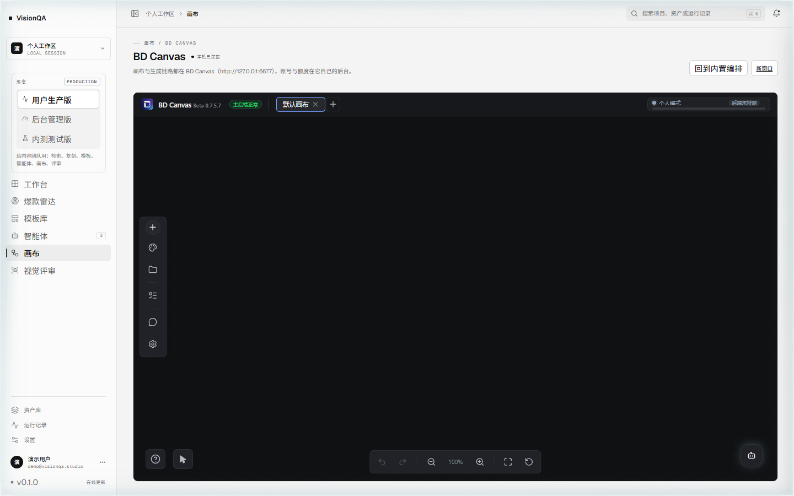

## 七、账号与会话（真实服务端）

登录不再是前端 mock。后端 `server/auth.mjs` + `server/routes/auth.mjs` 提供五个端点：`GET /api/auth/config`、`POST /api/auth/{register,login,logout}`、`GET /api/auth/me`。要点：

- **口令**：scrypt(N=16384, r=8, p=1) + 每用户随机盐，格式 `scrypt$N$r$p$salt$key`；库里没有明文密码。
- **会话**：32 字节随机 token，库里只存 `sha256(token)`；cookie 是 `HttpOnly; SameSite=Lax`，生产加 `Secure`。
- **不泄露账号存在性**：邮箱不存在时也跑一次 scrypt，登录失败统一 `field:'form'` + 「邮箱或密码不正确」。
- **限流**：同 IP + 邮箱 10 分钟失败 8 次锁；写请求校验 `Origin` 与 `Host` 一致，挡最省事的 CSRF。
- **受保护接口**：`VQ_REQUIRE_AUTH=1` 时除 `/api/auth/*`、`/api/health`、`/api/version` 外全部要登录，未登录返回 `{error:'未登录', loginRequired:true}`，前端收到就在 `src/api/client.ts` 派发 `vq:auth-required` 统一切回登录页。

**四个开关的默认值都在「不安全」一侧**（这是为了让本机演示不受影响），生产必须显式写：`VQ_REQUIRE_AUTH=1`、`VQ_SECURE_COOKIES=1`、`VQ_DEMO_ACCOUNT=0`、`VQ_REGISTRATION=0`（按需）。演示账号由后端 seed，密码通过 `/api/auth/config` 下发给登录页，**前端源码里没有任何密码**；关掉演示账号后登录页那块入口整体消失。

验收：`node scripts/test-auth.mjs` 起临时实例跑 16 项端到端断言（含「库里查不到明文 token / 明文密码」），全过；界面侧另做过一次真实点击：注册新账号 → 直接进工作台 → 退出 → 回登录页 → 错误密码给出统一提示 → 演示账号登录 → 进工作台。

没做的部分（别当成已经有了）：找回密码、邮箱验证、角色权限、多工作区、第三方登录。细节与接口契约见 [docs/accounts.md](docs/accounts.md)。


## 八、服务器配置

内测起步一台 **4C 8G / 100G ESSD / 5M 带宽**、视觉模型继续走 API、VisionQA Canvas 同机部署即可；**不需要 GPU**——评审 60–85s、智能体 20–50s 都是接口延迟。逐档配置、存储/带宽估算、以及上线前必须做的三件事（Windows 脚本换 systemd、JSON 换 SQLite、视频转对象存储）见 [docs/server-sizing.md](docs/server-sizing.md)。

**要真正对外上线**时看 [docs/deploy-production.md](docs/deploy-production.md)：域名与 DNS、Caddy 自动 HTTPS（`deploy/Caddyfile`）或 Nginx（`deploy/nginx.conf`）、systemd 守护（`deploy/vq.service`）、环境变量清单（`deploy/env.production.example`）、健康检查、备份恢复与日志轮转，都有可直接复制的命令和验收步骤。三条硬结论：node 只监听 127.0.0.1、公网只走反代；四个 `VQ_` 开关不写就等于裸奔；单机同时复刻不超过 2 路。

### 线上环境（已上线，2026-11-06）

| 项 | 值 |
| --- | --- |
| 站点 | https://visionqa.wavisionai.cn （80 端口 301 跳 https） |
| 机器 | 阿里云轻量应用服务器 2 vCPU / 2 GiB / 40 GB，华东2（上海） |
| 应用目录 | /opt/visionqa，git 部署，systemd `visionqa.service` |
| 数据目录 | /var/lib/visionqa（SQLite，含 auth.db） |
| 后端端口 | 127.0.0.1:8799（8787 被既有站点占用，所以换端口） |
| 反向代理 | nginx `/etc/nginx/conf.d/visionqa.wavisionai.cn.conf`：80 只做 ACME 挑战 + 跳转，443 终止 TLS 并反代 /api 与 /media |
| 证书 | Let's Encrypt（certbot webroot `/www/wwwroot/wavisionai.cn/acme`），到期 2027-02-04，续期不影响 443 |
| 登录账号 | 由服务器 `/opt/visionqa/.env` 的 `VQ_DEMO_EMAIL` / `VQ_DEMO_PASSWORD` 决定，改完 `systemctl restart visionqa` 生效 |

当前是**无模型 Key** 的形态：`/api/health` 里 `vision=false`，界面照常可用，模型下拉照实写「凭证未配置：选中模型也不会真正发起调用」，不假装有推理。

部署脚本（root）：

```bash
DOMAIN=visionqa.wavisionai.cn API_PORT=8799 SECURE_COOKIES=0 bash deploy/production/install.sh   # 装依赖 → 拉代码 → 构建 → systemd → nginx(80)
DOMAIN=visionqa.wavisionai.cn bash deploy/production/enable-https.sh                            # 签证书 → 换成 80 跳转 + 443 → 打开 Secure Cookie
```

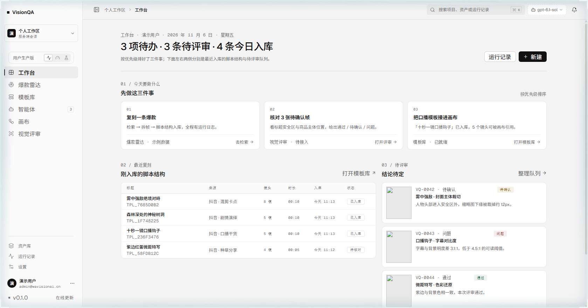


**模型切换的口子怎么用**：右上角模型下拉读 `GET /api/models`，目录来自服务器 `.env` 的 `VISION_MODELS`（逗号分隔，每项可写 `id|显示名`），没配就退回 `VISION_MODEL` + `VISION_FALLBACKS`；改完重启服务、刷新页面即可，**前端不用改一行**。公开匿名**拿不到**这份清单（`VQ_REQUIRE_AUTH=1` 时 401），只有登录后的界面能读；顶栏下拉只显示 VisionQA 产品名，真实模型 id 只用于请求。真正要发起调用时，把 `VISION_BASE_URL` / `VISION_API_KEY` 填进同一个 `.env`，`configured` 会变 true，下拉里的「凭证未配置」提示自动消失。

### VisionQA Canvas 同机部署（2026-11-06）

线上「画布」页里嵌的就是 BD Canvas 本体（真源码那套），不再是内置编排的替身。

| 项 | 值 |
| --- | --- |
| 站点 | https://canvas.wavisionai.cn （独立子域，80 跳 https） |
| 目录 | /opt/bdcanvas（git clone 私有仓库快照，venv 在 .venv，node_modules 走 npmmirror） |
| 服务 | systemd `bdc-web.service`（Vite 6677，只监听 127.0.0.1）、`bdc-api.service`（Flask 5312）、`bdc-enterprise.service`（Flask 5313） |
| 反向代理 | nginx `/etc/nginx/conf.d/canvas.wavisionai.cn.conf` → 127.0.0.1:6677；`/admin`、`/api/admin`、`/enterprise/admin` 只放行 127.0.0.1 |
| 证书 | Let's Encrypt（同一 ACME webroot），与主站互不影响 |
| 接线 | `/opt/visionqa/.env` 的 `BDC_WEB_URL=https://canvas.wavisionai.cn`，重启 visionqa 后 `/api/bdc/status` 变 `deployed: true`，画布页直接从「未发布」切成 iframe |

两个坑（都踩过）：

1. BD Canvas 的正式构建（`npm run build`）在当前源码里是坏的——`vite:esbuild-transpile` 在 `VideoFaceBlurEditor` 分块上拿到 `[object Object]` 就中断，去掉三个自定义 bridge 插件也一样。所以服务端跑的是它自己启动时用的那套 Vite dev server（6677），不是静态 dist。
2. `vite.config.ts` 默认把非 loopback Host 当「公网访客」，会 403 掉所有写接口。子域部署要把它加进 `TRUSTED_PUBLIC_HOSTS`（已改），同时加进 `server.allowedHosts`，否则整页 403。

**画布已加 Basic Auth**（2026-11-06 追加）：`canvas.wavisionai.cn` 默认 401，用户 `canvas`；iframe 走一次性入口 `/__auth?k=<token>` —— nginx 种 30 天 cookie 后所有资源请求免登录，所以嵌在 VisionQA 里不会弹登录框。`/admin`、`/api/admin`、`/enterprise/admin` 仍然只放行 127.0.0.1。VisionQA 侧新增两个环境变量：`BDC_EMBED_URL`（iframe 用，带 token）与 `BDC_WEB_PROBE_URL`（探活用本机 6677，避免 401 把 `deployed` 误判成 false）。

**外壳对齐（2026-11-06）**：主题只在 `deploy/bd-canvas/vq-theme.css`（部署方自用，不改它的组件结构），发布时拷成 `<canvas>/public/vq-theme.css`、在 `index.html` 里以 `#vq-bdc-theme` 引入。十节内容：

1. 第 1–8 节把它的 `--ui-*` 变量用 `:root:root` + `!important` 映射到 VisionQA 的 `tokens.css`——字体栈、6/10px 圆角、4/8pt 间距、`#f4f4f4` 画布 + 发丝线、单层轻阴影、等宽微标签。
2. 第 9 节管顶栏几何：`height: 42px !important`（只写 `min-height` 会被它自己的 48px 规则压住）、页签 26px/6px/12px、状态胶囊等宽 10px。
3. 第 10 节管左侧组件面板与右键菜单：面板 288px 白底 10px 圆角、44px 表头、分组标题等宽 10px/0.12em、行高 36px、图标方块 24px；右键菜单与节点创建菜单 208px 宽、行高 34px、快捷键右对齐（补了 `display:flex` + `margin-left:auto`，它原本是 `display:block`，标签和快捷键会挤在一起）。


**第三轮：外壳细节（2026-11-09）** 主题层第 11 节把剩下的界面统一成一套 4pt 栅格：

- 左侧功能轨：8px 内边距、32px 方形 8px 圆角按钮（原来是灰底圆形），悬浮 5% 墨色；
- 底部控制条：46 → **40px** 高（它的 `min-height: 44px` 要一起压，只写 `height` 不生效）、按钮 32px、缩放数字等宽 10px；
- 节点卡：标题 12/500、正文 13px/1.6、页脚等宽 10px、选中转单层墨色描边；
- 悬浮工具条 28px、参数面板 12px 圆角 + 等宽分组标签、输入框 6px 圆角聚焦转墨色、滚动条细化到 8px。

**顶栏状态改报真实结果（2026-11-09）**：品牌旁那颗探的是 `/api/health`（5312），5s 超时、30s 一轮，title 带状态码与耗时；右侧连接胶囊原本归管理服务状态管，未登录时恒为 `unknown` 所以永远显示「后端未检测」——现在宿主把真实探测结果写进 `setConnectionProbe()`，未登录也报真话（后端正常 / 后端断连）。


**细节第一轮：节点卡尺寸与空状态（2026-11-09）**

- **文本节点按「一页纸」定尺寸**：它自己会写 `_width/_height`（默认 360×220），但旧逻辑最后落到 `aspectRatio` 的 **1:1 方卡**上——评审结论三行就出滚动条。现在 `getNodeBaseSize()` 为 `text` 单独开一条分支按存储尺寸取值，写笔记用 420×300 + `_cardScale: 1`，五条结论一屏读完、不用滚动。
- **空白画布有了引导**：`#v2-canvas:not(:has(.v2-node))::after` 画一块虚线提示卡（13px / 白 70% / 10px 圆角 / 虚线发丝线）：「空白画布 · 左侧 + 新建节点，或把素材拖进来（Ctrl+V 粘贴）」。有节点后自动消失，纯 CSS，不动上游 DOM。


**细节第二轮：文本卡的内联样式控件（2026-11-09）** 文本节点没有模型参数面板（上游把它当「原地编辑」节点），所以样式控件直接做在卡片页脚，右对齐四颗 18px 小按钮：

- `A-` / `A+`：字号 10–22px，每次 1px；
- `LH`：行高在 1.4 / 1.6 / 1.8 之间循环；
- `M`：等宽字族开关（Geist Mono）。

样式写进 `node.params._vqText`，渲染时翻译成三支 CSS 变量（`--vq-text-size/-leading/-font`）由主题层消费；点按钮不整卡重渲染（文本框要保光标），直接把变量写到现有 textarea 上。线上实测：`13px → 16px` 时行高跟着到 `25.6px`，`M` 切到 `Geist Mono`。


**画布与工作台数据打通（2026-11-06）**：工作台不再只是「嵌一个 iframe」，它和后端共用同一批画布。

| 工作台接口 | 干什么 | 打到的画布接口 |
| --- | --- | --- |
| `GET /api/bdc/canvases` | 列画布（名称、节点数、版本、更新时间） | `GET /api/canvas/list` |
| `POST /api/bdc/canvases` | 建一块空画布（id 形如 `vq-*`） | `POST /api/canvas/save` |
| `POST /api/bdc/canvases/note` | 把评审结论落成画布里的一个文本节点 | `GET /api/canvas/load/:id` + `POST /api/canvas/save`（带 `expected_revision` 乐观锁，别人同时改了返回冲突而不是覆盖） |

界面就在 42px 状态条里：`画布项目` 下拉（选中即用 `&loadCanvas=<id>` 深链换画布，选中项记在 `localStorage`，刷新后仍然绑着同一块）、`新建`（建完自动绑定）、`写笔记`（写完 iframe 自动重挂载，立刻能看到那条文本节点）。


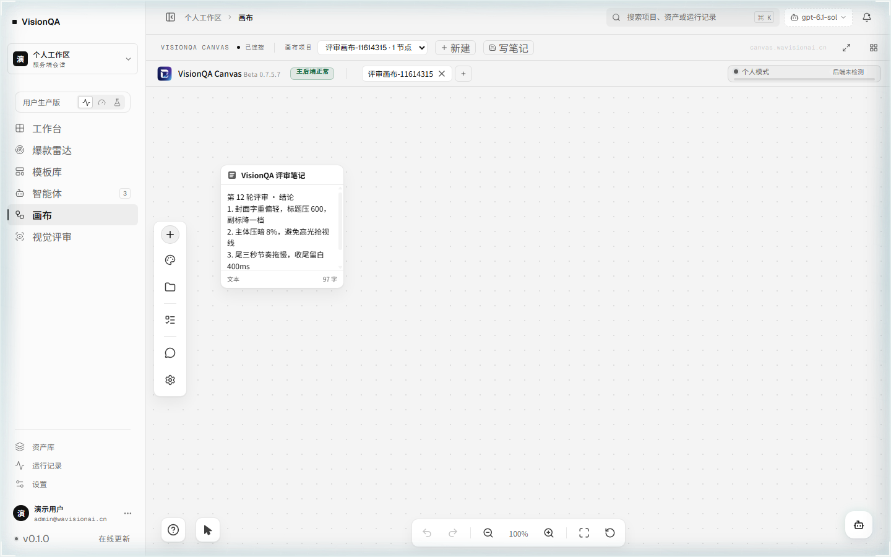

打通时踩到的三个硬点（都是上游行为，记住能省一天）：

1. **公网访客模式只读浏览器**：`isPublicWebClient()` 把任何非内网 Host 当公网访客，画布数据存 localStorage，服务端的画布永远加载不出来（深链报 `Load failed`）。改成把 `canvas.wavisionai.cn` 当「本机安装」（`runtimeMode.ts` 里加 `VITE_TRUSTED_HOSTS` 白名单），数据才落到服务端 workspace。
2. **一次性入口会吃掉查询串**：`/__auth?k=…&loadCanvas=<id>` 原本一律 `return 302 /`，深链参数直接丢。nginx 里补 `if ($arg_loadCanvas) { return 302 /?loadCanvas=$arg_loadCanvas; }`。
3. **文本节点的正文在 `prompt` 不在 `params.text`**：照它自己的 `createTextNode` 写——`{ type:'text', prompt: 正文, model:'text', params:{ _width:360, _height:220, _agentTextNode:true } }`，写进 `params.text` 的会显示成「0 字」。


## 九、怎么跑

依赖安装后起两个服务：后端 8787（同时托管 dist），前端开发 5191。守护脚本 keep-services.ps1 是单实例，掉了自动拉起，日志在 data/keeper.log。

| 命令 | 作用 |
| --- | --- |
| npm install | 装依赖 |
| node server/index.mjs | 后端 8787 |
| npm run dev -- --port 5191 --strictPort | 前端开发服务器 |
| powershell -ExecutionPolicy Bypass -File scripts/keep-services.ps1 | 常驻守护 |

环境变量放 .env（已 gitignore，模板见 .env.example）：

| 变量 | 用途 |
| --- | --- |
| REDFOX_API_KEY | 红狐检索 / 视频解析 Key（当前账号积分不足且 Key 被禁用） |
| API_PORT | 后端端口，默认 8787（监听地址写死 127.0.0.1，公网只走反向代理） |
| VISION_BASE_URL / VISION_API_KEY / VISION_MODEL | 模型通道，线上是 https://api.deepseek.com/v1 + deepseek-flash（文本与看图同一个模型） |
| VISIONQA_SERVICE_URL | VisionQA 插件服务地址，默认 http://127.0.0.1:6300 |
| VQ_REGISTRATION | 注册开关，**默认关闭**，只有显式写 1 才开放（以前是「不等于 0 就开」，漏配即公开注册） |
| VQ_ADMIN_EMAILS | 管理员邮箱（逗号分隔），可看全部数据、发放积分；库里 kind='admin' 等价 |
| VQ_CREDIT_WELCOME / VQ_CREDIT_SEARCH / VQ_CREDIT_REPLICATE / VQ_CREDIT_REVIEW / VQ_CREDIT_CHAT / VQ_CREDIT_FLOW_RUN | 初始积分与各动作单价，默认 100 / 2 / 10 / 5 / 1 / 2（画布整条流程跑一次） |
| VQ_CONCURRENCY_SEARCH / _REPLICATE / _REVIEW / _CHAT / _FLOW_RUN | 单账号并发上限，默认 1 / 2 / 1 / 2 / 1 |

## 十、接口

| 接口 | 说明 |
| --- | --- |
| GET /api/health | 服务与三个外部依赖的可用性（红狐 / 模型 / 模板数） |
| GET /api/auth/config, POST /api/auth/{register,login,logout}, GET /api/auth/me | 账号与会话（scrypt + HttpOnly cookie），契约见 [docs/accounts.md](docs/accounts.md) |
| GET /api/search | 红狐检索；不可用时返回 mode:'mock' + quota.code + 充值链接 |
| POST /api/replicate, GET /api/jobs/:id | 一键复刻流水线（五步进度） |
| GET /api/templates（含 ?kind=saved|replica）, GET /api/templates/:id, POST /api/templates/:id/reuse, DELETE /api/templates/:id | 模板库 |
| POST /api/templates/from-radar | 雷达卡片「加入模板库」：只落链接 + 互动数据，不下载视频（同一 sourceId 不会重复入库） |
| GET /api/billing/overview, GET/POST /api/billing/orders | 充值通道占位：未接入时返回 enabled:false、下单 501 BILLING_NOT_CONFIGURED，不伪造价格与订单 |
| GET/POST /api/agents, GET/PATCH/DELETE /api/agents/:id, POST /api/agents/:id/chat | 智能体与真实对话 |
| GET/POST /api/flows, PATCH/DELETE /api/flows/:id, POST /api/flows/:id/run, GET /api/runs | 画布与运行记录 |
| POST /api/review, GET /api/review/health | 视觉评审（service / local-model 两种 provider） |
| GET /media/frames/:id/:file | 抽帧静态文件 |
| GET /api/credits | 当前账号积分余额、单价、近期流水（检索 2 / 复刻 10 / 评审 5 / 对话 1，可用 VQ_CREDIT_* 改） |

## 二百七十二、快捷创作：脚本、Word、Excel、PDF 直接丢进来（r218 / v0.9.202）

上一版把回答做成流式，可用户手里最真实的东西——口播脚本、Word 的拆解稿、Excel 的复盘表、别人家的 PDF——
还是只能自己复制粘贴。这一版把附件接进对话框：**先在服务端读成文字，再连同问题一起问模型**。

- **四种格式，按内容认**：纯文本（txt/md/csv/json/日志/srt/代码，UTF-8 严格解，失败再试 GB18030）、
  `docx`（解 zip 取 `word/document.xml`）、`xlsx`（共享字符串 + 第一个工作表，单元格按制表符拼回）、
  `pdf`（解 FlateDecode 内容流，只取文字层）。全部自己实现，没有为了四种格式多吃一个依赖。
- **读不到就说清楚为什么**：扫描件 PDF 回「这份 PDF 里没有可读的文字（多半是扫描件或图片导出的）」，不做假 OCR；
  二进制回「这个文件按内容看不是文字」；9 MB 回「先压一下或截取要用的部分」。**不拿空内容去问模型**。
- **钱的口径**：附件**先解析再扣费**，附件本身不合规（超过 5 个、读不出来）一分钱不扣；
  别人的、已删除的附件在发送时跳过，并在上下文里写明「这次没带上」，不让回答假装看过。
- **上下文口径**：抽出来的文字跟着那条消息进上下文，只给最近 6 条留正文（更早的只剩文件名）；
  单文件封顶 20000 字、一条消息合计 24000 字，超了标「已截断」。
- **能自证**：点附件名字打开「平台读到的到底是什么字」的原文预览；发出去以后用户那条消息下面保留附件胶囊，点开还能回看。
- 接口：`POST/GET /api/chat/files`、`GET/DELETE /api/chat/files/:id`，发送时传 `files: ["cf_…"]`；
  上传走原始字节 + `x-file-name` header（不解析 multipart），读、删都按归属校验。

**验收**：本机临时实例 8813 + 本机假上游 8898，**0 次真实上游调用、0 元**。
门禁 `npm test` **1444/1444**（新增 6 条：Word/Excel/PDF/纯文本解析、二进制与扫描件明确拒绝、附件进上下文、
跨轮上下文与归属隔离、超限不扣费、截断）、`tsc -b` 干净、lint 0 error（25 warning 含解析器里两条正则字符类提示）、
`npm run build` 通过（入口 `index-C2CbrBFw.js`）、密钥扫描无命中。
端到端用无头浏览器真选文件、真点发送：2 个胶囊「口播脚本.txt 73 字」「参考脚本.docx 38 字」，
流式回答直接引用脚本第一句「开场三秒要抓人」，假上游收到的上下文里 txt 与 docx 两份文字都在；390 宽无横向溢出、0 个 JS 异常。

生产：**0.9.202** 已上线，`/api/version` 0.9.202、health `ok` templates 26、入口 200、未登录打 `/api/chat/files` 与 `/messages/stream` 都是 401。

**边界**：**没有 OCR**——扫描件 PDF 与图片里的字读不出来，会直说（OCR 要调视觉模型，等授权）；
没有图片理解进对话、没有语音；表格只读第一个工作表与单元格的值，PDF 只读文字层、不还原排版；
附件原文只在服务端留最近 20 份；上传不查毒，只按内容判断是不是认得的格式；回答仍是纯文本（无 markdown / 代码高亮）。
文档见 `docs/quick-create-attachments-2026-11-18.md`。

## 二百七十三、快捷创作：消息里的链接，平台自己读（r219 / v0.9.203）

r214 的「读链接」是上游服务端工具（`deepseek_read_url`）：**一把 Key 不认它，整条请求就 400**，按钮亮着却报错；
而且读完只把结论塞进回答，用户没法核对。这一版把读链接搬到平台本地：
消息里出现网址、且「读链接」开着时，**服务器先把那一页读成文字，再连同问题一起问模型**。

- **读到什么能自己看**：你那句话下面出现胶囊（页面标题 + 字数），点开着有全名；打不开的是虚线「没读到」，
  鼠标停上去是原因（HTTP 404 / 页面没正文 / 不是网页…）。页面正文只在服务端上下文里，**不进会话文件**。
- **一次最多 2 个链接、每条 12000 字**，超了标「已截断」；读到的文字与附件共用同一套上下文口径
  （最近 6 条留正文、单条 24000 字封顶）。
- **内网防护**：只认 http/https；域名先解析，解析结果落在本机 / 局域网 / 169.254 / CGNAT / 组播就拒绝；
  最多 3 次跳转、**每次跳转都重新校验**（挡住公网 302 跳到 127.0.0.1）；8 秒超时、3 MB 封顶、不执行脚本、不带 cookie。
- **读不了就说清**：需要登录、靠 JS 渲染、扫描件 PDF、压缩包与图片，都直接说，不做假 OCR。
- **钱的口径**：链接在读之前先读、读完才扣费；某个链接打不开只是「这条没读到」，这次对话照常回答、照常只扣 1 积分。
- 上游不再收到 `deepseek_read_url`；联网搜索仍走上游工具（**至今没有真实上游验证**，这条照实说）。

**验收**：本机临时实例 8814 + 本机假上游 8899 + 假网页 + 无头浏览器真点，**0 次真实上游调用、0 元**。
门禁 `npm test` **1458/1458**（新增 11 条读链接单测 + 3 条对话集成：进上下文 / 开关关着不抓 / 打不开仍回答）、
`tsc -b` 干净、lint 0 error、`npm run build` 通过、密钥扫描无命中。
端到端：胶囊「三条口播测试页 54 字」，假上游收到的上下文里有页面正文「开场三秒要抓人」、没有页面里的 `<script>`，
回答引用页面内容，会话里 `links[0].ok === true`；390 宽 `innerWidth = scrollWidth = 390`、0 个 JS 异常。

生产：**0.9.203** 已上线。

**边界**：DNS rebinding 未堵（不带登录态，最多拿到内网页面文字）；一次 2 个链接；不读要登录/要执行 JS 的页面；
不解析网页里的附件；联网搜索仍是未验证的上游工具。文档见 `docs/quick-create-links-2026-11-18.md`。


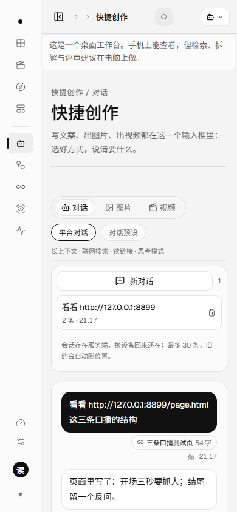


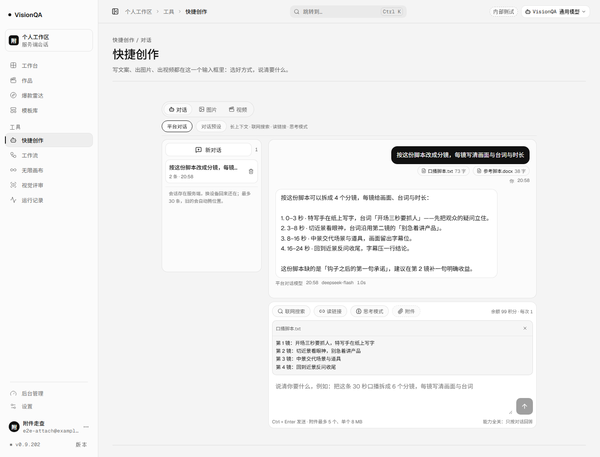


## 二百七十四、快捷创作：回答按 Markdown 排版，不再吐出 \*\*星号\*\*（r220 / v0.9.204）

平台对话的回答一直是纯文本：模型写 `## 结构`、`**结论**`、`| 时间段 | 动作 |`，界面上就原样显示这些符号。
回答一长（拆结构、列分镜、给对照表）就读不动，用户的原话是「至少让我看得清楚字是啥」。

这一版把自建智能体那套极简 Markdown 渲染抽成两个共用模块：

- **解析**在 `src/lib/markdown-parse.ts`（纯数据、能用 node:test 单测），**渲染**在 `src/lib/markdown.tsx`（React 节点）。
- 覆盖：标题、有序/无序列表、表格、代码块、引用、分隔线、加粗、行内代码、链接。
- 链接只放行 http / https / mailto；`javascript:`、`data:` 按原文显示，不当链接。
- 全程不用 `dangerouslySetInnerHTML`，模型写什么都不会变成脚本（和 r219 读链接同一原则）。
- 助手气泡 14px → **15px**；用户自己发的话仍按纯文本显示，不解析。
- 窄屏（≤560）表格 `min-width: 0` + `table-layout: fixed` + 12px：`nav.css` 给对话预设留的 480px 下限在这里收回，
  390 宽不再有 252px 横向滚动条。

**验收**：本机临时实例 + 本机假上游 + 真浏览器，**0 次真实上游调用、0 元**。
门禁 `npm test` **1467/1467**（新增 9 条解析单测）、`tsc -b` 干净、lint 0 error、`npm run build` 通过、密钥扫描无命中。
端到端渲染出：H3「三秒钩子脚本」、H4「结构」、1 个加粗、2 个列表（各 2 条）、2 行表格、1 个引用、1 条分隔线、
1 个 `https://` 链接、代码块首行 `const hook = (line) => l…`；正文不再出现 `**` 与行首 `|`；
1440 宽无横向溢出；390 宽 `innerWidth = scrollWidth = 390`、气泡与表格横向溢出均为 0（改前表格 252px）、
代码块内部横滚 153px（代码不折行）；0 个 JS 异常。

生产：**0.9.204** 已上线。

**边界**：不是完整 CommonMark（不做嵌套列表、图片、脚注、表格对齐、HTML 直出）；流式过程中仍显示原文，
回答结束才排版（避免半截代码块让整段跳动）；代码块在窄屏内部横滚。文档见 `docs/quick-create-markdown-2026-11-18.md`。

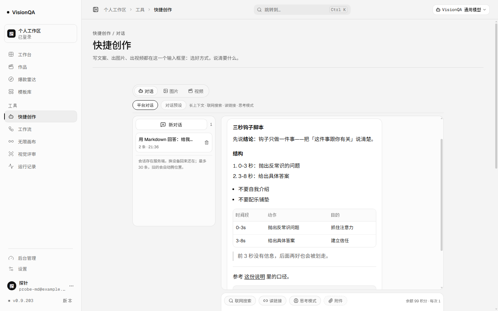

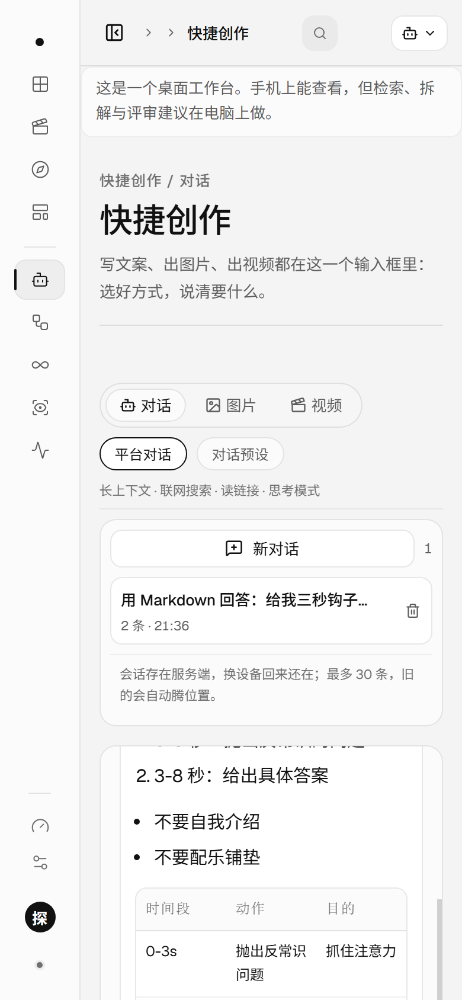

## 二百七十五、快捷创作：手机上的会话列表收成一条，回答区从 48vh 放到 58vh（r221 / v0.9.205）

手机上（≤900px）快捷创作原来是一列排：会话列表先占 200px，回答区被压到 48vh，输入框还在这之下。
列表里只有标题和「几条 · 时间」，却比回答还占地方——长回答一进来只能在一个 405px 的小窗里读。

这一版把列表收成一条：

- 窄屏默认只留一条 32px 的「历史对话」条（整块 50px），有当前会话时条上写它的标题；
- 点开才展开列表，最高 40vh、内部滚动，再点收起；选完一条或点「新对话」自动收起；
- 「会话存在服务端…」那句提醒在手机上藏起来（右边就是条数），桌面上照旧；
- 回答区 **48vh → 58vh**（844 高的手机上 405px → 490px）；
- 桌面（>900px）一点没动：左栏仍是 240px，折叠按钮在桌面上 `display: none`。

**没做「整页滚 + 输入框贴底」的原因**（写清楚，免得以后有人以为是漏的）：这一页真正的滚动容器是文档本身，
`.vq-content` 写了 `overflow: auto` 在窄屏却不滚（scrollHeight 与 clientHeight 都是 2740），
sticky 的参照是最近的滚动容器，所以输入框根本贴不住底（实测滚到 620px 时输入框 top=899，已在屏幕外）。
回答区自己滚反而更适合：边生成边看时，新字进来只滚回答区，整页不跟着跳。

**验收**：本机临时实例 + 假上游 + 无头 Edge，6 条会话，**0 次真实上游调用、0 元**。
门禁 `npm test` 1467/1467、`tsc -b` 干净、lint 0 error、`npm run build` 通过、密钥扫描无命中。
实测 390×844：会话列表整块 **50px**（改前 200px）、折叠按钮 32px、回答区 **490px**（改前 405px）、
选完会话后列表 display: none、`innerWidth = scrollWidth = 390`；展开时列表 338px（上限 40vh）内部滚。
1440：折叠按钮 `display: none`、左栏 240px / 470px 高、回答区上限 56vh，与改前一致。

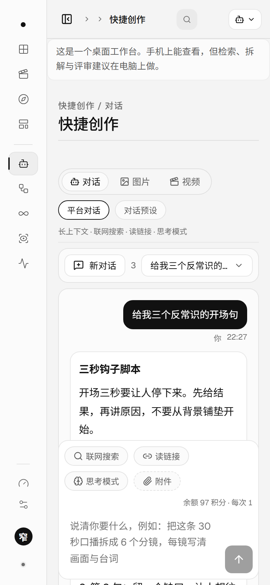


**边界**：手机上回答区仍是固定高度、内部滚动；输入框仍在回答区下方，页面头部本身约 300px，
844 高的屏要看到输入框还得往下滚一点（既有结构，本轮没动）；展开状态不记忆，刷新回收起。
文档见 `docs/quick-chat-mobile-2026-11-18.md`。

## 二百七十六、快捷创作：手机上整页滚、输入框贴在屏幕底部（r222 / v0.9.206）

r221 把会话列表收成一条之后，手机上的输入框还在回答区下面：页面头部本身约 300px，
844 高的屏要打字得往下滚，滚下去又看不到回答。这一版把它改成手机上真正的对话形态：

- 回答区不再自己滚（去掉 58vh 小窗），**整页滚**，读到哪算哪；
- 输入框 **sticky 贴屏幕底部**（离底 8px），滚到哪儿都在；滚到最底时底部留 272px 的 `scroll-margin`，
  最后一段回答不会被输入框挡住；
- 手机版头收一档（标题 22px、说明收进空状态，只在 ≤560 生效），省下来的高度给对话；
- 输入框自己从 241px 收 **201px**：手机上藏掉「Ctrl+Enter 发送」那行（手机上没这个键）、
  文本域 56px、去掉拖拽手柄；
- 桌面（>900）完全不变：仍是回答区自己滚（56vh），Ctrl+Enter 提示也还在。

**sticky 贴不住底的真因**（上一轮判断过、这一轮修掉了）：`.vq-content` 写了 `overflow: auto`。
按 CSS 规则，祖先只要**有滚动框**就成为 sticky 的参照，哪怕它从不滚动——它的滚动位置永远是 0，
按钮就跟着内容一起走。窄屏本来就是文档级滚动，于是这一档把 `.vq-content` 的 `overflow` 放开成 `visible`，
参照回到视口，按钮才贴得住。真会横向撑开的容器各自有自己的 `overflow`，不受影响。

**验收**：本机临时实例 + 假上游 + 无头 Edge，3 条会话，**0 次真实上游调用、0 元**。
门禁 `npm test` 1467/1467、`tsc -b` 干净、lint 0 error、`npm run build` 通过、密钥扫描无命中。
390×844 实测：输入框在「空状态 / 展开列表 / 选完会话 / 滚到顶端 / 滚到中途」五种状态都是 595–836（在视口内）；
选完会话自动滚到底时最后一段回答 bottom 539，落在输入框上方没被挡；回答区高度 1144px（改前固定 490px）；
输入框 201px（改前 241px）；`innerWidth = scrollWidth = 390`。
横向溢出：390 / 320 两档 × 9 个页面逐页量，`documentElement.scrollWidth` 全部等于 `innerWidth`（页面级横向滚动 0 处）。
1440：输入框 `position: static`、回答区上限 56vh、版头与说明照旧、左栏 240px。


**边界**：手机上输入框常驻占 201px（约一屏 24%，工具行在 390 宽折两行）；平台对话时页面下方仍列着
「对话预设」卡片库，滚到卡片区输入框会自然松开（既有结构，要不要收起来待定）；桌面没有跟进 sticky。
文档见 `docs/quick-chat-mobile-scroll-2026-11-18.md`。

## 二百七十七、快捷创作：手机输入框 201 → 148px，四个能力挤进一行（r223 / v0.9.207）

r222 把输入框贴到屏幕底部之后，它一直占 201px（844 高的屏 24%）。拆开看两块：能力行 88px——
四个按钮（联网搜索 / 读链接 / 思考模式 / 附件）在 390 宽折成两行，余额那行还单独占 16px；
文本域 87px——`rows=3` 撑出来的三行，随手问一句用不到。读回答时这四分之一屏一直在。

这一版只动手机两档：

- 能力按钮在手机上换成两个字（联网 / 链接 / 思考 / 附件），一行放得下；完整名称留在 `title` 与 `aria-label`；
- 触摸目标反而变大：**28px 高 / 12px 字 → 32px 高 / 13px 字**，收高度不靠抠小的；
- 余额独立一行、12px（仍一直看得见）；文本域固定 **64px**（两行），提示语缩到两行放得下；
- 320 窄机文本域给到 88px，不把提示第三行切一半；末尾 `scroll-margin` 从 272 收到 200；
- 桌面（>560）一点没动：全称标签、文本域 87px、Ctrl+Enter 提示行照旧。

**验收**：本机临时实例 + 无头 Edge，一条带表格与列表的会话，**0 次真实上游调用、0 元**。
390×844 输入框 **201 → 148px**（−26%），能力行 58px（一行按钮 + 余额）、文本域 64px；
自动滚到最新回答时 composer 668–816、最后一段 bottom 631（37px 空隙）；滚到顶 composer 688–836 仍在视口内；
文本域 `scrollHeight = clientHeight`（不切字）。320×720：186px、文本域 88px、不切字、`scrollWidth = 320`。
1440×900：composer 165px、全称标签、`position: static`，与改前一致。
门禁 `npm test` 1467/1467（首轮 media-gen 冷却用例在并发下假失败，单跑 18/18、重跑全绿）、`tsc -b` 干净、
lint 0 error / 26 warning、`npm run build` 通过、密钥扫描 920 文件无命中。

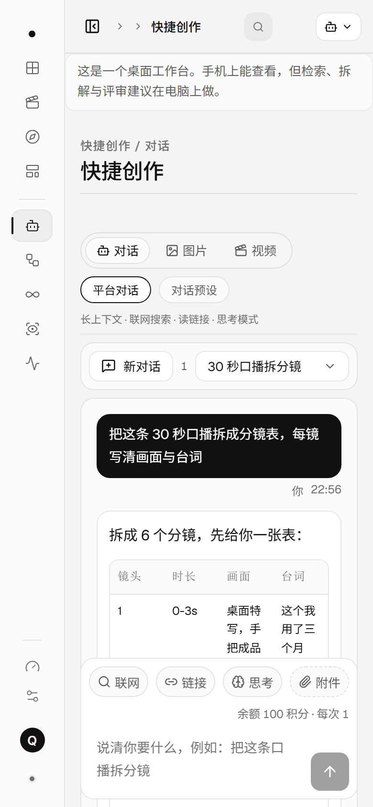


**边界**：148px 仍占一屏约 17.5%，余额那行（26px）还能再挪进会话条，但 390 宽下会话条已经很挤；
平台对话时页面下方仍列着「对话预设」卡片库，滚到卡片区输入框会自然松开（不在对话面板里了，r225 起手机上已把这块收起来）；
文本域固定两行，手机上不能再拖高。文档见 `docs/quick-compose-2026-11-18.md`。
## 二百七十八、手机端第二轮：桌面提示条可以关掉、回答里的表格改成逐行卡片（r224 / v0.9.208）

r223 之后继续按清单往下走，处理的都是手机上看得见、但一直没人管的两处：

- **「这是一个桌面工作台」提示每页都顶 71px**：翻十页就看十遍同一句话。现在右侧多一个 ×，
  点过之后这台浏览器不再出现（`localStorage: vq_mobile_note_seen`），390 宽一条 57px、320 宽 77px；
  隐私模式下写不进去就照常显示，不假装记住。
- **回答里的 4 列表格在 390 宽每列只剩 2～3 个字**：「对比前后，右上角小窗放原图」被切成六行，
  时长「16-21s」孤零零立着。≤560 改成一行一张小卡片，表头变成每格前面的小标签
  （镜号 1 / 时长 0-3s / 画面 … / 目的 …），桌面 >560 仍是原来的表格。
- 顺带两处：320 宽「对话 / 图片 / 视频」三枚页签各折成竖排两字（≤360 去掉图标让标签横排）；
  余额行一直写「每次 1」没单位，改成「每次 1 积分」（桌面同样生效）。

390×844 实测：提示条 56–113（57px），点 × 并刷新后页高 2935 → 2870，提示不再出现；
卡片宽 230、6 行每行 147px、容器不横滚；输入框 668–836（148px，与 r223 一致）。
320×720：提示条 77px，页高 3198 → 3113，卡片宽 160，整页 `scrollWidth = 320` 不溢出。
1440×900：提示条 `display: none`，四列表格原样（高 264），输入框 165px，都没动。
代价照实说：同一张 6 行表在 390 从 581px 变成 820px（+239px），换的是「一格一行字」而不是「每列 2～3 个字」。

门禁：`npm test` **1472/1472**（新增 `test/mobile-note.test.mjs` 5 条）、lint 0 error / 26 warning（599 文件）、
`tsc -b` 干净、`vite build` 干净（入口 `index-CS1pg49g.js`）、密钥扫描 921 文件无命中；本轮 0 次真实上游调用。

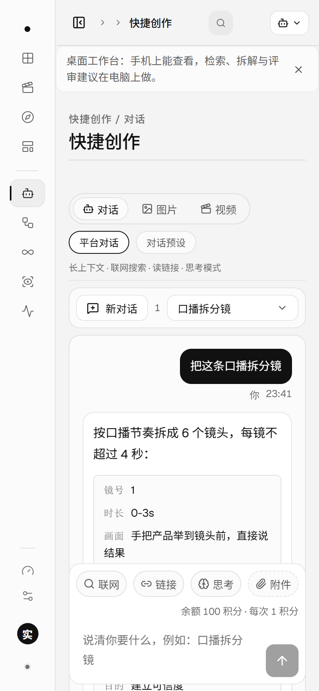


**边界**：提示的「记住」是浏览器级、不按账号，换浏览器会再出现一次；窄屏卡片让表变得更高，列数多的宽表需要往下翻；
只改前端样式、提示语与一个纯函数，没有新接口、没动服务端与计费。文档见 `docs/chat-mobile-r224-2026-11-18.md`。

## 二百七十九、手机端第三轮：平台对话不再拖着预设库、切页签不再丢草稿（r225 / v0.9.209）

接着清单第 10 项。两件事都是手机上看得见、但一直没归类的问题，都不碰上游调用：

- **「平台对话」下面挂着整块「已自建对话预设」**：它跟当前这段对话没关系，却是手机上这一页最长的一段
  （390 宽 4 张卡就 979px），还把贴底的输入框顶出视口——滚到预设卡片时输入框在屏幕上方 −339px。
  ≤900 把这块收起来（挑预设走上面的「对话预设」页签，那本来就是它的位置），桌面照旧显示。
- **切页签会丢草稿**：「平台对话」面板原来只在 `对话 && 平台对话` 时渲染，切到「对话预设」或图片 / 视频
  就整块卸载，写了一半的提示词、附件、正在生成的回答一起没了（实测：输入「写了一半的提示词」→ 图片 → 对话，回来是空的）。
  现在面板常驻、切走只 `hidden`；`.qc-root` 是 `display:grid`，hidden 属性盖不住它，由外层 `.agx-quickchat` 负责隐藏。

390×844 实测：页高 **2187 → 1176**（−1011，−46%），滚到底时输入框 672–820 仍在屏内（改前同一位置 −339 已出屏）；
320×720：**2490 → 1459**（−1031，−41%），输入框 484–696 在屏内；1440×900 未变（预设库 586px 照旧、输入框 165px）。
切到「对话预设」，三档宽度下预设库都回来（979 / 999 / 586px）。草稿在「图片 ↔ 对话」「平台对话 ↔ 对话预设」来回切后都还在。

门禁：`npm test` **1476/1476**（新增 `test/quick-create-mobile.test.mjs` 4 条）、lint 0 error / 26 warning、
`tsc -b` 干净、`vite build` 干净（入口 `index-DGE2dm0u.js`）、密钥扫描 924 文件无命中；本轮 0 次真实上游调用。


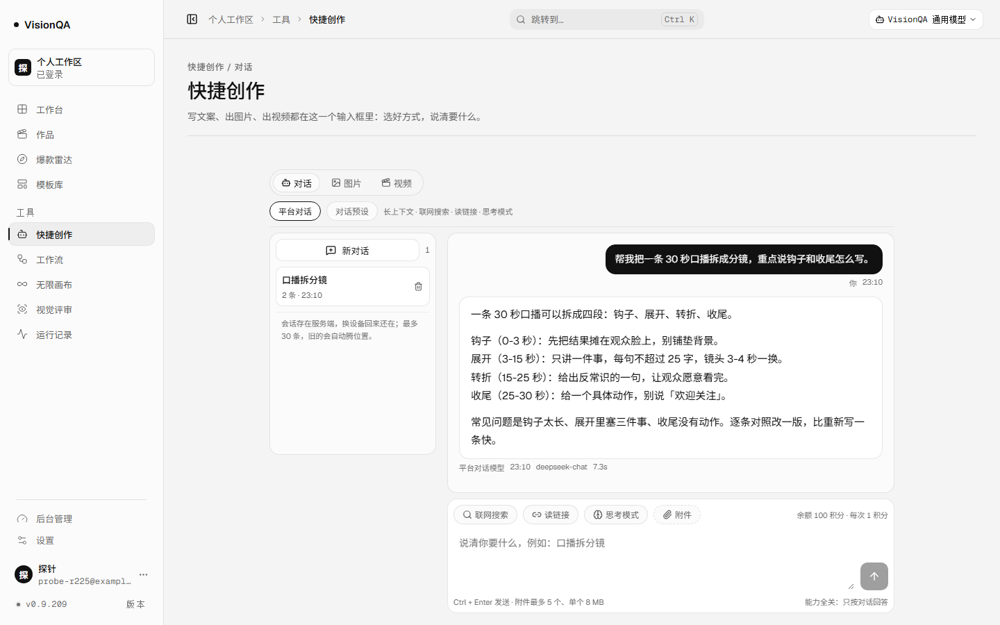

**边界**：收起按宽度判断（≤900），不是账号偏好，要挑预设得切「对话预设」页签；面板常驻后切走不再中断生成，
但「流式中切页签仍然写完」本轮只在假通道上验过草稿还在，没有真实生成；余额那行（26px）仍在输入框里，
挪进会话条会让 390 宽的会话条更挤、而且会话条会滚走。只改前端结构与样式，没有新接口、没动服务端与计费。
文档见 `docs/quick-create-mobile-r225-2026-11-18.md`。

## 二百八十、对话预设：选好就收起预设库、卡片标出「当前」（r226 / v0.9.210）

接着 r225 的思路处理「对话预设」这一面，两条都是手机上真看得见的：

- **选好一个预设之后，下面 979px 的预设库还在**：这时人要写东西，不是继续挑；390 宽整页 1717px，
  输入框和四张卡一起占了两屏多。现在选完自动收成一行（「当前「投放素材变体」+ 换一个预设」），
  整页 **1717 → 844**（正好一屏）；点那一行展开回去还是 1717，换预设 / 编辑 / 删除都在里面。
- **看不出选的是哪一张**：列表加载会自动选中第一个（服务端默认值，不是用户挑的），卡片却长得一样。
  现在当前那张描边加重、名字旁多一枚「当前」——两种宽度都生效。

390×844：刚进「对话预设」1717px（库 979px，第一张已标「当前」）→ 选好 844px（一屏，那一行 49px）
→ 点「换一个预设」1717px → 再从库里选另一个 844px（那一行名字跟着换）。
1440×900：预设库 586px 一直显示，那一行 `display: none`，卡片照旧三列。320 无横向溢出。

门禁：`npm test` **1478/1478**（`test/quick-create-mobile.test.mjs` 4 → 6 条）、lint 0 error / 26 warning、
`tsc -b` 干净、`vite build` 干净（入口 `index-CySm5Ob6.js`）、密钥扫描无命中；本轮 0 次真实上游调用。

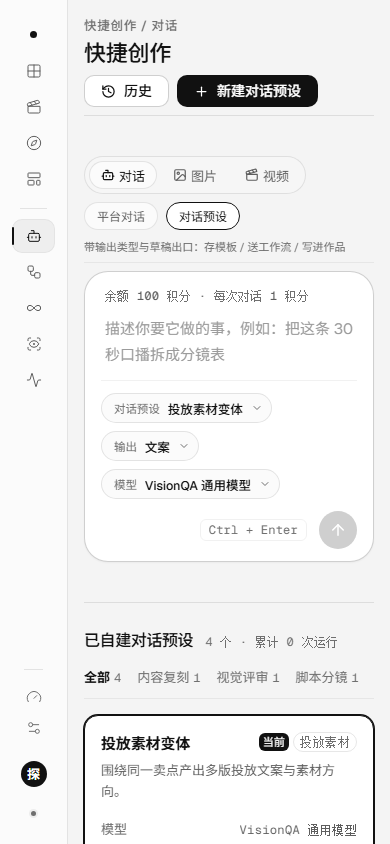


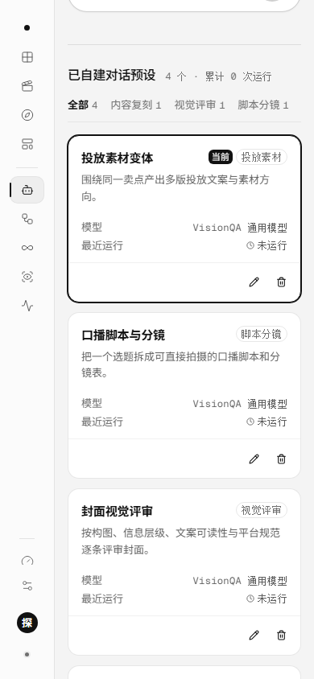


**边界**：收起只在 ≤900，桌面一直展开；「换一个预设」只展开不自动滚到库开头；
收起后编辑 / 删除预设要多点一次，这是为「选完就要写东西」让路的有意取舍。
只改前端结构与样式，没有新接口、没动服务端与计费。文档见 `docs/preset-shelf-r226-2026-11-19.md`。


## 二百八十一、工作流在手机上是「按执行顺序的步骤清单」（r227 / v0.9.211）

上一轮的清单继续往下走，这一轮体检到「工作流」这一页——用户说它鸡肋，我先用数字量了一遍，
390 宽下它其实还有硬伤：

- **画布只剩 272×309**，空状态（标题 + 两行说明 + 三个按钮 + 一句备注）比容器还高，
  直接压在缩放按钮和底部连线提示上；空工作流时看上去像样式坏了。
- **打开节点面板，清单/画布只剩 2px 宽**：≤1024 的「1fr + 272px」两列规则还在生效，
  390 扣掉 272px 右栏就没地方了，整页被撑到 2955px、一大片空白。
- **320 宽整页横拖 47px**：积分预估那行是 nowrap 的等宽字，274px 加上侧栏与内边距把页面撑到 367。

改法：≤760 不再画那块缩水画布，**改成按执行顺序排的步骤清单**——
「1 爆款素材与目标 / 输入」「2 拆成脚本结构 / 大模型 / 依赖第 1 步」…，
点一行就选中它，下面的节点检查器照旧改参数；有环时直接写「这条流程有环，跑不起来」。
顺序用与服务端 `topoSort` 同一套 Kahn 拓扑排序（`src/domain/flow-steps.ts`），真跑仍以服务端为准。

数字：390 页高 1483（面板打开 2955 → 1556）、320 下 innerWidth = clientWidth = scrollWidth = 320、
768 与 1440 画布照旧（清单 `display: none`）；画布专属工具（自动布局 / 适应工作流 / 缩放）在手机上收起；
流程名 ≤900 降到 22px + 省略号，390 与 768 都能读到全名。

门禁：`npm test` **1487/1487**（新增 9 条）、lint 0 error / 26 warning、`tsc -b` 干净、
`vite build` 干净（入口 `index-CN7ctzNk.js`）、密钥扫描 927 文件无命中；本轮 **0 次真实上游调用、0 元**。


**边界**：手机上能加节点、改参数、运行，**连线与位置仍要在电脑上摆**（清单底部写明了）；
有环按原顺序列出并明确说跑不起来；清单只写标题、类型、模型显示名、比例/时长与依赖步号，
细节在检查器里；768 及以上仍是画布，两档之间没有别的分支。文档见 `docs/workflow-steps-mobile-r227-2026-11-19.md`。

## 二百八十二、最近生成的结果能一键当参考素材（r228 / v0.9.212）

创作闭环里最容易断的一步是「刚出的这张图，下一步拿它接着改」——以前「最近生成」只有**下载**，
想复用要人手把文件再传一遍。这一版在每一条结果上加了 **用作参考**，也在结果卡下面加了一个。

顺手修掉三处规则缺口：

- 参考素材以前只判「这个方式收不收」，不分收图还是收视频（视频当参考时「首帧」先收下、等服务端 400）；
  现在规则收敛到 `src/domain/media-refs.ts`，按 `imageRefs / videoRefs` 判，不收就自动切到同一模型下第一个收它的方式，
  并说清楚换了哪个；
- 托架放满时不再只说「最多 N 个」，会点名同一模型里放得下的那个方式（首帧 1 张 → 多模态参考 9 张）；
- 上传前先判放不放得下，不放满才传，不白等一次上传。

数字：图片页签 文生图 → 点一下变「参考图」托架 1/1、余额 100 不变；视频页签 → 变「多模态参考」1/12；
同一条结果重复用会复用素材库里同名那份（文件数 3 → 3 → 3）；放满时报「「参考图」最多 1 张参考图：先移除一个」；
390 宽 `innerWidth = clientWidth = scrollWidth = 390`、按钮高 24px、页面异常 0 条。

门禁：`npm test` **1498/1498**（新增 11 条）、lint 0 error / 26 warning、`tsc -b` 干净、`vite build` 干净、
密钥扫描 930 文件无命中；本轮 **0 次真实上游调用、0 元**。参考图出图与参考素材生视频仍未真调（等你授权）。


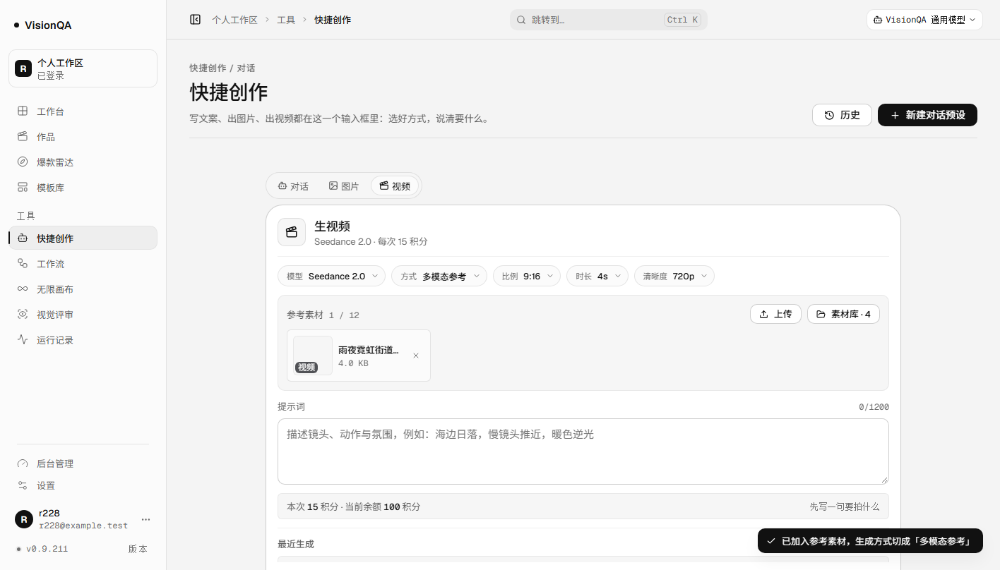


文档见 `docs/quick-create-use-as-ref-r228-2026-11-19.md`。

## 二百八十三、作品流里的成品能直接接着改：用作参考 + 下载（r229 / v0.9.213）

上一版把「刚生成的结果 → 参考素材」接上了，但那条路只在「最近生成」里；到了**作品**这一屏，
看到一张满意的成品只能「看大图」或「打开运行」，下一步就断了。这一版在每张作品卡（和放大层）上给了
**用作参考** 与 **下载**，覆盖三处来源：快捷创作的图 / 视频、工作流封面、无限画布里出过的图与视频。

点「用作参考」会发生这几件事：取回这条作品的文件 → 读真实宽高 / 时长 → 传成参考素材（同一条上传接口，
不扣积分、不打上游）→ 跳到「快捷创作」→ 按种类落到图片或视频页签 → 挂进托架、切成相应生成方式、
**比例跟着作品走**（9:16 的图不会落回 1:1）。交接只走一次性的 sessionStorage 记录，挂上就清掉；
模型表没回来时不瞎挂，素材库已有同名那份就不重复占配额。

顺手修的四件事：放大层以前看完没有下一步；画布与工作流的产物以前根本没有下载入口；
带过去的是一张 9:16 的图、出图却还是 1:1；390 宽那行时间被「看大图」挤成省略号（现在缩略图本身就是看大图，
那一行让给时间与模型名，标题两行）。

数字：三张卡都有两个动作（24px 触摸高度）；点工作流卡 → 页签图片 / 方式「参考图」/ 参考素材 1-1 / 比例 9:16 /
交接已清空 / 页面异常 0 条；390 宽 `innerWidth = clientWidth = scrollWidth = 390`、两列、卡片 139px、溢出 0。

门禁：`npm test` **1507/1507**（新增 9 条交接单测 + 2 条文件名规则）、lint 0 error / 26 warning、
`tsc -b` 干净、`vite build` 干净、密钥扫描 933 文件无命中；生产 0.9.213 发布
`20261118-171435-20261119-0125-v0.9.213wo`，入口 `index-CmfZPuwf.js`，health ok templates 26，
回滚 `--to 1` 回 0.9.212；本轮 **0 次真实上游调用、0 元**。

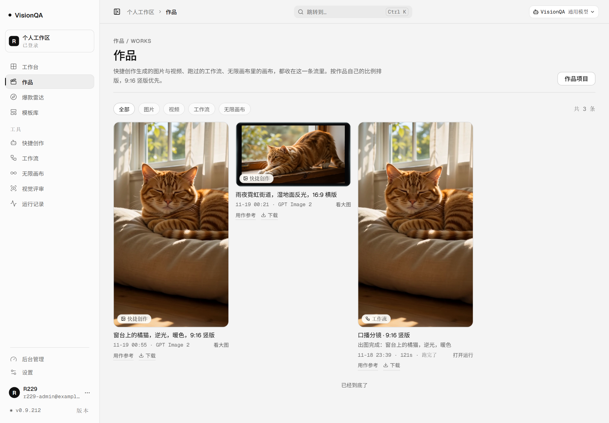

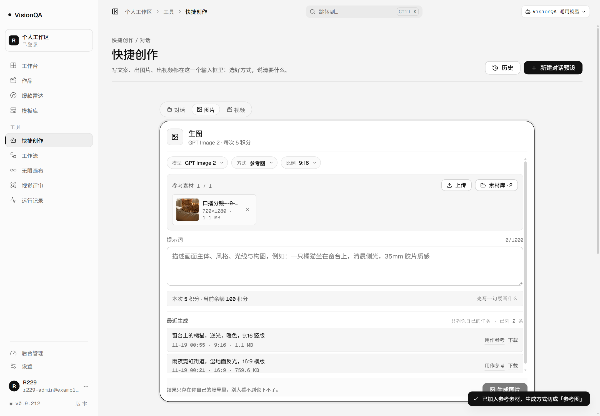


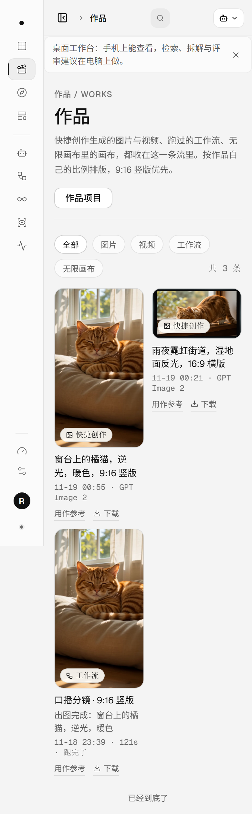

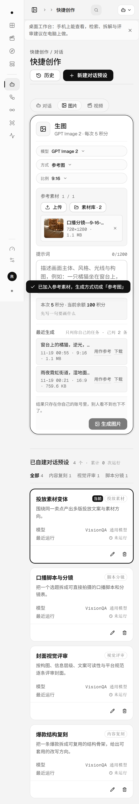

文档见 `docs/works-reuse-r229-2026-11-19.md`。

## 二百八十四、爆款雷达的手机端：一屏从不到一条变成三条（r230 / v0.9.214）

这一屏在手机上以前是「一张屏放不下一条结果」：390 宽每张卡 679px、封面 9:16 铺满整列（288×512），
8 条整页 6498px，一屏只看到 0.84 条；320 宽的检索工具栏还有 14px 横向溢出，「加入模板库」「一键复刻」
被截成半截字。这一版把 820 以下的检索结果改成**左封面 + 右文案 + 整行操作**的紧凑行，
390 每张卡 254px、整页 3062px（缩短 53%），一屏 3.3 条；320 每张卡 226px、一屏 3.5 条、溢出 0 处。

工具栏在同一断点改成两列网格：搜索框与平台各占一整行、时间与排序各半、检索按钮一整行，
高度 272→214（320）/ 192→180（390），下拉不再顶出 3px。触屏上没有 hover，封面那层看不见的
「一键复刻」整块浮层收掉——以前点封面任意位置就会弹复刻。

顺手三处：页头 kicker 与标题都写「爆款雷达」（加面包屑一屏三个），改成「找爆款 / RADAR」；
封面上的「库里已有 · 2 条作品」在 88px 封面上放不下，条数收进 `.radar-owned-count`，窄屏只留「库里已有」；
标题截断时补 `title` 能悬停看全。

同一轮还修了两处不属于这一屏的问题：**未登录实例的失败退款会抛错**（`beginPaid` 早退分支少一个 `refund`，
检索失败变成 500 + traceId，真正原因被吞掉），以及全站手机提示还写着「检索、拆解与评审建议在电脑上做」
——现在手机能检索、能跑工作流，文案改成「手机也能检索、挑素材、跑工作流；画布连线与逐帧评审建议在电脑上做」。

门禁：`npm test` **1513/1513**（新增 6 条窄屏结构断言）、lint 0 error / 26 warning（608 文件）、
`tsc -b` 干净、`vite build` 干净、密钥扫描 937 文件无命中；本轮 **0 次真实检索**（示例数据）。


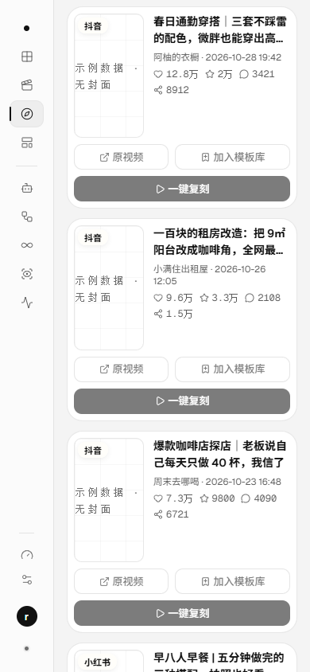

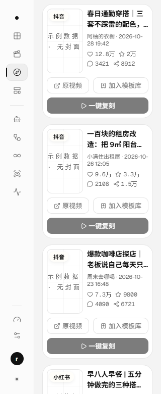

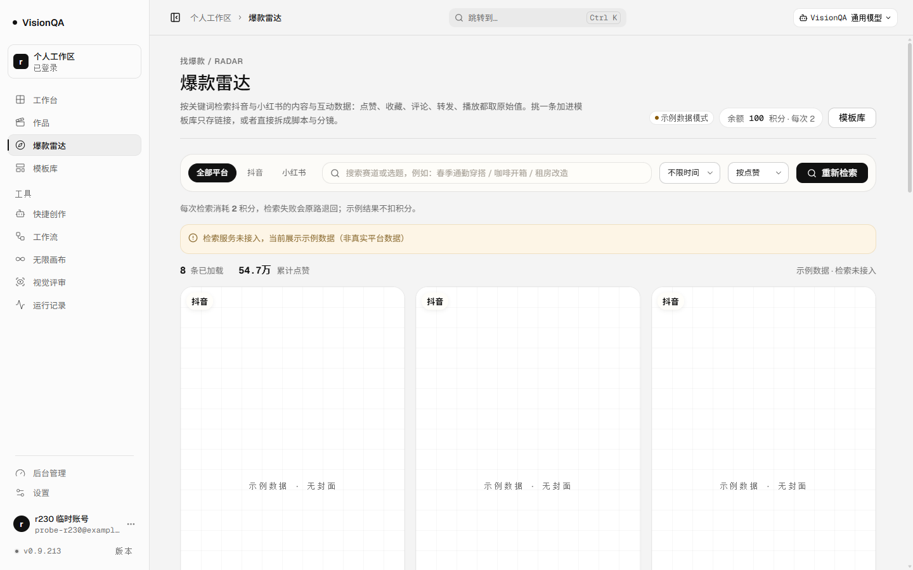

文档见 `docs/radar-mobile-r230-2026-11-19.md`。

## 二百八十五、一键复刻弹窗在手机上：从居中小窗改成贴底整宽面板（r231 / v0.9.215）

手机上点「一键复刻」弹出来的还是桌面那套居中小窗：390 宽只剩 342、320 宽只剩 272（遮罩的 24px
内边距白扔 48px），正文一律 13px，关闭按钮在 320 上只有 18×32，输入框 13px（iOS 一聚焦就把整页
放大）。最难看的是「复刻完成」那屏：5 张抽帧排成一行要 392px，塞进 292px 的正文里横向溢出 124px，
第 5 张直接被切掉——刚好停在用户最想看图的那一刻。

这一版 ≤640px 改成贴底整宽面板（只圆上面两角）：正文 14–17px、底部两个按钮各 175×48、关闭 40×40、
输入框 16px 高 48、抽帧 `flex-wrap` 换行（390 排 4+1，320 换 64px 缩略图排 3+2）。等待开始 / 进行中 /
完成三种状态实测容器内横向溢出都是 0，页面 `scrollWidth` 在 390 / 320 上分别等于 390 / 320，面板底边
贴在 844 视口的底部。641–760 仍是原来的居中窗（600px 宽放得下），桌面 1440 完全没动。

顺带一处：进行中那屏第一条日志还没回来时，日志容器会渲染成一个 16px 的空灰条顶在步骤下面，看着
像界面坏了；改成有内容才渲染，日志框 128 → 160px，6 行一次看全。

门禁：`npm test` **1519/1519**（新增 `test/replicate-mobile.test.mjs` 6 条）、lint 0 error / 26 warning
（609 文件）、`tsc -b` 干净、`vite build` 干净（入口 `index-BBEtjAdq.js`）、密钥扫描 939 文件无命中；
本轮 **0 次真实复刻**：进度与完成两屏是 CDP 拦截 `/api/replicate`、`/api/jobs/*`、`/api/templates` 返回的假任务。


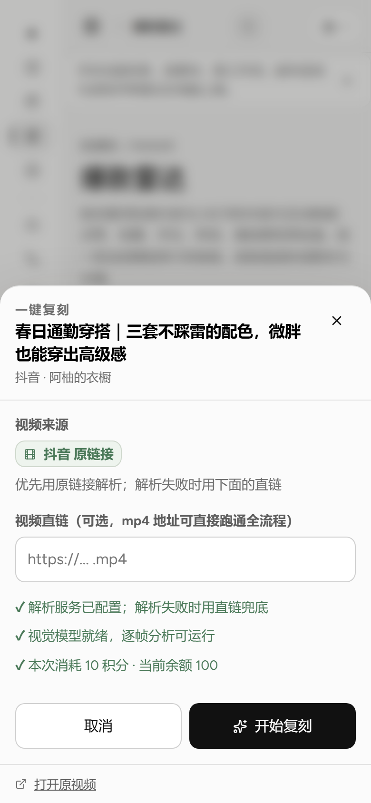

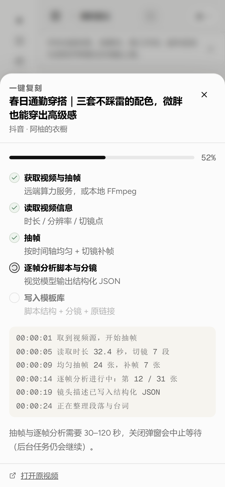

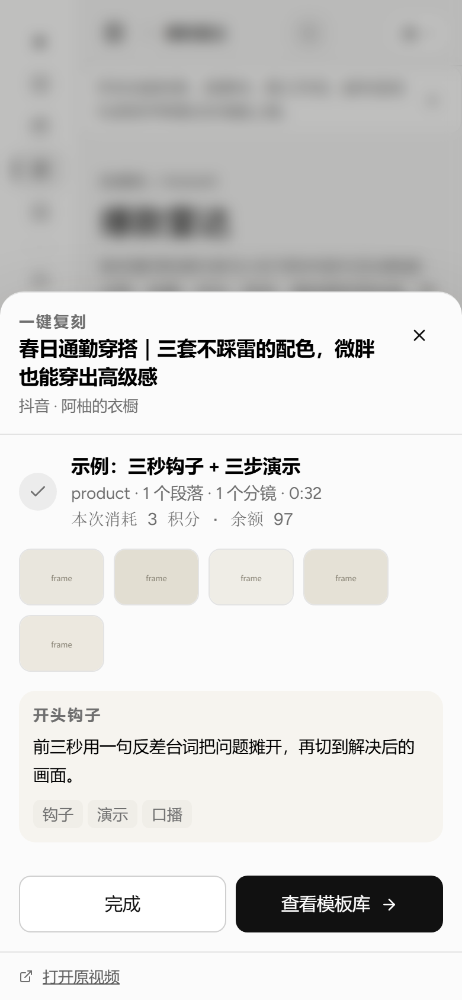


文档见 `docs/replicate-modal-mobile-2026-11-19.md`。

## 二百八十六、模板详情抽屉在手机上：正文 15px、底部动作改成等宽两列（r232 / v0.9.216）

抽屉在 ≤820px 本来就是整宽，问题在里面还是桌面排版：口播、分镜画面、分析条目一律 12.5–13px；
关闭按钮 28×32（320 上只剩 22×32）；底部四个动作 32px 高（删除 28px），还是右对齐的 flex 换行，
两行参差、删除比同行低 2px。这一屏覆盖的正好是主线上「拆结构」的全部内容，所以先把它抬到能读。

现在 ≤640px：正文 15px（行高 1.7）、说明 14px、元信息 13px；标题 18px（320 上 17px）最多三行；
关闭 40×40；底部四个动作 48px 高、等宽两列（主操作第一格、删除固定在右下角）；改编输入框 16px
（iOS 聚焦不再放大整页）；互动数据 14px、390 三列 / 320 两列且数字不折行。390 / 320 上页面
`scrollWidth` 分别等于 390 / 320，抽屉正文容器 `scrollWidth == clientWidth`，横向溢出 0，抽屉始终
贴满 844 高的视口。641–760 与桌面 1440 没动。

两处值得一提：① 抽屉的规则一半在 `radar.css`（随模板库懒加载分块后到），同权重写在 App.css 里会被
盖掉——实测 `.drawer-stats` 的 14px 与 `.adapt-input` 的 16px 各输过一次，所以这版选择器统一加了
`.template-drawer` 前缀。② 320 宽用三列网格时「播放 128.4万」被断成两行，补了 `white-space: nowrap`
并在 ≤380px 退成两列。

门禁：`npm test` **1525/1525**（新增 `test/template-drawer-mobile.test.mjs` 6 条）、lint 0 error / 26
warning（610 文件）、`tsc -b` 干净、`vite build` 干净（入口 `index-B9jbGaj2.js`）、密钥扫描 941 文件
无命中。生产 0.9.216：发布 `20261118-180003-20261119-0200-r232drawer`，health ok templates 26，
6 个服务 active，未登录 401；线上 `index-J2mtVEL8.css` 里 12 条新规则全部命中（压缩器会把
`:is(.vq-button)` 摊平成 `.vq-button` 并重排声明，所以核对要按选择器取片段、不按顺序）。


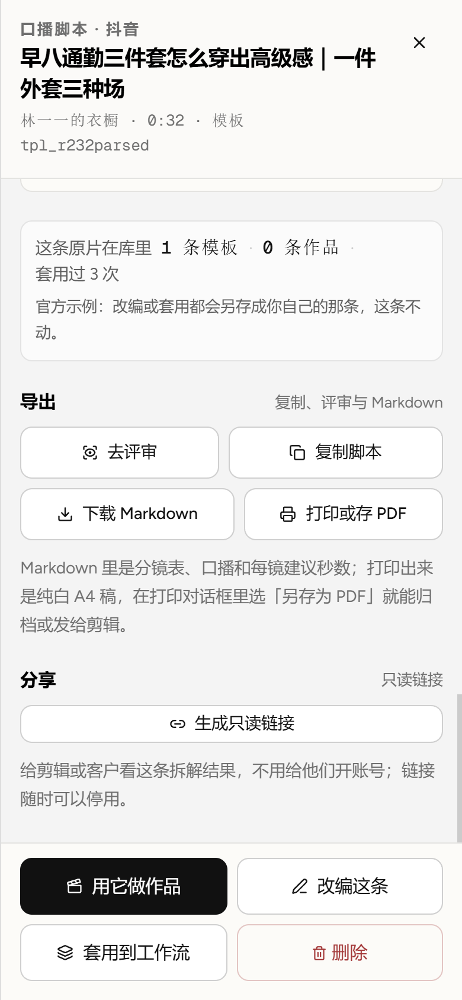

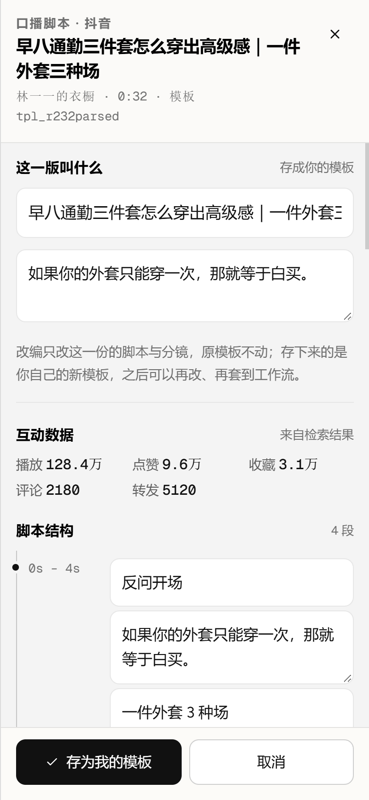

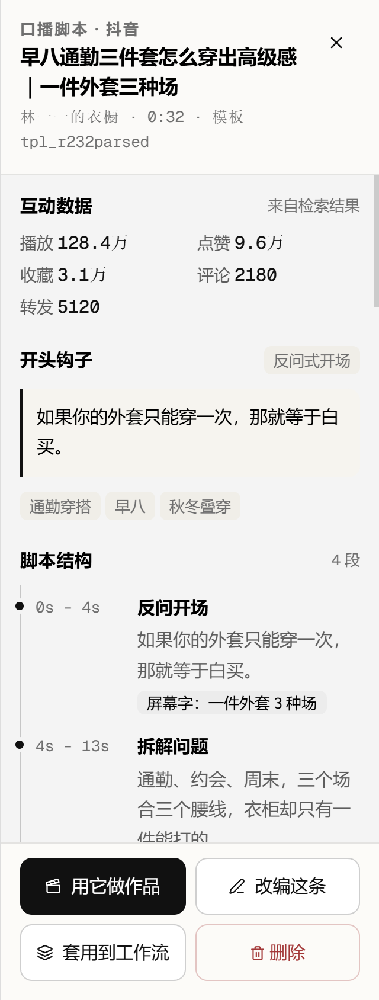

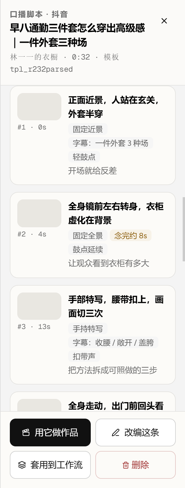

文档见 `docs/template-drawer-mobile-2026-11-19.md`。

## 二百八十七、作品流在手机上：卡片正文 15/14px、动作与胶囊换成 44/40px 触控区（r233 / v0.9.217）

「作品」默认打开的就是这条作品流（快捷创作的成品 + 工作流运行 + 无限画布的画布合成一条）。390 下两列卡片
只有 139px、320 下 106px，可里面还是桌面排版：标题 14px、工作流摘要 13px、时间与来源标签 12px，
「用作参考 / 下载」两个动作只有 **24px 高**，筛选胶囊 12.5px / 29px，大图关闭按钮 32×32、说明 12.5px。
这一版只抬字号与触控区：标题 15px、摘要 14px、时间与来源标签 13px；动作 14px / **44px**（下划线贴着字，
不再悬在盒子底部）；胶囊 14px / **40px**；「看更早的」44px；大图关闭 **44×44**、说明 14px、边距收到 16px。

**列数与按比例排版没动**：9:16 优先、1440 四列 / 1080 三列 / 768 与 390 两列，这条口径写进了
`test/works-wall-mobile.test.mjs` 的断言，免得下次有人被「139px 太窄」说服着改成整宽一列。桌面 1440 /
1024 / 768 实测一个数字都没变（四/三/两列、卡片 271 / 227 / 321px、字号仍 12.5 / 14 / 13 / 12px）。

390 与 320 上页面 `scrollWidth` 分别等于 390 / 320，横向溢出 0；胶囊在 390 折成 4 + 1、320 折成 3 + 2，
「共 5 条」跟着落到下一行右侧；320 下 106px 的卡片里「用作参考 / 下载」折成两行（各 44px），是宽度决定的。

门禁：`npm test` **1531/1531**（新增 `test/works-wall-mobile.test.mjs` 6 条）、lint 0 error / 26 warning（611 文件）、
`tsc -b` 干净、`vite build` 干净（入口 `index-BXRFei46.js`、样式 `index-CVd22nZy.css`）、密钥扫描 943 文件无命中。
生产 0.9.217：发布 `20261118-181316-20261119-0240-r233worksw`，health ok templates 26，6 个服务 active，
未登录 401；线上 560 块 17 条选择器、12 条抽查断言全部命中。回滚 `--to 1` 回 0.9.216。

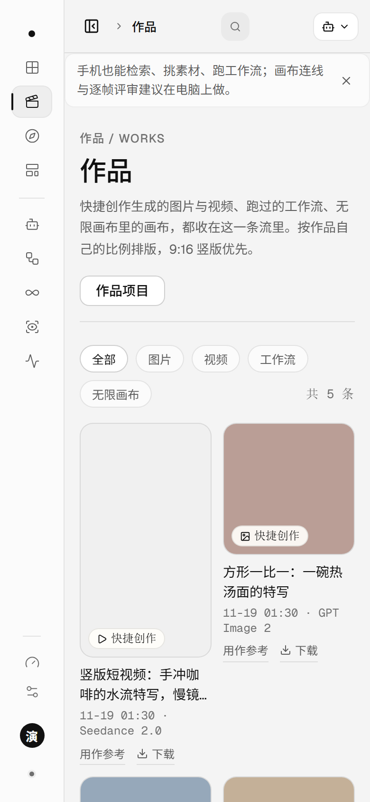


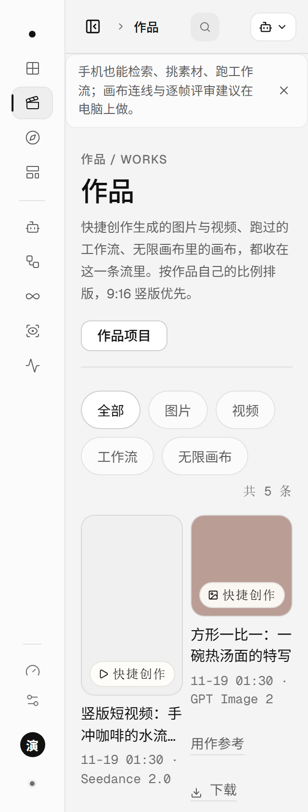

文档见 `docs/works-wall-phone-2026-11-19.md`。


## 二百八十八、作品项目在手机上：搜索 44px、筛选 40px、卡片数据 2 × 3 不再折行（r234 / v0.9.218）

「作品」切到「作品项目」（交付列表）后，390 下正文只有 240px，卡片六格数据落到 74.7px 一格：
「1,800 积分」被折成「1,800 积 / 分」并把那一路格子拉高；标题一行只剩十四个字；搜索框 32px、
筛选胶囊 30px / 12.5px、状态胶囊 22px / 12px、时间 12px。这一版把卡片内边距收到 **16px**
（正文 256px），六格改成 **2 × 3**（一格 120px）并给数字加 `white-space: nowrap`；标题 **18px、最多两行**；
模板来源与「打开作品」**15px**，时间与版次 **13px**；状态胶囊 **28px / 13px**；搜索框 **44px**（正文 15px）、
清除按钮 32×32；筛选胶囊 **40px / 14px**；「共 N 条」13px，落到胶囊下一行时靠右。

两处不是「调字号」而是真溢出，一起修了：320 下卡头（152px 的胶囊 + 70px 的 nowrap 时间）会把卡片的网格列
撑到 230px，内容顶出 220px 的卡片 —— 手机段让卡头能换行、时间自己靠右；搜索框 `flex-basis: 100%` 不等于能缩，
输入框默认 20 字符宽会成为 min-content（291px），320 下直接顶出正文区 —— 补 `min-width: 0` 才收得回 220px。
附带修 1024：网格还是两列时一张卡片 354px，六格只有 44px，「1,800 积分」同样折行，3 × 2 从 780 提前到 **1080**。

口径没动：780 以下才是单列，560 那段只改间距不改列数；1440 与 768 实测一个数字都没变
（1440 两列 562px 六格 78px、768 单列 668px 三格 200px，内边距仍 24px、胶囊仍 12px / 30px）。
390 与 320 的 `clientWidth` 分别等于 `scrollWidth`（390 / 320），横向溢出 0。

门禁：`npm test` **1536/1536**（新增 `test/projects-page-mobile.test.mjs` 5 条）、lint 0 error / 26 warning（612 文件）、
`tsc -b` 干净、`vite build` 干净（入口 `index-keDlsNgD.js`、样式 `index-DBjtBwrj.css`）、密钥扫描 945 文件无命中。
生产 0.9.218：发布 `20261118-185519-r234proj`，health ok templates 26，6 个服务 active，未登录 401，磁盘 72%；
线上 560 块 1101 B、**20 条抽查全命中**，1080 块含 3 × 2。回滚 `--to 1` 回 0.9.217。


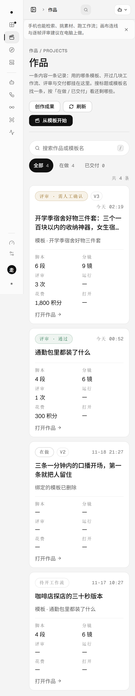

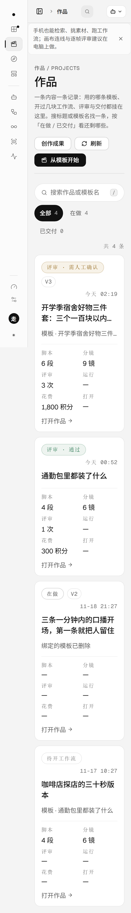

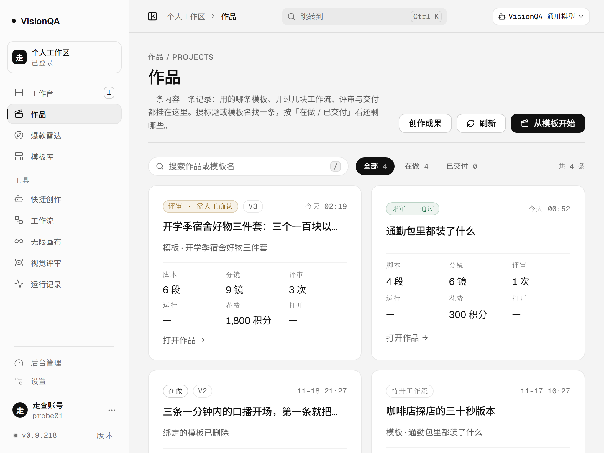

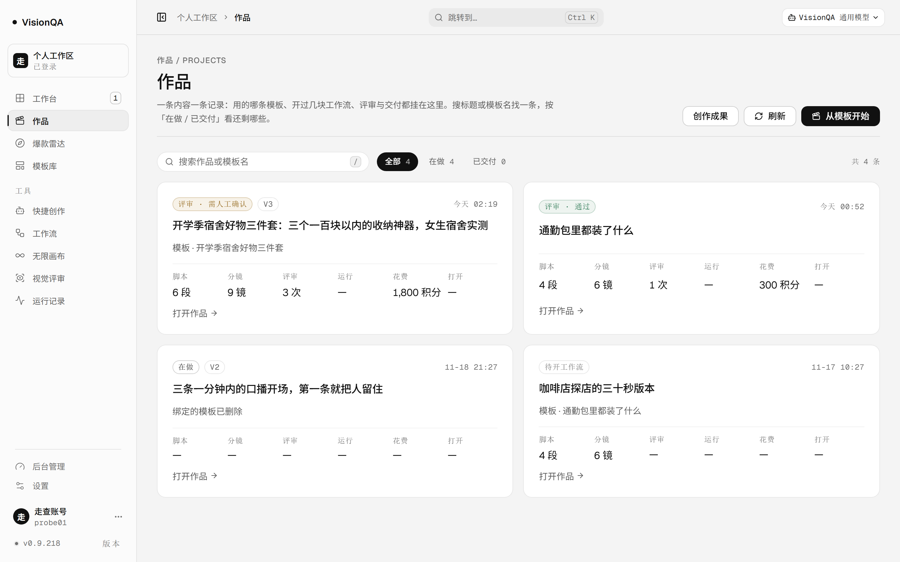

文档见 `docs/projects-page-mobile-2026-11-19.md`。

## 二百八十九、平板这一档：作品流动作 44px、作品项目搜索 44px，顺手修掉 1081–1439 的六格折行（r235 / v0.9.219）

手机与桌面之间（561–1080）一直没有规则：≤900 侧栏收成图标栏，作品流三列卡片只剩 230–330px，
整条流却还是桌面尺寸——动作 24px 高、正文 12–14px；作品项目 1024 下一张卡片 354px，标签 12px、
搜索 32px、筛选胶囊 30px、状态胶囊 22px。这一段是触屏。这一版只抬字号与触控区：
作品流胶囊 **40px / 14px**、标题 **15px 两行**、时间与来源标签 13px、动作 **44px / 14px**、大图关闭 44×44；
作品项目搜索 **44px**（正文 15px）、筛选 **40px / 14px**、状态胶囊 **26px / 13px**、标题 **18px 两行**、
模板来源与「打开作品」15px、六格标签 13px。列数与比例规则一个没动
（测试里锁了「这一段不含 grid-template-columns」）。

量 1081 边界时撞上一个既有问题：1080 那条「六格 3 × 2」一过就失效，可两列卡片还不够宽 ——
1081 一格 48.8px、1200 一格 58.7px，都放不下「1,830 积分」，折成两行（34.5–36px 高）；
1440 的 562px（一格 78.7px）才排得下六列。补一条 1081–1439 的 3 × 2 之后：1081 一格 105.5px、
1200 一格 125.3px，都是一行 24px，1440 保持六列。

口径没动：1440 逐项与改前相同（胶囊 29px / 12.5px、动作 24px / 12px、标题 14px、搜索 32px、
筛选 30px、六格 78.7px）；390 / 320 与 r233 / r234 相同。十个宽度（320–1440）的 clientWidth 都等于
scrollWidth，越界元素 0。

门禁：`npm test` **1543/1543**（新增 `test/works-projects-tablet.test.mjs` 7 条）、lint 0 error / 26 warning（613 文件）、
`tsc -b` 干净、`vite build` 干净（入口 `index-Baaj3I6D.js`、样式 `index-CGUjuBgj.css`）、密钥扫描 947 文件无命中。
生产 0.9.219：发布 `20261118-191511-20261119-r235tablet`，health ok templates 26，6 个服务 active，
未登录 401，磁盘 72%；线上 `--chip-pill-h:26px` 1 处、`min-height:44px` 9 处，两条新 media 都在。
回滚 `--to 1` 回 0.9.218。

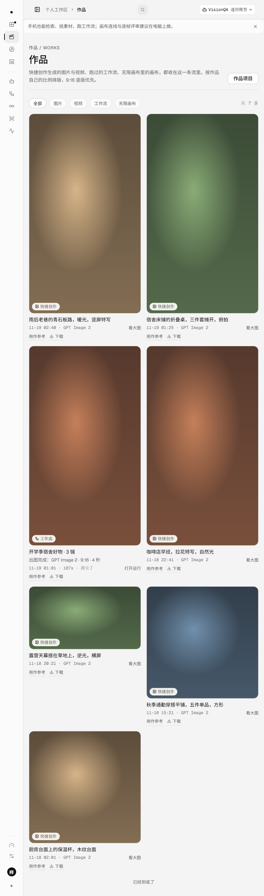

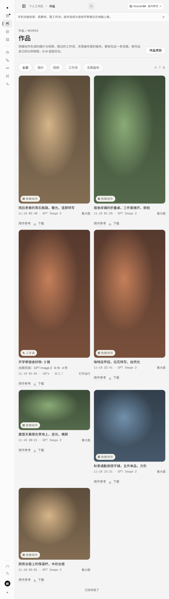


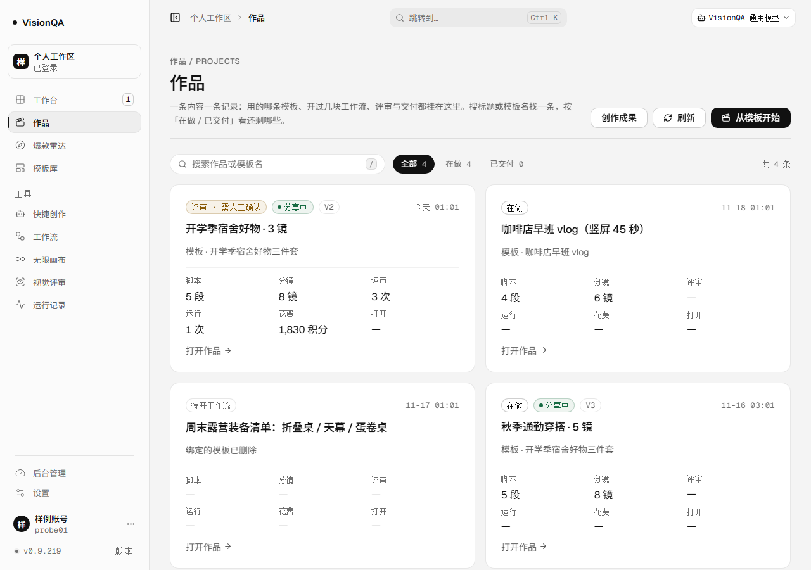

文档见 `docs/projects-works-tablet-2026-11-19.md`。

## 二百九十、作品详情页：手机 44px / 平板 40px，小字抬到 13px（r236 / v0.9.220）

作品详情页此前只有桌面一档：390 与 768 上正文 12–13px，「改脚本 / 提示词 / 查看运行 / 全部作品」这些
看起来像一行字的按钮只有 19–28px 高。这一版把 1080 以下的字号与触控区整体抬一档：正文 15 → **16**、
面板标题 16 → **17**、小字 12 / 12.5 → **13**、结论与运行胶囊 12/20 → **13/24**、版次胶囊 12/22 → **13/26**；
按钮与链接类按钮 **手机 44px、平板 40px**（改前 19–36px）。桌面（1081 起）逐项不动。

页面里「小于 13px 的文字」与「不到 40px 的按钮」两个数：390 / 768 / 1024 改前都是 **108 / 45**，改后都是 **0 / 0**。
页面高度 390 从 7956 → 8966、768 从 5015 → 5553——字大了、按钮 44px，这是代价，没有靠收行距换回来。

顺带修掉两个既有窄屏问题：320 下版本行里「最近一评 1 阻塞 · 1 主要 · 1 次要」是 nowrap，整行被撑到 413px，
页面横向滚（现在 ≤520 改竖排，scrollWidth == clientWidth == 320）；来源面板的隐式列按 max-content 定宽，
长模板名把面板顶到 313px（容器 220px），把栏目 / 面板 / 来源列表四层钉成 minmax(0, 1fr) 后省略号才生效。

门禁：npm test **1551/1551**（新增 test/project-detail-mobile.test.mjs 8 条）、lint 0 error / 26 warning（614 文件）、
tsc -b 干净、密钥扫描 949 文件无命中、构建入口 index-BHOLhzk7.js（742,219 B）/ 样式 index-J4Shf-PJ.css（349,943 B）。


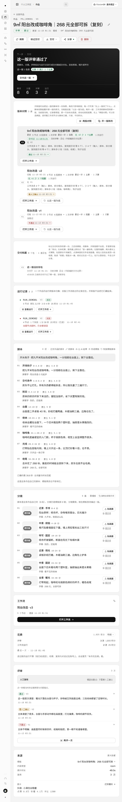


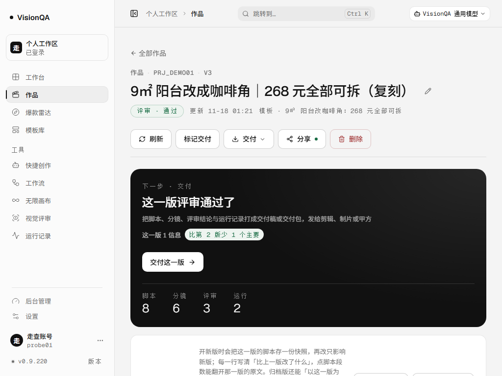

生产 0.9.220（发布 20261118-194818-20261119-034700-r236deta，health ok templates 26、6 个服务 active、未登录 401、磁盘 73%；回滚 --to 1 回 0.9.219）。

文档见 docs/project-detail-mobile-2026-11-19.md。

## 二百九十一、工作台 / 模板库 / 爆款雷达：骨架 40/44px，模板库改紧凑行（r237 / v0.9.221）

这一版先抬三页共用的骨架：侧栏导航 34px、顶栏搜索 30px、模型按钮 30px、版本按钮 28px、筛选片 30px / 12.5px、
文字链接 24px —— 1080 以下统一到 **手机 44px / 平板 40px**，筛选片同时到 **13px**；再抬三页各自的字：
工作台的小字 12 → **13**、爆款雷达的作者 / 平台徽标 / 互动数 11–12 → **13**、卡片标题 14 → **16**，
模板库的互动数与说明 11.5–12.5 → **13**、标题 15 → **16**、「用这条改编」11.5px / 32px → **13px / 40–44px**。

判据：390 / 768 / 1024 三页合计「小于 13px 的文字」108 / 111 / 69 → **0**，「不到 40px 的点击区」60 / 60 / 60 → **0**，
没有横向溢出；桌面 1440 逐字段与改前一致（16 / 24 / 32 处小字、21 / 19 / 20 个点按区）。

模板库顺手改掉 390 上 26 条 19,262px 的问题：≤820 改成与雷达一致的「左 96px 封面 + 右文案」，26 条 390 从
19,262px 收到 **8,308px**（−57%），768 从 35,372 收到 **5,986px**（−83%）；≤360 封面 80px、整句允许折行，
320 不再顶出屏幕（改之前右缘 355 > 320）。

门禁：npm test **1561/1561**（新增 test/overview-radar-mobile.test.mjs 10 条）、lint 0 error / 26 warning（615 文件）、
tsc -b 干净、密钥扫描 951 文件无命中、构建入口 index-IaXs9y-3.js（742.23 kB）/ 样式 index-LeX9QKPR.css（353.51 kB）。

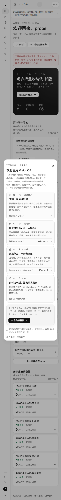


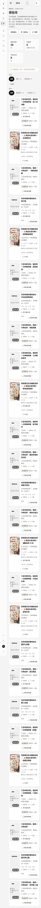


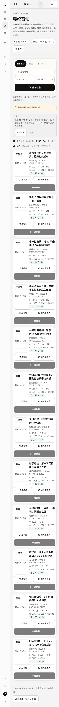

生产 0.9.221（发布 20261118-201321-r237mobile，health ok templates 26、6 个服务 active、未登录 401、磁盘 73%；
回滚 --to 1 回 0.9.220）。

文档见 docs/overview-radar-mobile-2026-11-19.md。

## 二百九十二、设置页：小字 13px、按钮 44/40px（r238 / v0.9.222）

设置页几乎全是原子组件，390 / 768 上的小字停在 11.5–12.5px：卡头 mono 12、`Tag` / `Pill` 12、
口令说明 11.5、会话 IP 11.5、流水表头 12、价格标签 11.5、反馈时间 11.5、健康行 12.5；
点按区停在 28–32px：按钮 32、图标按钮 32、口令输入 32、帮助链接 31。这一版按 r236 / r237 的同一套档位收口：
**1080 以下小字 13px、按钮手机 44px / 平板 40px**，桌面（1081 起）一个字段没动。

判据（每页实测，<13px 文字 / <40px 点按区）：390 的 **69 / 18 → 0 / 0**、768 的 **67 / 18 → 0 / 0**、
1024 的 **67 / 18 → 0 / 0**，320 改后 **0 / 0** 且 scrollWidth == clientWidth；1440 改前改后都是 **74 / 32**。
390 页面高度 5679 → 5947px（+4.7%），是字大一档、按钮 32 → 44 的代价。

规则全部挂在 `.vq-page--settings`（设置页新加的修饰类）下，写在新建的 `src/styles/settings.css`，
在 `credits.css` 之后加载 —— 只影响设置页。按钮靠 `--btn-h` / `--btn-h-sm` 两个 token 一起抬到 40 / 44，
图标按钮跟着 `--btn-h` 变正方形；口令输入框 32 → 40 / 44、字号 12.5 → 14；三枚「先看说明」帮助链接从 31px 撑到 40 / 44。

门禁：npm test **1568/1568**（新增 test/settings-mobile.test.mjs 7 条）、lint 0 error / 26 warning（616 文件）、
tsc -b 干净、密钥扫描 953 文件无命中、构建入口 index-BmcKRyHZ.js（742.25 kB）/ 样式 index-BLi8wNb_.css（355.14 kB）。


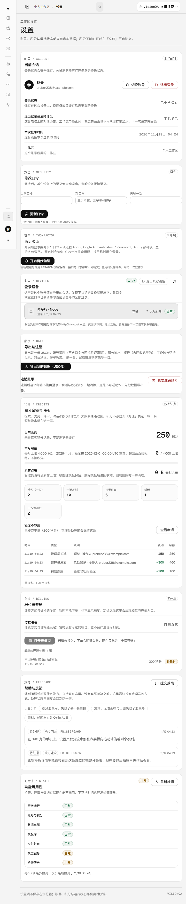


生产 0.9.222（发布 20261118-202923-r238mobile，health ok templates 26、6 个服务 active、未登录 401、磁盘 73%；
线上 CSS 有 vq-page--settings 与 --btn-h:40px；回滚 --to 1 回 0.9.221 入口 index-IaXs9y-3.js）。

文档见 docs/settings-mobile-2026-11-19.md。

## 二百九十三、视觉评审页：小字 13px、点按区 40/44px（r239 / v0.9.223）

上一轮清完设置页之后，视觉评审成了剩下最差的一页：390 宽首屏 22 处 12px 的字、4 处不到 40px 的点按区；
打开一条历史评审是 40 / 6，历史弹层 35 / 6。这一版按同一套档位收口：**1080 以下小字 13px、按钮与点按区手机 44px / 平板 40px**。

判据（每页实测，<13px 文字 / <40px 点按区）：390 首屏 **22 / 4 → 0 / 0**、历史详情 **40 / 6 → 0 / 0**、
弹层 **35 / 6 → 0 / 0**；768 首屏 **22 / 4 → 0 / 0**、详情 **40 / 6 → 0 / 0**；1024 首屏 **23 / 3 → 0 / 0**、
详情 **41 / 5 → 0 / 0**；320 改后 **0 / 0** 且 scrollWidth == innerWidth；1440 改前改后逐元素一致（30 / 18、45 / 20）。

评审页的字号与点按区几乎全走 shell 的原子（`.vq-pill` / `.vq-tag` / `.vq-mono` / `.vq-button`），
所以主体做法是在 `.review-page` 上把原子档位抬一档：胶囊 12px / 高 22 → **13px / 高 24**，严重度标签 12 → **13px**，
mono 小字与历史位置 12 → **13px**，问题编号盒 16×16 → **18×18**；「4 个模板首帧」折叠开关 24px 高、
「查看全部 4 条」35px、历史行 34px、`选图` / `回作品` / `评这一版` 28px 全部抬到 **40 / 44px**。
规则只写在 `src/styles/review.css` 末尾两段媒体查询里，桌面 1081 起一条都不进。
共用骨架顺带修了三处：图标态搜索 30×40 → **40 / 44px 宽**、侧栏「等你看」计数 12 → **13px**、
320 宽下被挤到 39 / 38px 的顶栏与弹层图标按钮**不参与收缩**。

门禁：npm test **1575/1575**（新增 test/review-mobile.test.mjs 7 条）、lint 0 error / 26 warning（617 文件）、
tsc -b 干净、密钥扫描 956 文件无命中、构建入口 index-C2cuw_43.js（742.25 kB）/ 样式 index-BuEIcdDe.css（356.48 kB）。

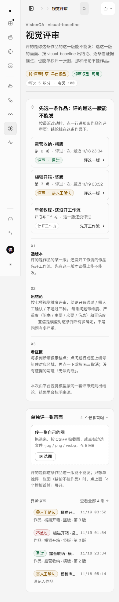


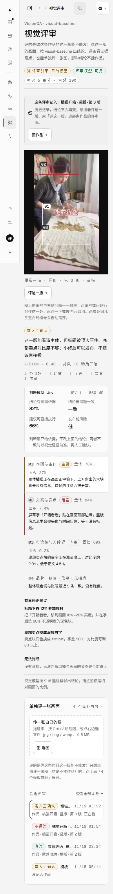


生产 0.9.223（发布 20261118-204623-r239review，health ok templates 26、6 个服务 active、未登录 401、磁盘 73%；
线上 CSS 有 .review-page .vq-mono；回滚 --to 1 回 0.9.222，发布 20261118-202923-r238mobile）。

文档见 docs/review-mobile-2026-11-19.md。

## 二百九十四、运行记录页：小字 13px、点按区 40/44px，修 320 三处布局（r240 / v0.9.224）

清单第 22 项。运行记录是 UX 清单里剩下最重的一页：390 宽 50 处 12px 的字、12 处不到 40px 的点按区（768 / 1024 各 62 / 12），
还带着三处在 320 上真坏掉的布局。这一版按同一套档位收口：**1080 以下小字 13px、按钮与点按区手机 44px / 平板 40px**。

判据（<13px 文字 / <40px 点按区）：390 页面 **50 / 12 → 0 / 0**、运行对照弹层 **15 → 0**；320 **50 / 12 → 0 / 0**；
768 **62 / 12 → 0 / 0**；1024 **62 / 12 → 0 / 0**；1440 改前改后逐元素一致（69 / 29），只有侧栏版本号变了。

在 `.runs-page` 上抬一档原子：mono 12 → **13px**，统计条标签、筛选标签、筛选下拉的选中值、输出字段名、「原始返回」里的 JSON 全部 12 → **13px**；
刷新 / 回作品 / 对照 / 查看这次运行 / 在工作流打开 / 翻页 28 → **40 / 44px**，搜索框 34 → 40 / 44（输入框同步够高，40px 的框带 1px 边时不再只剩 38），
「原始返回」折叠开关 27 → **40 / 44px**。

320 上的三处真坏：输出的「字段 → 值」两列（键列 140px）塌成**竖排单字** → ≤560 改单列、键在上值在下；
翻页的「1–12 / 14」**折成四行** → 区间一行、两个按钮一行各半；每行右侧 70px 窄列把标题与「作品 · 第几版」**挤成两段** → ≤700 状态/耗时/时间挪到第二行。
运行对照弹层（运行记录页与工作流页共用）顺带修两处：390 被挤成 **39px 宽**的关闭按钮改成不收缩的 40 / 44，「看改了哪几行」24 → 40 / 44px。

另补一处交互：窄屏（≤1100）列表与详情上下排、详情落在整张清单下面，以前点一行只有行变色；现在点完把详情滚到眼前
（`prefers-reduced-motion` 直接跳），桌面两栏并排不滚。实测 390 点第 6 条后 `window.scrollY` 0 → 2071、详情顶部 2071 → 0；1440 `scrollTop` 仍 0。

门禁：npm test **1585/1585**（新增 test/runs-mobile.test.mjs 10 条）、lint 0 error / 26 warning（618 文件）、
tsc -b 干净、密钥扫描 958 文件无命中、构建入口 index-WLrx66J3.js（742.53 kB）/ 样式 index-B6nKbWgO.css（358.25 kB）。


生产 0.9.224（发布 20261118-210403-r240runs，health ok templates 26、6 个服务 active、未登录 401、磁盘 73%；
线上 CSS 有 .runs-page .vq-mono 与 .rc-head .vq-button--icon；回滚 --to 1 回 0.9.223，发布 20261118-204623-r239review）。

文档见 docs/runs-mobile-2026-11-19.md。

## 二百九十五、快捷创作页：小字 13px、点按区 40/44px，修分类条被裁与历史弹层跑出屏幕（r241 / v0.9.225）

2026-11-19。快捷创作页（平台对话、对话预设、图片、视频四个状态）在 390 / 768 / 1024 / 320 下逐屏量：
12px 与 11.5px 的元信息 5–30 处、不到 40px 的点按区 11–26 处。改法与运行记录页同一套——所有覆盖写在 `agents.css` 末尾的
`@media (max-width: 1080px)` / `(max-width: 560px)` 两段里、选择器带 `.agx-page`，桌面（1081 起）一条规则都不进。

判据（<13px 文字 / <40px 点按区）：390 平台对话 **5 / 11 → 0 / 0**、图片面板 **26 / 24 → 0 / 0**、视频面板 **30 / 26 → 0 / 0**；
320 平台对话 **5 / 11 → 0 / 0**、图片面板 **26 / 24 → 0 / 0**；768 **11 / 11 → 0 / 0**（图片 30 / 24 → 0 / 0）；
1024 **36 / 23 → 0 / 0**；1440 图片面板 **40 / 38 → 40 / 38** 一个没变，平台对话 43 / 37 → 42 / 37（唯一少的那个是下面说的「0」）。

抬一档的原子：等宽元信息、胶囊标签（11.5px）、胶囊取值（12.5px）、预设计数、卡片「当前」、会话数 / 余额 / 能力按钮全部 → **13px**；
创作方式与对话方式页签 28 → **40 / 44px**，参数胶囊 30 → **42 / 46px**（胶囊自带 1px 边框，里面那枚按钮正好 40 / 44，写 40 就只剩 38），
短值触发器（`1:1`、`4s` 只有 34px 宽）补到 ≥40 / 44，发送键 38 → **40 / 44**，会话条与能力按钮 32 / 28 → **40 / 44px**。

三处真问题：① 预设分类条在 390 的内容列（290px）里要 397px，nav.css 又是 nowrap + 横向滚动，「脚本分镜 / 投放素材」被裁在屏幕外
→ ≤560 改换行 + 胶囊激活态；② 历史弹层是 `absolute; right: 0; width: 352px`，窄屏挂在左边按钮上算出**左边缘 −187px**，只剩一条「话记录」
→ 窄屏改贴底浮层（左右 8px、最高 70vh）；③ 对话数为 0 时左栏「新对话 ｜ 0 ｜ 历史对话」中间孤零零一个 0 → 0 条不显示，有对话时写「共 N 个」。

门禁：npm test **1595/1595**（新增 test/agents-mobile.test.mjs 10 条）、lint 0 error / 26 warning（619 文件）、
tsc -b 干净、密钥扫描 960 文件无命中、构建入口 index-Cv7e7_aY.js（742.53 kB）/ 主样式 index-B6nKbWgO.css（358.25 kB）/ 本页样式 agents-Cs33nbh8.css（55.49 kB）。


生产 0.9.225（发布 20261118-212249-r241quick，health ok templates 26、6 个服务 active、未登录 401、磁盘 73%；
公网 /assets/agents-Cs33nbh8.css 200 / 55,485 B / text/css；回滚 --to 1 回 0.9.224，发布 20261118-210403-r240runs）。

文档见 docs/agents-mobile-2026-11-19.md。

## 二百九十六、工作流页：小字 13px、点按区 40/44px，修顶栏溢出与工具条互压（r242 / v0.9.226）

工作流页（#/canvas/<flowId>）在 320 / 360 / 375 / 390 / 768 / 1024 六档、三种状态（默认 / 节点面板打开 / 首次上手引导）下，
小于 13px 的字与不到 40px 的点按区都清零；1440 桌面逐项 computed style 一致。同时修掉三处真问题：

1. **顶栏把整页撑宽**：375 宽整页 scrollWidth 381、320 宽 346（横向可拖），搜索键被挤到 36px、顶栏图标键 1024 时 37px。
   480 以下「内部测试」胶囊让位、模型键只留 Bot 图标 + 箭头（补 aria-label）；1080 以下右侧那组不参与收缩、模型名收窄到 148px。
2. **工具条文字互压**：768 宽内容 444px 挤进 366px 的格子，`+ 节点`、`5 节点 · 4 连线`、`适应工作流` 直接盖在一起（1024 是 499 挤 454）。
   `.cv-toolbar` 原来只在 ≤760 换行，761–1024 这一段是 nowrap，现在 1080 以下允许换行。
3. **上手引导关闭键 32px**：首次打开时它是整屏唯一能点的键，1080 以下补到 40×40。


判据四个数：小字（<13px 叶子文字）、点按区（宽或高 <40px）、同容器兄弟重叠、内容溢出自己的盒子；
React Flow 的画布视口与节点盒子天生比内容窄 2px，量的时候整棵子树排除。

| 宽度 | 小字 | 点按区 | 内容溢出 | 整页宽度 |
| --- | --- | --- | --- | --- |
| 320 | 14 → 0 | 13 → 0 | 5 → 0 | 346 → 320 |
| 360 | 14 → 0 | 12 → 0 | 5 → 0 | 368 → 360 |
| 375 | 14 → 0 | 11 → 0 | 1 → 0 | 376 → 375 |
| 390 | 14 → 0 | 11 → 0 | 1 → 0 | 390 → 390 |
| 768 | 15 → 0 | 15 → 0 | 3 → 0 | 768 → 768 |
| 1024 | 15 → 0 | 16 → 0 | 4 → 0 | 1024 → 1024 |
| 1440（桌面） | 22 → 22 | 21 → 21 | 0 → 0 | 1440 → 1440 |


改法与运行记录页、快捷创作页同一套：覆盖全写在 canvas.css 末尾的 ≤1080 / ≤560 两段、选择器带 `.cv-page`，
1081 起一条规则都不进；页内只抬 token（`--btn-h` 40/44、`--chip-pill-h` 24/26、`--text-mono` 13px），
再逐个点名 12px 的那一片（工具栏计数、缩放百分比、节点类型与状态、检查器小标题、步骤清单序号与依赖、抽屉里的序号与耗时）。


门禁：1604 / 1604 测试（新增 test/workspace-mobile.test.mjs 9 条）、lint 0 error / 26 warning（620 个文件）、tsc -b 干净。
边界：只量 Chromium 无头 1x 的七档宽度；运行抽屉只量关闭态；运行中相关状态（排队胶囊、失败红条）需要真跑一次流程，本轮没跑也没花积分。

文档见 docs/flow-mobile-2026-11-19.md。

生产 0.9.226（发布 20261118-214844-r242flow，health ok templates 26、6 个服务 active、未登录 401、磁盘 73%；
入口 index-BMy9_msg.js 742.61 kB / 主样式 index-B88JOElv.css 358.61 kB；
公网 /assets/CanvasPage-PyzuMW6o.css 200 / 30,342 B / text/css；回滚 --to 1 回 0.9.225，发布 20261118-212249-r241quick）。
提交 dc26961 + 27157d4，CI 44405387645 success（Node 22.12 / Node 24 / 安全扫描三件全绿；dc26961 那轮被后一次推送按并发策略取消）。

## 二百九十七、无限画布状态条：小字 13px、点按区 40/44px，修 768 整页横向滚动与两处顶出（r243 / v0.9.227）

无限画布（`#/board`）嵌的是外部那张自由画布，我们这层只留一条 42px 的状态条：
在哪块画布 / 通没通 / 排队位 / 换画布 / 新建 / 写笔记 / 专注 / 新窗口。
它 1440 上够用，768 与 1024 却装不下——这轮把它在 320 / 360 / 375 / 390 / 600 / 700 / 768 / 1024 八档量一遍、修到清零。

| 宽度 | 小字 | 点按区 < 40px | 内容溢出容器 | 整页宽度 | 状态条高度 |
| --- | --- | --- | --- | --- | --- |
| 320 | 1 → **0** | 4 → **0** | 0 → 0 | 320 → 320 | 133 → 105 |
| 360 | 1 → **0** | 4 → **0** | 0 → 0 | 360 → 360 | 101 → 105 |
| 375 | 1 → **0** | 4 → **0** | 0 → 0 | 375 → 375 | 101 → 105 |
| 390 | 1 → **0** | 4 → **0** | 0 → 0 | 390 → 390 | 101 → 105 |
| 768 | 4 → **0** | 4 → **0** | **6 → 0** | **912 → 768** | 42 → 52 |
| 1024 | 4 → **0** | 4 → **0** | **2 → 0** | 1024 → 1024 | 42 → 52 |
| 600 / 700（中间档抽查） | 0 → 0 | **3 → 0** | 0 → 0 | 不变 | 97 |
| 1440（桌面） | 11 → 11 | 20 → 20 | 0 → 0 | 1440 → 1440 | 42 → 42 |


顺手量出三处真问题：

1. **768 上整页被状态条撑出屏幕**：内容 780px、格子只有 672px，整页 `scrollWidth` 变 912，还能横向拖；1024 差 20px，
   唯一被挤掉的是「新窗口」图标键——被弹性收缩压成 **16×32**，只剩半截可点。
2. **手机上排队位胶囊被裁掉半句**：「在跑 3 · 排队 2（最久 12.4s）」是 nowrap + `max-width: 320px`，
   390 上直接顶出右边缘，「（最久 1」被页面裁断，连省略号都没有。
3. **561–760 这一段把按钮钉在 32px 宽**：那条 ≤760 的规则把「新建 / 写笔记 / 专注」收成图标方块，≤1080 只抬了高度，
   600 与 700 上量出 3 个 **32×40**——宽度不够点。补一条 ≤760 的 `width: 40px`（放在 ≤560 之前，手机上再由 44px 盖过）。
4. **写笔记弹层按 100vw 算宽度**：它挂在 322px 宽的状态条里却按视口算，390 上右边缘顶出 30px（整页 420）、320 上顶出 32px。


改法：全部写在 board.css 末尾的 ≤1080 / ≤560 两段里（这一页的样式表本来就只被 BoardPage 懒加载，是页级作用域），
1081 起一条规则都不进。≤1080 允许换行，并把「让位名单」扩到 4 个——页面名（面包屑里有）、分隔线、
选择器前面的「画布」两个字、画布域名（连接胶囊的 title 上还有）——省下的 100px 让 768 与 1024 都能排成一行；
状态胶囊与排队位 12 → 13px、24 → 26px，按钮 24 → 40px、图标键 32 → 40px 且 `flex: 0 0 auto` 不再被挤。
≤560 再抬到 44px：按钮、图标键、胶囊 28px，排队位收掉「（最久 12.4s）」，写笔记弹层改成按状态条自己算宽度。


顺带把状态条标成一组：`<div className="bd-strip" role="group" aria-label="无限画布状态条">`——
窄屏收起「无限画布」字样之后，读屏仍然知道这一条是什么。

桌面没动的证据是直接量出来的：同一个 1440 视口、同一批选择器，改前改后 `getComputedStyle` 逐项一致，
12 项全部相同——状态条 42px / 1204 宽、`.bd-label` 12px、`.bd-state` 12px/24px、`.bd-action` 13px/24px、
`.bd-strip .vq-button--icon` 32×32、`.vq-select__trigger` 13px/30px、画布 iframe 1204×802。


门禁：1614 / 1614 测试（新增 test/board-mobile.test.mjs 10 条）、lint 0 error / 26 warning（621 个文件）、tsc -b 干净、密钥扫描 964 个文件无命中。
边界：只量 Chromium 无头 1x 的八档宽度（561–760 只抽查 600 / 700）；画布本体是跨源 iframe，只量了我们这条状态条，iframe 里面一行没碰；
排队位是注入的假数据（没有真跑一次出图），写笔记只验弹层排布、没有真往画布写节点。

文档见 docs/board-mobile-2026-11-19.md。

生产 0.9.227（发布 20261118-220815-r243board2，health ok templates 26、6 个服务 active、未登录 401、磁盘 73%；
入口 index-DVl-vtFb.js 742.61 kB / 主样式 index-B88JOElv.css 358.61 kB / 本页样式 BoardPage-Bn0zleRL.css 5,246 B；
公网 /assets/BoardPage-Bn0zleRL.css 200 / 5,246 B / text/css；回滚 --to 1 回 0.9.226，发布 20261118-214844-r242flow）。
提交 3f097cb + ed0a53e + 1f69287 + cb63f59，CI 44408738720 success（Node 22.12 / Node 24 / 安全扫描三件全绿；ed0a53e 那轮被后一次推送按并发策略取消）。

## 二百九十八、快捷创作对话能发图片了：原图交给模型看，只在这一轮（r245 / v0.9.228）

「一页 DeepSeek」最后一个缺口补上：之前只能读脚本、Word、Excel、PDF，遇到一张「这张封面哪里不行」的截图，
只能让用户自己描述。现在是直接把图丢进对话——**原图随这一轮交给模型看，图里的字由模型自己读，本地不做 OCR**。

三件事刻意做得跟以前不一样：

1. **图片只在发送那一轮参与理解**。追问时历史里只剩一行说明（「这一轮带过 1 张图片（xxx.png）：后面只按文件名记住」），
   不会每问一句就再付一遍图片的输入费，也不会让模型以为自己还看得见那张图。
2. **带图的一轮走一次性回答**（不逐字）。多模态 + 流式在不同上游并不都成立，一条 400 会让整次对话失败并退款；
   一次性拿到整段再推给界面，行为是确定的。界面上就写「带图这一轮整段给，不逐字」。
3. **必须走视觉模型链**。文本链里常是纯文本模型，图片会被静默丢掉，回答装得像看过了——这个坑在评审那条链路上已经踩过一次。


动手之前先量了一遍现状：**390 宽下附件 chip 只有 26px 高、移除键 24×28**——加图之前就存在的点击区问题，
顺手补了 ≤560px 的 40px 下限。改完重载页面（同地址 navigate 不会重新加载，会量到上一屏的状态）再点开会话量：
390 与 320 都是 **小字 0 / 点按区 0 / 内容溢出 0 / 整页宽度 = 视口宽**。


契约：按文件头认 jpg/png/webp/gif（改名的 html 进不来）、一条最多 2 张、单张 ≤ 8 MB、
只给上传的人（`/api/chat/files/:id/raw` 按归属校验、只发 image/*、带 nosniff）、每人留 20 份轮转、删附件连原图一起删。
原图读不到就在扣费前 422，超 2 张 400，不是图 415——读不出来一分钱都不该扣。

门禁：1620 / 1620 测试（新增 6 条图片用例）、lint 0 error / 26 warning（621 个文件）、tsc -b 干净、密钥扫描无命中。
验证用的是本地假上游 + 真浏览器：单测跑通「多模态正文 / 追问不带图 / 3 张被拒 / 原图归属」；
Edge 无头里真的通过 `<input type=file>` 选了一张真截图、截到等待态与整段回答，假上游确认收到的是 `image_url` 的 data URL。

边界（别当成验过了）：**一次真实的多模态调用都没有发生**，生产上第一次真发图会不会被上游拒（`deepseek-flash` 是否收 `image_url`）未验证，
要花约 ¥0.01，等用户点头；没有本地 OCR，模型看不出的字就是看不出；只在当前这一轮带图，想再问那张图要重新发；
图片不进分享页、交付包、模板；只量了 320 / 390 / 1440，平板 768 未逐屏量。

文档见 docs/quick-create-images-2026-11-19.md。

生产 0.9.228（发布 20261118-222818-r245chatimg，health ok templates 26、6 个服务 active、未登录 /api/chat/files 与 /api/chat/files/:id/raw 均 401、磁盘 73%；
入口 index-bCJRzIkx.js 742.61 kB、本页 AgentsPage-BTMnsm5w.js 73,499 B、agents-DhJNiDqE.css 55,907 B 公网 200，样式表里已核到 .qc-file-thumb / .qc-preview-img 与 ≤560px 的 40px 规则；
回滚 --to 1 回 0.9.227，发布 20261118-220815-r243board2）。
提交 c03e1db + d72f80f，CI 44411856732 success（三件全绿）。

## 二百九十九、「联网搜索」改成平台自己搜：上游不认那个工具就整条 400（r246 / v0.9.229）

这一轮先查了一遍「哪一步最假」，查到的是**联网搜索**：以前是把 `deepseek_web_search` 当服务端工具塞进上游请求，
上游认这个工具才有搜索，不认就是整条请求 400——用户点一下开关，换来一句「这次没有回上来，积分已退回」，
而他自己并不知道上游根本没这个能力。（读链接在 r219 已经因为同样的原因改成平台自己在本地读，搜索一直漏着。）

现在搜索和读页面都在平台这一侧：先用平台自己的搜索服务搜一次（博查 / Tavily / 通用 JSON 接口），
再把前 3 条网页读成文字（内网地址、超时、字数上限都在读链接那一层），连同问题一起问模型；
界面上把「搜了什么、搜到哪几条」列在那句话下面，能点开核对。

三个刻意的决定：

1. **上游一个工具都不带了**——搜索、读页面都在我们这边做，上游只负责回答。
2. **用户自己贴了链接就不自己搜**：先把他的页面读准；同时再搜一遍只会多读三张网页、多花十几秒，还可能带偏。
3. **没配搜索服务时不假装搜过**：界面上的开关是禁用的、写明原因，服务端也只往上下文里写一句「这次没搜成、别编」，
   让模型老实说不确定，而不是编一条「最新消息」。


顺手修了一个权限不一致：`VQ_ADMIN_EMAILS` 里的账号在接口上是管理员（能发积分、能改配置），后台页面却显示
「这个账号没有后台权限」——因为 `/api/auth/me` 只回库里的 `kind`。现在两边同一套判定，单测钉住。

后台「系统」新增搜索服务卡片：选服务商、填地址与 API Key、点「试搜一次」（真发一次请求、花一次搜索服务的额度）看结果。
Key 只写不读，接口只回掩码与「有没有」。


量测（无头 Edge，按宽度重新加载后再量）：快捷创作 390 与 320 都是**小字 0 / 点按区 0 / 内容溢出 0 / 整页宽度 = 视口宽**；
后台这一页 390 下溢出 0（小字与 32px / 27px 控件是既有样式）。本轮自己被抓到两处并修掉：来源 chip 原来 12px / 站点 11px（归一到 13px），
搜索服务卡 390 下两个按钮并排把卡片顶出去 6px / 22px（允许换行 + 字段可收缩，溢出归零）。


门禁：1633 / 1633 测试（新增 web-search 9 条、chat 3 条、admin kind 1 条）、lint 0 error / 26 warning（624 个文件）、tsc -b 干净、
密钥扫描无命中；验证用的是本机临时实例 + 假上游 + 假搜索服务：真的走了「首轮未接通 → 后台配接口 → 第二轮搜到 3 条、读了 2 条、第 3 条 404 照实说」。

边界：**一次真实的搜索服务调用都没有发生**（博查 / Tavily 的请求体按公开文档写，拿到 Key 后要先点一次「试搜一次」确认，约 ¥0.03/次）；
结果是搜索引擎给的，不保证每条都能打开，读不到就写「没读到」；只读前 3 条、不翻页；搜索按次计费而对话仍只扣 1 积分，差价属于待定的定价决定（D1），这一轮没改价。

文档见 docs/quick-create-search-2026-11-19.md。

生产 0.9.229（发布 20261118-225452-r246search，health ok templates 26、6 个服务 active、未登录 /api/chat/search 与 /api/admin/search 均 401、磁盘 73%、
生产还没有 /var/lib/visionqa/search.json——所以线上那个「联网搜索」开关现在是禁用的，等管理员在后台填一个搜索服务；
入口 index-ZDuJmA_M.js 742.61 kB、本页 AgentsPage-xg-fx7Rf.js 75,122 B、agents-ByO7BeQ0.css 56,790 B 公网 200，样式表里已核到 .qc-search-item / .qc-search-site 与 13px；
回滚 --to 1 回 0.9.228，发布 20261118-222818-r245chatimg）。
提交 a73e4ad，CI 44416195107 success（Node 22.12 / Node 24 / 安全扫描三件全绿）。

## 三百、快捷创作：Enter 直接发、回答一键复制、会话被腾位置要说出来（r247 / v0.9.230）

这一轮补的是「一页 DeepSeek」里最容易被老用户第一分钟撞上的三处，都是从用户视角走查出来的：

1. **Enter 发送，Shift + Enter 换行**。以前只有 Ctrl + Enter 能发，从别的对话页过来的人打完字按 Enter
   会以为平台没反应；现在跟常见的对话页一致，中文输入法正在组词时按 Enter 仍然只是选字。
2. **每段回答一键复制**。复制的是模型原文排成的纯文本：**没有 `**`、没有 `|`**，表格转成制表符，
   代码块保留缩进，粘进剪辑软件 / 文档 / 飞书表格能直接用。这个产品的回答经常就是分镜表和脚本，拿不走等于没用。
3. **会话列表满 30 条时，被腾掉的是哪一条要明确说出来**。以前服务端悄悄删掉最早一条，
   用户只会发现「昨天那条长对话不见了」；现在服务端把被挪掉的标题回给界面，界面上以 toast 说清楚。

顺带把对话页的元信息行（模型名 / 耗时 / 时间）、余额与提示行从 11–12px 抬到 13px——
用户反复说过「字太小，至少让我看清是什么」，这行原来是这一页唯一还在 11px 的地方。


验收：单测新增 3 条（纯文本复制 2 条、会话腾位置 1 条）；端到端用本机临时实例 + 无头 Edge 真点：
复制后读回剪贴板 250 字、没有 `**`、表格是制表符、缩进在；Enter 真的把消息发出去了（输入框清空、消息落到对话里）；
Shift + Enter 不发送；满 30 条时 toast 里就是被删掉那条的标题。390 / 320 按宽度重新加载后量：
**小字 0 / 内容溢出 0 / 整页宽度 = 视口宽**，点按区只剩正文里的行内链接（90×19，文字链接不做 40px 触控区）。

边界：剪贴板里是 Windows 的 `\r\n`；只复制文字，不带图片与附件；浏览器拒写剪贴板时如实提示不假装成功；
腾位置是真删（有提示、不可恢复，没有做回收站）；手机上软键盘的「换行」键等于 Enter，会直接发送。
本轮 0 次真实上游调用（临时实例没有模型 Key，发送那一步以 403 失败并退回积分，正好覆盖失败提示）。

文档见 docs/quick-create-copy-enter-2026-11-19.md。

生产 0.9.230（发布 20261118-231236-r247copy，health ok templates 26、6 个服务 active、磁盘 73%、
未登录 /api/chat/conversations 与 /api/admin/search 均 401、入口 index-DkINxN3s.js 742.61 kB、
agents-CErZ7ny0.css 57,251 B 与 AgentsPage-lviWnYCx.js 76,772 B 公网 200，样式表里核到 .qc-copy 与 .qc-msg-meta 的 13px，
脚本里核到「已复制」与 Shift 键处理；回滚 --to 1 回 0.9.229，发布 20261118-225452-r246search）。
门禁 1636 / 1636 测试（新增 3 条）、lint 0 error / 26 warning（624 个文件）、tsc -b 干净、密钥扫描 971 个文件无命中。

## 三百零一、对话超过 200 条要说少了多少条；上游报错不再原样丢给用户（r248 / v0.9.231）

上一轮把「会话满 30 条悄悄删掉最早一条」改成了明确告知。这一轮补同一类问题的另一处：
**一条会话超过 200 条消息时，服务端过去也是悄悄丢最早的几条**——聊到一百多轮再往回翻，
第一句问的话没了，界面上什么都不说。现在两处口径都在：会话流顶部常驻一条
「再往前 N 条已经不在存档里」，刚刚发生的那一轮再用 toast 说一次「最早的 N 条已经从存档里挪掉」。
计数落进会话文件（`dropped`），刷新、换设备回来仍然知道少了多少；「这一轮挪了几条」（`trimmedNow`）
只在当次响应里，不写进文件。用户那句是先落库再去问上游的，所以**失败的那一轮也会说**。

顺手补了一个真正的上线前缺口：**上游报错不再原样丢给用户**。以前聊天失败时界面会出现
`deepseek-xxx HTTP 400：{"error":…}` 这种报文（带着型号、供应商地址、英文原话）；现在走 `server/public-error.mjs`
的统一口径——其它模块早就在用，只有聊天这条链路漏了。整句没有中文的英文报文给一句中文结论，
原文留在服务端日志里；我们或上游直接写的中文报错照旧透传。

同一条线把快捷创作里剩下的 11–12px 全部抬到 13px：会话列表条数与「N 条 · 时间」、左栏脚注、
输入框上方的工具条、附件与链接小条、预览标题与正文、行内报错、窄屏回答里的表格。


验收：单测新增 3 条（会话报数、英文报文兜底、聊天失败口径）。端到端用本机临时实例 + 无头 Edge，
拿一条 200 条的会话真点：1440 下横幅「再往前 6 条」、消息 200 条、小字 0 / 溢出 0 / 整页宽 = 视口宽；
发一句之后 toast 文案如上，服务端 `dropped` 6 → 7、消息仍是 200 条、第一条从「第 1 句」变成「第 1 段回答」
（确认是真删、不是只改计数）；那一轮上游 403，界面给的仍是中文结论，没有型号 / 网址 / 英文原文；
390 重新加载后同一条会话横幅折三行，小字 0 / 溢出 0 / 整页 390 = 视口 390。

边界：200 条是硬上限，挤掉是真删、没有回收站，服务端只记「累计少了多少条」；上下文仍然只带最近 30 条
（存档 ≠ 上下文窗口），所以横幅说的是「不在存档里」而不是「模型忘了」；toast 每轮最多一次；
本轮 0 次真实上游调用（发送那一步以 403 失败并退回积分，正好把失败路径也验了）。

文档见 docs/quick-create-trim-2026-11-19.md。

生产 0.9.231（发布 20261118-232817-r248trim，health ok templates 26、6 个服务 active、磁盘 73%、
未登录 /api/chat/conversations 仍 401、入口 index-COth83wr.js 742,611 B、agents-Dgtr37Tq.css 57,456 B
（样式表里核到 .qc-trimmed）与 AgentsPage-CTHiT7vV.js（脚本里核到「再往前」）公网 200；
回滚 --to 1 回 0.9.230，发布 20261118-231236-r247copy）。门禁 1639 / 1639 测试（新增 3 条）、
lint 0 error / 26 warning（624 个文件）、tsc -b 干净、密钥扫描 972 个文件无命中。

## 三百零二、工作流页不再是「三颗点不动的按钮」：从手上的作品与模板就地起手（r249 / v0.9.232）

用户说工作流这页「有点鸡肋，试着联动起来」。查下来问题比看上去硬：空状态里那三颗
「去爆款雷达找一条 / 套用模板库的结构 / 从作品继续」**本来就点不动**——它们挂在 `.cv-overlay` 里，
这一层是 `pointer-events: none`（当初为了让节点还能直接拖到画布上），按钮把这属性继承了去。
把旧标记放回同一块浮层实测：按钮的 `pointer-events` 计算值是 `none`，
在按钮中心 `elementFromPoint` 命中的是画布 `DIV.react-flow__pane`（`hitIsButton: false`）。
就算点得动，它们也只是跳走：人站在画布上，手上明明有作品和模板，还得跑去别的页面按一遍再回来。

现在空状态改成**从你手上的东西起手**：作品与来自工作流的模板直接摊在画布上，点了就地建好，不离开这一页。

- 「按它的脚本开一条」→ `POST /api/projects/<id>/canvas` 生成输入 + 复刻两个节点，直接落在这张画布上，
  地址跟着变成 `#/canvas/<flowId>`，顶部出现「在帮《作品》· 第 1 版」；
- 「打开那条」→ 已经有工作流的作品直接打开；
- 「套用成新工作流」→ 模板库那条 `apply` 原样建回一张新画布；
- 三颗跳走的按钮沉到最后一行当兜底，另外给「空白流程，自己拖节点」。

挑哪几条、行上写什么字都在 `src/domain/canvas-start.ts`（组件只负责画），单测跟着文案走：
只列**自己的**作品（公共示例作品 `ownerId` 是空串，点了绑不上，直接不列）、
只列 `kind === 'flow'` 且节点数 > 0 的模板、当前正打开的那条不列、两组各最多 2 条。

顺手修了这块的两个毛病：清单加进来以后 `.cv-overlay--empty` 比画布还高、底部被切掉
（改成可滚 + `safe center` + 底部留 48px 躲开左下角提示，三段说明压成一行标题 + 一行费用说明）；
清单行标题 14px、说明与动作 13px，桌面也不再是 12px。


验收：`test/canvas-start.test.mjs` 9 条单测；端到端用本机临时实例（副本 `DATA_DIR` + 探针账号 + 2 条作品
与 2 条工作流模板）+ 无头 Edge 真点：1440 下清单 4 行、小字 0 / 溢出 0 / 整页宽 = 视口宽；
真鼠标点第一行之后 `#/canvas/flow_4d2a6b90` → `#/canvas/flow_d90f7534`、画布 2 节点、
toast「已按《毛衣折叠收纳法》的脚本开了工作流：2 个节点」；390 重新加载后同一份清单折行，小字 0 / 溢出 0 / 整页 390 = 视口 390。

边界：只做了「从内容起手」这一半，跑完之后的回流（进评审 / 存模板 / 交付）仍在原来的位置；
模板那条 `?type=` 是内容类型不是 `kind`，这里拉全量再由领域层挑，没有动接口；
没有脚本的作品点了会得到服务端 409 的原文；本轮 0 次真实上游调用（开工作流只建草稿，不跑节点、不扣积分）。

文档见 docs/canvas-start-2026-11-19.md。

生产 0.9.232（发布 20261119-000653-r249start，health ok templates 26、6 个服务 active、磁盘 73%、
未登录 /api/projects 仍 401、入口 index-D4R-53t_.js 742,626 B、CanvasPage-BeSyRBZd.css 32,323 B
（样式表里核到 .cv-start-row 4 处）与 CanvasPage-BWllnrGv.js（脚本里核到「从你手上的东西起手」）公网 200；
回滚 --to 1 回 0.9.231，发布 20261118-232817-r248trim）。门禁 1648 / 1648 测试（新增 9 条）、
lint 0 error / 26 warning（627 个文件）、tsc -b 干净、密钥扫描 973 个文件无命中。

## 三百零三、跑完之后不再靠猜：抽屉底栏直接给下一步（r250 / v0.9.233）

上一节补的是「站在空工作流上从什么起手」；这一节补另一头——**跑完之后往哪走**。
此前工作流页只在跑之前给出口（另存为模板在顶栏、去评审在「在帮《作品》」那一条上）：
一按「运行流程」，重心就全跑到右边运行结果抽屉里，跑完那一刻抽屉里除了逐节点状态什么都没有，
页面上唯一的结论是右下角一条「运行完成 · 0.0s」。想知道下一步，得先关抽屉、再回顶栏找。

现在「接下来」直接钉在抽屉底栏：

| 这次运行 | 底栏 | 出口 |
| --- | --- | --- |
| 全跑完、挂在作品上 | 这次跑完了 · 全部 N 个节点跑完了，花 M 积分；这一版已经记在《作品》第 K 版下 | 送去评审这一版 · 存成模板 · 打开作品 |
| 全跑完、没挂作品 | 同上，但写明「还没挂到作品上，存成模板后能在别处套用这段结构」 | 存成模板 |
| 跑的是归档旧版 | — | 存成模板 · 打开作品（不拉旧版去评审） |
| 有节点失败 / 被进程打断 | 这次没跑完 / 这次被中断了 · N/M 个跑完，X 个失败 | 存成模板（+ 作品出口） |
| 自己按了停止 | 你停下了这次运行 · N 个留了结果、M 个没跑 | 存成模板（+ 作品出口） |

挑哪几个出口、每个字怎么写都在 `src/domain/run-next.ts`，组件只负责画。

顺手修的两个真问题：

1. **绑好的运行被说成「没挂到作品上」**。流式那条路推的 `run-end` 里没有 `project`，只有
   `GET /api/runs/:id` 会补；探针实测：页面上明明写着「在帮《毛衣折叠收纳法》第 1 版」，
   抽屉底栏却说「这次运行还没挂到作品上」。现在路由层开跑时查一次索引，`run-end` 与非流式响应
   都带上 `project`（没挂就是 `null`）。
2. **完成提示条压住新按钮**。`.vq-toast` 固定在右下 24px，正好落在底栏那排按钮上，压着的那两三秒
   点下去是点在提示条身上。底栏出现时提示条上移到 152px（窄屏 264px），提示不丢、按钮点得到。


验收：`test/run-next.test.mjs` 14 条 + `test/run-end-project.test.mjs` 2 条；端到端用本机临时实例
（副本 `DATA_DIR` + 探针账号 + 一条只含「输入 → 输出」的工作流，不调任何上游）绑到作品上，
无头 Edge 真鼠标点「运行流程」：1440 底栏文案与出口顺序如上，真点「送去评审这一版」落到
`#/review/project/prj_…`，真点「存成模板」toast 提示且 `GET /api/templates` 里出现该条目；
1440 / 390 溢出 0、整页宽 = 视口宽，底栏正文 14px。

边界：只做「跑完之后」这一屏，交付（封包、回执）仍在作品页；归档旧版不给评审出口；
抽屉里停的不是当前这条工作流时不给「存成模板」；`version: 0` 的作品不写「第 0 版」；
本轮 0 次真实上游调用。

文档见 docs/run-next-2026-11-19.md。

生产 0.9.233（发布 20261119-…，health ok templates 26、6 个服务 active、未登录 /api/projects 仍 401；
入口与 CanvasPage 分块文件名见下一轮发布记录；回滚 --to 1 回 0.9.232）。
门禁 1664 / 1664 测试（新增 16 条）、lint 0 error / 26 warning（630 个文件）、tsc -b 干净、
密钥扫描 977 个文件无命中。

## 三百零四、评完之后往哪走：结论一出来就给下一步（r251 / v0.9.234）

上一节补的是工作流跑完那一刻；这一节补下一站——**评审完之后往哪走**。评审结果以前到「说明」那一行就结束了：
结论有了，但这条结论记在哪一版、能不能往下交付、该回作品还是回工作流改，全靠自己去别的页面找一遍。
主线「找爆款 → 拆结构 → 复刻 → 评审 → 沉淀模板」在评审这一站是断的。

现在结论一出来，「接下来」就钉在结论下面：

| 这次评审 | 标题 | 出口 |
| --- | --- | --- |
| 通过 + 挂在作品上 | 这一版可以往交付走（《X》第 K 版这次没查出必须先解决的问题；确认这一版、封成交付包都在作品页） | 回《X》这一版 · 打开工作流 |
| 需人工确认 | 这一版要你拍板（把问题数摊开：1 阻塞 · 2 主要） | 回《X》这一版 · 打开工作流 |
| 不通过 | 先别发布这一版（N 处必须先解决；结构要改就回工作流重跑，只是画面问题就换新画面再评） | 回《X》这一版 · 打开工作流 |
| 单独评一张画面 | 这次评的是一张单独的图（作品页看不到这份结论） | 去作品流 |
| 回头看的旧记录 | 这条结论记在《X》第 K 版（只读，不能在这里再评一次） | 回《X》这一版 |

挑哪几个出口、每个字怎么写都在 `src/domain/review-next.ts`，组件只负责画；12 条单测钉住文案与出口顺序。
两条收紧：还没接工作流的作品不写「第 0 版」；老记录没记严重度时不写「有 0 处」。
「打开工作流」只在**这条作品真接了工作流**时才出现，不拿点不动的按钮凑数。

顺手查出来的真问题：**`POST /api/review` 只回结论、不带归属**——作品与版次只有 `GET /api/review/:id` 会现算，
刚评完那一眼页面根本不知道这次结论记在《X》第几版下，只能自己猜（与上一轮工作流 `run-end` 缺 `project` 是同一个坑）。
现在落库时那份归属随响应一起回去：`project: {id, title, version, flowId} | null` + `version`，没挂作品明确写 `null`，
`test/review-scope.test.mjs` 2 条钉住（本地假上游，0 次真实调用）。


验收：`test/review-next.test.mjs` 12 条 + `test/review-scope.test.mjs` 2 条；端到端用本机临时实例
（副本 `DATA_DIR` + 探针账号 + 一条真工作流 + 本机假视觉上游，0 次真实上游调用），无头 Edge 真鼠标：
1440 文案与出口顺序如上、真点「回…这一版」落到 `#/projects/prj_…`、真点「打开工作流」落到 `#/canvas/flow_…`；
历史记录只有「回…这一版」一个出口且真点落到作品页；1440 / 390 溢出 0、整页宽 = 视口宽。

边界：「回作品这一版」是导航，不改交付状态（确认这一版、拍板、封包仍只在作品页做）；
交付（封包 / 回执）仍在作品页，这一轮没搬进评审页；判断模型未接入时照旧写「未启用」，不拿它当依据。

文档见 docs/review-next-2026-11-19.md。

生产 0.9.234（发布 20261119-003544-r251review，health ok templates 26、6 个服务 active、磁盘 73%、
未登录 /api/projects 仍 401；入口 index-BEJDOXbd.js 746,088 B、样式表 index-C7DdEsG7.css 359,324 B
（核到 .rv-next / .rv-next.is-pass / .rv-next-actions）；回滚 --to 1 回 0.9.233）。
门禁 1678 / 1678 测试（新增 14 条）、lint 0 error / 26 warning（633 个文件）、tsc -b 干净、密钥扫描 984 个文件无命中。

## 三百零五、评通过就把这一版沉淀成模板：模板也记住它评过什么（r252 / v0.9.235）

主线最后一站接上了。上一轮把「评完往哪走」钉在结论下面，出口只有「回作品 / 回工作流」；
可主线终点是沉淀模板，这一步在评审页根本不存在——要回作品页往下翻才找得到那张卡片，
而且沉淀出来的模板不会说它是评过什么存下来的。

现在：结论通过、且这一版真有脚本与分镜时，「接下来」直接多一个**存成模板**。
那一刻人正看着「这一版可以往交付走」，这段结构值不值得留下，就在这一屏决定。

| 结论 | 有脚本 + 分镜 | 出口 |
| --- | --- | --- |
| 通过 | 有 | 回《X》这一版 · 存成模板 ·（接了工作流）打开工作流 |
| 通过 | 没有 | 回《X》这一版（不给按钮，正文也不写那句） |
| 需人工确认 / 不通过 | 有也不给 | 沉淀的是评过的那一版，没过的那版不当底子 |
| 历史记录（只读） | 有也不给 | 回《X》这一版 |
| 单独评一张图 | — | 去作品流 |

「能不能沉淀」现在只有一个判断：新增 `server/project-template-ready.mjs`，作品页那张卡片、
评审页这个按钮、`POST /api/projects/:id/template` 的第二道闸读的是同一份 spec。
按钮给不给由服务端算：`POST /api/review` 的响应多一个 `templatable`，false 就不给按钮——
不做一个点了才报错的入口。

存下来的模板会记住出生时那一次的评审：`review { verdict, at, issueCount }`（快照，之后重评不改它），
模板详情两处写「来自作品《X》· 还没开工作流 · 评审通过 · 3 段 · 2 镜」。
存完按钮就地变成一行结果：「已存成模板《X》（3 段 · 2 镜 · 评审通过），在模板库里能查到。」


验收：`test/review-next.test.mjs` 17 条（新增 5）、`test/review-scope.test.mjs` 4 条（新增 2，
`templatable` 真有脚本分镜为 true、只从工作流起的为 false、单独评图也是 false）、
`test/project-template.test.mjs` 补断言（接口回执与落盘都带评审快照）。
端到端用本机临时实例（副本 `DATA_DIR` + 探针账号 + 一条模板 + 本机假视觉上游，真实上游 0 次）：
无头 Edge 真鼠标在 1440 上传图 → 点「开始评审」→ 看到这个出口 → 真点「存成模板」→ 那一行结果；
再打开新模板，详情写着「来自作品《毛衣折叠收纳法》· 评审通过」。
390 重载后同样跑一遍：两个出口各 255×44 整行排开，整页宽 = 视口宽 390、溢出 0。

边界：只写模板库新的一条，不改作品、不改它绑的模板、不开新版、不扣积分；
评审结论是快照；历史记录仍只读，要沉淀回作品页；没有脚本 / 没有分镜仍然不落库
（从工作流起、没有分镜的走工作流里的「另存为模板」）。

文档见 docs/review-template-2026-11-19.md。

生产 0.9.235（发布 20261119-005335-r252tpl，入口 index-BoAzDWNW.js 747,656 B、样式表 index-DaBZYrwd.css 359,459 B（核到 .rv-next-note）；health ok templates 26、6 个服务 active、磁盘 73%；未登录 /api/projects 与 POST /api/review 均 401；回滚 --to 1 回 0.9.234（20261119-003544-r251review））。
门禁 1685 / 1685 测试（新增 7 条）、lint 0 error / 26 warning、tsc -b 干净、密钥扫描 985 个文件无命中。

## 三百零六、存完就能打开它：模板库卡片自己写「评审通过」（r253 / v0.9.236）

上一轮把「评通过 → 存成模板」接上了，但接完还断两截：存下来只留一句「在模板库里能查到」，
人要自己翻去模板库找；而模板库里这条新模板的卡片，和一条没评过的模板长得一模一样，
「评审通过」只有点开抽屉才看得到。

| # | 位置 | 以前 | 现在 |
| --- | --- | --- | --- |
| 1 | 评审结果页存完那一行 | 「…（3 段 · 2 镜 · 评审通过），在模板库里能查到。」 | 后面跟一个 **看这条模板 →**，点了直接落到 `#/templates/<新模板 id>` |
| 2 | 模板库卡片 | 「8 段脚本 · 8 个分镜 · 1 条作品在用」 | 多一格 **评审通过**（绿字）；没有评审记录的模板不多这一格 |
| 3 | 那一行小字 | 13px | 14px，跟结论正文一致 |

服务端零改动：模板上的 `review { verdict, at, issueCount }` 快照是 r252 落的，卡片只是把它显示出来；
新模板 id 取自 `POST /api/projects/:id/template` 回来的 `template.id`，不再查一遍列表去猜。
出口只在存成功时给，存失败的行只有原话；存完仍不留「存成模板」按钮（同一版重复存只会多一条一样的模板）；
历史记录里也没有这个出口（只读）。


验收：本机临时实例（副本 `DATA_DIR` + 探针账号 + 一条带脚本与分镜的模板 + 本机假视觉上游，真实上游 0 次），
无头 Edge 真鼠标 1440 上传 → 开始评审 → 存成模板 → 点「看这条模板」→ 地址 `#/templates/tpl_386d97a8`、
抽屉写「来自作品《毛衣折叠收纳法》 · 还没开工作流 · 评审通过 · 8 段 · 8 镜」；
模板库卡片「8 段脚本 8 个分镜 评审通过」，颜色 rgb(23, 107, 67)（= --pass）；
390 重载：卡片那格宽 56px 换行、整页 innerWidth 390 = scrollWidth 390、存完那一行 255×45、「看这条模板」87×22。
门禁 1685 / 1685 测试（本轮只改界面与样式，没有新增用例）、lint 0 error / 26 warning、tsc -b 干净。

边界：卡片上的结论是存下来那一刻的快照，之后重评不改它；「看这条模板」直接换地址（评审结论已落库），
没有「在这条模板上再评一次」——要评得先「用这条作品」把它变回一条作品；探针只验了 pass 一种结论。
文档见 docs/review-template-open-2026-11-19.md。

## 三百零七、「改编自 tpl_xxxxxxxx」不该出现在界面上（r254 / v0.9.237）

r252/r253 之后，从评审回落下来的模板越来越多，它们身上都带一个 `adaptedFrom`——「这一版是从库里哪条模板传下来的」。
抽屉里原来把这个字段直接印出来：`· 改编自 tpl_r253probe`、`改编自模板 tpl_r253probe`。一串原始 id 认不出是哪条，也点不过去。

| # | 位置 | 以前 | 现在 |
| --- | --- | --- | --- |
| 1 | `GET /api/templates/:id` | 只回 `adaptedFrom` | 多回 `adaptedFromTitle`（在账号看得见的那份列表里现算，找不到回空串） |
| 2 | 抽屉副标题 | 「· 改编自 tpl_xxx」 | 「· 改编自《毛衣折叠收纳法（原片）》」；查不到写「· 改编自另一条模板」 |
| 3 | 抽屉「来源」块（改编版） | 纯文字印 id | 「改编自《…》· 原片的作者、链接与互动数据不复制」+ **打开这条模板** 按钮 |
| 4 | 来源已删 / 不在当前账号下 | 仍然印一个 id | 「改编自另一条模板（原来的那条已删除或不在当前账号下）」，不给按钮 |

现算的规则在新函数 `adaptedFromTitle(template, list)`：只在 `listTemplates()` 那份**已经过归属过滤**的列表里找，
所以既不拿 id 冒充标题，也不把别人的模板标题漏给当前账号。


验收：本机临时实例（副本 `DATA_DIR` + 探针账号 + 三条模板：原片 / 改编自它 / 改编自已删的 id）+ 无头 Edge 真鼠标。
详情接口回 `{adaptedFrom: 'tpl_r254origin', adaptedFromTitle: '毛衣折叠收纳法（原片）'}`，来源不存在时标题是空串；
抽屉副标题「口播脚本与分镜 · 0:19 · 模板 tpl_r254adapt · 改编自《毛衣折叠收纳法（原片）》」；
真点「打开这条模板」地址从 `#/templates/tpl_r254adapt` 变成 `#/templates/tpl_r254origin`，抽屉换成来源那条；
来源已删那条写「改编自另一条模板（原来的那条已删除或不在当前账号下）」且不给按钮；
390 下来源块宽 357、按钮 127×44 整行可点，innerWidth 390 = scrollWidth 390。
门禁 1690 / 1690 测试（新增 5 条 `test/template-lineage.test.mjs`）、lint 0 error / 26 warning、tsc -b 干净。

边界：标题是现算的（来源改标题这里跟着变，来源删了就只剩「另一条模板」，这是想要的）；
「打开这条模板」只在标题查得到时给，免得点了 404；只动详情接口一个字段与那一块文案，列表与卡片没动。
文档见 docs/template-lineage-2026-11-19.md。

## 三百零八、工作流页要先读得懂：步骤条 + 可读缩放下限 + 折行布局（r255 / v0.9.238）

用户对这条页面的原话是「有点鸡肋…… 试着联动起来」，还有「字体都有点小了，至少让我看得清楚字是啥」。
r249–r254 已经把「从哪来、跑完往哪走」接上了；这一轮处理页面本身：一张流程图看不看得懂。

先量再改。临时实例（6 步流程 + 无头 Edge，1440×900）量到的改前数字：

| 流程 | 画布 | fitView 缩放 | 卡片屏幕宽度 | 标题屏幕高度 |
| --- | --- | --- | --- | --- |
| 4 步一行 | 810×562 | 0.67 | 161px | 16.1px |
| 6 步一行 | 810×562 | **0.441** | 106px | **10.6px** |

根因不是字号（卡片是 12/13/15px），是缩放：6 步横排 1684px，画布 810px，fitView 一路缩到 0.44，
15px 标题被缩成 9.3px。于是改三处：

1. **可读缩放下限 0.75**（`MIN_READ_ZOOM`）：铺满后若缩放低于 0.75 就退回 0.75、对到最左一列，
   底部提示「装不下全流程：往右拖，或点上面的步骤条」。同时关掉 `<ReactFlow fitView>` 自带的那次铺满——
   它会在节点量出尺寸后再铺一次，把夹好的 0.75 又缩回 0.44（实测踩过）。
   「装不下」按几何算（包围盒宽 × 0.75 vs 画布宽 / 1.12），不看当次缩放，否则铺满被调用几次提示会闪没。
2. **步骤条**（≥761）：画布上方一行「按执行顺序 ① 爆款素材与目标 → ② 拆出脚本结构 → …」，
   字号不跟画布缩放走，每颗带状态点，点一步就选中并居中。手机上本来就有整块步骤清单，所以这条不重复出现；
   ≤1080 胶囊抬到 40px 触控，挤不下时横向滚动并右侧淡出。
3. **自动布局折行**：`autoLayout` 每排最多 3 列（`LAYOUT_COLUMNS_PER_BAND`），第 4 步折到下一排，
   排距 280px（跑完贴最高 128px 的缩略图也压不住上一排）。同一条 6 步流程：1684px → 844px，缩放 0.441 → **0.905**。

另外桌面节点字号抬一档（类型/状态/底栏 12→13、描述 13→14、标题 15→16），工具栏计数与缩放百分比 12→13；
小地图改成只在「缩放被压到下限」或节点多于 6 个时才挂——折行后两排的最后一张正好落在小地图底下。

| 场景 | 缩放 | 卡片宽 | 组合 |
| --- | --- | --- | --- |
| 4 步一行 | 0.67 → **0.75** | 161 → **180px** | 第 4 张要拖过去看，步骤条上有它 |
| 6 步一行 | 0.441 → **0.75** | 106 → **180px** | 同上 |
| 6 步点「自动布局」 | 0.441 → **0.905** | 106 → **217px** | 3 列 × 2 排，一屏放得下 |
| 点步骤条第 5 颗 | 0.905 | — | 选中「评审这一版」并居中，检查器同步 |


验收：临时实例 + 无头 Edge 真点。4 步与 6 步都停在 0.75、卡片 180px 宽、步骤条 4/6 颗；
「自动布局」后 renderCols 3 / renderRows 2、0.905、卡片 217px、底部提示消失、页面 0 异常；
点第 5 颗后 `.cv-flowline-item.is-active` 是「评审这一版」、检查器输入框同步；
1024 下步骤条还在、胶囊 40px、scrollWidth 1024；390 下步骤条与画布都隐藏、只剩 6 条步骤清单、scrollWidth 390。
门禁 1697 / 1697 测试（新增 7 条 `test/canvas-layout.test.mjs`；`test/workspace-mobile.test.mjs` 里
那条「桌面 12px 元信息」的护栏按本轮改动改成 13px）、lint 0 error / 26 warning、tsc -b 干净。

边界：折行只在新建与点「自动布局」时生效，从模板/作品起手的工作流保存的是当时坐标，不会被动重排；
「两排 + 贴缩略图」只算了高度没真跑出一张图（本轮 0 次真实上游调用）；761–1080 只量了 1024 一档；
没做「缩放越低越简化」的语义缩放。文档见 docs/canvas-flowline-2026-11-19.md。

## 三百零九、四个页签要像同一个产品：工作流搬进快捷创作、图片 / 视频与对话同一副骨架（r256 / v0.9.239）

用户两句原话：「工作流还是太鸡肋，跟快捷创作联动起来才有意义，别让它变成孤零零一个独立页」，
「对话一个窗口，和图片视频的窗口一点都不靠近」。这一轮就改这两件。

**一、工作流成了快捷创作里的第四个页签。** 页签是 对话 / 图片 / 视频 / 工作流，工作流那一页直接摊开手上的流程：
每行写名字、几步几条连线、在帮哪条作品的第几版、跑过几次 / 最近一次什么时候；点一行就进那张画布
（实测 `#/agents` → `#/canvas/flow_e3afe8d4`，标题对得上）；一条都没有时给「去工作流页起手」与「新建」。
只读元数据，打开不扣积分。新组件 `src/components/FlowPanel.tsx`，数据仍走 `GET /api/flows`。

**二、图片 / 视频改成与「平台对话」同一副骨架。** 以前是另一套：900px 宽、24px 圆角、16px 内边距的独立面板，
自带标题头（40px 图标 + 大标题 + 价格）、字段各自带框、底部一颗大主按钮。现在：

| 位置 | 对话（平台对话） | 图片 / 视频（改后） |
| --- | --- | --- |
| 左栏 | `.qc-side` 会话列表 240px | `.agx-media-side` 最近生成 240px |
| 右栏上 | `.qc-thread` 对话内容卡 | `.agx-media-out` 结果卡 / 空状态说明卡 |
| 右栏下 | `.qc-composer`（8px / 14px 圆角） | `.agx-composer--media`（同样的 8px / 14px 圆角） |
| 发送 | 圆形 40px，右下 | 同一个 `.agx-send`（38px，右下） |

顺带删掉：面板自己的标题头、自带边框的提示词框、底部大主按钮、卡里再包一层的参考素材框；
模型 / 方式 / 比例 / 时长 / 清晰度五颗胶囊移进底部那条 bar。结果不再挤在表单里——生成中、进度、成功、失败
都排在输入卡上面，像对话里的消息；「最近生成」搬到左栏。媒体页签也不再套在对话那张输入卡里
（以前是卡片里再套一张卡，实测整块溢出到卡片外面）。


验收（临时实例 + 3 条样例流程 + 无头 Edge 真鼠标）：图片页签输入卡 644×254、padding 8px、圆角 14px、发送键 38×38，
对话页签 640 宽同档；左栏 240 / 232；工作流页签 3 行、点第一行进对应画布；390 下卡片 290 宽、发送键 44×44、
scrollWidth 390 无横向溢出；页面异常 0。门禁 1701 / 1701 测试（新增 4 条 `test/quick-composer-unified.test.mjs`：
骨架 240px、输入卡 8px/中圆角、不再有独立面板壳、工作流页签挂上清单）、lint 0 error / 26 warning、tsc -b 干净、
密钥扫描 992 文件无命中。

边界：图片 / 视频只验了空状态与参数，没有真跑出图 / 出视频（本轮 0 次真实上游调用）；「新建」只验到路径，
没在探针里真点；「对话预设」那条输入卡（24px 圆角 / 16px 内边距）仍是另一套，这一轮没动；
工作流页签没有搜索、按作品分组与最近运行预览。文档见 docs/quick-composer-unified-2026-11-19.md。

> r257 推翻了这一版：工作流不再是页签，页签右边只留一条入口，见下一节。

## 三百一十、对话框要一屏装下、工作流只留一条入口、字号再抬一档（r257 / v0.9.240）

用户三句原话：「快捷创作的对话框排版有问题」「工作流放快捷创作这里干嘛…别硬塞进去，做个入口联动就行」
「key 和联网搜索相关的配置统一收在一处」。前两件在这一轮做完，第三件见本节末尾。

**一、平台对话铺满一屏，只有线程滚。** 以前线程上限 56vh、输入卡按文档流往下排，1440×900 上输入卡从 753px
开始、底边 ~920px 掉出视口，最下面「Enter 发送 · Shift + Enter 换行」整行被切。现在 `.page.agx-page--platform`
收成一屏的 flex 竖排，`.qc-root` 的行定高（`minmax(0,1fr)`）、线程 `flex:1 / min-height:0 / max-height:none`，
页头 / 页签 / 输入卡都 `flex:none`。两个实测坑：网格行不定高时线程会按内容长出去（线程 256 / 容器 133），
输入卡照样掉出去；平台对话时下面那块「已自建对话预设」在桌面占 322px，也一起收起（要看预设就切页签）。

| 视口 | 线程 | 输入卡 | 页面纵向溢出 | 输入卡完整可见 |
| --- | --- | --- | --- | --- |
| 1440×900 | 341–652 | 660–828 | 0 | 是 |
| 1440×800 | 341–552 | 560–728 | 0 | 是 |
| 390×844 | 324–690 | 675–836（贴底） | 221（文档滚） | 是 |

空状态说明从六条收成四条：一屏里说明占太多，输入框就被推走了。

**二、工作流从第四页签改成页签右边一条入口。** 页签回到 对话 / 图片 / 视频；右侧 `.agx-flow-link`（133×32）：
挂着这条作品时写「这条作品的工作流」并直接打开那张画布、手上有流程写「工作流 · N 条」进列表、一条没有写
「起一条工作流」。`src/components/FlowPanel.tsx` 与 `.agx-flowpanel*` 整块样式删掉。r256 那一版因此被推翻——
把它做成页签等于把另一页的清单搬过来，既不是输入，也不是这次创作的上下文。

**三、字号再抬一档。** 11 / 11.5 / 12 / 12.5px 四种写法散在 13 个样式表共 358 处，并到一套字阶：新增
`--text-2xs: 13px` 当最小档，`--text-mono` 12→13、`--text-xs` 13→13.5、`--text-meta` 13→14、
`--head-kicker-size` 12.5→13、`--head-desc-size` 13.5→14、`--chip-font` 12→13。实测 12 个用户页 ×1440 与 9 页 ×390，
可见文字里小于 13px 的节点从 208 个降到 **0**，页面无横向溢出。


验收：无头 Edge 真点在三个视口量到上表数字；`test/quick-composer-unified.test.mjs` 5 条；8 个旧测试里
「12px / 11.5px / 12.5px」的断言改成「该值或 `var(--text-2xs)`」，并保留 token 断言。

边界：图片 / 视频页签这一轮没动（仍是 r256 的骨架，也没有一屏收高）；「对话预设」那条输入卡还是 16px 内边距 /
24px 圆角；工作流入口只读元数据、打开不扣积分；收起「已自建对话预设」只发生在平台对话这一面。文档见
docs/quick-create-layout-2026-11-19.md。

> r258 做完了这一件：Key 池、联网搜索都并进「模型与上游」，搜索默认沿用平台对话那把 DeepSeek Key，见下一节。

## 三百一十一、Key 与联网搜索收到「模型与上游」一处，搜索跟对话共用一把 Key（r258 / v0.9.241）

用户原话：「联网搜索和 deepseek 官网的 key 共用，这里的相关都共用……key 和联网搜索相关的配置统一收在一处，别各写各的」。

**一、以前确实是两处，而且搜索一直是死的。** 模型 Key 在后台「模型 Key」页、模型目录与上游价格在「模型与上游」页、
联网搜索在「系统」页最下面还要再填一把博查 / Tavily 的 Key。结果就是生产上 `/var/lib/visionqa/search.json` 根本不存在，
快捷创作里那个「联网搜索」开关一直是灰的——不是没做，是配置放错了地方，还要第二把 Key。

**二、DeepSeek 在 2026-11-13 把搜索开放成接口了**，同一个 Key、同一份余额：
`POST https://api.deepseek.com/v1/tools/search`（body `{query, count, need_content}`）直接回结构化结果
`title / url / snippet / summary / site_name / date / rerank_score / authority`；另有 `/v1/tools/fetch` 抓网页。
对话里的服务端工具（`deepseek_web_search`）仍然不能碰：r246 就是被「上游不认这个工具整条 400」坑过。
所以这一轮走**独立搜索接口**，对话请求一个字没动。

服务端（`server/web-search.mjs`）：新增 `PLATFORM_PROVIDER = 'deepseek'` 并设为默认通道；
`platformSearchConfig()` 按「离对话最近」的顺序取 Key——Key 池里 `provider=deepseek` 的启用 Key → 地址在
`api.deepseek.com` 的启用 Key → 环境变量那份对话凭证；`search.json` 里**不再存 Key**；请求 `need_content:false`
（正文仍由 link-read 自己读，不重复买）；结果用 `summary`（600～800 字）进上下文，界面只列标题 / 站点 / 地址；
401 / 402 / 400 都说人话，不把上游英文原文丢给用户；没有平台 Key 时**不许保存**，直接说去哪儿加。

**三、后台三页并成一页。** 「模型与上游」从上到下：平台卡 → 联网搜索 → 统一路由 → 模型目录 → Key 池 →
路由决策 → 出图 / 出视频通道 → 当前生效的接入 → 上游余额 → 计价口径。导航删掉「模型 Key」这一项（12 → 11），
旧收藏的 `#/admin/keys` 由 `parseAdminSection` 映射到 `models`，不落总览也不 404。共用通道时搜索卡片上
**没有第二个 Key 输入框**，只有一行「用「Key 池」里那把 平台对话：sk-••••58」；只有换成博查 / Tavily / 自建接口时
才出现地址与 Key，而且仍在同一张卡里。


验收：`test/web-search.test.mjs` 12/12（新增 3 条：没平台 Key 不许开通且不另存一份、请求打到 `/v1/tools/search`
且 Bearer 用平台那把、401/402/400 的话术）；新增 `test/admin-one-place.test.mjs` 4 条（一页装下 Key 池 / 搜索 /
路由 / 通道、导航没有第二个 Key 入口、`#/admin/keys` 落同一页、系统页不再有搜索卡片）；`test/admin-access.test.mjs`
改成 11 项且 `section:'keys'` 为 0。全量 1709/1709、lint 0 error / 26 warning、tsc -b 干净、build 通过。
临时实例（假 Key、假上游）实测 1440×1000 与 390×844 都渲染出「联网搜索 已接通」与共用 Key 那一行，390 无横向溢出；
`#/admin/keys` 真跳转落到同一页。

边界：**这一轮没有真实调用 DeepSeek 搜索接口**——第一次「试搜一次」由用户在用户端点（按次计费，跟对话同一份余额）；
博查 / Tavily / 通用接口逻辑没动，只是搬了家；只读前 3 条网页、合计 12000 字，不做图片搜索、不用 `/tools/fetch` 兜底。
文档见 docs/key-search-one-place-2026-11-19.md。

## 三百一十二、图片 / 视频页签也收进一屏，四种输入卡终于一样胖（r259 / v0.9.242）

上一轮把「平台对话」收进一屏，留下两个不一致：图片 / 视频页签还是「内容多高就多高」——
出一次图以后结果卡、输入卡、下面那块「已自建对话预设」一起把页面撑成两屏；
对话预设那张输入卡还是 16px 内边距 + 24px 圆角，跟平台对话那张（8px + 14px）摆在一起像两个产品。

**一、图片 / 视频与平台对话共用同一个骨架**（页面标记 `agx-page--media`，桌面 ≥901px）：

| 区块 | 改前 | 改后 |
| --- | --- | --- |
| 整页 | 内容撑高，页面滚 | `height:100%`，一屏；只有中间那列自己滚 |
| 左栏「最近生成」 | 最高 560px，任务多了整页变长 | 拉满一屏；头一行固定，清单在 `ul` 里滚 |
| 右栏「这次的结果」 | 跟着内容长，把输入卡顶下去 | 按内容高、多了自己滚（至少留 88px） |
| 输入卡 | 结果卡下面 | `margin-top:auto` 钉在列底，永远在屏幕里 |
| 「已自建对话预设」 | 图片 / 视频下也显示 | 这一页不显示（它属于「对话预设」页签） |

矮屏（高度 ≤820px，如 1024×768）上空的占位卡直接让位，输入卡优先。


**二、密度收到一处。** `.agx-composer` 的默认值改成与 `.qc-composer` 一致：8px 内边距、
`--radius-md`；文本框 92 → 72px、`padding 8px`、封顶 240px；参数行 `padding-top 12 → 8`。
图片 / 视频那张卡不再单独覆盖密度。**三、参考素材区**在「当前方式不收」且托架空着时收成一行，
不再用两枚灰按钮 + 两行说明占掉 82px。


**四、生产上一个只有真数据才会犯的错。** 第一版发上去，生产截图里「最近生成」的行被顶出左栏：
「用作参考 / 下载」被裁掉、清单下面多一条横向滚动条、提示词挤成「生成…」三个字。
根因是失败任务的**上游原话是 nowrap**，它的 min-width 等于整句原文，把整行撑得比 240px 的左栏还宽。
本地样例任务恰好都是成功的短提示词，所以本地量不出来——这一条是靠**看生产截图**发现的。
修法：失败原话加 `min-width: 0`、清单轨道写 `minmax(0, 1fr)`、行加 `min-width: 0`、
清单 `overflow-x: hidden`；同时把「标题整行、动作另起一行」（`flex: 1 0 100%`）与提示词两行
（`-webkit-line-clamp: 2`）一起补上——原来 240px 栏里提示词只剩三个字。


验收（临时实例 + 无头 Chrome 真量）：1440×900 图片页签整页 `scrollHeight 900 = 视口`，
有结果时输入卡 612–828 整张在屏幕里、结果区 296–604 自己滚（内容 443）；
1024×768 输入卡 407–696 不用滚；390×844 `scrollWidth 380 ≤ 390`；
「最近生成」行宽 212 = 栏宽，`scrollWidth 212 = clientWidth`。
门禁 1711/1711（`test/quick-composer-unified.test.mjs` 5 → 7 条）、lint 0 error / 26 warning（639 文件）、
`tsc -b` 干净、build 通过、密钥扫描 998 文件无命中。

生产 0.9.242：入口 `index-LMGlphD_.js`（本页样式 `agents-CEUOwpS0.css`），
health ok、templates 26、6 个服务 active、磁盘 73%；发布标签
`20261119-065031-v0.9.242-20261119-r259me`（14:27 那次 `20261119-062705-…` 是同一版号、
带上面第 4 条那个横向滚动 bug），`rollback.sh --to 2` 回 0.9.241。

边界：只改前端布局与文案，**0 次真实上游调用**；「一屏」只在 901px 以上的桌面生效，
平板竖屏与手机仍是整页滚；结果区高度不足时整列会滚而不是裁掉输入卡，那时 1:1 的图在 88px 高的
窗口里看不全（「点开看大图」留作下轮候选）；左栏仍是 240px，提示词最多两行，更长靠 title。
文档见 docs/quick-media-one-screen-2026-11-19.md。

## 三百一十三、结果区点开看大图：矮屏上也能把整张图看清楚（r260 / v0.9.243）

r259 把图片 / 视频收进一屏，剩下的那条边界是：**1024×768 上结果区只有 88px，1:1 的图只能看见中间一条**，
想看清得先下载。这一轮补上「点开看大图」。

| 入口 | 行为 |
| --- | --- |
| 缩略图本身（整张图是按钮，右下角一枚「看大图」胶囊） | 点开整页浮层 |
| 结果卡动作栏「看大图」/「放大看」 | 同上 |
| 关闭 | Esc、右上角叉、底部「关闭」、点空白处，四种都行；打开后焦点落在「关闭」 |


量出来的数（临时实例 + 生产各一遍）：1440×900 浮层里 **692×692**（原图 1024² / 生产 1254²），
卡片 718×806 整张在屏幕里；1024×768 **560×560**；390×844 **356×356**、`scrollWidth 390 = innerWidth`、
三个按钮都在屏内；生产视频 397×692 整条在屏幕里。

两个坑记在这里：

1. **百分比 `max-height` 在弹性盒里会退化。** 卡片是纵向 flex、舞台 `flex: 1 1 auto`，
   舞台高度由内容定 → 图片的 `max-height: 100%` 解析成 `none`，1024 的图把卡片顶到 1138px，
   超出 900 的窗口、按钮跑到屏幕外。改成 `calc(100vh - 208px)` 才稳。
2. **固定 1120px 宽的卡片会给 1:1 的图配两条黑边。** 卡片宽度改成 `width: auto`（居中 grid 里按内容收缩），
   舞台 `width: 100%`，卡片收到 718px。舞台底色用近黑 `#0e0e10`——看图得有个观看台，浅灰底像没加载完。

被隐藏的那个面板（图片 / 视频都挂着、只隐藏）不许把自己的浮层留在屏幕上：
渲染条件是 `lightbox && !hidden && task?.status === 'succeeded'`。

门禁 1712/1712（`test/quick-composer-unified.test.mjs` 7 → 8 条）、lint 0 error / 25 warning（626 文件）、
`tsc -b` 干净、build 通过（入口 `index-f4l8ajRv.js`）、密钥扫描 999 文件无命中。
生产 0.9.243：health ok、templates 26、6 个服务 active、磁盘 73%，发布标签
`20261119-074204-20261119-1540-v0.9.243-l`，`rollback.sh --to 1` 回 0.9.242。
生产截图用的临时管理员会话截完即撤销（revoked 1 / left 0）。

边界：只覆盖「这次的结果」那张卡——左边「最近生成」仍只有文字，不能缩略图预览，也不能点开看大图；
没有缩放 / 拖动 / 左右翻；作品流页的封面还没接同一个浮层；**0 次真实上游调用、0 费用**。
文档见 docs/lightbox-2026-11-19.md。

## 三百一十四、最近生成也带缩略图：找图不用再读提示词（r261 / v0.9.244）

左边「最近生成」从 r195 起就只有文字：一条提示词、一行时间与比例、两个动作。r259 把提示词从「生成…」三个字救成两行，但**想找上周那张海边礁石，还是得一条条读**。这一轮每行左边补一块 48×48 缩略图，点它直接开 r260 那个看大图浮层；顺手把后台 `console.css` 里最后 27 处 12px 小字与 7 个 30/32px 的输入控件一起抬了——用户第 4 条「字有点小」到这一轮才算扫完。


**缩略图没有新增接口**：图片直接用结果文件；视频用 `preload="metadata"` 拉头部数据、`loadedmetadata` 后把 `currentTime` 设到 0.1 秒画出封面帧，不下载整条片子，也不依赖生产没有的 ffmpeg。失败 / 进行中的行留同尺寸占位块，列表不会错位。

**浮层改成「正在看哪一条」**：r260 是布尔值，默认永远看结果区那条；r261 改成 `zoomTask`，结果区缩略图、动作栏、左边缩略图三个入口都开它，切页签时自动收掉（两个面板都挂着只隐藏，浮层不能留在屏幕上）。量到的尺寸：1440 图 692²/卡片 718×806、1024 图 560²、390 图 356² 且三个按钮都在屏内，两处窄屏 `scrollWidth == innerWidth`。

**后台字号地板**：`console.css` 里 12px / 11.5px / 12.5px 共 27 处统一到 13px（与用户侧 `--text-2xs` 一档），`.admin-edit-field input/select`、`.admin-search input`、`.admin-usage-range .vq-input`、`.admin-run-filter select`、`.admin-audit-input`、`.admin-report-actions .admin-input` 七个控件 30/32px → 36px。逐元素量 computed font-size：1440 与 390 的最小字号都是 13px，小于 13px 的元素 0 个，整页无横向溢出。

三个坑记在 [docs/media-recent-thumbs-2026-11-19.md](docs/media-recent-thumbs-2026-11-19.md)：①`.agx-media-recent-open` 原来 `flex: 1 0 100%`，加缩略图要包一层 body 再改 `1 1 auto`；②两个面板都挂着，探针点「第一个缩略图」拿到的是隐藏面板那张，浮层被 `!hidden` 拦住、看起来像没反应，必须用 `.agx-media-panel:not([hidden])` 作用域；③无头 Chrome 后台标签页不解视频帧，封面要手动 seek。

门禁：测试 1713/1713、lint 0 error / 25 warning、`tsc -b` 干净、build 入口 `index-DX7ItUW3.js`、密钥扫描无命中；生产 0.9.244 已上线，回滚 `--to 1` 回 0.9.243。边界：缩略图是 48×48 居中裁切；浮层没有缩放 / 拖动 / 翻页；作品流封面还没接这个浮层。

## 三百一十五、作品流的「看大图」换成和快捷创作同一套浮层（r262 / v0.9.245）

同一件事（点开看大图）之前在两处各写了一套。作品流那套是固定的 880px 弹层：没有卡片底、不压暗，图一放大就跟背后的卡片标题、动作叠在一起；1536×1024 的成品只显示成 **880×587**，而快捷创作那边同一个文件能显示成 **1038×692**。视频更明显——作品流的 `autoPlay` 没带 `muted`，浏览器拦下，点开看到的还是 0:00 那张静帧。这一轮把它抽成一个共用组件 `MediaLightbox`（样式搬到 `src/styles/media-lightbox.css`，类名 `.vq-lightbox*`），两处都换成它，顺手把卡片上那个只有 **39×19px** 的「看大图」抬到 24px 高、视频那条入口改叫「看视频」。


**实测（生产、真实账号、真实作品 4 条：2 图 2 视频）**：1440 图片浮层 1038×692 / 卡片 1064×798、视频 1094×615 且播放中；1024 图片 840×560、视频 950×534；390 图片 356×237 / 卡片 374×388、视频 356×200，三个按钮都是 44px。三档 `scrollWidth == innerWidth`，列表最小字号 13px，小于 24px 的触控目标从 4 处变成 0 处。Esc、点遮罩空白、点关闭按钮在作品流全部验证；快捷创作切页签浮层会自动收掉。

**三处老测试锁死了旧类名**（`works-modal-close` 44px、平板关闭按钮、`actions(preview, true)`），抽组件时一起改成了「共用浮层 + 新参数」——它们挂起来不是无关失败。另外平板 561–1080 那档旧弹层是 44px 关闭按钮，共用浮层默认 32px，特意补了 `@media (max-width: 1080px)`，否则触屏平板会被悄悄打回小按钮。

坑与边界写在 [docs/works-lightbox-unified-2026-11-19.md](docs/works-lightbox-unified-2026-11-19.md)，其中一条值得记：用 `document.dispatchEvent` 造 Esc 会得到假结论——快捷创作的监听挂在 `window` 上，作品流挂在 `document` 上，必须用 CDP 真按键验证。

门禁：测试 **1714/1714**（新增 1 条 r262、改 3 条老的）、lint 0 error / 25 warning（627 文件）、`tsc -b` 干净、build 入口 `index-BlpMLYug.js`、密钥扫描 1001 文件无命中。生产 **0.9.245** 已上线：`/api/version` 本地与公网一致、health ok templates 26、服务 active，发布标签 `20261119-093002-r262works`，`ops/rollback.sh --to 1` 回 0.9.244。边界：浮层没有缩放 / 拖动 / 翻页；视频要先下载（2.9 MB 那条 1024 下约 7 秒出第一帧，期间是播放器黑框）；「一块画布」「一次运行」这类卡片没有文件，点缩略图仍直接跳详情；本轮 0 次真实上游调用、0 费用。
## 三百一十六、用户侧不再出现开发者话术，上游挡回说清是谁的问题（r263 + r264 / v0.9.246）

这一轮是**上线前的口径清理**：不动功能、不动计费、不动模型路由，只把用户看到的每一句话改成能自己读懂的说法，排障原话留给内部环境。

| 位置 | 以前用户看到 | 现在 |
| --- | --- | --- |
| 快捷创作对话失败 | 「在项目 .env 里配置 VISION_API_KEY，或确认本机 ~/.codex/auth.json 存在」（还带 OpenCodex、127.0.0.1:10100） | 「这次没有回上来，积分已退回：模型服务连接超时，请稍后重试」 |
| 工作台横幅 | 「无限画布服务没有连上（本机 5312）…确认无限画布服务已启动」 | 「无限画布暂时连不上：作品、模板、评审、交付都不受影响；过一会儿刷新再试」 |
| 断网 / 服务没起来 | 浏览器原样丢出的 `Failed to fetch` | 「连不上服务：检查网络后重试。」（原始串留在 detail，只有管理员看得到） |


做法：新增 `safeFetch`（[src/api/client.ts](src/api/client.ts)）替掉 5 个 api 模块与 3 处下载/预览里的裸 `fetch`，网络类失败统一翻成人话；对话的流式与非流式两条路都过 `publicError`；`internalMode()` 决定要不要显示端口、变量名、上游原始报文——这套开关本来就有，缺的是「建议」这一层没走它。

**顺带修掉两个真实失败（都是这轮真调才发现的）**：

1. **内容策略误判**：2026-11-19 12:47 一个真账号用「生成一只橘猫」出图，上游回 400 `the image we created may violate our content policies`，我们写的是「上游拒绝了这次生成」——读起来像用户参数发错。现在写「上游按内容策略挡回了这次生成（不是你操作的问题，换个说法再试；这次不计费）」，并带上游自己的 `HTTP 400 upstream_error` 供后台排障。
2. **上游出片了却拿不回来**：同一天真调 seedance-2.0 与 seedance-2.0-fast 各一条 4s/480p，上游都出片成功（275 s / 153 s），我们下载时直接 `fetch failed`。现在网络类失败重试两次（1.2 s / 2.4 s 退避）、证书或地址问题不重试并单独说明，文案改成「上游已出片，但取回文件失败（试了 N 次）：这次已全额退回积分，稍后重新生成一次」。

同一轮把「每个模型到底能不能真跑」实测了一遍，结果在 [docs/models-live-check-2026-11-19.md](docs/models-live-check-2026-11-19.md)：文本 ✅、视觉 ✅、图片 ⚠️（1 次成功 39.8 s / 2.33 MB，随后连挂 3 次 HTTP 500）、两条视频 ❌（上游出片，但结果地址证书域名不符 + HTTP 418，本机也一样，属上游 CDN 问题）、参考图出图仍未真调。

门禁：测试 **1731/1731**（新增 plain-language 11 条、download-retry 5 条、gateway 文案 2 条，改 3 条按旧文案写死的老用例）、lint 0 error / 25 warning（629 文件）、`tsc -b` 干净、build 入口 `index-BvrsspGc.js`、密钥扫描无命中。生产 **0.9.246** 已上线：`/api/version` 本地与公网都是 0.9.246、health ok templates 26、服务 active，发布标签 `20261119-105238-20261119-1850-r263copy`，`ops/rollback.sh --to 1` 回 0.9.245。边界：内容策略与上游 5xx 这两类只改了「怎么说」，没有加自动换通道；视频要等上游修好 CDN 或换通道才能真出片；本轮真调花掉约 ¥5。

## 三百一十七、数据文件读不出来时不再当空库：先堵住静默丢数据，再让两格数字不打架（r265 / v0.9.247）

上线前巡检模板库时看到过「模板总数 0、作品在用 1」这种组合：0 条模板，却有 1 条作品在用它。往下追，发现真正的坑不在数字，在**这些数据文件的读法**——模板库、作品库、工作流、运行记录都是「整份读、改一条、整份写回」，而读失败一律 `catch { cache = [] }`：文件只要有一次读不出来（JSON 写坏、权限不对、盘上留了半个文件），页面显示的就是「一条都没有」；用户随手新建一条，整份内容就被这一条覆盖掉了。**数据是静默丢的，连一句提示都没有。**

这一轮先堵这个：新增 [server/json-store.mjs](server/json-store.mjs)，只有「文件还不存在」（ENOENT）算空库，其余失败一律抛 STORE_UNREADABLE；三个存储模块的 loadAll 走它，persist 里加一道闸——**这一次读失败过就不许写回，一个字节都不动**。文件修好以后下一次请求就自动恢复，不用重启；服务启动时「恢复上次没跑完的运行」这一步改成读不出来就跳过并记一行日志，不因为一份坏文件让整站起不来。

用户看到的是：「模板库现在读不出来 / 模板库数据读不出来（文件可能损坏）：这一次没有改动任何内容，请联系管理员 / 再试一次」——不再把 0 摆出来，也不再在报错旁边写「模板库还是空的」。


**同时把两格数字的口径理顺**（server/template-usage.mjs 新增 usageTotals）：「作品在用」只数库里看得见、又不在回收站里的模板名下的作品；作品还指着一条已经删掉的模板时，单独回一个 orphanTotal，页面多一行说清楚并给「打开回收站」的入口，不把那条作品偷偷漏掉。


口径与边界写在 [docs/store-integrity-2026-11-19.md](docs/store-integrity-2026-11-19.md)。**这一轮只收了这四份数据**（模板、作品、工作流、运行记录）：智能体、评审、告警这些模块还是老写法（读失败当空库），危害小一些，下一轮再收。

门禁：测试 **1740/1740**（新增 store-corrupt 5 条、store-missing 3 条、orphan 计数 1 条）、lint 0 error / 25 warning（632 文件）、tsc -b 干净、build 入口 index-DousaTZz.js、密钥扫描 1007 文件无命中。生产现状只读自查：管理员 26 条模板 / 作品在用 1（模板在库里）、普通账号 25 / 0，当前没有 orphan。

## 三百一十八、作品流里的运行卡：点缩略图是看大图，跳转写成按钮（r266 / v0.9.248）

作品流里同一张图有两套点击结果：图片卡点缩略图是看大图，**运行卡**（工作流出图节点真画出来的那张封面）点开却整页跳走。根因是 `server/works-feed.mjs` 把运行卡的 `previewUrl` 写死成 `null`，前端 `open()` 的判断只有「有 previewUrl 才开浮层」。这一轮让封面同时当预览，把跳转收进浮层底部的按钮里，顺手修掉两个真 bug。

| 位置 | 以前 | 现在 |
| --- | --- | --- |
| 运行卡预览 | `previewUrl: null`，点缩略图跳走 | 有产物时就是封面地址（图或视频），点开是共用浮层 |
| 进流条件 | `running` / `queued` 也进，卡片写「已停止」 | `runWorkItem()` 对这两种状态返回 null，不进流 |
| 状态文案 | 只认 success / error，其余「已停止」 | 跑完了 / 失败 / 已停止 / 还在跑 / 排队中，不认识的空着 |
| 动作行 | 用作参考 / 下载 | 有产物时多一条「打开这次运行」（画布里出的图是「打开画布」） |
| 筛选 | 每次重挂回「全部」 | 记在 `sessionStorage`（[src/domain/works-view.ts](src/domain/works-view.ts)），存坏的退回「全部」 |


本机临时实例实测（样例数据 4 条）：点运行卡缩略图前后 `location.hash` 都是 `#/projects`（没离开作品流），浮层里那张图自然尺寸 1280×720；筛「工作流」后重载仍是「工作流」2 条；390 下 `scrollWidth == innerWidth == 390`、浮层卡片 374×372。没有产物可看的运行卡（纯文本流程 / 被停掉的）仍只有「打开运行」一条路——它本来就没有图。

口径与边界写在 [docs/works-run-preview-2026-11-19.md](docs/works-run-preview-2026-11-19.md)：画布里出的图「打开画布」只有单测覆盖（临时实例没有画布应用）；运行卡封面只取一个产物，多图不翻页；筛选只在同一标签页内保留，已翻页数不记。

门禁：测试 **1751/1751**（新增 works-feed 4 条、works-view 7 条，改 media-handoff 1 条源码断言）、lint 0 error / 25 warning（634 文件）、`tsc -b` 干净、build 入口 `index-BQcTKTSl.js`、密钥扫描无命中。生产 **0.9.248** 已上线，回滚 `--to 1` 回 0.9.247。本轮 0 次真实上游调用、0 费用。

## 三百一十九、用户数据文件读不出来时不再当空库：七份补齐，评审页不再同时说「读不出来」和「还没有」（r267 / v0.9.249）

上一轮（r265）只收了模板库、作品库、工作流、运行记录四份数据，其余仍是「读失败当空库」的老写法：文件坏一次，页面显示「一条都没有」，用户随手新建一条就把整份历史覆盖掉。这一轮把剩下的用户数据补齐，并修掉两处界面上自相矛盾的写法。

| 存储 | 读不出来时 | 写回 |
| --- | --- | --- |
| 评审历史 `reviews.json` | 视觉评审页「最近评审」报读不出来 | 拒绝，一个字节不动 |
| 智能体运行记录 `agent-runs.json` | 运行记录列表报错 | 拒绝 |
| 检索历史 `search-history.json` | 爆款雷达本地空列表（检索照常） | 拒绝 |
| 已看过 `review-acks.json` / 人工拍板 `review-decisions.json` | 待办与拍板读不出来 | 拒绝 |
| 举报 `reports.json` / 反馈 `feedback.json` / 前端异常 `client-errors.json` | 后台对应分块报错 | 拒绝 |
| 告警 `alerts.json` 与外推队列 `alert-outbox.json` | 告警页与队列报错（队列是对象形态，单独判） | 拒绝 |

写法与 r265 相同：`loadAll` 走 [server/json-store.mjs](server/json-store.mjs) 的 `readStoreArray`（只有 ENOENT 算空库），`persist` 开头一句「这次读失败过就不许写回」。文件修好后下一次请求自动恢复，不用重启。

**顺手修的两处**：

1. `server/service-state.mjs` 里 `void recordAlert(...)` 没有 `catch` —— 告警存储是坏文件时，模型失败这条路径会留下一个未处理的 Promise 拒绝。现在补上 `.catch(() => {})`，告警写不进去不该把请求也打挂。
2. 视觉评审页的「最近评审」在读取失败时，下面照样渲染「还没有评审记录」、标题旁还写一个「0」。现在失败只报读不出来，计数显示「—」。


收紧读取条件之前先只读核对了生产数据的形状，确认不会被误判成损坏：`reviews.json` array:3、`agent-runs.json` array:14、`client-errors.json` array:21、`alerts.json` array:16、`alert-outbox.json` object(items,sent)，其余都是空数组。

口径与边界写在 [docs/store-integrity-user-data-2026-11-19.md](docs/store-integrity-user-data-2026-11-19.md)：`agents.json` 仍是「坏文件改名备份 + 空列表」（智能体列表是每个创作页的入口，直接抛错会让整站不可用，留作下一轮按「界面说明 + 修复入口」处理）；检索历史与前端异常这类偏便利的数据在前端是静默空列表；没做自动修复与坏文件恢复入口。

门禁：测试 **1760/1760**（新增 store-corrupt-user-data 7 条、store-missing 扩 2 条）、lint 0 error / 25 warning（635 文件）、`tsc -b` 干净、build 入口 `index-sCbYe-at.js`、密钥扫描 1014 文件无命中。生产 0.9.249 已上线，发布标签 `20261119-121210-20261119-2024-r267store`，health ok templates 26，回滚 `--to 1` 回 0.9.248。本轮 0 次真实上游调用、0 费用。

## 三百二十、智能体文件坏了：先备份、再降级，界面上说清楚（r268 / v0.9.250）

上一轮把十份用户数据改成「读不出来就停」，唯独 `data/agents.json` 留了个尾巴：坏文件改名成 `agents.json.broken-<时间戳>` 之后，内存里给一个**空列表**。原件其实没丢，但用户看到的是「一份预设都没有」，随手新建一条就只剩这一条 —— 看起来像历史全没了，而且一句提示都没有。

不能照搬「读失败就抛」：对话预设是每个创作页的入口，整站跟着不可用代价太大。改成**先备份、再降级**：

| 情况 | 读 | 写 | 界面 |
| --- | --- | --- | --- |
| 文件不存在（第一次部署） | 四份默认预设 | 正常 | 不提示 |
| 坏了、备份挪得走 | 四份默认预设 | 允许，第一次写生成新文件 | 警告条：原文件已备份、现在显示默认预设、写一次会生成新文件，附备份文件名 |
| 坏了、**备份挪不走** | 四份默认预设 | 一律拒绝（`STORE_UNREADABLE`），一个字节不写 | 警告条换失败色：为了不覆盖原文件，现在不能新建或修改，请联系管理员 |
| 顶层不是数组 | 同上 | 同上 | 同上（以前会被当成空库） |

说明随 `GET /api/agents` 的 `storeNotice` 下发（健康时 `null`，带 `degraded / canWrite / at / backup / message`），出现在「快捷创作」页头下方（与输入卡同宽 900px）与「对话预设」编辑页顶部。


新增 [test/agents-store-corrupt.test.mjs](test/agents-store-corrupt.test.mjs) 5 条：备份 + 降级、备份后新建落盘（4 + 1）、备份文件不被后续写入改动、**备份失败时读仍给默认预设且写被拒、原件一个字节没动**、顶层不是数组同样按坏文件处理。

边界写在 [docs/agents-store-degraded-2026-11-19.md](docs/agents-store-degraded-2026-11-19.md)：说明只在见过坏文件的那一次进程里挂着（备份挪走后下一次启动按 `ENOENT` 起干净文件，界面不再提示，原件一直在数据目录里）；没有从备份自动修复的入口；默认预设 `ownerId` 为空这一点与第一次部署一致，不是这轮引入的。

门禁：测试 **1765/1765**（+5）、lint 0 error / 25 warning（636 文件）、`tsc -b` 干净、build 入口 `index-CFwGgTlk.js`、密钥扫描通过。本轮 0 次真实上游调用、0 费用。

## 三百二十一、读不出来不许再说成「一条都没有」：运行记录、爆款雷达、工作台（r269 / v0.9.251）

数据读失败和「真的没有」长得一模一样——列表为空。页面上却写着一句确定的假话：「还没有运行记录」「没有检索到内容」「模板库还是空的」。用户照着这句话做下一步，做的全是白工，还会以为数据被删了。上一轮修的是视觉评审页那一处，这一轮把用户侧剩下的同类写法扫干净。

| 位置 | 以前 | 现在 |
| --- | --- | --- |
| 运行记录页 | 上面一句「数据读不出来」，下面还写「还没有运行记录」；四个统计全写 0 | 报错时不出空状态；四个数字显示「—」 |
| 爆款雷达（失败 / 积分不足） | 红色错误下面还写「没有检索到内容」+「0 条已加载 · 示例数据」 | 都不出现，只留一句说明 |
| 爆款雷达页头 | 配了 Key 就写「检索服务已连接」 | 「检索通道已配置」——配了凭证不等于这一刻通 |
| 爆款雷达报错文案 | 直接把 `fetch failed；fetch failed` 甩给用户（英文、念两遍） | 「连不上检索服务（网络或上游暂时不可用）」+「这一次没有扣积分」；两个平台同一句去重 |
| 工作台 · 最近运行 / 模板库 / 交付 / 分享 | 读失败仍写「还没有…」，模板库还给一个「去检索」的假出口 | 各自写「这次没取到」，不给假出口 |

顺带修了服务端 `server/redfox.mjs`：网络类失败（`fetch failed` / ECONNREFUSED / 证书错误…）统一翻成一句人话，并去掉两个平台重复的那一句。


验证用的是临时实例：一个坏掉的 `runs.json`，加上把 RedFox 指向没人监听的端口（**不产生任何真实上游调用**），再用无头 Chrome 真点一次检索。新增 [test/redfox-search-error.test.mjs](test/redfox-search-error.test.mjs) 1 条盯错误话术与去重。

口径与边界写在 [docs/empty-vs-error-states-2026-11-19.md](docs/empty-vs-error-states-2026-11-19.md)：只修「说了假话」的地方，没有统一成同一个错误组件；「检索通道已配置」不代替探活；工作台按错误前缀分块判断，前缀文案改了要同步改。

门禁：测试 **1766/1766**（+1）、lint 0 error / 25 warning（637 文件）、`tsc -b` 干净、build 入口 `index-DcD3zSQO.js`、密钥扫描通过。本轮 0 次真实上游调用、0 费用。

## 三百二十二、写到一半不许悄悄丢：作品脚本、对话预设、工作流离开前先问一句（r270 / v0.9.252）

产品里有三处「填完自己点保存」的编辑面，以前离开时一个字都不说：作品的脚本（开头钩子 + 最多 12 段，草稿只在内存）、对话预设的表单、工作流的节点（自动保存，但保存失败时只有保存按钮上一行小字）。点侧栏、点「全部作品」、按浏览器后退、刷新 —— 改动直接没了，事后连发生过什么都说不清。

| 编辑面 | 以前 | 现在 |
| --- | --- | --- |
| 作品 · 脚本 | 切页 / 后退 / 刷新即丢，无提示 | 改过才拦，弹窗说「这条作品的脚本改了还没保存」 |
| 对话预设 | 同上 | 改过才拦，说清是哪个对话预设 |
| 工作流 | 保存失败时只有按钮上一行小字 | 保存失败才拦，说明这次没存成功并提示 Ctrl+S 重试 |

做法是三层、一处真源：页面用 `setUnsaved({ owner, message })` 登记（只清自己那一条），路由 `navigate` 比 `routeKey` 决定挂起（同一条地址自己回写不拦），App 用 `.vq-leave-modal` 问一句「丢下改动，离开 / 留在这页」，关标签页与刷新这一层交给 `beforeunload`。浏览器后退也接上了：先把地址改回原处，再问同一句话。三处保存成功后都先撤登记再跳转，不会出现「刚存好就被自己拦住」。


本机临时实例 + 无头 Chrome 真点验过：改名字后点侧栏地址不动、弹窗出现；「留在这页」内容还在；「丢下改动」才跳走；没有改动时不误伤（一次就过去）；作品「写一条脚本」改一段后同样被拦；按后退地址弹回并弹窗；390 下 `scrollWidth == innerWidth == 390`；控制台 0 异常。判定本身是纯函数 `shouldAskBeforeLeave`，新增 [test/unsaved-guard.test.mjs](test/unsaved-guard.test.mjs) 5 条。

口径与边界写在 [docs/unsaved-leave-guard-2026-11-19.md](docs/unsaved-leave-guard-2026-11-19.md)：只接住这三处手写编辑面（作品页回执收口输入、后台表单没接）；关标签页那层只能用浏览器自己的文案；后退拦下后历史里会多一条同地址记录；工作流那条是「保存失败才拦」，临时实例里不好造保存失败，未真点过。

门禁：测试 **1771/1771**（+5）、lint 0 error / 25 warning（639 文件）、`tsc -b` 干净、build 入口 `index-BY7BtFlI.js`、密钥扫描通过。本轮 0 次真实上游调用、0 费用。

## 三百二十三、删掉的作品能找回来：30 天回收站，恢复连评审、已看过、拍板一起放回（r271 / v0.9.253）

作品以前是「一删到底」：脚本、分镜、版本、交付记录当场蒸发，只有一个浏览器 confirm 挡着，点错了没有任何补救。模板早就有一套 30 天回收站，**作品反而没有**——而作品比模板贵得多（一条内容的全部产出都在它身上）。

| 动作 | 以前 | 现在 |
| --- | --- | --- |
| 删作品 | 从库里消失，交付包文件一起删 | 进回收站留 30 天，包先留着 |
| 恢复 | 没有这条路 | 作品记录 + 评审 + 已看过 + 拍板按原样回来 |
| 彻底删除 | 就是删除本身 | 删包、删条目，之后不能恢复 |
| 过期 | — | 读回收站时按需清掉，且连包一起清 |

做法是把「删」拆成暂存：新增 `projects-trash.json`（单独一份文件，不往 projects.json 里塞标记——作品列表、作品流、模板使用统计、评审候选都读那份文件，一处漏过滤就会有人看见已经删掉的作品）。删除时把评审、已看过、拍板从各自的库里摘下来一起存进条目；恢复时评审按 id 补回 `projectId`（删除只摘关联、没删记录），已看过与拍板重新插回；交付包文件留到彻底删除那一刻才清。接口三个：`GET /api/projects/trash`、`POST /api/projects/:id/restore`、`DELETE /api/projects/trash/:id`，都排在 `/api/projects/:id` 的正则前面（`trash` 本身会被那条正则当成作品号）。


界面上回收站是通用的一份（`TrashModal` 改成由调用方给「读什么、恢复什么」），模板库与作品共用同一套样式与说法；作品页两个视图的页头都放了入口——删完作品会回到「创作成果」，那里也得能找回来。删除文案也改准了：以前写「工作流与评审不会被删掉，只解除关联」（并不准确），现在写「脚本、分镜、版本、交付记录和评审会一起进回收站，30 天内可以恢复」。

真点验收（本机临时实例 + 无头 Chrome）：打开回收站看到 1 条「审计用作品 v0 · 删于 11-20 11:31 · 30 天后清空」→ 点恢复 → 行消失、弹窗转成空状态、作品回到列表；390 下弹窗 366×373、按钮不折行、`scrollWidth == innerWidth == 390`；控制台 0 异常。新增 [test/project-trash.test.mjs](test/project-trash.test.mjs) 7 条，两条既有用例按新行为更新（删作品那条、交付包封存目录那条）。

边界写在 [docs/project-trash-2026-11-20.md](docs/project-trash-2026-11-20.md)：回收站没有单独页面（入口在作品页页头），一次最多 60 条；30 天是常量、后台没有开关；恢复不还原工作流本身（工作流从来没被删除影响过）；回收站期间「已看过 / 拍板」不可见，恢复后一起回来。

门禁：测试 **1778 条**（+7）、lint 0 error / 25 warning（641 文件）、`tsc -b` 干净、build 入口 `index-Cqbj8mCO.js`。本轮 0 次真实上游调用、0 费用。

## 三百二十四、作品流这一屏说错的话：栏目没有数目、空状态把「这一类没有」说成「一条都没有」（r272 / v0.9.254）

作品页默认落在「创作成果」这条流上（快捷创作的图与视频、跑过的工作流、无限画布里的产物合成一条）。它有两件事一直在说错。

| 问题 | 以前 | 现在 |
| --- | --- | --- |
| 栏位上没有数目 | 五颗胶囊只有名字，点之前不知道里面有几条 | 名字 + 条数；**为 0 的那一栏压暗一档** |
| 筛到空的一栏 | 写「还没有作品」，还教你去「生成一张图或一条视频」 | 写「视频这一类还没有作品」+ 这东西从哪来 + 「看全部 N 条」 |
| 一条都没有 | 只提快捷创作与工作流 | 补上无限画布——这个流本来就收它的产物 |

做了 200 张图、没做过视频的人，第二行那句「还没有作品」是假话，而且把他指去重新生成：他缺的不是新图，是「这一栏本来就没有」。

做法上只有一处服务端改动：`mergeWorks` **先数全部、再按筛选切**，多回一个 `counts`（all / image / video / run / canvas），`total` 的语义不变。界面靠 `counts.all` 分得清两种空；老服务端不回 `counts` 时退回笼统空状态，不猜哪一类有东西。

同一轮顺手清掉改名留下的病句：v0.9.163 把「画布」拆成「工作流」与「无限画布」时用了批量替换，于是「画布工作流」变成「**工作流工作流**」（分享页类型标签、导出的 Markdown、智能体上下文、工作流页读屏标签，共 5 处），「画布上另存的工作流」变成「**工作流上另存的工作流**」——一件东西套着自己。前两处是外部可见的：分享链接的读者是没有账号的剪辑与客户，导出的 Markdown 会交给别人。登录页「正在验证验证码…」也改成「正在核对验证码…」。


真点验收（本机临时实例 + 无头 Chrome，样例是 3 张图 + 1 次纯文本工作流运行）：栏位读到 全部 4 · 图片 3 · 视频 0 · 工作流 1 · 无限画布 0；点「视频」看到「视频这一类还没有作品」；点「看全部 4 条」4 张卡回来；390 重新加载后 `scrollWidth == innerWidth == 390`；控制台 0 异常。新增 4 条 counts 用例与 [test/copy-hygiene.test.mjs](test/copy-hygiene.test.mjs) 3 条（源码里不许出现改名重复词、不许再写「工作流上另存的工作流」、扫到的文件数没塌）。

边界写在 [docs/works-honest-counts-2026-11-20.md](docs/works-honest-counts-2026-11-20.md)：`counts` 数的是**清单里的条数**不是库里总数（快捷创作只扫最近 400 份任务元数据、工作流最近 50 条运行、画布只读前 12 块节点，这三处上限本轮没动）；失败与还在跑的生成本来就不进这条流、也不计入；「看全部 N 条」只是切筛选，切回去仍是 24 条一页。

门禁：测试 **1785 条**（+7）、lint 0 error / 25 warning（642 文件）、`tsc -b` 干净、build 入口 `index-22zC4Ypi.js`。本轮 0 次真实上游调用、0 费用。

## 三百二十五、画布列表读不到，不等于「你没有画布」；换了一块画布也必须说出来（r273 / v0.9.255）

无限画布的**网页服务**在跑、**数据接口**没起来时（两个服务本来就是分开的 unit，这是真实会发生的一种分裂），
画布页以前会写：

```
• 已连接    画布 ▾ 暂无已保存的画布
```

两句话都错。一是「暂无已保存的画布」把一个故障说成了「你没有」；二是它顺手把内存里那块画布编号清成空串，
`?loadCanvas=` 参数随之消失，`localStorage['vq:bdcCanvas']` 也被删掉——一次接口抖动，
把「你上次在哪块画布上」这条记忆一起丢了，画布框退回画布自己的默认内容。

根因在 `/api/bdc/canvases` 的两种失败：HTTP 抛错（旧代码 `.catch(() => undefined)` 吞掉了），
和 **200 但 `ok:false`**（服务端已经写了一句能行动的中文，界面却当成功走进了 `.then`，
拿到空列表再 `list[0]?.id || ''`）。工作台对同一份数据本来就用 `Promise.allSettled` 分开认，
所以同一份数据在两个页面上有两种说法——这一轮把画布页对齐。

| 读到的情况 | 打开哪块 | 状态条 |
| --- | --- | --- |
| 读到 + 链接点名的那块在 | 那块 | 不提 |
| 读到 + 上次打开的那块在 | 那块 | 不提 |
| 读到 + 上次打开的那块没了 | 列表第一块 | 「上次那块画布不在了，已先打开「X」」 |
| 读到 + 链接点名的那块没了 | 整页说明 | 「这块无限画布不在了」（沿用旧行为） |
| 没读到 | **照上次那块打开** | 「画布列表没读到」+「重试」 |

两条硬规矩：**没读到就不许猜**（不猜「你没有画布」，也不猜「列表第一块」——那是别人的画布）；
**换了一块必须说出来**（说不出名字就说「这个账号下现在没有别的画布」，不写「已打开 X」）。
判据落在 [src/domain/board-canvas.ts](src/domain/board-canvas.ts)，界面只照结果渲染；
没读到列表时选择器收成一只「上次那块画布（名字没读到）」的禁用框，「重试」走状态条里同一套按钮
（1440 60×24、390 44×44 的点按区）。


真点验收（本机临时实例 + 无头 Chrome，假无限画布拆成 `--web` 7799 与 `--api` 7798 两个进程，0 次上游调用）：
数据接口没起来时状态条读到「画布列表没读到」+ 完整那句 title，选择器 `disabled`，
`localStorage` 仍是 `vq-keep`，iframe 仍带 `loadCanvas=vq-keep`（没退回默认画布）；把接口起起来点「重试」，
提醒消失、选择器恢复可用；把记忆换成已删的 `vq-gone` 再进，读到「上次那块画布不在了，已先打开「双十一主图」」
且未截断；390 重新载入后 `scrollWidth == innerWidth == 390`。新增 [test/board-canvas.test.mjs](test/board-canvas.test.mjs) 13 条。

边界写在 [docs/r273-canvas-strip-truth-2026-11-20.md](docs/r273-canvas-strip-truth-2026-11-20.md)：
状态条的「已连接」探的是画布**网页服务**（6677），没读成的是**数据接口**（5312），
探活本身没改，这一轮只是让界面把「网页通了、数据没通」说清楚；读不到列表时选择器禁用
（这时候确实没有名字可挑）；「上次那块不在了」只说一次，换成哪块哪块就成为「现在这块」；服务端 0 改动。

门禁：测试 **1798 条**（+13）、lint 0 error / 25 warning（644 文件）、`tsc -b` 干净、build 入口 `index-DmDAuw3Q.js`（759,952 B）。本轮 0 次真实上游调用、0 费用。

## 三百二十六、评审页：读不到不等于没有，空占位也不等于画面没了（r274 / v0.9.256）

评审页一进来要读两件互不相干的事：`/api/review/health`（评审引擎在不在、模型配没配，决定「开始评审」能不能点）
与 `/api/templates`（左栏那一列模板首帧）。以前它们挤在一个 `Promise.all` 里，`catch` 里只有一个 `undefined`——
模板库一失手，评审状态一起丢掉，页面接着写「评审模型 未配置」并把「开始评审」锁死；
模板列表同时显示「0 个模板首帧」和「模板库还是空的，先去爆款雷达复刻一条」。
两件事都没读到，被说成两个「没有」。同一页另外三处读失败（历史、候选、上传）本来都有话，只有这两条没有。

| 读到的情况 | 两只胶囊 | 「开始评审」 | 页面上的话 |
| --- | --- | --- | --- |
| 都读到、模型可用 | 本地服务 / 平台模型 · 可用 | 能点 | 不提 |
| 状态没读到 | 评审引擎 状态没读到 · 评审模型 状态没读到 | **能点**（服务端再判一次，失败原路退回） | 「不是没配置：可以直接点「开始评审」试一次…」+ 重新读取 |
| 读到、模型真没配 | … · 未配置 | 点不了，title 写原因 | 不提 |
| 模板库没读到 | 不受影响 | 不受影响 | 开关「模板首帧没读到」、空状态「不是库空了」 |

画面区也从两档拆成三档。以前只有「有图 / 评审时的画面已经不在了」，于是一个**没抽到首帧**的模板
（本来就没有画面）也被说成「画面已经不在了」，「开始评审」还照样能点——点下去只是一条没有画面的请求。
现在：没有画面 →「这一条没有可评的画面」且按钮点不了（title 写原因）；有来源但打不开 → 评过就说「画面已经不在了，
结论与锚点仍然有效」，没评过就说「这张图打不开」；有图 → 照常画编号锚点。判据都在
[src/domain/review-ready.ts](src/domain/review-ready.ts)，界面只照结果渲染，两条接口改用 `Promise.allSettled` 分开认。


真点验收（本机临时实例 8802 + 只在本机用的筛选代理 8801 + 无头 Chrome，假上游 127.0.0.1:9，0 次上游调用）：
让 `/api/templates` 回 500 时，胶囊仍读「平台模型 · 可用」，提醒条、开关、空状态三处都说「没读到」，
全文没有「还是空的」「未配置」；让 `/api/review/health` 回 500 时，胶囊读「状态没读到」，挑一张首帧后
「开始评审」`disabled=false`（读不到就不锁）；点一次「重新读取」，提醒消失、胶囊与开关都恢复；
挑一个没首帧的模板，画面区读「这一条没有可评的画面」且按钮 `disabled=true`，title 写着原因；
390 重新载入后提醒条仍在、「重新读取」44×44、`scrollWidth == innerWidth == 390`。
新增 [test/review-ready.test.mjs](test/review-ready.test.mjs) 18 条（含一条静态检查：不许再让两条接口挤进同一个 `Promise.all`）。

边界写在 [docs/r274-review-unread-2026-11-20.md](docs/r274-review-unread-2026-11-20.md)：
「没读到就放行」只用于能不能评这一件事（真没配模型时服务端回错、页面照原话显示、不扣积分）；
「打不开」仍允许点评审（浏览器加载不了不等于服务端取不到那张图，以服务端为准）；
只改评审页与它自己的判据模块，服务端 0 改动，两条接口的返回形状没动。

门禁：测试 **1816 条**（+18）、lint 0 error / 25 warning（646 文件）、`tsc -b` 干净、build 入口 `index-BgaHQDj6.js`（764,490 B）。本轮 0 次真实上游调用、0 费用。

## 三百二十七、回执链接「没读到」不等于「链接不在了」：收包人那一屏终于能再试一次（r275 / v0.9.257）

发给客户、剪辑的回执链接（`#/receipt/<token>`）是**唯一一个没有账号、也没有「重新读取」入口**的页面。
以前 `/api/receipts/<token>` 只要没成功，页面就一句「这条回执链接不在了」，并让他「找发件人要一条新的」——
断网、服务重启、5xx 全被算进这一句里。于是发件人被叫去重发一条**本来就没坏**的链接；
而服务只是抖一下的时候，收包人手上连第二次机会都没有（那一屏只有一句话，没有一个能点的东西）。
同一个病 r274 在评审页刚治过，只是那一页有登录态、有「重新读取」；这一页什么都没有，说错话的代价更大。

现在三档，只有服务端明确说「没有这一条」才叫链接不在了：

| 页面看到 | 什么时候 | 收包人该做什么 |
| --- | --- | --- |
| 这条地址已经换成新的了 | 410 / `LINK_RETIRED` | 用最后发来的那条；包不用重下 |
| 这条回执链接不在了 | 404（服务端说没有这一条） | 找发件人要新的；包不用重下 |
| **这一下没打开** | 断网、5xx、超时、其它状态码 | **原地点「再试一次」**；包不用重下 |

第三档是新加的：同一个 token 重新取一次，不刷新整页、不换链接、不写任何记录。
判据在 [src/domain/receipt-link-read.ts](src/domain/receipt-link-read.ts)，页面只照结果渲染；
文案上两条硬规矩由单测守着——「这一下没打开」那三句里不许出现「不在了／失效／换成新」（否则又变成叫收包人换链接），
「不在了」那句必须同时写清「找发件人要新的」和「手上的包不用重下」。细节行只给 `HTTP 500` 或「网络没连上」，
服务端内部错误码不上屏。


真点验收（本机临时实例 8802 + 只在本机用的筛选代理 8801 + 无头 Chrome，代理按清单让 `/api/receipts/` 回 500，
临时数据里一条带封存包与回执 token 的样例交付，0 次上游调用）：500 时页面读「这一下没打开」、按钮 116×36、细节行 `HTTP 500`；
不刷新页面点「再试一次」并同时把故障摘掉，同一页变回收据表（作品名、第 1 版、包名、45,678 B 都在）；
不存在的 token 回 404 时才是「这条回执链接不在了」；390 重新载入后按钮 116×44、`scrollWidth == innerWidth == 390`；
两种宽度最小字号都是 13px。新增 [test/receipt-link-read.test.mjs](test/receipt-link-read.test.mjs) 8 条。

边界写在 [docs/r275-receipt-unreadable-2026-11-20.md](docs/r275-receipt-unreadable-2026-11-20.md)：
服务端一行没改（404 / 410 的语义、回执比对、打开记录都不动）；「再试一次」只重取同一条链接，不换 token；
404 仍叫「不在了」——哪天服务端改用别的状态码表达「没有」，这里的判据要跟着改；
截图里那条交付是本机临时实例的演练数据，不是生产里真实客户的那一份。

门禁：测试 **1824 条**（+8）、lint 0 error / 25 warning（648 文件）、`tsc -b` 干净、build 入口 `index-B9G1tNXV.js`（764,490 B）、密钥扫描 1034 文件无命中。本轮 0 次真实上游调用、0 费用。

## 三百二十八、分镜的每一镜现在能就地出一张画面：不用再复制出去、下载、回来贴（r276 / v0.9.258）

作品页「分镜」这一块，以前是整条创作链里唯一一处**必须换个应用自己干**的活：提示词在这一页现拼（v0.9.164），
拼好只能「复制」——自己去无限画布或快捷创作里出图、下载、再回来点「贴画面」上传。四步里至少两步是产品自己的活。
中间那句说明还停在 v0.9.164 的实情（「贴进无限画布的生图框就能出图」），可 v0.9.210 起平台自己就有出图通道了。

现在每一镜下面多一颗「**出这一镜 · 5 积分**」：点一下用这一镜的提示词（分镜画面 + 机位 + 这一段口播）交给平台自己的网关，
每 2.5 秒读一次任务、最长 4 分钟；画完把那张图取回来、传成自己账号下的素材、记到这一镜。模板一个字不动。

| 段 | 做什么 | 没成的时候说什么 |
| --- | --- | --- |
| 出图 | 模型与单价读 `/api/media/models`（与快捷创作同一份真源，按钮上写着模型名与价格） | 服务端原话，并说清这笔积分是否已原样退回 |
| 等 | 最长 4 分钟（服务端出图超时 240 秒） | 说清它还会画完、去「最近生成」找，**不叫人重试** |
| 取回 | 从 `downloadUrl` 拿字节 | 说清图在、钱花了、别重复再点 |
| 贴 | 传成 `uploads/<账号>/…` 再记到这一镜 | 说清用「贴画面」补，模板没动 |

只有点这一下才花钱：进页面、展开提示词、切页签都不出图；余额不够时按钮直接写「还差 N 积分」并按住，不让点下去才 402。
判据在 [src/domain/shot-generate.ts](src/domain/shot-generate.ts)（9 条单测）：处理中只到 99%、成功必须带得回下载地址、
失败按服务端记的账说钱退没退（花了钱没退时不许说「没有产生消耗」）、余额不足单独一档去充值、任务号都没回来时不许叫人直接再点。


真点验收（本机临时实例 8802 + 只在本机用的筛选代理 8801 + 无头 Chrome，0 次上游调用、0 费用）：代理只拦
`/api/media/generate`、`/api/media/tasks/task_fake001`、`/api/media/tasks/task_fake001/file` 三条路径，其余原样转发，
「画好的那张图」是代理用 zlib 现造的一张 96×96 PNG——界面、扣费字段、轮询、上传、记账全是真代码，只有上游那一段是假的。
实测：8 镜各一颗按钮；正常模式点一次 → 出图中 40% ×7 次 → 按钮回到「出这一镜 · 5 积分」、标签变「你的画面」、
作品 `shots["1"].media` 落盘；失败模式点一次 → 行下出现「上游忙，这一下没出图 本次 5 积分已原样退回，没有产生消耗。」、标签仍是「原片帧」；
390 宽按钮 141×44、`scrollWidth 380 ≤ innerWidth 390`、最小字号 13px；两种宽度 0 条控制台报错。

边界写在 [docs/r276-shot-generate-2026-11-20.md](docs/r276-shot-generate-2026-11-20.md)：
只做「一镜一张、即时出图」（没有批量、没有自动重试——重试就是再扣一次、没有参考图）；
出图走我们自己的网关，真调一次 5 积分（上游约 ¥0.44），本轮**一张都没真调**，等用户点头再验；
图片模型仍只有 gpt-image-2；分镜仍是模板的，这一版只改「这一镜挂哪张画面」。

门禁：测试 **1833 条**（+9）、lint 0 error / 25 warning（650 文件）、`tsc -b` 干净、build 入口 `index-nKCNlLhc.js`（770,450 B）、密钥扫描 1037 文件无命中。本轮 0 次真实上游调用、0 费用。


## 三百二十九、开工作流之后，那条工作流真的会出画面了（r277 / v0.9.259）

r276 把「出这一镜」收进了作品页的分镜，可「开工作流」这条路还是老样子：服务端只用脚本生成**两个节点**
（原始素材 → 复刻脚本），分镜就在旁边，一镜都没进工作流。于是一整条主线的「跑一次工作流」只得到一段文字，
用户还得回到作品页一镜一镜点出图——工作流这一步看着就像个摆设。

现在 `buildReplicateDraft` 按分镜给**每一镜建一个出图节点**：8 镜的作品，开出来就是 10 节点 · 9 连线，
顶栏当场算出「运行 2 + 出图 8 张 40 = 42 积分 · 余额 58」；跑一次，8 张画面落进这次运行自己的目录，
运行抽屉写「消耗 2 积分 + 出图 40 积分」，作品的花费面板跟着记 42。

| | 之前 | 现在 |
| --- | --- | --- |
| 开工作流建了什么 | 输入 + 复刻脚本 | 输入 + 复刻脚本 + 每镜一个出图节点 |
| 跑一次得到什么 | 一段复刻文字 | 复刻文字 + 每镜一张画面 |
| 开工作流花钱吗 | 不花 | 不花（节点不计费） |
| 跑一次多少钱 | 2 积分 | 2 + 镜数 × 5（运行前逐项写明，余额不够按钮按住） |

规则：一镜一个节点、上限 12（超出在描述里如实写「还有 N 镜没建」）；比例跟平台（认得出横屏就是 16:9，其余 9:16）；
模型留空跟随统一路由；接在复刻脚本下游，复刻失败时这些图跟着跳过、不扣钱；没有分镜的老作品仍是两个节点，行为不变。

规矩只有一条不能破：**工作流画的图和「出这一镜」画的图必须是同一条提示词**。服务端跑 node、import 不了
`src/domain/shot-prompt.ts`，所以有一份逐条镜像 `server/shot-prompt.mjs`，并用 8 平台 × 4 组脚本 × 6 镜头 × 3 种来源
逐一逐字比对（`test/shot-prompt.test.mjs`）——改一边忘了另一边会直接红。顺带补上模板自己的 `platform` 字段：
以前作品页只读「模板来源.平台」，标着小红书却带不出原片链接的模板，提示词里连「竖屏 9:16」都没有。

真点验收（本机临时实例 + 本地假上游 + 无头 Chrome，**0 次真实上游调用、0 费用**）：390 宽这句文案 111×44、整页 390 = 390；
1440 点「开工作流」的 toast 是「已开好工作流：复刻脚本 + 8 镜出图（跑一次会画 8 张，每张 5 积分）」；
画布 10 节点全「完成」、8 张缩略图，运行 `run_3ed8d135` 10/10 节点、430ms、`imageCredits: 40`、`spentTotal: 42`，
`runs/<runId>/` 下真有 `n_shot_01.png … n_shot_08.png`；两种宽度 0 条控制台报错。


边界与没做的写在 [docs/r277-workflow-shot-nodes-2026-11-20.md](docs/r277-workflow-shot-nodes-2026-11-20.md)：
出图节点的提示词在开工作流那一刻按分镜写死（改脚本/改分镜要重开一条或手动改）；模板库「套用模板」那条路仍是两个节点；
运行画出来的图还没回贴到分镜（下一轮最该补的一格）；12 镜一次跑真出图要排队等（每张 20–90 秒）；
本轮假上游每次回同一张渐变图，真出图仍待用户点一次（5 积分/张，约 ¥0.44）。

门禁：测试 **1840 条**（+7）、lint 0 error / 25 warning（651 文件）、`tsc -b` 干净、build 入口 `index-CG8QkiZB.js`（770,993 B）、密钥扫描 1040 文件无命中。本轮 0 次真实上游调用、0 费用。

## 三百三十、跑完工作流画的那 8 张，一键贴回分镜（r278 / v0.9.260）

r277 让「开工作流」按分镜给每一镜建出图节点，跑一次能得到「复刻脚本 + 每镜一张画面」。
跑完却断在这里：8 张图落在 `runs/<runId>/` 里，只有运行记录看得到，作品页分镜还是「原片帧」——
想变成「这一镜我打算这么拍」，只能一镜一镜点「贴画面」，8 镜就是 8 次上传。

这一版把「画布 → 作品」那条虚线连上：

- **运行记录那一行**多一个「贴回分镜」（只有这次运行真按分镜画成了图才出现），
- **分镜面板上面**多一句「运行 run_xxx 按分镜画了 8 张，[贴回分镜]」，已经贴过的那次不再提示。

两处入口一次贴完整批，不叫页面发 8 次请求。规则都在服务端一处：

| 规则 | 做法 |
| --- | --- |
| 镜号从哪来 | 只认开工作流时按分镜建的节点 `n_shot_NN`；自己拉的出图节点没有镜号，不往分镜上硬塞 |
| 只贴画成的 | 只认 `success` 且真有落盘路径的节点；跳过 / 失败的镜保持原样 |
| 镜号要在分镜里 | 第 4 镜的节点遇到 3 镜的模板不进 |
| 重贴同一次运行 | 记着 `from === runId` 的镜直接跳过，不复制第二份，提示「没有重复贴」 |
| 原来有画面 | 换掉，并说清「其中 N 镜原来有画面」 |
| 图存哪 | 先复制成自己的上传素材再记到作品上：运行目录是将来的清理对象，分镜不能跟着丢 |

顺手修掉两个真问题：①「用回原片」以前点了只会弹「画面要用自己上传的图」——空值被当成别人的图挡成 400；
② 运行行只写「2 积分」，出图那 40 积分不显示，余额少了 42 在页面上对不上账。

实测（临时实例 + 本地假上游 + 无头 Chrome，0 次真实上游调用、0 费用）：
跑一次得到 10 节点全成功、8 张出图、42 积分；点一次「贴回分镜」8 镜全变成「你的画面」，
8/8 张图真的读得回来（200 · image/png · 186,832 B）；再点一次回「已经是这次运行画的图了」；
390 宽 `scrollWidth 390 = innerWidth 390`、行内按钮 95×44、提示按钮 94×36、正文 16px、控制台 0 条报错。


边界：贴回也占上传额度（每账号 20 张 / 160 MB，超出顶掉最早上传的图，下一轮候选是给分镜画面单独存储）；
字节存两份（`runs/` 与 `uploads/`）；模板库「套用模板」那条路仍是两个节点、没有可贴的图。
细节与踩坑见 [docs/r278-run-frames-backfeed-2026-11-20.md](docs/r278-run-frames-backfeed-2026-11-20.md)。

## 三百三十一、分镜画面有自己的库：贴回分镜不再顶掉用户自己传的图（r279 / v0.9.261）

r278 让「跑完工作流 → 一键贴回分镜」跑通了，但那张图是**复制成上传素材**再记到作品上的。
上传素材是每账号 20 张 / 160 MB 的环形空间：一条 8 镜作品贴两次就占 16 张，
实测「贴回 8 张之后上传占用量没变」——不是没占，是**又顶掉了 8 张用户自己传进来准备评审的图**。
评审记录还在，原图已经没了。

这一版给分镜画面单独一块存储：

| 项目 | 规则 |
| --- | --- |
| 存哪 | `shotframes/<账号>/<作品>/<时间戳-随机串>.<png/jpg/webp>` |
| 单张 / 一条作品 / 一个账号 | 8 MB；60 个文件；800 张 / 1.2 GB（满了回 409 并说清怎么腾，不顶掉别人的画面） |
| 读法 | `GET /media/shotframes/…`：必须登录、只给本人（管理员排障可读）；未登录 401、别人 404 |
| 什么时候清 | 换图 /「用回原片」后清掉没人引用的那张；彻底删除作品、回收站过期、注销账号整棵清；进回收站不删 |
| 老记录 | r278 记下的 `uploads/…` 照旧能读、能显示，不迁移 |
| 手贴 | 不变：引用用户自己上传的那张（`uploads/…`），只记引用，不复制字节 |

设置页「素材占用」下面多一行「工作流画面」（张数 / 字节 / 上限）——有上限就得有读数，
否则贴满那一刻只会收到一句「到上限了」。

实测（临时实例 + 假上游 + 无头 Chrome，0 次真实上游调用、0 费用）：

| 检查 | 结果 |
| --- | --- |
| 先传 3 张自己的图 | 3 张 / 418,164 B |
| 贴回 8 镜 | 200、applied 8、failed 0；目录 8 个文件；8 个 media 全是 `shotframes/` |
| 上传占用 | 仍 3 张 / 418,164 B；3 张原图逐一 200 image/png（一张都没被顶掉） |
| 8 镜画面 | 8/8 200 image/png 139,388 B |
| 再贴同一次运行 | applied 0、kept 8、目录 8 个文件 |
| 第 2 镜「用回原片」 | 7 镜、目录 7 个文件；上传占用仍 3 张 |
| 换第二次运行重贴 | applied 8、overwritten 7 镜；目录仍 8 个文件（旧的被清掉） |
| 设置页 | 8 张 / 1.1 MB、上限 800 张 / 1.17 GB、正文 13px |
| 浏览器真渲染 | 8 行分镜、8 张 `/media/shotframes/` 图 naturalWidth 256、8 个「你的画面」、0 个「原片帧」 |
| 390 宽 | `scrollWidth 390 = innerWidth 390`、内容区 322/322、正文 16px、行内按钮 95×44 |


门禁：测试 **1856 条**（+8）、lint 0 error / 25 warning（652 文件）、`tsc -b` 干净、build 入口 `index-CVA4lFvP.js`（773,893 B）、密钥扫描 1043 文件无命中。0 次真实上游调用、0 费用。

边界：字节还是两份（`runs/` 一份、`shotframes/` 一份）；账号总量满会拒这次回贴（几镜进 failed，原因写明），
还没有一键清理入口；r278 记在 `uploads/` 下的老画面继续显示但仍占上传额度；分享页 / 交付包不带分镜画面。
细节与踩坑见 [docs/r279-shot-frame-store-2026-11-20.md](docs/r279-shot-frame-store-2026-11-20.md)。
## 三百三十二、工作流画面有定额了，就得有对账和腾地方的地方（r280 / v0.9.262）

r279 给工作流画面单独立了库、单独立了定额（每账号 800 张 / 1.2 GB），满了回 409 且不顶掉别人的图。
当时留了一条边界：**到上限之后没有一键清理入口**——用户只能一镜一镜点「用回原片」（8 镜点 8 次），
或者把整条作品彻底删掉（分镜、脚本、评审一起没）。有定额就得有对账的地方。

现在「设置 → 积分 → 工作流画面」那一行右列多一颗「管理」，点开是一张表：

| 面板上看到的 | 含义 |
| --- | --- |
| 按作品看占用 · N 条作品 · 合计 X（上限 1.17 GB） | 和上面那行同一个口径 |
| 没人引用的 N 张 · X | 盘上有、记录里没主的（贴图中途断掉留下的），只有一个「清掉」 |
| 每条作品一行：标题 · N 张 · X · 最近时间 | 按字节从大到小，最占地方的排最上面 |
| 行右「清空画面」 | 两步：先变「确认清空」，再点才真清 |

清空一条作品 = 摘掉这条作品里指向分镜画面库的镜头记录（分镜回到原片帧，镜头数、脚本、画面结构都不动），
再把那条作品的画面目录整个清掉；**手贴的图一张都不动**，想用回那张图去运行记录里再贴一次。

服务端只多了两条口径：`GET /api/storage/shotframes`（usage + 按作品拆开 + orphans）与
`POST /api/storage/shotframes/clear`（`{ projectId }` 清一条，`{ scope: "unused" }` 清孤儿）。
归属、上限、文件名形状全部沿用 `shot-frame-store.mjs` 那一套，没有第二份判定。

实测（临时实例 + 无头 Chrome，0 次真实上游调用、0 费用）：3 条作品 10 张 4.2 MB → 点「清空画面」
只变「确认清空」不提交 → 再点后剩 2 条 762 KB，顶部那行同步变「762 KB / 4 张画面」，
提示「已清空「周末农场 vlog」的 6 镜画面，腾出 3.4 MB；分镜回到原片帧。」，
GET 那条作品 200、标题在、`shots: {}`；孤儿 8 KB 单列并清掉后被引用的那张仍在；
清别人的作品 404 且不动字节；未登录 401。

390 实测出过一处挤压：`.vq-row` 左列会收缩、右列 `flex: none` 按内容宽度占掉大半，
说明文字被挤成 40px 宽的竖排——`≤720px` 改成说明整行、占用与按钮换到下一行才正常（量到 256px 宽、按钮 230×44）。
到上限那句 409 也改成指路：「到设置页的「工作流画面」点「管理」，清掉不用的作品画面，再回来贴」。

边界：只能看/清自己账号那一份；没有批量（一次清掉几十条作品的画面，不该是顺手一点）；回收站里的作品
算「还在用」（恢复要连画面一起回来）；作品已删、目录还在的写「已删除的作品」；分享页与交付包仍不带分镜画面。
细则与踩坑见 [docs/r280-shot-frame-cleanup-2026-11-20.md](docs/r280-shot-frame-cleanup-2026-11-20.md)。


## 三百三十三、作品流能搜了（r281 / v0.9.263）

r213 把快捷创作、工作流、无限画布三处产物收成一条作品流，之后一路只往里加，没有删除也没有搜索。一个用户生成 60 张图之后，想找「上周那张咖啡图」只能一页一页点「看更早的」；而作品流本身只扫最近 400 份图片、50 次运行、12 块画布，更早的东西连翻都翻不到。这条线的最后一段是断的。

r281 给作品流加了搜索框：搜的是卡片上已经写着的字（提示词标题、运行摘要、模型名、来源）加上四个栏目名，所以搜「seedance」「画布」「视频」都命中。过滤在服务端已经扫进内存的那批里做，不打上游、不扣积分；计数在关键词之后、栏目之前数，搜完就知道四个栏目各剩几条；结果行明写「只在最近 N 条里找」，不假装全库检索；关键词记在会话里，点开一条作品再回来还在。翻页仍走位置游标，只是走匹配集。

实测（临时实例 + 无头 Chrome，0 次上游调用）：6 条作品里输入「猫」→ 2 条（窗边的橘猫在打盹 / 橘猫跳上窗台）、「匹配 2 条」、栏目计数同步成 2/2/0/0/0；输入「火星」→ 空状态「没有匹配「火星」的作品」+ 一条清掉的路。1440 搜索框 340×32 与五个栏目同行；390（按 390 重载）搜索框 290×44、栏目 74×40、页面 390 = 390。截图 `docs/r281-works-search-1440.png`、`docs/r281-works-search-empty-1440.png`、`docs/r281-works-search-390.png`，说明见 `docs/r281-works-search-2026-11-20.md`。

边界：只搜自己账号、只搜扫进来的那批、按文字不按语义、没有删除 / 按时间筛 / 排序切换。
## 三百三十四、生成记录能删了：失败与不要的成品终于有出口（r282 / v0.9.264）

生产那 6 条真实生成记录里有 4 条是失败任务。失败任务不进作品流，但它们一直躺在「最近生成」里，
没有任何出口：失败 12 次就是 12 条「失败 · 已退 5 积分」，把成功的那几条挤到看不见的地方；
每条成功任务的结果文件（图片 1～3 MB、视频 2～3 MB）也一直留在磁盘上，删不掉也用不上。
作品流那边同理：r281 能搜了，但删掉不要的成品只能绕去作品项目页，图片 / 视频根本删不了。

这一轮补上同一条出口，只做一件事并把边界写死：只删「快捷创作」生成的图与视频（一条生成任务 = 元数据 + 结果文件）；
点两下才真删（第一下按钮变红框「确认删掉」）；删完记录与文件一起消失、它同时从「最近生成」与作品流里消失，
**已用掉的积分不退**（删除不是「这单不算」）；还在生成的 409 拒（删了就对不上这笔账），别人的 403，没登录 401，
只删下载地址 405；工作流运行与无限画布不出删除按钮——那些记录属于各自应用。

服务端只新增一个 `DELETE /api/media/tasks/:id`，其余全部复用既有实现：归属判断与读任务走同一段、
释放的字节数是真实 stat 出来的（文件本来就不在就回 0）、删掉之后再读是 404、再删一次也是 404（不是 200）、
记一条 `media.task.delete` 操作日志。界面两处：「最近生成」每行一枚「删掉」（processing 那条禁用），
作品流「看大图」浮层里一枚「删掉这条」（卡片上不给——390 上卡片只有 139px 宽，删除又是唯一不可逆的动作）；
删完整页重取一次列表（被删的那条很可能正是翻页游标）；≤560 把「用作参考 / 下载 / 删掉」一起从 24px 抬到 32px。

实测（临时实例 + 无头 Chrome，0 次上游调用）：最近生成 3 行 → 第一下「确认删掉」rgb(163,56,56) 行数仍 3 →
第二下 3→2、接口只剩 2 条（被删的那条不在）；作品流浮层三枚动作、删一条后卡片 2→1、计数「共 1 条」、
提示「已删掉这条作品，释放 38 KB」；390 删掉 46×32、用作参考 68×32、页面 390 = 390、字号 13px。
测试 1880/1880（+3）、lint 0 error / 24 warning、tsc -b 干净、构建入口 index-7D9l2Rw_.js。
细则与边界见 [docs/r282-media-delete-2026-11-20.md](docs/r282-media-delete-2026-11-20.md)。


## 三百三十五、失败的那条能直接再来一次（r283 / v0.9.265）

生产上那 6 条真实生成记录里 4 条是失败（上游超时、500 read_response_body_failed、模型没接入）。r282 给了它们「删掉」，但删掉只是把痕迹抹了——用户真正想要的是再试一次。以前重试的代价是把提示词、模型、方式、比例、时长、清晰度、参考素材全部重填一遍，多数人填到一半就不试了。顺带修掉一个名不副实的按钮：结果卡上的「再生成」点下去只是把结果收起来，并不会真的再跑一次。

规则四条：① 重试原样搬这条任务记下的参数；② 三个入口——失败结果卡「再来一次 · N 积分」、最近生成的失败行「再来一次」、成功结果卡「再生成一次 · N 积分」；③ 点了按当前模型价再扣一次，失败照旧全额退回，按钮上直接写清数字；④ 模型已下线的不重试（说清是哪个模型，不偷偷换模型扣钱），上一条还在跑的先等它跑完。

三条入口共用一段提交代码 runGeneration(input, priced)，参数由调用方给死、不读闭包里的 state——否则「把旧参数填回输入框、紧接着提交」会拿到还没生效的上一帧，等于用错参数又扣一次积分。参数怎么搬收在 src/domain/media-retry.ts 的 planTaskRetry 一个纯函数里（模型下架、方式改名、比例 / 时长 / 清晰度已不在当前规格的兜底都在那儿），页面只调用与画按钮。

实测（临时实例 + 本机 8899 的假上游，0 次真实上游调用、0 费用）：失败行「再来一次」66×24 / 13px，「删掉」在最右，原因行改成「失败 · 已退 5 积分 · 上游超时：等了 240 秒没有返回（timeout）」；失败结果卡上 161×32 的「再来一次 · 5 积分」；点了之后输入框被填成那条任务的提示词，POST /api/media/generate 正文与那条任务逐字一致（model=gpt-image-2、mode=text、ratio=9:16、assets=[]），上游收到 size=1024x1536（9:16 落的尺寸），余额 300 → 295 只扣一次；跑完的结果卡四枚动作一行站下（看大图 / 用作参考 / 下载图片 / 再生成一次 · 5 积分），再点它确实又发了一次同样的请求；390 上那枚按钮 74×32、行宽 272、页面 390 = 390。

边界：重试会再扣一次积分（是又跑了一次，不是续跑上次那单）；参考素材按 id 重发、服务端仍按「自己名下」校验，素材被删了会当场报「这个参考素材不在了」；模型下线的老任务只能看不能重试；视频那条的「再来一次」没在假上游上跑通（假上游只实现了出图，视频通道会当场失败并全额退回，视频参数由 domain 单测覆盖）；结果卡上的「清掉结果」去掉了（那是以前「再生成」实际在做的事，留着就成第五枚按钮、1440 上折到第二行）；最近生成里成功行仍没有「再来一次」（那一行只有 190 来 px 宽），要在成功行上再抽一张，打开它点结果卡上的「再生成一次」。

门禁：测试 1887/1887（+7，test/media-retry.test.mjs）、lint 0 error / 24 warning（656 文件）、tsc -b 干净、构建入口 index-C1uOI7TV.js（780,748 B）、密钥扫描无命中。截图 docs/r283-retry-recent-1440.png、docs/r283-retry-failed-1440.png、docs/r283-retry-done-1440.png、docs/r283-retry-390.png。


## 三百三十六、读不到不许画成「没有」：作品流三处来源各自说清（r284 / v0.9.266）

作品流把三处产物收成一条流：快捷创作的图与视频、工作流的运行记录、无限画布（另一个应用）。
以前任何一处读失败，界面都画成「这一类还没有作品」——无限画布服务没连上那一刻，
一个在画布里出过 30 张图的人会看到「无限画布这一类还没有作品：在无限画布上出过图或视频，就会进这里」，
顶部还写着「共 N 条」。这不是「做得不好看」，是把「坏了」说成「你从来没做过」。

现在：

- 服务端三个来源各自回 `{ items, error }`，合成一页时带 `degraded: { media?, runs?, canvas? }`，值就是给用户看的那一句话；
  三处并行读，一处坏不会再让整个 `/api/works` 变成 500。
- 读不到的那一栏数字写「—」而不是 0（0 会被读成「这一类是空的」），「全部」也不写死数，并在读屏文案里说「有一处来源没读到」。
- 空状态分三种：**这次没读到**（给「重新读取」）/ 这一类真没有（切回全部）/ 一条都没有。
- 顺带修掉一个量词谎话：快捷创作的作品只扫最近 400 份，以前按**目录顺序**取前 400 个名字，真正「最近」的可能压根没扫到；现在超限时先按 mtime 取最新。

验证（临时实例 + 假无限画布，0 次真实上游调用、0 费用）：画布连不上时 `全部 —` / `无限画布 —`、顶部「读到 1 条」、
说明条带「重新读取」；停在「无限画布」这一栏标题写「无限画布这次没读到」；390 下按钮 78×32、页面 390=390；
画布服务起来后点「重新读取」，胶囊变 `全部 3` / `图片 2` / `无限画布 1`、说明条自己消失。


同一轮还修掉一个会丢结果的坑：任务元数据的「写 .tmp 再 rename」在 Windows 上会被正被读取的目标文件挡成 EPERM
（日志原话 `EPERM: operation not permitted, rename …`），轮询与后台写撞上那一次，任务就永远停在「进行中」、结果与退款都拿不到。
新增 `server/atomic-write.mjs`（只对 EPerm/EBUSY/EACCES/EAGAIN 这类暂时性错误重试，最多 6 次），任务元数据改走它；
media-gen 从 20/21 连红三次变成 21/21。其余约 40 处同样的写法下一轮统一迁移。

门禁：1906/1906 测试、lint 0 error / 24 warning（658 文件）、`tsc -b` 干净、入口 `index-D8U1B3ph.js`（783,236 B）、
密钥扫描 1053 文件无命中。详见 `docs/r284-works-degraded-2026-11-20.md`。

## 三百三十七、写不进去不许当没发生：全站 47 处原子写收到一处（r285 / v0.9.267）

r284 抓到的那次 `EPERM rename` 不是 media-gen 一家的事。全站 **40 个文件 / 47 处**「写 .tmp 再 rename」都是同一个坑，而且深浅不一：27 个文件直接 rename 完事（撞上「目标文件正被人读」就抛，这一次修改没了）；只有 `projects.mjs` 在 r267 手工补了 3 次重试（还漏了 `EAGAIN`）；13 个文件是同步写（偏好、配额、价格、Key、画布归属、计费订单、对话存档…），连 catch 都没有——`keyvault.mjs` 存 Key 状态，撞上就是「这把 Key 的启用/停用没生效」，刷新后又变回去，用户会以为是自己点错了。

这一轮全部收到 `server/atomic-write.mjs`：

- 补同步形态 `renameSyncWithRetry` / `writeFileAtomicSync`。同步代码没有 await，等待用 `Atomics.wait`（Node 主线程允许），每次 `min(delayMs*(attempt+1), 200)` 毫秒，**故意封顶**，不能因为一次写重试把请求线程按住好几秒；
- 47 处逐处对齐文件权限：原来默认 0644 的显式传 `{ mode: 0o666 }`，原来 0600 的照传，原来 rename 后补 `chmod` 的（邮件、短信、站点、余额、搜索、上游 Key）保持不动；
- `agents.mjs` 的「把坏文件挪去 .broken-<时间戳>」也走 `renameWithRetry`：挪不走才降级成「不许写」；
- 新增守卫 `test/atomic-write-guard.test.mjs`：`server/` 递归扫，除 `atomic-write.mjs` 外出现 `renameSync(` 或 `.rename(` 即失败；确需自己 rename 的写 `// atomic-write-exempt: 原因` 显式放行。反向验证过：临时在 `preferences.mjs` 加回一行 `fs.renameSync`，守卫立刻点名 `preferences.mjs:71`。

语义没变：只重试 EPERM / EBUSY / EACCES / EAGAIN，最多 6 次、间隔逐次加长；盘满、路径没了立刻抛，抛之前删掉自己的 .tmp，不装成写成功。读的一方要么看到旧的、要么看到新的，永远读不到半份 JSON。

门禁 **1913/1913**（+7）、lint 0 error / 24 warning（658 文件）、`tsc -b` 干净、入口 `index-CQ-R63kV.js`（783,236 B）；本轮 0 次真实上游调用、0 费用。详见 `docs/r285-atomic-write-all-2026-11-20.md`。

## 三百三十八、登录页是第一屏：可点区域、字号、对比度一次量到位（r286 / v0.9.268）

用无头浏览器按 1440 / 390 量登录页，**一次量出 12 个问题**：输入框的可点区域只有 19px 高（外层 38px 的框里 input 自己不占高度，点在上下留白上会掉焦点）、显示密码的眼睛按钮 22×22、「记住我」勾选框 13×13、深色品牌栏的次要文字最低 3.32:1（正文要 4.5:1），而 390 宽时品牌栏占满一整屏，**登录框在首屏之外**——想登录先滚一屏。

r257/r261 把字号抬到 13px 地板、把后台输入框抬到 36px 时，登录页没在那次盘点里。这一轮补上（只动 `src/styles/shell.css`）：

- `.vq-input input { height: 100% }`：外层框多高，可点区域就多高——全站所有输入框都受益，不是只改登录页；
- 登录页再高一档：输入框 44 高、文字 13 → 15px、字段标签与说明 14px；
- 眼睛按钮 22 → 32×32，勾选框 13 → 24×24（整行 min-height 24）；
- 深色栏三处半透明白 0.36 / 0.38 / 0.42 → 0.55 / 0.58，实测对比度 5.5 / 5.5 / 6.0:1；
- `@media (max-width: 640px)` 里把表单排到品牌栏前面（`order`），390 首屏就能登录。

同一台无头浏览器再量：**12 → 2**，剩下的两条都是那条故意保留的装饰水印（aria-hidden、6% 不透明度、父层裁切），把它「修」进框里反而破设计。新增 `test/login-a11y.test.mjs`（4 条）盯住这些数，对比度是**按 WCAG 公式现算**的，换颜色也会被算出来。

门禁 **1917/1917**（+4）、lint 0 error / 24 warning（660 文件）、`tsc -b` 干净、入口 `index-C4OL3P-_.js`（783,236 B）；截图 `docs/r286-login-form-1440.jpg` / `docs/r286-login-390.jpg`（含改前的 `-before`），来自本机临时实例，0 次真实上游调用、0 费用。详见 `docs/r286-login-a11y-2026-11-20.md`。

## 三百三十九、快捷创作先减负；对话框直连生图先对齐接法（r287 / v0.9.269）

在用户自己的 Chrome（1366×768、已登录生产）打开 `#/agents` 才看清：屏上**三排控件**，同一批能力被说了**三遍**——空状态卡片的四条说明、「对话方式」那行文字、下面那排开关，再加输入框底下一行密到 11–13px 的限定说明。1366 宽、768 高的机器上，对话本身被挤成很薄一条。

这一轮只减说明、不动逻辑：「平台对话」下不再重复列「长上下文 · 联网搜索 · 读链接 · 思考模式」（下面那排开关就是它们，预设那一侧没有开关所以保留说明）；空状态四条并成两条；输入框下只留「Enter 发送 · Shift + Enter 换行」，附件上限挪进「附件」按钮的 title。

「对话框直接让 DeepSeek 生图/生视频」这轮**没有半截上线**，因为查清后它是架构问题而不是配置问题：① 对话有两个入口（平台对话走 `routes/chat.mjs`+QuickChat，对话预设走 `routes/agents.mjs`+agentChat），两条链路各自独立；② `AGENT_TOOLS` 里的 `image-gen` 一直是 `state: 'planned'`，注释写明只作声明、不执行；③ 现有「工具」都是请求前读上下文，`chatCompletion` 没有把 `tools`/`tool_calls` 透出来，模型没有决定权；④ 生图/生视频管线本身是现成的（扣费、全额退、任务落盘、最近生成），缺的只是「谁决定调用」与「怎么回到对话里」。

两条接法写在文档里：A 真函数调用（要改三处、且**上游 deepseek-flash 认不认 tools 没验过**，验一次要真调文本约 ¥0.05）；B 明确触发词（100% 本地可验、0 费用，模型只负责写正文）。建议 B 先上、A 作为增强，A 需要一次真实文本调用确认，得用户点头。

门禁 1917/1917、lint 0 error / 24 warning（660 文件）、`tsc -b` 干净；入口 `index-XJaizrWx.js`（783,236 B）；本轮 0 次真实上游调用、0 费用。详见 `docs/r287-quick-create-density-2026-11-20.md`。

## 三百四十、对话框里一句话直接生图 / 生视频（r288 / v0.9.270）

r287 把「对话框直连生成」按 A/B 两条路摆出来，这一轮按 **B（明确触发词）** 落地：
「快捷创作 → 对话（平台对话）」里，消息**开头**就是生成指令时，这一轮不走文本模型，
直接接上现成的生图 / 生视频管线——扣费、失败全额退、任务落盘、「最近生成」全是原来那套——
结果以一张卡片挂在回答下面。

支持的写法（`server/media-intent.mjs` 是唯一真源）：斜杠 `/生图` `/图` `/画图` `/生视频` `/视频`；
自然语言 `生成一张图` `画一张` `生成一段视频` `帮我生成一张图`；参数写比例（9:16 / 16:9 / 1:1）、
时长（4 秒 / 8 秒）、清晰度（480p / 720p），`seedance 2.0 fast`。参数词从提示词里摘掉再发上游，
模型不支持的不偷偷改：`4:3` 会说「这次按 1:1 生成」，`10秒` 会说「只能 4 秒 / 8 秒，这次按 4 秒」。

**判定写得很窄，因为生成要花钱**：只认开头（一句话中间提到「生图」不算）；自然语言触发词后面必须有断点
（`生成视频教程的文案` 不会被当成要出视频）；问句不触发（`怎么生成图？` `生成一张图要多久` `生图工具怎么用`
`生成视频能有多长`）；只有指令没有提示词就 400 教用法、一分钱不扣；带附件下生成指令直接拒并引导到
「图片 / 视频」页签（对话只做文生图 / 文生视频）。

扣费：这一轮**不扣对话那 1 积分**（没走文本模型），只扣生成积分（图片 5 / 视频 15）；与页签共用同一个
10 次/分钟的账号限流桶；余额不足 402、限流 429 都发生在打上游之前；失败走管线自己那套退款（重复查询不多退）。

诚实边界：`image-gen` 仍是 `state: 'planned'`，`chatcall.mjs` 仍不透 `tools`/`tool_calls`——
这是「用户说人话、平台认指令、平台执行」，不是「模型自己决定去画」。要走到那一步是 A 方案，
需要一次真实文本调用（约 ¥0.05）确认上游认不认 function calling，本轮没花。

门禁 **1930/1930**（+13：`test/media-intent.test.mjs` 7 条 + `media-gen` 端到端 6 条）、
lint 0 error / 24 warning（664 文件）、`tsc -b` 干净、入口 `index-BsQwlhEV.js`（783,236 B）、密钥扫描 1061 文件无命中；
截图 `docs/r288-chat-media-1440.png` / `-1440-video.png` / `-390.png` 来自本机临时实例 + 无头 Edge
（0 次真实上游调用、0 费用）。详见 `docs/r288-chat-generate-2026-11-20.md`。


## 三百四十一、对话框里带一张图：按它出图 / 当视频首帧（r289 / v0.9.271）

上一轮对话框能一句话生图了，但带附件就被拒，还要用户自己跳去「图片」页签重传参考图——刚钓起「直接对话生成」，下一步就撞墙。
这轮补上：挂一张图再打 `/生图` 或 `/生视频`，生图走参考图（`/images/edits`）、生视频拿它当首帧（`image2video`），
照样不扣对话那 1 积分、只扣生成积分、失败全额退回。回话与卡片都写明「参考 1 张」，那条消息上仍能点开自己传的图。

只收 1 张是有意的：生图的参考方式恰好 1 张、生视频首帧也是 1 张，多收几张就没有「用哪张」的语义；
带 2 张、或带着文档下生成指令都直接 400 说清楚（文档被静默丢掉比报错更糟——用户会以为模型读了那份脚本）。
图不进素材库：对话附件的字节只在内存里传给生成管线，任务元数据只留名字与类型，不占用户的素材额度、也不在磁盘上存两份。

接线只改四处：`server/chat.mjs`（`mediaReferences()` + 附件留在消息里 + 元数据带 assets）、`server/chat-media.mjs`
（带图时生成方式换成 `reference` / `first`）、`MediaTaskCard`（规格行加「参考 N 张」）、`QuickChat`（提示与空状态各补一句）。
扣费、退款、落盘、最近生成、生成指令识别规则一行没改。

门禁：单测 1933/1933（新增 4 条、删 1 条旧的「一律拒」）、lint 0 error / 24 warning（664 文件）、`tsc -b` 干净、构建入口 `index-DygFCEaN.js`、
密钥扫描 1066 文件无命中；本机临时实例 + 假出图上游 + 无头 Edge 真点真上传，1440 / 390 截图见 `docs/r289-chat-ref-*.png`。
本轮 0 次真实上游调用、0 费用。边界：对话里还不收参考视频；带图仍只有 gpt-image-2 / seedance-2.0 两个主路由模型。

## 三百四十二、全站字阶整体抬 1px（r290 / v0.9.272）

用户从上线角度说过「整体页面看起来挺协调，但字体这种都有点小了，放大点，至少让我看得清楚字是啥」。
线上实测：作品 152 个字块、模板库 331 个、爆款雷达 96 个——**一页的主体文字几乎全是 13px**，13px 的中文在 1x 屏上确实偏挤。

改法不是逐页调，而是把整套刻度一起 +1：最小档/元数据 13→14、说明正文 15→16、面板小标题 16→17、卡片标题 17→18、
胶囊 13→14、按钮 14/13→15/14（tokens.css 记录这次抬档）。全站写死的 font-size: Npx 用**一次扫描、一张映射表**替换，
不做链式替换（13→14 再 14→15 会变成 +2）；共 32 个文件约 700 处，含 src/App.css 那份老样式——漏了它就是「一半页面变大、一半没变」。
行高、间距、圆角一个都没动。

敢一次改 700 处，是因为先在**生产页面**上做过模拟：把所有计算字号 13/13.5/14/15/16/17 的元素临时 +1px，再量同一套指标——
9 个用户页 + 5 个后台页（1440 / 768 / 390）横向溢出全部 0→0，只有作品页多出两处单行省略号标签。
改完再上生产实测：12 个页面 × 1440/390，横向溢出 0、控制台报错 0、接口 4xx/5xx 0、破图 0、小于 11px 的字 0；
字号分布按预期整体右移一格。字号冻结测试（13 个 *-mobile.test.mjs，112 处）同步更新到新刻度，规则没有放宽。

门禁：1933/1933 测试、lint 0 error / 24 warning（664 文件）、tsc -b 干净、入口 index-DIdk3iSK.js、密钥扫描 1067 文件无命中；
截图用生产数据副本在本机临时实例上拍（账号换成演示账号，不含手机号/邮箱），见 docs/r290-type-*.png。
边界：行高未动、交付包 PDF 与两版对照纸仍是印刷字号、2x/3x 高分屏未逐屏过。


## 三百四十三、自己带一条链接来拆（r291 / v0.9.273）

主线的第一步一直是「在爆款雷达里检索到一条 → 点一键复刻」。这条路上只要有一处不成立，整条创作闭环就进不去：
检索服务挂了 / Key 被禁用 / 上游额度用完时，雷达页只剩示例数据，而示例数据没有原视频，复刻按钮是灰的；
用户手上本来就有一条自己的片子时，他并不需要检索；后台「系统 → 复刻任务」的空状态还写着
「或在雷达页粘贴视频直链发起复刻」——而那个输入口从来没做过。

服务端其实早就支持：`POST /api/replicate` 的 `body.url` 会作为 `overrideUrl` 覆盖掉 item 里的链接
（`server/jobs.mjs` 的 `targets`）。这一轮不新建管线，只把已经存在的能力接出来：

- 新增 `server/video-link.mjs`（判定真源）与 `src/domain/video-link.ts`（前端镜像，边粘边判）：
  抖音 / 小红书 / 直链三类认得出来，认不出的给具体原因（不是一句「无法识别」）。
  整段抖音分享文案直接粘能捞出链接，漏了 `https://` 的裸域名也接住，`ftp://` 与带账号口令的链接各自说清为什么不行。
  两份规则由 `test/video-link.test.mjs` 用同一批 13 条样本钉住，漂移会当场挂测试。
- `server/media.mjs` 的 `acquireVideo` 改为**按链接判平台**，不再要求客户端声明 platform：
  以前自备链接时客户端只能瞎猜，传错就被拦成「无法识别的链接」，明明链接是好的。识别不出才退回客户端声明的平台（老路径行为不变）。
- 两个入口：爆款雷达检索工具条下面一行「手上已经有一条？抖音 / 小红书链接或 .mp4 直链都能直接拆成脚本与分镜（不检索，按复刻计费）」+「拆自己的链接」按钮；
  模板库空状态在「去检索一条」旁边并排一个「拆自己的链接」。
- 两个入口打开的是同一张复刻弹窗（同一套扣费、退款、入库）：`manual` 模式下没有「视频来源」那一块（没有原链接可退）、
  链接框自动聚焦、框下实时写「识别为……」或认不出的原因、认不出时主按钮是灰的。

验收：本机临时实例 + 无头浏览器真点（不发起任何上游解析）——入口行在 1440 与 390 都在；
弹窗自动聚焦 `#direct-url`；粘 `https://example.com/article/1` 时主按钮灰、下面写「认不出这条链接：给抖音 / 小红书的内容页链接，或者 .mp4 / .mov / .webm 直链」；
粘 `.mp4` 直链变成「识别为视频直链，点「开始拆解」就按复刻计费」且按钮亮起；再粘整段抖音分享文案认成「抖音链接」；
390 宽页面与弹窗都没有横向溢出（`innerWidth == scrollWidth == 390`），入口行 137px（先把「说明占满一行」的 163px 改掉了）；
模板库空状态两个按钮都在。截图见 docs/r291-*.png。

门禁：1936/1936 测试（新增 3 组）、lint 0 error / 24 warning（667 文件）、tsc -b 干净、入口 index-YJ3_QUtE.js、密钥扫描无命中。
边界：真实解析这一次没有跑（要花上游算力 + 视觉模型，等用户点头），验证覆盖到「入口可用、判定正确、请求发出前的拦截」；
自备链接仍按复刻计费（与卡片点「一键复刻」同价），失败全额退回；第三方短链转发判不出来，需要展开后的链接。

## 三百四十四、三处「字被挤没了」：标题独占一行、归属放两行（r292 / 合并进 v0.9.275）

r290 把全站字阶整体 +1px 之后，有三处原本刚好放下的列宽不够了。这一轮不是重新排版，是把「谁该独占一行」
改对：用生产站真实数据只读走查（7 个用户页 × 1440 / 390，临时会话用完即撤销）量出来的数字是——

- 评审页「最近评审」每条是 3 列网格（结论胶囊 + 标题 + 时间 挤在 ~292px 里），标题只剩 **43px**（390 时 33px），
  「毛衣折叠收纳法 · v2」显示成「毛衣…」。改成 `grid-template-areas: 'title title' / 'verdict time' / 'where where'`：
  标题独占 **248px** 一行读全，胶囊与时间退第二行，归属两行。
- 运行记录的归属说明从「一行 nowrap + 省略号」改成两行 clamp，不再切在「第 1 版（归…」里。
- 作品流竖卡标题两行 clamp、`works-time` 允许折行：「11-18 17:18 · Seedance 2.0 · 极速」不再变成「Seedance 2…」。
  桌面标题字号仍是 15px（没有顺手放大，放大就又挤回去了）。

只动 `review.css` / `runs.css` / `works.css` 三个样式文件，新增 `test/text-readability.test.mjs`（3 条）钉住规则：
桌面标题不许放大、弹层布局不许被列表规则带走、三处都必须是两行 clamp 而不是 nowrap。
截图：`docs/r292-before-review-1440.png`（改前，生产 0.9.273）对照 `docs/r292-after-review-1440.png`（改后）。
细节见 `docs/r292-text-clamp-2026-11-23.md`。
边界：无头浏览器里那条视频卡是空白块，但 `readyState=4`——headless 不绘制视频帧的假象，没有当 bug 改。

## 三百四十五、对话框里说「帮我出个视频」就出；写死的参数照原样提交（r293 / v0.9.275）

r288 已经能「一句话直接生成」，但只认命令式说法。实测 11 句口语：`帮我出个视频`、`帮我做一个 30 秒的抖音爆款视频`、
`帮我做个卖毛衣收纳袋的短视频` 全部被当成普通聊天；`来个视频`、`帮我做个视频` 认出来了却回一句「后面写清要拍什么」。
r293 补三块：

1. **触发词从词表改正则族**（`server/media-intent.mjs`）：动词 + 量词 + 名词（出个 / 做条 / 来一段），
   以及「名词被参数隔在后面」的形态（做一个 30 秒的…视频）。保护规则一条没放松：名词后接「的…」不算、
   问句开头不算、名词离动词超过 24 字不算——`做个视频的脚本`、`生成视频教程的文案` 仍然只是聊天。
2. **只说了要图 / 要视频时，先把提示词写出来**（新增 `server/media-prompt.mjs`）：标记 `needsPrompt`，
   调一次文本模型写成 40–120 字画面提示词，输入带最近几句对话（「再来一条刚才那种」能接上）；
   输出 JSON，失败或过短就回空并回一句「补一句画面再发一次」——**绝不拿空提示词去扣 15 积分**。
3. **写死的参数原样提交**（`server/media-models.mjs` 的 `locked`）：`1080p`、`12 秒`、`4:5`、`2048x2048`、
   `1920x1080` 都不再被默认档位顶掉；图片 `2K/4K` 按比例展开（2K 竖屏 → 1152x2048）、冷门比例算出尺寸
   （4:5 → 1232x1536）。界面下拉那条路**没有放宽**：不带 locked 的越界值仍然 400。
   回答里写明「这几个参数是你写死的，我按原样提交」；上游不接受就失败全额退回并在卡片上写上游原话。

验收：1955/1955 测试（本轮 16 条：口语与非指令反例、尺寸换算、改写失败的兜底、locked 参数真的进了上游请求体、
只写指令不扣钱）、lint 0 error / 24 warning（668 文件）、`tsc -b` 干净、入口 `index-DEjcfEDd.js`。
本机临时实例截图 `docs/r293-quick-empty-1440.png` / `-390.png`：空状态仍只有 3 条说明，1440 栏高不变，
390 无横向溢出、无文字被裁。细节见 `docs/r293-chat-media-locked-2026-11-23.md`。
边界：提示词改写只用注入的假 call 验过（真调一次 DeepSeek 待用户点头）；1080p / 12 秒 / 4:5 / 2048x2048 都**没有真调上游**，
上游收不收未知，不收就是失败全额退回——不构成「已经能出 1080p」的承诺；多轮修改（「改成 8 秒」）留给下一轮。

## 三百四十六、快捷创作的对话框收身：左栏 240 → 208、区块 900 → 铺满（r294 / v0.9.276）

用户的原话是「对话框窗口太拥挤了 四周留白过多 左侧对话框切换栏过大，收紧一些」。量出来是三个数字：

- **四周的空白不在页面外，在对话区块的两侧**：`.agx-composer-wrap` 上限 900，而舞台在 1440 上有 1136 宽，
  左右各空 118px；再加上页面底部 64px 的内边距，一屏布局白丢一截高度。
- **左栏 240px 吃掉对话区三成**：会话行 60 高（21 条要翻四屏），底注三到四行常驻再挤掉 107px。
- **右栏线程只剩 644×302**：1024×768 上更惨，线程 468×107，空状态卡比窗口还高，被切成上不见标题、下不见尾。

改法只动布局：页面内边距 32/32/64 → 24，舞台上留白 24 → 16，对话区块**取消 900 上限铺满**，
左栏 240 + 16 → **208 + 12**（图片 / 视频那条列表跟着同一个数，切页签左边界不跳），
会话行 60 → 51，底注收成一行（全文进 `title`）。矮屏（≤820 高）空状态那三条说明让位，只留标题 + 一句话。
页签两行、输入卡密度、圆角、配色一处没动。

实测 1440×900：对话区 900 → **1152**，线程 644×302 → **932×366**（宽 +45%），
左栏清单可视 312 → **451**（露 5 条 → 9 条），底注 107 → **31**。1024×768：线程 468×107 → **520×171**，
空状态不再被切。390 无横向溢出。1955/1955 测试（`quick-composer-unified` 的 240px 钉子跟着改成 208）、
lint 0 error / 24 warning（671 文件）、`tsc -b` 干净、入口 `index-BMQSfzPb.js`。
截图 `docs/r294-before-chat-1440.png` / `docs/r294-after-chat-1440.png` / `docs/r294-after-chat-1024.png` /
`docs/r294-after-chat-390.png` / `docs/r294-after-media-1440.png`。细节见 `docs/r294-quickchat-layout-2026-11-23.md`。


## 三百四十七、输入卡只剩一层框：textarea 不再自己描边（r295 / v0.9.277）

用户圈着「对话 → 平台对话」的输入框说「我不想要这个框 和图片视频那边一样调整一下」。
那圈 1px 直角黑框不是卡片边框，是 `.agx-page textarea:focus-visible` 的 outline（点进去就亮，
Chrome 对文本输入框总是判 `:focus-visible`），再加上 `.qc-input { resize: vertical }` 的右下角缩放柄；
图片 / 视频那张 `.agx-textarea` 两样都没有。r259 给 `.agx-composer` 让过位，对话这张卡（另一个组件）没跟上。

改法只动 CSS：把 `.qc-composer .qc-input` 的 `:focus` 与 `:focus-visible` 一起按掉、`resize` 收成 `none`，
焦点提示改由整张卡给（`:focus-within` 边框转墨 + 柔光，和 `.agx-composer` 同档，描边升到 `--line-strong`、
补上 `--shadow-card`）。无障碍不丢：点进去时整张卡变，而不是没有反馈。
新增一条测试「输入卡只有一层框」钉住 6 条断言（自己描边 / 缩放柄 / 焦点环在哪一层 / 两张卡同一档）。

实测 1424×805：聚焦时对话 textarea 的 outline 从 `1px solid rgb(17,17,17)`（offset 2px）变成 **none / 0px**、
`resize` 从 vertical 变 **none**，卡片从「浅描边无 ring」变成「墨色描边 + 4px 柔光」，与媒体侧一致；
390×844 `innerWidth == scrollWidth == 390`，仍然只有一层框。1956/1956 测试、lint 0 error / 24 warning（671 文件）、
`tsc -b` 干净、密钥扫描 1079 文件无命中、入口 `index-CSIp7JJa.js`。
截图 `docs/r295-before-chat-focus-1440.png`（改前，注入旧规则复现）对照 `docs/r295-after-chat-focus-1440.png`，
另有整页 `docs/r295-after-chat-1440.png`、图片页签参照 `docs/r295-after-media-1440.png`、
窄屏 `docs/r295-after-chat-390.png`。细节见 `docs/r295-composer-frame-2026-11-23.md`。
边界：发送键形状没动（对话是圆角方块、图片/视频是圆形，和 r256 那句「同一个圆形发送键」对不上，等用户决定）；
390 的输入卡仍是 sticky 贴底，空状态长时会被压住一截（r294 起如此）。

生产复核（只读，临时管理员会话用完即撤销）：0.9.277 已上线，入口 `index-CSIp7JJa.js`，health ok templates 26，
`agents-tsFxnGEd.css` 里 `qc-composer:focus-within` / `qc-input:focus-visible{outline:0}` / `resize:none` 都在；
1440×900 聚焦时 textarea `outline: none 0px`、`resize: none`、卡片描边转墨，390 无横向溢出。
发布标签 `20261123-025541-20261123-1059-r295frame`，回滚 `ops/rollback.sh --to 1` 回 0.9.276；
生产截图 `docs/r295-prod-chat-focus-1440.png` / `docs/r295-prod-chat-390.png`。本轮 0 次上游调用、0 费用。

## 三百四十七、画布数据按账号隔离：接口认人、文件记归属（r296 / v0.9.278）

用户报「不同账号之间画布数据并没有隔离」。查下来是**画布 JSON 接口本身不认人**：`GET /api/canvas/list`
不带任何凭据就返回全部 5 块画布（名字、节点数、版本），`load/save/DELETE` 同理；画布文件都在同一个
workspace 目录里、没有任何归属字段。VisionQA 侧虽然有归属表（`canvas-owners.json`）和 `visibleCanvases`，
但它只作用于我们自己的 `/api/bdc/canvases`；嵌进去的画布应用直接调 5312，那边的 `@jwt_required`
只是「有 token 就解析」，没有 token 也放行，解析出来也没人用。另外 `/api/bdc/canvases/note` 只凭一个
canvasId 就能往别人画布里写。

修法四层：①企业登录/换票时种 httpOnly cookie `bd_canvas_session`，画布 API 用它认人（SPA 是裸 fetch，
只有 cookie 会自动带上）；②画布 JSON 加 `_owner`，list 只回自己的（管理员角色看全部）、load 别人的回 404、
save/delete 别人的 403/404、新建写归属、认不出人就不回清单；③VisionQA 服务端调画布带
`X-VQ-Canvas: <body>.<hmac>`（与票据同一把密钥、60 秒、只在环回发），没配密钥就不发；④落笔记按归属拦。
画布前端再补一处：换票前就拉了 `?loadCanvas=` 会落成 `Load failed` 标签，换票成功后每个标签页刷一次。

迁移：`vq-mwrean75` → `usr_FREfD8DfpBE1`，其余 4 块（含默认画布）归 VisionQA 管理员。
验收（生产）：无凭据 list 空 + `auth_required`；管理员 5 块、mark 0 块；mark 打开/保存/删除管理员画布
分别 404 / 403 / 404；mark 新建的画布带 `_owner = vq:usr_7s55Vz2pejJ_`；`/api/bdc/canvases` 5 / 0；
落笔记 mark 403、管理员 200。截图 `docs/r296-board-admin-1440.png` / `docs/r296-board-mark-1440.png`。
1959/1959 测试（新增 `test/canvas-isolation-r296.test.mjs` 3 条）、lint 0 error / 24 warning（672 文件）、
`tsc -b` 干净、密钥扫描 1080 文件无命中、入口 `index-R33d5rdj.js`；生产 0.9.278，发布标签
`20261123-040252-20261123-1205-r296canvas`，回滚 `--to 1` 回 0.9.277；画布侧回滚快照
`/var/backups/bdcanvas/bdcanvas-pre-r296-owner-*.tgz` + `canvases-pre-owner-*.tgz`。
边界：画布里的素材/成片（assets/outputs/downloads）仍是共享目录；VisionQA 管理员在画布企业侧是 `user`
角色，所以画布应用里只看自己的，和 VisionQA 列表的「管理员看全部」口径不完全一致；无主老画布只有管理员看得到；
cookie 是 httpOnly 但没设 Secure。细节见 `docs/r296-canvas-isolation-2026-11-23.md`。

## 三百四十八、画布素材与成片按账号隔离：文件服务认人（r297 / v0.9.278 不变）

r296 留的那条边界（画布里的素材与成片仍是共享目录）这轮补上。实测：不带任何凭据请求
`/api/workspace/file/canvases/<目录>/videos/xxx.mp4` 回 **200**——画布清单和 JSON 隔离了，
文件出口没有。修法：`serve_workspace_file` 先认人（cookie `bd_canvas_session` 或 VisionQA 服务端的
`X-VQ-Canvas` HMAC），再按目录定归属——`canvases/<目录>` 读 `.canvas_id` 指向的画布 `_owner`，
新上传按账号分 `uploads/<账号>/` 并写 `.owner`，其余共享目录登录即可看；越权 403 `FILE_FOREIGN`，
画布目录认不出归属只给管理员。验收（生产）：无凭据 401 / 管理员 200 / mark 403（5312 与 6677 代理
两个口子都测），共享区文件 mark 200；`/api/bdc/canvases` 仍 5 块 200，服务身份没被误拦；`bdc-api`
重启后 active、`/api/health` 200。只改画布 `server_v2.py`（+55 / −2），VisionQA 版本仍是 0.9.278，
无测试/构建变化（后端单点改动，既有 1959/1959 不变）。画布提交 `af63c9f`（`prod-rebrand-20261118`，
本地未推），回滚 `/var/backups/bdcanvas/server_v2.py.pre-r297b-*.py`。
边界：`assets/saved`（素材库）、`projects/`、`autosave/`、老 `uploads/` 根下仍共享；
`canvas-files` / `resolve-files` 这类列目录接口没按归属过滤（只能列出名字，文件本身已被拦）。
细节见 `docs/r297-canvas-assets-2026-11-23.md`。


## 三百四十九、模型统一：一个显示模型、几条通道兜底、按上游成本计价（r298 / v0.9.279）

快捷创作里不再让用户挑上游型号：图片只有「VisionQA通用图片模型」，视频只有「VisionQA通用视频模型」；
底下自动走最便宜的通道，上游拒单才换备用；扣费不再写死 5 / 15 积分，按「上游成本 × 1.1」算。

- **显示模型层**（`server/media-models.mjs`）：图片 = gpt-image-2.6 → 2.5 → 2；视频 = seedance-2.0-fast → seedance-2.0。
  `/api/media/models` 每种能力只回一条，带 `label`、`channelCount`、`credits` 与视频的 `priceTable`（key 形如 `8|720p`）。
  老记录里的上游 id 仍认，不迁数据。
- **通道兜底**（`server/media-route.mjs`）：只有上游 400/404 明确拒单、或池里没有声明这条模型的 Key 才换下一条；
  超时 / 结果不明 / 401/402/429/5xx / 连不上**一律不换**——前两种上游可能已接单计费，换了就是重复付钱，
  后几种换模型也一样失败，还会把整池 Key 打进 60 秒冷却。出视频只在建任务时换通道，任务建起来就不再重提。
- **按成本计价**（`server/media-pricing.mjs`）：积分 = ceil(上游成本 × 1.1 × 每元积分)，例：上游 5 元 → 55 积分。
  一图（2.6）3 积分；视频 4 秒 480p 13、4 秒 720p 28、8 秒 480p 26、8 秒 720p 55、写死 12 秒 1080p 168。
  取整只向上，宁可少赚不到 1 个积分也不卖到成本以下；汇率 / 加价 / 每元积分只在 `config.billing` 一处。
- 主路由跟着改：`server/model-routes.mjs` 的图片 = `gpt-image-2.6`、视频 = `seedance-2.0-fast`，
  后台「模型与上游」看到的主路由就是真正在用的那条。
- 验收：1959/1959 测试、`tsc -b` 干净、oxlint 0 error、build 通过、密钥扫描 1083 文件无命中；
  本轮 0 次真实上游调用、¥0。详见 `docs/r298-media-model-unify-2026-11-23.md`。
- 画布侧留到下一轮：现有三把「通道」其实是同一把 VisionQA 网关令牌（key_preview 三行一致），
  没有真正的火山方舟 Key，`generation_records` 里 volcengine 一条成功记录都没有；画布要改成读同一张模型表、
  每个模型一个全名、扣费也走「成本 × 1.1 → 积分」。


## 三百五十、快捷创作页头收成一条工具条：标题与说明撤出顶部（r307 / v0.9.280）

用户 2026-11-24：「顶部无需具体描述这里 腾空页面空间」——参照运行类工作台（runow / runninghub 的 agent 页）把页头压薄。

- 页头那块整版（kicker + 32px 标题 + 说明 + 20px 下边距，约 122px）撤掉，连同下面「创作方式」「对话方式」两行页签（约 93px），
  合并成一条工具条：左边创作方式、发丝线之后是对话方式（只在「对话」页签出现），右边是工作流去路与「历史 / 新建对话预设」。
- 标题改为读屏可读的 `h1.agx-sr-only`：面包屑上已经写着「快捷创作」，同屏再写一遍是重复，但页面级标题不能没有。
- 「对话预设」旁边那句「带输出类型与草稿出口：存模板 / 送工作流 / 写进作品」收进这枚页签的 `title`。
- 「历史 / 新建对话预设」只在「对话」页签出现：图片、视频页签上不该抢一个主按钮。
- 1440×900 实测：对话卡顶边 323 → **160**，对话区 553 → **716**（省下约 163px 全给对话）。
  390×844：平台对话 119px（两行）、对话预设 171px（三行）、图片 / 视频 107px（两行）；320 无横向溢出。
- 顺手修 320 宽对话预设态的 6px 横向溢出：`.agx-head-actions` 缺 `min-width: 0; flex-wrap: wrap`，两个按钮 242px 撑破了 220px 的列。
- 门禁：1966/1966 测试（新增 `test/quick-create-topbar.test.mjs` 7 条）、`tsc --noEmit` 干净、oxlint 0 error、build 通过。
  真实渲染截图：`docs/quick-create-topbar-1440.png`、`-preset-1440`、`-image-1440`、`-390`、`-preset-390`；
  细节见 `docs/quick-create-topbar-2026-11-24.md`。本轮 0 次真实上游调用。

