# VisionQA Workbench

VisionQA 是给画面做**有证据的视觉评审**的工具：结论只有「通过 / 需人工确认 / 不通过」三种，每条判断都必须指向画面里的具体区域（像素锚点），定位不到证据的一律写进「无法判断」，不给模糊结论。

这个仓库是 VisionQA 的**创作与检索工作台**：把「找一条爆款 → 拆它的结构 → 换个产品复刻 → 评审产出画面 → 沉淀成可复用模板」串成一条能跑通的链路，评审语言与 VisionQA 插件共用同一套 visual-baseline 契约。

> 诚实边界（2026-11-09 17:20 线上实测）：模型链路换成**官方 DeepSeek**（`https://api.deepseek.com/v1`）后真正通了。`deepseek-flash` 自报的 `input_modalities` 是 `["text","image"]`，所以智能体对话和抽帧评审共用同一个模型，不再需要假想一个「视觉专用模型」。实测：后台「连通性自检」`可用 · 上游 2 个模型`；智能体对话 6.0 秒出成品文案；`/api/review` 本地模型路径 16.6 秒给出 verdict + 像素锚点；`analyzeFrames` 在服务器上用生产代码跑 3 帧得到合法分镜 JSON。**仍然缺**：模板库 0 条（「一键复刻」还没跑过一条真实视频）、没有队列/配额/找回密码/用户列表接口。


登录是**真实的服务端账号**：密码用 scrypt 存哈希，账号落在 `data/auth.db`（SQLite），会话是服务端随机 token + HttpOnly cookie，浏览器里读不到 token 也读不到密码。支持注册、登录、记住我；登录失败统一提示「邮箱或密码不正确」，不泄露邮箱是否注册过。登录状态收在**侧栏左下角**，点开可切换账号或退出。


左下角是账号与版本：点账号行可设置 / 切换账号 / 退出；点版本行打开「版本与在线更新」——只读服务端 /api/version 的真实版本号，接口没接入时如实显示「未接入」，不伪造下载进度。


## 一、这一版做了什么

| 模块 | 真实能力 | 事实边界 |
| --- | --- | --- |
| 登录 | 注册 / 登录 / 登出 / 记住我 / 会话持久化，密码 scrypt 存哈希，会话服务端校验 | **没有找回密码、邮箱验证与角色权限**；注册默认关闭，加账号用 `npm run adduser`，见 [docs/accounts.md](docs/accounts.md) |
| 作品 | **一条内容一条记录**：`#/projects` 与 `#/projects/<id>`；只存「绑哪条模板 + 哪块画布 + 到哪一步」，脚本与分镜实时取自模板；作品页按「下一步」给一张主卡（开画布 / 送评审 / 继续改 / 交付）；改名、多版本对照、运行按作品归集、脚本 copy-on-write、**只读分享链接**都已上线；智能体草稿可**存为模板 / 送到画布** | 默认只存引用，脚本只在改过时复制一份；**没有作品级权限 / 协作 / 分享访问统计** |
| 导航 | 一级只留四个去处：**工作台 / 作品 / 发现 / 模板库**；智能体 / 画布 / 视觉评审 / 运行记录退到「工具」区；可用 Ctrl / ⌘ + K 快速跳转任意页面与动作 | 智能体编辑器仍归在「智能体」项下；路由保持原样（`#/radar` 等旧地址照旧可用） |
| 本地工作区（桌面端） | **loop、工具、会话记忆都在本机**：列目录 / 读文件 / 写文件 / 执行命令四个工具，写文件与执行命令必须逐次批准；会话落盘可续，上下文超预算先压成摘要；模型补全走账号会话（`/api/local-agent/complete`），密钥不下发 | 只在 Electron 外壳里出现，网页版打开 `#/local` 会如实说明不可用；**还没有安装包**（`npm run desktop` 起开发外壳，见第六十七节） |
| 发现（原爆款雷达） | 进页面**不自动检索**，点「检索」才发请求；卡片给播放 / 点赞 / 收藏 / 评论 / 转发与互动率；可「加入模板库」或「一键复刻」 | 抖音有播放量，小红书没有；取不到就隐藏，不做估算 |
| 一键复刻 | 视频解析 → ffprobe → FFmpeg 拆帧 → 逐帧视觉分析 → 入库，五步进度与实时日志 | 平台链接解析依赖红狐 Key；直链兜底可用 |
| 模板库 | **只存原链接 + 互动数据 + 解析出的脚本与分镜，不保存视频文件**；待解析 / 已解析两种状态，详情抽屉里可「去解析」；类型/关键词检索；送去评审 | 待解析条目没有帧图，封面走 /api/cover 代理 |
| 智能体 | 对话框式入口、参数行（智能体/输出/模型）、已自建智能体分类卡片、新建/编辑/删除；对话带**最近 8 条 / 6000 字**的会话记忆；脚本/分镜回复带**结构化草稿**，可存为模板、送到画布 | 记忆由服务端截断，超出部分不带；不落库；草稿只认回复里那段 ```draft JSON，模型没给就没有出口，不从正文表格反推 |
| 画布 | React Flow 节点编排（input/llm/kb/tool/condition/output）、检查器、连线校验、保存、逐节点运行；节点面板默认收起，双击画布或点「节点」唤出 | 运行是真执行，耗时真实；VisionQA Canvas 部署后画布交给它接管（见第六节） |
| 视觉评审 | 选画面 → visual-baseline 七维评审 → verdict + 像素锚点 + 有界修正建议 | 未启动 VisionQA 插件服务时由本地模型出一份同契约结果，provider 会写清 |
| 运行记录 | 读 data/runs.json，逐节点状态、耗时、输出 | 只有画布执行会产生记录 |

导航分两层：一级 4 项「工作台 / 作品 / 发现 / 模板库」，下面是「工具」区「智能体 / 画布 / 视觉评审 / 运行记录」，底部只留设置；桌面端在这之间多一组「本机 › 本地工作区」。左上角只写 VisionQA，不放图形标记；导航只有 `src/nav.ts` 一份真源（第六十六节）。

> 2026-11-09 上线体检后，整块删掉了「资产库」（6 条假资产 + 假统计，没有后端）、内测测试版、登录页演示账号与访客入口、工作台的示例待办/最近复刻/待评审。逐项清单与「哪些是真的」判定见 [docs/launch-readiness.md](docs/launch-readiness.md)。

### 2026-11-10 这一轮（已上线）

| 改动 | 之前 | 现在 |
| --- | --- | --- |
| 雷达检索时机 | 切到爆款雷达就自动检索一次（按次计费） | 进页面只读健康状态；输入关键词点「检索」才请求，未检索时给明确的空状态 |
| 卡片数据 | 点赞 / 收藏 / 评论 / 转发 | 再加播放量与互动率（(赞+藏+评+转)/播放），排序支持按播放、按转发 |
| 雷达 → 模板库 | 只有「一键复刻」入库 | 新增「加入模板库」：只存原链接、作者、互动数据，不下载视频、不抽帧 |
| 模板库 | 每条都带本地帧图 | 待解析 / 已解析两态；详情里可「去解析这条」，复刻完成后同一条目升级，不重复占格 |
| 智能体对话框 | 输入框 + 参数行 + 提示行 + 独立发送键，改一次要滚 | 一块卡片：输入区在上，参数与「Ctrl + Enter + 发送」收在底部同一行；去掉「数量 1」与「真实调用本地模型」这类给我们自己看的文案 |
| 会话记忆 | 每轮只发当前一句 | 带最近 8 条 / 6000 字上下文（服务端截断），实测追问能接住上文 |
| 字体 | 从 fonts.googleapis.com 拉 Geist + Noto Sans SC 四套字重；中文用无 hinting 的网页字体，12px 发虚 | 去掉外部字体请求，Geist 拉丁子集自托管、中文用系统黑体；10px 微标签统一抬到 11px |
| 充值 | 无 | 新增 /api/billing/*（overview / orders）与设置页「充值」按钮；通道未开通时明确显示未开通、按钮不可用，不编价格 |


### 2026-11-10 追加：页头、运行记录溢出、入口 HTML 缓存

| 问题 | 原因 | 改法 |
| --- | --- | --- |
| 智能体页顶部「创作能力 / 智能体」 | 顶栏已经有「个人工作区 › 智能体」，页内又写了一遍虚构的上一层 | 删掉页内这行眉标（编辑页同改），全站只留顶栏一处面包屑 |
| 「已自建智能体」上方 | 「自建库 · N 次运行」和下面的标题说的是同一件事，右上角还有第二个「新建」 | 收成一行：标题 + 「N 个 · 累计 M 次运行」；新建只留页头那一个 |
| 参数胶囊的下拉 | 原生 `<select>` 弹出层会盖住输入框底部，样式也和发丝线不搭 | 换成自绘下拉：点击外部或 Esc 关闭、选中项加粗、展开时箭头翻转 |
| 运行记录页明显溢出 | `.runs-page` 漏写页面内边距，内容顶到侧栏和窗口边缘，左侧字看起来像被切掉 | 与工作台同一套 32px 内边距 + 1280 居中 |
| 工作台页头字体发虚 | 「工作台 · 用户 · 2026 年 11 月 10 日 · 星期二」整行等宽字体 + 中文混排，被 0.04em 字距拉散 | 拆成「工作台 · 用户 · 日期」，中文走界面字体、只有日期用等宽等宽数字；标题数字改 tabular-nums、分隔点降为 1px 灰 |
| 发版后仍看到旧界面 | nginx 直接托管 dist，`index.html` 没有 `Cache-Control`，浏览器按 ETag 启发式缓存旧 HTML，发版后继续加载旧 bundle | nginx 里 `location = /index.html` 写 `no-store, no-cache, must-revalidate`，`/assets/` 写 `immutable` 长缓存 |


同一轮还按上线前审计修了六处**会真出事故**的地方（登录暴破绕过、模板库并发写丢条目、失败任务残留临时目录、
模板帧图送评审路径错、安全响应头、数据零备份）：
`deploy/production/backup.sh` + `visionqa-backup.timer` 每天 04:10 把 `/var/lib/visionqa` 整目录打包到
`/var/backups/visionqa` 留 7 份（含 WAL，恢复时 SQLite 自己重放），已装并跑过第一次。
审计清单、未修的 P0/P1（配额闸门、多用户 ownerId、SSRF 超时、健康检查探上游……）逐条记在
[docs/launch-readiness.md](docs/launch-readiness.md) 的「三点八」。

### 视觉基线（去 AI 味）

界面按六条硬规则约束，细则与 token 表见 [docs/design-baseline.md](docs/design-baseline.md)：

1. **间距只走 4/8pt 栅格**——`--space-1..16`（4/8/12/16/24/32/48/64），组件里不出现 13/26/29 这类随手值；
2. **禁大面积渐变**——底板是纯色（`#f4f4f4` / `#fbfbfb` / `#ffffff`），彩色只留在「通过 / 待确认 / 问题」三个语义位；
3. **图标不用 emoji**——全部 lucide 线性图标，统一 1.5px 描边；
4. **字体显式指定**——Geist 拉丁子集自托管（52KB）+ 中文走系统黑体（苹方 / 微软雅黑），不再 @import fonts.googleapis.com；标题 500、正文 14、等宽元数据 11–12；
5. **文案给信息不给寒暄**——工作台页头是「3 项待办 · 3 条待评审 · 4 条今日入库」，不是「下午好」；
6. **颜色先 token 后动手**——六件套 `--canvas / --surface / --surface-raised / --ink / --muted / --line`，组件里不现调色。

这一轮把 8 张样式表里 449 处 off-grid 间距、495 处 `font-size` 收敛到栅格与字阶，标题字重统一降到 500，并把模板库「搜索框 + 9 个类型 chip 挤一行换行」重排成搜索一行、类型一行（下划线式 tab，横向不换行）：


### 两个形态

对外只有一个形态：**用户生产版**。后台管理版不给普通用户看到，地址栏加 `?edition=admin` 才进得去，进去后侧栏有一条「返回生产版」。

| 形态 | 给谁 | 导航 |
| --- | --- | --- |
| 用户生产版 PRODUCTION | 内容团队日常用 | 工作台 / 爆款雷达 / 模板库 / 智能体 / 画布 / 视觉评审 +（横线下）运行记录 / 设置 |
| 后台管理版 ADMIN | 运维自己（`?edition=admin`） | 总览 / 账号 / 模型 Key / 模板治理 / 运行审计 / 系统 |

原来的「内测测试版 LAB」整块删除：接口体检、样例对照、功能开关、诊断导出四页里，开关全是「仅记录，尚未接线」，对照页的作用是把 `src/data/mock.ts` 的假数据摆在真实接口旁边——上线版不该带这种页面。
后台版每个数字都标「真实接口 / 本地会话」，没有接口的地方就写没有，见 [docs/editions.md](docs/editions.md)。


## 二、检索 → 复刻 → 模板库

爆款雷达按平台（抖音 / 小红书）、关键词、时间范围检索，卡片直接给点赞 / 收藏 / 评论 / 分享与时长；鼠标移到封面出「一键复刻」。


红狐账号不可用时（Key 禁用 / 积分不足 / 限流），界面明确说清并给后台链接：


一键复刻跑五个可观测步骤：解析视频地址 → 读视频信息（ffprobe + 场景切镜）→ FFmpeg 抽帧 → 逐帧分析脚本与分镜 → 写入模板库。进度、每步状态、实时日志都在弹窗里。


模板详情里有脚本结构（钩子 + beats + 口播 + 屏幕字）、分镜表（画面 / 机位 / 字幕 / 声音 / 叙事作用 + 对应帧图）、爆款分析、可复用规则、原视频链接，以及「送去评审」——把这条模板的首帧直接交给视觉评审。


### 抽帧可以交给远端算力

「解析 → 下载 → 探测 → 抽帧」这四步默认在本机跑 FFmpeg。填一个 `REPLICATE_REMOTE_URL` 就整体挪到外部服务上，工作台只收帧、调视觉模型、入库，**服务器上不再需要跑 FFmpeg**。契约与参考实现见 [docs/remote-compute.md](docs/remote-compute.md)，仓库自带 `worker/video-worker.mjs`。

弹窗里会写明这次走的是哪条路——下图是远端算力实际跑通的一帧：`来源：远端算力 … · 5 帧 · 640×360`，前三个步骤（获取 / 探测 / 抽帧）由对方完成：


顺带把本机那两条 FFmpeg 命令也压了一轮：场景切点只解关键帧、18 次 spawn 合成一条命令，整条链路 **6.1s → 0.99s**（10 秒 640×360 实测）。

## 三、智能体：对话框入口 + 已自建智能体

进入「智能体」先看到的是一个 composer：描述你要它做的事，同一行选智能体、输出类型、模型、数量，Ctrl+Enter 发送。发送后进入对话，用户消息靠右、智能体消息靠左，运行中有计时，失败显示模型名 + 状态码 + 原因并可重试。


底部不是「精选作品」，而是**已自建智能体**：分类标签（全部 / 内容复刻 / 视觉评审 / 脚本分镜 / 投放素材）+ 卡片（名称、职责、模型、最近运行、使用次数），可编辑、可删除、可新建。


真实链路：POST /api/agents/:id/chat 把智能体的 systemPrompt、知识条目、本次输出类型和用户消息拼成 messages，调用本机模型（gpt-6.1-sol，失败按降级链换模型），返回真实回复并把 runCount 加一。实测一次口播分镜回复 44–52 秒，主模型过载时会降级到 grok-4.6 并在界面上标出实际用的模型。

## 四、画布：节点编排与真实执行

画布用 @xyflow/react 12 实现：中间画布 + 右侧检查器，**节点面板默认不显示**——双击画布空白处或点工具栏「节点」才唤出（Esc 收起），避免一进来就被一列按钮占掉焦点。连线校验（不允许自环、输入只接一根），节点可删，Ctrl+Z 撤销，画布状态存 data/flows.json。节点类型只有六类：输入 / 大模型 / 知识库 / 工具 / 条件 / 输出——**评审不进画布**，评审是独立页面（第五节）。


点「运行流程」由服务端按拓扑序执行：llm 节点调本地模型、kb 节点读模板库做上下文、condition 按表达式分支、output 汇总；每个节点返回 status / ms / output，节点在画布上逐个点亮，右侧抽屉同步显示每节点输出。


实测一条 6 节点流程（input → kb → llm → condition → tool → output）跑完 72.8 秒，llm 节点 72.8 秒（含模型调用），GET /api/runs 能查到逐节点结果。


画布的参考来源与许可证（Langflow / Flowise / n8n / Dify / React Flow，未复制任何源码）写在 [docs/canvas-source-attribution.md](docs/canvas-source-attribution.md)。

## 五、视觉评审：VisionQA 的视觉能力怎么放进工作台

VisionQA 的定位不是「帮你想文案」，而是「给已经产出的画面下判断」。放进工作台后它有三个落点：

1. **独立页面**：选一张画面（模板首帧或图片地址）→ 出 verdict、逐条 observation（维度 / 严重度 / 像素锚点 / 置信度）、有界修正建议、无法判断清单。
2. **模板库出口**：模板详情里「送去评审」，把首帧直接带进评审页。
3. **画布不掺和**：评审不是流程节点，画布只做编排与执行——判断留在评审页，画布保持干净。


评审按 visual-baseline 七维（层级 / 对比 / 间距 / 字体 / 色彩 / 构图 / 可识别性）出结论，**每条判断必须给 bbox 锚点**，给不出锚点的降级为 info 或进「无法判断」。服务端实现见 server/review.mjs：优先调 VisionQA 插件服务（127.0.0.1:6300 的 /api/visual-review，同一套 v0.1 契约），服务没起来就退到本地模型的同口径评审，并把实际 provider 写进结果（截图里是 local-model:gpt-6.1-sol · 72.9s）。

契约映射、证据锚点格式与降级行为见 [docs/review-integration.md](docs/review-integration.md)。

## 六、VisionQA Canvas 接入（上游 BD Canvas 源码，Source-Available，不入仓）

画布这一块跑的是 **VisionQA Canvas**：源码来自 **BD Canvas**（Source-Available License v1.0，不是开源协议）的授权副本，本产品对外统一叫 VisionQA Canvas。上游条款禁止把源码或修改版以任何形式分发，也禁止把软件本身当产品卖，所以本仓库：

- **不 vendor、不提交** BD Canvas 的任何源码或构建产物（公开仓库提交就等于分发）；
- VisionQA Canvas 单独部署在本机，跑它自己的 5312（后端）/ 5313（后台管理）/ 6677（网页入口）；
- 工作台只做探活与内嵌：GET /api/bdc/status 探测这三个地址，画布页拿到 `deployed=true` 就**默认直接进 VisionQA Canvas 本体**；没有部署时仍是本仓库那套节点编排。
- 画布页是**沉浸模式**：第三方画布自带完整的顶栏与工具条，所以这一层不再叠标题和说明，只留一条 42px 状态条（署名 BD CANVAS / 连接状态 / 当前地址 / 新窗口 / 回到内置编排），画布铺满内容区、不套卡片不套圆角。画布页的主角是画布，壳让位。

部署记录、三个必踩的坑（Python 不在 PATH、requirements 少两个包、根 .env 没有代码读）与验收清单见 [docs/visionqa-canvas-integration.md](docs/visionqa-canvas-integration.md)，自检用 node scripts/check-bdc.mjs，重启用 `scripts/start-bdc.ps1`。

**当前状态（2026-11-05 实测）**：已解压到 `D:\Projects\bd-canvas`，5312 / 5313 / 6677 三端口都返回 200，`/api/bdc/status` 的 `deployed` 为 true，画布页由 VisionQA Canvas 接管，浅色纸面主题已覆盖；后台 `bdadmin` 初始密码已改。**还差模型 Key**——后台「Key 管理」为空，出图链路没通。

### 改名与顶栏对齐（2026-11-06）

产品名统一成 **VisionQA Canvas**，只改**用户看得见**的地方：网页 `<title>`、顶栏品牌、管理员登录页、新手教程页、桌面端画布标题、设置面板里的应用名、AI 人设前缀、`document.title` 动态标题。上游的版权声明（`copyrightBanner.ts` 归属串）、各文件头部的 `Source-Available License v1.0` 与 `LICENSE` 原文**一个字符都没动**——那是 §4.3 / §5.1 要求保留的署名。

顶栏几何也并进 `deploy/bd-canvas/vq-theme.css` 第 9 节，口径直接抄宿主 42px 状态条（`.cv-bdc-strip`）：**42px 高、底色 `#f4f4f4` 与宿主状态条连成一条、底边 `1px rgba(17,17,17,.10)`、页签 26px / 6px 圆角 / 12px 字、「后端未检测」做成 20px 等宽微标签**。于是「宿主状态条 + 画布顶栏」读起来是一条，而不是两层壳。

### 把它收进我们这套白纸墨线的语言

上游默认是 `#101113` + 蓝 `#6f9cff` + 青 `#22d3ee` 的深色霓虹调性，直接嵌进浅色工作台会读成「里面装了个别家的 App」。所以做了一层**只改配色与顶栏几何、不改组件结构**的主题覆盖：

- `deploy/bd-canvas/vq-theme.css`：它真正的色板在 `src/ui/styles/` 里分三层——`palette.css` → `themes.css`（`--ui-*` 语义层）→ `legacyAliases.css`（把旧 `--bg-*` / `--text-*` / `--border-*` 全部桥接上去）。所以只重定义**上游两层**（`--palette-*` 与 `--ui-*`）就能一次收口，并且是**往我们自己的浅色画布上靠**，不是另起一套深色皮肤：画布 `#f4f4f4`、卡片 `#ffffff`、次级 `#f0f0f0`、三级发丝线 `rgba(17,17,17,.06/.10/.20)`、文字 `#111 / #3f3f3f / #5d5d5d / #9a9a9a`、强调近黑、发光全 `transparent` 只留墨投影、点阵 `rgba(17,17,17,.10)`、语义色直接用我们 tokens.css 的 `#176b43 / #8a5b08 / #a33838`。
- `scripts/apply-bdc-theme.mjs`：幂等地把 css 复制进 `bd-canvas/public/`，并在 `index.html` 的 `</head>` 前插入/校正一行 `<link id="vq-bdc-theme" rel="stylesheet" href="/vq-theme.css">`（371121 → 371187 字节，去掉这一行可完整还原）。上游升级后重跑一次即可；`--check` 只校验不改。

**许可证边界**：LICENSE §3.2 允许为自用修改源码，§4.3 / §5.1 禁止删除、隐藏、篡改版权声明、水印与归属标识。所以：`src/features/license/copyrightBanner.ts` 的归属串、各文件头部的 `Source-Available License v1.0` 声明、`LICENSE` 原文**全部原样保留**；改动只限于**可见产品名**（标题、顶栏品牌、登录页、教程页、桌面端标题、AI 人设、`document.title`）与配色/顶栏几何（`deploy/bd-canvas/vq-theme.css`）。`vq-theme.css` 与脚本是我们自己写的、进本仓库，**上游源码一个字节都没进仓库**。

改色前（蓝青霓虹）：


改色后（白纸 + 墨线 + 发丝节点卡，节点选中是 1.5px 近黑环）：


同一个画布按沉浸模式内嵌进工作台——两边现在是一套语言，不再像「里面装了个别家的 App」：


## 七、账号与会话（真实服务端）

登录不再是前端 mock。后端 `server/auth.mjs` + `server/routes/auth.mjs` 提供五个端点：`GET /api/auth/config`、`POST /api/auth/{register,login,logout}`、`GET /api/auth/me`。要点：

- **口令**：scrypt(N=16384, r=8, p=1) + 每用户随机盐，格式 `scrypt$N$r$p$salt$key`；库里没有明文密码。
- **会话**：32 字节随机 token，库里只存 `sha256(token)`；cookie 是 `HttpOnly; SameSite=Lax`，生产加 `Secure`。
- **不泄露账号存在性**：邮箱不存在时也跑一次 scrypt，登录失败统一 `field:'form'` + 「邮箱或密码不正确」。
- **限流**：同 IP + 邮箱 10 分钟失败 8 次锁；写请求校验 `Origin` 与 `Host` 一致，挡最省事的 CSRF。
- **受保护接口**：`VQ_REQUIRE_AUTH=1` 时除 `/api/auth/*`、`/api/health`、`/api/version` 外全部要登录，未登录返回 `{error:'未登录', loginRequired:true}`，前端收到就在 `src/api/client.ts` 派发 `vq:auth-required` 统一切回登录页。

**四个开关的默认值都在「不安全」一侧**（这是为了让本机演示不受影响），生产必须显式写：`VQ_REQUIRE_AUTH=1`、`VQ_SECURE_COOKIES=1`、`VQ_DEMO_ACCOUNT=0`、`VQ_REGISTRATION=0`（按需）。演示账号由后端 seed，密码通过 `/api/auth/config` 下发给登录页，**前端源码里没有任何密码**；关掉演示账号后登录页那块入口整体消失。

验收：`node scripts/test-auth.mjs` 起临时实例跑 16 项端到端断言（含「库里查不到明文 token / 明文密码」），全过；界面侧另做过一次真实点击：注册新账号 → 直接进工作台 → 退出 → 回登录页 → 错误密码给出统一提示 → 演示账号登录 → 进工作台。

没做的部分（别当成已经有了）：找回密码、邮箱验证、角色权限、多工作区、第三方登录。细节与接口契约见 [docs/accounts.md](docs/accounts.md)。


## 八、服务器配置

内测起步一台 **4C 8G / 100G ESSD / 5M 带宽**、视觉模型继续走 API、VisionQA Canvas 同机部署即可；**不需要 GPU**——评审 60–85s、智能体 20–50s 都是接口延迟。逐档配置、存储/带宽估算、以及上线前必须做的三件事（Windows 脚本换 systemd、JSON 换 SQLite、视频转对象存储）见 [docs/server-sizing.md](docs/server-sizing.md)。

**要真正对外上线**时看 [docs/deploy-production.md](docs/deploy-production.md)：域名与 DNS、Caddy 自动 HTTPS（`deploy/Caddyfile`）或 Nginx（`deploy/nginx.conf`）、systemd 守护（`deploy/vq.service`）、环境变量清单（`deploy/env.production.example`）、健康检查、备份恢复与日志轮转，都有可直接复制的命令和验收步骤。三条硬结论：node 只监听 127.0.0.1、公网只走反代；四个 `VQ_` 开关不写就等于裸奔；单机同时复刻不超过 2 路。

### 线上环境（已上线，2026-11-06）

| 项 | 值 |
| --- | --- |
| 站点 | https://visionqa.wavisionai.cn （80 端口 301 跳 https） |
| 机器 | 阿里云轻量应用服务器 2 vCPU / 2 GiB / 40 GB，华东2（上海） |
| 应用目录 | /opt/visionqa，git 部署，systemd `visionqa.service` |
| 数据目录 | /var/lib/visionqa（SQLite，含 auth.db） |
| 后端端口 | 127.0.0.1:8799（8787 被既有站点占用，所以换端口） |
| 反向代理 | nginx `/etc/nginx/conf.d/visionqa.wavisionai.cn.conf`：80 只做 ACME 挑战 + 跳转，443 终止 TLS 并反代 /api 与 /media |
| 证书 | Let's Encrypt（certbot webroot `/www/wwwroot/wavisionai.cn/acme`），到期 2027-02-04，续期不影响 443 |
| 登录账号 | 由服务器 `/opt/visionqa/.env` 的 `VQ_DEMO_EMAIL` / `VQ_DEMO_PASSWORD` 决定，改完 `systemctl restart visionqa` 生效 |

当前是**无模型 Key** 的形态：`/api/health` 里 `vision=false`，界面照常可用，模型下拉照实写「凭证未配置：选中模型也不会真正发起调用」，不假装有推理。

部署脚本（root）：

```bash
DOMAIN=visionqa.wavisionai.cn API_PORT=8799 SECURE_COOKIES=0 bash deploy/production/install.sh   # 装依赖 → 拉代码 → 构建 → systemd → nginx(80)
DOMAIN=visionqa.wavisionai.cn bash deploy/production/enable-https.sh                            # 签证书 → 换成 80 跳转 + 443 → 打开 Secure Cookie
```


**模型切换的口子怎么用**：右上角模型下拉读 `GET /api/models`，目录来自服务器 `.env` 的 `VISION_MODELS`（逗号分隔，每项可写 `id|显示名`），没配就退回 `VISION_MODEL` + `VISION_FALLBACKS`；改完重启服务、刷新页面即可，**前端不用改一行**。公开匿名**拿不到**这份清单（`VQ_REQUIRE_AUTH=1` 时 401），只有登录后的界面能读；顶栏下拉只显示 VisionQA 产品名，真实模型 id 只用于请求。真正要发起调用时，把 `VISION_BASE_URL` / `VISION_API_KEY` 填进同一个 `.env`，`configured` 会变 true，下拉里的「凭证未配置」提示自动消失。

### VisionQA Canvas 同机部署（2026-11-06）

线上「画布」页里嵌的就是 BD Canvas 本体（真源码那套），不再是内置编排的替身。

| 项 | 值 |
| --- | --- |
| 站点 | https://canvas.wavisionai.cn （独立子域，80 跳 https） |
| 目录 | /opt/bdcanvas（git clone 私有仓库快照，venv 在 .venv，node_modules 走 npmmirror） |
| 服务 | systemd `bdc-web.service`（Vite 6677，只监听 127.0.0.1）、`bdc-api.service`（Flask 5312）、`bdc-enterprise.service`（Flask 5313） |
| 反向代理 | nginx `/etc/nginx/conf.d/canvas.wavisionai.cn.conf` → 127.0.0.1:6677；`/admin`、`/api/admin`、`/enterprise/admin` 只放行 127.0.0.1 |
| 证书 | Let's Encrypt（同一 ACME webroot），与主站互不影响 |
| 接线 | `/opt/visionqa/.env` 的 `BDC_WEB_URL=https://canvas.wavisionai.cn`，重启 visionqa 后 `/api/bdc/status` 变 `deployed: true`，画布页直接从「未发布」切成 iframe |

两个坑（都踩过）：

1. BD Canvas 的正式构建（`npm run build`）在当前源码里是坏的——`vite:esbuild-transpile` 在 `VideoFaceBlurEditor` 分块上拿到 `[object Object]` 就中断，去掉三个自定义 bridge 插件也一样。所以服务端跑的是它自己启动时用的那套 Vite dev server（6677），不是静态 dist。
2. `vite.config.ts` 默认把非 loopback Host 当「公网访客」，会 403 掉所有写接口。子域部署要把它加进 `TRUSTED_PUBLIC_HOSTS`（已改），同时加进 `server.allowedHosts`，否则整页 403。

**画布已加 Basic Auth**（2026-11-06 追加）：`canvas.wavisionai.cn` 默认 401，用户 `canvas`；iframe 走一次性入口 `/__auth?k=<token>` —— nginx 种 30 天 cookie 后所有资源请求免登录，所以嵌在 VisionQA 里不会弹登录框。`/admin`、`/api/admin`、`/enterprise/admin` 仍然只放行 127.0.0.1。VisionQA 侧新增两个环境变量：`BDC_EMBED_URL`（iframe 用，带 token）与 `BDC_WEB_PROBE_URL`（探活用本机 6677，避免 401 把 `deployed` 误判成 false）。

**外壳对齐（2026-11-06）**：主题只在 `deploy/bd-canvas/vq-theme.css`（部署方自用，不改它的组件结构），发布时拷成 `<canvas>/public/vq-theme.css`、在 `index.html` 里以 `#vq-bdc-theme` 引入。十节内容：

1. 第 1–8 节把它的 `--ui-*` 变量用 `:root:root` + `!important` 映射到 VisionQA 的 `tokens.css`——字体栈、6/10px 圆角、4/8pt 间距、`#f4f4f4` 画布 + 发丝线、单层轻阴影、等宽微标签。
2. 第 9 节管顶栏几何：`height: 42px !important`（只写 `min-height` 会被它自己的 48px 规则压住）、页签 26px/6px/12px、状态胶囊等宽 10px。
3. 第 10 节管左侧组件面板与右键菜单：面板 288px 白底 10px 圆角、44px 表头、分组标题等宽 10px/0.12em、行高 36px、图标方块 24px；右键菜单与节点创建菜单 208px 宽、行高 34px、快捷键右对齐（补了 `display:flex` + `margin-left:auto`，它原本是 `display:block`，标签和快捷键会挤在一起）。


**第三轮：外壳细节（2026-11-09）** 主题层第 11 节把剩下的界面统一成一套 4pt 栅格：

- 左侧功能轨：8px 内边距、32px 方形 8px 圆角按钮（原来是灰底圆形），悬浮 5% 墨色；
- 底部控制条：46 → **40px** 高（它的 `min-height: 44px` 要一起压，只写 `height` 不生效）、按钮 32px、缩放数字等宽 10px；
- 节点卡：标题 12/500、正文 13px/1.6、页脚等宽 10px、选中转单层墨色描边；
- 悬浮工具条 28px、参数面板 12px 圆角 + 等宽分组标签、输入框 6px 圆角聚焦转墨色、滚动条细化到 8px。

**顶栏状态改报真实结果（2026-11-09）**：品牌旁那颗探的是 `/api/health`（5312），5s 超时、30s 一轮，title 带状态码与耗时；右侧连接胶囊原本归管理服务状态管，未登录时恒为 `unknown` 所以永远显示「后端未检测」——现在宿主把真实探测结果写进 `setConnectionProbe()`，未登录也报真话（后端正常 / 后端断连）。


**细节第一轮：节点卡尺寸与空状态（2026-11-09）**

- **文本节点按「一页纸」定尺寸**：它自己会写 `_width/_height`（默认 360×220），但旧逻辑最后落到 `aspectRatio` 的 **1:1 方卡**上——评审结论三行就出滚动条。现在 `getNodeBaseSize()` 为 `text` 单独开一条分支按存储尺寸取值，写笔记用 420×300 + `_cardScale: 1`，五条结论一屏读完、不用滚动。
- **空白画布有了引导**：`#v2-canvas:not(:has(.v2-node))::after` 画一块虚线提示卡（13px / 白 70% / 10px 圆角 / 虚线发丝线）：「空白画布 · 左侧 + 新建节点，或把素材拖进来（Ctrl+V 粘贴）」。有节点后自动消失，纯 CSS，不动上游 DOM。


**细节第二轮：文本卡的内联样式控件（2026-11-09）** 文本节点没有模型参数面板（上游把它当「原地编辑」节点），所以样式控件直接做在卡片页脚，右对齐四颗 18px 小按钮：

- `A-` / `A+`：字号 10–22px，每次 1px；
- `LH`：行高在 1.4 / 1.6 / 1.8 之间循环；
- `M`：等宽字族开关（Geist Mono）。

样式写进 `node.params._vqText`，渲染时翻译成三支 CSS 变量（`--vq-text-size/-leading/-font`）由主题层消费；点按钮不整卡重渲染（文本框要保光标），直接把变量写到现有 textarea 上。线上实测：`13px → 16px` 时行高跟着到 `25.6px`，`M` 切到 `Geist Mono`。


**画布与工作台数据打通（2026-11-06）**：工作台不再只是「嵌一个 iframe」，它和后端共用同一批画布。

| 工作台接口 | 干什么 | 打到的画布接口 |
| --- | --- | --- |
| `GET /api/bdc/canvases` | 列画布（名称、节点数、版本、更新时间） | `GET /api/canvas/list` |
| `POST /api/bdc/canvases` | 建一块空画布（id 形如 `vq-*`） | `POST /api/canvas/save` |
| `POST /api/bdc/canvases/note` | 把评审结论落成画布里的一个文本节点 | `GET /api/canvas/load/:id` + `POST /api/canvas/save`（带 `expected_revision` 乐观锁，别人同时改了返回冲突而不是覆盖） |

界面就在 42px 状态条里：`画布项目` 下拉（选中即用 `&loadCanvas=<id>` 深链换画布，选中项记在 `localStorage`，刷新后仍然绑着同一块）、`新建`（建完自动绑定）、`写笔记`（写完 iframe 自动重挂载，立刻能看到那条文本节点）。


打通时踩到的三个硬点（都是上游行为，记住能省一天）：

1. **公网访客模式只读浏览器**：`isPublicWebClient()` 把任何非内网 Host 当公网访客，画布数据存 localStorage，服务端的画布永远加载不出来（深链报 `Load failed`）。改成把 `canvas.wavisionai.cn` 当「本机安装」（`runtimeMode.ts` 里加 `VITE_TRUSTED_HOSTS` 白名单），数据才落到服务端 workspace。
2. **一次性入口会吃掉查询串**：`/__auth?k=…&loadCanvas=<id>` 原本一律 `return 302 /`，深链参数直接丢。nginx 里补 `if ($arg_loadCanvas) { return 302 /?loadCanvas=$arg_loadCanvas; }`。
3. **文本节点的正文在 `prompt` 不在 `params.text`**：照它自己的 `createTextNode` 写——`{ type:'text', prompt: 正文, model:'text', params:{ _width:360, _height:220, _agentTextNode:true } }`，写进 `params.text` 的会显示成「0 字」。


## 九、怎么跑

依赖安装后起两个服务：后端 8787（同时托管 dist），前端开发 5191。守护脚本 keep-services.ps1 是单实例，掉了自动拉起，日志在 data/keeper.log。

| 命令 | 作用 |
| --- | --- |
| npm install | 装依赖 |
| node server/index.mjs | 后端 8787 |
| npm run dev -- --port 5191 --strictPort | 前端开发服务器 |
| powershell -ExecutionPolicy Bypass -File scripts/keep-services.ps1 | 常驻守护 |

环境变量放 .env（已 gitignore，模板见 .env.example）：

| 变量 | 用途 |
| --- | --- |
| REDFOX_API_KEY | 红狐检索 / 视频解析 Key（当前账号积分不足且 Key 被禁用） |
| API_PORT | 后端端口，默认 8787（监听地址写死 127.0.0.1，公网只走反向代理） |
| VISION_BASE_URL / VISION_API_KEY / VISION_MODEL | 模型通道，线上是 https://api.deepseek.com/v1 + deepseek-flash（文本与看图同一个模型） |
| VISIONQA_SERVICE_URL | VisionQA 插件服务地址，默认 http://127.0.0.1:6300 |
| VQ_REGISTRATION | 注册开关，**默认关闭**，只有显式写 1 才开放（以前是「不等于 0 就开」，漏配即公开注册） |
| VQ_ADMIN_EMAILS | 管理员邮箱（逗号分隔），可看全部数据、发放积分；库里 kind='admin' 等价 |
| VQ_CREDIT_WELCOME / VQ_CREDIT_SEARCH / VQ_CREDIT_REPLICATE / VQ_CREDIT_REVIEW / VQ_CREDIT_CHAT / VQ_CREDIT_FLOW_RUN | 初始积分与各动作单价，默认 100 / 2 / 10 / 5 / 1 / 2（画布整条流程跑一次） |
| VQ_CONCURRENCY_SEARCH / _REPLICATE / _REVIEW / _CHAT / _FLOW_RUN | 单账号并发上限，默认 1 / 2 / 1 / 2 / 1 |

## 十、接口

| 接口 | 说明 |
| --- | --- |
| GET /api/health | 服务与三个外部依赖的可用性（红狐 / 模型 / 模板数） |
| GET /api/auth/config, POST /api/auth/{register,login,logout}, GET /api/auth/me | 账号与会话（scrypt + HttpOnly cookie），契约见 [docs/accounts.md](docs/accounts.md) |
| GET /api/search | 红狐检索；不可用时返回 mode:'mock' + quota.code + 充值链接 |
| POST /api/replicate, GET /api/jobs/:id | 一键复刻流水线（五步进度） |
| GET /api/templates（含 ?kind=saved|replica）, GET /api/templates/:id, POST /api/templates/:id/reuse, DELETE /api/templates/:id | 模板库 |
| POST /api/templates/from-radar | 雷达卡片「加入模板库」：只落链接 + 互动数据，不下载视频（同一 sourceId 不会重复入库） |
| GET /api/billing/overview, GET/POST /api/billing/orders | 充值通道占位：未接入时返回 enabled:false、下单 501 BILLING_NOT_CONFIGURED，不伪造价格与订单 |
| GET/POST /api/agents, GET/PATCH/DELETE /api/agents/:id, POST /api/agents/:id/chat | 智能体与真实对话 |
| GET/POST /api/flows, PATCH/DELETE /api/flows/:id, POST /api/flows/:id/run, GET /api/runs | 画布与运行记录 |
| POST /api/review, GET /api/review/health | 视觉评审（service / local-model 两种 provider） |
| GET /media/frames/:id/:file | 抽帧静态文件 |
| GET /api/credits | 当前账号积分余额、单价、近期流水（检索 2 / 复刻 10 / 评审 5 / 对话 1，可用 VQ_CREDIT_* 改） |
| GET /api/system/health | 深度健康检查：真连数据库、数据目录、模板库、模型接口、红狐接口（结果缓存 10 秒） |
| GET /api/admin/users, POST /api/admin/users/:id/credits | 管理员：真实账号列表（含余额）、发放/扣减积分 |

## 十一、目录

前端在 src/：App.tsx 是外壳（侧栏、顶栏、登录门、vq:navigate 事件）；auth/ 是会话状态（服务端真实校验，含 RequireSession 与 useSession）；brand/ 是 VisionQA 标记；styles/tokens.css 是设计 token；api/ 是各模块轻客户端；pages/ 下是 10 个页面（登录、工作台、雷达、模板库、智能体、编辑器、画布、视觉评审、资产库、运行记录、设置）。

后端在 server/：index.mjs 做路由分发与静态托管；routes/ 下 agents、flows、review 三个路由模块；llm.mjs 统一模型调用（重试 + 降级链）；review.mjs 是评审适配；redfox.mjs 是红狐客户端（限流、缓存、单飞、错误映射）；media.mjs 与 frames.mjs 负责视频解析与抽帧；templates.mjs、agents.mjs、flows.mjs 是 JSON 原子写存储。

文档在 docs/：design-direction-v2.md（视觉方向与去 AI 味清单）、review-integration.md（评审契约）、replication-pipeline.md（复刻链路与红狐实测）、canvas-source-attribution.md（画布开源调研）。

## 十二、已知限制

- 红狐账号积分不足且 Key 被禁用：雷达只能给示例数据；重新充值并换 Key 后无需改代码。
- 视觉评审在插件服务未启动时走本地模型，结论可信度取决于模型；界面始终标出 provider，不冒充插件结果。
- 视觉评审与智能体对话需要 `VISION_API_KEY`，爆款雷达需要 `REDFOX_API_KEY`：没配就是「接口在、结果出不来」，界面按实际状态标注，不假装成功。
- 智能体「数量」固定 1；工具只声明不自动执行；会话记忆只在一次对话里生效，刷新后靠本地「最近对话」找回，不落服务端。
- 充值只有接口和按钮：价格、档位、支付通道都没接，设置页显示「未开通」，下单接口回 501，没有任何扣费。
- 模板库现在以「链接 + 解析内容」为主；解析过的模板仍保留抽帧图作为分镜缩略图，视频文件本身不进库（复刻结束即删临时目录）。
- 完整的上线差距清单（真实 / 演示逐项判定、P0–P2 补课顺序）见 [docs/launch-readiness.md](docs/launch-readiness.md)。
- 账号是真的（SQLite + scrypt + 服务端会话），但没有找回密码、邮箱验证、角色权限与多租户；后台管理版的用户列表页因此只展示当前会话。
- 单机部署：复刻任务没有队列（`startReplicate` 直接起 ffmpeg），多人同时复刻会叠加 CPU；4C8G 单机建议同时复刻 ≤2。

## 十三、验证记录

- npx tsc -p tsconfig.app.json --noEmit 通过；npx oxlint src 0 error / 0 warning（59 个文件）。
- 账号体系端到端 16 项全过（`node scripts/test-auth.mjs`）：未登录受保护接口 401、注册即登录、重复注册 409、弱密码 400、登出后旧 cookie 失效、库中无明文 token 与明文密码。
- 智能体对话实测 44.2s（gpt-6.1-sol）、52.7s（降级链生效）、123.6s（grok-4.6）。
- 画布 7 节点流程实测 99.0s / 115.5s，/api/runs 可回放逐节点输出。
- 视觉评审实测 72.9s（gpt-6.1-sol）、84.2s（gpt-6-luna），5–7 条 observation，锚点渲染与图片对齐。
- 复刻压测：5 并发 5/5 完成（163s 墙钟）、25 并发复用无丢失更新、40 并发检索 40/40 HTTP 200（p50 3.7s）。
- 2026-11-10 实测：进爆款雷达 0 次 /api/search 请求（改前是一次）；点检索后线上返回 74 条真实小红书数据；「加入模板库」后 /api/templates 返回 saved:1，详情看到「待解析」与互动数据；智能体带 history 追问 1.4s 返回且 memory.turns=1；/api/billing/overview 200 enabled:false、POST /api/billing/orders 501；/fonts/geist.woff2 200 font/woff2，document.fonts 只剩 Geist / Geist Mono 两套。
- 同轮修掉一个线上漏洞：VQ_REQUIRE_AUTH=1 时 /api/agents、/api/flows、/api/billing 曾匿名返回 200（登录门排在功能路由之后），现已前置，匿名请求一律 401。
## 十四、2026-11-10 追加二：积分制、多用户隔离、健壮性与页头统一

这一轮按你的九条落地，线上已经是新版本（bundle index-CdQxwXyC.js）。

### 十四.1 九条与结果

| # | 你要的 | 现在是什么 |
| --- | --- | --- |
| 1 | 积分制，每次检索扣积分 | 检索 2 / 一键复刻 10 / 视觉评审 5 / 智能体对话 1；余额在 users.credits、流水在 credit_ledger，同一事务里改；**先扣后调、失败原路退回**；示例数据不扣费。单账号并发上限（检索 1 / 复刻 2 / 评审 1 / 对话 2），余额不足返回 402 且不扣钱 |
| 2 | 多用户归属 | 模板、智能体、画布流程、运行记录、复刻任务都带 ownerId；列表与读取按账号过滤，改删前先校验，跨账号一律 404（不泄露存在性），管理员可见全部 |
| 3 | 修 P1 | 见下面十四.3：SSRF、超时、流式下载、全局兜底、请求日志、深度健康检查 |
| 4 | 兜底日志 | 每请求一行 JSON（方法、路径、状态、耗时、账号、IP、X-Request-Id）；5xx 另打堆栈并把同一个 id 回给前端；unhandledRejection 记录，uncaughtException 记完退出交给 systemd 重启 |
| 5 | 健康检查放到底部设置 | 设置页最下方「系统状态 / Health」，6 项逐条真探（进程、账号库、数据目录、模板库、模型接口、红狐接口），带「重新检测」与 10 秒缓存 |
| 6 | ErrorBoundary + 路由 | hash 路由 #/radar、#/agents/<id>、#/admin/users 等，刷新停留、前进后退可用、首屏不多压历史；内容区包 ErrorBoundary（切页自动复位）；5 个重页面懒加载 |
| 7 | 收尾内容（备案号不做） | 注册默认关闭（fail-closed）、口令必须字母+数字、分包、小屏表格；备案号按你说的不设置 |
| 8 | 充值先别动 | 设置页充值卡仍是「未开通」占位，/api/billing/* 一字未改，不产生任何扣费 |
| 9 | 页头字体降重并统一 | 「爆款雷达」原来 33px/800/-0.045em，现在全站页头一套 token：26px / 500 / -0.01em / line-height 1.25，kicker 11.5px，desc 12.5px；工作台、爆款雷达、模板库、智能体、画布、视觉评审、运行记录、设置、智能体编辑全部换成同一个 PageHead |

### 十四.2 真实截图（线上渲染）


### 十四.3 实测数字

- 积分端到端 23 项全过（node scripts/test-credits.mjs，配 scripts/mock-redfox.mjs）：注册得 100 → 检索扣 2（100→98）→ 上游 3105 退款（98→98）→ 余额压到 1 分再检索得 402 且不扣费 → 管理员发放 → 3 并发检索 200/429/429 → 封面代理拒内网 404 → 评审拒内网图片 500 并退款 → 深度健康 6 项。
- 多用户隔离：A 存 1 条模板、B 看到 0 条；B 读 A 的单条 404；B 访问 /api/admin/users 403。
- 启动迁移：线上 agents:4 flows:4 templates:0 认领给管理员；老账号一次性补 100 初始积分（日志 welcome-credits accounts:1）。
- 分包：主包 604.09 kB → 315.54 kB（gzip 183.91 → 97.28 kB，−47%），画布 222 kB 等按页懒加载。
- 路由：17 组 parseRoute/toHash 用例通过；无 hash 首屏只 replace 一次（history 1 条）。
- 生产探针：/api/health ok；/api/credits、/api/admin/users、/api/system/health、/api/templates 匿名均 401；/api/auth/config → registrationEnabled:false、passwordPolicy「至少 8 位，且同时包含字母和数字」；HSTS / X-Frame-Options / 入口 HTML no-store 保持。
- 页头计算样式实测：26px / 500 / -0.26px / 32.5px，页头下边线 1px，与内容 24px。

### 十四.4 还没做的

- 充值仍是占位：金额、档位、支付方式等你定价，接口契约没动。
- 模板库真实条目还是 0：「一键复刻」没有对真实视频跑过，第一条闭环等你点头（会消耗真实红狐额度与积分）。
- 账号仍没有找回密码、邮箱验证、停用开关；多租户仍是单工作区。
- 画布流程执行没有接积分（只受并发与超时保护），要不要按次计费等你定。

完整差距清单见 [docs/launch-readiness.md](docs/launch-readiness.md) 的「三点九」。

## 十五、2026-11-10 追加三：画布图标、后端状态下线、全站口径统一

### 十五.1 三项改动

| 项 | 之前 | 现在 |
| --- | --- | --- |
| 画布图标 | 上游 BD Canvas 的紫色渐变「B」标（569×569），同时当 favicon | 换成 VisionQA 标记（V + 检视框：深墨底、奶油字、紫环），512×512、四角透明，favicon 同步；源文件 [deploy/bd-canvas/bd-canvas-app-icon.svg](deploy/bd-canvas/bd-canvas-app-icon.svg) |
| 画布顶栏「主后端正常」 | 品牌旁一颗 10px 胶囊，探 `/api/health` 后显示「主后端正常 / 断开 / 检测中」 | 主题层 `display:none`，画布里不再报后端状态；进程、数据目录、模型与检索的探活统一放「设置 → 系统状态」 |
| 画布顶栏账号/额度挂件 | 右侧「个人模式 + 后端正常 + 额度条」 | 整颗隐藏：账号、余额、积分都在 VisionQA 自己的顶栏与设置页，画布只留品牌、画布页签与工具 |
| 全站口径 | 雷达、设置、复刻、后台写着「红狐」「deepseek-flash」 | 一律以 VisionQA 为主语：检索服务 / 模型服务 / VisionQA 通用·视觉·对话模型；后台「模型与密钥」默认只露产品口径，真实模型 ID、上游地址、环境变量值收进右上角「显示技术详情」 |

### 十五.2 真实截图（线上渲染，1440 宽）


## 六十五、智能体结构化草稿与两个出口：存为模板 / 送到画布（v0.5.2）

智能体的回复现在带一份**机器可读版本**：正文照常讲思路，末尾附一个 ```draft JSON 块。
服务端只认这一段，把它整理成「段 + 镜」的草稿（标题 / 钩子 / 每段口播与屏幕字 / 每镜画面与字幕），
**正文气泡里不会出现那坨 JSON**。回复下面出现一张草稿卡：6 段脚本 · 6 个分镜 · 口播约 20.1 秒，
右边两个按钮——存为模板、送到画布。

| 之前 | 现在 |
| --- | --- |
| 智能体只产出自由文本，想留下得自己复制去模板 / 画布 | 回复带结构化草稿，两个按钮直接落库 |
| 存模板要重新填标题、段数、时长 | 存为模板：落成 `kind: agent` 的新模板，段落、分镜、时长一起带过来，存完在模板库能搜到、能套用 |
| 送到画布要自己搭 input + llm 节点、自己写提示词 | 送到画布：建一张两节点画布（原始素材 → 复刻脚本），提示词就是这份脚本，带每段「这句要念几秒」 |
| 开了「导出 JSON」的智能体会把草稿块当成「没有 JSON」 | 导出工具认内容不认标签，草稿照样导出 `agent-output.json` |

实现要点：

- **草稿块只认 fenced 代码块**（```draft / ```json），解析失败或形状不合格就当没有草稿；
  不从 Markdown 表格反推、不截断成坏 JSON——宁可不给出口，也不存一条假结构。
- **时长不采信模型写的秒数**：统一用 `server/speech.mjs` 按口播字数估（与模板、作品同一口径），
  分镜里没字幕也没声音的镜头给 2 秒默认值；草稿卡与模板详情显示的是同一个数。
- 上限：段落 12 段、分镜 24 镜；标题 60 字、单段口播 600 字。
- 两个出口都**不扣积分**（没有模型调用）；草稿由服务端重新整理，不信任客户端回传的形状。
- 模板库里 `kind: agent` 单独标「智能体」、**不显示原片互动数据**（它不是某条爆款的复刻），
  详情写「来自智能体 X · N 段 · M 镜」；没有分镜的草稿不显示「改编这条」（改编要求分镜在场）。
- 送画布复用已有的复刻草稿生成器（`server/script-draft.mjs`），和作品页开画布走同一套节点与提示词前缀。

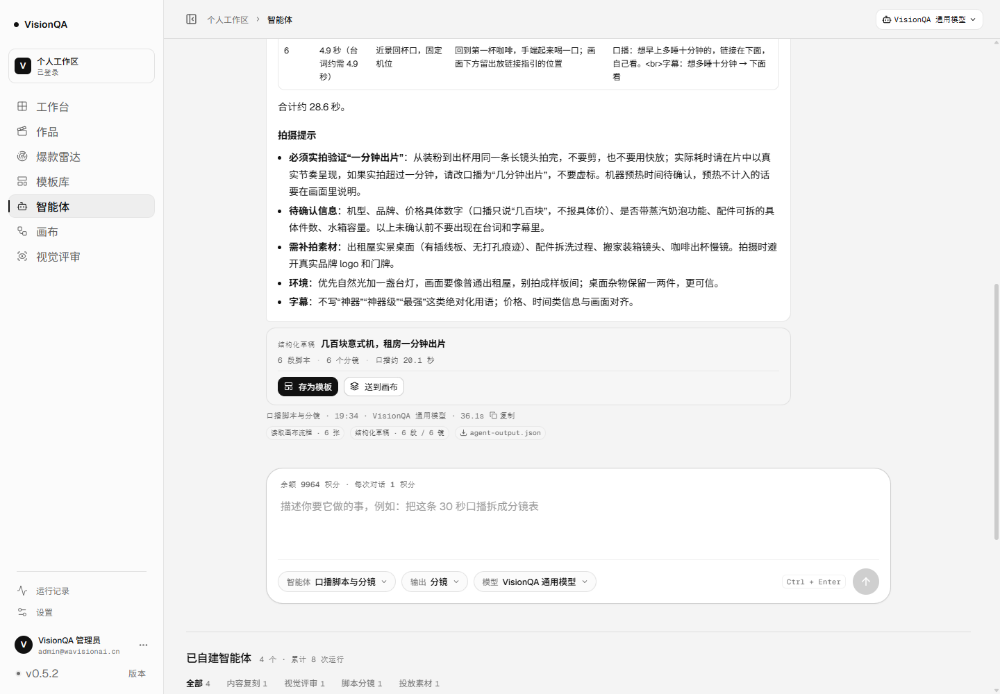

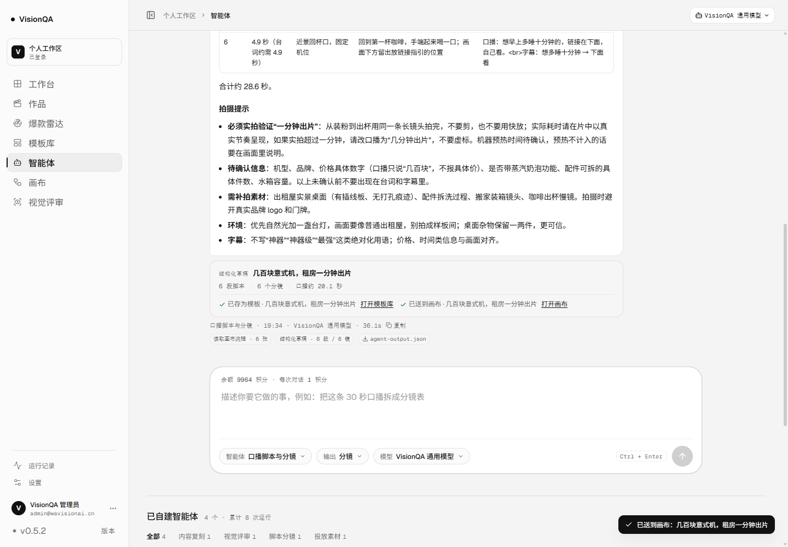

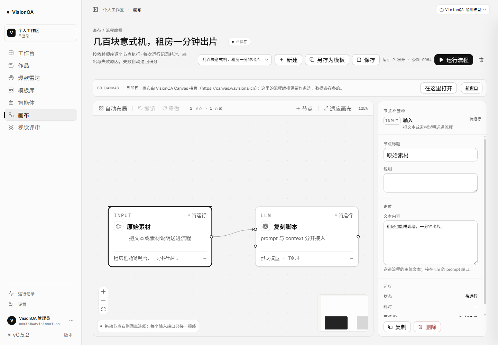

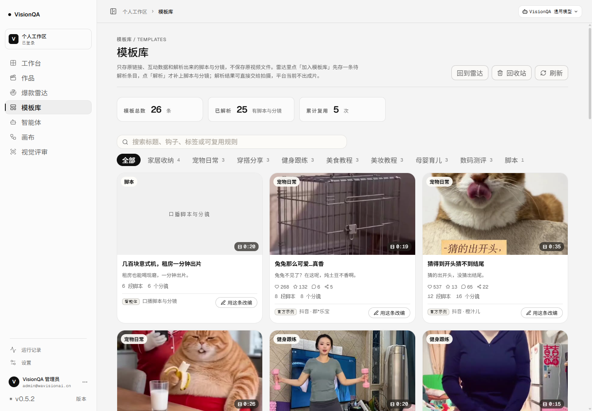

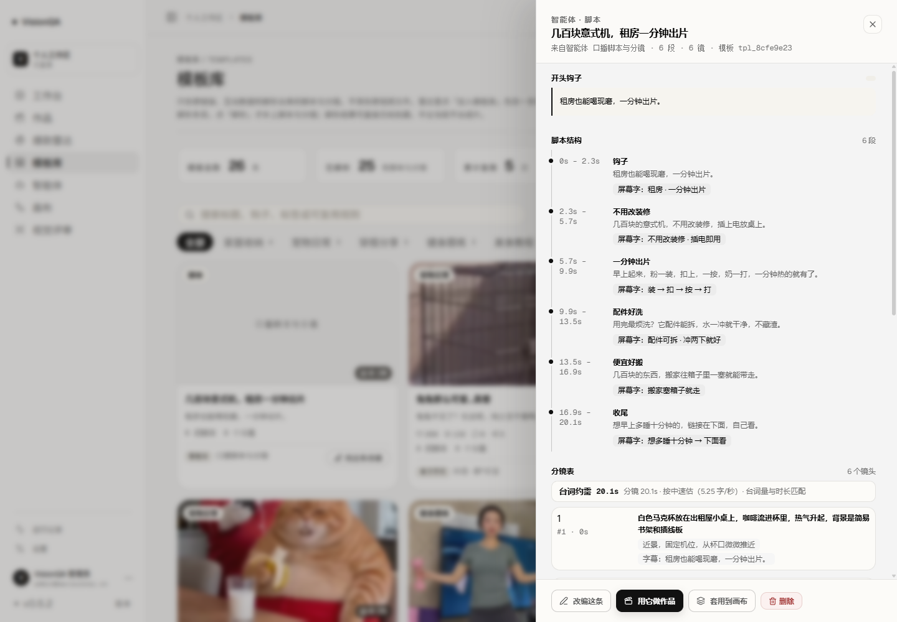

验收：生产 **v0.5.2**、`/api/health` ok（templates 26）、入口 `index-rKFBCLkL.js`；
用真实 DeepSeek 跑一轮「租房咖啡机」口播（输出类型「分镜」，36.1 秒），服务端取出 6 段 / 6 镜草稿；
点「存为模板」得到 `tpl_8cfe9e23`（`kind: agent`、6 段 / 6 镜、时长 20s、`timing.fit = ok`），
点「送到画布」得到 `flow_4edab7b8`（2 节点 1 连线，提示词里带每段「这句要念 X 秒」）；
运行记录里这一轮的工具是「读取画布流程 + 结构化草稿」，没有 skipped，扣 1 积分。
`npm test` **74/74**（新增 8 条：草稿块解析与去除、坏 JSON 不生成草稿、段镜上限、只有分镜的草稿、
画布提示词、存模板、空草稿不落库、导出 JSON 认内容不认标签）；oxlint 0 error / 8 warning（均为既有）。

这一片是边截图边修的：v0.5.0 的草稿指令写成「适合就输出」，模型因为正文已经写了口播和分镜表而整段省略；
改成强制格式后 v0.5.1 又暴露出「路由没把 draft 带回响应」和「导出 JSON 只认 ```json、不认 ```draft」两个问题，
v0.5.2 才把截图定稿。v0.5.0 / v0.5.1 那两次试跑存的模板与画布已删（模板进回收站），
保留的是最后一轮真实产物，可在生产打开。

## 六十六、P2 导航收敛：一级四去处 + 工具区 + 快速跳转（v0.6.0）

这一片改的是**信息架构**，不是加页面。侧栏原来 7 项平铺，智能体、画布、评审和「发现 / 模板库」看起来是同一类入口——
但前三个其实是「从作品的某一步被带进去的能力」。现在一级只留四个去处，其余收进工具区；
「爆款雷达」改名「发现」（地址仍是 `#/radar`，旧链接、收藏、分享都不失效）；补了 Ctrl / ⌘ + K 快速跳转，
键盘三步内能到任何页面或动作。

| 之前 | 现在 |
| --- | --- |
| 侧栏 7 项平铺：工作台 / 作品 / 爆款雷达 / 模板库 / 智能体 / 画布 / 视觉评审 | 一级 4 项 + 「工具」区 4 项 + 底部「设置」；工具区有独立分组标签 |
| 智能体、画布、评审和「发现 / 模板库」并列，看不出主次 | 工具页的面包屑多一段「工具」：个人工作区 › 工具 › 画布 |
| 收起侧栏后 9 个图标挤在一起，分不出主线与工具 | 收起或窄屏时，分组标签变成一道发丝线，主线与工具仍然分得开 |
| 名字叫「爆款雷达」，实际做的是发现与拆解 | 页面名「发现」，页头 kicker 写「内容发现」；路由不变 |
| 页面一多，到「运行记录」要穿过三层 | 顶栏「跳转到…」或 Ctrl / ⌘ + K：输入几个字母就筛到目标，↑↓ 选择、Enter 打开、Esc 关闭 |

实现要点：

- **导航只有一份真源**：`src/nav.ts` 导出 `PRIMARY_NAV / TOOL_NAV / SETTINGS_NAV` 与 `isNavActive / isToolPage`，
  侧栏与命令面板都从它生成，不再各抄一份页面清单；改导航只改这一处。
- **命令面板是纯函数 + 薄组件**：匹配规则在 `src/domain/commands.ts`（多词全中、大小写不敏感），
  组件只管渲染与键盘。清单 = 9 个导航目标 + 3 个真动作（新建空白画布 / 使用引导 / 收起侧栏）。
- **键盘与焦点**：打开时焦点进输入框并锁住背景滚动；Esc / 点遮罩关闭，焦点还给打开它的控件；
  在输入框里按 Ctrl+K 不抢键（编辑器里的同名快捷键仍属于编辑器）；只在没有上手引导 / 版本弹窗时响应。
- **窄屏不漏可访问名**：900px 以下侧栏固定 68px、文字由 CSS 隐藏，按钮仍带 `aria-label` 与图标态 tooltip；
  分组标签在收起态与窄屏下是同一个元素（1px 发丝线），不多渲染一个节点。
- 顺带修掉侧栏旧「运行记录」在底部设置层的错位：它属于工具，不属于设置。


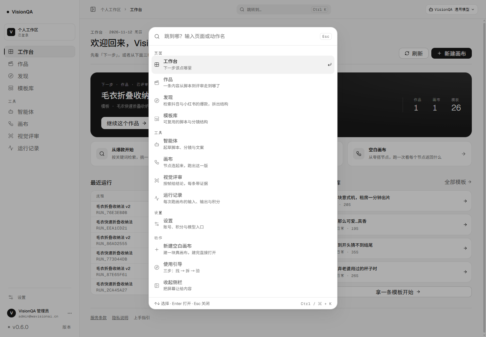

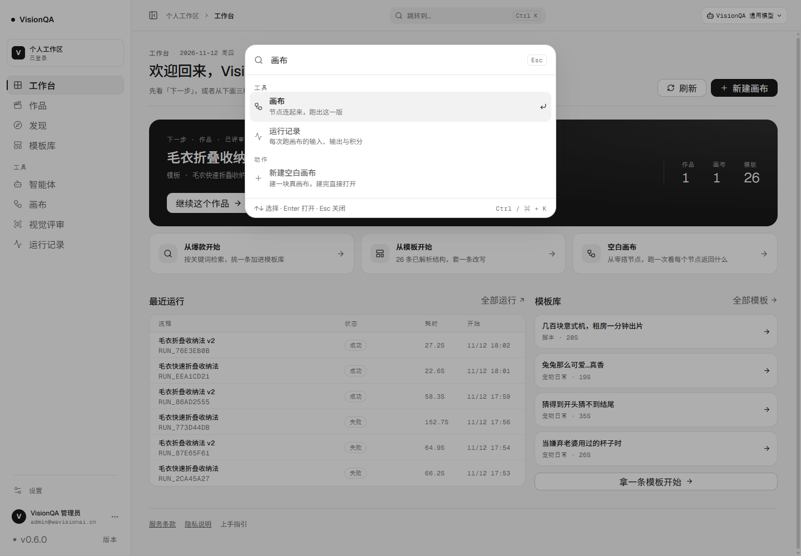

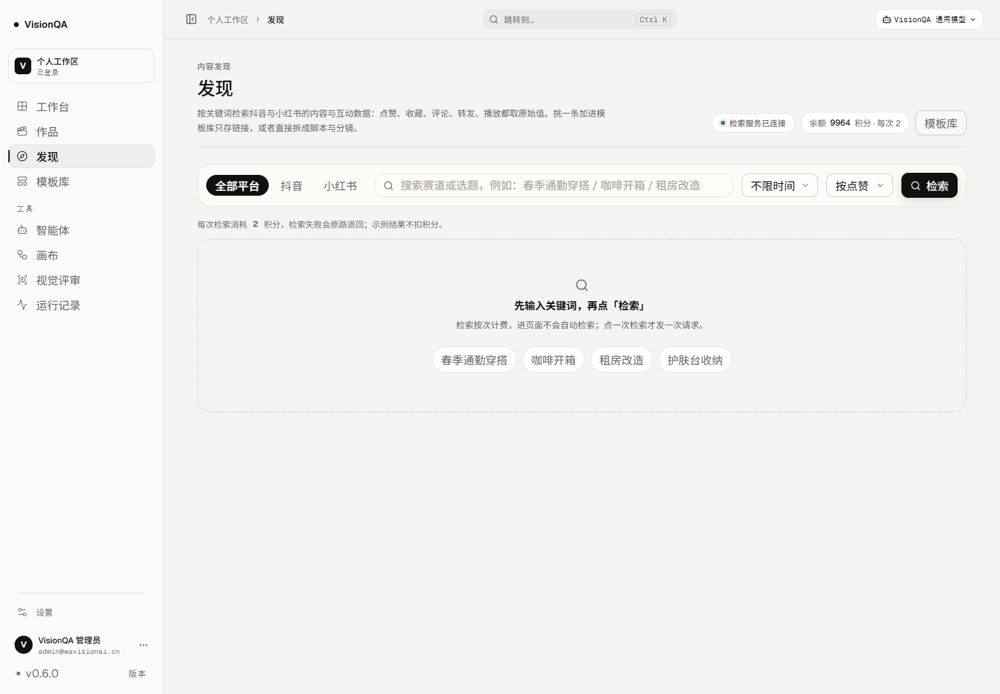

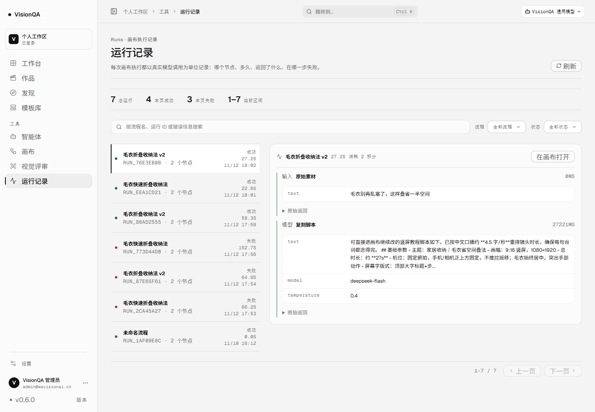

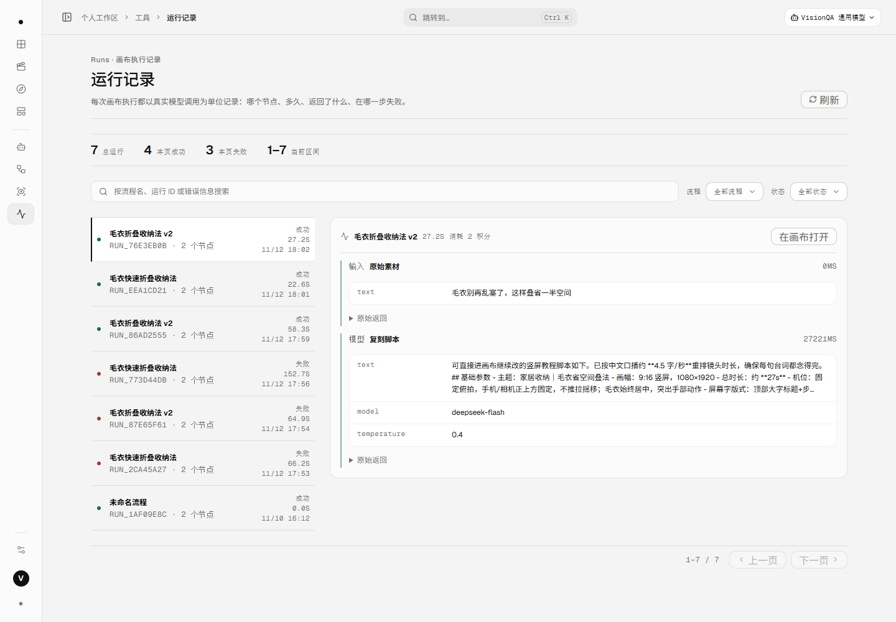

**桌面端形态定下来了**：先做「桌面优先的网页外壳」（固定左侧栏 + 顶栏 + 内容区），
Electron 之后只负责把同一外壳套进本地窗口、多一个「本地工作区」，导航层级不再改。
这样 P2 不必等 Electron，也不会把导航做两遍；本地 agent loop 与压缩协议按原计划接在这套外壳后面。

验收：生产 **v0.6.0**、`/api/version` 0.6.0、`/api/health` ok（templates 26）、入口 `index-DYSi_9wT.js`。
CDP 在生产页面实测：侧栏 3 段（一级 4 / 工具 4 / 底部 1）、面板分组「页面·工具·设置·动作」、
过滤「画布」剩 3 条、Enter 跳转后地址与高亮一致、Esc 后焦点回到入口且背景滚动恢复、
在发现页搜索框里按 Ctrl+K 不弹面板；900px 窄屏侧栏 68px、9 个图标都有可访问名；全程 0 条页面异常。
`npm test` **74/74**、oxlint 0 error / 8 warning（均为既有）、`npm run build` 通过。


## 六十七、桌面外壳与本地工作区：agent loop 跑在本机（v0.7.0）

上一片把桌面形态定成「网页外壳 + Electron 只套壳」，这一片把「多出来的那一块」做成了真能干活的东西：
桌面端多一个**本地工作区**——循环、工具、审批、会话记忆都在这台机器上跑，模型补全仍然走 VisionQA 账号。

| 之前 | 现在 |
| --- | --- |
| 网页里点按钮，服务端做事 | 桌面端里点发送：列目录、读文件、执行命令都在这台机器上，服务端只负责「用平台 Key 换一次补全」 |
| 智能体只有对话，没有工具 | 四个本地工具，**写文件与执行命令必须先批准**，路径锁在工作区内 |
| 刷新页面就等于从零开始 | 会话存在本机，重启还在；上下文超过预算先压成摘要再继续 |
| 网页版没有本地能力 | 网页版打开 `#/local` 会如实说「只在桌面端可用」，不给一个假界面 |
| 要让客户端能跑模型，就得把密钥发下去 | 密钥不下发：桌面端用账号会话调 `/api/local-agent/complete`，一轮只扣一次积分 |

分层（也是为什么它能被测试）：

```
渲染进程（React / src/pages/LocalWorkspacePage.tsx）
        ⇅ IPC（preload 只暴露 8 个方法）
主进程（electron/main.cjs：窗口、菜单、Cookie、会话落盘）
        ⇅ 直接调用
agent（electron/agent/*.mjs：协议解析 / 工具 / 审批 / 压缩 / 存储，不 import electron）
        ⇅ POST /api/local-agent/complete
服务端（平台 Key + 模型降级链，扣积分只在这里）
```

实现要点：

- **一步一个 JSON**，不依赖供应商 function calling：`{"type":"tool",...}` 继续查、`{"type":"final",...}` 收尾；
  一轮最多 8 步，用完就直说「到上限了，没做的还没做」。
- **审批是真的会等**：`write_file` / `run_command` 把请求推到界面，用户点允许才执行；拒绝就把这条写回上下文，
  让模型不要原样重试。窗口在后台时会闪任务栏。
- **边界不止一道**：所有路径先过 `resolveInside()`，工作区外的读写直接报错——审批不是唯一防线。
- **压缩**：64k 预算、到 75% 触发、保留最近 ≤6 条、摘要 ≤1200 字；摘要生成失败就**不动历史**，下一轮再试。
- **会话落盘**：`userData/local-agent/threads/*.json`，临时文件 + rename，强杀不会留半个 JSON。
- **桌面壳**：单实例、窗口位置记忆、外链交系统浏览器、中文菜单、`will-navigate` 只放行同源；
  页面刷新时主动中止挂起的审批（否则那一轮会永远等人点按钮）。

三处是**实测踩到才补的**（不是设计时想到的）：

1. 模型会在工具调用后面自己编一段「`<system>工具执行成功…`」——第一版把这段原文写进历史，下一轮它把自己编的内容当证据，
   于是一边读真实文件、一边报「文件里写的是《夜班》」。现在历史里只写**规范化后的调用**，伪造段落不进上下文。
2. 模型会漏转义引号、在 JSON 字符串里直接写换行——先做控制字符转义再解析；仍不合法就判定为格式错误。
3. 格式确实不对时，**只要求它重发一次**（界面上会留一行「已要求模型重发」），第二次还不对就停，不让它空转。

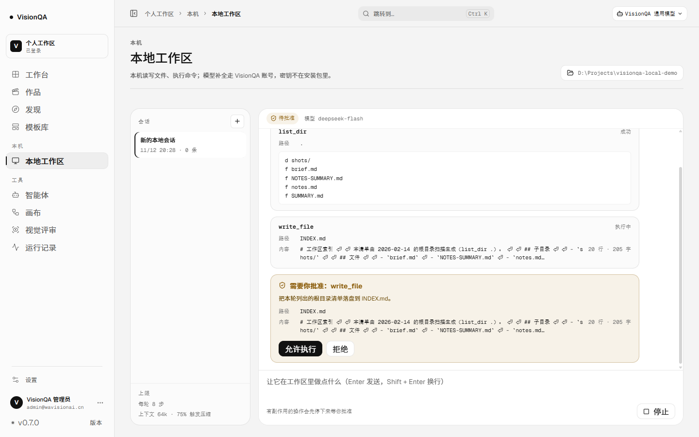

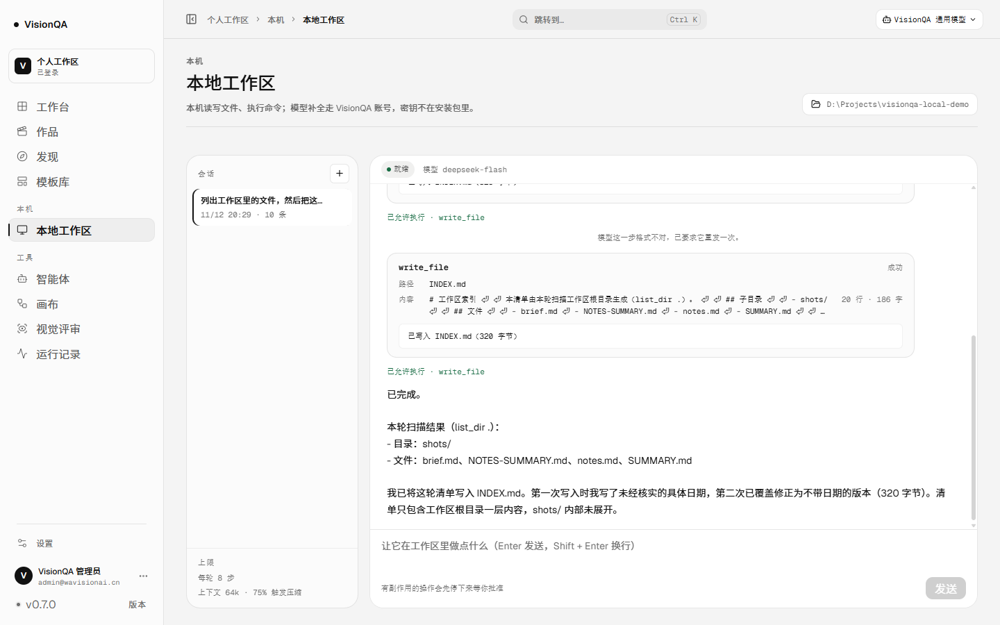

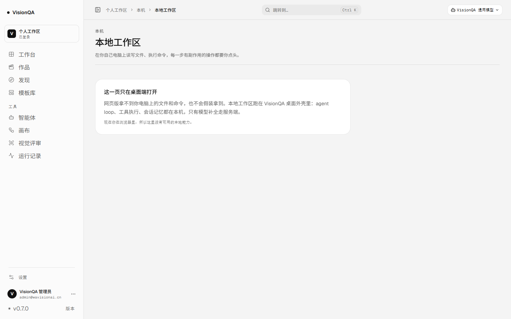

验收：生产 **v0.7.0**、入口 `index-XB_UdIu2.js`、release `20261112-122641-0.7.0.tar.gz`、`/api/health` ok（templates 26）、
`/api/local-agent/meta` 匿名 **401**（登录才可见）。生产 Electron 窗口里真实走了一遍：
登录 → 本地工作区（工作区 `D:\Projects\visionqa-local-demo`）→ `list_dir` → `read_file brief.md`（读到的就是磁盘上的 10 行）
→ `write_file INDEX.md` **等待批准** → 允许 → 写入 320 字节；中途模型一次格式不对，被自动要求重发后继续。
本地实测：重启后会话与工具卡原样恢复；拒绝审批时文件不会出现；页面刷新会中止那一轮。
`npm test` **86/86**（74 + 本地循环 12 条）、oxlint 0 error / 8 warning（均为既有）、`npm run build` 通过。

更多本地工具与跨会话长期记忆已在 v0.8.0 补上（见下一节）；桌面端安装包与 v0.9.0 见再下一节。

## 六十八、本地工作区的长期记忆：跨会话记住，改文件走补丁（v0.8.0）

结论：本地工作区以前每开一个新会话都是白纸——压缩只解决「这一轮说了什么」，跨会话仍然没有连续性。
这一片补上**按工作区存的长期记忆**，再顺手把两个最常用的工具补齐：**按关键词找内容**（只读）与**补丁式改文件**（要批准）。
记一条不花积分：用户发「记住：…」由主进程直接写盘，不调模型。

| 之前 | 现在 |
| --- | --- |
| 新会话从零开始，上次说定的路径、命名、口径都要重讲 | 每个工作区一份长期记忆，新会话说「老规矩」它就懂；不同目录是不同的一份 |
| 记忆只活在上下文里，压缩一次就可能丢 | 落盘在 `userData/local-agent/memory/<工作区哈希>.json`，重启、换会话都在 |
| 只能整份读、整份写 | 新增 `search_text` 按关键词定位（给出「文件:行号: 那一行」）、`edit_file` 只换唯一一段原文 |
| 记忆怎么来的不透明 | 面板里一条条看得见：原文、被召回几次、最近一次什么时候，能单条删、能清空 |

记忆的四个决定：

- **跟着工作区走**：文件名是工作区路径的哈希，换个目录就是另一份；路径大小写、斜杠写法不同也算同一个目录。
- **两个入口**：智能体在你说出长期有效的约定时自己调 `remember` 记一条；你也可以直接发「记住：…」——这条不调模型、不扣积分。
- **召回不是全塞**：按当前这句话和每条记忆的词语重合度排序，最多 8 条 / 1600 字，被用到的计一次「召回」。
  满 40 条后先淘汰「最少召回、最久没用」的那条。
- **记忆是提示，不是事实**：系统提示里写明「这是以前记的，和用户现在说的冲突以现在为准，不确定就重新读文件核对」。

两个新工具：

- `search_text`：只读，走关键词（按字面匹配，不把它当正则），跳过 `node_modules` / `.git` / 产物目录与二进制文件，
  最多 400 个文件 / 60 处命中，到上限会直说「可能还有」。
- `edit_file`：**必须批准**。原文必须在文件里**只出现一次**，否则拒绝并让你多带两行上下文；
  替换后回报行数与字节数，模型不需要重写整份文件。

实测踩到的三件事：

1. **`EPERM: rename`**：新建会话后立刻再存一次，Windows 上偶发 `rename` 被占用（杀毒/索引器正在读新文件），
   那一轮直接失败。现在所有落盘走 `writeFileAtomic()`：写 .tmp → rename，遇到 `EPERM/EACCES/EBUSY` 退避重试 6 次，
   仍失败才删 .tmp 并抛错，**原文件保持不动**（这条有单测）。
2. **模型不轻信记忆**：生产里我故意记了一条「发布前跑 npm test、用 ops/deploy.sh 打包」，它在那个没有 `package.json` 的演示工作区里
   先 `search_text` 核实，发现对不上，明确说「这条记忆不适用于此工作区，别照做」，还自己写回一条更正。
   这正是「以现在为准」那行提示在起作用——记忆没有让它闭眼照做。
3. **会话栏在长一轮里一直写着「新的本地会话 / 0 条」**：改名与条数以前只在本轮结束后才刷新。现在主进程补发 `title` 事件、
   `user` 事件带上条数，发送后立刻变成第一句话。

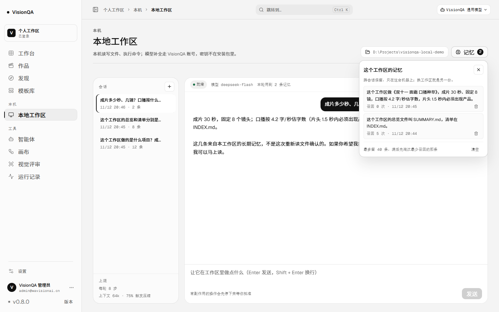

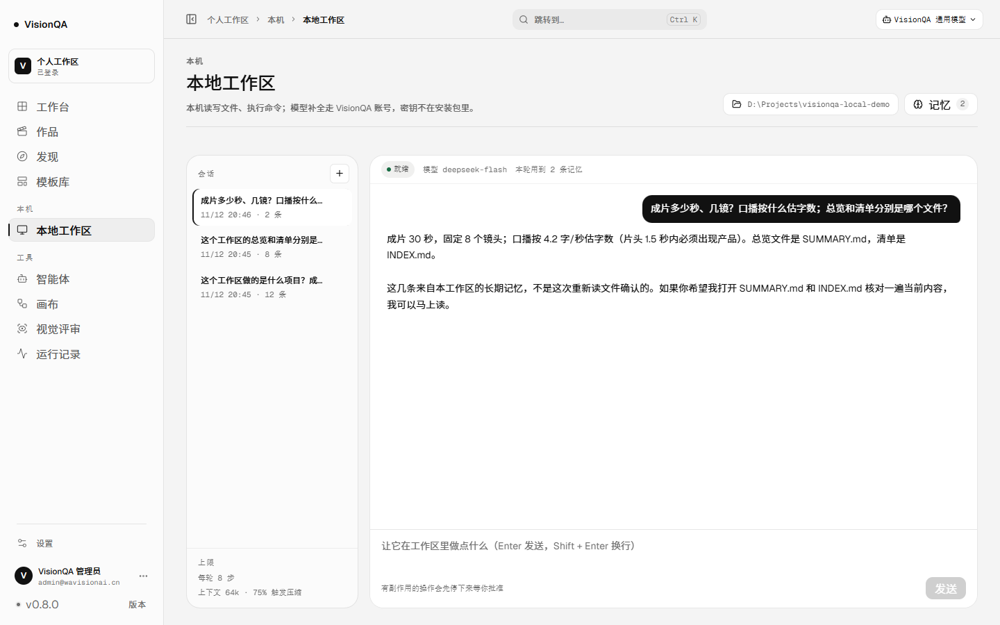

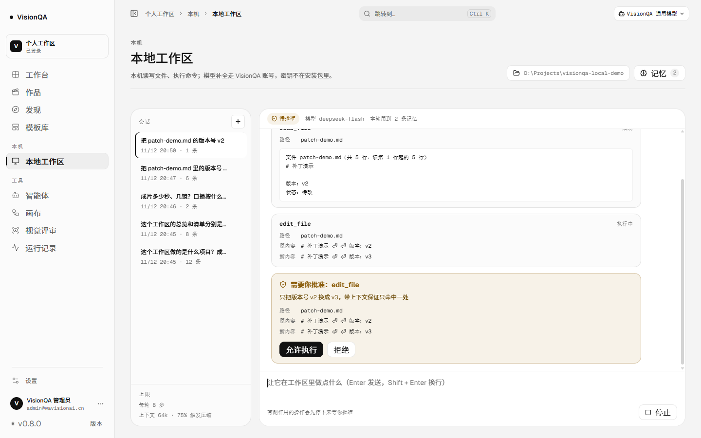

验收：生产 **v0.8.0**、入口 `index-C6sOIVZZ.js`、release `20261112-124816-0.8.0.tar.gz`、`/api/version` 0.8.0、
`/api/health` ok（templates 26）、`/api/local-agent/meta` 匿名 **401**。
生产 Electron 窗口里真实走了一遍：记忆面板 2 条 → 新会话问「成片多少秒、几镜」→ 状态栏「本轮用到 2 条记忆」→
回答 30 秒 / 8 镜且注明「来自本工作区的长期记忆，不是这次重新读文件确认的」；
`edit_file` 改 `patch-demo.md` 的 `版本：v2 → v3` 走完**待批准 → 允许 → 替换 1 处**，文件 44 字节、其余未动；
重启应用后两条记忆与 5 条会话都还在，召回次数继续累加（当时 9 / 4）。
`npm test` **92/92**（74 + 本地循环 18 条）、oxlint 0 error / 8 warning（均为既有）、`npm run build` 通过。

还没做：**安装包**（electron-builder、签名、自动更新）——签名证书与更新源要你先定；
跨会话记忆目前是「模型主动记 + 用户命令记」，还没有后台批量提炼与语义召回（现在是关键词重合度），
这两件等安装包落地后再排。


## 六十九、桌面端有了安装包：装完双击就用，卸载不丢数据（v0.9.0）

结论：以前桌面端只能 `git clone` + `npm i` + `npx electron .` 才跑得起来，等于只有开发机自己能用。
这一片把它做成两个能直接发出去的文件：**NSIS 安装包**（开始菜单、桌面快捷方式、卸载程序）和**免安装单文件**。
签名与自动更新**没有接**——这两件要你先定证书和更新源；它们缺席时用户会遇到什么，下面如实写，不粉饰。

| 之前 | 现在 |
| --- | --- |
| 只能从源码起 `npx electron .` | 双击 `VisionQA-Setup-0.9.0.exe` 装好，开始菜单与桌面都有入口 |
| 没有应用图标与版本信息 | 品牌 mark 做成 7 档 ICO（16–256）；exe 属性里 `VisionQA 0.9.0` |
| 数据目录跟着包名落在 `creator-canvas-studio` | 落在 `%APPDATA%\VisionQA Desktop`；首次启动把旧目录整个搬一次（会话、长期记忆、登录态都在） |
| 装的是哪一版，界面里看不出来 | 本地工作区状态栏右侧直接写「桌面端 0.9.0」，版本取自主进程，不是网页版号 |
| 装与卸没在真机上走过 | 走完了：安装向导三页、装好后截图、静默卸载（目录 / 注册表 / 快捷方式清干净、数据保留）、重装后 5 条会话与记忆都在 |

两个包（都放在本机 `release-desktop/`，产物不入库）：

- `VisionQA-Setup-0.9.0.exe`（103.1 MB）：NSIS 向导，默认「仅为我安装」到 `%LOCALAPPDATA%\Programs\VisionQA`，
  可改目录，建开始菜单与桌面快捷方式，带卸载程序。
- `VisionQA-Portable-0.9.0.exe`（94.9 MB）：免安装，双击自解压到临时目录运行，同样能登录、能用本地工作区。

安装包本身的三件事，先说清楚：

- **未签名**：Authenticode 状态是 `NotSigned`。从浏览器下载后首次运行，Windows 会先拦一次「Windows 已保护你的电脑」，
  要点「更多信息 → 仍要运行」。要消掉这一步只能买代码签名证书。
  （本机这份是直接构建的，没有下载标记，所以这次安装没有弹——分发给别人时会在。）
- **没有自动更新**：构建产物里有 `latest.yml` 与 blockmap，但应用里没接更新源、也没有更新提示；
  换版本靠重新下载安装包覆盖安装（数据在 `%APPDATA%\VisionQA Desktop`，覆盖安装不动它）。
- **装出来 330 MB**，主要是 Electron 运行时；卸载默认保留用户数据，重装后会话与记忆还在。

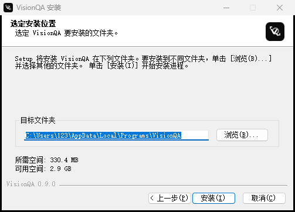

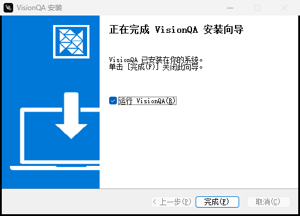

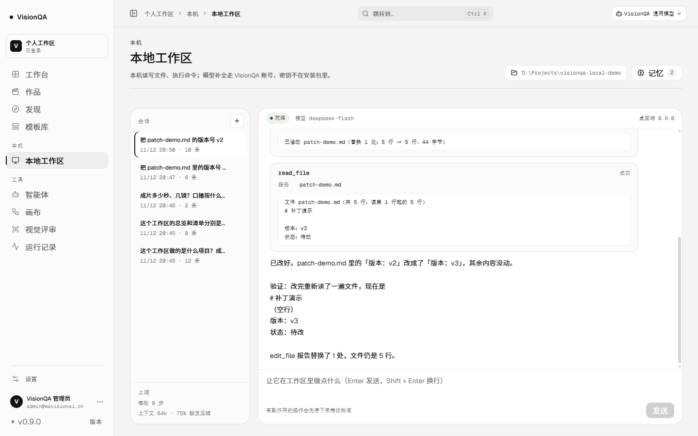

验收（本机 Windows 实装，不是模拟）：安装目录 `%LOCALAPPDATA%\Programs\VisionQA` 内 `VisionQA.exe` 的文件版本
**0.9.0**、产品名 **VisionQA**；卸载项 `VisionQA 0.9.0` 带 `/currentuser` 卸载命令；开始菜单与桌面各 1 个快捷方式；
静默卸载后安装目录、卸载项、两个快捷方式全部为 0，`%APPDATA%\VisionQA Desktop` 保留；静默重装后 5 条会话、
2 条记忆都还在，应用能正常起并加载生产站点。免安装版也真起过一次，同样加载生产站点、页面一致。
生产同时升到 **v0.9.0**：入口 `index-BvtX7MhE.js`、release `20261112-131339-0.9.0.tar.gz`、
`/api/version` 0.9.0、`/api/health` ok（templates 26）。
`npm test` **92/92**、oxlint **0 error / 8 warning**、`npm run build` 通过。

校验值与构建参数记在 `docs/desktop-installer-2026-11-12.md`（安装包不入库，重编后哈希会变，文档里写明了这一点）。

还没做：**代码签名**（要证书）与**自动更新**（要更新源）——这两件你定了之后各接一小片；
长期记忆的后台批量提炼与语义召回仍排在它们之后。

## 七十、长期记忆会自己提炼，也听得懂近义说法（v0.9.1）

结论：v0.8.0 的记忆要么等智能体主动记、要么人发「记住：…」，而且召回只认字面重合——问「上线」找不到记着「发布」的那条。
这一片补两件事：**每轮结束后台提炼最多 3 句长期约定**（不调模型、不扣积分），**召回按同义组 + 稀有词权重排序**，
一条词都不沾边的记忆不再塞进上下文。

| 之前 | 现在 |
| --- | --- |
| 只有智能体主动记 / 用户发「记住：…」 | 每轮结束后台扫最近 20 条用户消息，挑长期约定自动记；来源标「后台提炼」 |
| 记忆从哪来的分不清 | 面板每条带来源：你让记的 / 智能体记的 / 后台提炼 |
| 后台干了什么看不见 | 面板写「后台提炼：看过 N 句，记下 M 条（K 条重复）」，状态栏写「自动记下 N 条」 |
| 召回只认字面词 | 同义组（上线↔发布↔部署、打包↔构建、图标↔icon…）+ 稀有词权重（IDF） |
| 无关记忆也会被塞进提示 | 一条词都没重合就不注入；判重还会挡住「换个说法」的重复 |

提炼的边界（不夸大）：

- 只从**用户自己说的话**里挑；工具结果、系统提示、批准备注都不算。问句、「帮我改一下…」这种一次性任务不算，
  「记住：…」已经直接写盘，不重复记。
- 规则是句式 + 关键词（以后 / 下次 / 每次 / 默认 / 统一 / 口径 / 规范 / 不要 / 必须…），**不是模型总结**：
  多调一次模型就多扣一次积分，这个决定要你点头，所以现在这套不花钱。宁可少记，也不把一次性任务记成长期约定。
- 每轮最多 3 条；写入前先按「完全一样」和「短句有一大半词重合」判重；满 40 条仍按原规则淘汰最少召回的。
- 提炼失败不拖垮这一轮（catch 后只写日志）。

召回怎么算：

- 分词（英文按词、中文按二元组）→ 同义组扩展 → 用这个工作区的条目集合算 IDF（越少见的词权重越高）→
  命中词权重求和排序 → 同分看最近用过。
- 例：记着「以后发布前先跑 npm test，再用 ops/deploy.sh 部署」，问「上线前要做什么检查？」也能召回到（上线 / 发布 / 部署同组）。

实测（生产装好的 0.9.1）：

- 发一句「以后发布前先跑 npm test，再用 ops/deploy.sh 部署；成片统一按 30 秒、8 镜算。」→ 这一轮结束后面板变成 4 条，
  两条来源「后台提炼」，面板写「看过 2 句，记下 2 条」，状态栏「自动记下 2 条」。
- 新会话只问「上线前要做什么检查？」→ 状态栏「本轮用到 1 条记忆」，模型准确指出「我记忆里那条部署约定属于另一个工程工作区，
  在当前目录不适用」——召回到了，但它没有把记忆当事实硬套。
- 旧桌面端兼容：新网页的 `memory:list` 返回结构变了，渲染侧对「数组」和「{entries, stats}」两种都认，
  避免网页先发、客户端没更新时记忆面板崩掉。

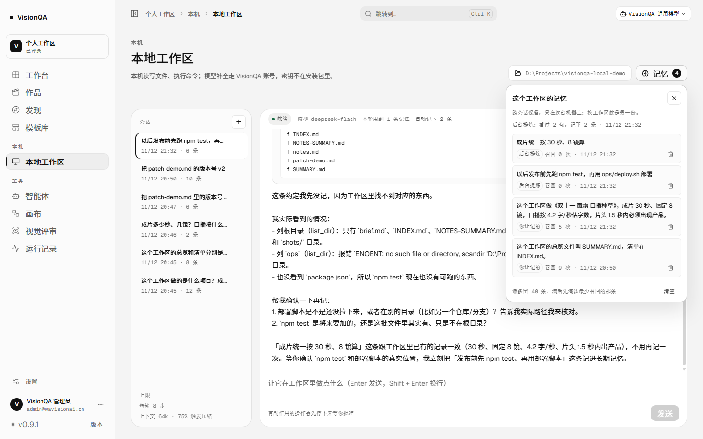

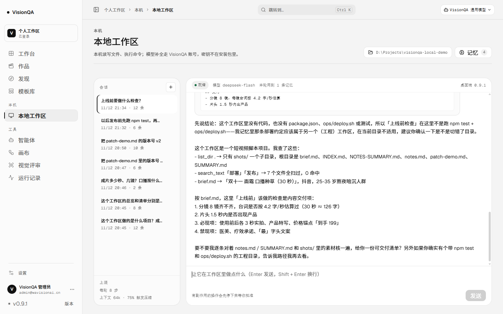

验收：生产 **v0.9.1**、入口 `index-DNXxL_Ir.js`、release `20261112-132859-0.9.1.tar.gz`、`/api/health` ok（templates 26）；
安装包同步重打为 `VisionQA-Setup-0.9.1.exe`（103,057,739 B）与 `VisionQA-Portable-0.9.1.exe`（94,862,438 B），
覆盖安装后 5 条会话与旧记忆都在，卸载项显示 `VisionQA 0.9.1`。
`npm test` **97/97**（74 + 本地循环 23 条；新增语义召回、提炼规则、判重、账目 5 条）、
oxlint **0 error / 7 warning**、`npm run build` 通过。

还没做：**代码签名**与**自动更新**要你先定证书和更新源（同上节）；记忆提炼目前是本地规则，
模型驱动的归纳要额外一次补全与积分，等你点头再做。

## 七十一、作品交付稿：一条内容能拿出工作台了（v0.9.2）

结论：作品页以前只能「标记交付」，标记完手上什么也没有。这一片补上最后一公里——
**一键把这条作品压成一份 Markdown 交付稿**，脚本、分镜、评审的问题与修正建议、版本对照、
运行记录（含失败原因）全在里面，发给剪辑、贴进文档、打印都行。

| 之前 | 现在 |
| --- | --- |
| 只有「标记交付」，改的是作品状态 | 页头「导出交付稿」：点一下落盘一个 `.md` |
| 脚本与评审结论只在屏幕上可看 | 8 个章节的完整稿，含每条修正建议与每次运行的失败原因 |
| 想拿走只能开只读分享（要联网、谁都能看） | 交付稿是文件，不用给任何人开权限 |
| 时间、口径各处不一 | 按导出人时区写；脚本用作品自己的版本，版本 0 的历史记录折进 v1 |

稿子的三条边界（这一片最花时间的部分）：**不写分享 token**（它等于钥匙，而稿子会被转发）；
**只写发生过的事**（这一版没送评审就写没送，不拿上一版结论凑数）；**口径与页面同源**
（详情组装提成 `projectDetailView()`，作品页与导出读同一个函数）。

```markdown
## 评审

最新一次（v2）：需人工确认 · 2026-11-12 18:03
模型 visual-baseline（local-model:deepseek-flash） · 38 秒

> 首帧里人和毛衣都在，但标题红色文字压住折叠起点，双手张开没捏住衣角，下摆出画，折叠动作读不出来。

### 修正建议（3）

1. 把标题移出折叠区：把「毛衣折叠」从 y0.47–0.55 下移到 y0.82–0.90 的桌面空区…
```

生产实测（作品「毛衣折叠收纳法」，v2）：

- 点导出 → `GET /api/projects/prj_f38d68c6/deliverable?tz=480` **200**、`text/markdown`，落盘 **9,245 B**，
  文件名 `VisionQA-毛衣折叠收纳法-20261112.md`（中文名走 RFC 5987，老浏览器退回 ASCII 名）。
- 稿子 174 行：8 段脚本、8 个镜头、5 个问题 + 3 条修正建议、v1/v2 版本对照、6 次运行（4 次失败，原因逐条在稿里）。
- 控制台 **0 异常**，按钮没有卡在「正在整理…」。

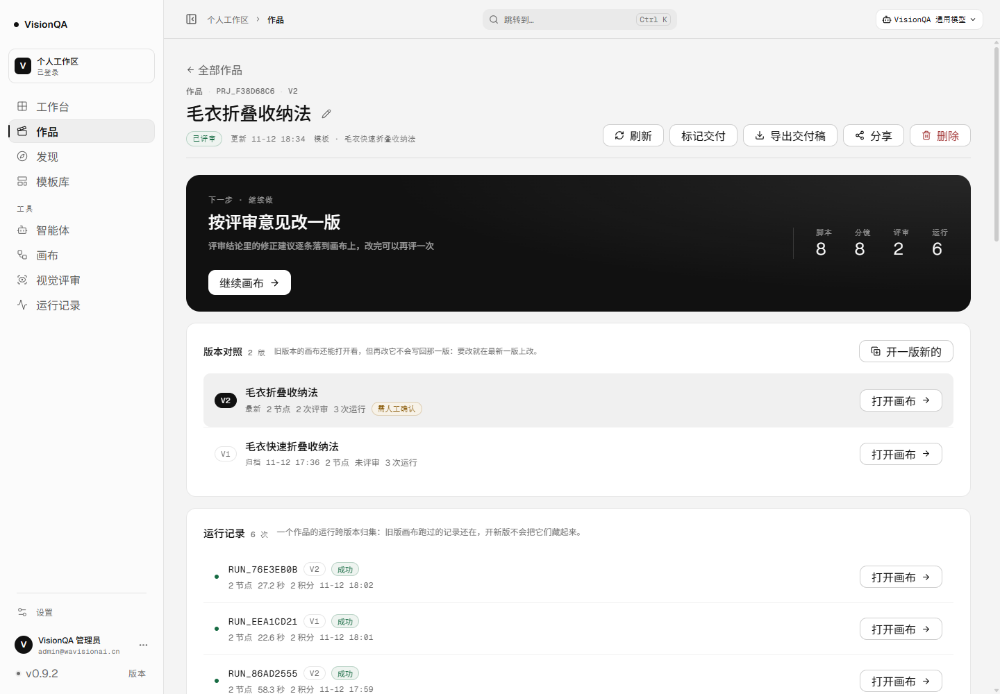

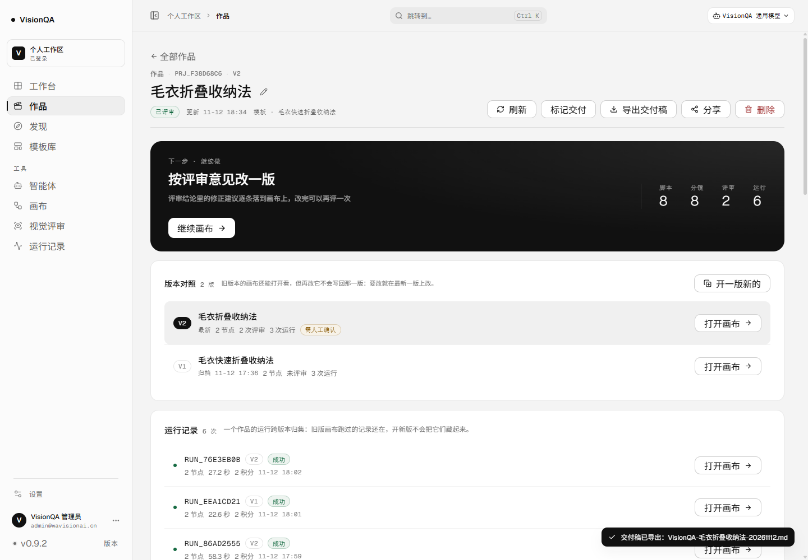

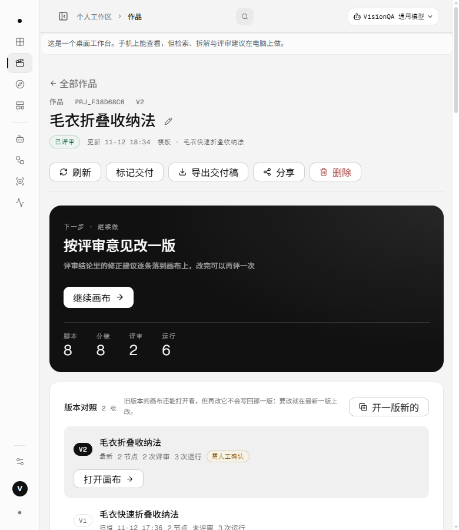

顺手修的两个问题：**页头挤标题**（第五个按钮让 780 宽下的标题断成三行，页头改成放不下时动作整行下移，
1440 宽逐像素不变，全站页头共用）；**「按快速估」读不通**（模板详情、分享页、模板导出、交付稿四处统一成「按语速档「快」估」）。

验收：生产 **v0.9.2**、入口 `index-LpbTI6B9.js`、release `20261112-134609-20261112-214608-0.9.2.tar.gz`、
`/api/health` ok（templates 26）；`npm test` **107/107**（新增交付稿 10 条）、oxlint **0 error / 7 warning**、构建通过。
桌面端不用重装：外壳加载的就是这套网页（这一轮没有改外壳代码，安装包仍是 0.9.1）。
细节见 [作品交付稿](./docs/project-deliverable-2026-11-12.md)。

## 七十二、交付稿的打样版：一键出 A4，打印或存 PDF（v0.9.3）

结论：上一节给的是 `.md`，但编导要摊在桌上用笔改、制片要在群里发一张纸。这一片给交付稿加**第二个出口**——
作品页点「打印稿」，新标签里是一张排好版的 A4，按一下「打印 / 存为 PDF」，纸张已经写死 A4，只剩选「另存为」。

| 之前 | 现在 |
| --- | --- |
| 只有 `.md`，要纸得自己排版 | 服务端直接出 A4：抬头事实表、小节自动编号、镜头不跨页 |
| 打印前得装个 Markdown 编辑器 | 浏览器打印（Ctrl+P），不新增依赖，中文断行交给浏览器 |
| 纸上的内容和稿子可能两套口径 | 打印版由**同一份 Markdown** 渲染，两份永远同文 |

为什么从 Markdown 再渲染一次（而不是照作品详情再拼一遍版）：一份内容只有一个来源；
渲染器只认我们自己生成的七种记号，遇到不认识的行按段落输出，**宁可难看也不吞内容**；
打印走浏览器自己的 PDF 引擎，服务器不用装 Chromium。

生产实测（作品「毛衣折叠收纳法」v2）：

- 页头点「打印稿」→ **真鼠标点击**开出新标签 `/print/projects/prj_f38d68c6/deliverable?tz=480`（标签 165 → 166）。
- 页面 **19,168 B**、`text/html`、`no-store`、`noindex`；**7 个小节 / 3 张表 / 8 个镜头**；控制台 **0 异常**。
- 服务端真出一份 PDF：**5 页 / 444,140 B**，已存进仓库 [样张 PDF](./docs/sample-deliverable-2026-11-12.pdf)。
- 没登录是 `401` + 一张「登录已过期」的纸（带「去登录」）；作品被删是 `404` + 「作品不在了」——
  新标签里不吐 JSON。

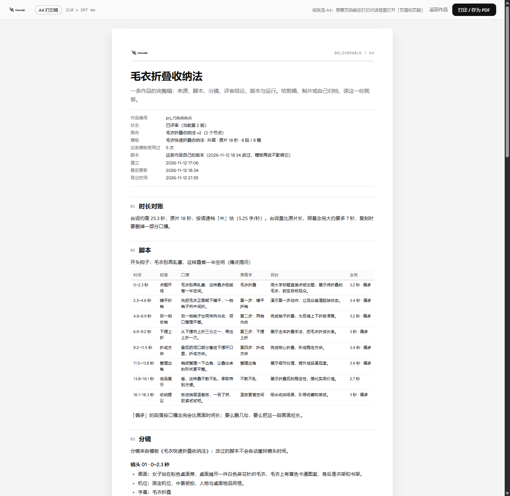

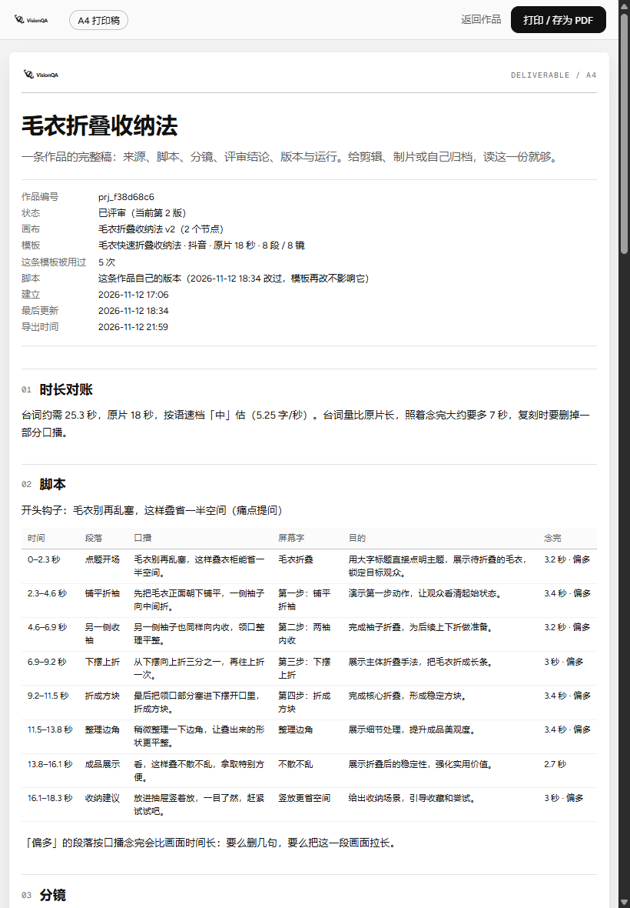

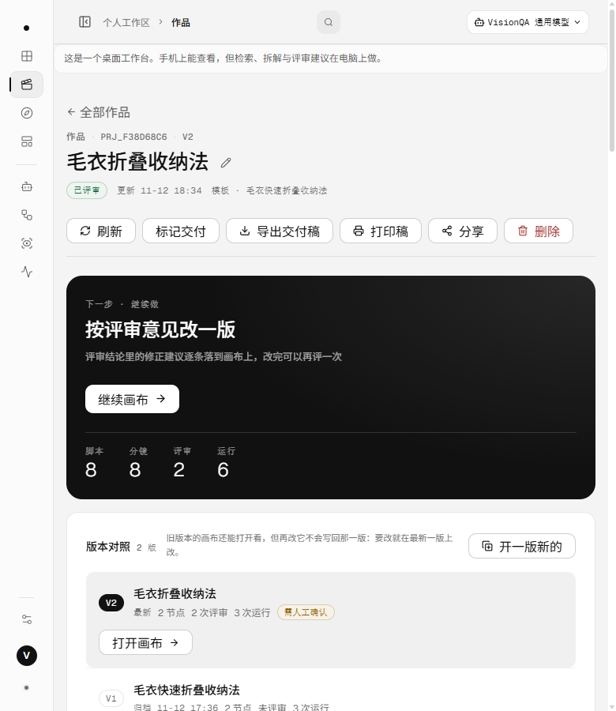

这一轮最容易漏的一处是 **nginx**：生产 `location / { try_files … /index.html }` 是静态托管，
`/print/...` 不加一条反代就会返回 SPA 首页——**看着 200，打开是应用壳**，等于没上线。
已加 `location ^~ /print/`（带五个安全头，nginx 里 location 写了 add_header 就不继承 server 级的），
`nginx -t` 通过后 reload，备份在服务器 `/root/visionqa.wavisionai.cn.conf.bak-20261112-print`；
仓库 `deploy/nginx.conf` 同步补上，重装机器不会漏。

顺手修了两处：**评审元信息粘行**（纸上「18:03 模型 …」连成一句，元信息行前补「· 」）；
**抬头没有冒号**（「建立 / 导出时间」在事实表里落不到标签列，统一成「标签：值」，`最后更新` 独立一行）。

验收：生产 **v0.9.3**、入口 `index-CarVCfDG.js`、release `20261112-140215-0.9.3.tar.gz`（含手机端那条媒体查询）、
`/api/health` ok（templates 26）；`npm test` **114/114**（新增打印版 7 条）、
oxlint **0 error / 7 warning**、构建通过。桌面端不用重装（外壳加载的就是这套网页，仍为 0.9.1）。
细节见 [交付稿的 A4 打印版](./docs/project-deliverable-a4-2026-11-12.md)。

## 七十三、交付稿把每一版都写全：开机快照、逐版对照（v0.9.4）

结论：前两节的稿子只写**当前这一版**，历史版本只剩一张表（几个节点、评过几次、什么结论）。
编导说「把这版和上一版一起发我」时，收到的人看不到上一版当时说了什么、为什么没过。
这一片把每一版都写成稿子里的一节：脚本、画布变化、评审结论、运行结果——**一份稿子，全部版本**。

| 之前 | 现在 |
| --- | --- |
| 版本对照只有一张表，历史版本的内容要把作品页一版版点开 | 每版一段：归档时间、画布变化、脚本快照、评审结论、运行结果 |
| 「v1 的脚本是什么样」查不到（脚本只有一份，改的就是它） | 开新版时给这一版存一份脚本快照，稿子里能逐版比：多几段、哪段口播改过、钩子换没换 |
| 旧版本只能看节点数 | 画布按节点 id 比内容指纹，说清「多 / 少 / 改」并点名节点 |
| 不确定的地方容易编 | 没快照的版本直接写「这一版没存快照……当时的口播找不回来了」 |

一句「v2 比 v1」长这样（生产实测）：

```
v2 比 v1：画布改 2 个（原始素材、复刻脚本）；脚本多 2 段（挑豆、收尾）、1 段口播改过、钩子换过。
```

生产实测（2026-11-12，v0.9.4）：

- 生产建一个**临时作品**走完整链路：建作品 → 开画布（2 节点）→ 存 v1 脚本（2 段）→ 开新版（归档里快照 2 段）
  → 存 v2 脚本（4 段）→ 导出交付稿 → 打印。**验完把临时作品和两张演示画布都删了**，生产回到 1 个作品 / 7 张画布。
- 交付稿 200 `text/markdown; charset=utf-8`、**4,739 B**；差异逐条列出（多 2 段、1 段改口播、钩子换过）。
- 打印页 7 小节、2 张表、1 个版本块；服务端出 PDF **4 页 / 327,870 B**，已存进仓库
  [样张 PDF](./docs/sample-deliverable-versions-2026-11-12.pdf)。
- 真实作品（「毛衣折叠收纳法」v2，v1 是升级前归档的）打印页 **20,000 B**、7 小节、3 张表（6 / 8 / 6 列）、
  1 个版本块、控制台 **0 异常**；v1 那一段如实写「没存快照」。
- 手机 390 宽：页面 `scrollWidth` 390 = 视口宽，八列的版本表自己横滚（430 / 334），不撑页面。
- 作品页版本行多一项：当前版「8 段脚本」、归档版「脚本没存快照」，说明改成
  「开新版时会把这一版的脚本存一份快照，再改只影响新版」。

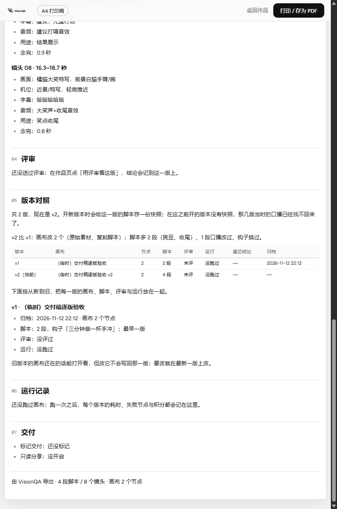

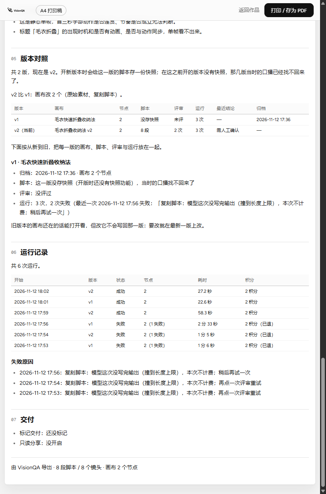

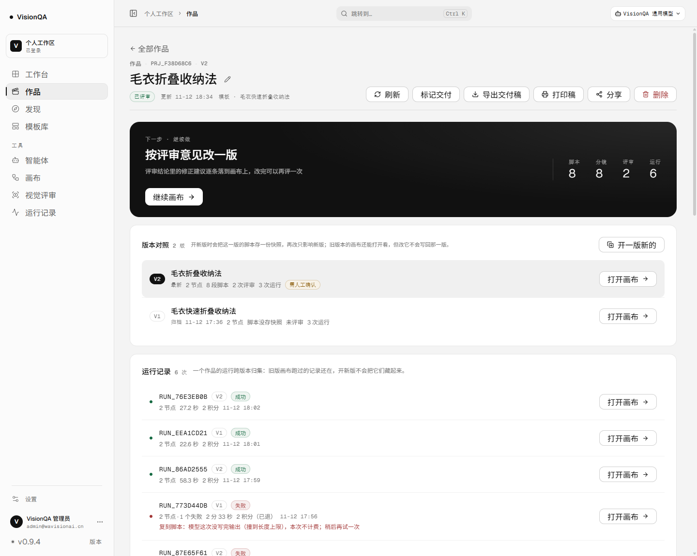

顺手修的两处：**打印页在本地演示下打不开**（打印路由一律要求登录态，`VQ_REQUIRE_AUTH=0` 时打开只有
「登录已过期」，没法验排版；改成与其它接口同一套：生产必须登录、本地照常可用）；
**老作品的评审导不全**（导出时按版本号相等找最近一次评审，版本 0 的历史评审记在 0 上，
v1 会显示「正文没读到」；改成与页面同一套折进规则）。

验收：生产 **v0.9.4**、入口 `index-D0iM7q4Y.js`、release `20261112-141444-0.9.4.tar.gz`、
`/api/health` ok（templates 26）；`npm test` **122/122**（新增逐版对照 7 条 + 快照落盘 1 条）、
oxlint **0 error / 7 warning**、构建通过。桌面端不用重装（外壳加载的就是这套网页，仍为 0.9.1）。
细节见 [交付稿把每一版都写全](./docs/project-deliverable-versions-2026-11-12.md)。

## 七十四、交付包里带帧图：现场页与 .zip（v0.9.5）

结论：稿子和纸都有了，但两个人拿到手还是不好用——**编导要一张能带进现场的纸**（念什么、拍什么，最好看得见原片那一帧），
**剪辑 / 甲方要一个不登录就能看的文件包**。这一片加两个出口：**现场页**（线上 A4，只留脚本 + 分镜，带帧图）与
**交付包**（.zip：交付稿 + 现场页 + 原片帧图）。

| 之前 | 现在 |
| --- | --- |
| 交付稿 7 个小节、5 页纸，现场翻到「分镜」要跨过评审与运行 | 现场页只有两节：脚本、分镜，页码独立，两三页看完 |
| 帧图只在系统里（`/media/frames` 要登录），发出去对方看不到 | 交付包把帧图按镜头编号落地成 `shot-01.jpg`…，解压就能看 |
| 发给剪辑是一个 `.md` + 一句「图在系统里」 | 一个 `.zip`：稿子、现场页、帧图，`说明.txt` 写清对应关系 |
| 页头「导出交付稿」「打印稿」+ 分享 + 删除 + 刷新 + 标记交付六件按钮 | 四种产物收进一个「交付」菜单，头行写清这一版几段脚本几个镜头 |

生产实测（作品「毛衣折叠收纳法」v2，2026-11-12）：

- 现场页 200、**19,285 B**、2 小节、**8 个镜头卡片 / 8 张帧图全部加载**（`naturalWidth` 480）、控制台 0 异常；
  服务端出 PDF **3 页 / 641,903 B** → [样张 PDF](./docs/sample-set-sheet-2026-11-12.pdf)。
- 交付包 200、`application/zip`、**421,750 B / 11 条目**：8 张帧图（39,115 – 66,526 B）、交付稿 10,018 B、
  现场页 18,974 B、说明 664 B；文件名 `VisionQA-毛衣折叠收纳法-20261112-交付包.zip`（RFC 5987）；
  纸脚带导出时间，所以每次导出的字节数会差几个字节。
- 浏览器里点出来的数（不是 curl）：交付包 200 / `application/zip` / 421,750 B，现场页 200、8 个镜头卡片都在。
- 解压用系统引擎过一遍：`Expand-Archive` 读出 5 个中文文件名，Python `zipfile.testzip()` 返回 `None`（CRC 全对）。
- 这一轮**没有在生产写演示数据**（只读）：作品 1 个（`prj_f38d68c6`）、画布 7 张，和上一轮收尾一致。

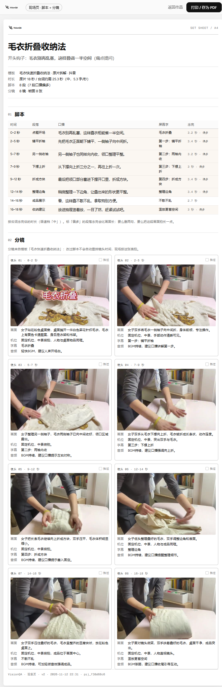

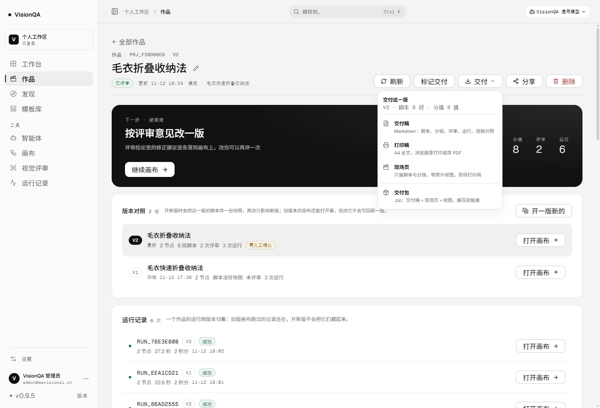

ZIP 是自己写的（[`server/zip-store.mjs`](./server/zip-store.mjs)）：包里只有十来个已压过的 JPEG 和两份文本，
store 不压缩体积差不到 1%，省掉一个十几 MB 的依赖；测试逐字段验（CRC32 与 `zlib.crc32` 比对、条目偏移、UTF-8 标记）。
**边界写死**：单文件与整包 < 4 GB、条目 < 65535，超了报错而不是出坏包。顺带记一笔：Windows 自带的 `tar.exe`（bsdtar）
读不了中文文件名——`Compress-Archive` 打的包它也读不了，是它自己的毛病。

三条边界：**不编**（没脚本 / 没分镜 / 帧图读不到都照实写，包里没打进去的帧图不留打不开的地址）、
**不写凭证**（分享 token、ownerId 不进纸也不进包）、**离线可用**（解压后不用登录不用联网，字体取不到就走系统字体）。

顺手改了三处：纸张外壳抽成 `printToolbar` / `paperShell` 导出，两种纸共用一套排版；页头把四个交付入口收进「交付」菜单；
**窄屏菜单会顶出屏幕左边**（390 宽实测面板 x = −109），560 以下改成贴底浮层，390 / 480 / 700 / 1440 四档都完整在视口内。

验收：生产 **v0.9.5**、入口 `index-CIO_6BwP.js`、release `20261112-230500-0.9.5.tar.gz`、
`/api/health` ok（templates 26）；`npm test` **135/135**（新增 ZIP 5 条 + 现场页 8 条）、
oxlint **0 error / 7 warning**、构建通过。桌面端不用重装（外壳加载的就是这套网页，仍为 0.9.1）。
细节见 [交付包里带帧图](./docs/project-deliverable-package-2026-11-12.md)。

## 七十五、小屏收口：页头不再空 445px，顶栏不再顶出视口（v0.9.6）

结论：这一轮没有加功能，只修「手机上打开是坏的」——**9 个路由 × 390 / 480 / 1440 三档，
横向滚动为 0、控制台异常为 0**；顺带把全站 102 处随手写的 3 / 5 / 6 / 10 / 14 / 20 / 28 / 40 / 56px
间距收回 4/8 栅格、23 处 10px 小字升到 11px，并给这两类问题加了会红的测试。

两个真坏的地方：

1. **页头在小屏被撑到 445px 高**。760 以下页头改竖排，但没关 `flex-wrap: wrap`，
   于是 `.vq-head-main` 的 `flex: 1 1 24rem` 里那个 24rem 在竖排方向上变成了**高度**：
   每页顶上凭空多出约 280px 空白，内容被推到第二屏。运行记录 445px、视觉评审 473px。
2. **顶栏在 390 宽溢出 12–18px**。模型按钮按内容宽度占位（155px）缩不下去，整页跟着横向滚动；
   面包屑还会折成两行（「运行 / 记录」）。

顺手查出来的第三处：设置页在 390 下**卡片比视口宽 109px**，右边整块被切掉（邮箱被拆成
`admin@w / avisionai.c / n`）。根因是 `grid-template-columns: 1fr`——`1fr` 的自动最小值是内容的
min-content，卡片里最宽的那一行 405px，轨道就撑到 405px。全站 20 处单列 `1fr` 改成 `minmax(0, 1fr)`。

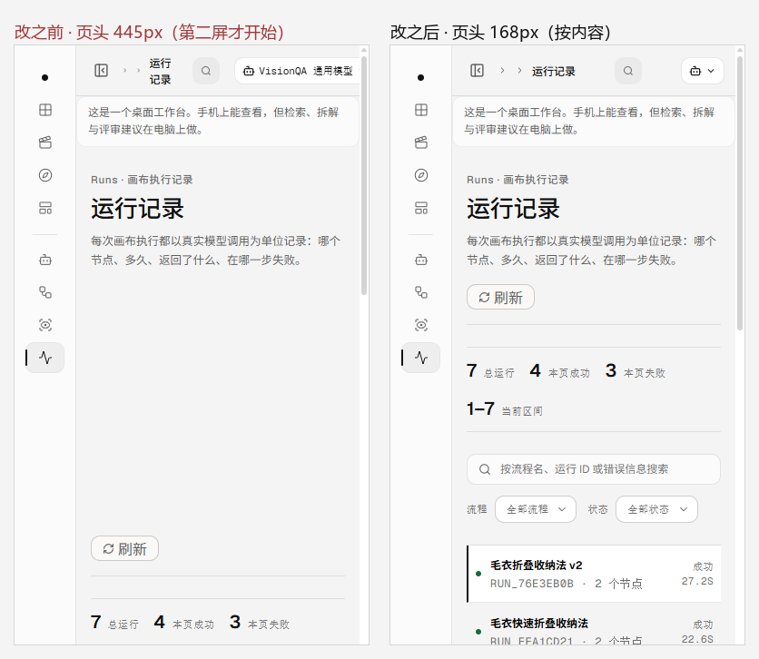

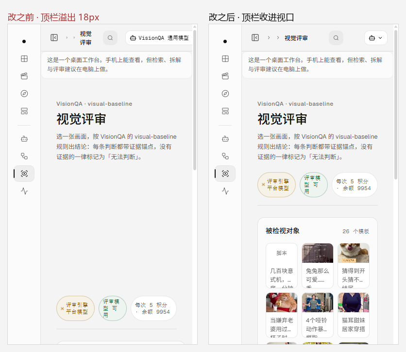

（左边是上一版样式表在同一张页面、同一份数据下复现的——线上已经更新，拍不到旧样式了；右边是生产实拍。）

| 项 | 之前 | 现在 |
| --- | --- | --- |
| 非栅格间距（页面元素计数） | 1076 | **0** |
| 小于 11px 的字号（同上） | 76 | **0** |
| 小于 28px 的按钮 | 30 | **0**（剩下 8 个是文字链接与输入框本身） |
| 小屏页头高度 @390 | 445 / 473px | 168 / 217px |
| 横向滚动 @390 | 智能体 396、评审 402、运行 402、设置 421 | 全部 = 视口宽 |

细节：3px→4px、5px→4px、6px→8px、10px→8px（`gap` 里改 12px）、14px→16px、20px→24px、
28px→24px、40px→48px、56px→48px，10px / 10.5px 一律 11px；1–2px 只留给描边内缩这类视觉补偿。
触控目标：模板卡「用这条改编」26→32、智能体图标按钮 26→32、参数胶囊里的按钮撑满 30px 胶囊。
视觉评审缩略图标题从单行省略改成两行截断。

回归测试 [`test/design-grid.test.mjs`](./test/design-grid.test.mjs)（6 条）**扫 CSS 而不是扫界面**：
间距在不在栅格、字号够不够、圆角在不在尺度、tokens 有没有被改小；另外两条把上面两个事故写成
结构断言（竖排页头必须 `flex-wrap: nowrap`；≤640 必须收起模型名并给按钮限宽 48px）。
做过变异验证：往 `runs.css` 塞一条 `padding: 13px; font-size: 10px`，测试立刻红，删掉恢复绿。

验收：生产 **v0.9.6**、入口 `index-B5ciAwnC.js`、release `20261112-145333-v0.9.6.tar.gz`、
`/api/health` ok（templates 26）；26 个「路由 × 宽度」组合全部 `scrollWidth == clientWidth`；
`npm test` **141/141**（新增 6 条）、oxlint **0 error / 7 warning**、构建通过。
这一轮在生产**只读**：作品 1 个、画布 7 张，没有写演示数据。桌面端不用重装（外壳加载的就是这套网页）。
细节见 [小屏收口](./docs/mobile-grid-2026-11-12.md)。

## 七十六、现场页只印今天要拍的那几镜：8 镜 3 页变 2 页（v0.9.7）

结论：现场页顶栏多了一行「只印 `2-4,6`」，回车就换一版纸；纸自己在上方写明「本张只印第 **2–4、6** 镜
（全片 8 镜，未印的 4 镜在作品页看）」。同一条作品、同一份数据：全印 A4 **3 页**，只印这 4 镜 **2 页**。

为什么值得做：编导一天常常只拍其中几镜。原来一张 24 镜的纸，现场要一边翻一边找，而且拍 03 的人不需要 08 的帧图。
现在选区写在 URL 上（`?shots=2-4,6`），刷新、收藏、发给同组的人都还在；交付包里那张 `现场页.html`
双击打开（`file://`）照样能改——脚本是几行纯 DOM、不联网、不加依赖。

| 之前 | 现在 |
| --- | --- |
| 打开就是全部分镜，只能整张印 | 顶栏「只印 __ 镜」写镜号即换，留空回到全部 |
| 想少印几镜只能自己在打印对话框里缩页面 | 没选中的镜头不上纸，也不占位 |
| 收件人不知道纸是不是缺页 | 纸上写明只印了哪几镜、全片几镜、剩下的在哪看 |
| 线上改、包里不能改 | 线上与交付包都能改（同一份渲染） |

三个设计决定，都是为了现场不出岔子：

1. **没选中的卡片还在 DOM 里，只是带 `is-off`**（屏幕与纸上都 `display:none`）。所以改选区不用重新请求，
   交付包里也能改；同时服务端先按 URL 把该隐藏的隐藏好——关掉脚本或脚本出错，这张纸仍然是对的。
2. **写错的写法不报错**。`abc`、`99`、`0` 这类一个都认不出的输入，直接退回「印全部 8 镜」，
   顶栏同时说一句「没认出这个写法，印全部 8 镜」。纸不是表单，现场没人愿意先跟输入框斗智斗勇。
3. **口径不动**。段落表仍然全印（一条作品 8 段，一张纸放得下）；交付包里的帧图仍然带全部——
   换一天再拍另外几镜时，那个包还能用。

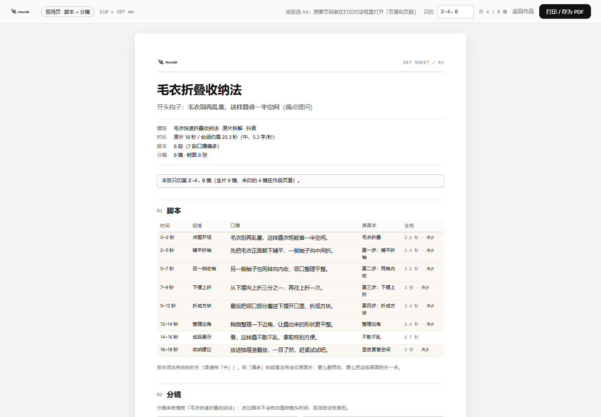

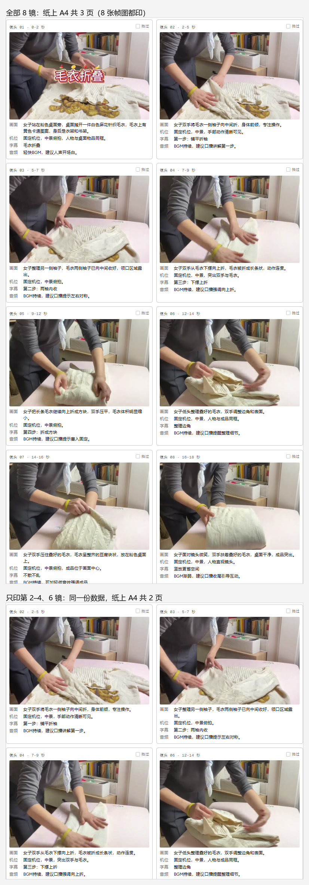

验收：生产 **v0.9.7**、入口 `index-CG2pHbhu.js`、release `20261112-151318-v0.9.7.tar.gz`、
`/api/health` ok（templates 26）。生产上对着真实作品（8 镜、8 张帧图）实测：
全印 8 张卡、选 `2-4,6` 后只剩 4 张（02 / 03 / 04 / 06）、顶栏写「印 4 / 8 镜」、纸上方那行写对、
地址栏收回 `?shots=2-4,6`；Chrome 存 PDF 实测 **3 页 → 2 页**（文档高度 2405 → 1621px）。
交付包里那张纸用 `file://` 打开复验：无脚本异常、改选区立即生效、只有 1 张帧图时不引用缺失文件、没有「返回作品」这种本机打不开的链接。
`npm test` **146/146**（新增 5 条）、oxlint **0 error / 6 warning**（顺手清掉自己带进来的一条未用参数）、构建通过。
这一轮在生产只读（作品 1 个、画布 7 张、评审 3 条），没有写演示数据。
细节见 [现场页按镜打印](./docs/set-sheet-pick-2026-11-12.md)。

## 七十七、评审对照页：把评审说的问题框回画面上（v0.9.8）

结论：交付包里多了一张 **评审对照页.html**。「红色标题压住折叠起点」这种判断，纸上直接框在原片
帧上，左上角的编号就是右边问题列表的编号；线上也能开：`/print/projects/<id>/review?tz=480`。
单下 `交付稿.md` 的人也不会看不到证据：每条问题后面补了 `框 x 13–60% · y 45–57%`。

为什么值得做：评审结论一直带证据框（相对画面的 x/y/w/h），作品页会高亮；但这些框只活在页面里。
包发给剪辑、拍摄、甲方之后，剩下的是一句「右下角按钮距容器底边 0px」——对着哪一帧、哪一块全靠猜。
这张纸和交付稿同一次导出，只是把框画出来。

| 之前 | 现在 |
| --- | --- |
| 交付包里只有文字结论，框留在页面上 | 每个被评过的版本一块：左图右文，编号一一对应 |
| 收件人不知道评的是哪一帧 | 纸脚写明画面在包里是哪一张（本例 `frames/shot-01.jpg`） |
| 框是谁给的说不清 | 纸脚每次写「框是评审当时给出的位置，不是人工复核」 |
| 单独下 .md 就看不到框 | 每条问题后面带框的百分比，末尾一句指向这张纸 |

三个设计决定：

1. **每一版只印最近一次评审**：纸回答「现在这一版被指出什么」，重评的中间结论留在作品页；
   超过 3 版只印最近 3 版，抬头写 `3 / 7 版`。
2. **画面只认自己存下的帧图**：评的是外部图片就不下载、只写「不在我们的帧图里」；
   交付包里如果这张帧本来就在，复用 `frames/shot-01.jpg`，不再复制第二份。
3. **框是相对画面的比例**：压边的框裁进画面，整块出画面的不画（实测 5 条问题里有 1 条框贴在 x=1.2，
   纸上就是 5 条、4 个框，底栏照实数写）。

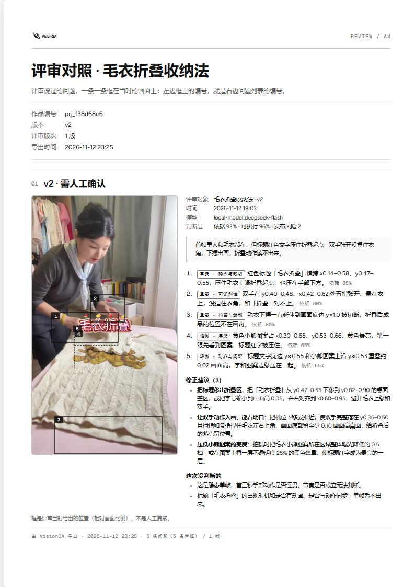


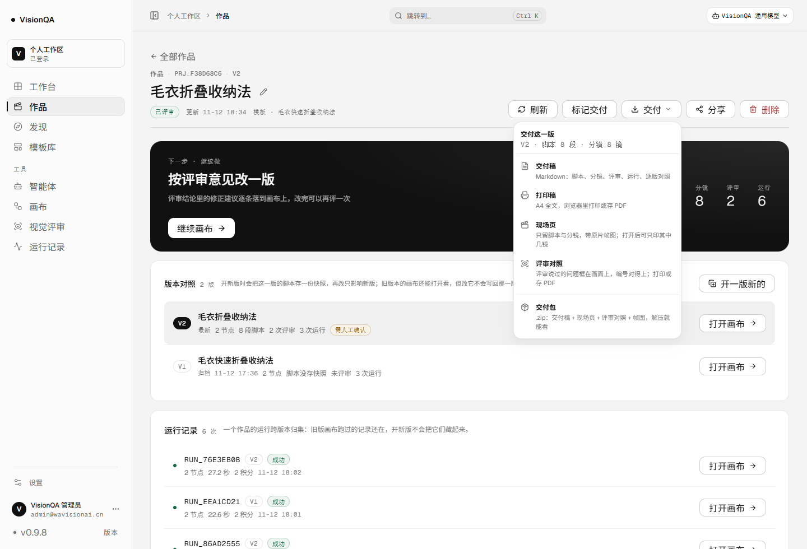

验收：生产 **v0.9.8**、入口 `index-TWxqeCat.js`、release `20261112-152452-v0.9.8.tar.gz`
（先发过一版 `20261112-152342-v0.9.8.tar.gz`，改掉「评审版次」那句措辞后重打包重部署，最终产物与 HEAD 一致）、
`/api/health` ok（templates 26）、`/api/version` 0.9.8。
生产真实作品实测：线上 5 个框、画面 480×854 加载成功、1440 宽无横向滚动、Chrome 存 PDF **1 页**；
交付包里 `评审对照页.html` 用 `file://` 打开，画面走 `frames/shot-01.jpg`、5 个框、无「返回作品」、
无联网地址，存 PDF 也是 **1 页**；390 宽 `scrollWidth == clientWidth`。
`npm test` **155/155**（新增 9 条）、oxlint **0 error / 6 warning**、构建通过。
这一轮在生产**只读**：作品 1 个、画布 7 张、评审 3 条，没有写演示数据。
细节见 [评审对照页](./docs/review-sheet-2026-11-12.md)。
## 七十八、评审对照纸跟着分享链接走：甲方不用账号也能看框（v0.9.9）

结论：v0.9.8 那张「把评审说的问题框回画面」的纸，现在跟着**只读分享链接**一起能用。
分享页顶栏多一个「评审对照」，评审块里也有一张横条；点开是新标签里的一张 A4 纸，
不用登录。作品页、交付包、分享纸三处印的是同一份内容——挑评审的规则抽成了一处。

为什么值得做：这张纸最该看的人是甲方、剪辑、拍摄。他们手上只有一条分享链接，没有账号；
而画面偏偏走的是要登录的 `/media/frames`。这一轮把纸接到分享自己的帧图接口上，
链接能看什么，纸就能看什么。

| 之前 | 现在 |
| --- | --- |
| 分享页只说「评过几次」，问题与框都在登录后 | 拿到链接就能打开对照纸，框与编号和作品页一致 |
| 纸的返回是「返回作品」，没有登录态只会撞上登录页 | 分享纸返回「返回分享页」，并写明链接停用后它会失效 |
| 公开链接可能顺带露出内部 id | 分享纸不印作品编号，公开白名单同样不给 |

三个实现决定：

1. **打印路由不在 /api 下**：`/print/share/project/<token>/review`。地址会出现在打印页脚里，
   带 `/api` 既难看也像接口；凭证就是分享 token，停止分享后纸和分享页一起 404。
2. **画面按帧序号取，不按文件名拼地址**：评审记的是 `frames/<模板>/<文件>`，
   只在模板自己的帧记录里找同名文件、拿它的帧序号，再拼 `/api/share/project/<token>/frame/<n>`；
   找不到就不画图（写「不在这个分享里」）。纸上不出现 `/media/frames`。
3. **一处渲染**：挑评审抽成 `reviewSheetSelection()`（每版最近一次、v0 折进 v1、最多 3 版），
   作品页 / 交付包 / 分享纸都走它。顺手修了旧口径：底栏「N 条带框」以前数的是有坐标的问题，
   现在只数**画出来的**框——没有画面时一个框都没有，不能还说「5 条带框」。

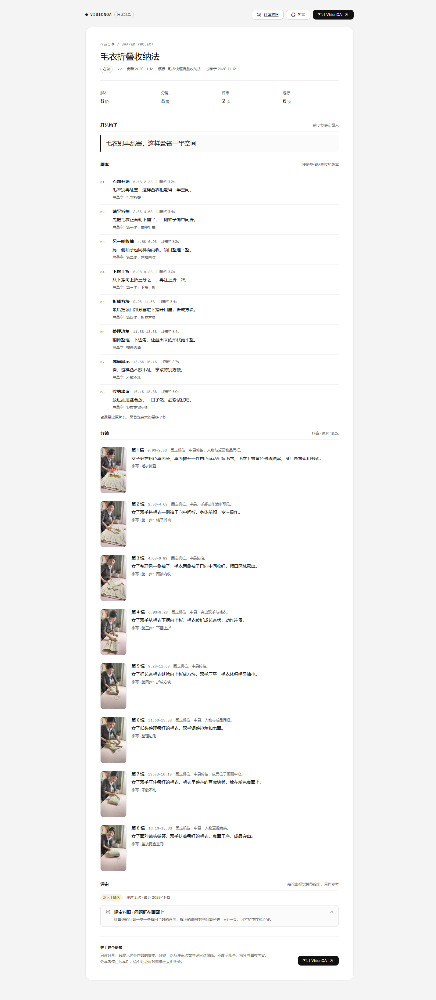


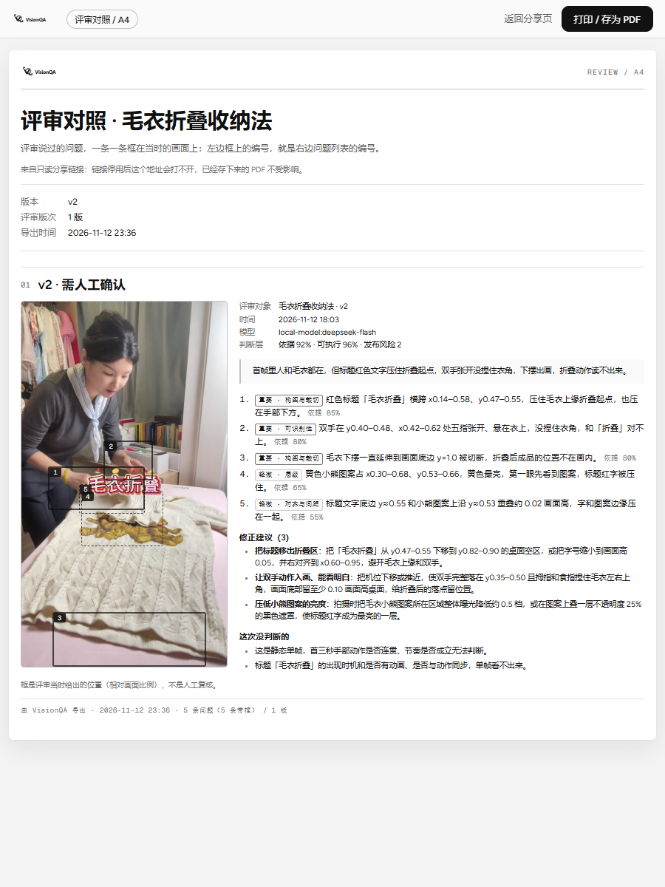

验收：生产 **v0.9.9**、入口 `index-kS64DdI6.js`、release `20261112-153559-v0.9.9.tar.gz`、
`/api/health` ok（templates 26）、`/api/version` 0.9.9。
生产真实作品（8 镜 8 帧、2 次评审）实测：分享页 1440 下 8 张帧图全部加载、无横向滚动；
390 下只留「评审对照」；分享纸 5 个框、画面 480×854 加载成功、876×933、页面无 `/media/frames`、
无作品编号、Chrome 存 PDF **1 页**；同一时刻 `/print/projects/<id>/review` 仍是 **401**，
分享纸是 **200**；坏 token 给 404 的纸；停掉分享后纸与接口都 404。
作品页与分享纸印出来的是同一份（都是 5 个框、同一句底栏）。
`npm test` **162/162**（新增 7 条）、oxlint **0 error / 6 warning**（仓库含 electron 的 `npm run lint` 是 7 条既有告警）、构建通过。
为了拍截图在生产上**临时开过一次分享链接、截完就停**；生产数据没动：作品 1 个、画布 7 张、评审 3 条。
细节见 [评审对照纸跟着分享链接走](./docs/share-review-sheet-2026-11-12.md)。

## 七十九、分享链接被打开过几次：甲方看没看，不用再问（v0.9.10）

结论：链接发出去之后，作品页的分享面板会告诉你**它被打开过几次、最近一次是什么时候、
从哪一类客户端打开的**。以前这个问题只能靠微信追问，或者把「没回」猜成「没看」。

为什么值得做：这是只读分享唯一缺的一环。v0.9.9 让甲方能看，但分享者对「对方到底点开了没有」
完全没有信号。这一轮把信号补上，同时守住三条线：不存 token、不存 IP、不假装知道是谁。

| 之前 | 现在 |
| --- | --- |
| 链接发出去就断了消息，只能问「看了吗」 | 面板写「2 次打开 · 最近 刚刚（手机或平板）」 |
| 没有任何办法判断链接有没有被点开 | 第一次打开时间、最近一次时间与客户端类别都在 |
| 加统计容易变成访问日志 | 只留次数与四类客户端，记录键是 token 哈希，上限 200 条 |

三个实现决定：

1. **记录键是 token 的 SHA-256 前 16 位**：记录文件被看到也拿不到能打开作品的链接。
2. **只记次数与客户端类别**（微信内打开 / 手机或平板 / 电脑浏览器 / 未知设备），不记 IP、不存原始 UA；
   微信优先于手机判断，微信里点开也算「微信内打开」。
3. **60 秒内的连续打开算同一次**，窗口对着「上一次真正计数的那一次」算：对着最近一次算的话，
   每隔几十秒刷新的人会让窗口一直往后滑，一晚上都只算一次。帧图与对照纸不单独记——
   一次打开会带很多张图，按图计数只会把「打开次数」变成「图片请求数」。

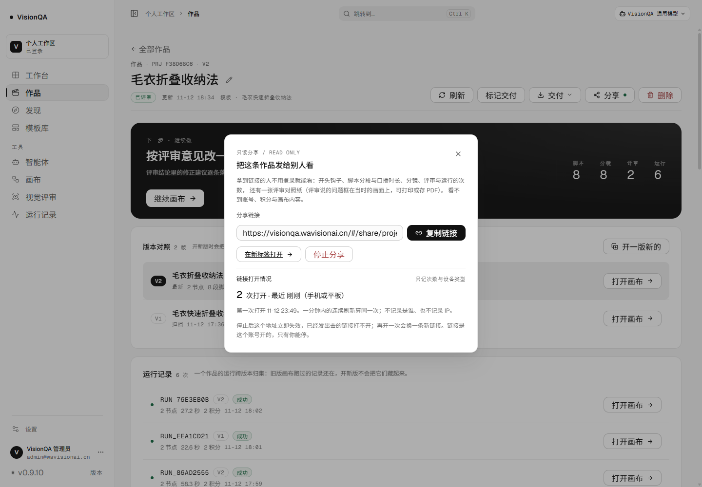

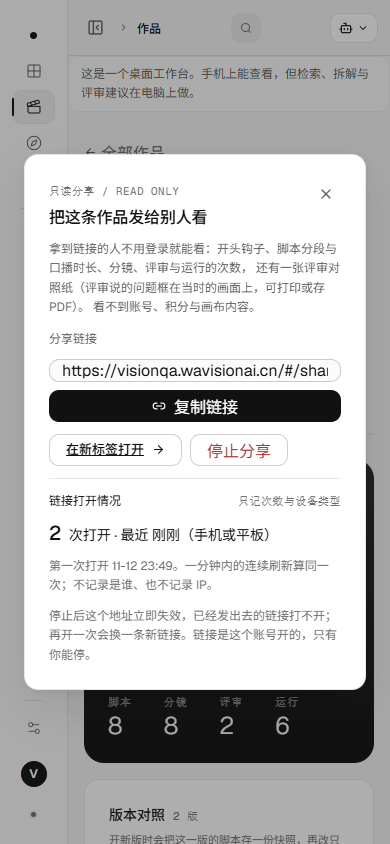

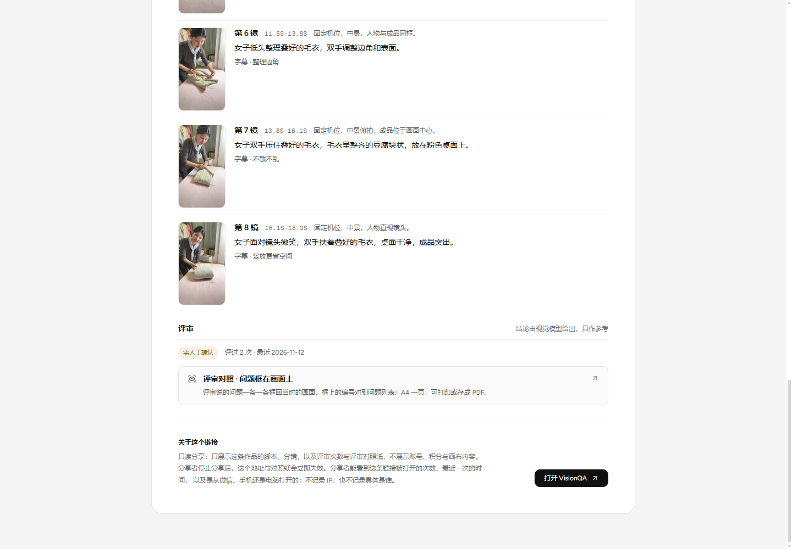

验收：生产 **v0.9.10**、入口 `index-MiEK94pG.js`、release `20261112-154900-v0.9.10.tar.gz`、
`/api/health` ok（templates 26）。生产真实作品实测：电脑上打开 → `opens 1`（desktop）；
同一分钟内手机再打开 → 仍是 `opens 1`、`lastClient` 变 mobile；过 62 秒再打开 → `opens 2`，
面板写「2 次打开 · 最近 刚刚（手机或平板）」。面板 1440 宽 520px、390 宽 342px，
两种宽度都 `scrollWidth == clientWidth`；分享页页脚带统计说明；停掉分享后分享页与接口都是 404、
作品的 `share` 变回 null。`npm test` **169/169**（新增 7 条，含路由级计数与「公开视图不漏统计」）、
oxlint **0 error / 6 warning**（仓库含 electron 的 `npm run lint` 是 7 条既有告警）、构建通过。
为了拍这两张图在生产上**临时开过一次分享链接、截完就停**；生产数据只多了一条哈希键的记录
（`opens 2`，就是验收时的两次打开），作品、画布、评审都没动。
细节见 [分享链接被打开过几次](./docs/share-visits-2026-11-12.md)。

## 八十、停掉的分享链接，打开记录还在（v0.9.11）

结论：分享停掉之后，作品页的分享面板不再只剩一个「生成分享链接」按钮——下面会列出**以前的链接**：
每一轮停用的时间、那一轮被打开过几次、最近一次是什么时候、从哪类客户端打开的，最多 8 轮。
v0.9.10 让「甲方看没看」第一次有了答案，这一轮让这个答案在链接停掉之后仍然拿得回来。

| 之前 | 现在 |
| --- | --- |
| 一停分享，打开记录跟着面板一起消失 | 「以前的链接」把每一轮停用时间与打开次数留在面板里 |
| 上周那一版给甲方看过没有，只能翻数据文件 | 打开分享面板就能回看 |
| 直接再开一条链接，上一轮记录容易断档 | 换新链接自动把上一轮归档 |

三个实现决定：

1. **历史只存 token 的哈希前缀，token 本身清掉**：旧地址照旧 404，谁也打不开；
   但哈希键和打开记录对得上，面板里还能显示那一轮被打开过几次。
2. **最多 8 轮，按停用时间倒序**：更早的链接没人会回去看；换新链接时自动归档上一轮，不要求先手动停。
3. **详情接口只给统计，不给记录键**：每条历史只有起止时间与打开情况；列表接口连历史一起剥掉。

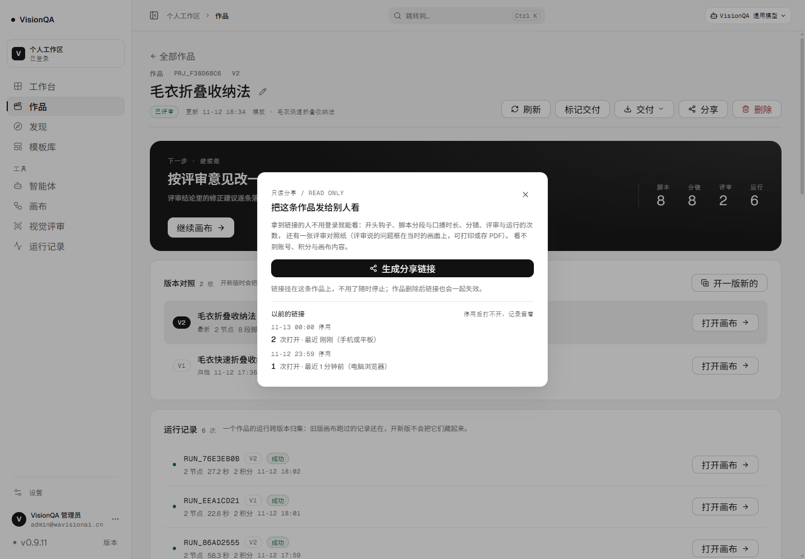

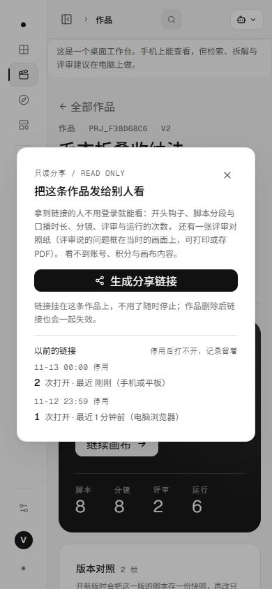

验收：生产 **v0.9.11**、入口 `index-B4OCwfGK.js`、release `20261112-155829-v0.9.11.tar.gz`、
`/api/health` ok（templates 26）、`/api/version` 0.9.11、两个服务 active，
部署上去的三个服务端文件 MD5 与 HEAD 一致（`84e4a651…` / `97cabf99…` / `35a33395…`）。
生产真实作品跑了两轮：第一轮电脑打开一次后停用；第二轮手机打开、过 63 秒再打开（计数 2）后停用。
停用后详情 `share` 为 null、`shareHistory` 两条（`2 次打开 · 手机或平板` 在前，`1 次打开 · 电脑浏览器` 在后），
两条旧地址都 404、历史里的次数不变；响应里没有旧 token，也没有记录键。
面板 1440 宽 520×384px、390 宽 342×422px，两种宽度 `scrollWidth == clientWidth`。
`npm test` **176/176**（新增 7 条）、oxlint **0 error / 6 warning**（仓库含 electron 的 `npm run lint` 是 7 条既有告警）、构建通过。
生产数据只多了这两轮历史（`projects.json` 的 `shareHistory`，无 token）与对应哈希键；
作品 1 个、画布 7 张、评审 3 条没动。为了拍图在生产上**临时开过两条分享链接、两条都已停用**；
`share-visits.json` 里还留着 v0.9.10 验收时的一条孤儿记录（对应的链接早已停用、没有作品再引用它）。
细节见 [停掉的分享链接，打开记录还在](./docs/share-history-2026-11-12.md)。

## 八十一、工作台多了一块「分享出去的链接」：不用逐个点开作品（v0.9.12）

结论：工作台现在能一眼看到「哪些作品分享过、被点开过几次」——一条作品一行，
正在分享的那轮 + 停用的各轮合成一个累计；点一行进作品，再看每一轮的明细。

| 之前 | 现在 |
| --- | --- |
| 哪个作品在分享、甲方看没看，只能逐个点开 | 工作台底部一条作品一行：分享中/已停用、几轮、累计打开次数 |
| 打开次数散在各作品的分享面板里 | 同一处看到累计与最近一次（客户端），点进去看每一轮 |
| 停掉的链接要重新翻作品 | 汇总包含停用的历史，链接失效后记录还在 |

三个实现决定：

1. **一条作品一行，累计各轮**：按链接摊开是一张流水账，汇总到作品层行数才可控；每轮明细留给作品面板。
2. **只列最近活跃的 6 条作品，总数按全部算**：工作台不是报表，但「共 N 条作品分享过」写清楚。
3. **接口只回轮数与统计**：不返回 token、记录键与每轮明细；仍按作品归属过滤。

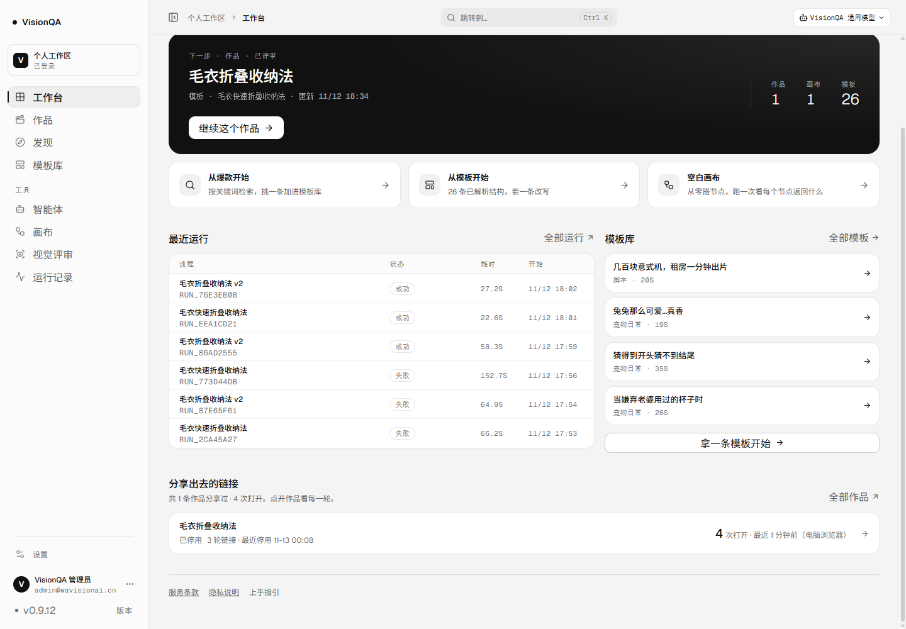

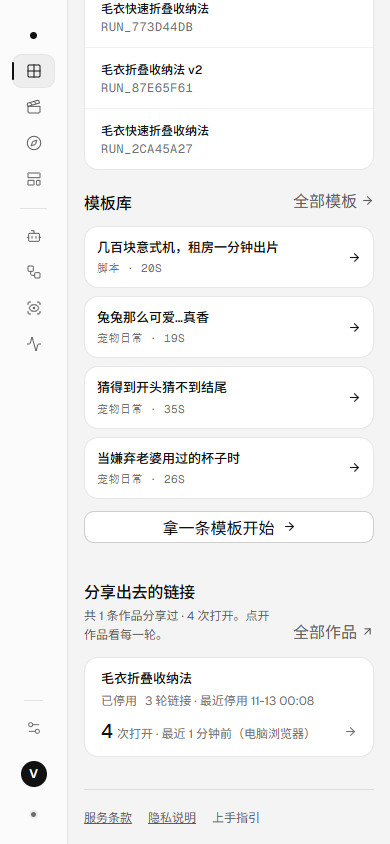

验收：生产 **v0.9.12**、入口 `index-DgCItpFS.js`、release `20261112-160942-v0.9.12.tar.gz`、
`/api/health` ok（templates 26）、`/api/version` 0.9.12、两个服务 active，
部署的五个服务端文件 MD5 与 HEAD 一致（`c97e37c9…` / `c87c6927…` / `84e4a651…` / `97cabf99…` / `35a33395…`）。
生产实测：该作品三轮链接、累计 4 次打开（2+1+1），`/api/shares` 一行 `live false`、`rounds 3`、`opens 4`，
响应里没有 token、记录键与每轮明细；第三轮停用后旧地址 404、次数不变。
工作台 1440 区块 129px、行宽 1130px；390 区块 183px、行宽 290px，两种宽度 `scrollWidth == clientWidth`，
「全部作品」不换行。`npm test` **179/179**（新增 3 条）、oxlint **0 error / 6 warning**、构建通过。
为拍图在生产上临时开了第三轮分享（打开一次即停），永久状态是 3 轮 4 次打开；
`share-visits.json` 里仍有 v0.9.10 验收留下的一条孤儿记录。
细节见 [工作台多了一块「分享出去的链接」](./docs/share-summary-2026-11-12.md)。

## 八十二、作品列表卡片直接看得到分享状态（v0.9.13）

结论：作品列表的卡片上现在直接写着「分享中 / 已停用」和「打开几次」——
不用点进作品、也不用先回工作台，扫一眼就知道哪条还在分享、甲方看没看。

| 之前 | 现在 |
| --- | --- |
| 哪条还在分享，要点进作品看分享面板 | 卡片状态胶囊多一枚「分享中」（绿点）/「已停用」 |
| 打开次数只在作品面板与工作台汇总里 | 指标行第五格「打开」直接写次数 |
| 停掉之后卡片看不出被看过几次 | 停用后胶囊变灰，次数与轮数照样在 |

三个实现决定：

1. **摘要挂在列表接口里**，不让页面再调一次 `/api/shares` 拼：那张表按最近活跃只回 6 行，按项目去查会被截掉。
2. **只挂一条摘要**（`live / rounds / opens / lastAt / lastClient`）：归属仍是作品的规则，但 token 与记录键不跟到列表。
3. **胶囊管状态、第五格管次数**：两件事塞进一个胶囊会让文案随次数变长，390 宽下把右上角时间挤走。

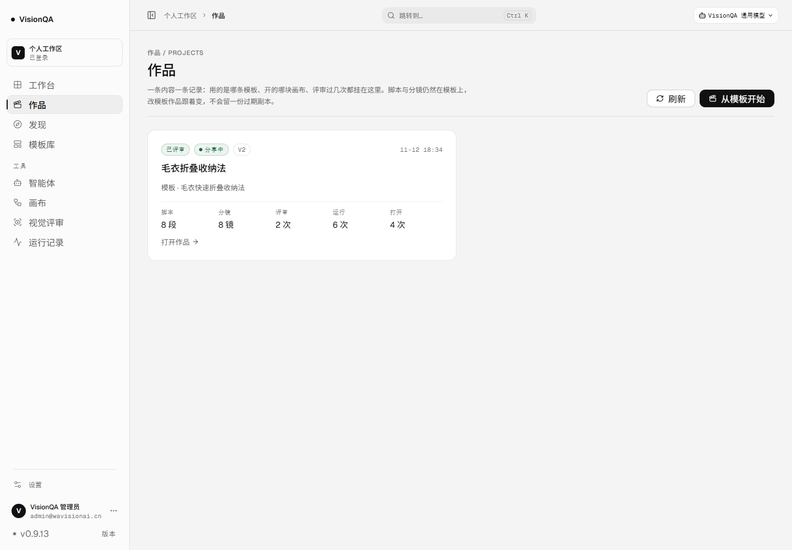

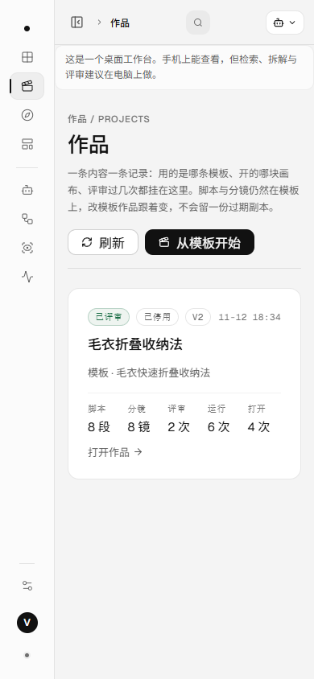

验收：生产 **v0.9.13**、入口 `index-_P_BDv7n.js`、release `20261112-161622-v0.9.13.tar.gz`、
`/api/health` ok（templates 26）、`/api/version` 0.9.13、两个服务 active，
部署的五个服务端文件 MD5 与 HEAD 一致（`c97e37c9…` / `13957d62…` / `a5bed6ad…` / `60910748…` / `84e4a651…`）。
生产实测：`/api/projects` 每一项带 `share` 摘要，该作品 `live false`、`rounds 4`、`opens 4`、`lastClient desktop`，
响应里没有 token、记录键、`shareHistory` 与 `visits`；卡片 1440 宽 562×238px、胶囊 62/52×22px、指标五格各 96px，
390 宽卡片 290px、五格各 42px，两种宽度 `scrollWidth == clientWidth`。
`npm test` **183/183**（新增 4 条）、oxlint **0 error / 6 warning**、构建通过。
为了拍「分享中」的图，生产上临时开了第四轮分享、拍完立即停用（无人打开）：该作品现在是 4 轮 4 次打开，
`share-visits.json` 里仍有 v0.9.10 验收留下的一条孤儿记录。
细节见 [作品列表卡片上直接看得到分享状态](./docs/project-share-badge-2026-11-12.md)。

## 八十三、模板库能回答「这条我做过吗」（v0.9.14）

结论：模板库卡片上现在写着「1 条作品在用」，详情抽屉里逐条列出是哪几条，点一行直接进作品——
模板库与作品终于连上了。

| 之前 | 现在 |
| --- | --- |
| 打开一条模板，不知道自己是不是已经用它做过作品 | 卡片指标行写「N 条作品在用」，详情逐条列出、可点进作品 |
| 卡片写「已复用 N 次」，是只增不减的计数器（删作品不回落） | 汇总与卡片都改用现算的作品数：删掉作品，数字跟着回落 |
| 顶部汇总第三格写「累计复用」 | 改成「作品在用」，与卡片同一口径 |

三个实现决定：

1. **用量现算，不用计数器**：`reuseCount` 是「点过几次用它做作品」（生产这条模板 5 次复用、1 条作品在用），删作品不回滚；作品数从 `projects.json` 现算，归属仍按 `listProjects` 那套。
2. **计数放列表、明细放详情**：26 条模板一次拉完只多一个数字，`projects` 数组只在打开某一条模板时取一次。
3. **明细放指标行、不放脚注**：塞进脚注会把长作者名顶成两行、卡片比同排高一截（第一版实测就是这样），改到「几段脚本 · 几个分镜」后面就齐了。

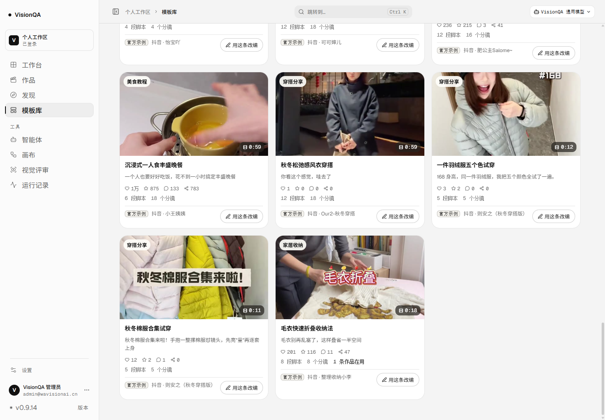


验收：生产 **v0.9.14**、入口 `index-DHrmZhNp.js`、release `20261112-162919-v0.9.14d.tar.gz`、
`/api/health` ok（templates 26）、`/api/version` 0.9.14、两个服务 active，
部署的 `index` / `template-usage` / `projects` 三个服务端文件 MD5 与 HEAD 一致（`5591bf1e…` / `cdec0710…` / `97cabf99…`）。
生产实测：`/api/templates` 26 条、`projectTotal: 1`、该条 `projectCount: 1`（`reuseCount: 5`）、列表不带 `projects` 数组；
`/api/templates/tpl_5323f485` 给出 1 条作品（v2、在做）。
模板库 1440 卡片 355×392px、指标行「8 段脚本 8 个分镜 1 条作品在用」；
详情抽屉 1440 宽 580px、作品行 521×52px；390 抽屉宽 390px、作品行 341×52px，三种宽度 `scrollWidth == clientWidth`。
`npm test` **189/189**（新增 6 条）、oxlint **0 error / 6 warning**、构建通过。
这一轮只读生产数据：没有新建、删除或修改模板与作品，也没有开关分享；同一版本重发了几次只为修脚注换行与用量位置。
细节见 [模板库能回答「这条我做过吗」](./docs/template-works-2026-11-12.md)。

## 八十四、运行记录认得作品了（v0.9.15）

结论：运行记录页每条运行下面多了「作品 · 第几版」，详情页头多了「回作品」——
在运行里看见一条两点的失败，能直接回到那条作品的脚本、分镜与评审；搜索框也能按作品名搜到运行，
画布改过名之后照样命中。工作台「最近运行」同一行、同一口径。

| 之前 | 现在 |
| --- | --- |
| 只有画布名，一条作品的 v1 与 v2 混在一列里 | 第二行写「作品 · 第 2 版」/「作品 · 毛衣折叠收纳法 · 第 1 版（归档）」 |
| 看见失败运行，没有路回作品，只能去作品列表挨个点开 | 详情页头「回作品」，直接进那条作品的当前这一版 |
| 搜「毛衣」只命中画布名里带这两个字的运行 | 按作品名搜，归档版画布（被改过名）的运行也命中 |
| 空白画布直接跑的运行看着和作品的运行一样 | 如实写「没挂在作品上」，不当成某条作品 |

三个实现决定：

1. **现算，不落库**：运行记录里不加 `projectId`。作品那侧已经存着两张画布指针（当前版 `flowId` + 归档 `versions[].flowId`），反过来建一次索引就够；复制到运行上，之后改作品名、开新版就得两地同步，迟早一处是旧的。
2. **列表只加一个字段**：`/api/runs` 每条多 `project: { id, title, version, archived } | null`，不带脚本、不带分享凭证、不带节点输出；单条 `/api/runs/:id` 同一口径。
3. **搜索走补充命中集**：`listRuns({ flowIds })` 只扩大关键词命中，归属过滤、状态筛选、按画布筛选一条都没动——画布改名之后搜作品名仍能命中，按画布名搜索的行为也不变。


验收：生产 **v0.9.15**、入口 `index-DBbjP6fs.js`、release `20261112-164329-v0.9.15.tar.gz`、
`/api/health` ok（templates 26）、`/api/version` 0.9.15、两个服务 active，
部署的 `flows` / `routes/flows` / `run-ownership` / `index` 四个服务端文件 MD5 与 HEAD 一致（`a532a7ca…` / `99ea472a…` / `9477addb…` / `5591bf1e…`）。
生产实测：`/api/runs` 7 条——4 条第 2 版（当前）、3 条第 1 版（归档）、1 条「未命名流程」`project: null`，
单条详情同样带 `project`；搜索「毛衣」命中 6 条（第 7 条不命中是应该的）。
运行记录页 1440 列表宽 360px、单行 85px、详情 746px，390 单行 290px、行高 85px，两档 `scrollWidth == clientWidth`；
工作台最近运行 1440 行高 46px、390 行高 61–77px。
`npm test` **194/194**（新增 5 条）、oxlint **0 error / 6 warning**、构建通过。
这一轮只读生产数据：没有新建、删除或修改作品与运行，也没有跑新画布。
细节见 [运行记录认得作品了](./docs/run-project-ownership-2026-11-13.md)。

## 八十五、视觉评审也认得作品了（v0.9.16）

结论：视觉评审页「最近评审」每条下面多了一行「作品 · 标题 · 第几版」，打开一条历史评审，页头会说明它记在哪条作品下，并给一条「回作品」——评审结论终于和作品连上，不用再靠来源标签猜。

| 之前 | 现在 |
| --- | --- |
| 历史列表只有来源标签与时间，看不出属于哪条作品 | 第二行写「作品 · 毛衣折叠收纳法 · 第 2 版」 |
| 普通评审与作品评审在列表里没有区别 | 没记入作品如实写「没记入作品」（弱色） |
| 打开历史评审就停在这一条结论里 | 页头写「这条评审记入：毛衣折叠收纳法 · 第 2 版」，「回作品」直接进那条作品 |
| 作品改名后历史评审的归属不会跟着变 | 标题现算：作品改名，历史评审跟着改口 |

三个实现决定：

1. **只多一个字段，现算不回写**：`/api/reviews` 每条多 `project: { id, title } | null`，与 `/api/reviews/:id` 同一口径；评审记录里已有 `projectId` 与 `version`，标题从作品现算，两百条历史不用回填。
2. **版次用评审自己的 `version`**：记的是「评审当时作品的第几版」，作品后来开新版仍记在原来那一版；没有版次的老记录写「未记版次」，不冒充第 1 版。
3. **打开历史不再打一次接口**：归属从列表那一条取，页面只多一次状态更新。

顺手修的三处：生产 26 条模板把左栏撑成整页高（候选网格封顶 480px 自己滚，历史回到一屏内）、390 宽下结论与修正建议挤成两条窄栏（改单栏、状态胶囊回自身宽度）、手机候选一行三张变两张（三张只有 78px 宽，标题读不出）。


验收：生产 **v0.9.16**、入口 `index-CKDnGNJp.js`、release `20261112-165922-v0.9.16c.tar.gz`、`/api/health` ok（templates 26）、`/api/version` 0.9.16、两个服务 active，部署的 `review-ownership` / `routes/review` / `index` 三个服务端文件 MD5 与 HEAD 一致（`28de3249…` / `2f42a1be…` / `5591bf1e…`）。
生产实测：`/api/reviews` 3 条——2 条挂在 `prj_f38d68c6`（毛衣折叠收纳法 · 第 2 版）、1 条 `project: null`（画布界面截图）；单条详情同样带 `project`。历史行高 1440 与 390 都是 66px，左栏 300px / 258px，两档 `scrollWidth == clientWidth`。
`npm test` **198/198**（新增 4 条）、oxlint **0 error / 6 warning**、构建通过。
这一轮只读生产数据：没有新建、删除或修改评审，也没有跑新的评审（未消耗积分）；本地看布局只用 `.tmp-qa` 里的临时演示数据。同一版本重发了两次，只为修左栏高度与手机候选列数。
细节见 [视觉评审也认得作品了](./docs/review-project-ownership-2026-11-13.md)。

## 八十六、评审的证据，一点就开（v0.9.17）

结论：作品页「版本对照」每一版下面逐条列出评过的那几次，点一条直接进那次的记录页——当时被检视的画面原图、问题锚点、结论与修正建议都在。地址栏变成 `#/review/<评审 id>`，刷新、后退、把链接发给同账号的自己也落回同一条；历史评审只读，想接着评这一版用「评这一版」进那条作品的评审页，新结论照样挂在作品下。

| 之前 | 现在 |
| --- | --- |
| 版本对照只写「2 次评审」，看不出是哪两次、评的哪张图 | 每一版下面逐条列出：结论胶囊 + 时间 + 箭头，点一条进那次的记录页 |
| 右侧「评审」面板只有摘要，整行不可点 | 整行可点，面板顶部写明「点一条看当时的证据原图与问题锚点」 |
| 找更早的一条评审只能去评审页翻「最近评审」那 6 条 | 从作品页进不受这 6 条限制，作品名下最近 20 条都能点到 |
| 历史评审只能从左侧列表打开，地址栏里没有记录 | `#/review/<评审 id>` 就是入口：刷新 / 后退 / 分享链接都回到同一条 |
| 打开的历史评审还能「重新评审」，会落一条没归属的新记录 | 历史只读，动作换成「评这一版」，新评审回到那条作品、归属正确 |
| 模板帧被清理后，证据位置是一张破图 | 一块说明「评审时的画面已经不在了」，结论与锚点照旧显示 |

三个实现决定：

1. **地址即入口**：`#/review/<评审 id>` 解析成路由参数，评审页按 id 读一次记录；左侧「最近评审」点击也改走地址，地址栏、页面、浏览器后退三者始终一致。
2. **归属用记录自己的 `project`**：上一轮给 `/api/reviews/:id` 也算好了归属，这里不依赖「最近评审」那 6 条——两个月前的评审同样写得出「作品 · 第几版」。
3. **历史评审只读**：在旧画面上再跑一次会落一条没有 `projectId` 的新记录，分数花了却不知道该记在哪条作品下；主按钮换成「评这一版」，回到那条作品的评审页。

顺手修的三处：证据原图被清理时换成说明块（不再显示破图）、390 宽评审面板改成结论与版次一行 + 摘要独占下一行、版本结论胶囊不换行（不再被拆成两行、撑到 40px 高）。


验收：生产 **v0.9.17**、入口 `index-deB9xUo5.js`、release `20261112-171837-v0.9.17.tar.gz`、`/api/health` ok（templates 26）、`/api/version` 0.9.17、两个服务 active。生产实测：`prj_f38d68c6`「毛衣折叠收纳法」v2 下列出 2 条评审（11-12 18:03、11-12 17:37），v1 未评审不列；点第一条进 `#/review/rev_af034805`，页头「这条评审记入：毛衣折叠收纳法 · 第 2 版」，证据原图 480px 宽、5 个锚点、5 条问题，动作只有「评这一版」；版本胶囊 1440 与 390 都是 194×24，两档 `scrollWidth == clientWidth`。
`npm test` **198/198**、oxlint **0 error / 6 warning**、构建通过。
这一轮没有改服务端口径（`/api/reviews` 与 `/api/reviews/:id` 字段未变），生产数据只读：没打开模型、没跑评审、没扣积分；本地用 `.tmp-qa` 的临时演示数据验证，其中一条故意指向不存在的证据图，用来看「原图不在了」的说明。
细节见 [评审的证据，一点就开](./docs/review-evidence-deeplink-2026-11-13.md)。

## 八十七、200 条评审历史，翻得到也筛得动（v0.9.18）

结论：视觉评审页左侧「最近评审」标题行右侧多了「查看全部 N 条」，点开是 720px 弹层：按结论筛（每枚胶囊带真实计数）、按作品筛（作品名 + 条数，含「没记入作品」），一页 20 条往下翻，点一条回到那次评审的证据页。历史存 200 条，现在全部够得着。

| 之前 | 现在 |
| --- | --- |
| 「最近评审」只露 6 条，剩下的 194 条只在作品页按作品看得到 | 标题行「查看全部 N 条」进弹层，200 条一页 20 条翻到底 |
| 想找「上个月那条不通过的评审」只能凭记忆翻作品 | 按结论筛，结论胶囊就是筛选器，每枚带条数 |
| 看不出哪条作品评得多、哪条一次都没评 | 作品下拉列出每条的评审数，另有「没记入作品 · N」 |
| 筛选后不知道还有多少、到底翻完没有 | 页脚「已显示 X / 共 Y 条」，不够就「再看 N 条」 |
| 300px 侧栏塞不下这些 | 弹层 390 宽占满屏，行结构与桌面同一份 |

三个实现决定：

1. **弹层，不是新页面**：`#/review/<评审 id>` 已被「某一条评审」占用，`#/review/history` 会被当成一条不存在的评审；弹层不开地址，就不动上一轮立的「地址即入口」——在弹层里点一条仍然落到 `#/review/<评审 id>`。
2. **筛选与翻页在服务端**：`GET /api/reviews` 增加 `offset` 与 `orphan`，一次最多 50 条；返回 `total` 与 `facets`，其中**结论计数按当前作品筛选算、作品计数按当前结论筛选算**，换一个筛选后另一排数字仍然是真的。
3. **一行只有一份实现**：侧栏与弹层共用 `ReviewHistoryRow`。

顺手修四处：结论胶囊占固定 96px 一列（标题不再参差、胶囊不再被挤成两行）；零结果时筛选下拉仍写「作品 · 0」（原来退回占位文案，看见 0 条不知道哪个筛选在起作用）；「查看全部」从列表底部提到标题行；「通过 / 需人工确认 / 不通过」的字收进 `domain/review.ts` 一处。


验收：生产 **v0.9.18**、入口 `index-BVgUPwQ7.js`、release `20261112-173959-0.9.18-final.tar.gz`、`/api/health` ok（templates 26）、`/api/version` 0.9.18、两个服务 active。生产实测：评审页「查看全部 3 条」；弹层 720×413、3 行各 55px、胶囊「全部 3 · 通过 0 · 需人工确认 3 · 不通过 0」；作品下拉「全部作品 / 毛衣折叠收纳法 · 2 / 没记入作品 · 1」；筛作品后 2 条、再叠「通过」得 0 条空状态且下拉写「毛衣折叠收纳法 · 0」；390 宽 374×505，两档 `scrollWidth == clientWidth`；Esc 与点背景都能关。本地 24 条演示数据验翻页：20 + 「再看 4 条」→ 24 条。
`npm test` **205/205**（新增 7 条）、oxlint **0 error / 6 warning**、构建通过。
这一轮改了口径外的服务端参数（`offset` / `orphan` / `facets`），但没动已有字段的含义；生产数据只读：没打开模型、没跑评审、没扣积分；本地只用 `.tmp-qa` 的临时演示数据。同一版本重发了两次，只为修「零结果时下拉退回占位文案」这一处。
细节见 [评审历史：查看全部](./docs/review-history-2026-11-13.md)。

## 八十八、评过不等于过了：作品状态胶囊直接写结论（v0.9.19）

结论：作品卡片、作品页、工作台三处的状态胶囊不再一律写「已评审」。有结论就直接写结论——「评审 · 通过」「评审 · 需人工确认」「评审 · 不通过」，颜色跟着语气走。工作台多一块「评审等你看的」：当前这一版最近一次结论是需人工确认或不通过的作品按评审时间排队，点一条进作品改一版；「下一步」主卡也先挑队列里最该动手的那条，按钮写「按意见改这一版」。评审通过后，作品页主卡改问「交付」：点「交付这一版」直接打开交付菜单。

| 之前 | 现在 |
| --- | --- |
| 评过 1 次和评过 9 次、通过和不通过，卡片上都写「已评审」 | 胶囊直接写结论：评审 · 通过 / 需人工确认 / 不通过，三档颜色 |
| 想知道「这条过了没」得点进作品页翻评审面板 | 作品列表第一眼就看得到，悬停还有「需人工确认 · 11/12 18:03 · 评过 2 次」 |
| 工作台只回答「最近在改哪条」，评审给出意见的作品不露面 | 工作台多一块「评审等你看的」，按评审时间排，点一条进作品 |
| 工作台「下一步」可能挑到一条已经通过的 | 先挑队列里最该动手的；通过的不进队列，交付了的不再催 |
| 评审通过后主卡还写「按评审意见改一版」 | 通过时写「这一版评审通过了」，按钮「交付这一版」开交付菜单 |
| 交付稿纸上写「状态：已评审」 | 纸上写「状态：评审 · 需人工确认（当前第 2 版）」 |

三个实现决定：

1. **「已评审」不再当状态用**：评过和过了是两件事。有结论就写结论，只有结论之前的老记录（没有 verdict）才退回「已评审」，不假装它给了结论；字与评审页 / 评审历史 / 分享页同一套。
2. **队列在服务端一处算**：`GET /api/reviews/queue` 只看当前这一版（版本 0 的旧评审折进 v1），只收需人工确认 / 不通过，按评审时间倒序；已交付与已通过都不进。工作台的主卡与队列块读同一份结果。
3. **口径收成一个模块**：`server/project-status.mjs` 管四种状态与「某一版评过几次」，交付稿里那份私有 `statusLabel` 已删——纸上的状态与页面上的胶囊不会再各说各话。

顺手修四处：卡片右上角时间不再被拆成两行（胶囊变长后 390 宽会挤成「11-12 / 18:34」）；队列行胶囊固定 128px 一列，作品名从同一条竖线开始；窄屏队列行改成两行（否则「第 1 版 · 评过 8 次 · 11/13 00:40」被挤成三行）；状态胶囊样式从 projects.css 收进 shell.css，工作台也能用。


验收：生产 **v0.9.19**、入口 `index-lUF4ffRl.js`、release `20261112-175811-v0.9.19-review-verdict.tar.gz`、`/api/health` ok（templates 26）、`/api/version` 0.9.19、两个服务 active。生产实测：`/api/reviews/queue` 为 `total 1`（毛衣折叠收纳法 v2 / needs_review / 2 次）；作品卡片胶囊 119×22、悬停「需人工确认 · 11/12 18:03 · 评过 2 次」；工作台队列 1 行 63px（390 宽 93px）；两档 `scrollWidth == clientWidth`。生产只有 1 条作品、2 次评审，三档颜色里只看得到「需人工确认」一档；**「评审 · 通过」「评审 · 不通过」与「下一步 · 交付」是在本地演示数据（3 条作品 / 26 次评审）上验的**，不是生产数据。
`npm test` **218/218**（新增 `test/review-queue.test.mjs` 8 条、`test/project-status.test.mjs` 5 条，交付稿状态文案跟着改）、oxlint **0 error / 6 warning**、构建通过。生产数据只读：没打开模型、没跑评审、没扣积分。
细节见 [评过不等于过了](./docs/review-verdict-2026-11-13.md)。

## 八十九、看过不等于改过：「已看过」给评审待办一个出口（v0.9.20）

结论：上一轮的「评审等你看的」只有入口、没有出口——结论是「需人工确认」的作品，不改就永远躺在待办里催你。这一轮每行多一个行尾动作「已看过」：点一下，这条从待办挪到下面一行，还能撤销；**评审结论、状态胶囊、交付稿一个字都不动**，页面上写的是「已看过 N 条，这一版先没改」，不是「已处理」「已通过」。它是待办上的便利贴，不是结论。

| 之前 | 现在 |
| --- | --- |
| 一条需人工确认的作品，不改就永远在待办里，没有别的选择 | 行尾「已看过」把它挪出待办，可撤销 |
| 想清空待办只能改完再评或标记交付 | 先不改也能清，评审记录与胶囊仍在 |
| 待办里没有「我看过了」这件事 | 下面一行写「已看过 N 条，这一版先没改 · 最近：作品（第 N 版 · 时间 看过）」 |
| 全标掉后只能看到「没有等你改的评审」 | 换成「等你看的都看过了」，并说明「看过不等于改过」 |
| 已看过之后主卡还催「按意见改这一版」 | 队列空了主卡退回最近作品，CTA 变「继续这个作品」；标签仍是评审结论 |

三个实现决定：

1. **记在「哪一版 + 哪一次评审」上，不是记在作品上**：同一版又评出新结论（时间对不上）或作品开了新版（版次对不上）都会自动回到待办——看过上一次不等于看过这一次。结论是通过或作品已交付的，既不在待办也不在「已看过」。删作品时便利贴一起删，注销账号一起清；不调模型、不扣积分、不改评审记录。
2. **一行拆成两个动作**：整行进作品（主体那颗按钮铺满左侧）+ 行尾「已看过」（11px）。行本身不再是按钮——按钮里不能套按钮；已看过的写在队列下面一行，带「撤销」。
3. **不做「已看过 = 通过」**：人工复核（人拍板通过 / 不通过）要改结论、胶囊、交付稿与评审对照纸的口径，是另一件事，留到后面。这一轮只让待办有出口，且出口不撒谎。

顺手修三处：全局 `.vq-scope button { font: inherit }` 比 `.vq-button` 更具体，按钮字号会被顶回 16px——行尾这个 11px 小动作写在更具体的选择器上并注明原因（不动全局，影响面太大）；窄屏把 `11/13 00:40` 劈成两行——时间包 nowrap，要么整块留在上行末尾，要么整块落到下一行；窄屏的箭头让位给动作（整行本来就能点），把宽度还给作品名与「已看过」。


验收：生产 **v0.9.20**、入口 `index-Ce9xLRHm.js`、release `20261112-181519-v0.9.20-review-ack.tar.gz`、`/api/health` ok（templates 26）、`/api/version` 0.9.20、两个服务 active。生产实测：`/api/reviews/queue` 标记前 `total 1 / seen 0`（毛衣折叠收纳法 v2 / 需人工确认 / 评过 2 次）→ 点「已看过」后 `items 0 / seen 1`、页面出现「等你看的都看过了」+「已看过 1 条…撤销」→ 点「撤销」后 `items 1 / seen 0`，与标记前完全一致；队列行 1440 宽 63px、390 宽 109px，胶囊 119×22 不变，行尾动作 67×26（390 宽 51×32），已看过那行 41px（390 宽 84px），两档 `scrollWidth == clientWidth`；评审仍是 3 条，没跑模型、没扣积分。生产这次写的是**队列状态**（一条便利贴），写完当场撤销、数据回到原样。生产只有 1 条作品 2 次评审，**两条待办的对照、全部看过后的空状态、主卡跟着队列换**是在本地演示数据（3 条作品 / 26 次评审）上验的，不是生产数据。
`npm test` **230/230**（新增 `test/review-ack.test.mjs` 12 条：待办/已看过分流、版次与评审时间两处对不上、同版重评自动回队列、已交付不留在两边、账号隔离、撤销、去重、删作品清净、接口 409/400 与归属、队列行接口），oxlint **0 error / 6 warning**、构建通过。
细节见 [看过不等于改过](./docs/review-ack-2026-11-13.md)。
## 九十、人拍板这一版：模型给结论，人给结论（v0.9.21）

结论：预览版的视觉质检一直卡在「模型说需人工确认，然后呢」——上一轮给待办加了出口（「已看过」），但出口不产生结论：人看完证据，既不能说可以发，也不能说不行，只能去点「标记交付」（把交付与通过混成一件事）或者改一版再评（还是模型拍板）。这一轮在模型结论**之上**加一层人工复核：拍板「通过 / 不通过」，不改评审记录一个字，但它会写进状态胶囊、下一步、工作台、交付稿、A4 打印稿、评审对照纸与分享出去的同一张纸。

| 之前 | 现在 |
| --- | --- |
| 模型说「需人工确认」后，人看完只能标记交付或改完再评 | 作品页「人工复核」：拍板通过 / 这一版不行，可撤销、可改判 |
| 没有人说过这一版通过，胶囊却会因为标记交付变成「已交付」 | 胶囊写「评审 · 人工通过 / 人工不通过」，交付是交付，通过是通过 |
| 交付稿与评审对照纸只写模型结论，收件人不知道谁看过 | 抬头与每版纸脚写清「人工复核：通过 · 时间 · 备注」；没人复核仍写「不是人工复核」 |
| 拍过板的那条还在待办里催改 | 从待办挪走，工作台留一行「你拍板过 1 条 · 最近：…（撤销在作品页）」 |
| 「已看过」不等于结论，主卡仍催「按意见改这一版」 | 拍板后主卡换「这一版你拍板通过了 / 交付这一版」 |

三个实现决定：

1. **拍板记在「哪一次评审」上，不记在作品上**：`reviewAt` 由服务端取那次评审的 `createdAt`；同一版再评、开新版再评，时间对不上，拍板自动失效、回到待办。人拍的是那一次评审，不是「这条作品永远通过」。只能对「需人工确认 / 不通过」拍板——模型说通过的一版不给否决按钮，避免「通过」与「人工不通过」同时成立。
2. **人的结论盖过模型的结论，但不覆盖评审记录**：评审历史里模型写的问题、框、判断层原样保留；人的结论单独一层（`review-decisions.json`），胶囊、下一步、纸都读这一层。撤销就是删掉这一层，回到模型结论。
3. **纸不能撒谎**：评审对照纸原来固定写「框是评审当时给出的位置，不是人工复核」——有人拍过板这句就变成假的。现在拆成两句：框仍是模型给的位置，复核是人的结论（谁、什么时候、备注）。交付稿抬头也照实写「没有（结论由模型给出，还没人拍板）」，不假装复核过。

顺手修：拍板后备注在卡里出现两次（一条「备注：…」+ 输入框），删掉重复那一行，输入框本身就是当前备注（改判不用重打）；评审对照纸的纸脚从一句拆成两句（框 / 复核），测试跟着拆；工作台三种空状态（没人拍板 / 都看过了 / 你拍过板了）分开写，不再一句话套三种情况。


验收：生产 **v0.9.21**、入口 `index-kBkFpAX7.js`、release `20261112-183652-v0.9.21-human-review.tar.gz`、`/api/version` 0.9.21、`/api/health` ok（templates 26）、两个服务 active。生产实测（唯一一条作品：毛衣折叠收纳法 · 第 2 版 · 2 次评审）：标记前队列 `total 1 / decided 0`，作品页胶囊「评审 · 需人工确认」、主卡「继续做 / 继续画布」、卡 387×209；点「拍板通过」并写备注后胶囊「评审 · 人工通过」（悬停「你拍板通过 · 11/13 02:37 · 画面可以，先发这一版」）、主卡「交付 / 交付这一版」、卡 387×191、按钮 98×32 / 130×32，工作台 `total 0 / decided 1` 且出现「你拍板过 1 条…」一行（1130×41），作品列表胶囊「评审 · 人工通过」；评审对照纸纸脚实测 `框是评审当时给出的位置（相对画面比例）；这一版人工复核：通过 · 2026-11-13 02:39 · 画面可以，先发这一版。`；撤销返回 `removed: 1`，队列回到 `total 1 / seen 0 / decided 0`，作品接口 `decision` 回到 `null`。390 宽卡 240 宽、`scrollWidth == clientWidth`。生产这一轮写了**两次、都当场撤销**（标记 → 撤销、再标记 → 再撤销，同一条记录），没改评审记录、没交付、没调模型、没扣积分；生产只有 1 条作品，「分别拍通过 / 拍不通过」与交付稿两种写法在本地演示数据上验。
`npm test` **245/245**（新增 `test/review-decisions.test.mjs` 15 条；`test/project-review-sheet.test.mjs` 的纸脚断言按新口径拆成两句），oxlint **0 error / 6 warning**、构建通过。
细节见 [人拍板这一版](./docs/human-review-2026-11-13.md)。

## 九十一、交付留痕：交出去的是哪一版、什么时候（v0.9.22）

结论：上一轮把「人拍板 → 交付」接上了，但交付这一端还是个开关——点「标记交付」只把状态改成已交付，不记交的是哪一版。交付了 v2 又开 v3，作品还写着「已交付」，而 v3 一次都没评过、也没交出去；收件人拿到的交付稿也不知道是哪一版。这一轮把交付变成一条**记录**：哪一版、什么时候；「已交付」只在当前这一版交出去时成立；撤销（重新打开）会收回这一版的记录，不留假账。

| 之前 | 现在 |
| --- | --- |
| 标记交付只改状态，交的是哪一版没记录 | 作品上落一条 `{ version, at }`：版次 + 服务端时间，最多 20 条，不同版本各留各的 |
| 交付了 v2 又开 v3，作品仍写「已交付」 | `deliveredCurrent()`：只有当前这一版交过才写已交付；v3 没交，胶囊、待办、分享页、交付稿一起回到在做 / 送评审 |
| 开新版把上一版的交付状态带过去 | 开新版 = 上一版收尾：上一版的交付记录补上（老数据时间写空），作品回到在做 |
| 标错了只能改回状态，「交付过」这件事撤不干净 | 重新打开 = 收回这一版的交付记录（别的版本留着），胶囊、交付稿、分享页一起翻回去 |
| 交付稿与分享页的「已交付」没有版本与时间 | 交付稿抬头多一行「交付：这一版已经交付 · v2 · 时间」，版本表写「v2 · 已交付」，分享页按这一版判断 |

三个实现决定：

1. **交付是对某一版的宣布，不是对作品的永久标签**：记录按版次存，判断按当前版算。开新版不会抹掉旧版「交过」这件事（版本对照里那枚「交付过」胶囊留着），也不会让新版冒充已交付。
2. **撤销要能撤干净**：标错了点「重新打开」，撤的是这一版的交付记录——胶囊、交付稿、分享页同时回到「这一版还没交」。只改状态不撤记录，会留下一条谁也解释不了的「交付过」。
3. **老数据不迁移、也不撒谎**：没有交付记录的 `status=done` 仍然算这一版交了，只写「时间没记录」；开新版的那一刻才补一条空时间的记录。不凭空造时间、不批量改盘。

顺手修三处：交付菜单顶上加一句「导出不会改状态：交出去之后点页头「标记交付」会记下这一版与交付时间」——导出是取产物，不是宣布交付；交付时间原来在胶囊悬停写「11/13」、在页头写「11-13」，统一成 MM-DD HH:mm；模板详情里「用这条模板的作品」不再用 `status=done` 冒充已交付，改看这一版交没交。


![生产真实数据：点「重新打开」之后——胶囊回到「评审 · 需人工确认」，交付胶囊消失，交付记录撤回（接口回到 deliveries: []）](docs/screenshot-prod-delivery-reopened-2026-11-13.png)


验收：生产 **v0.9.22**、入口 `index-V52WPpgk.js`、release `20261112-185803-v0.9.22-delivery-record.tar.gz`、`/api/version` 0.9.22、`/api/health` ok（templates 26）、两个服务 active。生产实测（唯一一条作品：毛衣折叠收纳法 · 第 2 版 · 2 次评审，交付前 `deliveries: []`）：标记前胶囊「评审 · 需人工确认」（悬停「需人工确认 · 11/12 18:03 · 评过 2 次」）、页头无交付胶囊、主卡「按评审意见改一版 / 继续画布」；点「标记交付」后胶囊「已交付」（悬停「交付 v2 · 11-13 02:58」）、页头出现「交付 v2 · 11-13 02:58」、主卡「这条已经交付」且写「交付的是 v2」、版本对照 v2 行「交付过 · 11-13 02:58」、交付稿「交付：这一版已经交付 · v2 · 2026-11-13 02:58」「交付记录：v2 · 2026-11-13 02:58」「v2（当前） · 已交付」、列表卡片胶囊「已交付」（悬停同一句）；390 宽页头 306×275，`scrollWidth == clientWidth`；点「重新打开」后胶囊回到「评审 · 需人工确认」、交付胶囊消失、接口 `{ status: 'active', version: 2, deliveries: [] }`——**生产两次写入都当场撤销，回到交付前**，本轮不改评审、不动画布、不调模型、不扣积分。生产只有 1 条作品，「两个版本各留一枚」与「交付旧版后开新版」在本地演示数据（3 作品 / 26 评审 / 3 版）上验。
`npm test` **254/254**（新增 `test/project-delivery.test.mjs` 9 条；`test/project-deliverable.test.mjs` 的「标记交付」断言与 `test/template-usage.test.mjs` 的字段集按新口径更新），oxlint **0 error / 6 warning**、构建通过。
细节见 [交付留痕](./docs/delivery-record-2026-11-13.md)。


## 九十二、作品找得到也筛得动：标题 / 模板名搜、按交没交出去筛（v0.9.23）

结论：作品是主线对象，但它的入口一直只支持「作品少」的情况——列表按改动时间堆着，找一条旧作品只能滚；状态胶囊已经有七八种写法，列表却不能按状态筛。这一轮把列表变成**能找、能筛、数字是真的**：搜作品标题或模板名，按「在做 / 已交付」筛，三枚胶囊各自带计数；口径在服务端，与状态胶囊、交付记录同一套。

| 之前 | 现在 |
| --- | --- |
| 26 条模板意味着能长出 26 条作品，但找一条只能从头滚 | 搜索框搜作品标题与模板名，多个词用空格是「都要命中」，最多 5 个词 |
| 交付过的和还在改的混在一列，只能一条条看胶囊 | 三枚胶囊：全部 / 在做 / 已交付，各带计数；点一下只剩那一种 |
| 状态胶囊有七八种写法，列表却不认识「交没交出去」 | 分桶口径 = `deliveredCurrent`：交付了 v2 又开 v3 算在做，老数据 done 没记录照旧算已交付 |
| 筛选后的数字与列表各算一遍，容易对不上 | 分面计数按关键字算、不按当前状态算；换一个状态另一排数字仍然是真的 |
| 一条作品都没有与筛不出来共用一句「还没有作品」 | 两种空状态分开：去模板库挑一条 / 清掉搜索与筛选 |

三个实现决定：

1. **搜索只认卡片上看得见的两行**：作品标题 + 模板标题。钩子、台词、评审正文都不进搜索范围——搜不到的东西不假装能搜到；命中模板名时卡片上本来就写着「模板 · X」，人知道为什么它被搜出来。
2. **三枚胶囊只回答「交没交出去」，不把评审结论再切成筛选项**：结论继续写在胶囊里（通过 / 需人工确认 / 不通过 / 人工通过 / 人工不通过），「等你看哪几条」仍由工作台的评审待办回答。两处各管一件事，不互相冒充。
3. **口径与计数都在服务端**：`server/project-list.mjs` 纯函数算分词、分桶、分面，路由只负责读 `q` / `state`；界面不另算一遍，筛选出来的行数与胶囊上的数字永远同源。接口向后兼容：不传参数就是原来的列表。

顺手修三处：页头说明从「脚本与分镜仍然在模板上，改模板作品跟着变」这种实现口径，换成一句照着做的操作说明（搜标题或模板名、按在做 / 已交付看还剩哪些）；空结果与空账号拆成两种文案（以前筛不出来也会说「还没有作品」）；列表页加 `/` 聚焦搜索、`Esc` 清关键字的顺手键，搜索框去掉浏览器自带的第二个清除钮。


验收：生产 **v0.9.23**、入口 `index-dhpZAC9V.js`、release `20261112-191002-v0.9.23-project-find.tar.gz`、`/api/version` 0.9.23、`/api/health` ok（templates 26）、两个服务 active。生产实测（只读，唯一一条作品：毛衣折叠收纳法 · 第 2 版 · 评审需人工确认，交付记录为空）：`/api/projects` total 1、facets `{ all: 1, active: 1, delivered: 0 }`；`?q=毛衣` 1 条，`?state=delivered` 0 条；界面胶囊「全部 1 / 在做 1 / 已交付 0」、右侧「共 1 条」，搜「毛衣」→「筛出 1 / 共 1 条」，点「已交付」→「筛出 0 / 共 1 条」+ 空状态，清掉筛选回到「共 1 条」；1440 工具栏 1140×32、390 工具栏 290×92，两档 `scrollWidth == clientWidth`。生产只有 1 条作品，「多作品下的计数与筛选」在本地演示数据（9 条作品 / 4 条模板）上验：默认在做 6 / 已交付 3、搜「咖啡」筛出 3、叠「已交付」筛出 2、搜「不存在」0 条，`/` 与 `Esc` 都按预期工作；这一轮只读，没有写任何数据、不调模型、不扣积分。
`npm test` **265/265**（新增 `test/project-list.test.mjs` 11 条），oxlint **0 error / 6 warning**、构建通过。
细节见 [作品列表的找法](./docs/project-find-2026-11-13.md)。

## 九十三、「等你看」看得见，也走得完：侧栏角标、第 4 条以后不再消失、作品页原地关掉（v0.9.24）

结论：上一轮之后作品找得到了，但「哪几条等我改」这件事还是只在工作台那一屏成立——出了工作台就看不见，工作台里第 4 条以后又静默消失，想标记「已看过」还得退回工作台点第二次。这一轮把评审待办推到全站可见，并补完它自己的尾巴：侧栏「工作台」带一枚真实数字，队列不再吞条目，作品页就能原地记「已看过 / 撤销」。三处一套口径，数字仍由服务端 `reviewQueue().total` 算。

| 之前 | 现在 |
| --- | --- |
| 待办只在工作台那一屏，离开就看不见 | 侧栏「工作台」右侧一枚数字：几条评审等你看；点一下回队列 |
| 队列只排 3 条，第 4 条以后静默消失 | 「还有 N 条等你改」点开排到上限；超过 20 条如实写「只列了最近 20 条」 |
| 「已看过」只能在队列里点，进了作品要退回去 | 作品页「评审」卡里就能记「已看过 · 这一版先不改」，也能撤销 |
| 收起侧栏 / 窄屏放不下数字，待办就断了 | 数字换成图标右上角一个点，条数写进可访问名（「工作台，4 条评审等你看」） |
| 角标得靠轮询或前端另算，容易和队列对不上 | 数字来自 `/api/reviews/queue` 的 total；换页对一次，看过 / 拍板 / 评出新结论由事件当场再对一次 |

三个实现决定：

1. **角标只数「没看的」，取不到就不显示**：已看过、拍过板的不算；0 不渲染，请求失败也不渲染——不拿 0 冒充「没有等你改的」。
2. **不轮询、不猜**：换页对一次数；评出新结论、已看过、撤销、拍板都由 `vq:queue-changed` 事件当场再对一次。数字永远来自服务端同一处，前端不另算。
3. **「已看过」留在待办这一层**：作品页能原地做，但不改胶囊、不改下一步、不进交付稿；按「哪一版、哪一次评审」认，评出新结论或开新版自动作废。

顺手修三处：侧栏那枚角标原本是淡灰描边、比导航标签还淡，改成正文墨色（数字是今天还剩几件事）；队列第 4 条以后以前静默截断，现在有「还有 N 条」，超过上限时明说只列最近 20 条；作品详情的 `ack` 与队列同一口径算，评出新结论自动失效，不用手动清。


验收：生产 **v0.9.24**、入口 `index-D7fqLXK_.js`、release `20261112-192358-v0.9.24-review-badge.tar.gz`、`/api/version` 0.9.24、`/api/health` ok（templates 26）、两个服务 active。生产实测（**只读**）：`/api/reviews/queue` total 1（毛衣折叠收纳法 · 第 2 版 · needs_review），侧栏角标「1」211×34、`aria-label`「工作台，1 条评审等你看」，工作台队列 1 行、没有「还有」；收起侧栏后数字隐藏、圆点显示、可访问名仍带 1；作品详情 `ack: null`，人工复核面板渲染出「已看过 · 这一版先不改」；390 队列 290×213，`scrollWidth == clientWidth`（1440 同样相等）。生产只有 1 条待办，「超过 3 条」「点开更多」「原地关掉后角标减一」在本地演示数据（9 条作品 / 5 条待办 / 1 条已看过）上验：默认角标 5、队列 3 行 + 「还有 2 条等你改」，点开 5 行全排；在「春季新品开箱」点「已看过」后同一行变成「你 11/13 03:22 看过这一版 · 先不改 + 撤销已看过」，角标当场 5 → 4，回工作台队列变「还有 1 条等你改」、顶部「已看过 2 条」；390 无横向滚动。这一轮生产没有写任何数据、不调模型、不扣积分。
`npm test` **267/267**（`test/review-ack.test.mjs` 新增 2 条：`ackFor` 三样都得对上；作品详情带 ack、撤销就没了、胶囊不变），oxlint **0 error / 6 warning**、构建通过。
细节见 [「等你看」看得见也走得完](./docs/review-queue-visible-2026-11-13.md)。

## 九十四、「等你看」找得到：按时间收窄、按标题搜（v0.9.25）

结论：上一轮把第 4 条以后捞出来了，但捞到 20 条就是底——超过 20 条时「只列了最近 20 条」只是承认问题，人没有路够到更早的那些。这一轮给队列两种找法：按那次评审的时间收窄（全部时间 / 7 天内 / 30 天内），按作品标题搜关键字（空格分词、大小写不敏感）。两种都在服务端算，所以胶囊上的计数、筛出 / 全部、空状态里的「全部还有 N 条」都是同一次 `reviewQueue()` 出来的数；筛空时明说「全部还有 N 条」，不冒充「没有等你改的」。上面那张「下一步」主卡不跟着筛选变。

| 之前 | 现在 |
| --- | --- |
| 待办超过 20 条时够不到更早的，只能看最近 20 条 | 限到「7 天内 / 30 天内」，或搜作品标题，筛出来的范围里再排到 20 条 |
| 想看「这周评出来的」得一条条看时间 | 三枚胶囊带计数（全部 4 / 7 天内 2 / 30 天内 3），点一下换范围 |
| 待办一多就靠肉眼找标题 | 搜索框按作品标题搜，空格分词、大小写不敏感，`/` 聚焦、`Esc` 清掉 |
| 筛空时容易被当成「没有待办」 | 写「没有标题含「iPhone」的等你改 · 全部还有 4 条」，并给「清掉筛选」 |
| 筛选顺手把主卡换掉 | 主卡读不带筛选的那一条（`lead`），筛列表不换「下一步」 |

三个实现决定：

1. **范围按那次评审的时间算，不按作品更新时间**：等你看的是结论出来的那一刻；作品昨天被点开过不代表意见是新的。三档够用，认不出的范围退回「全部」。
2. **筛出来的数与全量分开**：接口同时给 `total`（筛出多少条）与 `allTotal`（不带筛选的全量）；胶囊计数按关键字算、不按当前范围算——换一个范围，另一排数字仍然是真的（与作品列表 v0.9.23 同一条规则）。
3. **关键字只搜行上看得见的**：作品标题。模板名、评审正文不搜——搜到了界面也看不见，那是假装能搜。分词与作品列表共用一份 `projectSearchTokens`。

顺手做一件事：作品页那套搜索框 / 计数 / 清掉筛选本来只属于作品页，这一轮搬进 `shell.css`（`.vq-toolbar*`），工作台的队列直接用同一套——两页长相一样，以后只有一处要改。作品页截图核对过，样子没有变。


验收：生产 **v0.9.25**、入口 `index-BKi-sa9S.js`、release `20261112-193723-v0.9.25-queue-find.tar.gz`、`/api/version` 0.9.25、`/api/health` ok（templates 26）、两个服务 active。生产实测（**只读**）：队列 total 1 / allTotal 1 / facets `1 / 1 / 1`，`range=7d` 与 `range=30d` 都还是 1 条（毛衣折叠收纳法，2026-11-12T10:03:17.972Z 评的）；`q=不存在的作品` → total 0、allTotal 1、`lead` 仍是毛衣折叠收纳法；侧栏角标「1」211×34、可访问名「工作台，1 条评审等你看」；1440 与 390 都 `scrollWidth == clientWidth`（390 工具栏 290×126）。生产只有 1 条待办，「筛出 2 / 全部 4」「搜到 40 天前那条」「筛空写全量」在本地演示数据（9 条作品 / 4 条待办 / 2 条已看过）上验：胶囊 `4 / 2 / 3`，「7 天内」筛出 2，「iPhone」筛出 1 且胶囊变 `1 / 0 / 0`，再叠「30 天内」筛空并写「全部还有 4 条」，清掉筛选回到 4 条 + 「还有 1 条」，以上每一步主卡都是「咖啡店探店三分钟」。这一轮生产没有写任何数据、不调模型、不扣积分。
`npm test` **274/274**（新增 `test/review-queue-filter.test.mjs` 7 条：范围边界、分词与大小写、计数与筛选同源、筛空保留全量、`lead` 不跟着筛选变、看过的 / 拍过板的不被筛没、路由透传与 limit 只截列表），oxlint **0 error / 6 warning**、构建通过。
细节见 [「等你看」找得到：按时间找、按标题搜](./docs/review-queue-find-2026-11-13.md)。


## 九十五、拍板记录回看：每一版拍过什么、还算不算数（v0.9.26）

结论：作品页的「评审」里多了一块「拍板记录」。v0.9.21 让人可以拍板，但界面只显示当前这一版**有效**的那一条——开新版或这一版重评之后，旧拍板就从页面上消失了，人再也答不出「上一版我为什么放行」。这一轮把拍板当成有历史的记录：这条作品名下每一次拍板按时间倒序排着，逐条标出还算不算数（管这一版 / 这一版重评过 · 已失效 / 早先那一版），并带上那次评审的模型结论与当时的备注。「撤销」也跟着修准：撤销只拿走这一版这一次评审的那条，早先几版的记录留着；要连历史一起删是「清空拍板记录」，点两下才动手。

| 之前 | 现在 |
| --- | --- |
| 改判 / 撤销 / 开新版之后，旧的拍板在页面上消失 | 每次拍板都留在「拍板记录」里，按时间倒序 |
| 看不出哪条还算数 | 逐条标 state：管这一版 / 这一版重评过 · 已失效 / 早先那一版 |
| 「撤销拍板」把这条作品的记录全清掉 | 「撤销这一版」只撤那一次评审；清空是另一个动作，点两下才动手 |
| 回看只有结论，没有当时的上下文 | 每行带那一次评审的模型结论与当时的备注，评审还在列表里就点得进证据 |
| 没有 ownerId 的老记录谁都撤不掉，同一次评审还会印两遍 | 覆盖与撤销都按「看得见」算（canAccess）：撤得掉、覆盖得掉、不重样 |

三个实现决定：

1. **state 算在服务端**（`decisionHistory()`，纯函数）：胶囊、下一步、交付稿、对照纸与这块历史读同一份判断，页面只把三个词写成人话。没有当前评审时谁都不算「管这一版」，不硬挑一条当现行。
2. **撤销 ≠ 清空历史**：`DELETE /api/reviews/decision/<id>?reviewAt=…` 只撤那一次评审的拍板，不带 `reviewAt` 才是清空；返回 `scope` 说明是哪一种。removed=0 时不说「已撤销」，写「这条拍板已经不在记录里了，刷新看看」。
3. **覆盖与撤销按「看得见」算**：原来按 ownerId 硬比，没有 ownerId 的老记录谁都撤不掉、同一版同一次评审还会堆出两条、管理员也撤不掉别人拍的。现在统一成 canAccess——与列表、队列、评审那一套一致。

顺手改一件事：390 宽时一行放不下「胶囊 + 版次 + 正文 + 箭头」，改成胶囊与箭头在第一行、正文独占第二行（≤640px），11px 的说明不再被挤成一条缝。


验收：生产 **v0.9.26**、入口 `index-Ce2mVQZq.js`、release `20261112-195749-v0.9.26-decision-history.tar.gz`、`/api/version` 0.9.26、`/api/health` ok（templates 26）、两个服务 active；入口里含「拍板记录」「撤销这一版」「清空拍板记录」。生产只读核对：队列 total 1 / allTotal 1 / decidedTotal 0、lead 毛衣折叠收纳法；作品详情 `decisions: []`、`decision: null`、reviews 2（字段在，还没人拍过板）；作品页 1440 评审面板 437×617、390 面板 290×731，两处都 `scrollWidth == clientWidth`，没有记录时这块按设计不出现。生产做了一次**一来一回**的真实拍板：拍板 → 「拍板记录 1 条 · 管这一版」+ 胶囊「评审 · 人工通过」+ 下一步「交付这一版」；撤销 → 记录块消失、胶囊回到「需人工确认」、队列仍 total 1 / decidedTotal 0、详情 `decisions: 0`、`decision: null`（当场核对归零，没有留下东西）。多版与三种状态在本地演示数据（`.tmp-qa/r97data`，9 条作品 + 冬季围巾三种系法：2 版 / 3 次评审 / 3 条拍板）上验：打开 3 条记录、撤销后剩 2 条、再拍一次回到 3 条、清空第一下只是换字第二下才删（toast「已清空 3 条」）。这一轮不调模型、不扣积分。
`npm test` **284/284**（新增 `test/decision-history.test.mjs` 10 条：三种状态、版次 0 折进 v1、坏记录不排、没有当前评审时不挑现行、撤销只拿走一条、账号隔离、没有 ownerId 的老记录撤得掉且不堆两条、管理员撤得掉别人拍的、缺参数不动手；`test/review-decisions.test.mjs` 里无登录态 DELETE 的断言跟着口径改成 2 条），oxlint **0 error / 6 warning**、构建通过。
细节见 [拍板记录回看](./docs/decision-history-2026-11-13.md)。
## 九十六、队列翻得完：一页 20 条，翻到底才说都列出来了（v0.9.27）

结论：工作台「评审等你看的」那道「一页最多 20 条」的上限，以前没有出口——攒到 27 条待办时，界面诚实地说「还有 7 条更早的等你改」，但没有东西可点，那 7 条在数据里、页面上永远见不到。这一轮把队列做成翻得完的：服务端多一个 `offset`，工作台写「已列 20 / 27 条 · 再看 7 条」，一页一页往后取，翻到底才说「全部 27 条都列出来了」。顺手修一个数字对不上的老毛病：展开按钮原来按「已经取回来几行」算（屏上写「还有 17 条」），实际还剩 24 条；现在按队列总数算，3 + 17 = 20 与「已列 20 / 27 条」接得上。

| 之前 | 现在 |
| --- | --- |
| 超过 20 条的部分只有一句「只列了最近 20 条」，点不动 | 「已列 20 / 27 条 · 再看 7 条」，一页 20 条往后取 |
| 翻到底没有交代，用户以为还能继续点 | 写完就收起按钮，只留一行「全部 27 条都列出来了」 |
| 展开按钮写「还有 17 条」，与总数 27 对不上 | 按队列总数算：「还有 24 条等你改」，点开后再写「已列 20 / 27 条」 |
| 一页装得下时也可能出现「再看」 | 一页装得下就没有翻页行；收着的时候也不出现 |

三个实现决定：

1. **offset 算在服务端**：`reviewQueue(user, { limit, offset })` 一页仍是 20 条，但可以从第 N 条开始取；返回 `offset`（夹到总数上，不写出比总数还大的页码）与 `hasMore`。`total` / `allTotal` / `facets` / `lead` 都按整份列表算——翻到第 2 页，「下一步」主卡不会跟着换人。
2. **写数字，不写形容词**：「已列 20 / 27 条」能被核对，「还有 7 条」只能被相信。翻到底之后把按钮收起来，再补一行淡字「全部 27 条都列出来了」，不然用户会以为还能再点。
3. **翻几页就取几页、按作品去重**：第 2 页之后刷新（有人点了「已看过」或拍了板）要把前几页一起取回来，否则行整体前移会让拼出来的列表缺一条；相邻两页真返回同一行时按 `projectId` 去重。上限 10 页（200 条），到顶就直接写「用上面的搜索或时间范围收窄」。


验收：生产 **v0.9.27**、入口 `index-BXL7RCj7.js`（448,140 字节，含「已列」「都列出来了」「再看」）、release `20261112-201254-v0.9.27-queue-paging.tar.gz`、`/api/version` 0.9.27、`/api/health` ok（templates 26）、两个服务 active。生产只读核对（全程 GET）：队列 `items 1 / total 1 / allTotal 1 / offset 0 / hasMore false`、facets 全部 1 / 7 天内 1 / 30 天内 1、lead 毛衣折叠收纳法（v2）；`offset=20` 被夹到 1、返回 0 行、`hasMore false`；工作台 1440 队列块 1130×172、390 290×351，两处都 `scrollWidth == clientWidth`，1 条待办时既不出现「还有 N 条」也不出现翻页行。翻页的真实形态在本地演示数据上验：`.tmp-qa/r98data`（27 条待办）——3 行 + 「还有 24 条」→ 展开 20 行 + 「已列 20 / 27 条」→「再看 7 条」→ 27 行 + 「全部 27 条都列出来了」；筛「7 天内」成 8 条、搜「咖啡」成 6 条时都没有翻页行（一页装得下就不装样子）；390 展开后翻页行 290px 一行排下、无横向滚动。这一轮不调模型、不扣积分。
`npm test` **288/288**（新增 4 条：offset 往后取、越界与非法值、筛过之后按筛出来的列表翻页、路由认 offset），oxlint **0 error / 6 warning**、`tsc -b` 干净、构建通过。
细节见 [队列翻页](./docs/queue-paging-2026-11-13.md)。

## 九十七、看过的都找得回来：两行小结点开就是整份清单（v0.9.28）

结论：v0.9.20 的「已看过」和 v0.9.21 的「拍板」都在工作台上留了一行字，但那行只写得出**最近一条**——记了 6 条「已看过」，另外 5 条既看不见也撤不掉，要知道是哪条作品得自己记住标题、去作品列表里一条条翻。这一轮把两行变成**点得开的清单**：点「看这 6 条」就是 6 行（状态胶囊 + 作品名 + 第几版 / 评过几次 / 什么时候看过），行尾逐条「撤销」；拍过板的那份每行写人的结论（人工通过 / 人工不通过），点一行进作品看那一次拍板。默认收着，不占首屏高度。

顺手修一处真 bug：撤销「已看过」以前按 `ownerId` 硬比，**看得见却撤不掉**的条目（没有归属的公共记录、管理员看别人的）点下去接口 200、`removed` 是 0，那一行原地不动，像是按钮坏了。现在与 v0.9.26 拍板记录的撤销同一口径——`canAccess`「看得见就撤得掉」；真撤不掉时界面写一句，不假装成功。

| 之前 | 现在 |
| --- | --- |
| 只有最近一条能看见，另外 5 条得自己记标题 | 「看这 6 条」点开就是 6 行，逐条进作品、逐条撤销 |
| 「拍板过 3 条」只有一个「打开」 | 点开是 3 行，每行写人的结论、哪一版、什么时候拍的板 |
| 撤销最近一条之后，没有地方回看整份 | 展开状态下撤销：行当场消失、数字 6 → 5，它回到上面的待办 |
| 看得见却撤不掉，按钮像坏了 | 看得见就撤得掉；真撤不掉如实写一句 |

三个实现决定：

1. **清单整份给，不砍到 10 条**：服务端原来 `seen` / `decided` 各 `slice(0, 10)`，只够写一行字。界面上写「已看过 6 条」，点开就得有 6 行——少一条就是假话。现在整份给第一页（`offset=0`），条数天然被「账号里还等在队列里的作品数」限住；翻页时不重发（翻页是为了待办）。
2. **拍板那行的胶囊写人的结论**：`decided` 每行的 `status` 改成 `projectStatus(project, reviews, decision)`，与作品卡片、作品页、交付稿同一口径——否则「模型说不通过、人拍板通过」的那一条会在清单里挂着「评审 · 不通过」，读的人以为拍板没生效。
3. **撤销改成「看得见就撤得掉」，撤不掉就直说**：与 v0.9.26 拍板记录定下的规矩一致；客户端在 `removed === 0` 时写「撤销没撤掉：这条「已看过」已经不在了，可能刚在作品页撤过」。


验收：生产 **v0.9.28**、入口 `index-Czr4sWc8.js`（450,973 字节，含「看这」「撤销最近一条」「收起」「这里只列还等在队列里的拍板」）、release `20261112-202823-v0.9.28-handled-lists.tar.gz`、`/api/version` 0.9.28（`startedAt` 2026-11-12T20:28:24.552Z）、`/api/health` ok（templates 26）、两个服务 active。生产只做一次可逆写入并当场撤销：标记前队列 `items 1 / total 1 / seenTotal 0`、工作台没有已看过块（队列块 1130×172）；把唯一一条待办（毛衣折叠收纳法 · v2）标成「已看过」→ `seenTotal 1`，清单写「已看过 1 条 … 看这 1 条 / 撤销最近一条」，点开 1 行、390 清单块 290px、页宽 390 `scrollWidth == clientWidth`；撤销后 `removed 1`、队列回到 `items 1 / seenTotal 0`、页面回到「共 1 条等你改」。多条目的形态在本地演示数据上验：`.tmp-qa/r99data`（27 条待办，另记 4 条已看过、2 条拍板）= `items 21 / seen 6 / decided 3`；收着两行、点开 6 行与 3 行（拍板那 3 行的胶囊是「人工通过 / 人工不通过 / 人工通过」）；点掉「桌面收纳盒 · 第 02 条」的撤销 → 6 行变 5 行、「还有 18 条」变 19；390 收着 / 展开（6 行）两态都无横向滚动，页高 3002 → 3727。这一轮不调模型、不扣积分。
`npm test` **294/294**（新增 6 条：整份给 / 倒序与行字段 / 人拍板的胶囊 / 只在第一页带 / 路由翻页不重发 / 看得见就撤得掉），oxlint **0 error / 6 warning**、`tsc -b` 干净、构建通过。
细节见 [看过的都找得回来](./docs/handled-lists-2026-11-13.md)。

## 九十八、没挂在作品上的运行，就地能收进一条作品（v0.9.29）

结论：运行记录页一直有一句老实话——「这次运行没挂在作品上：空白画布直接跑的，作品页不会出现它」。话说清楚了，但没有下一步：空白画布跑出来的东西想变成一条作品，只能回模板库从头套一条模板、亲手把画布再搭一遍；那块画布上跑过的运行、之后要送的评审，哪儿都落不住。这一轮把这块接口补上：**画布归作品**。运行详情里多一个「归到作品」，两条路——挂到一条已有作品（包括还没开画布的那种，归过去就从 v0 变 v1），或者照这块画布新建一条（没有模板，脚本在作品页现写，一出生就是 v1）。两条路都不复制运行：运行只认 flowId，作品那侧记着画布指针，一接上，这块画布以前跑过的运行当场变成「作品 · 第几版」。

| 之前 | 现在 |
| --- | --- |
| 「没挂在作品上」，说完就没了 | 说明后面给下一步；行里多一个「归到作品」 |
| 空白画布跑出来的东西只能回模板库从头再来 | 挂到已有作品，或照这块画布新建一条 |
| 归不进去，那些运行永远进不了作品页 | 一接上，跑过的运行与之后的评审都落在这条作品里 |
| 从画布起步的作品没有模板，建都建不出来 | 建作品有两条起点：一条模板，或者一块画布 |

三个实现决定：

1. **一块画布只归一条作品**：运行与评审都按 flowId 反查作品（`projectsByFlow`），画布归了两条，同一次运行的「作品 · 第几版」就有两个答案。归到已有作品时若这块画布已经属于别的作品，回 409 `FLOW_BOUND` 并把是哪条作品写清楚。
2. **一条作品只有一块当前画布**：直接换画布会让旧版的运行与评审对不上号，所以已经有画布的作品再挂另一块回 409 `CANVAS_TAKEN`（「要换先开一版新的」）；同一块画布重复点一下不算冲突，回 `changed: false`，连 `updatedAt` 都不动。
3. **从画布建的作品没有模板，不编一条出来**：`templateId` 留空，脚本区直接可写；建作品接口不再只认模板——「要么从一条模板开始，要么从一块画布开始」，两个都不给才回 `TEMPLATE_REQUIRED`。作品简报（不带脚本、不带分享 token）搬进 `server/project-briefs.mjs`，两条路共用一份。


验收：生产 **v0.9.29**、入口 `index-CDIG32-Q.js`（481,252 字节，含「归到作品」「照这块画布建一条」「运行不复制记录」）、release `20261112-204501-v0.9.29-canvas-adopt.tar.gz`、`/api/version` 0.9.29（`startedAt` 2026-11-12T20:45:02.040Z）、`/api/health` ok（templates 26）、两个服务 active。生产一次可逆写入并当场撤销：归之前运行 7 条、作品 1 条（`prj_f38d68c6` v2），那条 `run_1af09e8c` / `flow_4b106e4a` / 未命名流程 写着「没挂在作品上」；点「归到作品」→ 面板 →「照这块画布建一条」→ 行写成「作品 · 第 1 版」、记账写「这块画布跑过的 1 次运行一起归过去了」；服务端核对新作品 `prj_aee0d0ef`「未命名流程」v1、`flowId=flow_4b106e4a`，`GET /api/runs?flowId=flow_4b106e4a` 1 条且 `project` 是它 v1，作品详情 `runTotal 1` / `runs[0]=run_1af09e8c`，作品页首屏「下一步 · 送评审 / 画布有了，送一次评审」、运行 1；撤销 `DELETE /api/projects/prj_aee0d0ef` → 200（解绑评审 0 / 便利贴 0 / 拍板 0），作品回到 1 条、那条运行回到「没挂在作品上」，生产数据与归之前一致。两条路的完整形态在本地演示数据上验：`.tmp-qa/r100data`（3 条作品含一条还没开画布、4 块画布、5 条运行，3 条没挂在作品上）——「照画布新建」把 `flow_free1` 变成新作品《办公室午休垫 · 第一版》第 1 版，**同一块画布上的两条运行（一成功一失败）同时改口**、记账写 2 次；「挂到已有作品」把 `flow_free2` 挂到《午休垫文案已写好 · 画布还没开》（v0 → v1）、记账写 1 次，作品页首屏「画布有了，送一次评审」；390 面板改成标签 / 下拉 / 按钮各占一行，页宽 390 `scrollWidth == clientWidth`。这一轮不调模型、不扣积分。
`npm test` **302/302**（新增 8 条：索引认归档版 / 两道判断 / 归过去 v0→v1 且运行一起归 / 重复归不改时间 / 别人的作品与画布 404 而管理员全通 / 从画布建作品与同名覆盖 / 路由两种写法与运行反查 / 缺参数与「模板或画布」的报错），oxlint **0 error / 6 warning**、`tsc -b` 干净、构建通过。
细节见 [这次运行归到作品](./docs/canvas-adopt-2026-11-13.md)。

## 九十九、智能体的草稿写进作品：第三个出口落到这一版脚本（v0.9.30）

结论：产品里能产出脚本的地方有三个——模板、画布、智能体，前两个早就有出口，智能体的结构化草稿只有「存为模板 / 送到画布」两个，作品页的脚本只能手改。这一轮补上第三条：**作品页脚本头多一个「让智能体写」**，带着这一版的要求（标题、版次、现在的钩子与段数）去智能体页；**草稿卡多一个「写进作品」**，写进去的就是这一版的脚本（钩子 + 段落，走 copy-on-write，模板与别的作品不动）。覆盖前先把「现在是什么」摆出来，写完的记账带被换掉的那一份；只有分镜的草稿不给这个出口（400 `DRAFT_NO_SCRIPT`，要镜头就走「送到画布」）。

| 之前 | 现在 |
| --- | --- |
| 作品页的脚本只能手改 | 「让智能体写」带着这一版去智能体页，横幅写明在帮哪条作品、哪一版 |
| 智能体的草稿只能存模板或送画布 | 第三个出口：写进一条作品的这一版脚本 |
| 写之前不知道会覆盖掉什么 | 面板先写「现在：… · 第几版 / 还没开画布 · 脚本几段（来自模板 / 这条作品的版本）→ 换成这份草稿的 N 段」 |
| 写完之后不知道动没动画布 | 「画布里的复刻提示词就是这份脚本」/「画布提示词你手改过，没动」 |
| 脚本换了、分镜没换，界面不说 | 分镜区写「N 镜 · 跟模板」并说明「脚本是这条作品自己的（N 段），分镜仍是模板那 M 镜」 |

三个实现决定：

1. **写进去的是脚本，不是分镜**：作品脚本只有「钩子 + 段落」两栏，分镜跟着模板走（画布出生的作品没有模板，也不编一份分镜出来）；草稿里没有段落就返回 400 `DRAFT_NO_SCRIPT`，不留一个点了会报错的按钮。
2. **覆盖，不合并**：点之前先说清现在是什么，回执里带 `replaced.source` / `replaced.beats`；写进作品走作品脚本的 copy-on-write，模板与别的作品一个字不动。
3. **写脚本不开新版**：版本只跟画布走（与 v0.9.29 同一口径）；照模板建、还没开画布的作品在界面上写「还没开画布」，不写「第 0 版」。

顺手修的两处：**同一份脚本存两次，「画布提示词没变」不再被说成「你手改过」**（旧代码 `changed: false` 一律回 `hand-edited`，界面就写「画布提示词是你手改过的，没动」——那是假话；现在「没变」与「被手改过」分开）；**作品页的分镜区写清来源**，不让人以为换了脚本连镜头也换了。


验收：生产 **v0.9.30**、入口 `index-CIsctaDZ.js`（482,176 字节，含「让智能体写」「写进作品」「覆盖这一版脚本」）、release `20261112-210443-v0.9.30c-select-labels.tar.gz`、`/api/version` 0.9.30（带登录态读到 `startedAt` 2026-11-12T21:04:44.173Z）、`/api/health` ok（templates 26）、两个服务 active。生产**一次可逆写入并当场撤销**：写之前作品 1 条（`prj_f38d68c6` v2，自己的脚本 8 段）、智能体 4 个、运行 7 条、评审 3 条、队列 1 条；照模板 `tpl_8cfe9e23` 建一条临时作品 `prj_34606d58`（v0，跟随模板 6 段 / 6 镜），从作品页点「让智能体写」→ 智能体页横幅「在帮《毛衣折叠收纳法》· 第 2 版 · 脚本 8 段 · 这条作品的版本」→ 草稿卡「写进作品」→ 选那条临时作品（面板写「现在：《…》· 还没开画布 · 脚本 6 段（来自模板）→ 换成这份草稿的 5 段；模板与别的作品不动」）→「覆盖这一版脚本」→ 行写「已写进《…》· 还没开画布 · 5 段」；服务端核对 `prj_cbdb2af1` 的 `script.source = project`、5 段（钩子 / 痛点 / 演示 / 算账 / 收尾）、钩子是「别再花三十块买一杯了」、`templateId` 仍是 `tpl_8cfe9e23` 而模板 6 段与钩子一字未动、`version` 仍 0（写脚本不开版）、没有画布；撤销 `DELETE /api/projects/prj_cbdb2af1` → 200（解绑评审 0 / 便利贴 0 / 拍板 0）→ 作品 1 条、智能体 4、运行 7、评审 3、队列 1，与写之前一致。完整形态在本地演示数据上验：`.tmp-qa/r110data`（1 条模板 6 段 / 3 条作品 / 1 块画布 / 1 个智能体）——从作品页点「让智能体写」，横幅写「在帮《毛衣折叠收纳法》· 第 1 版 · 脚本 6 段 · 来自模板」；面板选它，「现在：… 脚本 6 段（来自模板）→ 换成这份草稿的 5 段」；写完之后作品页脚本头「5 段 · 这条作品的版本」、分镜区「3 镜 · 跟模板」并写明「脚本是这条作品自己的（5 段），分镜仍是模板那 3 镜」，画布的复刻提示词换成新脚本（输入节点里的旧钩子也换了），模板仍是 6 段原钩子；390 下拉 / 注释 / 按钮各占一行，页宽 390 `scrollWidth == clientWidth`。草稿卡里那份草稿是本机历史里的演示内容，**这一轮不调模型、不扣积分**；界面与写入都是生产的。
`npm test` **311/311**（新增 9 条 `test/agent-project.test.mjs`：草稿映射 / 跟模板与没模板两种写入 / 覆盖不合并 / 画布同步与手改不覆盖 / 重复写不误报 / 该拒的拒 / 路由与方法），oxlint **0 error / 6 warning**、`tsc -b` 干净、构建通过。
细节见 [智能体的草稿写进作品](./docs/agent-draft-to-project-2026-11-13.md)。

## 一百、做完的作品沉淀回模板库：闭环最后一格（v0.9.31）

结论：产品结构定下的价值链是「找选题 → 拆结构 → 改成我的 → 编排/生成 → 审片 → **沉淀模板**」，前五格早就有路，最后一格一直是断的——模板库只会从「发现」与「智能体」里长，做完的作品流不回去。这一轮补上：**作品页脚本头多一个「存成模板」**，把这一版做完的脚本写成模板库里一条新模板（分镜沿用绑定模板的取景文字），卡片脚注写「来自作品」，详情写明是哪条作品的第几版。

| 之前 | 现在 |
| --- | --- |
| 作品做完只能交付、导出，沉淀不了 | 脚本头「存成模板」：这一版的脚本 + 沿用绑定模板的分镜文字 → 模板库新一条 |
| 不知道存进去的是哪几段、分镜从哪来 | 面板先写「存的是这一版的脚本 N 段（这条作品的版本 / 来自模板），分镜 M 镜沿用《X》的取景文字（原片帧图与互动数据不复制）」 |
| 脚本没改过也存得出，跟原模板几乎一样 | 先把「几乎一样」说出来，再让人决定 |
| 没有分镜的作品点了才发现存不了 | 面板写清原因、按钮置灰，并指到画布里的「另存为模板」 |
| 模板库分不清哪条是自己作品沉淀的 | 卡片脚注「来自作品」；详情「来自作品《X》· 第几版（还没开画布）· N 段 · M 镜」 |
| 存完就找不到了 | 脚本头「沉淀过 N 条模板」，刷新还在；回执给「去模板库」 |

三个实现决定：

1. **存的是这一版的脚本 + 绑定模板的分镜文字，原片的东西一概不复制**：新模板的 `structure` 来自作品这一版（时长已按模板语速档重算），`storyboard` 来自绑定模板的取景文字；作者、原链接、互动数据、帧图全部留空——它们属于那条原片。字段上限与「改编」共用（30 段 / 60 镜），所以「用这条改编」「用它做作品」都直接能用。
2. **没有分镜就不落库**（两道闸）：模板要能被再改编，改编要脚本 + 分镜两个都有着落；存一条只有脚本的模板等于把人引到一个点开就报错的入口。从画布起的作品本来就有出口——画布里的「另存为模板」。
3. **不碰作品、不开版本、不动原模板**：只往模板库写一条新条目；`kind` 仍是 `adapted`（以绑定模板为底改出来的），另加 `origin: 'project'` 与 `projectId` / `projectTitle` / `projectVersion` 说明来历。作品详情多返回 `templateSaves`（最多 5 条），脚本头据此写「沉淀过 N 条模板」。

顺手修的两处：脚本头多一个入口之后「脚本」两个字在 1440 下折成「脚 / 本」（`h2` 不再参与挤压）；新模板的 `platformLabel` 原本写「作品沉淀」，卡片脚注成了「来自作品 作品沉淀」，现在留空、只留一句「来自作品」，没有封面时封面上写「没有封面」而不是一个空框。


验收：生产 **v0.9.31**、入口 `index-8WxmRoT1.js`（486,250 字节，含「存成模板」「把这一版存成模板」「来自作品」）、release `20261112-214438-v0.9.31-project-template.tar.gz`、`/api/version` 0.9.31、`/api/health` ok（templates 26）、两服务 active。生产**一次可逆写入并当场撤销**：写前作品 1 条 / 模板 26 条 / 智能体 4 个 / 运行 7 条 / 评审 3 条 / 队列 1 条；照模板 `tpl_a0fb5992`（《猜得到开头猜不到结尾》12 段 / 16 镜）建临时作品 `prj_25a35c96`（v0）→ 写入 5 段自己的脚本 → 点「存成模板」→ 得 `tpl_ca691cae`（`kind: adapted`、`origin: project`、`adaptedFrom: tpl_a0fb5992`、`projectVersion: 0`、5 段 / 16 镜、帧图 0 张、作者与原链接与平台标签全空）；原模板仍 12 段 / 16 镜、钩子与第一镜帧图一字未动；作品仍 v0、脚本来源 `project`、`templateSaves` 记着这一条；撤销 `DELETE` + `purge` + `DELETE` 作品 → 作品 1、模板 26、智能体 4、运行 7、评审 3、队列 1，逐项与写前一致。为拍「模板库那张卡」再做了一次同规模往返（`prj_14dd151f` + `tpl_a6a63a94`，4 段 / 16 镜），拍完同样删净归零。完整形态在本地演示数据上验：`.tmp-qa/r111data`（1 条模板 6 段 / 3 镜、4 条作品）——`prj_follow` 存成 `tpl_ea16c799`，模板库 1 → 2 条、卡片脚注「来自作品」、详情「来自作品《毛衣折叠收纳法》 · 第 1 版 · 5 段 · 3 镜 · 改编自 tpl_demo」，原模板 6 段 / 3 镜不动，390 面板按钮各占一行、`scrollWidth == clientWidth`。这一轮不调模型、不扣积分。
`npm test` **319/319**（新增 8 条 `test/project-template.test.mjs`：两种脚本来源 / 没脚本 400 / 没分镜 400 且指到画布 / 落库字段与不复制原片 / 原模板与作品不动 / 再存一条不覆盖 / 落库函数第二道闸 / 路由 201·404·405 与详情字段），oxlint **0 error / 6 warning**、`tsc -b` 干净、构建通过。
细节见 [作品存成模板](./docs/project-template-2026-11-13.md)。

## 一百零一、交出去的：交付流水（v0.9.32）

工作台一直回答「下一步点哪里」，但到这一轮为止，它没有一处回答**「我交出去过什么」**。交付记录 v0.9.22 起就已经落库（每次「标记交付」写一条 `{ version, at }`，同一版重复标记只更新时间，开新版会给上一版补一条并把作品放回在做），可这些记录只在作品页自己那一格里看得见：交出去几条作品、哪一版交在什么时候、那一版当时评成什么、还能不能把交付稿再发一次，都要一条一条点进作品才拼得出来。这一轮把「交出去的」摊成工作台上一块清单。

| 之前 | 现在 |
| --- | --- |
| 交付记录只在作品页那一格里看得见 | 工作台多一块「交出去的」：跨作品按交付时间倒序，一次交付一行 |
| 不知道一共交出去几次、分布在几条作品上 | 一句话写清「已经交出去 N 次，分布在 M 条作品上，其中 K 次交的还是当前这一版」 |
| 开过新版之后，旧交付容易被当成现在的状态 | 行尾只写版次事实「当前版 / 已到 v5」；「这一版还是不是当前版」与「这条作品还在不在交付状态」是两个数，不合成一句「已交付」 |
| 那一版当时评成什么，得点进作品才知道 | 一行写清那一版的最后一次结论与评过几次；没进过评审就写「交的时候没进评审」，不写「未记结论」 |
| 交出去的交付稿要再发一次，得先找到那条作品 | 当前版的行尾直接给「交付稿」：新标签打开那张 A4 纸，可存 PDF |
| 记录多了只看得到最近几条 | 首屏 3 条 → 点开一页 8 条 → 「再看 N 条」接着取，翻到底写「全部 N 条都列出来了」 |
| 时间没记下的老记录会被当成刚交的 | 如实写「交付时间没记下」并排在最后，不拿作品更新时间冒充 |

四个口径决定：

1. **一次交付一行**（作品 × 版次）：同一版重复标记只更新时间，所以一个版次只占一行；新的在前，时间没记下的排最后。
2. **三个事实分开说**：`current`（交的是不是当前这一版）、`deliveredNow`（这条作品现在还在不在交付状态）、`atKnown`（时间记下来没有）。交付过 v2 又开了 v3 的作品，v2 那行 `current=false`，但它当时确实交出去了——混成一句就会把旧交付说成现状。
3. **结论跟着版本走**：一行上的「评审「不通过」· 评过 2 次」是那一版的最后一次结论，不是作品现在的结论（作品现在的结论在状态胶囊里）。没进过评审的那一行写「交的时候没进评审」。
4. **数字按全部记录算**：`total` / `projects` / `currentTotal` / `lastAt` 都按整份记录算，翻页只换这一页的行，不会让「共 9 次」变成「共 8 次」。

接口 `GET /api/deliveries?offset=0&limit=8` → `{ items, total, projects, currentTotal, lastAt, offset, hasMore }`，`limit` 上限 20，非 GET 回 405；归属沿用 `listProjects` 的规则，只回记录与那一版的评审计数，不回脚本、不回分享 token。

**交付稿只按当前这一版生成**：旧版那一行不给「交付稿」按钮（点下去拿到的会是当前版的稿子，而记录写的是旧版），清单下面一句话说清，并指到作品里的「版本对照」——评审记录是按版本存的，旧版的证据在那儿。

顺手修的三处：390 宽下元信息把「通过」劈成「通 / 过」（时间 / 结论 / 次数各自成段、段内不换行，只在「·」处断行）；没有评审计数的行原本写「评审「未记结论」· 这条没进评审」自相矛盾（没进过评审就不写结论段）；取完最后一页时翻页行整个消失（现在留一句「全部 N 条都列出来了」）。另外版次小标签的内边距原本写 6px，不在 4/8 栅格上，被 `test/design-grid.test.mjs` 当场拦下，改成 4px。


验收：生产 **v0.9.32**、入口 `index-D8DqNqEd.js`（491,290 字节，含「交出去的」「交付稿只按当前这一版生成」）、release `20261112-220754-2026-11-13-delivery-ledg.tar.gz`、`/api/version` 0.9.32、`/api/health` ok（templates 26）、两服务 active。生产先只读核对 `/api/deliveries` 为 `total 0`（工作台写「还没交出去过」），再做**一次可逆写入并当场撤销**：写前作品 1 条 / 模板 26 条 / 智能体 4 个 / 运行 7 条 / 评审 3 条 / 队列 1 条；`PATCH /api/projects/prj_f38d68c6 { status: 'done' }` → v2 落一条 `{ version: 2, at: 2026-11-12T22:08:29.933Z }`，`/api/deliveries` 变成 `total 1 / projects 1 / currentTotal 1`，那一行 `current=true`、`deliveredNow=true`、`reviews=2`、`verdict=needs_review`；撤销 `PATCH … { status: 'active' }` → 记录回到 `[]`、流水回到 `total 0`，作品 1、模板 26、智能体 4、运行 7、评审 3、队列 1，逐项与写前一致。完整形态在本地演示数据上验（`.tmp-qa/r112data`：4 条作品、9 次交付）：首屏 3 条 + 「看这 8 条」，点开「已列 8 / 9 条 · 再看 1 条」，再点一次取到第 9 条并写「全部 9 条都列出来了」，1440 与 390 的 `scrollWidth == clientWidth`。这一轮不调模型、不扣积分。
`npm test` **325/325**（新增 6 条 `test/delivery-ledger.test.mjs`：一行一次交付与排序 / 当前版与还在交付状态两个事实 / 结论跟着版本走 / 数字按全部算且翻页不重不漏 / 空流水 / 路由 200·分页·405），oxlint **0 error / 6 warning**、`tsc -b` 干净、构建通过。
细节见 [交出去的：交付流水](./docs/delivery-ledger-2026-11-13.md)。

## 一百零二、模板库的「来源」筛选（v0.9.33）

模板库到这里已经有五条入口：雷达检索解析出来的、画布另存的工作流、智能体存的草稿、以另一条模板改编出来的、做完的作品沉淀回来的（v0.9.31），另外还有运营放进来的官方示例。可它们都躺在同一个网格里，工具条上只有一排「类型」胶囊——回答的是「这条是什么」，回答不了「这条从哪来」。于是要找「我自己做完那条作品沉淀下来的模板」，得把 26 条一条条点开看抬头；要清理由自己攒的那些，官方示例混在里面分不开。这一轮补的是**模板库的第二个坐标：来源**。

| 之前 | 现在 |
| --- | --- |
| 只有「类型」一排胶囊，分不清来源 | 多一排「来源」：全部 / 发现 / 作品 / 智能体 / 画布 / 改编 / 官方示例，胶囊后面是该来源在全库里的条数 |
| 作品沉淀的模板只能一条条点开看抬头 | 点「作品」就只剩那几条，卡片脚注写着「来自作品」，抽屉里带「打开这条作品」 |
| 类型胶囊的数字是全局的，选了来源也对不上 | 类型与「待解析」的数字跟着当前来源算；来源=作品时不再出现只有雷达条目才有的类型 |
| 顶部「模板总数」写的是筛到的条数 | 写全库条数；筛选另起一行「筛到 N 条 · 来源：作品 · 全库 26 条」，并给「清空条件」 |
| 筛不到时写「模板库还是空的」（其实库里有 26 条） | 写「没有筛到模板」，把是哪几个条件没匹配上列出来，并说出全库还有几条 |
| 抽屉里的「来源」对谁都写平台 + 作者 + 原链接 | 按来源分开说：来自作品《…》第 N 版 / 智能体的草稿 / 画布工作流 / 改编自哪条 / 官方示例 / 检索原片 |
| 从作品来的模板被写成「原链接缺失（示例数据或直链测试）」 | 它本来就没有原片、不是链接丢了：改成「这一版的分镜不是原片，作者与互动数据不复制」 |

三个口径决定：

1. **一张卡片只属于一个来源**，顺序即优先级：官方示例 > 作品 > 智能体 > 画布 > 改编 > 发现（雷达检索来的，含待解析与 v0.9.2 之前没有 `kind` 的老条目）。作品沉淀的模板 `kind` 仍是 `adapted`，靠 `origin === 'project'` 或 `projectId` 认出来；五个 key 与文案由服务端 `TEMPLATE_SOURCES` 一处给出，卡片标签、筛选胶囊、抽屉抬头共用，前端不另写一份分类表。
2. **两个数字不能混**：「来源」胶囊的条数按全库算（它是一组胶囊的底数，切到别的来源不该让其它数字变小）；「类型」与「待解析」按当前来源算；顶部「模板总数 / 已解析 / 作品在用」永远是全库，筛选只改下面筛到的条数。
3. **认不出来的来源回 400**（附可用值清单），不静默退化成「全部」——链接里写错一个 key，用户看到整整一库模板，还以为筛过了。列表项与详情都多带一个 `source` 字段，抽屉那句话与胶囊用的是同一套口径。

接口 `GET /api/templates?source=agent` → `{ items, total, parsed, saved, flows, pending, byType, sources, projectTotal }`：`sources` 是六个来源的 `{ key, label, count }`（含 0，前端只渲染有内容的），`byType` 与 `pending` 按当前来源算，`total` 不变；`?source=bogus` 回 400。

顺手修的三处：「模板总数」原本跟着筛选变小（把「总数」写成了「筛到几条」）；「待解析」在当前来源里没有条目时也挂着（点下去是空的）；筛不到就写「模板库还是空的」（库里有 26 条，只是这次条件没匹配上）。另外抽屉里从作品 / 智能体 / 画布来的模板被写成「原链接缺失（示例数据或直链测试）」——它们本来就没有原片，现在按来源分开说，作品那条还带「打开这条作品」，把「作品 → 模板 → 回作品」接上。


验收：生产 **v0.9.33**、入口 `index-DBLdMQWQ.js`（491,325 字节，含「来源」「筛到 1 条 · 来源：智能体 · 全库 26 条」「没有筛到模板」）、release `20261112-222013-2026-11-13-template-sour.tar.gz`、`/api/version` 0.9.33、`/api/health` ok（templates 26）、两服务 active。这一轮**生产零写入**，全部只读核对：`/api/templates` 的六个来源计数是 `radar 0 / project 0 / agent 1 / canvas 0 / adapted 0 / shared 25`，加起来 26 正好等于 `total 26`；`?source=agent` 给 1 条（`tpl_8cfe9e23`）、`total` 仍是 26、`byType { 脚本: 1 }`；`?source=shared` 给 25 条；`?source=project/radar/canvas/adapted` 都是 0 条而 `total` 仍是 26（生产还没有这几类，不编数据）；`?source=bogus` 回 400 并列出可用值；详情也带 `source`。本地演示数据（`.tmp-qa/r113data`：8 条模板覆盖六个来源、4 条作品）验完整形态：默认六排计数如上，点「作品」→ 1 条、类型收成「家居收纳 1」，抽屉里来源写「来自作品《毛衣折叠收纳法》· 第 3 版」，来源=智能体 + 搜索 `zzz` → 「没有筛到模板」并列出条件；1440 与 390 的 `scrollWidth == clientWidth`（390 / 390，页面高 3671）。这一轮不调模型、不扣积分。
`npm test` **329/329**（新增 4 条 `test/template-source.test.mjs`：每条模板只属于一个来源 / 按来源筛且只给当前账号看得见的 / 来源计数按全库算而类型与待解析跟着来源算 / 认不出来的来源回 400），oxlint **0 error / 6 warning**、`tsc -b` 干净、构建通过。
细节见 [模板库的「来源」筛选](./docs/template-source-2026-11-13.md)。

## 一百零三、画布知道自己在做哪条作品（v0.9.34）

作品主线走到 v0.9.33，六个页面里有五个已经认得自己那条线：模板库说得出每条模板从哪来，运行记录说得出挂在哪条作品的第几版，评审说得出记入哪条作品，交付稿与交付流水也都按作品算。只剩下画布不知道。从作品页「套用模板开画布」进来，画布只有一块流程：不知道在帮哪条作品、第几版，也**走不回去**——评审页有「回作品」，画布页没有，想回作品只能靠侧栏或浏览器后退。这一轮把这一格补上，同时把画布页在中屏与窄屏上一直坏着的四处版式修掉。

| 之前 | 现在 |
| --- | --- |
| 从作品开画布进来，只有一块流程：不知道在帮哪条作品、第几版 | 画布卡片顶上写「在帮《X》· 第 N 版」，右边「打开作品 / 去评审这一版」 |
| 想回作品只能靠侧栏或浏览器后退 | 「打开作品」落到那条作品；「去评审这一版」落到那条作品的评审页 |
| 归档版画布与当前版看起来一模一样 | 写「归档画布 · 第 N 版（已归档）」，并**不给**「去评审这一版」（评审只会落在作品当前版） |
| 空白画布也被追问「这属于哪条作品」 | 没归作品就什么都不写，不编一条「未命名作品」出来 |
| 保存一次画布，这条归属可能自己消失 | 列表 / 详情 / 保存三个响应都带 `project`，换回列表项不丢上下文 |
| 1280 宽画布被压成左侧 186px 一条 | 696px（节点面板打开时 496px） |
| 1024 宽画布只有 61px 高，页头还空出约 300px | 画布 513px，页头紧凑 |
| 760 / 700 / 390 宽画布高 0px | 画布 288px |
| 390 宽 BD CANVAS 说明条挤成一根竖条、按钮被裁 | 整条折行：说明独占一行，两个按钮各占一半 |

三个口径决定：

1. **归属按运行 / 评审同一张索引算**。不新增字段、不落库：作品的当前版与归档版各记一个 `flowId`，`projectsByFlow()` 建一次索引，`withFlowProject()` 只给每条流程加一个 `project: { id, title, version, archived }`——运行的「作品 · 第几版」与画布的「在帮《X》· 第 N 版」永远是同一个答案。没归作品是 `null`，归档版 `archived: true`。
2. **三个响应都带，新建显式说没有**。`GET /api/flows`、`GET /api/flows/:id`、`PATCH /api/flows/:id` 都带 `project`（保存不带的话，前端把更新后的流程换回列表，横幅就会自己消失）；`POST /api/flows` 回 `project: null`，前端不用区分「没有这个字段」和「没归谁」。
3. **横幅并进画布卡片，不占页面高度**。画布页是整屏工具，页头已经三排按钮，塞两个入口会挤；横幅做成画布卡片自己的第一行（`.cv-project`），跟着画布一起伸缩。空白画布没有这一行，工具栏直接贴顶，与以前一样。

接口示例：`GET /api/flows/flow_7d7e18af` → `{ "id": "flow_7d7e18af", "name": "毛衣折叠收纳法 v2", "project": { "id": "prj_f38d68c6", "title": "毛衣折叠收纳法", "version": 2, "archived": false } }`。

顺手修的四处版式（都是本轮实测出来的，纯 CSS）：中屏那份三栏加上 `:has(.cv-palette)` 条件——以前不分有没有节点面板一律 188 / 1fr / 288，1280 宽屏幕上画布被压成左边 186px 一条；1024 起画布第一行写成 `minmax(440px, 1fr)` 而不是 `auto`，并把页头竖排时的 `flex-basis` 放开（v0.9.6 只在 760 以下修过同一处，1024 这里还留着 300px 空白）；≤760 给画布卡片 400px 下限，画布才不是 0 高；390 的 BD CANVAS 说明条改折行。


验收：生产 **v0.9.34**、入口 `index-9SIs2xIj.js`（491,325 字节，含「在帮《…》· 第 N 版」「打开作品」「去评审这一版」）、release `20261112-224232-2026-11-13-canvas-proj.tar.gz`、`/api/version` 0.9.34、`/api/health` ok（templates 26）、两服务 active。这一轮**生产零写入**：截图前后各取一次 `/api/flows` 与 `/api/projects`，七块画布的 `updatedAt` 与作品的 `updatedAt` / `version` 完全一致（`zero-writes flows true project true`）。只读核对：7 块画布里 2 块归在同一作品 `prj_f38d68c6`——《毛衣折叠收纳法》v2 当前版（`flow_7d7e18af`）与 v1 归档版（`flow_28f9602e`）；另外 5 块（含「几百块意式机，租房一分钟出片」）`project: null`，页面不给横幅。1440 下画布 460px、横幅 45px 一行；390 下画布 288px、`scrollWidth == clientWidth`（390 / 390）。本地演示数据（`.tmp-qa/r114data`：3 块画布）验完整形态，含**切流程**：`flow_demo`（当前版）→ `flow_arch`（归档）→ `flow_free`（空白）来回切，横幅从「在帮 · 第 3 版」换成「归档画布 · 第 2 版（已归档）」再消失；「打开作品」落到 `#/projects/prj_follow`，「去评审这一版」落到 `#/review/project/prj_follow`；1440 / 1280 / 1024 / 760 / 700 / 390 六档 `scrollWidth == clientWidth`，节点面板开 / 关都量过。这一轮不调模型、不扣积分。
`npm test` **331/331**（新增 2 条 `test/canvas-project.test.mjs`：归属三种形态（当前版 / 归档版 / 没归作品，含别人的作品不认）+ 列表 / 详情 / 保存 / 新建的 `project` 字段），oxlint **0 error / 6 warning**、`tsc -b` 干净、构建通过。
细节见 [画布知道自己在做哪条作品](./docs/canvas-project-2026-11-13.md)。

