# VisionQA Workbench

VisionQA 是给画面做**有证据的视觉评审**的工具：结论只有「通过 / 需人工确认 / 不通过」三种，每条判断都必须指向画面里的具体区域（像素锚点），定位不到证据的一律写进「无法判断」，不给模糊结论。

这个仓库是 VisionQA 的**创作与检索工作台**：把「找一条爆款 → 拆它的结构 → 换个产品复刻 → 评审产出画面 → 沉淀成可复用模板」串成一条能跑通的链路，评审语言与 VisionQA 插件共用同一套 visual-baseline 契约。

> 诚实边界（2026-11-09 17:20 线上实测）：模型链路换成**官方 DeepSeek**（`https://api.deepseek.com/v1`）后真正通了。`deepseek-flash` 自报的 `input_modalities` 是 `["text","image"]`，所以智能体对话和抽帧评审共用同一个模型，不再需要假想一个「视觉专用模型」。实测：后台「连通性自检」`可用 · 上游 2 个模型`；智能体对话 6.0 秒出成品文案；`/api/review` 本地模型路径 16.6 秒给出 verdict + 像素锚点；`analyzeFrames` 在服务器上用生产代码跑 3 帧得到合法分镜 JSON。**仍然缺**：模板库 0 条（「一键复刻」还没跑过一条真实视频）、没有队列/配额/找回密码/用户列表接口。


登录是**真实的服务端账号**：密码用 scrypt 存哈希，账号落在 `data/auth.db`（SQLite），会话是服务端随机 token + HttpOnly cookie，浏览器里读不到 token 也读不到密码。支持注册、登录、记住我；登录失败统一提示「邮箱或密码不正确」，不泄露邮箱是否注册过。登录状态收在**侧栏左下角**，点开可切换账号或退出。


左下角是账号与版本：点账号行可设置 / 切换账号 / 退出；点版本行打开「版本与在线更新」——只读服务端 /api/version 的真实版本号，接口没接入时如实显示「未接入」，不伪造下载进度。

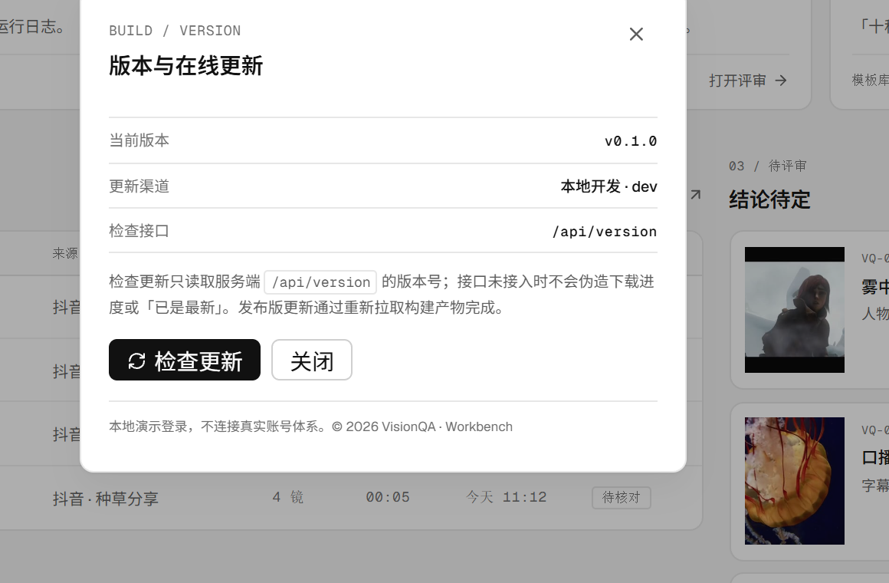

## 一、这一版做了什么

| 模块 | 真实能力 | 事实边界 |
| --- | --- | --- |
| 登录 | 注册 / 登录 / 登出 / 记住我 / 会话持久化，密码 scrypt 存哈希，会话服务端校验 | **没有找回密码、邮箱验证与角色权限**；注册默认关闭，加账号用 `npm run adduser`，见 [docs/accounts.md](docs/accounts.md) |
| 作品 | **一条内容一条记录**：`#/projects` 与 `#/projects/<id>`；只存「绑哪条模板 + 哪块画布 + 到哪一步」，脚本与分镜实时取自模板；作品页按「下一步」给一张主卡（开画布 / 送评审 / 继续改 / 交付）；改名、多版本对照（每版写清比上一版改了什么，任意两版可逐项看节点参数前后，并把两版评审结论、按严重度的问题数、交付状态与交时评审并排（交付后重评会单独写一条，不改写交时结论；可打印成 A4 对照纸带走，两版对照页也随交付包 `.zip` 一起给出，只读分享可另外选择带上这张纸，并可下载含现场页、评审对照与帧图的离线包；**标记交付时整套包当场封存，开新版或改模板之后旧版仍能原样下载，作品页的交付档案还能展开包内清单、复制 SHA-256，下载后拖回同一块就能在本机核对，服务器上那一份也能点「查一遍哈希」重算，丢了 / 大小变了 / 内容被换过都会直说；包里那份也不用解压：清单直接读包内目录，交付稿看原文、现场页进沙箱、帧图直接看，某一条 CRC32 对不上也会当场说；「体检整包」还会把每一条都解开重算一遍 CRC32，按偏移读、内存里最多一条，坏哪条点哪条，包被截断就说做不了；清单与单条预览也改成按偏移读，十个文件的包列一次目录只读 691 B，取一条就只读这一条；封存包还由定时任务每天自动巡检一遍，作品页写「上次巡检 …」与每一版自己的结论，坏了红字点名，不用谁记得点；交出去的包里还带一页 `校验.html`：收包人把 zip 拖进去就逐条对一遍 CRC32、并算出整包 SHA-256，不上传、不联网、不要账号；分享页的离线包也带同一页，拿到链接的人不用账号也能自己核，对不上的那条点名；核对完页面给一段**收据**（谁、哪一份、结论、整包 SHA-256、时间、坏在哪），可复制或存成 txt 发回给发件人，打印时按钮自动收起；**那段收据贴回作品页的交付档案就能跟封存包对一遍**（版次 / 包名 / 字节 / 整包 SHA-256 / 对方结论五项），结论记在那一条交付记录上，刷新还在；**回执链接让收包人自己贴，不用注册，结论直接写回同一条交付记录**，他贴过几次都留着：最新一次写在档案行，更早的在下面按时间倒序，谁贴的、差哪一项都查得到）；旧版脚本快照可点开看，归档版可**以这一版为底**再开一版）、运行按作品归集、脚本 copy-on-write、**只读分享链接**都已上线；**分镜每一镜有自己的画面槽**（v0.9.161）——可以把你出的图贴到某一镜、换一张或退回原片帧，评审页「这条作品的画面」直接挑这一镜去评，模板一个字不动；**每一镜还带一条现拼的出图提示词**（v0.9.164）——画面、机位与脚本拼成，可复制这一镜或整条，不调模型、不花额度，出图仍去无限画布；智能体草稿可**存为模板 / 送到画布** | 默认只存引用，脚本只在改过时复制一份；**没有作品级权限 / 协作 / 逐人访问明细**；分享只记打开次数与设备类别 |
| 交出去的（工作台） | 工作台把每一次交付摊成一条线：哪条作品的哪一版、什么时候交的、交时评审、现在还作不作数；**封过包的每一条带回收执的结论**（对得上 / 对不上 / 对方读不出来 / 还没收到），清单顶上按整份记录数一遍，对不上的另起一句；**点一行直接落在作品页那一版的档案上**，收据已经摊开、那一行标出来，地址带着交付记录 id（刷新 / 后退都还在这一版）；**又贴一次时，收据里多一句「和上一次比变了哪一项」**——哪一项从对不上变成对得上（或反过来）、结论怎么变、收据上换成了哪一串（v0.9.139–141）；**对不上的时候再收一句「下一步做什么」**——版次或包名不对、字节不对、只有哈希不对、哈希空着、对方读不出来各有一句判断和下一步，包对得上只是结论打架用警示色，看不出是哪一种就直说（v0.9.142）；**对不上的时候多一个「复制这段话」**——把两边值照抄收据，写清请对方怎么重验，一键复制去发（v0.9.143）；**还没回来的那一行说清等了几天、差在哪一项**——「发出 4 天」、超过三天换警示色、对不上时胶囊里写「差在整包 SHA-256」，行尾多一个「复制提醒」：复制一段带回收据链接的话，档案里记下催过几次，刷新还在（v0.9.144）；**还没回来的那一行还说这条链接送到没有**——收包人打开回执地址就记一次（只存哈希前缀、只分四类客户端、一分钟内刷新算一次），行上写「链接打开 1 次」或「链接还没打开」，一次都没打开的 title 里写「可能没送到，先把链接再发他一次」，顶上另起一句数一遍，作品页档案里写「打开过几次、最近一次」；升级前发的链接没有发出时间，一个字都不说（v0.9.145）；**知道之后下一步就在这一行上**——链接一次都没被打开过的那几行，按钮换成「再发一次链接」：点一下复制一段「那条链接你那边可能没收到，这里再发一次」，带回同一条地址与「打不开就说一声」，行尾另记「又发过 N 次」（与「催过 N 次」分开算），发到两次还没打开就直说「换个方式发（邮件 / 换个人）」，顶上另起一句数一遍（v0.9.146）；**那条地址发两遍都没打开，就地换一条新链接**——又发过两次还是没打开的那几行，按钮换成「换一条新链接」：点一下换一枚新 token（旧地址立刻打不开），复制一段说清「这是新地址、旧的那条已经作废」的话，打开次数与重发次数从零算起、换成「换过 N 次链接」，档案里带着「上一条发过 2 次没打开」；打开过的那条不给换（服务端也拦一道 409 LINK_OPENED），顶上另起一句（v0.9.147）；**换掉的那条旧地址自己会说「已经换成新的了」**——收包人从聊天记录点回旧的，得到的是「这条地址已经换成新的了 / 哪一天换的 / 旧地址从那会儿起打不开 / 用最后发给你的那条 / 手上的包不用重下」，不是「链接不在了」；换地址时只留旧 token 的哈希前缀（不留 token 本身，最多 5 条），打开旧地址不算打开那份包，也不把新地址交出去（v0.9.148）；**换掉的那条旧地址还被点着，发件人第一次看得见**——有人点回旧地址时记一次（只记次数与最近一次；五秒内连着来算一次，不记是谁、不记从哪来），行上单独一段写「旧地址还被点过 3 次」并给出下一步「他手上可能还是旧的那条，把现在这条再发一次」，收包人那一屏照旧只说「换成了新的」、不把次数说给他（v0.9.149）；**换过两次就不再给换第三条**——换地址换的是 token，不是渠道：绕不过去（工作台按钮没了、作品页那条一起消失，两个入口在服务端都回 409 LINK_ROTATE_LIMIT），行上多一段「地址换到头了」解释按钮去哪了，剩下的动作换成「问问收到没」：复制一段「是不是没收到」的话，带着现在这条地址（v0.9.150）；**收包人自己说一句话**——回执页多一个「东西收到了，正在验」：点一下只记这一刻（不比对任何东西、不改包、不改地址、不算打开次数、不顶作品排序），页面变成「已经告诉他了」、刷新还认得；工作台那一行行首从「还没收到回执」换成「他点了「收到了」，收据还没贴」，不再劝换地址 / 再发一遍，剩下的动作是「复制提醒」；清单顶上多一句「其中 N 次他自己点了「收到了」」，这几条从「可能没送到」那一堆里挪出去；作品页档案里多一行「他在回执页点了「收到了」」（v0.9.151）；**每一条交付还能写清「这是给谁的」**——同时交出去两三份时，作品页交付档案里写一个称呼（最多 24 个字），工作台那一行第一段就是「给王老师 · 内容组」，复制出去的提醒 / 重发 / 问话都用这个称呼开头；同一个称呼再存一次不写盘，清掉就回到「没写」，行上什么都不说；这个称呼只在发件人这一侧，包里没有，公开回... (line truncated to 2000 chars)
| 导航 | 一级只留四个去处：**工作台 / 作品 / 发现 / 模板库**；智能体 / **工作流** / **无限画布** / 视觉评审 / 运行记录退到「工具」区（v0.9.163 起两张画布各占一项）；可用 Ctrl / ⌘ + K 快速跳转任意页面与动作 | 智能体编辑器仍归在「智能体」项下；路由保持原样（`#/radar` 等旧地址照旧可用）；旧画布项目地址 `#/canvas/project/<id>` 自动改写成 `#/board/<id>` |
| 本地工作区（桌面端） | **loop、工具、会话记忆都在本机**：列目录 / 读文件 / 写文件 / 执行命令四个工具，写文件与执行命令必须逐次批准；会话落盘可续，上下文超预算先压成摘要；模型补全走账号会话（`/api/local-agent/complete`），密钥不下发 | 只在 Electron 外壳里出现，网页版打开 `#/local` 会如实说明不可用；**还没有安装包**（`npm run desktop` 起开发外壳，见第六十七节） |
| 发现（原爆款雷达） | 进页面**不自动检索**，点「检索」才发请求；卡片给播放 / 点赞 / 收藏 / 评论 / 转发与互动率；可「加入模板库」或「一键复刻」 | 抖音有播放量，小红书没有；取不到就隐藏，不做估算 |
| 一键复刻 | 视频解析 → ffprobe → FFmpeg 拆帧 → 逐帧视觉分析 → 入库，五步进度与实时日志 | 平台链接解析依赖红狐 Key；直链兜底可用 |
| 模板库 | **只存原链接 + 互动数据 + 解析出的脚本与分镜，不保存视频文件**；待解析 / 已解析两种状态，详情抽屉里可「去解析」；类型/关键词检索；送去评审 | 待解析条目没有帧图，封面走 /api/cover 代理 |
| 智能体 | 对话框式入口、参数行（智能体/输出/模型）、已自建智能体分类卡片、新建/编辑/删除；对话带**最近 8 条 / 6000 字**的会话记忆；脚本/分镜回复带**结构化草稿**，可存为模板、送到画布 | 记忆由服务端截断，超出部分不带；不落库；草稿只认回复里那段 ```draft JSON，模型没给就没有出口，不从正文表格反推 |
| 工作流 `#/canvas` | React Flow 节点编排（input/llm/kb/tool/condition/output）、检查器、连线校验、保存、逐节点运行；节点面板默认收起，双击画布或点「节点」唤出 | 只做编排与执行：v0.9.163 起不再嵌外部画布（见第二百三十节），运行是真执行、耗时真实 |
| 无限画布 `#/board` | 外部自由画布（canvas.wavisionai.cn）整屏嵌入：42px 状态条上换画布 / 新建 / 写笔记 / 专注 / 新窗口，`#/board/<画布ID>` 点名一块；报价按积分，余额与充值留在工作台 | 第三方应用、自带顶栏；连不上时只在这一页说明，不影响工作流与作品；画布项目与写笔记仍走 `/api/bdc/*`（本机 5312 / 5313） |
| 视觉评审 | 选画面 → visual-baseline 七维评审 → verdict + 像素锚点 + 有界修正建议 | 未启动 VisionQA 插件服务时由本地模型出一份同契约结果，provider 会写清 |
| 充值与积分口径 | **价格只有一种说法：积分**。`#/recharge` 选一档（默认体验 / 标准 / 团队，后台可改）→ 内测直充当场到账，余额、订单与积分流水三处对得上；积分口径只有一处（`VQ_POINTS_PER_CNY`，默认 1 元 = 10 积分），充值页、默认档位与外部画布的报价都读它 | 支付通道还没接入（商户号未下来）：「到账」是内测直充，不扣真实款项，页面逐字写明；`VQ_BILLING_MODE=off` 立刻退回「只能提交申请」 |
| 运行记录 | 读 data/runs.json，逐节点状态、耗时、输出；同一画布、或同一件作品另一版画布上的两次运行可逐节点对照，输出差异可按需展开 | 只有画布执行会产生记录；跨版本按节点 id 对齐；跨作品仍不可对照；差异只到行 / 160 字段落，不做字内高亮 |

导航分两层：一级 4 项「工作台 / 作品 / 发现 / 模板库」，下面是「工具」区「智能体 / 工作流 / 无限画布 / 视觉评审 / 运行记录」，底部只留设置；桌面端在这之间多一组「本机 › 本地工作区」。左上角只写 VisionQA，不放图形标记；导航只有 `src/nav.ts` 一份真源（第六十六节）。

> 2026-11-09 上线体检后，整块删掉了「资产库」（6 条假资产 + 假统计，没有后端）、内测测试版、登录页演示账号与访客入口、工作台的示例待办/最近复刻/待评审。逐项清单与「哪些是真的」判定见 [docs/launch-readiness.md](docs/launch-readiness.md)。

### 2026-11-10 这一轮（已上线）

| 改动 | 之前 | 现在 |
| --- | --- | --- |
| 雷达检索时机 | 切到爆款雷达就自动检索一次（按次计费） | 进页面只读健康状态；输入关键词点「检索」才请求，未检索时给明确的空状态 |
| 卡片数据 | 点赞 / 收藏 / 评论 / 转发 | 再加播放量与互动率（(赞+藏+评+转)/播放），排序支持按播放、按转发 |
| 雷达 → 模板库 | 只有「一键复刻」入库 | 新增「加入模板库」：只存原链接、作者、互动数据，不下载视频、不抽帧 |
| 模板库 | 每条都带本地帧图 | 待解析 / 已解析两态；详情里可「去解析这条」，复刻完成后同一条目升级，不重复占格 |
| 智能体对话框 | 输入框 + 参数行 + 提示行 + 独立发送键，改一次要滚 | 一块卡片：输入区在上，参数与「Ctrl + Enter + 发送」收在底部同一行；去掉「数量 1」与「真实调用本地模型」这类给我们自己看的文案 |
| 会话记忆 | 每轮只发当前一句 | 带最近 8 条 / 6000 字上下文（服务端截断），实测追问能接住上文 |
| 字体 | 从 fonts.googleapis.com 拉 Geist + Noto Sans SC 四套字重；中文用无 hinting 的网页字体，12px 发虚 | 去掉外部字体请求，Geist 拉丁子集自托管、中文用系统黑体；10px 微标签统一抬到 11px |
| 充值 | 无 | 新增 /api/billing/*（overview / orders）与设置页「充值」按钮；通道未开通时明确显示未开通、按钮不可用，不编价格 |

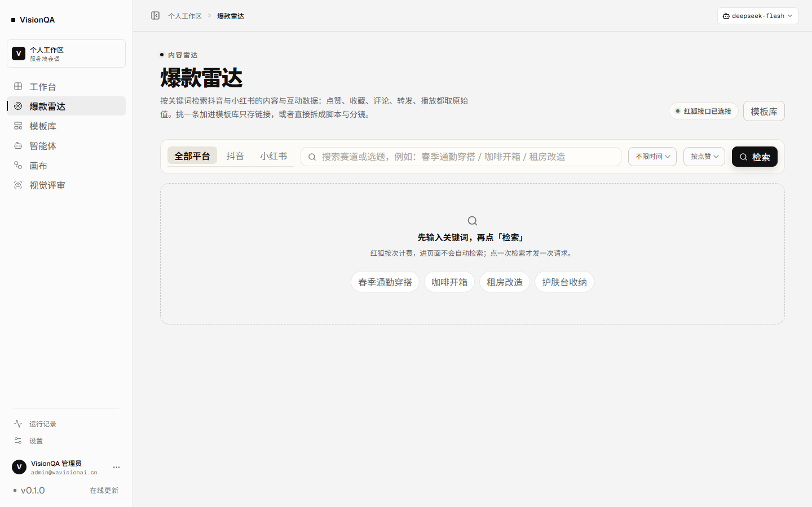


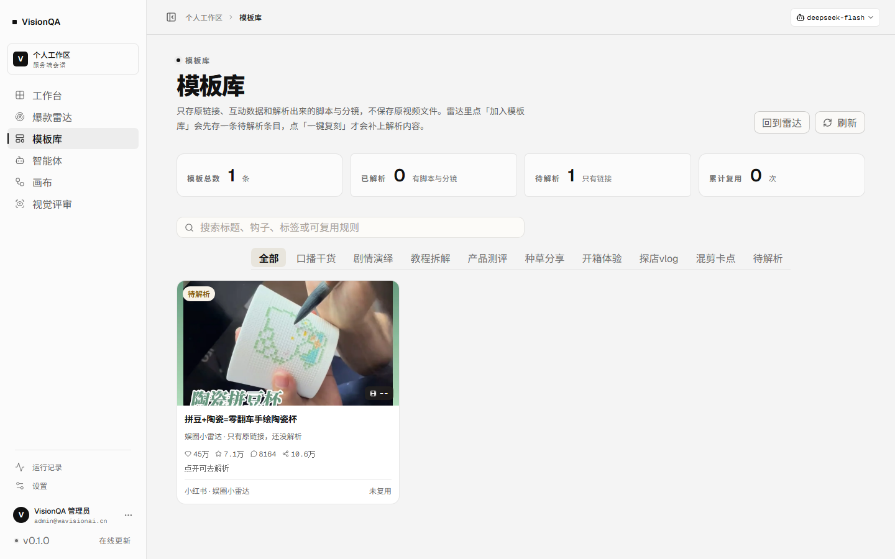

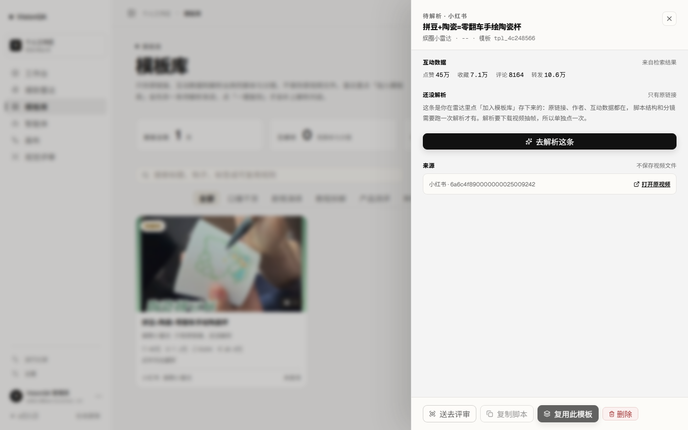

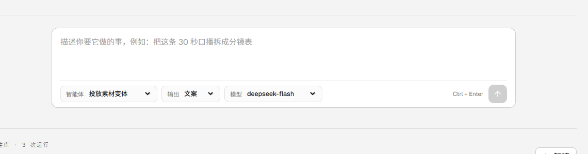

### 2026-11-10 追加：页头、运行记录溢出、入口 HTML 缓存

| 问题 | 原因 | 改法 |
| --- | --- | --- |
| 智能体页顶部「创作能力 / 智能体」 | 顶栏已经有「个人工作区 › 智能体」，页内又写了一遍虚构的上一层 | 删掉页内这行眉标（编辑页同改），全站只留顶栏一处面包屑 |
| 「已自建智能体」上方 | 「自建库 · N 次运行」和下面的标题说的是同一件事，右上角还有第二个「新建」 | 收成一行：标题 + 「N 个 · 累计 M 次运行」；新建只留页头那一个 |
| 参数胶囊的下拉 | 原生 `<select>` 弹出层会盖住输入框底部，样式也和发丝线不搭 | 换成自绘下拉：点击外部或 Esc 关闭、选中项加粗、展开时箭头翻转 |
| 运行记录页明显溢出 | `.runs-page` 漏写页面内边距，内容顶到侧栏和窗口边缘，左侧字看起来像被切掉 | 与工作台同一套 32px 内边距 + 1280 居中 |
| 工作台页头字体发虚 | 「工作台 · 用户 · 2026 年 11 月 10 日 · 星期二」整行等宽字体 + 中文混排，被 0.04em 字距拉散 | 拆成「工作台 · 用户 · 日期」，中文走界面字体、只有日期用等宽等宽数字；标题数字改 tabular-nums、分隔点降为 1px 灰 |
| 发版后仍看到旧界面 | nginx 直接托管 dist，`index.html` 没有 `Cache-Control`，浏览器按 ETag 启发式缓存旧 HTML，发版后继续加载旧 bundle | nginx 里 `location = /index.html` 写 `no-store, no-cache, must-revalidate`，`/assets/` 写 `immutable` 长缓存 |


同一轮还按上线前审计修了六处**会真出事故**的地方（登录暴破绕过、模板库并发写丢条目、失败任务残留临时目录、
模板帧图送评审路径错、安全响应头、数据零备份）：
`deploy/production/backup.sh` + `visionqa-backup.timer` 每天 04:10 把 `/var/lib/visionqa` 整目录打包到
`/var/backups/visionqa` 留 7 份（含 WAL，恢复时 SQLite 自己重放），已装并跑过第一次。
审计清单、未修的 P0/P1（配额闸门、多用户 ownerId、SSRF 超时、健康检查探上游……）逐条记在
[docs/launch-readiness.md](docs/launch-readiness.md) 的「三点八」。

### 视觉基线（去 AI 味）

界面按六条硬规则约束，细则与 token 表见 [docs/design-baseline.md](docs/design-baseline.md)：

1. **间距只走 4/8pt 栅格**——`--space-1..16`（4/8/12/16/24/32/48/64），组件里不出现 13/26/29 这类随手值；
2. **禁大面积渐变**——底板是纯色（`#f4f4f4` / `#fbfbfb` / `#ffffff`），彩色只留在「通过 / 待确认 / 问题」三个语义位；
3. **图标不用 emoji**——全部 lucide 线性图标，统一 1.5px 描边；
4. **字体显式指定**——Geist 拉丁子集自托管（52KB）+ 中文走系统黑体（苹方 / 微软雅黑），不再 @import fonts.googleapis.com；标题 500、正文 14、等宽元数据 11–12；
5. **文案给信息不给寒暄**——工作台页头是「3 项待办 · 3 条待评审 · 4 条今日入库」，不是「下午好」；
6. **颜色先 token 后动手**——六件套 `--canvas / --surface / --surface-raised / --ink / --muted / --line`，组件里不现调色。

这一轮把 8 张样式表里 449 处 off-grid 间距、495 处 `font-size` 收敛到栅格与字阶，标题字重统一降到 500，并把模板库「搜索框 + 9 个类型 chip 挤一行换行」重排成搜索一行、类型一行（下划线式 tab，横向不换行）：

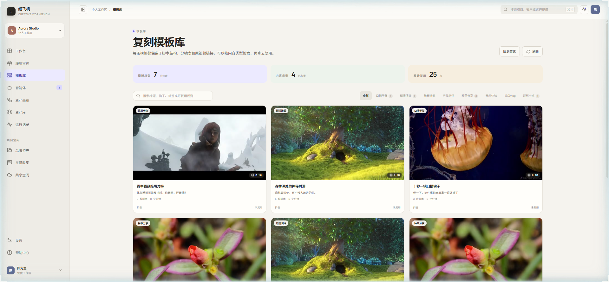


### 两个形态

对外只有一个形态：**用户生产版**。后台管理版不给普通用户看到，地址栏加 `?edition=admin` 才进得去，进去后侧栏有一条「返回生产版」。

| 形态 | 给谁 | 导航 |
| --- | --- | --- |
| 用户生产版 PRODUCTION | 内容团队日常用 | 工作台 / 爆款雷达 / 模板库 / 智能体 / 工作流 / 无限画布 / 视觉评审 +（横线下）运行记录 / 设置 |
| 后台管理版 ADMIN | 运维自己（`?edition=admin`） | 总览 / 账号 / 无限画布 / 模型 Key / 模型与上游 / 模板治理 / 成本 / 计费 / 举报处理 / 反馈 / 运行审计 / 系统 |

原来的「内测测试版 LAB」整块删除：接口体检、样例对照、功能开关、诊断导出四页里，开关全是「仅记录，尚未接线」，对照页的作用是把 `src/data/mock.ts` 的假数据摆在真实接口旁边——上线版不该带这种页面。
后台版每个数字都标「真实接口 / 本地会话」，没有接口的地方就写没有，见 [docs/editions.md](docs/editions.md)。

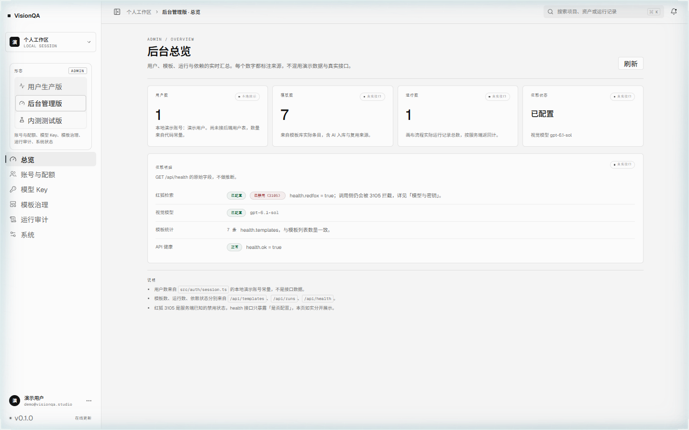


## 二、检索 → 复刻 → 模板库

爆款雷达按平台（抖音 / 小红书）、关键词、时间范围检索，卡片直接给点赞 / 收藏 / 评论 / 分享与时长；鼠标移到封面出「一键复刻」。


红狐账号不可用时（Key 禁用 / 积分不足 / 限流），界面明确说清并给后台链接：

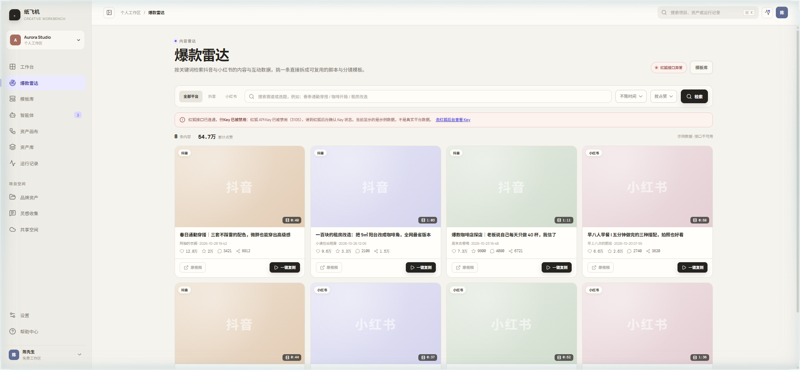

一键复刻跑五个可观测步骤：解析视频地址 → 读视频信息（ffprobe + 场景切镜）→ FFmpeg 抽帧 → 逐帧分析脚本与分镜 → 写入模板库。进度、每步状态、实时日志都在弹窗里。


模板详情里有脚本结构（钩子 + beats + 口播 + 屏幕字）、分镜表（画面 / 机位 / 字幕 / 声音 / 叙事作用 + 对应帧图）、爆款分析、可复用规则、原视频链接，以及「送去评审」——把这条模板的首帧直接交给视觉评审。


### 抽帧可以交给远端算力

「解析 → 下载 → 探测 → 抽帧」这四步默认在本机跑 FFmpeg。填一个 `REPLICATE_REMOTE_URL` 就整体挪到外部服务上，工作台只收帧、调视觉模型、入库，**服务器上不再需要跑 FFmpeg**。契约与参考实现见 [docs/remote-compute.md](docs/remote-compute.md)，仓库自带 `worker/video-worker.mjs`。

弹窗里会写明这次走的是哪条路——下图是远端算力实际跑通的一帧：`来源：远端算力 … · 5 帧 · 640×360`，前三个步骤（获取 / 探测 / 抽帧）由对方完成：

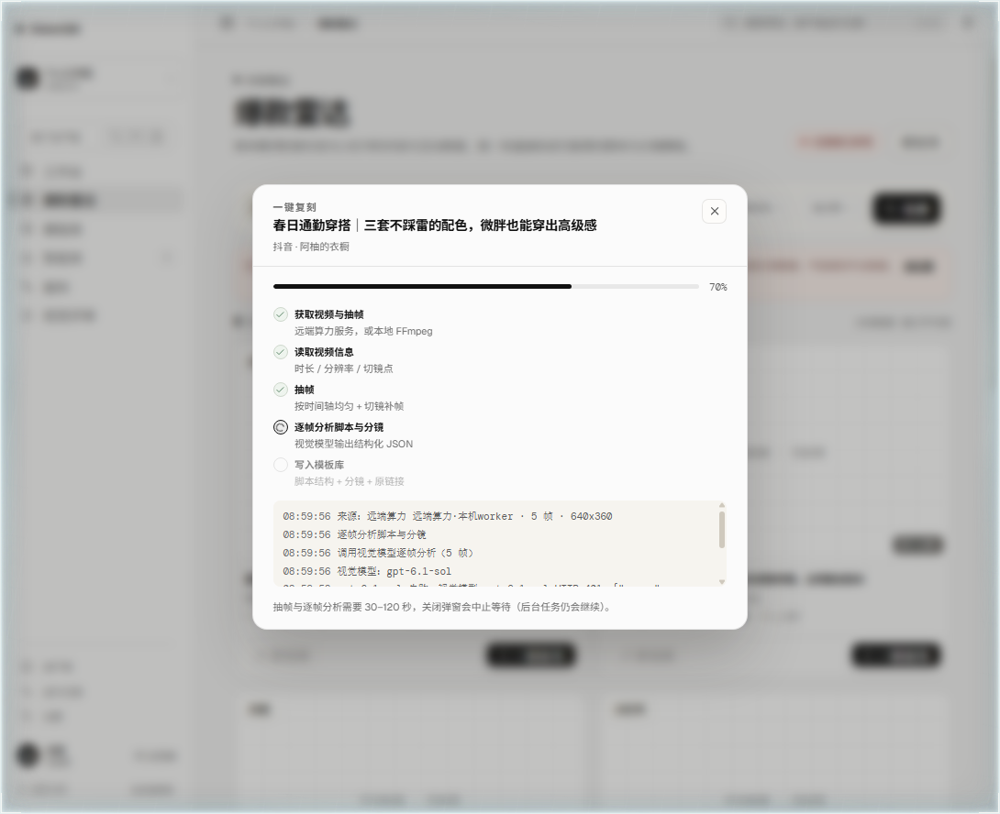

顺带把本机那两条 FFmpeg 命令也压了一轮：场景切点只解关键帧、18 次 spawn 合成一条命令，整条链路 **6.1s → 0.99s**（10 秒 640×360 实测）。

## 三、智能体：对话框入口 + 已自建智能体

进入「智能体」先看到的是一个 composer：描述你要它做的事，同一行选智能体、输出类型、模型、数量，Ctrl+Enter 发送。发送后进入对话，用户消息靠右、智能体消息靠左，运行中有计时，失败显示模型名 + 状态码 + 原因并可重试。


底部不是「精选作品」，而是**已自建智能体**：分类标签（全部 / 内容复刻 / 视觉评审 / 脚本分镜 / 投放素材）+ 卡片（名称、职责、模型、最近运行、使用次数），可编辑、可删除、可新建。


真实链路：POST /api/agents/:id/chat 把智能体的 systemPrompt、知识条目、本次输出类型和用户消息拼成 messages，调用本机模型（gpt-6.1-sol，失败按降级链换模型），返回真实回复并把 runCount 加一。实测一次口播分镜回复 44–52 秒，主模型过载时会降级到 grok-4.6 并在界面上标出实际用的模型。

## 四、画布：节点编排与真实执行

画布用 @xyflow/react 12 实现：中间画布 + 右侧检查器，**节点面板默认不显示**——双击画布空白处或点工具栏「节点」才唤出（Esc 收起），避免一进来就被一列按钮占掉焦点。连线校验（不允许自环、输入只接一根），节点可删，Ctrl+Z 撤销，画布状态存 data/flows.json。节点类型只有六类：输入 / 大模型 / 知识库 / 工具 / 条件 / 输出——**评审不进画布**，评审是独立页面（第五节）。


点「运行流程」由服务端按拓扑序执行：llm 节点调本地模型、kb 节点读模板库做上下文、condition 按表达式分支、output 汇总；每个节点返回 status / ms / output，节点在画布上逐个点亮，右侧抽屉同步显示每节点输出。


实测一条 6 节点流程（input → kb → llm → condition → tool → output）跑完 72.8 秒，llm 节点 72.8 秒（含模型调用），GET /api/runs 能查到逐节点结果。

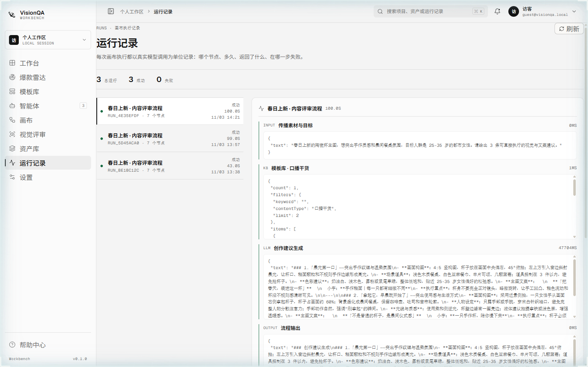

画布的参考来源与许可证（Langflow / Flowise / n8n / Dify / React Flow，未复制任何源码）写在 [docs/canvas-source-attribution.md](docs/canvas-source-attribution.md)。

## 五、视觉评审：VisionQA 的视觉能力怎么放进工作台

VisionQA 的定位不是「帮你想文案」，而是「给已经产出的画面下判断」。放进工作台后它有三个落点：

1. **独立页面**：选一张画面（模板首帧或图片地址）→ 出 verdict、逐条 observation（维度 / 严重度 / 像素锚点 / 置信度）、有界修正建议、无法判断清单。
2. **模板库出口**：模板详情里「送去评审」，把首帧直接带进评审页。
3. **画布不掺和**：评审不是流程节点，画布只做编排与执行——判断留在评审页，画布保持干净。


评审按 visual-baseline 七维（层级 / 对比 / 间距 / 字体 / 色彩 / 构图 / 可识别性）出结论，**每条判断必须给 bbox 锚点**，给不出锚点的降级为 info 或进「无法判断」。服务端实现见 server/review.mjs：优先调 VisionQA 插件服务（127.0.0.1:6300 的 /api/visual-review，同一套 v0.1 契约），服务没起来就退到本地模型的同口径评审，并把实际 provider 写进结果（截图里是 local-model:gpt-6.1-sol · 72.9s）。

契约映射、证据锚点格式与降级行为见 [docs/review-integration.md](docs/review-integration.md)。

## 六、VisionQA Canvas 接入（上游 BD Canvas 源码，Source-Available，不入仓）

画布这一块跑的是 **VisionQA Canvas**：源码来自 **BD Canvas**（Source-Available License v1.0，不是开源协议）的授权副本，本产品对外统一叫 VisionQA Canvas。上游条款禁止把源码或修改版以任何形式分发，也禁止把软件本身当产品卖，所以本仓库：

- **不 vendor、不提交** BD Canvas 的任何源码或构建产物（公开仓库提交就等于分发）；
- VisionQA Canvas 单独部署在本机，跑它自己的 5312（后端）/ 5313（后台管理）/ 6677（网页入口）；
- 工作台只做探活与内嵌：GET /api/bdc/status 探测这三个地址，画布页拿到 `deployed=true` 就**默认直接进 VisionQA Canvas 本体**；没有部署时仍是本仓库那套节点编排。
- 画布页是**沉浸模式**：第三方画布自带完整的顶栏与工具条，所以这一层不再叠标题和说明，只留一条 42px 状态条（署名 BD CANVAS / 连接状态 / 当前地址 / 新窗口 / 回到内置编排），画布铺满内容区、不套卡片不套圆角。画布页的主角是画布，壳让位。

部署记录、三个必踩的坑（Python 不在 PATH、requirements 少两个包、根 .env 没有代码读）与验收清单见 [docs/visionqa-canvas-integration.md](docs/visionqa-canvas-integration.md)，自检用 node scripts/check-bdc.mjs，重启用 `scripts/start-bdc.ps1`。

**当前状态（2026-11-05 实测）**：已解压到 `D:\Projects\bd-canvas`，5312 / 5313 / 6677 三端口都返回 200，`/api/bdc/status` 的 `deployed` 为 true，画布页由 VisionQA Canvas 接管，浅色纸面主题已覆盖；后台 `bdadmin` 初始密码已改。**还差模型 Key**——后台「Key 管理」为空，出图链路没通。

### 改名与顶栏对齐（2026-11-06）

产品名统一成 **VisionQA Canvas**，只改**用户看得见**的地方：网页 `<title>`、顶栏品牌、管理员登录页、新手教程页、桌面端画布标题、设置面板里的应用名、AI 人设前缀、`document.title` 动态标题。上游的版权声明（`copyrightBanner.ts` 归属串）、各文件头部的 `Source-Available License v1.0` 与 `LICENSE` 原文**一个字符都没动**——那是 §4.3 / §5.1 要求保留的署名。

顶栏几何也并进 `deploy/bd-canvas/vq-theme.css` 第 9 节，口径直接抄宿主 42px 状态条（`.cv-bdc-strip`）：**42px 高、底色 `#f4f4f4` 与宿主状态条连成一条、底边 `1px rgba(17,17,17,.10)`、页签 26px / 6px 圆角 / 12px 字、「后端未检测」做成 20px 等宽微标签**。于是「宿主状态条 + 画布顶栏」读起来是一条，而不是两层壳。

### 把它收进我们这套白纸墨线的语言

上游默认是 `#101113` + 蓝 `#6f9cff` + 青 `#22d3ee` 的深色霓虹调性，直接嵌进浅色工作台会读成「里面装了个别家的 App」。所以做了一层**只改配色与顶栏几何、不改组件结构**的主题覆盖：

- `deploy/bd-canvas/vq-theme.css`：它真正的色板在 `src/ui/styles/` 里分三层——`palette.css` → `themes.css`（`--ui-*` 语义层）→ `legacyAliases.css`（把旧 `--bg-*` / `--text-*` / `--border-*` 全部桥接上去）。所以只重定义**上游两层**（`--palette-*` 与 `--ui-*`）就能一次收口，并且是**往我们自己的浅色画布上靠**，不是另起一套深色皮肤：画布 `#f4f4f4`、卡片 `#ffffff`、次级 `#f0f0f0`、三级发丝线 `rgba(17,17,17,.06/.10/.20)`、文字 `#111 / #3f3f3f / #5d5d5d / #9a9a9a`、强调近黑、发光全 `transparent` 只留墨投影、点阵 `rgba(17,17,17,.10)`、语义色直接用我们 tokens.css 的 `#176b43 / #8a5b08 / #a33838`。
- `scripts/apply-bdc-theme.mjs`：幂等地把 css 复制进 `bd-canvas/public/`，并在 `index.html` 的 `</head>` 前插入/校正一行 `<link id="vq-bdc-theme" rel="stylesheet" href="/vq-theme.css">`（371121 → 371187 字节，去掉这一行可完整还原）。上游升级后重跑一次即可；`--check` 只校验不改。

**许可证边界**：LICENSE §3.2 允许为自用修改源码，§4.3 / §5.1 禁止删除、隐藏、篡改版权声明、水印与归属标识。所以：`src/features/license/copyrightBanner.ts` 的归属串、各文件头部的 `Source-Available License v1.0` 声明、`LICENSE` 原文**全部原样保留**；改动只限于**可见产品名**（标题、顶栏品牌、登录页、教程页、桌面端标题、AI 人设、`document.title`）与配色/顶栏几何（`deploy/bd-canvas/vq-theme.css`）。`vq-theme.css` 与脚本是我们自己写的、进本仓库，**上游源码一个字节都没进仓库**。

改色前（蓝青霓虹）：

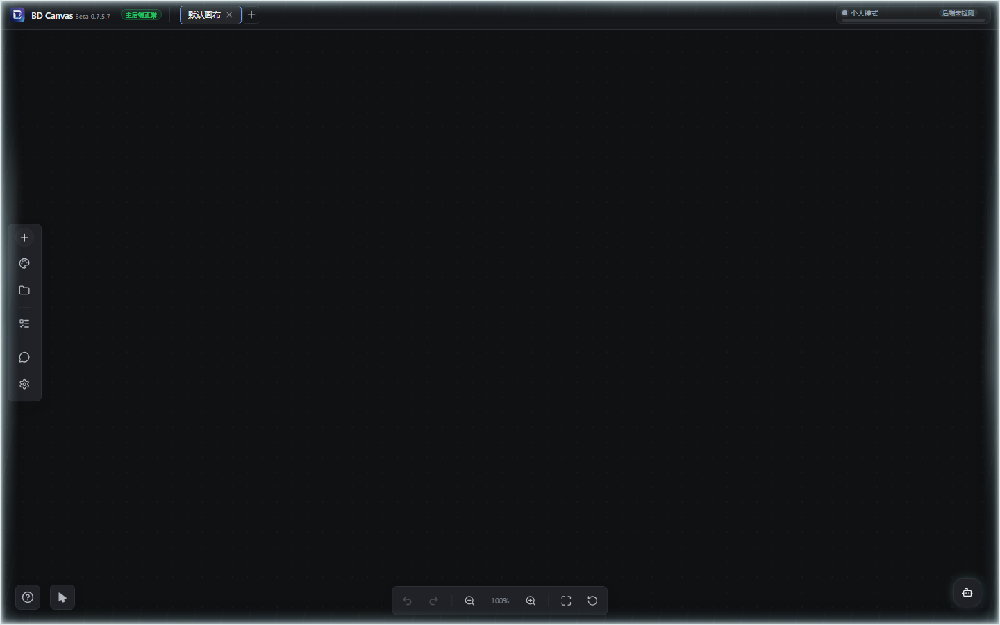

改色后（白纸 + 墨线 + 发丝节点卡，节点选中是 1.5px 近黑环）：


同一个画布按沉浸模式内嵌进工作台——两边现在是一套语言，不再像「里面装了个别家的 App」：


## 七、账号与会话（真实服务端）

登录不再是前端 mock。后端 `server/auth.mjs` + `server/routes/auth.mjs` 提供五个端点：`GET /api/auth/config`、`POST /api/auth/{register,login,logout}`、`GET /api/auth/me`。要点：

- **口令**：scrypt(N=16384, r=8, p=1) + 每用户随机盐，格式 `scrypt$N$r$p$salt$key`；库里没有明文密码。
- **会话**：32 字节随机 token，库里只存 `sha256(token)`；cookie 是 `HttpOnly; SameSite=Lax`，生产加 `Secure`。
- **不泄露账号存在性**：邮箱不存在时也跑一次 scrypt，登录失败统一 `field:'form'` + 「邮箱或密码不正确」。
- **限流**：同 IP + 邮箱 10 分钟失败 8 次锁；写请求校验 `Origin` 与 `Host` 一致，挡最省事的 CSRF。
- **受保护接口**：`VQ_REQUIRE_AUTH=1` 时除 `/api/auth/*`、`/api/health`、`/api/version` 外全部要登录，未登录返回 `{error:'未登录', loginRequired:true}`，前端收到就在 `src/api/client.ts` 派发 `vq:auth-required` 统一切回登录页。

**四个开关的默认值都在「不安全」一侧**（这是为了让本机演示不受影响），生产必须显式写：`VQ_REQUIRE_AUTH=1`、`VQ_SECURE_COOKIES=1`、`VQ_DEMO_ACCOUNT=0`、`VQ_REGISTRATION=0`（按需）。演示账号由后端 seed，密码通过 `/api/auth/config` 下发给登录页，**前端源码里没有任何密码**；关掉演示账号后登录页那块入口整体消失。

验收：`node scripts/test-auth.mjs` 起临时实例跑 16 项端到端断言（含「库里查不到明文 token / 明文密码」），全过；界面侧另做过一次真实点击：注册新账号 → 直接进工作台 → 退出 → 回登录页 → 错误密码给出统一提示 → 演示账号登录 → 进工作台。

没做的部分（别当成已经有了）：找回密码、邮箱验证、角色权限、多工作区、第三方登录。细节与接口契约见 [docs/accounts.md](docs/accounts.md)。

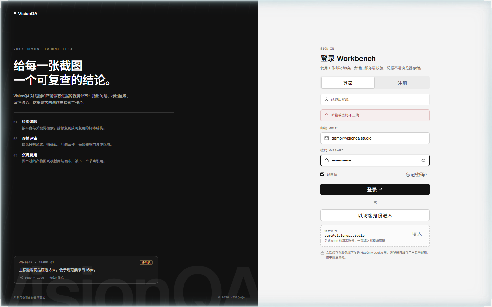

## 八、服务器配置

内测起步一台 **4C 8G / 100G ESSD / 5M 带宽**、视觉模型继续走 API、VisionQA Canvas 同机部署即可；**不需要 GPU**——评审 60–85s、智能体 20–50s 都是接口延迟。逐档配置、存储/带宽估算、以及上线前必须做的三件事（Windows 脚本换 systemd、JSON 换 SQLite、视频转对象存储）见 [docs/server-sizing.md](docs/server-sizing.md)。

**要真正对外上线**时看 [docs/deploy-production.md](docs/deploy-production.md)：域名与 DNS、Caddy 自动 HTTPS（`deploy/Caddyfile`）或 Nginx（`deploy/nginx.conf`）、systemd 守护（`deploy/vq.service`）、环境变量清单（`deploy/env.production.example`）、健康检查、备份恢复与日志轮转，都有可直接复制的命令和验收步骤。三条硬结论：node 只监听 127.0.0.1、公网只走反代；四个 `VQ_` 开关不写就等于裸奔；单机同时复刻不超过 2 路。

### 线上环境（已上线，2026-11-06）

| 项 | 值 |
| --- | --- |
| 站点 | https://visionqa.wavisionai.cn （80 端口 301 跳 https） |
| 机器 | 阿里云轻量应用服务器 2 vCPU / 2 GiB / 40 GB，华东2（上海） |
| 应用目录 | /opt/visionqa，git 部署，systemd `visionqa.service` |
| 数据目录 | /var/lib/visionqa（SQLite，含 auth.db） |
| 后端端口 | 127.0.0.1:8799（8787 被既有站点占用，所以换端口） |
| 反向代理 | nginx `/etc/nginx/conf.d/visionqa.wavisionai.cn.conf`：80 只做 ACME 挑战 + 跳转，443 终止 TLS 并反代 /api 与 /media |
| 证书 | Let's Encrypt（certbot webroot `/www/wwwroot/wavisionai.cn/acme`），到期 2027-02-04，续期不影响 443 |
| 登录账号 | 由服务器 `/opt/visionqa/.env` 的 `VQ_DEMO_EMAIL` / `VQ_DEMO_PASSWORD` 决定，改完 `systemctl restart visionqa` 生效 |

当前是**无模型 Key** 的形态：`/api/health` 里 `vision=false`，界面照常可用，模型下拉照实写「凭证未配置：选中模型也不会真正发起调用」，不假装有推理。

部署脚本（root）：

```bash
DOMAIN=visionqa.wavisionai.cn API_PORT=8799 SECURE_COOKIES=0 bash deploy/production/install.sh   # 装依赖 → 拉代码 → 构建 → systemd → nginx(80)
DOMAIN=visionqa.wavisionai.cn bash deploy/production/enable-https.sh                            # 签证书 → 换成 80 跳转 + 443 → 打开 Secure Cookie
```


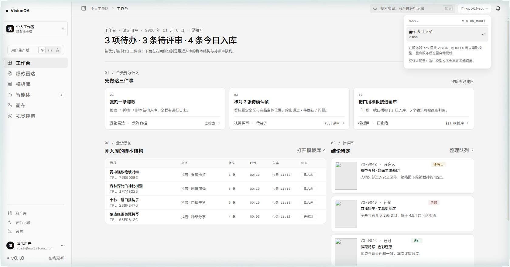

**模型切换的口子怎么用**：右上角模型下拉读 `GET /api/models`，目录来自服务器 `.env` 的 `VISION_MODELS`（逗号分隔，每项可写 `id|显示名`），没配就退回 `VISION_MODEL` + `VISION_FALLBACKS`；改完重启服务、刷新页面即可，**前端不用改一行**。公开匿名**拿不到**这份清单（`VQ_REQUIRE_AUTH=1` 时 401），只有登录后的界面能读；顶栏下拉只显示 VisionQA 产品名，真实模型 id 只用于请求。真正要发起调用时，把 `VISION_BASE_URL` / `VISION_API_KEY` 填进同一个 `.env`，`configured` 会变 true，下拉里的「凭证未配置」提示自动消失。

### VisionQA Canvas 同机部署（2026-11-06）

线上「画布」页里嵌的就是 BD Canvas 本体（真源码那套），不再是内置编排的替身。

| 项 | 值 |
| --- | --- |
| 站点 | https://canvas.wavisionai.cn （独立子域，80 跳 https） |
| 目录 | /opt/bdcanvas（git clone 私有仓库快照，venv 在 .venv，node_modules 走 npmmirror） |
| 服务 | systemd `bdc-web.service`（Vite 6677，只监听 127.0.0.1）、`bdc-api.service`（Flask 5312）、`bdc-enterprise.service`（Flask 5313） |
| 反向代理 | nginx `/etc/nginx/conf.d/canvas.wavisionai.cn.conf` → 127.0.0.1:6677；`/admin`、`/api/admin`、`/enterprise/admin` 只放行 127.0.0.1 |
| 证书 | Let's Encrypt（同一 ACME webroot），与主站互不影响 |
| 接线 | `/opt/visionqa/.env` 的 `BDC_WEB_URL=https://canvas.wavisionai.cn`，重启 visionqa 后 `/api/bdc/status` 变 `deployed: true`，画布页直接从「未发布」切成 iframe |

两个坑（都踩过）：

1. BD Canvas 的正式构建（`npm run build`）在当前源码里是坏的——`vite:esbuild-transpile` 在 `VideoFaceBlurEditor` 分块上拿到 `[object Object]` 就中断，去掉三个自定义 bridge 插件也一样。所以服务端跑的是它自己启动时用的那套 Vite dev server（6677），不是静态 dist。
2. `vite.config.ts` 默认把非 loopback Host 当「公网访客」，会 403 掉所有写接口。子域部署要把它加进 `TRUSTED_PUBLIC_HOSTS`（已改），同时加进 `server.allowedHosts`，否则整页 403。

**画布已加 Basic Auth**（2026-11-06 追加）：`canvas.wavisionai.cn` 默认 401，用户 `canvas`；iframe 走一次性入口 `/__auth?k=<token>` —— nginx 种 30 天 cookie 后所有资源请求免登录，所以嵌在 VisionQA 里不会弹登录框。`/admin`、`/api/admin`、`/enterprise/admin` 仍然只放行 127.0.0.1。VisionQA 侧新增两个环境变量：`BDC_EMBED_URL`（iframe 用，带 token）与 `BDC_WEB_PROBE_URL`（探活用本机 6677，避免 401 把 `deployed` 误判成 false）。

**外壳对齐（2026-11-06）**：主题只在 `deploy/bd-canvas/vq-theme.css`（部署方自用，不改它的组件结构），发布时拷成 `<canvas>/public/vq-theme.css`、在 `index.html` 里以 `#vq-bdc-theme` 引入。十节内容：

1. 第 1–8 节把它的 `--ui-*` 变量用 `:root:root` + `!important` 映射到 VisionQA 的 `tokens.css`——字体栈、6/10px 圆角、4/8pt 间距、`#f4f4f4` 画布 + 发丝线、单层轻阴影、等宽微标签。
2. 第 9 节管顶栏几何：`height: 42px !important`（只写 `min-height` 会被它自己的 48px 规则压住）、页签 26px/6px/12px、状态胶囊等宽 10px。
3. 第 10 节管左侧组件面板与右键菜单：面板 288px 白底 10px 圆角、44px 表头、分组标题等宽 10px/0.12em、行高 36px、图标方块 24px；右键菜单与节点创建菜单 208px 宽、行高 34px、快捷键右对齐（补了 `display:flex` + `margin-left:auto`，它原本是 `display:block`，标签和快捷键会挤在一起）。


**第三轮：外壳细节（2026-11-09）** 主题层第 11 节把剩下的界面统一成一套 4pt 栅格：

- 左侧功能轨：8px 内边距、32px 方形 8px 圆角按钮（原来是灰底圆形），悬浮 5% 墨色；
- 底部控制条：46 → **40px** 高（它的 `min-height: 44px` 要一起压，只写 `height` 不生效）、按钮 32px、缩放数字等宽 10px；
- 节点卡：标题 12/500、正文 13px/1.6、页脚等宽 10px、选中转单层墨色描边；
- 悬浮工具条 28px、参数面板 12px 圆角 + 等宽分组标签、输入框 6px 圆角聚焦转墨色、滚动条细化到 8px。

**顶栏状态改报真实结果（2026-11-09）**：品牌旁那颗探的是 `/api/health`（5312），5s 超时、30s 一轮，title 带状态码与耗时；右侧连接胶囊原本归管理服务状态管，未登录时恒为 `unknown` 所以永远显示「后端未检测」——现在宿主把真实探测结果写进 `setConnectionProbe()`，未登录也报真话（后端正常 / 后端断连）。


**细节第一轮：节点卡尺寸与空状态（2026-11-09）**

- **文本节点按「一页纸」定尺寸**：它自己会写 `_width/_height`（默认 360×220），但旧逻辑最后落到 `aspectRatio` 的 **1:1 方卡**上——评审结论三行就出滚动条。现在 `getNodeBaseSize()` 为 `text` 单独开一条分支按存储尺寸取值，写笔记用 420×300 + `_cardScale: 1`，五条结论一屏读完、不用滚动。
- **空白画布有了引导**：`#v2-canvas:not(:has(.v2-node))::after` 画一块虚线提示卡（13px / 白 70% / 10px 圆角 / 虚线发丝线）：「空白画布 · 左侧 + 新建节点，或把素材拖进来（Ctrl+V 粘贴）」。有节点后自动消失，纯 CSS，不动上游 DOM。

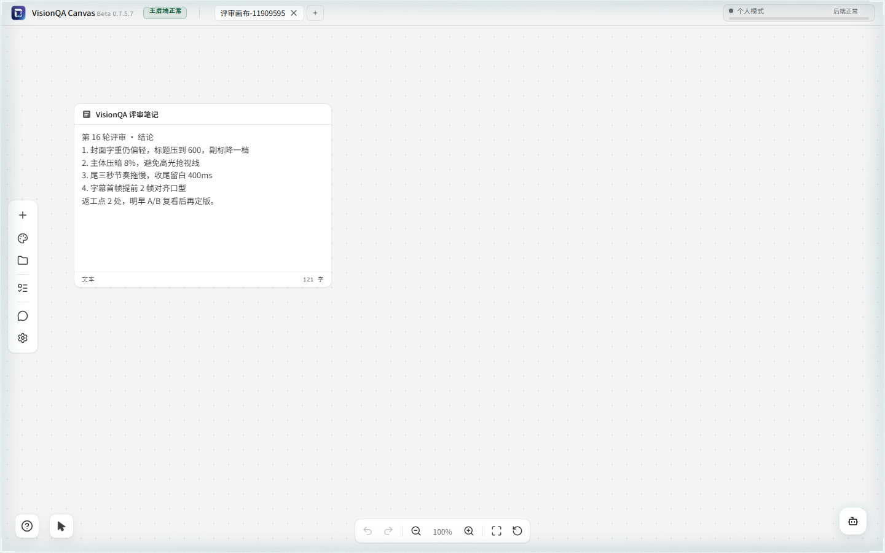


**细节第二轮：文本卡的内联样式控件（2026-11-09）** 文本节点没有模型参数面板（上游把它当「原地编辑」节点），所以样式控件直接做在卡片页脚，右对齐四颗 18px 小按钮：

- `A-` / `A+`：字号 10–22px，每次 1px；
- `LH`：行高在 1.4 / 1.6 / 1.8 之间循环；
- `M`：等宽字族开关（Geist Mono）。

样式写进 `node.params._vqText`，渲染时翻译成三支 CSS 变量（`--vq-text-size/-leading/-font`）由主题层消费；点按钮不整卡重渲染（文本框要保光标），直接把变量写到现有 textarea 上。线上实测：`13px → 16px` 时行高跟着到 `25.6px`，`M` 切到 `Geist Mono`。


**画布与工作台数据打通（2026-11-06）**：工作台不再只是「嵌一个 iframe」，它和后端共用同一批画布。

| 工作台接口 | 干什么 | 打到的画布接口 |
| --- | --- | --- |
| `GET /api/bdc/canvases` | 列画布（名称、节点数、版本、更新时间） | `GET /api/canvas/list` |
| `POST /api/bdc/canvases` | 建一块空画布（id 形如 `vq-*`） | `POST /api/canvas/save` |
| `POST /api/bdc/canvases/note` | 把评审结论落成画布里的一个文本节点 | `GET /api/canvas/load/:id` + `POST /api/canvas/save`（带 `expected_revision` 乐观锁，别人同时改了返回冲突而不是覆盖） |

界面就在 42px 状态条里：`画布项目` 下拉（选中即用 `&loadCanvas=<id>` 深链换画布，选中项记在 `localStorage`，刷新后仍然绑着同一块）、`新建`（建完自动绑定）、`写笔记`（写完 iframe 自动重挂载，立刻能看到那条文本节点）。

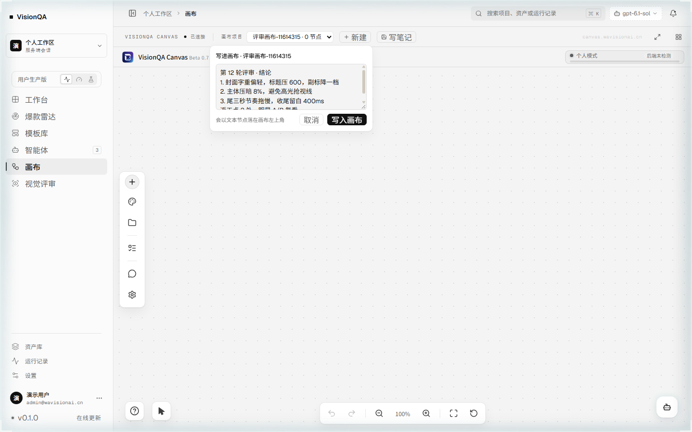


打通时踩到的三个硬点（都是上游行为，记住能省一天）：

1. **公网访客模式只读浏览器**：`isPublicWebClient()` 把任何非内网 Host 当公网访客，画布数据存 localStorage，服务端的画布永远加载不出来（深链报 `Load failed`）。改成把 `canvas.wavisionai.cn` 当「本机安装」（`runtimeMode.ts` 里加 `VITE_TRUSTED_HOSTS` 白名单），数据才落到服务端 workspace。
2. **一次性入口会吃掉查询串**：`/__auth?k=…&loadCanvas=<id>` 原本一律 `return 302 /`，深链参数直接丢。nginx 里补 `if ($arg_loadCanvas) { return 302 /?loadCanvas=$arg_loadCanvas; }`。
3. **文本节点的正文在 `prompt` 不在 `params.text`**：照它自己的 `createTextNode` 写——`{ type:'text', prompt: 正文, model:'text', params:{ _width:360, _height:220, _agentTextNode:true } }`，写进 `params.text` 的会显示成「0 字」。


## 九、怎么跑

依赖安装后起两个服务：后端 8787（同时托管 dist），前端开发 5191。守护脚本 keep-services.ps1 是单实例，掉了自动拉起，日志在 data/keeper.log。

| 命令 | 作用 |
| --- | --- |
| npm install | 装依赖 |
| node server/index.mjs | 后端 8787 |
| npm run dev -- --port 5191 --strictPort | 前端开发服务器 |
| powershell -ExecutionPolicy Bypass -File scripts/keep-services.ps1 | 常驻守护 |

环境变量放 .env（已 gitignore，模板见 .env.example）：

| 变量 | 用途 |
| --- | --- |
| REDFOX_API_KEY | 红狐检索 / 视频解析 Key（当前账号积分不足且 Key 被禁用） |
| API_PORT | 后端端口，默认 8787（监听地址写死 127.0.0.1，公网只走反向代理） |
| VISION_BASE_URL / VISION_API_KEY / VISION_MODEL | 模型通道，线上是 https://api.deepseek.com/v1 + deepseek-flash（文本与看图同一个模型） |
| VISIONQA_SERVICE_URL | VisionQA 插件服务地址，默认 http://127.0.0.1:6300 |
| VQ_REGISTRATION | 注册开关，**默认关闭**，只有显式写 1 才开放（以前是「不等于 0 就开」，漏配即公开注册） |
| VQ_ADMIN_EMAILS | 管理员邮箱（逗号分隔），可看全部数据、发放积分；库里 kind='admin' 等价 |
| VQ_CREDIT_WELCOME / VQ_CREDIT_SEARCH / VQ_CREDIT_REPLICATE / VQ_CREDIT_REVIEW / VQ_CREDIT_CHAT / VQ_CREDIT_FLOW_RUN | 初始积分与各动作单价，默认 100 / 2 / 10 / 5 / 1 / 2（画布整条流程跑一次） |
| VQ_CONCURRENCY_SEARCH / _REPLICATE / _REVIEW / _CHAT / _FLOW_RUN | 单账号并发上限，默认 1 / 2 / 1 / 2 / 1 |

## 十、接口

| 接口 | 说明 |
| --- | --- |
| GET /api/health | 服务与三个外部依赖的可用性（红狐 / 模型 / 模板数） |
| GET /api/auth/config, POST /api/auth/{register,login,logout}, GET /api/auth/me | 账号与会话（scrypt + HttpOnly cookie），契约见 [docs/accounts.md](docs/accounts.md) |
| GET /api/search | 红狐检索；不可用时返回 mode:'mock' + quota.code + 充值链接 |
| POST /api/replicate, GET /api/jobs/:id | 一键复刻流水线（五步进度） |
| GET /api/templates（含 ?kind=saved|replica）, GET /api/templates/:id, POST /api/templates/:id/reuse, DELETE /api/templates/:id | 模板库 |
| POST /api/templates/from-radar | 雷达卡片「加入模板库」：只落链接 + 互动数据，不下载视频（同一 sourceId 不会重复入库） |
| GET /api/billing/overview, GET/POST /api/billing/orders | 充值通道占位：未接入时返回 enabled:false、下单 501 BILLING_NOT_CONFIGURED，不伪造价格与订单 |
| GET/POST /api/agents, GET/PATCH/DELETE /api/agents/:id, POST /api/agents/:id/chat | 智能体与真实对话 |
| GET/POST /api/flows, PATCH/DELETE /api/flows/:id, POST /api/flows/:id/run, GET /api/runs | 画布与运行记录 |
| POST /api/review, GET /api/review/health | 视觉评审（service / local-model 两种 provider） |
| GET /media/frames/:id/:file | 抽帧静态文件 |
| GET /api/credits | 当前账号积分余额、单价、近期流水（检索 2 / 复刻 10 / 评审 5 / 对话 1，可用 VQ_CREDIT_* 改） |

## 二百七十二、快捷创作：脚本、Word、Excel、PDF 直接丢进来（r218 / v0.9.202）

上一版把回答做成流式，可用户手里最真实的东西——口播脚本、Word 的拆解稿、Excel 的复盘表、别人家的 PDF——
还是只能自己复制粘贴。这一版把附件接进对话框：**先在服务端读成文字，再连同问题一起问模型**。

- **四种格式，按内容认**：纯文本（txt/md/csv/json/日志/srt/代码，UTF-8 严格解，失败再试 GB18030）、
  `docx`（解 zip 取 `word/document.xml`）、`xlsx`（共享字符串 + 第一个工作表，单元格按制表符拼回）、
  `pdf`（解 FlateDecode 内容流，只取文字层）。全部自己实现，没有为了四种格式多吃一个依赖。
- **读不到就说清楚为什么**：扫描件 PDF 回「这份 PDF 里没有可读的文字（多半是扫描件或图片导出的）」，不做假 OCR；
  二进制回「这个文件按内容看不是文字」；9 MB 回「先压一下或截取要用的部分」。**不拿空内容去问模型**。
- **钱的口径**：附件**先解析再扣费**，附件本身不合规（超过 5 个、读不出来）一分钱不扣；
  别人的、已删除的附件在发送时跳过，并在上下文里写明「这次没带上」，不让回答假装看过。
- **上下文口径**：抽出来的文字跟着那条消息进上下文，只给最近 6 条留正文（更早的只剩文件名）；
  单文件封顶 20000 字、一条消息合计 24000 字，超了标「已截断」。
- **能自证**：点附件名字打开「平台读到的到底是什么字」的原文预览；发出去以后用户那条消息下面保留附件胶囊，点开还能回看。
- 接口：`POST/GET /api/chat/files`、`GET/DELETE /api/chat/files/:id`，发送时传 `files: ["cf_…"]`；
  上传走原始字节 + `x-file-name` header（不解析 multipart），读、删都按归属校验。

**验收**：本机临时实例 8813 + 本机假上游 8898，**0 次真实上游调用、0 元**。
门禁 `npm test` **1444/1444**（新增 6 条：Word/Excel/PDF/纯文本解析、二进制与扫描件明确拒绝、附件进上下文、
跨轮上下文与归属隔离、超限不扣费、截断）、`tsc -b` 干净、lint 0 error（25 warning 含解析器里两条正则字符类提示）、
`npm run build` 通过（入口 `index-C2CbrBFw.js`）、密钥扫描无命中。
端到端用无头浏览器真选文件、真点发送：2 个胶囊「口播脚本.txt 73 字」「参考脚本.docx 38 字」，
流式回答直接引用脚本第一句「开场三秒要抓人」，假上游收到的上下文里 txt 与 docx 两份文字都在；390 宽无横向溢出、0 个 JS 异常。

生产：**0.9.202** 已上线，`/api/version` 0.9.202、health `ok` templates 26、入口 200、未登录打 `/api/chat/files` 与 `/messages/stream` 都是 401。

**边界**：**没有 OCR**——扫描件 PDF 与图片里的字读不出来，会直说（OCR 要调视觉模型，等授权）；
没有图片理解进对话、没有语音；表格只读第一个工作表与单元格的值，PDF 只读文字层、不还原排版；
附件原文只在服务端留最近 20 份；上传不查毒，只按内容判断是不是认得的格式；回答仍是纯文本（无 markdown / 代码高亮）。
文档见 `docs/quick-create-attachments-2026-11-18.md`。

## 二百七十三、快捷创作：消息里的链接，平台自己读（r219 / v0.9.203）

r214 的「读链接」是上游服务端工具（`deepseek_read_url`）：**一把 Key 不认它，整条请求就 400**，按钮亮着却报错；
而且读完只把结论塞进回答，用户没法核对。这一版把读链接搬到平台本地：
消息里出现网址、且「读链接」开着时，**服务器先把那一页读成文字，再连同问题一起问模型**。

- **读到什么能自己看**：你那句话下面出现胶囊（页面标题 + 字数），点开着有全名；打不开的是虚线「没读到」，
  鼠标停上去是原因（HTTP 404 / 页面没正文 / 不是网页…）。页面正文只在服务端上下文里，**不进会话文件**。
- **一次最多 2 个链接、每条 12000 字**，超了标「已截断」；读到的文字与附件共用同一套上下文口径
  （最近 6 条留正文、单条 24000 字封顶）。
- **内网防护**：只认 http/https；域名先解析，解析结果落在本机 / 局域网 / 169.254 / CGNAT / 组播就拒绝；
  最多 3 次跳转、**每次跳转都重新校验**（挡住公网 302 跳到 127.0.0.1）；8 秒超时、3 MB 封顶、不执行脚本、不带 cookie。
- **读不了就说清**：需要登录、靠 JS 渲染、扫描件 PDF、压缩包与图片，都直接说，不做假 OCR。
- **钱的口径**：链接在读之前先读、读完才扣费；某个链接打不开只是「这条没读到」，这次对话照常回答、照常只扣 1 积分。
- 上游不再收到 `deepseek_read_url`；联网搜索仍走上游工具（**至今没有真实上游验证**，这条照实说）。

**验收**：本机临时实例 8814 + 本机假上游 8899 + 假网页 + 无头浏览器真点，**0 次真实上游调用、0 元**。
门禁 `npm test` **1458/1458**（新增 11 条读链接单测 + 3 条对话集成：进上下文 / 开关关着不抓 / 打不开仍回答）、
`tsc -b` 干净、lint 0 error、`npm run build` 通过、密钥扫描无命中。
端到端：胶囊「三条口播测试页 54 字」，假上游收到的上下文里有页面正文「开场三秒要抓人」、没有页面里的 `<script>`，
回答引用页面内容，会话里 `links[0].ok === true`；390 宽 `innerWidth = scrollWidth = 390`、0 个 JS 异常。

生产：**0.9.203** 已上线。

**边界**：DNS rebinding 未堵（不带登录态，最多拿到内网页面文字）；一次 2 个链接；不读要登录/要执行 JS 的页面；
不解析网页里的附件；联网搜索仍是未验证的上游工具。文档见 `docs/quick-create-links-2026-11-18.md`。

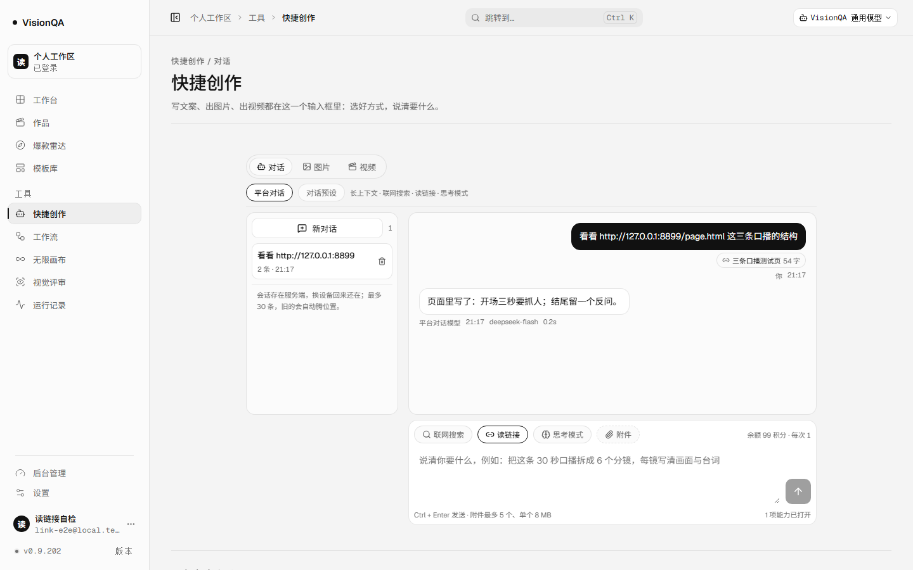


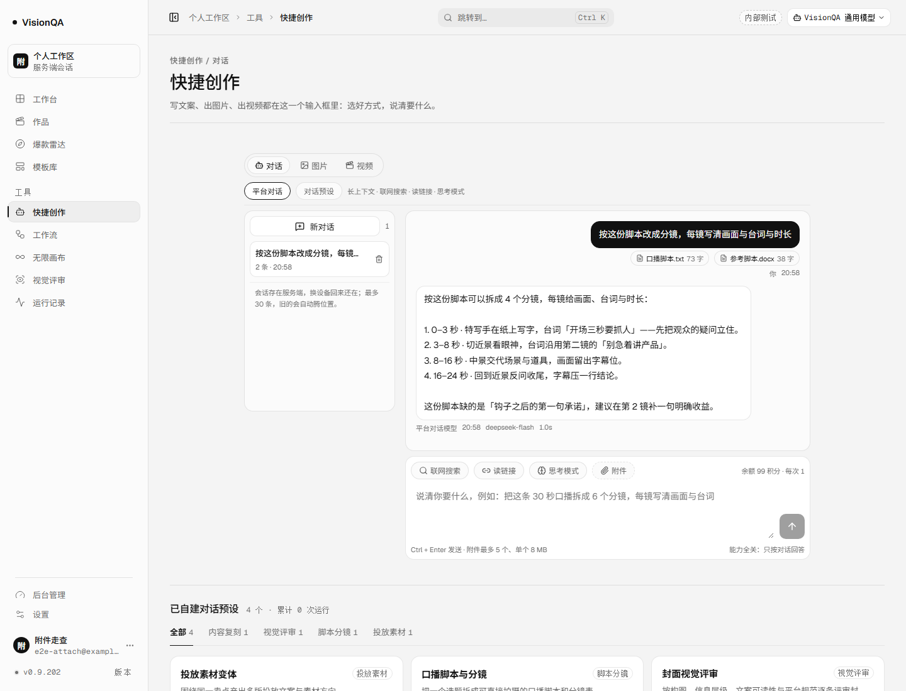

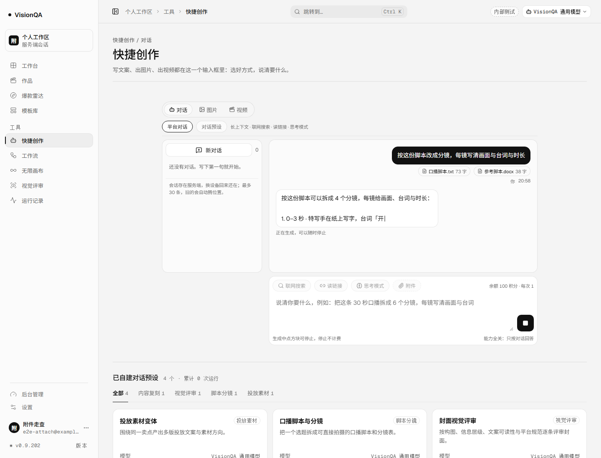


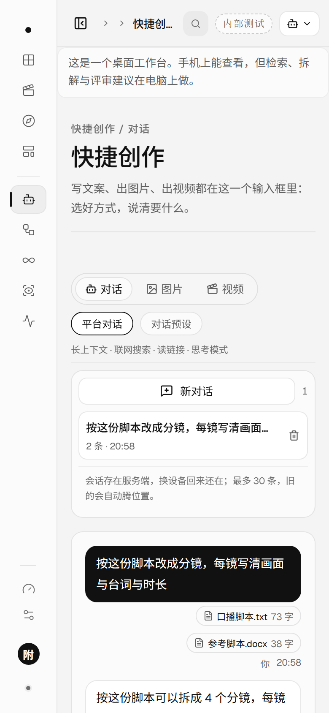

## 二百七十四、快捷创作：回答按 Markdown 排版，不再吐出 \*\*星号\*\*（r220 / v0.9.204）

平台对话的回答一直是纯文本：模型写 `## 结构`、`**结论**`、`| 时间段 | 动作 |`，界面上就原样显示这些符号。
回答一长（拆结构、列分镜、给对照表）就读不动，用户的原话是「至少让我看得清楚字是啥」。

这一版把自建智能体那套极简 Markdown 渲染抽成两个共用模块：

- **解析**在 `src/lib/markdown-parse.ts`（纯数据、能用 node:test 单测），**渲染**在 `src/lib/markdown.tsx`（React 节点）。
- 覆盖：标题、有序/无序列表、表格、代码块、引用、分隔线、加粗、行内代码、链接。
- 链接只放行 http / https / mailto；`javascript:`、`data:` 按原文显示，不当链接。
- 全程不用 `dangerouslySetInnerHTML`，模型写什么都不会变成脚本（和 r219 读链接同一原则）。
- 助手气泡 14px → **15px**；用户自己发的话仍按纯文本显示，不解析。
- 窄屏（≤560）表格 `min-width: 0` + `table-layout: fixed` + 12px：`nav.css` 给对话预设留的 480px 下限在这里收回，
  390 宽不再有 252px 横向滚动条。

**验收**：本机临时实例 + 本机假上游 + 真浏览器，**0 次真实上游调用、0 元**。
门禁 `npm test` **1467/1467**（新增 9 条解析单测）、`tsc -b` 干净、lint 0 error、`npm run build` 通过、密钥扫描无命中。
端到端渲染出：H3「三秒钩子脚本」、H4「结构」、1 个加粗、2 个列表（各 2 条）、2 行表格、1 个引用、1 条分隔线、
1 个 `https://` 链接、代码块首行 `const hook = (line) => l…`；正文不再出现 `**` 与行首 `|`；
1440 宽无横向溢出；390 宽 `innerWidth = scrollWidth = 390`、气泡与表格横向溢出均为 0（改前表格 252px）、
代码块内部横滚 153px（代码不折行）；0 个 JS 异常。

生产：**0.9.204** 已上线。

**边界**：不是完整 CommonMark（不做嵌套列表、图片、脚注、表格对齐、HTML 直出）；流式过程中仍显示原文，
回答结束才排版（避免半截代码块让整段跳动）；代码块在窄屏内部横滚。文档见 `docs/quick-create-markdown-2026-11-18.md`。


## 二百七十五、快捷创作：手机上的会话列表收成一条，回答区从 48vh 放到 58vh（r221 / v0.9.205）

手机上（≤900px）快捷创作原来是一列排：会话列表先占 200px，回答区被压到 48vh，输入框还在这之下。
列表里只有标题和「几条 · 时间」，却比回答还占地方——长回答一进来只能在一个 405px 的小窗里读。

这一版把列表收成一条：

- 窄屏默认只留一条 32px 的「历史对话」条（整块 50px），有当前会话时条上写它的标题；
- 点开才展开列表，最高 40vh、内部滚动，再点收起；选完一条或点「新对话」自动收起；
- 「会话存在服务端…」那句提醒在手机上藏起来（右边就是条数），桌面上照旧；
- 回答区 **48vh → 58vh**（844 高的手机上 405px → 490px）；
- 桌面（>900px）一点没动：左栏仍是 240px，折叠按钮在桌面上 `display: none`。

**没做「整页滚 + 输入框贴底」的原因**（写清楚，免得以后有人以为是漏的）：这一页真正的滚动容器是文档本身，
`.vq-content` 写了 `overflow: auto` 在窄屏却不滚（scrollHeight 与 clientHeight 都是 2740），
sticky 的参照是最近的滚动容器，所以输入框根本贴不住底（实测滚到 620px 时输入框 top=899，已在屏幕外）。
回答区自己滚反而更适合：边生成边看时，新字进来只滚回答区，整页不跟着跳。

**验收**：本机临时实例 + 假上游 + 无头 Edge，6 条会话，**0 次真实上游调用、0 元**。
门禁 `npm test` 1467/1467、`tsc -b` 干净、lint 0 error、`npm run build` 通过、密钥扫描无命中。
实测 390×844：会话列表整块 **50px**（改前 200px）、折叠按钮 32px、回答区 **490px**（改前 405px）、
选完会话后列表 display: none、`innerWidth = scrollWidth = 390`；展开时列表 338px（上限 40vh）内部滚。
1440：折叠按钮 `display: none`、左栏 240px / 470px 高、回答区上限 56vh，与改前一致。


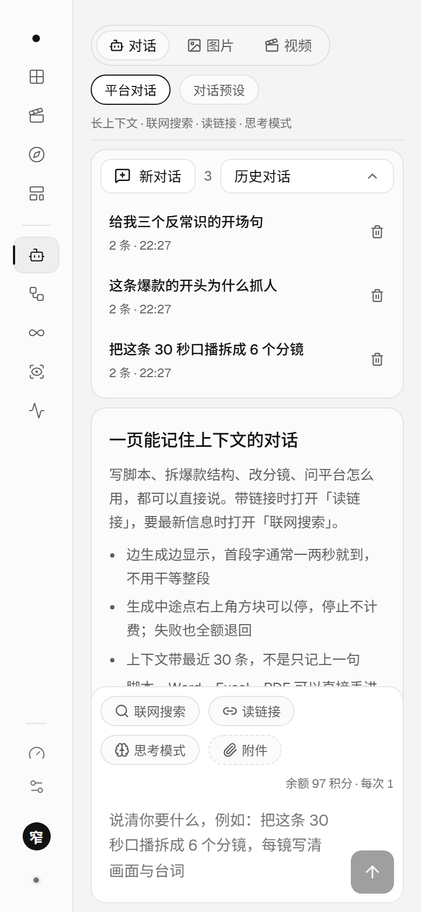

**边界**：手机上回答区仍是固定高度、内部滚动；输入框仍在回答区下方，页面头部本身约 300px，
844 高的屏要看到输入框还得往下滚一点（既有结构，本轮没动）；展开状态不记忆，刷新回收起。
文档见 `docs/quick-chat-mobile-2026-11-18.md`。

## 二百七十六、快捷创作：手机上整页滚、输入框贴在屏幕底部（r222 / v0.9.206）

r221 把会话列表收成一条之后，手机上的输入框还在回答区下面：页面头部本身约 300px，
844 高的屏要打字得往下滚，滚下去又看不到回答。这一版把它改成手机上真正的对话形态：

- 回答区不再自己滚（去掉 58vh 小窗），**整页滚**，读到哪算哪；
- 输入框 **sticky 贴屏幕底部**（离底 8px），滚到哪儿都在；滚到最底时底部留 272px 的 `scroll-margin`，
  最后一段回答不会被输入框挡住；
- 手机版头收一档（标题 22px、说明收进空状态，只在 ≤560 生效），省下来的高度给对话；
- 输入框自己从 241px 收 **201px**：手机上藏掉「Ctrl+Enter 发送」那行（手机上没这个键）、
  文本域 56px、去掉拖拽手柄；
- 桌面（>900）完全不变：仍是回答区自己滚（56vh），Ctrl+Enter 提示也还在。

**sticky 贴不住底的真因**（上一轮判断过、这一轮修掉了）：`.vq-content` 写了 `overflow: auto`。
按 CSS 规则，祖先只要**有滚动框**就成为 sticky 的参照，哪怕它从不滚动——它的滚动位置永远是 0，
按钮就跟着内容一起走。窄屏本来就是文档级滚动，于是这一档把 `.vq-content` 的 `overflow` 放开成 `visible`，
参照回到视口，按钮才贴得住。真会横向撑开的容器各自有自己的 `overflow`，不受影响。

**验收**：本机临时实例 + 假上游 + 无头 Edge，3 条会话，**0 次真实上游调用、0 元**。
门禁 `npm test` 1467/1467、`tsc -b` 干净、lint 0 error、`npm run build` 通过、密钥扫描无命中。
390×844 实测：输入框在「空状态 / 展开列表 / 选完会话 / 滚到顶端 / 滚到中途」五种状态都是 595–836（在视口内）；
选完会话自动滚到底时最后一段回答 bottom 539，落在输入框上方没被挡；回答区高度 1144px（改前固定 490px）；
输入框 201px（改前 241px）；`innerWidth = scrollWidth = 390`。
横向溢出：390 / 320 两档 × 9 个页面逐页量，`documentElement.scrollWidth` 全部等于 `innerWidth`（页面级横向滚动 0 处）。
1440：输入框 `position: static`、回答区上限 56vh、版头与说明照旧、左栏 240px。


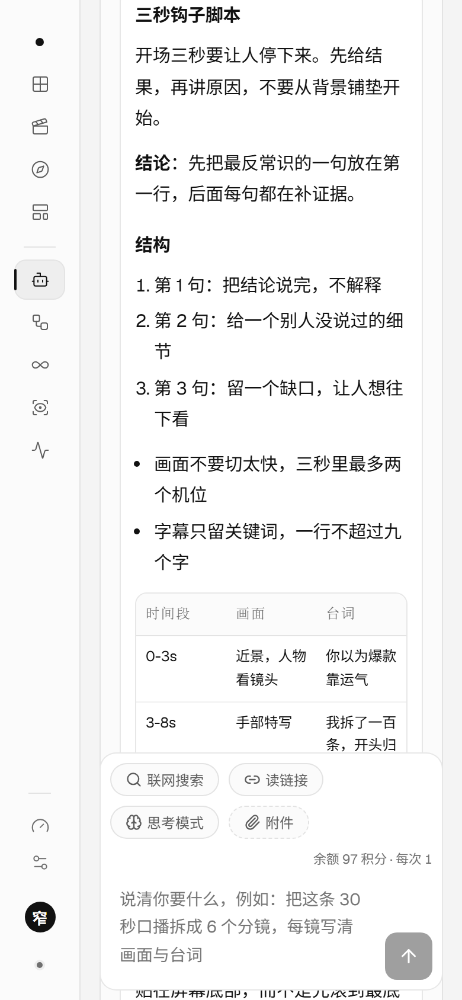

**边界**：手机上输入框常驻占 201px（约一屏 24%，工具行在 390 宽折两行）；平台对话时页面下方仍列着
「对话预设」卡片库，滚到卡片区输入框会自然松开（既有结构，要不要收起来待定）；桌面没有跟进 sticky。
文档见 `docs/quick-chat-mobile-scroll-2026-11-18.md`。

## 二百七十七、快捷创作：手机输入框 201 → 148px，四个能力挤进一行（r223 / v0.9.207）

r222 把输入框贴到屏幕底部之后，它一直占 201px（844 高的屏 24%）。拆开看两块：能力行 88px——
四个按钮（联网搜索 / 读链接 / 思考模式 / 附件）在 390 宽折成两行，余额那行还单独占 16px；
文本域 87px——`rows=3` 撑出来的三行，随手问一句用不到。读回答时这四分之一屏一直在。

这一版只动手机两档：

- 能力按钮在手机上换成两个字（联网 / 链接 / 思考 / 附件），一行放得下；完整名称留在 `title` 与 `aria-label`；
- 触摸目标反而变大：**28px 高 / 12px 字 → 32px 高 / 13px 字**，收高度不靠抠小的；
- 余额独立一行、12px（仍一直看得见）；文本域固定 **64px**（两行），提示语缩到两行放得下；
- 320 窄机文本域给到 88px，不把提示第三行切一半；末尾 `scroll-margin` 从 272 收到 200；
- 桌面（>560）一点没动：全称标签、文本域 87px、Ctrl+Enter 提示行照旧。

**验收**：本机临时实例 + 无头 Edge，一条带表格与列表的会话，**0 次真实上游调用、0 元**。
390×844 输入框 **201 → 148px**（−26%），能力行 58px（一行按钮 + 余额）、文本域 64px；
自动滚到最新回答时 composer 668–816、最后一段 bottom 631（37px 空隙）；滚到顶 composer 688–836 仍在视口内；
文本域 `scrollHeight = clientHeight`（不切字）。320×720：186px、文本域 88px、不切字、`scrollWidth = 320`。
1440×900：composer 165px、全称标签、`position: static`，与改前一致。
门禁 `npm test` 1467/1467（首轮 media-gen 冷却用例在并发下假失败，单跑 18/18、重跑全绿）、`tsc -b` 干净、
lint 0 error / 26 warning、`npm run build` 通过、密钥扫描 920 文件无命中。


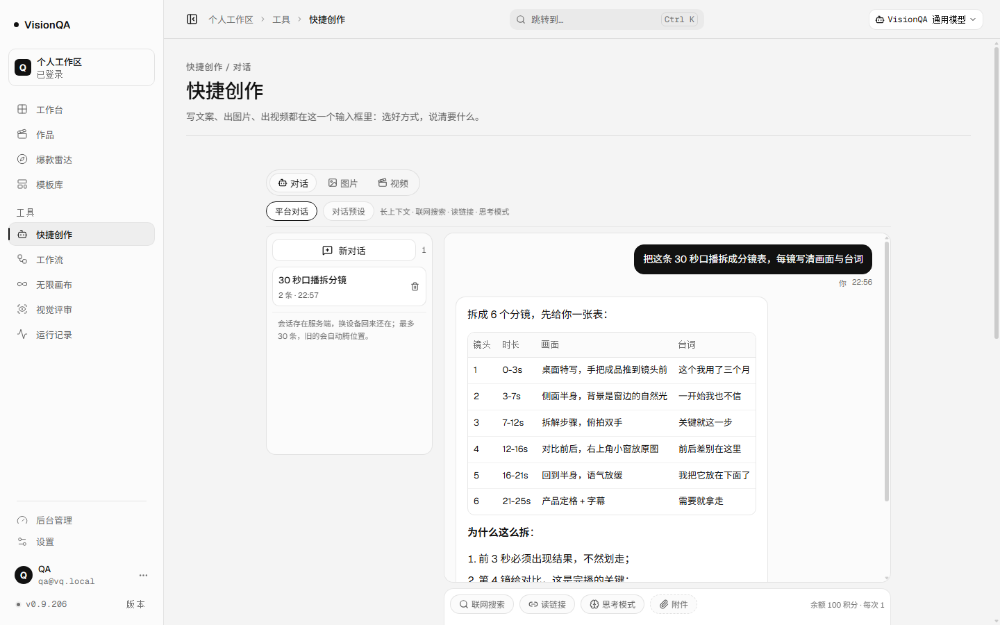

**边界**：148px 仍占一屏约 17.5%，余额那行（26px）还能再挪进会话条，但 390 宽下会话条已经很挤；
平台对话时页面下方仍列着「对话预设」卡片库，滚到卡片区输入框会自然松开（不在对话面板里了，r225 起手机上已把这块收起来）；
文本域固定两行，手机上不能再拖高。文档见 `docs/quick-compose-2026-11-18.md`。
## 二百七十八、手机端第二轮：桌面提示条可以关掉、回答里的表格改成逐行卡片（r224 / v0.9.208）

r223 之后继续按清单往下走，处理的都是手机上看得见、但一直没人管的两处：

- **「这是一个桌面工作台」提示每页都顶 71px**：翻十页就看十遍同一句话。现在右侧多一个 ×，
  点过之后这台浏览器不再出现（`localStorage: vq_mobile_note_seen`），390 宽一条 57px、320 宽 77px；
  隐私模式下写不进去就照常显示，不假装记住。
- **回答里的 4 列表格在 390 宽每列只剩 2～3 个字**：「对比前后，右上角小窗放原图」被切成六行，
  时长「16-21s」孤零零立着。≤560 改成一行一张小卡片，表头变成每格前面的小标签
  （镜号 1 / 时长 0-3s / 画面 … / 目的 …），桌面 >560 仍是原来的表格。
- 顺带两处：320 宽「对话 / 图片 / 视频」三枚页签各折成竖排两字（≤360 去掉图标让标签横排）；
  余额行一直写「每次 1」没单位，改成「每次 1 积分」（桌面同样生效）。

390×844 实测：提示条 56–113（57px），点 × 并刷新后页高 2935 → 2870，提示不再出现；
卡片宽 230、6 行每行 147px、容器不横滚；输入框 668–836（148px，与 r223 一致）。
320×720：提示条 77px，页高 3198 → 3113，卡片宽 160，整页 `scrollWidth = 320` 不溢出。
1440×900：提示条 `display: none`，四列表格原样（高 264），输入框 165px，都没动。
代价照实说：同一张 6 行表在 390 从 581px 变成 820px（+239px），换的是「一格一行字」而不是「每列 2～3 个字」。

门禁：`npm test` **1472/1472**（新增 `test/mobile-note.test.mjs` 5 条）、lint 0 error / 26 warning（599 文件）、
`tsc -b` 干净、`vite build` 干净（入口 `index-CS1pg49g.js`）、密钥扫描 921 文件无命中；本轮 0 次真实上游调用。


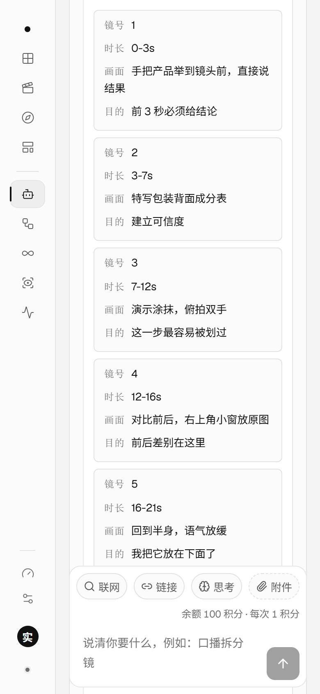

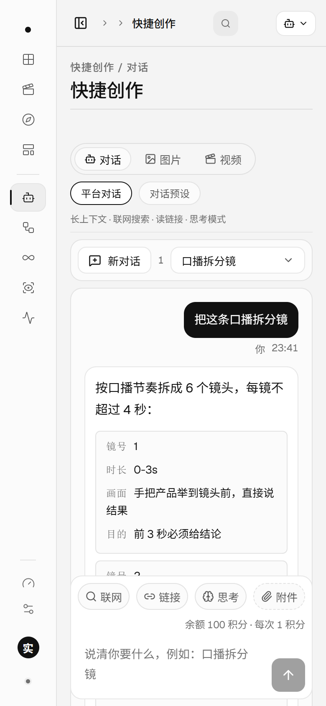

**边界**：提示的「记住」是浏览器级、不按账号，换浏览器会再出现一次；窄屏卡片让表变得更高，列数多的宽表需要往下翻；
只改前端样式、提示语与一个纯函数，没有新接口、没动服务端与计费。文档见 `docs/chat-mobile-r224-2026-11-18.md`。

## 二百七十九、手机端第三轮：平台对话不再拖着预设库、切页签不再丢草稿（r225 / v0.9.209）

接着清单第 10 项。两件事都是手机上看得见、但一直没归类的问题，都不碰上游调用：

- **「平台对话」下面挂着整块「已自建对话预设」**：它跟当前这段对话没关系，却是手机上这一页最长的一段
  （390 宽 4 张卡就 979px），还把贴底的输入框顶出视口——滚到预设卡片时输入框在屏幕上方 −339px。
  ≤900 把这块收起来（挑预设走上面的「对话预设」页签，那本来就是它的位置），桌面照旧显示。
- **切页签会丢草稿**：「平台对话」面板原来只在 `对话 && 平台对话` 时渲染，切到「对话预设」或图片 / 视频
  就整块卸载，写了一半的提示词、附件、正在生成的回答一起没了（实测：输入「写了一半的提示词」→ 图片 → 对话，回来是空的）。
  现在面板常驻、切走只 `hidden`；`.qc-root` 是 `display:grid`，hidden 属性盖不住它，由外层 `.agx-quickchat` 负责隐藏。

390×844 实测：页高 **2187 → 1176**（−1011，−46%），滚到底时输入框 672–820 仍在屏内（改前同一位置 −339 已出屏）；
320×720：**2490 → 1459**（−1031，−41%），输入框 484–696 在屏内；1440×900 未变（预设库 586px 照旧、输入框 165px）。
切到「对话预设」，三档宽度下预设库都回来（979 / 999 / 586px）。草稿在「图片 ↔ 对话」「平台对话 ↔ 对话预设」来回切后都还在。

门禁：`npm test` **1476/1476**（新增 `test/quick-create-mobile.test.mjs` 4 条）、lint 0 error / 26 warning、
`tsc -b` 干净、`vite build` 干净（入口 `index-DGE2dm0u.js`）、密钥扫描 924 文件无命中；本轮 0 次真实上游调用。

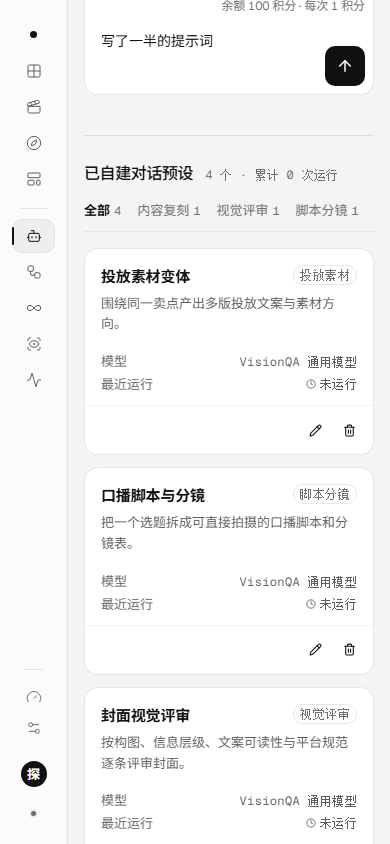

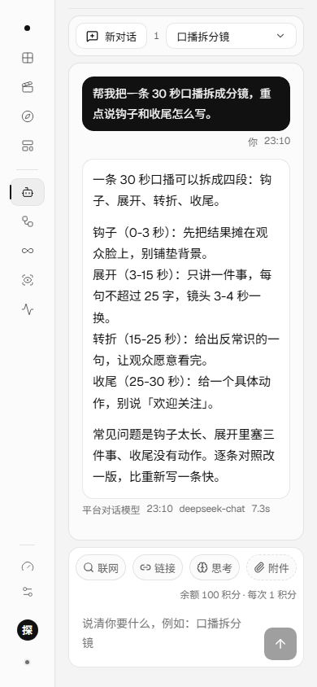

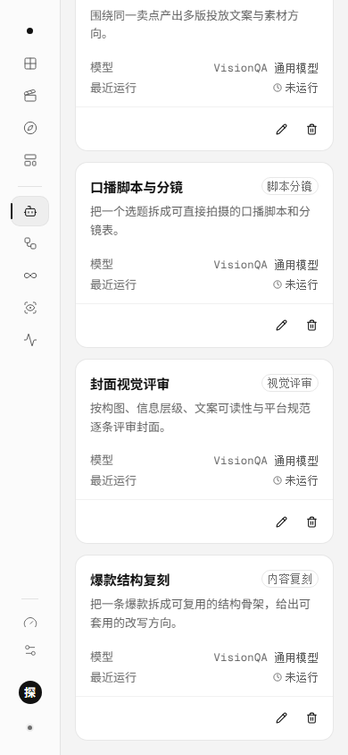


**边界**：收起按宽度判断（≤900），不是账号偏好，要挑预设得切「对话预设」页签；面板常驻后切走不再中断生成，
但「流式中切页签仍然写完」本轮只在假通道上验过草稿还在，没有真实生成；余额那行（26px）仍在输入框里，
挪进会话条会让 390 宽的会话条更挤、而且会话条会滚走。只改前端结构与样式，没有新接口、没动服务端与计费。
文档见 `docs/quick-create-mobile-r225-2026-11-18.md`。

## 二百八十、对话预设：选好就收起预设库、卡片标出「当前」（r226 / v0.9.210）

接着 r225 的思路处理「对话预设」这一面，两条都是手机上真看得见的：

- **选好一个预设之后，下面 979px 的预设库还在**：这时人要写东西，不是继续挑；390 宽整页 1717px，
  输入框和四张卡一起占了两屏多。现在选完自动收成一行（「当前「投放素材变体」+ 换一个预设」），
  整页 **1717 → 844**（正好一屏）；点那一行展开回去还是 1717，换预设 / 编辑 / 删除都在里面。
- **看不出选的是哪一张**：列表加载会自动选中第一个（服务端默认值，不是用户挑的），卡片却长得一样。
  现在当前那张描边加重、名字旁多一枚「当前」——两种宽度都生效。

390×844：刚进「对话预设」1717px（库 979px，第一张已标「当前」）→ 选好 844px（一屏，那一行 49px）
→ 点「换一个预设」1717px → 再从库里选另一个 844px（那一行名字跟着换）。
1440×900：预设库 586px 一直显示，那一行 `display: none`，卡片照旧三列。320 无横向溢出。

门禁：`npm test` **1478/1478**（`test/quick-create-mobile.test.mjs` 4 → 6 条）、lint 0 error / 26 warning、
`tsc -b` 干净、`vite build` 干净（入口 `index-CySm5Ob6.js`）、密钥扫描无命中；本轮 0 次真实上游调用。


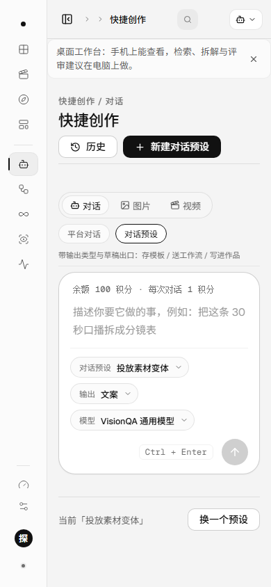


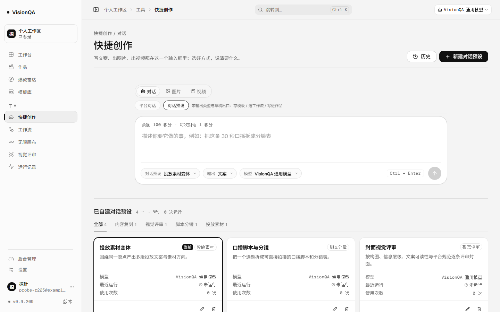

**边界**：收起只在 ≤900，桌面一直展开；「换一个预设」只展开不自动滚到库开头；
收起后编辑 / 删除预设要多点一次，这是为「选完就要写东西」让路的有意取舍。
只改前端结构与样式，没有新接口、没动服务端与计费。文档见 `docs/preset-shelf-r226-2026-11-19.md`。


## 二百八十一、工作流在手机上是「按执行顺序的步骤清单」（r227 / v0.9.211）

上一轮的清单继续往下走，这一轮体检到「工作流」这一页——用户说它鸡肋，我先用数字量了一遍，
390 宽下它其实还有硬伤：

- **画布只剩 272×309**，空状态（标题 + 两行说明 + 三个按钮 + 一句备注）比容器还高，
  直接压在缩放按钮和底部连线提示上；空工作流时看上去像样式坏了。
- **打开节点面板，清单/画布只剩 2px 宽**：≤1024 的「1fr + 272px」两列规则还在生效，
  390 扣掉 272px 右栏就没地方了，整页被撑到 2955px、一大片空白。
- **320 宽整页横拖 47px**：积分预估那行是 nowrap 的等宽字，274px 加上侧栏与内边距把页面撑到 367。

改法：≤760 不再画那块缩水画布，**改成按执行顺序排的步骤清单**——
「1 爆款素材与目标 / 输入」「2 拆成脚本结构 / 大模型 / 依赖第 1 步」…，
点一行就选中它，下面的节点检查器照旧改参数；有环时直接写「这条流程有环，跑不起来」。
顺序用与服务端 `topoSort` 同一套 Kahn 拓扑排序（`src/domain/flow-steps.ts`），真跑仍以服务端为准。

数字：390 页高 1483（面板打开 2955 → 1556）、320 下 innerWidth = clientWidth = scrollWidth = 320、
768 与 1440 画布照旧（清单 `display: none`）；画布专属工具（自动布局 / 适应工作流 / 缩放）在手机上收起；
流程名 ≤900 降到 22px + 省略号，390 与 768 都能读到全名。

门禁：`npm test` **1487/1487**（新增 9 条）、lint 0 error / 26 warning、`tsc -b` 干净、
`vite build` 干净（入口 `index-CN7ctzNk.js`）、密钥扫描 927 文件无命中；本轮 **0 次真实上游调用、0 元**。

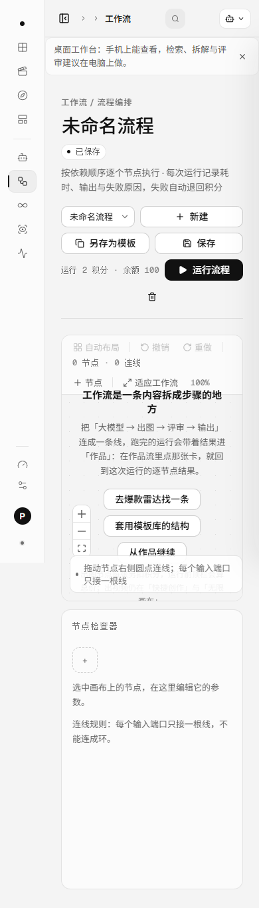

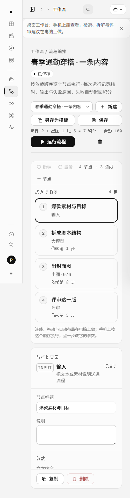

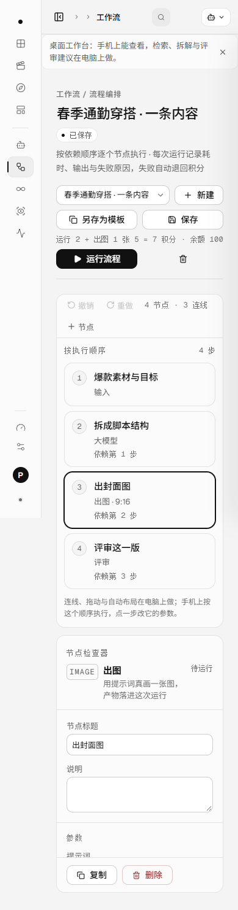

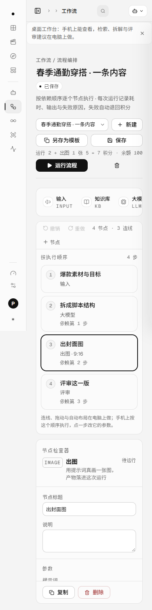

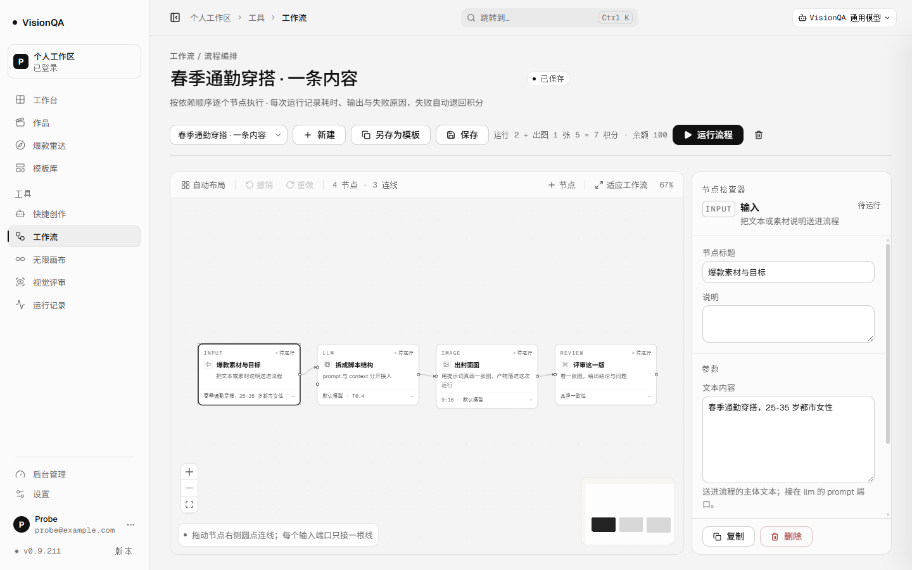

**边界**：手机上能加节点、改参数、运行，**连线与位置仍要在电脑上摆**（清单底部写明了）；
有环按原顺序列出并明确说跑不起来；清单只写标题、类型、模型显示名、比例/时长与依赖步号，
细节在检查器里；768 及以上仍是画布，两档之间没有别的分支。文档见 `docs/workflow-steps-mobile-r227-2026-11-19.md`。

## 二百八十二、最近生成的结果能一键当参考素材（r228 / v0.9.212）

创作闭环里最容易断的一步是「刚出的这张图，下一步拿它接着改」——以前「最近生成」只有**下载**，
想复用要人手把文件再传一遍。这一版在每一条结果上加了 **用作参考**，也在结果卡下面加了一个。

顺手修掉三处规则缺口：

- 参考素材以前只判「这个方式收不收」，不分收图还是收视频（视频当参考时「首帧」先收下、等服务端 400）；
  现在规则收敛到 `src/domain/media-refs.ts`，按 `imageRefs / videoRefs` 判，不收就自动切到同一模型下第一个收它的方式，
  并说清楚换了哪个；
- 托架放满时不再只说「最多 N 个」，会点名同一模型里放得下的那个方式（首帧 1 张 → 多模态参考 9 张）；
- 上传前先判放不放得下，不放满才传，不白等一次上传。

数字：图片页签 文生图 → 点一下变「参考图」托架 1/1、余额 100 不变；视频页签 → 变「多模态参考」1/12；
同一条结果重复用会复用素材库里同名那份（文件数 3 → 3 → 3）；放满时报「「参考图」最多 1 张参考图：先移除一个」；
390 宽 `innerWidth = clientWidth = scrollWidth = 390`、按钮高 24px、页面异常 0 条。

门禁：`npm test` **1498/1498**（新增 11 条）、lint 0 error / 26 warning、`tsc -b` 干净、`vite build` 干净、
密钥扫描 930 文件无命中；本轮 **0 次真实上游调用、0 元**。参考图出图与参考素材生视频仍未真调（等你授权）。

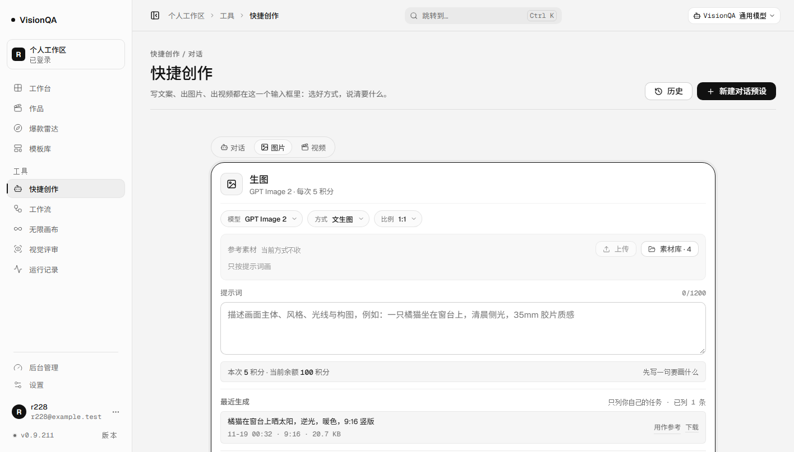

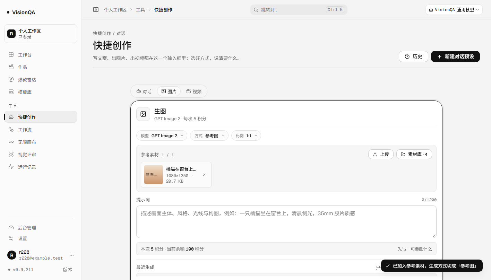

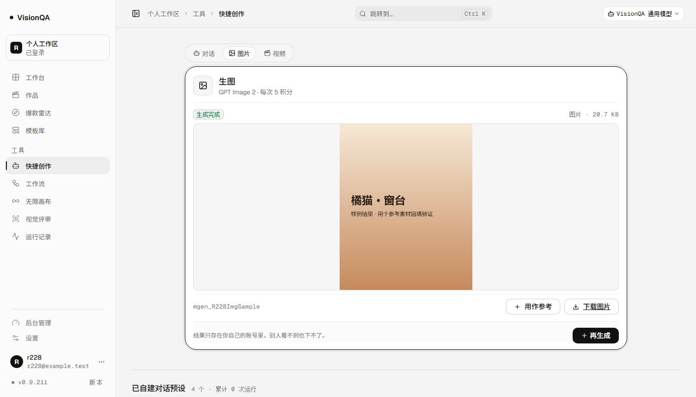


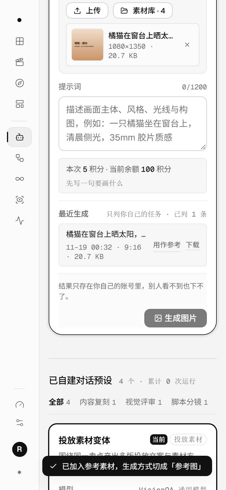

文档见 `docs/quick-create-use-as-ref-r228-2026-11-19.md`。

## 二百八十三、作品流里的成品能直接接着改：用作参考 + 下载（r229 / v0.9.213）

上一版把「刚生成的结果 → 参考素材」接上了，但那条路只在「最近生成」里；到了**作品**这一屏，
看到一张满意的成品只能「看大图」或「打开运行」，下一步就断了。这一版在每张作品卡（和放大层）上给了
**用作参考** 与 **下载**，覆盖三处来源：快捷创作的图 / 视频、工作流封面、无限画布里出过的图与视频。

点「用作参考」会发生这几件事：取回这条作品的文件 → 读真实宽高 / 时长 → 传成参考素材（同一条上传接口，
不扣积分、不打上游）→ 跳到「快捷创作」→ 按种类落到图片或视频页签 → 挂进托架、切成相应生成方式、
**比例跟着作品走**（9:16 的图不会落回 1:1）。交接只走一次性的 sessionStorage 记录，挂上就清掉；
模型表没回来时不瞎挂，素材库已有同名那份就不重复占配额。

顺手修的四件事：放大层以前看完没有下一步；画布与工作流的产物以前根本没有下载入口；
带过去的是一张 9:16 的图、出图却还是 1:1；390 宽那行时间被「看大图」挤成省略号（现在缩略图本身就是看大图，
那一行让给时间与模型名，标题两行）。

数字：三张卡都有两个动作（24px 触摸高度）；点工作流卡 → 页签图片 / 方式「参考图」/ 参考素材 1-1 / 比例 9:16 /
交接已清空 / 页面异常 0 条；390 宽 `innerWidth = clientWidth = scrollWidth = 390`、两列、卡片 139px、溢出 0。

门禁：`npm test` **1507/1507**（新增 9 条交接单测 + 2 条文件名规则）、lint 0 error / 26 warning、
`tsc -b` 干净、`vite build` 干净、密钥扫描 933 文件无命中；生产 0.9.213 发布
`20261118-171435-20261119-0125-v0.9.213wo`，入口 `index-CmfZPuwf.js`，health ok templates 26，
回滚 `--to 1` 回 0.9.212；本轮 **0 次真实上游调用、0 元**。


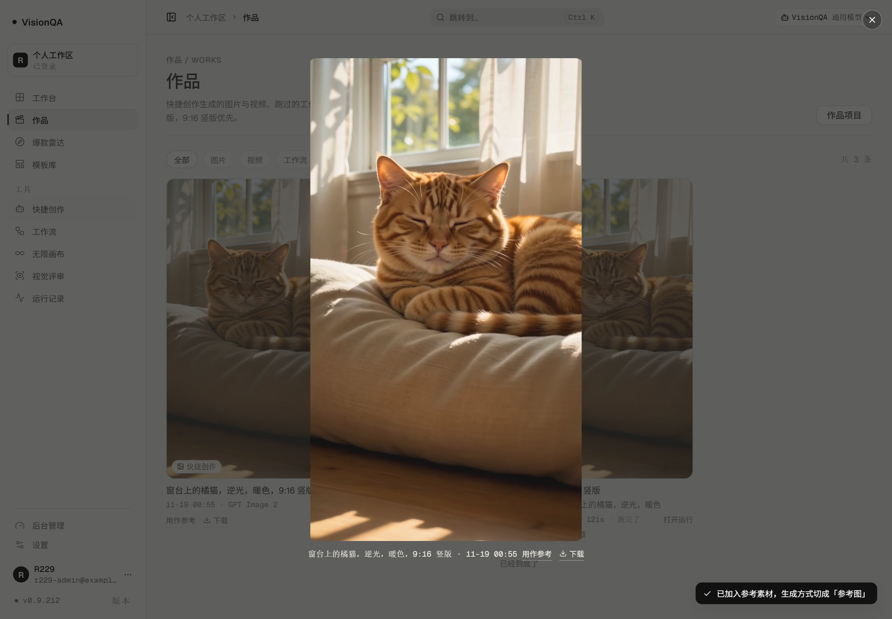


文档见 `docs/works-reuse-r229-2026-11-19.md`。

## 二百八十四、爆款雷达的手机端：一屏从不到一条变成三条（r230 / v0.9.214）

这一屏在手机上以前是「一张屏放不下一条结果」：390 宽每张卡 679px、封面 9:16 铺满整列（288×512），
8 条整页 6498px，一屏只看到 0.84 条；320 宽的检索工具栏还有 14px 横向溢出，「加入模板库」「一键复刻」
被截成半截字。这一版把 820 以下的检索结果改成**左封面 + 右文案 + 整行操作**的紧凑行，
390 每张卡 254px、整页 3062px（缩短 53%），一屏 3.3 条；320 每张卡 226px、一屏 3.5 条、溢出 0 处。

工具栏在同一断点改成两列网格：搜索框与平台各占一整行、时间与排序各半、检索按钮一整行，
高度 272→214（320）/ 192→180（390），下拉不再顶出 3px。触屏上没有 hover，封面那层看不见的
「一键复刻」整块浮层收掉——以前点封面任意位置就会弹复刻。

顺手三处：页头 kicker 与标题都写「爆款雷达」（加面包屑一屏三个），改成「找爆款 / RADAR」；
封面上的「库里已有 · 2 条作品」在 88px 封面上放不下，条数收进 `.radar-owned-count`，窄屏只留「库里已有」；
标题截断时补 `title` 能悬停看全。

同一轮还修了两处不属于这一屏的问题：**未登录实例的失败退款会抛错**（`beginPaid` 早退分支少一个 `refund`，
检索失败变成 500 + traceId，真正原因被吞掉），以及全站手机提示还写着「检索、拆解与评审建议在电脑上做」
——现在手机能检索、能跑工作流，文案改成「手机也能检索、挑素材、跑工作流；画布连线与逐帧评审建议在电脑上做」。

门禁：`npm test` **1513/1513**（新增 6 条窄屏结构断言）、lint 0 error / 26 warning（608 文件）、
`tsc -b` 干净、`vite build` 干净、密钥扫描 937 文件无命中；本轮 **0 次真实检索**（示例数据）。

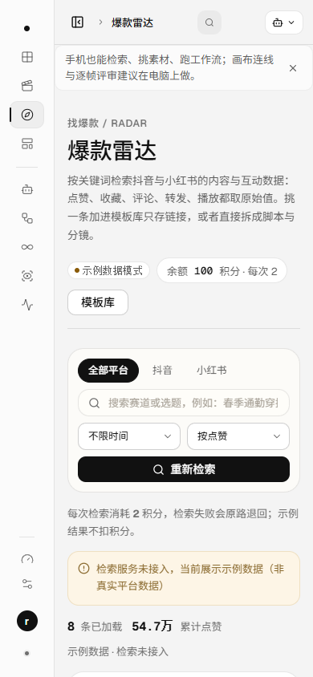


文档见 `docs/radar-mobile-r230-2026-11-19.md`。

## 二百八十五、一键复刻弹窗在手机上：从居中小窗改成贴底整宽面板（r231 / v0.9.215）

手机上点「一键复刻」弹出来的还是桌面那套居中小窗：390 宽只剩 342、320 宽只剩 272（遮罩的 24px
内边距白扔 48px），正文一律 13px，关闭按钮在 320 上只有 18×32，输入框 13px（iOS 一聚焦就把整页
放大）。最难看的是「复刻完成」那屏：5 张抽帧排成一行要 392px，塞进 292px 的正文里横向溢出 124px，
第 5 张直接被切掉——刚好停在用户最想看图的那一刻。

这一版 ≤640px 改成贴底整宽面板（只圆上面两角）：正文 14–17px、底部两个按钮各 175×48、关闭 40×40、
输入框 16px 高 48、抽帧 `flex-wrap` 换行（390 排 4+1，320 换 64px 缩略图排 3+2）。等待开始 / 进行中 /
完成三种状态实测容器内横向溢出都是 0，页面 `scrollWidth` 在 390 / 320 上分别等于 390 / 320，面板底边
贴在 844 视口的底部。641–760 仍是原来的居中窗（600px 宽放得下），桌面 1440 完全没动。

顺带一处：进行中那屏第一条日志还没回来时，日志容器会渲染成一个 16px 的空灰条顶在步骤下面，看着
像界面坏了；改成有内容才渲染，日志框 128 → 160px，6 行一次看全。

门禁：`npm test` **1519/1519**（新增 `test/replicate-mobile.test.mjs` 6 条）、lint 0 error / 26 warning
（609 文件）、`tsc -b` 干净、`vite build` 干净（入口 `index-BBEtjAdq.js`）、密钥扫描 939 文件无命中；
本轮 **0 次真实复刻**：进度与完成两屏是 CDP 拦截 `/api/replicate`、`/api/jobs/*`、`/api/templates` 返回的假任务。

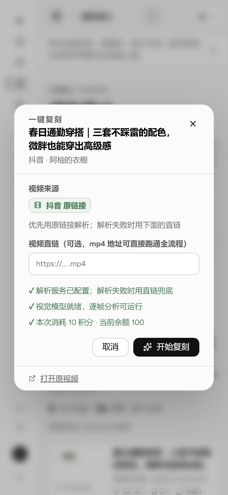


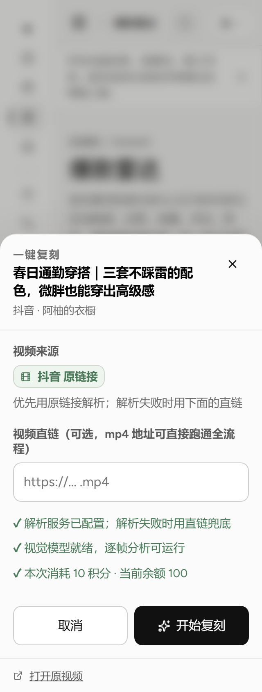

文档见 `docs/replicate-modal-mobile-2026-11-19.md`。

## 二百八十六、模板详情抽屉在手机上：正文 15px、底部动作改成等宽两列（r232 / v0.9.216）

抽屉在 ≤820px 本来就是整宽，问题在里面还是桌面排版：口播、分镜画面、分析条目一律 12.5–13px；
关闭按钮 28×32（320 上只剩 22×32）；底部四个动作 32px 高（删除 28px），还是右对齐的 flex 换行，
两行参差、删除比同行低 2px。这一屏覆盖的正好是主线上「拆结构」的全部内容，所以先把它抬到能读。

现在 ≤640px：正文 15px（行高 1.7）、说明 14px、元信息 13px；标题 18px（320 上 17px）最多三行；
关闭 40×40；底部四个动作 48px 高、等宽两列（主操作第一格、删除固定在右下角）；改编输入框 16px
（iOS 聚焦不再放大整页）；互动数据 14px、390 三列 / 320 两列且数字不折行。390 / 320 上页面
`scrollWidth` 分别等于 390 / 320，抽屉正文容器 `scrollWidth == clientWidth`，横向溢出 0，抽屉始终
贴满 844 高的视口。641–760 与桌面 1440 没动。

两处值得一提：① 抽屉的规则一半在 `radar.css`（随模板库懒加载分块后到），同权重写在 App.css 里会被
盖掉——实测 `.drawer-stats` 的 14px 与 `.adapt-input` 的 16px 各输过一次，所以这版选择器统一加了
`.template-drawer` 前缀。② 320 宽用三列网格时「播放 128.4万」被断成两行，补了 `white-space: nowrap`
并在 ≤380px 退成两列。

门禁：`npm test` **1525/1525**（新增 `test/template-drawer-mobile.test.mjs` 6 条）、lint 0 error / 26
warning（610 文件）、`tsc -b` 干净、`vite build` 干净（入口 `index-B9jbGaj2.js`）、密钥扫描 941 文件
无命中。生产 0.9.216：发布 `20261118-180003-20261119-0200-r232drawer`，health ok templates 26，
6 个服务 active，未登录 401；线上 `index-J2mtVEL8.css` 里 12 条新规则全部命中（压缩器会把
`:is(.vq-button)` 摊平成 `.vq-button` 并重排声明，所以核对要按选择器取片段、不按顺序）。

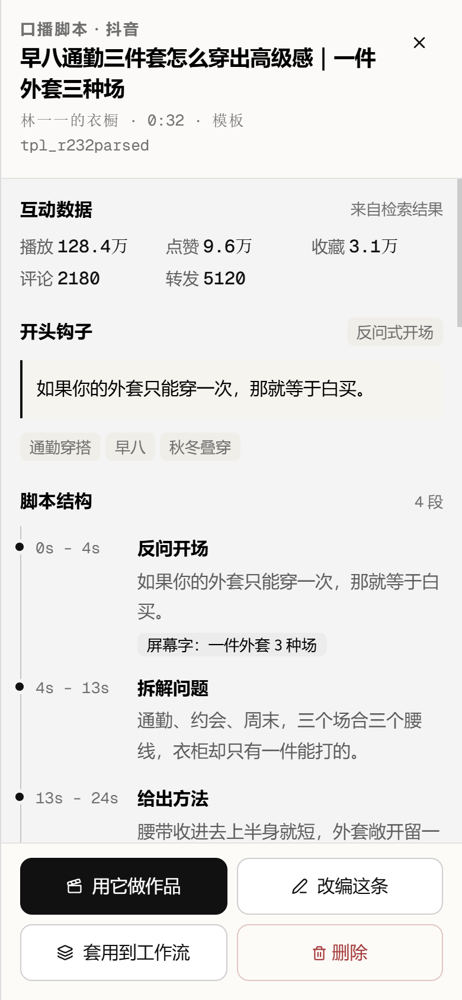

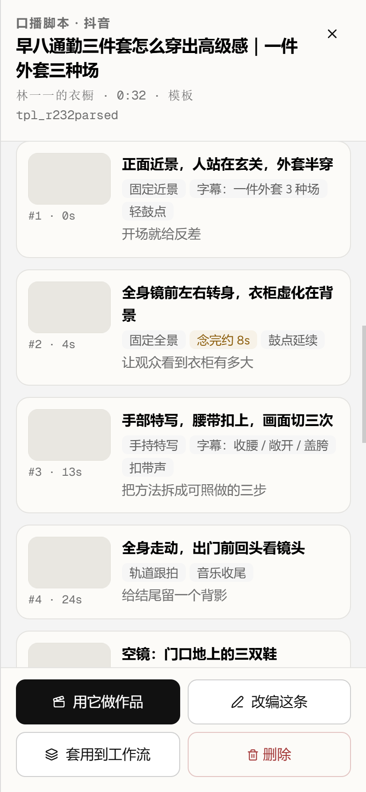


文档见 `docs/template-drawer-mobile-2026-11-19.md`。

## 二百八十七、作品流在手机上：卡片正文 15/14px、动作与胶囊换成 44/40px 触控区（r233 / v0.9.217）

「作品」默认打开的就是这条作品流（快捷创作的成品 + 工作流运行 + 无限画布的画布合成一条）。390 下两列卡片
只有 139px、320 下 106px，可里面还是桌面排版：标题 14px、工作流摘要 13px、时间与来源标签 12px，
「用作参考 / 下载」两个动作只有 **24px 高**，筛选胶囊 12.5px / 29px，大图关闭按钮 32×32、说明 12.5px。
这一版只抬字号与触控区：标题 15px、摘要 14px、时间与来源标签 13px；动作 14px / **44px**（下划线贴着字，
不再悬在盒子底部）；胶囊 14px / **40px**；「看更早的」44px；大图关闭 **44×44**、说明 14px、边距收到 16px。

**列数与按比例排版没动**：9:16 优先、1440 四列 / 1080 三列 / 768 与 390 两列，这条口径写进了
`test/works-wall-mobile.test.mjs` 的断言，免得下次有人被「139px 太窄」说服着改成整宽一列。桌面 1440 /
1024 / 768 实测一个数字都没变（四/三/两列、卡片 271 / 227 / 321px、字号仍 12.5 / 14 / 13 / 12px）。

390 与 320 上页面 `scrollWidth` 分别等于 390 / 320，横向溢出 0；胶囊在 390 折成 4 + 1、320 折成 3 + 2，
「共 5 条」跟着落到下一行右侧；320 下 106px 的卡片里「用作参考 / 下载」折成两行（各 44px），是宽度决定的。

门禁：`npm test` **1531/1531**（新增 `test/works-wall-mobile.test.mjs` 6 条）、lint 0 error / 26 warning（611 文件）、
`tsc -b` 干净、`vite build` 干净（入口 `index-BXRFei46.js`、样式 `index-CVd22nZy.css`）、密钥扫描 943 文件无命中。
生产 0.9.217：发布 `20261118-181316-20261119-0240-r233worksw`，health ok templates 26，6 个服务 active，
未登录 401；线上 560 块 17 条选择器、12 条抽查断言全部命中。回滚 `--to 1` 回 0.9.216。


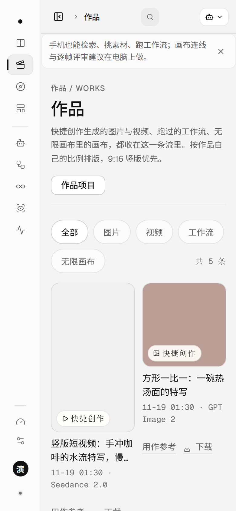

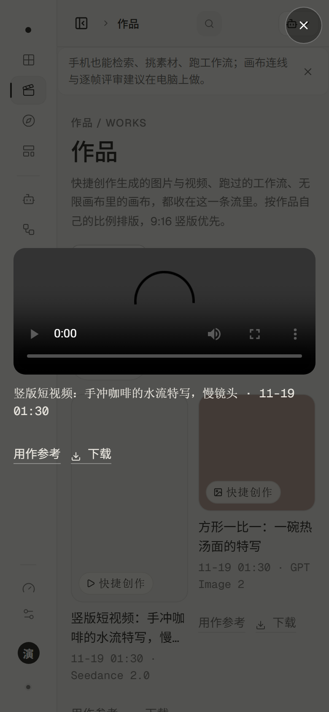


文档见 `docs/works-wall-phone-2026-11-19.md`。


## 二百八十八、作品项目在手机上：搜索 44px、筛选 40px、卡片数据 2 × 3 不再折行（r234 / v0.9.218）

「作品」切到「作品项目」（交付列表）后，390 下正文只有 240px，卡片六格数据落到 74.7px 一格：
「1,800 积分」被折成「1,800 积 / 分」并把那一路格子拉高；标题一行只剩十四个字；搜索框 32px、
筛选胶囊 30px / 12.5px、状态胶囊 22px / 12px、时间 12px。这一版把卡片内边距收到 **16px**
（正文 256px），六格改成 **2 × 3**（一格 120px）并给数字加 `white-space: nowrap`；标题 **18px、最多两行**；
模板来源与「打开作品」**15px**，时间与版次 **13px**；状态胶囊 **28px / 13px**；搜索框 **44px**（正文 15px）、
清除按钮 32×32；筛选胶囊 **40px / 14px**；「共 N 条」13px，落到胶囊下一行时靠右。

两处不是「调字号」而是真溢出，一起修了：320 下卡头（152px 的胶囊 + 70px 的 nowrap 时间）会把卡片的网格列
撑到 230px，内容顶出 220px 的卡片 —— 手机段让卡头能换行、时间自己靠右；搜索框 `flex-basis: 100%` 不等于能缩，
输入框默认 20 字符宽会成为 min-content（291px），320 下直接顶出正文区 —— 补 `min-width: 0` 才收得回 220px。
附带修 1024：网格还是两列时一张卡片 354px，六格只有 44px，「1,800 积分」同样折行，3 × 2 从 780 提前到 **1080**。

口径没动：780 以下才是单列，560 那段只改间距不改列数；1440 与 768 实测一个数字都没变
（1440 两列 562px 六格 78px、768 单列 668px 三格 200px，内边距仍 24px、胶囊仍 12px / 30px）。
390 与 320 的 `clientWidth` 分别等于 `scrollWidth`（390 / 320），横向溢出 0。

门禁：`npm test` **1536/1536**（新增 `test/projects-page-mobile.test.mjs` 5 条）、lint 0 error / 26 warning（612 文件）、
`tsc -b` 干净、`vite build` 干净（入口 `index-keDlsNgD.js`、样式 `index-DBjtBwrj.css`）、密钥扫描 945 文件无命中。
生产 0.9.218：发布 `20261118-185519-r234proj`，health ok templates 26，6 个服务 active，未登录 401，磁盘 72%；
线上 560 块 1101 B、**20 条抽查全命中**，1080 块含 3 × 2。回滚 `--to 1` 回 0.9.217。

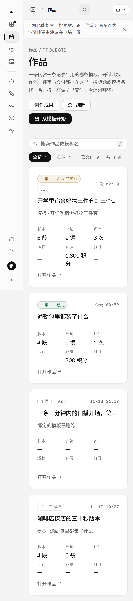


文档见 `docs/projects-page-mobile-2026-11-19.md`。

## 二百八十九、平板这一档：作品流动作 44px、作品项目搜索 44px，顺手修掉 1081–1439 的六格折行（r235 / v0.9.219）

手机与桌面之间（561–1080）一直没有规则：≤900 侧栏收成图标栏，作品流三列卡片只剩 230–330px，
整条流却还是桌面尺寸——动作 24px 高、正文 12–14px；作品项目 1024 下一张卡片 354px，标签 12px、
搜索 32px、筛选胶囊 30px、状态胶囊 22px。这一段是触屏。这一版只抬字号与触控区：
作品流胶囊 **40px / 14px**、标题 **15px 两行**、时间与来源标签 13px、动作 **44px / 14px**、大图关闭 44×44；
作品项目搜索 **44px**（正文 15px）、筛选 **40px / 14px**、状态胶囊 **26px / 13px**、标题 **18px 两行**、
模板来源与「打开作品」15px、六格标签 13px。列数与比例规则一个没动
（测试里锁了「这一段不含 grid-template-columns」）。

量 1081 边界时撞上一个既有问题：1080 那条「六格 3 × 2」一过就失效，可两列卡片还不够宽 ——
1081 一格 48.8px、1200 一格 58.7px，都放不下「1,830 积分」，折成两行（34.5–36px 高）；
1440 的 562px（一格 78.7px）才排得下六列。补一条 1081–1439 的 3 × 2 之后：1081 一格 105.5px、
1200 一格 125.3px，都是一行 24px，1440 保持六列。

口径没动：1440 逐项与改前相同（胶囊 29px / 12.5px、动作 24px / 12px、标题 14px、搜索 32px、
筛选 30px、六格 78.7px）；390 / 320 与 r233 / r234 相同。十个宽度（320–1440）的 clientWidth 都等于
scrollWidth，越界元素 0。

门禁：`npm test` **1543/1543**（新增 `test/works-projects-tablet.test.mjs` 7 条）、lint 0 error / 26 warning（613 文件）、
`tsc -b` 干净、`vite build` 干净（入口 `index-Baaj3I6D.js`、样式 `index-CGUjuBgj.css`）、密钥扫描 947 文件无命中。
生产 0.9.219：发布 `20261118-191511-20261119-r235tablet`，health ok templates 26，6 个服务 active，
未登录 401，磁盘 72%；线上 `--chip-pill-h:26px` 1 处、`min-height:44px` 9 处，两条新 media 都在。
回滚 `--to 1` 回 0.9.218。


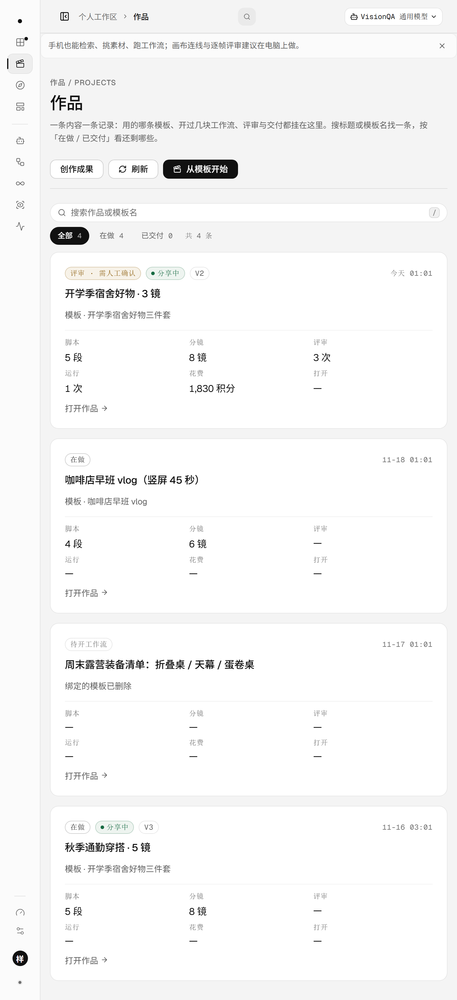

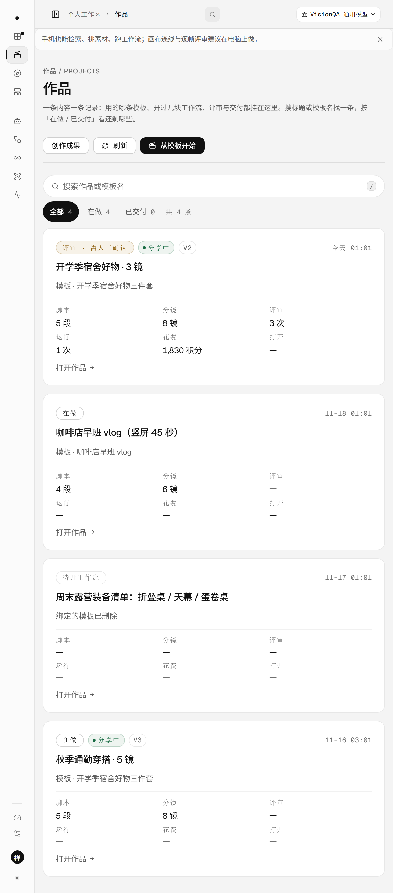


文档见 `docs/projects-works-tablet-2026-11-19.md`。

## 二百九十、作品详情页：手机 44px / 平板 40px，小字抬到 13px（r236 / v0.9.220）

作品详情页此前只有桌面一档：390 与 768 上正文 12–13px，「改脚本 / 提示词 / 查看运行 / 全部作品」这些
看起来像一行字的按钮只有 19–28px 高。这一版把 1080 以下的字号与触控区整体抬一档：正文 15 → **16**、
面板标题 16 → **17**、小字 12 / 12.5 → **13**、结论与运行胶囊 12/20 → **13/24**、版次胶囊 12/22 → **13/26**；
按钮与链接类按钮 **手机 44px、平板 40px**（改前 19–36px）。桌面（1081 起）逐项不动。

页面里「小于 13px 的文字」与「不到 40px 的按钮」两个数：390 / 768 / 1024 改前都是 **108 / 45**，改后都是 **0 / 0**。
页面高度 390 从 7956 → 8966、768 从 5015 → 5553——字大了、按钮 44px，这是代价，没有靠收行距换回来。

顺带修掉两个既有窄屏问题：320 下版本行里「最近一评 1 阻塞 · 1 主要 · 1 次要」是 nowrap，整行被撑到 413px，
页面横向滚（现在 ≤520 改竖排，scrollWidth == clientWidth == 320）；来源面板的隐式列按 max-content 定宽，
长模板名把面板顶到 313px（容器 220px），把栏目 / 面板 / 来源列表四层钉成 minmax(0, 1fr) 后省略号才生效。

门禁：npm test **1551/1551**（新增 test/project-detail-mobile.test.mjs 8 条）、lint 0 error / 26 warning（614 文件）、
tsc -b 干净、密钥扫描 949 文件无命中、构建入口 index-BHOLhzk7.js（742,219 B）/ 样式 index-J4Shf-PJ.css（349,943 B）。

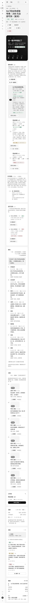


生产 0.9.220（发布 20261118-194818-20261119-034700-r236deta，health ok templates 26、6 个服务 active、未登录 401、磁盘 73%；回滚 --to 1 回 0.9.219）。

文档见 docs/project-detail-mobile-2026-11-19.md。

## 二百九十一、工作台 / 模板库 / 爆款雷达：骨架 40/44px，模板库改紧凑行（r237 / v0.9.221）

这一版先抬三页共用的骨架：侧栏导航 34px、顶栏搜索 30px、模型按钮 30px、版本按钮 28px、筛选片 30px / 12.5px、
文字链接 24px —— 1080 以下统一到 **手机 44px / 平板 40px**，筛选片同时到 **13px**；再抬三页各自的字：
工作台的小字 12 → **13**、爆款雷达的作者 / 平台徽标 / 互动数 11–12 → **13**、卡片标题 14 → **16**，
模板库的互动数与说明 11.5–12.5 → **13**、标题 15 → **16**、「用这条改编」11.5px / 32px → **13px / 40–44px**。

判据：390 / 768 / 1024 三页合计「小于 13px 的文字」108 / 111 / 69 → **0**，「不到 40px 的点击区」60 / 60 / 60 → **0**，
没有横向溢出；桌面 1440 逐字段与改前一致（16 / 24 / 32 处小字、21 / 19 / 20 个点按区）。

模板库顺手改掉 390 上 26 条 19,262px 的问题：≤820 改成与雷达一致的「左 96px 封面 + 右文案」，26 条 390 从
19,262px 收到 **8,308px**（−57%），768 从 35,372 收到 **5,986px**（−83%）；≤360 封面 80px、整句允许折行，
320 不再顶出屏幕（改之前右缘 355 > 320）。

门禁：npm test **1561/1561**（新增 test/overview-radar-mobile.test.mjs 10 条）、lint 0 error / 26 warning（615 文件）、
tsc -b 干净、密钥扫描 951 文件无命中、构建入口 index-IaXs9y-3.js（742.23 kB）/ 样式 index-LeX9QKPR.css（353.51 kB）。


生产 0.9.221（发布 20261118-201321-r237mobile，health ok templates 26、6 个服务 active、未登录 401、磁盘 73%；
回滚 --to 1 回 0.9.220）。

文档见 docs/overview-radar-mobile-2026-11-19.md。

## 二百九十二、设置页：小字 13px、按钮 44/40px（r238 / v0.9.222）

设置页几乎全是原子组件，390 / 768 上的小字停在 11.5–12.5px：卡头 mono 12、`Tag` / `Pill` 12、
口令说明 11.5、会话 IP 11.5、流水表头 12、价格标签 11.5、反馈时间 11.5、健康行 12.5；
点按区停在 28–32px：按钮 32、图标按钮 32、口令输入 32、帮助链接 31。这一版按 r236 / r237 的同一套档位收口：
**1080 以下小字 13px、按钮手机 44px / 平板 40px**，桌面（1081 起）一个字段没动。

判据（每页实测，<13px 文字 / <40px 点按区）：390 的 **69 / 18 → 0 / 0**、768 的 **67 / 18 → 0 / 0**、
1024 的 **67 / 18 → 0 / 0**，320 改后 **0 / 0** 且 scrollWidth == clientWidth；1440 改前改后都是 **74 / 32**。
390 页面高度 5679 → 5947px（+4.7%），是字大一档、按钮 32 → 44 的代价。

规则全部挂在 `.vq-page--settings`（设置页新加的修饰类）下，写在新建的 `src/styles/settings.css`，
在 `credits.css` 之后加载 —— 只影响设置页。按钮靠 `--btn-h` / `--btn-h-sm` 两个 token 一起抬到 40 / 44，
图标按钮跟着 `--btn-h` 变正方形；口令输入框 32 → 40 / 44、字号 12.5 → 14；三枚「先看说明」帮助链接从 31px 撑到 40 / 44。

门禁：npm test **1568/1568**（新增 test/settings-mobile.test.mjs 7 条）、lint 0 error / 26 warning（616 文件）、
tsc -b 干净、密钥扫描 953 文件无命中、构建入口 index-BmcKRyHZ.js（742.25 kB）/ 样式 index-BLi8wNb_.css（355.14 kB）。


生产 0.9.222（发布 20261118-202923-r238mobile，health ok templates 26、6 个服务 active、未登录 401、磁盘 73%；
线上 CSS 有 vq-page--settings 与 --btn-h:40px；回滚 --to 1 回 0.9.221 入口 index-IaXs9y-3.js）。

文档见 docs/settings-mobile-2026-11-19.md。

## 二百九十三、视觉评审页：小字 13px、点按区 40/44px（r239 / v0.9.223）

上一轮清完设置页之后，视觉评审成了剩下最差的一页：390 宽首屏 22 处 12px 的字、4 处不到 40px 的点按区；
打开一条历史评审是 40 / 6，历史弹层 35 / 6。这一版按同一套档位收口：**1080 以下小字 13px、按钮与点按区手机 44px / 平板 40px**。

判据（每页实测，<13px 文字 / <40px 点按区）：390 首屏 **22 / 4 → 0 / 0**、历史详情 **40 / 6 → 0 / 0**、
弹层 **35 / 6 → 0 / 0**；768 首屏 **22 / 4 → 0 / 0**、详情 **40 / 6 → 0 / 0**；1024 首屏 **23 / 3 → 0 / 0**、
详情 **41 / 5 → 0 / 0**；320 改后 **0 / 0** 且 scrollWidth == innerWidth；1440 改前改后逐元素一致（30 / 18、45 / 20）。

评审页的字号与点按区几乎全走 shell 的原子（`.vq-pill` / `.vq-tag` / `.vq-mono` / `.vq-button`），
所以主体做法是在 `.review-page` 上把原子档位抬一档：胶囊 12px / 高 22 → **13px / 高 24**，严重度标签 12 → **13px**，
mono 小字与历史位置 12 → **13px**，问题编号盒 16×16 → **18×18**；「4 个模板首帧」折叠开关 24px 高、
「查看全部 4 条」35px、历史行 34px、`选图` / `回作品` / `评这一版` 28px 全部抬到 **40 / 44px**。
规则只写在 `src/styles/review.css` 末尾两段媒体查询里，桌面 1081 起一条都不进。
共用骨架顺带修了三处：图标态搜索 30×40 → **40 / 44px 宽**、侧栏「等你看」计数 12 → **13px**、
320 宽下被挤到 39 / 38px 的顶栏与弹层图标按钮**不参与收缩**。

门禁：npm test **1575/1575**（新增 test/review-mobile.test.mjs 7 条）、lint 0 error / 26 warning（617 文件）、
tsc -b 干净、密钥扫描 956 文件无命中、构建入口 index-C2cuw_43.js（742.25 kB）/ 样式 index-BuEIcdDe.css（356.48 kB）。


生产 0.9.223（发布 20261118-204623-r239review，health ok templates 26、6 个服务 active、未登录 401、磁盘 73%；
线上 CSS 有 .review-page .vq-mono；回滚 --to 1 回 0.9.222，发布 20261118-202923-r238mobile）。

文档见 docs/review-mobile-2026-11-19.md。

## 二百九十四、运行记录页：小字 13px、点按区 40/44px，修 320 三处布局（r240 / v0.9.224）

清单第 22 项。运行记录是 UX 清单里剩下最重的一页：390 宽 50 处 12px 的字、12 处不到 40px 的点按区（768 / 1024 各 62 / 12），
还带着三处在 320 上真坏掉的布局。这一版按同一套档位收口：**1080 以下小字 13px、按钮与点按区手机 44px / 平板 40px**。

判据（<13px 文字 / <40px 点按区）：390 页面 **50 / 12 → 0 / 0**、运行对照弹层 **15 → 0**；320 **50 / 12 → 0 / 0**；
768 **62 / 12 → 0 / 0**；1024 **62 / 12 → 0 / 0**；1440 改前改后逐元素一致（69 / 29），只有侧栏版本号变了。

在 `.runs-page` 上抬一档原子：mono 12 → **13px**，统计条标签、筛选标签、筛选下拉的选中值、输出字段名、「原始返回」里的 JSON 全部 12 → **13px**；
刷新 / 回作品 / 对照 / 查看这次运行 / 在工作流打开 / 翻页 28 → **40 / 44px**，搜索框 34 → 40 / 44（输入框同步够高，40px 的框带 1px 边时不再只剩 38），
「原始返回」折叠开关 27 → **40 / 44px**。

320 上的三处真坏：输出的「字段 → 值」两列（键列 140px）塌成**竖排单字** → ≤560 改单列、键在上值在下；
翻页的「1–12 / 14」**折成四行** → 区间一行、两个按钮一行各半；每行右侧 70px 窄列把标题与「作品 · 第几版」**挤成两段** → ≤700 状态/耗时/时间挪到第二行。
运行对照弹层（运行记录页与工作流页共用）顺带修两处：390 被挤成 **39px 宽**的关闭按钮改成不收缩的 40 / 44，「看改了哪几行」24 → 40 / 44px。

另补一处交互：窄屏（≤1100）列表与详情上下排、详情落在整张清单下面，以前点一行只有行变色；现在点完把详情滚到眼前
（`prefers-reduced-motion` 直接跳），桌面两栏并排不滚。实测 390 点第 6 条后 `window.scrollY` 0 → 2071、详情顶部 2071 → 0；1440 `scrollTop` 仍 0。

门禁：npm test **1585/1585**（新增 test/runs-mobile.test.mjs 10 条）、lint 0 error / 26 warning（618 文件）、
tsc -b 干净、密钥扫描 958 文件无命中、构建入口 index-WLrx66J3.js（742.53 kB）/ 样式 index-B6nKbWgO.css（358.25 kB）。


生产 0.9.224（发布 20261118-210403-r240runs，health ok templates 26、6 个服务 active、未登录 401、磁盘 73%；
线上 CSS 有 .runs-page .vq-mono 与 .rc-head .vq-button--icon；回滚 --to 1 回 0.9.223，发布 20261118-204623-r239review）。

文档见 docs/runs-mobile-2026-11-19.md。

## 二百九十五、快捷创作页：小字 13px、点按区 40/44px，修分类条被裁与历史弹层跑出屏幕（r241 / v0.9.225）

2026-11-19。快捷创作页（平台对话、对话预设、图片、视频四个状态）在 390 / 768 / 1024 / 320 下逐屏量：
12px 与 11.5px 的元信息 5–30 处、不到 40px 的点按区 11–26 处。改法与运行记录页同一套——所有覆盖写在 `agents.css` 末尾的
`@media (max-width: 1080px)` / `(max-width: 560px)` 两段里、选择器带 `.agx-page`，桌面（1081 起）一条规则都不进。

判据（<13px 文字 / <40px 点按区）：390 平台对话 **5 / 11 → 0 / 0**、图片面板 **26 / 24 → 0 / 0**、视频面板 **30 / 26 → 0 / 0**；
320 平台对话 **5 / 11 → 0 / 0**、图片面板 **26 / 24 → 0 / 0**；768 **11 / 11 → 0 / 0**（图片 30 / 24 → 0 / 0）；
1024 **36 / 23 → 0 / 0**；1440 图片面板 **40 / 38 → 40 / 38** 一个没变，平台对话 43 / 37 → 42 / 37（唯一少的那个是下面说的「0」）。

抬一档的原子：等宽元信息、胶囊标签（11.5px）、胶囊取值（12.5px）、预设计数、卡片「当前」、会话数 / 余额 / 能力按钮全部 → **13px**；
创作方式与对话方式页签 28 → **40 / 44px**，参数胶囊 30 → **42 / 46px**（胶囊自带 1px 边框，里面那枚按钮正好 40 / 44，写 40 就只剩 38），
短值触发器（`1:1`、`4s` 只有 34px 宽）补到 ≥40 / 44，发送键 38 → **40 / 44**，会话条与能力按钮 32 / 28 → **40 / 44px**。

三处真问题：① 预设分类条在 390 的内容列（290px）里要 397px，nav.css 又是 nowrap + 横向滚动，「脚本分镜 / 投放素材」被裁在屏幕外
→ ≤560 改换行 + 胶囊激活态；② 历史弹层是 `absolute; right: 0; width: 352px`，窄屏挂在左边按钮上算出**左边缘 −187px**，只剩一条「话记录」
→ 窄屏改贴底浮层（左右 8px、最高 70vh）；③ 对话数为 0 时左栏「新对话 ｜ 0 ｜ 历史对话」中间孤零零一个 0 → 0 条不显示，有对话时写「共 N 个」。

门禁：npm test **1595/1595**（新增 test/agents-mobile.test.mjs 10 条）、lint 0 error / 26 warning（619 文件）、
tsc -b 干净、密钥扫描 960 文件无命中、构建入口 index-Cv7e7_aY.js（742.53 kB）/ 主样式 index-B6nKbWgO.css（358.25 kB）/ 本页样式 agents-Cs33nbh8.css（55.49 kB）。


生产 0.9.225（发布 20261118-212249-r241quick，health ok templates 26、6 个服务 active、未登录 401、磁盘 73%；
公网 /assets/agents-Cs33nbh8.css 200 / 55,485 B / text/css；回滚 --to 1 回 0.9.224，发布 20261118-210403-r240runs）。

文档见 docs/agents-mobile-2026-11-19.md。

## 二百九十六、工作流页：小字 13px、点按区 40/44px，修顶栏溢出与工具条互压（r242 / v0.9.226）

工作流页（#/canvas/<flowId>）在 320 / 360 / 375 / 390 / 768 / 1024 六档、三种状态（默认 / 节点面板打开 / 首次上手引导）下，
小于 13px 的字与不到 40px 的点按区都清零；1440 桌面逐项 computed style 一致。同时修掉三处真问题：

1. **顶栏把整页撑宽**：375 宽整页 scrollWidth 381、320 宽 346（横向可拖），搜索键被挤到 36px、顶栏图标键 1024 时 37px。
   480 以下「内部测试」胶囊让位、模型键只留 Bot 图标 + 箭头（补 aria-label）；1080 以下右侧那组不参与收缩、模型名收窄到 148px。
2. **工具条文字互压**：768 宽内容 444px 挤进 366px 的格子，`+ 节点`、`5 节点 · 4 连线`、`适应工作流` 直接盖在一起（1024 是 499 挤 454）。
   `.cv-toolbar` 原来只在 ≤760 换行，761–1024 这一段是 nowrap，现在 1080 以下允许换行。
3. **上手引导关闭键 32px**：首次打开时它是整屏唯一能点的键，1080 以下补到 40×40。


判据四个数：小字（<13px 叶子文字）、点按区（宽或高 <40px）、同容器兄弟重叠、内容溢出自己的盒子；
React Flow 的画布视口与节点盒子天生比内容窄 2px，量的时候整棵子树排除。

| 宽度 | 小字 | 点按区 | 内容溢出 | 整页宽度 |
| --- | --- | --- | --- | --- |
| 320 | 14 → 0 | 13 → 0 | 5 → 0 | 346 → 320 |
| 360 | 14 → 0 | 12 → 0 | 5 → 0 | 368 → 360 |
| 375 | 14 → 0 | 11 → 0 | 1 → 0 | 376 → 375 |
| 390 | 14 → 0 | 11 → 0 | 1 → 0 | 390 → 390 |
| 768 | 15 → 0 | 15 → 0 | 3 → 0 | 768 → 768 |
| 1024 | 15 → 0 | 16 → 0 | 4 → 0 | 1024 → 1024 |
| 1440（桌面） | 22 → 22 | 21 → 21 | 0 → 0 | 1440 → 1440 |


改法与运行记录页、快捷创作页同一套：覆盖全写在 canvas.css 末尾的 ≤1080 / ≤560 两段、选择器带 `.cv-page`，
1081 起一条规则都不进；页内只抬 token（`--btn-h` 40/44、`--chip-pill-h` 24/26、`--text-mono` 13px），
再逐个点名 12px 的那一片（工具栏计数、缩放百分比、节点类型与状态、检查器小标题、步骤清单序号与依赖、抽屉里的序号与耗时）。


门禁：1604 / 1604 测试（新增 test/workspace-mobile.test.mjs 9 条）、lint 0 error / 26 warning（620 个文件）、tsc -b 干净。
边界：只量 Chromium 无头 1x 的七档宽度；运行抽屉只量关闭态；运行中相关状态（排队胶囊、失败红条）需要真跑一次流程，本轮没跑也没花积分。

文档见 docs/flow-mobile-2026-11-19.md。

生产 0.9.226（发布 20261118-214844-r242flow，health ok templates 26、6 个服务 active、未登录 401、磁盘 73%；
入口 index-BMy9_msg.js 742.61 kB / 主样式 index-B88JOElv.css 358.61 kB；
公网 /assets/CanvasPage-PyzuMW6o.css 200 / 30,342 B / text/css；回滚 --to 1 回 0.9.225，发布 20261118-212249-r241quick）。
提交 dc26961 + 27157d4，CI 44405387645 success（Node 22.12 / Node 24 / 安全扫描三件全绿；dc26961 那轮被后一次推送按并发策略取消）。

## 二百九十七、无限画布状态条：小字 13px、点按区 40/44px，修 768 整页横向滚动与两处顶出（r243 / v0.9.227）

无限画布（`#/board`）嵌的是外部那张自由画布，我们这层只留一条 42px 的状态条：
在哪块画布 / 通没通 / 排队位 / 换画布 / 新建 / 写笔记 / 专注 / 新窗口。
它 1440 上够用，768 与 1024 却装不下——这轮把它在 320 / 360 / 375 / 390 / 600 / 700 / 768 / 1024 八档量一遍、修到清零。

| 宽度 | 小字 | 点按区 < 40px | 内容溢出容器 | 整页宽度 | 状态条高度 |
| --- | --- | --- | --- | --- | --- |
| 320 | 1 → **0** | 4 → **0** | 0 → 0 | 320 → 320 | 133 → 105 |
| 360 | 1 → **0** | 4 → **0** | 0 → 0 | 360 → 360 | 101 → 105 |
| 375 | 1 → **0** | 4 → **0** | 0 → 0 | 375 → 375 | 101 → 105 |
| 390 | 1 → **0** | 4 → **0** | 0 → 0 | 390 → 390 | 101 → 105 |
| 768 | 4 → **0** | 4 → **0** | **6 → 0** | **912 → 768** | 42 → 52 |
| 1024 | 4 → **0** | 4 → **0** | **2 → 0** | 1024 → 1024 | 42 → 52 |
| 600 / 700（中间档抽查） | 0 → 0 | **3 → 0** | 0 → 0 | 不变 | 97 |
| 1440（桌面） | 11 → 11 | 20 → 20 | 0 → 0 | 1440 → 1440 | 42 → 42 |


顺手量出三处真问题：

1. **768 上整页被状态条撑出屏幕**：内容 780px、格子只有 672px，整页 `scrollWidth` 变 912，还能横向拖；1024 差 20px，
   唯一被挤掉的是「新窗口」图标键——被弹性收缩压成 **16×32**，只剩半截可点。
2. **手机上排队位胶囊被裁掉半句**：「在跑 3 · 排队 2（最久 12.4s）」是 nowrap + `max-width: 320px`，
   390 上直接顶出右边缘，「（最久 1」被页面裁断，连省略号都没有。
3. **561–760 这一段把按钮钉在 32px 宽**：那条 ≤760 的规则把「新建 / 写笔记 / 专注」收成图标方块，≤1080 只抬了高度，
   600 与 700 上量出 3 个 **32×40**——宽度不够点。补一条 ≤760 的 `width: 40px`（放在 ≤560 之前，手机上再由 44px 盖过）。
4. **写笔记弹层按 100vw 算宽度**：它挂在 322px 宽的状态条里却按视口算，390 上右边缘顶出 30px（整页 420）、320 上顶出 32px。


改法：全部写在 board.css 末尾的 ≤1080 / ≤560 两段里（这一页的样式表本来就只被 BoardPage 懒加载，是页级作用域），
1081 起一条规则都不进。≤1080 允许换行，并把「让位名单」扩到 4 个——页面名（面包屑里有）、分隔线、
选择器前面的「画布」两个字、画布域名（连接胶囊的 title 上还有）——省下的 100px 让 768 与 1024 都能排成一行；
状态胶囊与排队位 12 → 13px、24 → 26px，按钮 24 → 40px、图标键 32 → 40px 且 `flex: 0 0 auto` 不再被挤。
≤560 再抬到 44px：按钮、图标键、胶囊 28px，排队位收掉「（最久 12.4s）」，写笔记弹层改成按状态条自己算宽度。


顺带把状态条标成一组：`<div className="bd-strip" role="group" aria-label="无限画布状态条">`——
窄屏收起「无限画布」字样之后，读屏仍然知道这一条是什么。

桌面没动的证据是直接量出来的：同一个 1440 视口、同一批选择器，改前改后 `getComputedStyle` 逐项一致，
12 项全部相同——状态条 42px / 1204 宽、`.bd-label` 12px、`.bd-state` 12px/24px、`.bd-action` 13px/24px、
`.bd-strip .vq-button--icon` 32×32、`.vq-select__trigger` 13px/30px、画布 iframe 1204×802。


门禁：1614 / 1614 测试（新增 test/board-mobile.test.mjs 10 条）、lint 0 error / 26 warning（621 个文件）、tsc -b 干净、密钥扫描 964 个文件无命中。
边界：只量 Chromium 无头 1x 的八档宽度（561–760 只抽查 600 / 700）；画布本体是跨源 iframe，只量了我们这条状态条，iframe 里面一行没碰；
排队位是注入的假数据（没有真跑一次出图），写笔记只验弹层排布、没有真往画布写节点。

文档见 docs/board-mobile-2026-11-19.md。

生产 0.9.227（发布 20261118-220815-r243board2，health ok templates 26、6 个服务 active、未登录 401、磁盘 73%；
入口 index-DVl-vtFb.js 742.61 kB / 主样式 index-B88JOElv.css 358.61 kB / 本页样式 BoardPage-Bn0zleRL.css 5,246 B；
公网 /assets/BoardPage-Bn0zleRL.css 200 / 5,246 B / text/css；回滚 --to 1 回 0.9.226，发布 20261118-214844-r242flow）。
