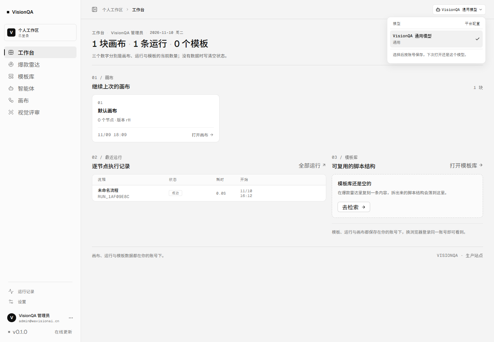
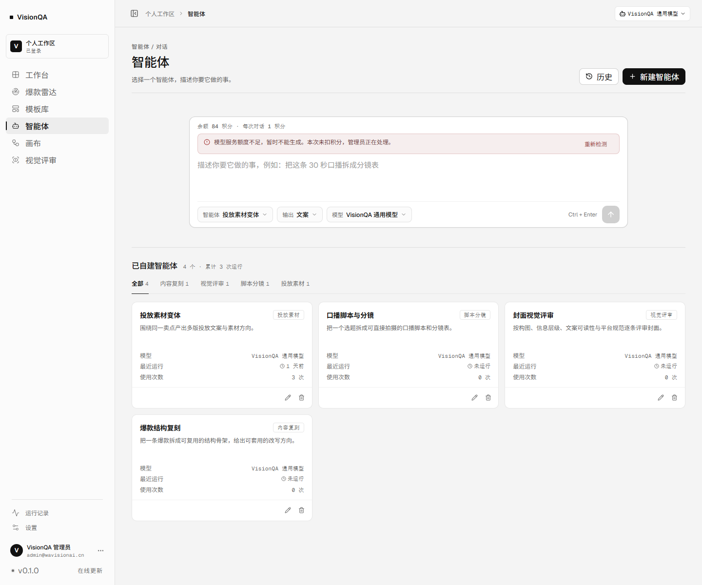
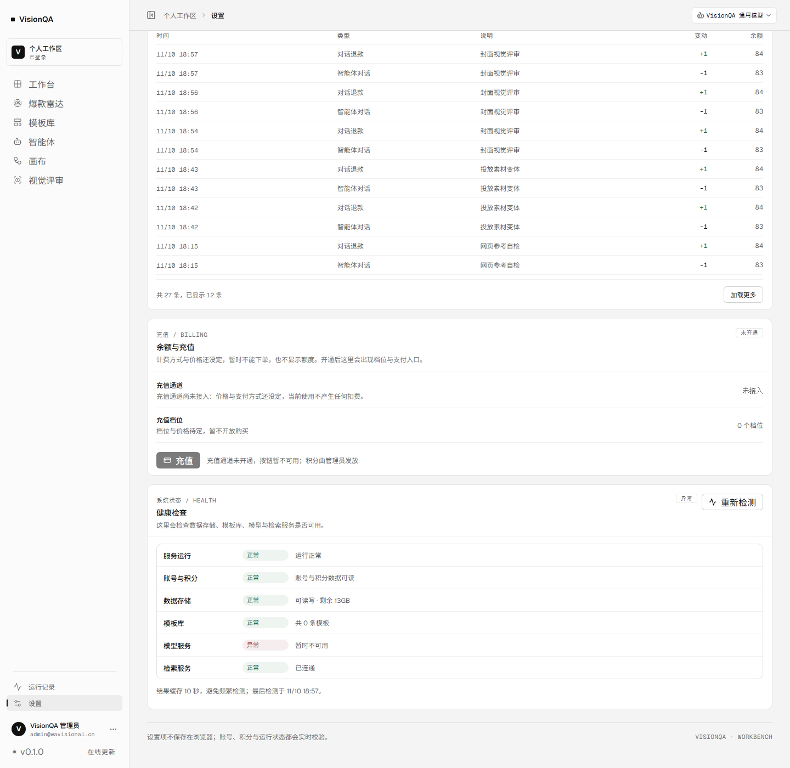
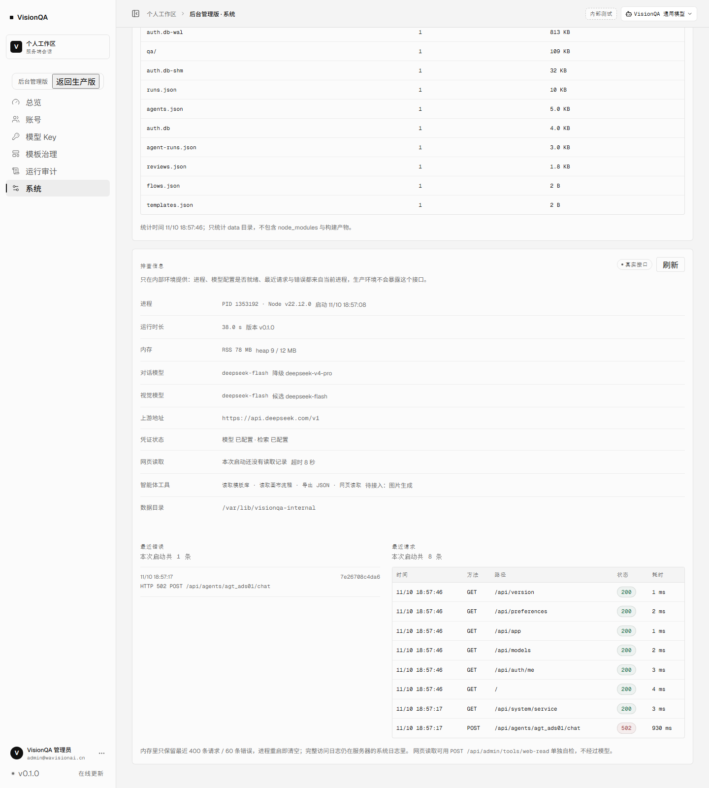

# 上线验收（2026-11-10 实测）

> 这份文档记录「第十三批」上线后的真实验收：接口、页面、生产/内部两套口径。
> 所有结论都来自线上真实请求与真实渲染截图，不是本地断言。

## 一、怎么复跑

脚本 `scripts/acceptance.mjs` 只读：不写数据，也不发起扣费请求。

```bash
# 生产：匿名检查 + 登录后检查
VQ_COOKIE=<会话 token 或整条 Cookie> node scripts/acceptance.mjs

# 内部测试：通过 SSH 隧道
VQ_SCOPE=internal VQ_BASE=http://127.0.0.1:8801 VQ_COOKIE=<内部会话> node scripts/acceptance.mjs
```

不给 `VQ_COOKIE` 时只跑匿名检查。`VQ_COOKIE` 可以只给 token，脚本自动补 `vq_session=` 前缀。

## 二、生产环境（25/25）

| 检查 | 结果 |
| --- | --- |
| 匿名 `GET /api/models` | 401，带 `loginRequired`，拿不到模型标识 |
| 匿名 `GET /api/version` | 200，只有 `version / name: "VisionQA"`，没有 `startedAt` |
| 匿名 `GET /api/health` | 200，没有 `visionModel / llmModel` |
| `GET /api/app` | `mode: "prod"`、`internal: false` |
| 登录后 `GET /api/models` | 200，标签为「VisionQA 通用模型」，仍带请求用 id |
| 登录后 `GET /api/version` | 带回 `startedAt` |
| 积分 / 偏好 / 模板 / 智能体 / 流程 / 运行 / 评审 | 全部 200，有真实数组 |
| 充值 `GET /api/billing/overview` | `enabled: false`，档位空数组，文案「充值通道尚未接入」 |
| 充值订单 `GET /api/billing/orders` | 空列表；`POST` 带档位 501 `BILLING_NOT_CONFIGURED`；不带档位 400 |
| `GET /api/system/health` | 六项产品状态；失败只写「暂时不可用」，无路径、Node 版本、上游或状态码 |
| `GET /api/system/service` | 只有 `available / message / retryAfterSec` |
| 后台账号 / 存储 / 操作日志 | 全部 200 |
| 生产 `/api/admin/diagnostics` | 404 |
| 生产 `/api/admin/tools/web-read` | 404 |
| 画布服务状态 | 200，`deployed: true`，Web / Admin / API 三个端口都通 |

## 三、内部测试环境（8/8）

| 检查 | 结果 |
| --- | --- |
| `GET /api/app` | `mode: "internal"`、`internal: true` |
| 匿名 `GET /api/models` | 401（与生产一致） |
| 匿名 `GET /api/version` | 保留包名 `creator-canvas-studio`，不暴露启动时间 |
| `GET /api/health` | 保留 `visionModel / llmModel` |
| `GET /api/admin/diagnostics` | 200，含进程、内存、模型、上游地址、最近请求与错误 |
| `GET /api/system/service` | 额外带 `code / detail / upstream / since / count / lastModel / verified / verifiedAt` |
| 登录后 `GET /api/models` | 200，有可选模型 |
| `POST /api/admin/tools/web-read` | 200，真实抓取公开页面 |

## 四、页面与真实故障

- 生产 15 个页面（工作台、雷达、模板库、智能体列表与编辑、画布、评审、运行记录、设置、后台六页）
  按真实登录态渲染复扫：**0 处技术词命中、0 个页面脚本报错、无横向溢出、无图片加载失败**。
- 真实模型失败一次：生产对话返回 502「模型服务额度不足，本次不计费；请联系管理员充值后再试」，
  响应不再带技术建议；余额保持 84，流水 25 → 27（扣 1 退 1）。
- 同一时刻生产健康检查「模型服务」为「异常 · 暂时不可用」；内部环境显示
  `Insufficient Balance / 402`、模型名、失败时间与建议原文。
- 健康检查在「刚启动、还没有真实调用」时显示「注意 · 接口已连通 · 待首次生成验证」，
  不再把 `/models` 连通冒充成可用。

## 五、截图









## 六、未覆盖与阻塞

- 上游模型账号余额未充：智能体成功路径与视觉评审无法在真实数据上验收；失败与拦截路径已验收。
- 模板库第一条真实复刻仍需一次真实视频确认。
- 后台模型 Key 托管与在线更新下载/应用保持只读 + 部署文档说明（不在界面写密钥、不做未签名自更新）。
- 多工作区切换、邮件自助找回、图片生成仍等数据模型、邮件通道或图像通道。
- 充值（billing）按用户要求保持占位，金额、档位、支付方式未定。
