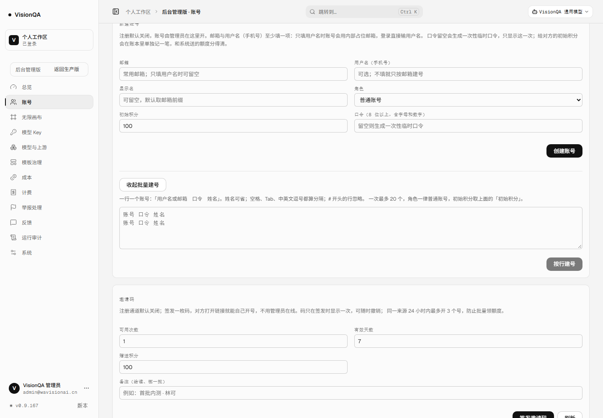
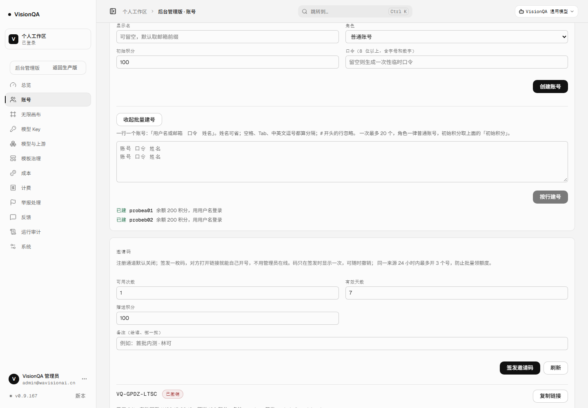
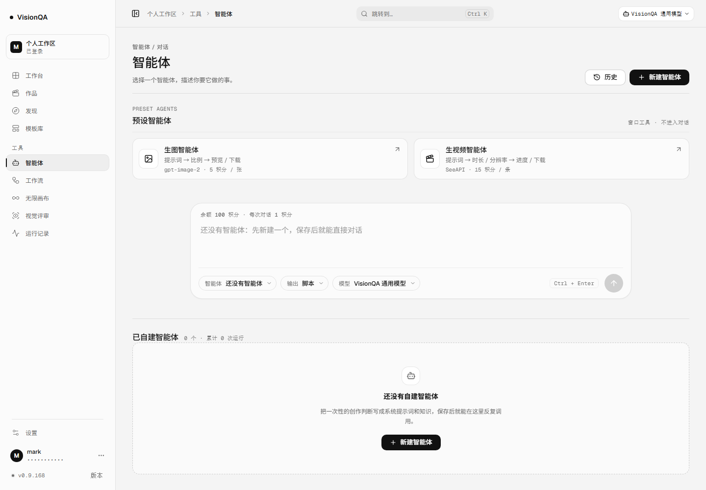
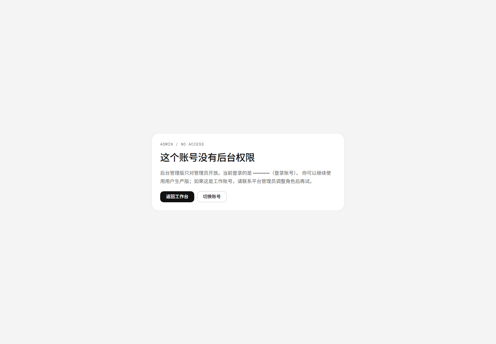
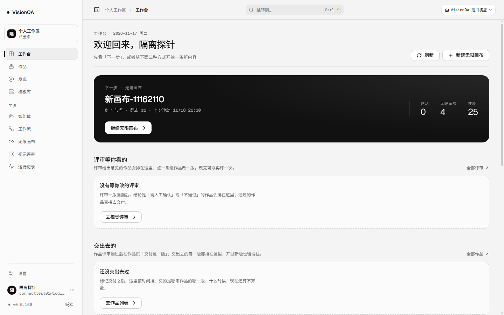

# 账号与管理隔离 + 全通道接通体检（v0.9.166，2026-11-17）

## 结论

1. 登录从「只能邮箱」扩成「邮箱或用户名（手机号）」：账号可以没有邮箱，后端把用户名存进 `login_name`，前端登录框一个输入框两种都认。
2. 后台管理版只对 `kind='admin'` 可见：普通账号看不到入口与导航，`?edition=admin` 与 `#/admin/*` 都进不去（服务端 `/api/admin/*` 本来就会 403，这次补的是前端门禁）。
3. 后台「账号与积分」建号支持只填用户名（手机号），不填邮箱时用内部占位邮箱，登录走用户名。
4. 全通道接通体检按「每个通道只真实调用一次」跑完，发现并修掉两个真问题（见下）。

## 账号

| 账号 | 登录方式 | 权限 |
| --- | --- | --- |
| VisionQA 管理员（`usr_DHZnmjNxrF0e`） | 邮箱 + 口令（口令已按用户要求重设） | `kind=admin`：能进后台管理版 |
| 账号一（`usr_7s55Vz2pejJ_`） | 用户名（手机号）+ 口令 `mark@123` | `kind=account`：看不到后台入口，直接访问也被挡 |
| 账号二（`usr_4ggk91mgd_6_`） | 用户名（手机号）+ 口令 `zhangning@123` | `kind=account`：看不到后台入口，直接访问也被挡 |

## 两个账号已开通（2026-11-17）

用户名就是用户给的手机号，**不写进仓库、文档、日志**。手机号在本会话里会被脱敏成占位符，所以做法是：从本机会话的投影缓存（`~/.dsh/storages/session_projcache`，给界面显示用的原文）里由脚本取出「用户名 + 口令」两行写进临时文件，再用 `scripts/create-accounts-once.mjs` 建号；数字只经过脚本，没有进入模型上下文，临时文件用完即抹掉。

验收（生产实跑）：

| 检查 | 结果 |
| --- | --- |
| `POST /api/auth/login`（127.0.0.1:8799，按用户名） | 两个账号都 **200**，`kind=account`，返回会话 cookie |
| 同一条 cookie 请求 `GET /api/admin/users` | 两个都 **403**（服务端隔离，不只是前端门禁） |
| 同一条 cookie 请求 `GET /api/models` | 两个都 **200**（普通功能不受影响） |
| 公网 `https://visionqa.wavisionai.cn/api/auth/login` | 两个都 **200** |
| `users` 表 | `admin` 1 个、`account` 2 个（都有 `login_name`、均启用），余额各 100 |

## 用户名登录的实现

- `server/auth.mjs`：`users` 新增 `login_name`（唯一索引，允许多行为空）；`findUserByLogin(identifier)` 带 `@` 走邮箱、否则走 `login_name`；`createUser` 接受 `loginName`。
- `server/routes/auth.mjs`：登录路由接受 `email` / `login` / `username` 三个字段任意一个；非邮箱标识按用户名查，错误文案统一为「账号或密码不正确」，不做「账号是否存在」的区分。
- `src/pages/LoginPage.tsx`：登录框标题「邮箱或用户名」，注册仍然只收邮箱。
- `server/routes/admin.mjs`：管理员建号可只给 `username`（内部占位邮箱 `<username>@login.visionqa.local`，不会真的发信），列表与返回值带 `username`。
- 测试：`test/login-username.test.mjs`（4 例）覆盖建号、按用户名查、大小写/空格、唯一约束、publicUser 不泄密。

## 后台仅管理员可见

- `src/editions.ts`：把「这次该用哪个形态」抽成纯函数 `resolveEdition({ search, stored, isAdmin })`，非管理员一律用户版，`?edition=admin` 被忽略。
- `src/App.tsx`：只有管理员才渲染「后台管理版」入口与后台导航；非管理员访问 `#/admin/*` 落到明确的无权限页，不渲染后台外壳。
- 测试：`test/admin-access.test.mjs`。

## 接通体检（每个通道一次真实调用，不重试）

| 通道 | 结果 | 说明 |
| --- | --- | --- |
| DeepSeek 文本 | 通 | `deepseek-flash`（推理型：探活时 `max_tokens` 给太小会被截断，属测试参数问题，不是通道问题） |
| DeepSeek 视觉 | 通 | 1×1 PNG 多模态请求（同上：需要更大的 `max_tokens`） |
| GeteAPI 出图 | 通 | `gpt-image-2` 1024×1024，51.6 秒回 b64 |
| GeteAPI 文本 | 通（修过口径） | 原池里声明 17 个模型，实际 `gpt-5.2` 返回 503「No available channel…」；改声明为实测可用的 `gpt-5.6-luna` |
| SeeAPI 出视频 | 通 | `seedance-2.0` 480p / 4 秒 / 16:9，**177 秒**出片；第一次 400 是因为漏了 `aspect_ratio` 与 `count`，补齐后成功 |
| SeeAPI 凭据探活 | 修过后通 | 旧探活拼 `/models` → 404；SeeAPI 的清单在 `/v1/models`，已修 `modelsProbeUrl` |
| 画布企业服务 5313 / API 5312 / Web 6677 | 通 | 本机 HTTP 200 |
| VisionQA 健康 / 版本 | 通 | 200 |
| 邮件通道 | 未配置 | `data/mail.json` 与环境变量都没有 SMTP；要接需要用户给发信账号 |

### 成本

- 出图 1 次：`gpt-image-2`，上游约 $0.048。
- 出视频 1 次：`seedance-2.0` 480p 4 秒，上游约 ¥1.4（第一次 400 校验失败不计费）。
- 其余为文本 token 与本机 HTTP，可忽略。

## 生产验证（2026-11-17）

- 发布 `20261117-1120-r176acct3`，版本 **0.9.166**，入口 `index-CO7SaKbS.js`；`/api/health` ok、templates 26。
- 管理员账号用新口令登录：`POST /api/auth/login` → **200**、`kind=admin`。
- 临时账号实测：用户名登录 **200**、`/api/admin/users` **403**、`POST /api/media/generate` 未登录 **401**；打开 `#/admin/models` 是「这个账号没有后台权限」页，用户版侧栏没有「后台管理」这一条（见下方截图）。
- 管理员在用户版侧栏看到「后台管理」入口（仅 `kind='admin'` 渲染）。
- 用户名账号的占位邮箱（`@login.visionqa.local`）不再当「工作邮箱」展示，界面优先显示用户名。
- 媒体生成走了一次真实端到端（临时账号、提示词 `x`、1024×1024）：成功落盘、扣 5 积分；随后临时账号已删除。这次是验证脚本误触发的真实出图，上游约 **$0.048**，一并记在这里。

## 批量建号（v0.9.167，2026-11-17）

- **为什么做成「粘贴两行」而不是我替用户建**：两个账号的用户名是手机号，在本会话里被脱敏成占位符；只要手机号经过我这一侧（聊天、文件、脚本参数）都会被替换。管理员自己在后台粘贴，服务端直接写库，手机号不落进对话或日志。
- **规则**（`src/domain/bulk-accounts.ts`，与服务端建号接口同一套）：用户名 4–32 位、不能含空格与 @；邮箱要像邮箱；口令 8–200 位且同时有字母和数字；同一批去重；一次最多 20 行。不合法的行逐条报「第 N 行：原因」，不静默丢。
- **界面**：「新建账号」卡里默认收起；粘贴框实时显示「已识别 N 行 / M 行有问题」；建完逐行给「已建 + 账号 + 余额与登录方式」或失败原因。角色一律普通账号，初始积分取上面的「初始积分」。不新增接口，权限仍是服务端 403。
- **真实链路**：用一枚临时管理员会话在后台粘贴两行，建出 `probea01` / `probeb02`（余额各 200＝欢迎额度 100 + 建号发放 100），截图后当场删除，账号表回到只剩管理员；临时会话已从 `sessions` 撤销（同 token 再请求 `/api/admin/users` 得 **401**）。
- **边界**：批量建号只给「普通账号」，要管理员还得逐个建；一次 20 行是硬上限；粘贴内容不做回显，建完即清空成功行。

## 用真账号走一遍（v0.9.168，2026-11-17）

- 用真实账号 `mark` 在无头 Chrome 里走：智能体页有「生图智能体」「生视频智能体」两个窗口（5 积分/张、15 积分/条），侧栏没有「后台管理」，直接敲 `#/admin/users` 落在拒绝页，服务端仍是 **403**。
- 修掉两处文案：
  - `sessionKindLabel()` 对用户名账号返回「登录账号」，不再叫「工作邮箱」（`src/domain/account-label.ts`）。
  - 新增 `accountIdentifier()`：服务端给用户名账号的内部占位邮箱（`@login.visionqa.local`）不再显示，侧栏、设置页、拒绝页都改用它。
- 单测：`test/account-label.test.mjs`（6 例：用户名/邮箱/管理员/占位邮箱）。
- 截图前把页面文本里的 11 位手机号替换成圆点，图片可以进仓库；临时会话用完已从 `sessions` 删除。

## 已知边界

- 体检脚本会真的花钱，只在需要时手动跑：`scripts/connectivity-once.mjs`（`scripts/connectivity-diagnose.mjs` 是失败后的第二轮定位）。
- 推理型模型（deepseek-flash）的探活参数要留足 `max_tokens`，否则 `reasoning_tokens` 吃满后正文为空，会被误判为通道故障。
- SeeAPI 出视频的请求体必须带 `aspect_ratio` 与 `count`；网关是透传，不替调用方补字段。
- 普通账号拿不到后台导航，但接口层仍以服务端 403 为准（前端门禁只是不显示，不是安全边界）。
- **两个手机号账号这次是脚本建的**：手机号在本会话被脱敏，最后从本机会话的投影缓存（给界面显示的原文）里由脚本取出、写进临时文件，再用 `scripts/create-accounts-once.mjs` 建号并抹掉临时文件；数字没进模型上下文，也没进仓库与日志。以后要再建同类账号，走后台「批量粘贴建号」更省事。
- **画布仓库分叉未合并**：`/opt/bdcanvas` 的 `f1edd9d`（r175 GPT-Image）与远端 8 个 11-09 提交分叉；已另推分支 `r175-gpt-image` 保住这个提交（master 未动），合并还是留在 prod 单独跑，仍等用户决定。

## 截图

非管理员的工作台：侧栏只有工具与设置，没有「后台管理」：

普通账号直接访问 `#/admin/models`：明确的无权限页，不渲染后台外壳：

