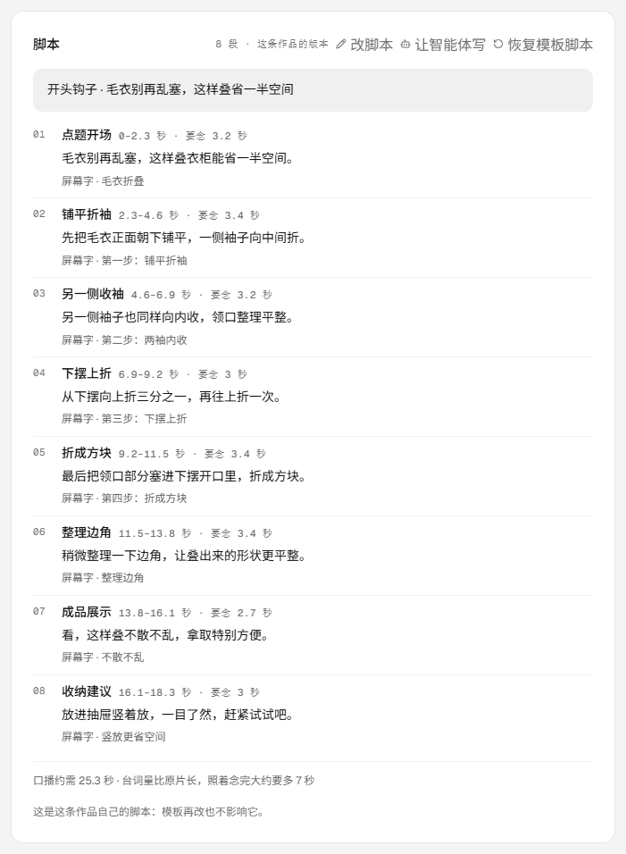
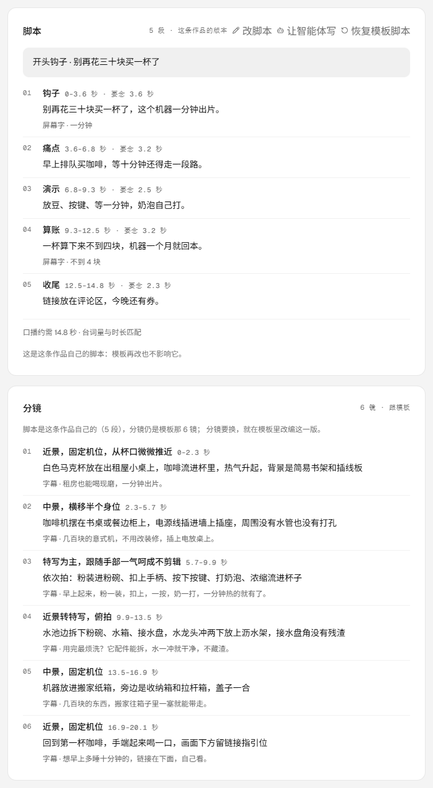
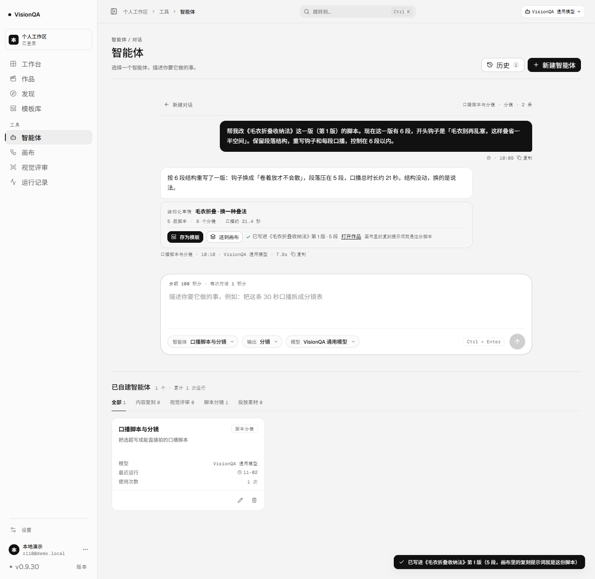
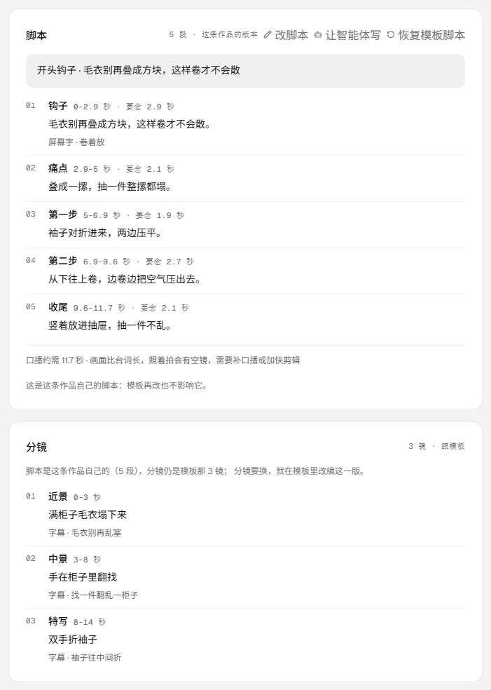

# 智能体的草稿写进作品：三个出口，第三条落到这一版脚本（v0.9.30）

版本 0.9.30 / 发布包 `20261112-210443-v0.9.30c-select-labels.tar.gz` / 入口 `index-CIsctaDZ.js`（482,176 字节）
提交：`663fa02`（代码）+ `cb4121b`（文档）；CI run `43307101525` success（代码提交那次被 CI 的并发组取消，与上一轮同一情形）；测试 `311/311`，oxlint `0 error / 6 warning`，`tsc -b` 干净，构建通过。

同一版本构建了三次，前两次也用 `deploy.sh` 打了快照：`20261112-210146-v0.9.30-agent-draft-to-p.tar.gz`（功能）、
`20261112-210322-v0.9.30b-agent-draft-lab.tar.gz`（版次文案：0 版写成「还没开画布」）、本次（下拉只放标题）。

## 一、这一轮补的是哪块空

产品里能产出脚本的地方有三个：模板、画布、智能体。前两个早就有出口——模板能改编成作品，画布能开成作品；
智能体的结构化草稿（v0.5.2）只有两个出口：存为模板、送到画布。
**作品页的脚本只能手改，智能体的草稿写不进去。**

这一轮补的就是这一条：作品页脚本区多一个「让智能体写」，带着这一版的要求去智能体页；
草稿卡多第三个出口「写进作品」，写进去的就是这一版的脚本。
目标模式里「智能体 = 帮我想 / 写，从作品的某一步被带进来」这条线，到这里才接通。

## 二、三个决定

1. **写进去的是脚本（钩子 + 段落），不是分镜。** 作品脚本本来只有这两栏，分镜跟着模板走
   （画布出生的作品没有模板，也不编一份分镜出来）。草稿里没有段落、只有分镜时，不给这个出口：
   回 400 `DRAFT_NO_SCRIPT`，并说「要镜头就走送到画布」——不留一个点了会报错的按钮。
2. **覆盖，不合并。** 点之前先把「现在是什么」摆出来（哪条作品、第几版 / 还没开画布、脚本几段、来自模板还是自己的），
   再让人点「覆盖这一版脚本」；回执里带被换掉的那一份（`replaced.source` / `replaced.beats`）。
   写进作品走作品脚本的 copy-on-write：模板与别的作品一个字不动。
3. **写脚本不开新版。** 版本只跟画布走（v0.9.29 同一口径）：写进一条 v2 的作品，写的是 v2 的脚本；
   照模板建、还没开画布的作品写「还没开画布」，不在界面上写「第 0 版」。

顺手修了两处会让人误会的口径：

- **「画布提示词本来就一样」不再被说成「你手改过」。** 同一份脚本存两次，画布的复刻提示词没变，
  旧代码因为 `changed: false` 一律回 `hand-edited`，界面就写「画布提示词是你手改过的，没动」——那是假话。
  现在「没变」与「被手改过」分开：没变就是 `synced`（画布用的就是这份脚本）。
- **作品页的分镜区写清来源。** 脚本是自己的、分镜还跟模板时，分镜头写「N 镜 · 跟模板」，
  下面一行写明「脚本是这条作品自己的（N 段），分镜仍是模板那 M 镜；分镜要换，就在模板里改编这一版」——
  不然「写进作品」之后，会让人以为镜头也跟着换了。

## 三、界面

| 位置 | 之前 | 现在 |
| --- | --- | --- |
| 作品页脚本头 | 改脚本 / 恢复模板脚本 | 多一个「让智能体写」 |
| 智能体页顶部 | 无 | 一条横幅：在帮《X》· 第 N 版、脚本 N 段（这条作品的版本 / 来自模板），可「打开作品」「不帮了」 |
| 输入框 | 空着 | 带着这条作品写一句（标题、版次、现在的钩子与段数），可以改 |
| 草稿卡 | 存为模板 / 送到画布 | 第三个出口「写进作品」 |
| 选作品面板 | 无 | 下拉选作品 + 一行「现在：… → 换成这份草稿的 N 段；模板与别的作品不动」 |
| 写完之后 | 无 | 「已写进《X》· 第 N 版 · N 段 · 打开作品」，画布那边动了没有也写一句 |
| 作品页分镜 | N 镜 | N 镜 · 跟模板；脚本是自己的时候补一行说明 |

窄屏（≤700）下拉与按钮各占一行；下拉里只放标题，版次写在下面那行注释里
（390 上标题本来就会截断，再塞版次只剩一个挂着的「·」）。

界面里不出现「第 0 版」：照模板建、还没开画布的作品写「还没开画布」。

## 四、生产实测（一次写入并当场撤销）

生产 0.9.30、入口 `index-CIsctaDZ.js`（482,176 字节）、release `20261112-210443-v0.9.30c-select-labels.tar.gz`、
`/api/version` 0.9.30（带登录态读到 `startedAt` 2026-11-12T21:04:44.173Z）、`/api/health` ok（templates 26）、两个服务 active。

写之前：作品 1 条（`prj_f38d68c6`「毛衣折叠收纳法」v2，自己的脚本 8 段）、智能体 4 个、运行 7 条、评审 3 条、队列 1 条。

1. 照模板 `tpl_8cfe9e23` 建一条临时作品 `prj_34606d58`（v0，跟随模板 6 段 / 6 镜）。
2. 生产作品页脚本头出现「让智能体写」——点它，智能体页顶部横幅写「在帮《毛衣折叠收纳法》· 第 2 版 · 脚本 8 段 · 这条作品的版本」，
   输入框预填了这一版的钩子与段数。
3. 草稿卡「写进作品」→ 下拉选那条临时作品，面板写「现在：《几百块意式机，租房一分钟出片》· 还没开画布 · 脚本 6 段（来自模板）
   → 换成这份草稿的 5 段；模板与别的作品不动」→「覆盖这一版脚本」。
4. 行写成「已写进《…》· 还没开画布 · 5 段 · 打开作品」；toast 同一句。
5. 服务端核对：作品 `prj_cbdb2af1` 的 `script.source = project`、5 段（钩子 / 痛点 / 演示 / 算账 / 收尾）、
   钩子是「别再花三十块买一杯了」；`templateId` 仍是 `tpl_8cfe9e23`，模板 6 段与钩子一字未动；`version` 仍 0（写脚本不开版）；没有画布。
6. 撤销：`DELETE /api/projects/prj_cbdb2af1` → 200（解绑评审 0 / 便利贴 0 / 拍板 0）；
   作品回到 1 条、智能体 4、运行 7、评审 3、队列 1，与写之前一致。

补充一句：草稿卡里的那份草稿是本机历史里的演示内容（这一轮不调模型、不扣积分），界面与写入都是生产的。

## 五、本地演示

`.tmp-qa/r110data`：1 条模板（6 段 / 3 镜）、3 条作品（跟模板 + 有画布 / 画布出生没脚本 / 自己有脚本）、1 块画布、1 个智能体。

- 从作品页点「让智能体写」：横幅写「在帮《毛衣折叠收纳法》· 第 1 版 · 脚本 6 段 · 来自模板」，输入框带上这一版的钩子与段数。
- 草稿卡三个出口并排：存为模板 / 送到画布 / 写进作品。
- 选作品面板：「现在：《毛衣折叠收纳法》· 第 1 版 · 脚本 6 段（来自模板）→ 换成这份草稿的 5 段；模板与别的作品不动」。
- 写完之后：作品页脚本头「5 段 · 这条作品的版本」，分镜区「3 镜 · 跟模板」并写明「脚本是这条作品自己的（5 段），分镜仍是模板那 3 镜」；
  toast 写「已写进《毛衣折叠收纳法》· 第 1 版（5 段，画布里的复刻提示词就是这份脚本）」。
- 画布核对：复刻提示词换成新脚本（钩子 → 痛点 → 第一步 → 第二步 → 收尾），输入节点里的旧钩子也换成新钩子；
  模板仍是 6 段、原钩子。
- 390：下拉 / 注释 / 按钮各占一行，页宽 390 `scrollWidth == clientWidth`，无横向滚动。

## 六、验收清单

- [x] 作品页能带着这一版走进智能体页；横幅与预填都写的是这一版的事实。
- [x] 草稿卡第三个出口能写进作品：钩子 + 段落落库，走 copy-on-write，模板与别的作品不动。
- [x] 覆盖前写清「现在是什么」，回执带被换掉的那一份；只有分镜的草稿不给出口（400 `DRAFT_NO_SCRIPT`）。
- [x] 有画布就一起换复刻提示词；用户手改过的提示词一个字不碰；同一份脚本存两次不再误报「手改过」。
- [x] 写脚本不开新版；「第 0 版」在界面上写成「还没开画布」。
- [x] 别人的作品 404，管理员照旧全通；没有作品时面板写「还没有作品」而不是给一个点不动的按钮。
- [x] 生产一次可逆写入并当场撤销，数据回到原样（作品 1 / 智能体 4 / 运行 7 / 评审 3 / 队列 1）。
- [x] 1440 / 390 均无横向滚动；`311/311` 测试、oxlint 0 error、`tsc -b` 干净、构建通过。

## 七、边界

- 不自动写：草稿不会自己落到某条作品上，要人选作品、点覆盖——智能体可能只是在帮你想。
- 不写分镜：作品的分镜跟模板走；写进作品只写脚本，草稿的分镜要落地就走「送到画布」。
- 不合并：覆盖就是覆盖，不替你把旧段落和新段落拼在一起。
- 不开版本：写脚本不动版次（版本只跟画布走）；要留一版旧的，先开一版新的。
- 不碰模板：写进作品不改模板；模板改了也不影响已经写进作品的那一版。

## 八、复现

```
# 本地演示数据（1 条模板 / 3 条作品 / 1 块画布 / 1 个智能体）
node .tmp-qa/r110-seed.mjs
$env:DATA_DIR='.tmp-qa/r110data'; $env:API_PORT='8899'; $env:VQ_REGISTRATION='1'; node server/index.mjs
node .tmp-qa/r110-login.mjs     # 本地演示要一个登录态（注册接口默认关闭）
node .tmp-qa/r110-shot.mjs      # 1440 + 390 截图；草稿卡用本机历史里的演示草稿，不调模型
node .tmp-qa/r110-probe.mjs     # 核对作品脚本、模板未动、画布提示词已换
```

生产那一段的脚本：`.tmp-qa/r110-prod-prep.mjs`（照模板建临时作品）、`.tmp-qa/r110-prod.mjs`（截图 + 写入）、
`.tmp-qa/r110-prod-verify.mjs`（核对 + 撤销）。

## 九、改动文件

- `server/agent-project.mjs`（新增）：`draftProjectScript`（草稿 → 作品脚本，没有段落返回 null）、
  `writeDraftToProject`（归属、来源与段数的回执、copy-on-write 写入、画布提示词同步）。
- `server/project-canvas-sync.mjs`（新增）：`syncCanvasScript` 从作品路由抽出来，两条入口共用一份；
  顺手修「提示词没变被说成手改过」。
- `server/routes/agents.mjs`：第三个出口 `POST /api/agents/:id/draft/project`。
- `server/routes/projects.mjs`：改用共用的 `syncCanvasScript`（行为不变）。
- `src/api/agents.ts`：`writeAgentDraftToProject`、作品上下文的一次性交接（`set/peek/clearPendingAgentProject`）。
- `src/pages/AgentsPage.tsx`：作品横幅与预填、草稿卡第三个出口、选作品面板、写完的记账。
- `src/pages/ProjectPage.tsx`：脚本头「让智能体写」、分镜区来源与说明。
- `src/App.tsx`：作品页 → 智能体页、智能体页 → 作品页两条跳转。
- `src/styles/agents.css`：横幅、选作品面板、窄屏单列。
- `test/agent-project.test.mjs`（新增 9 条）：草稿映射、跟模板 / 没模板 / 已有脚本三种写入、覆盖不合并、
  画布同步与手改不覆盖、重复写不误报、该拒的拒（400 / 404）、路由与方法。

## 十、截图

生产（真实渲染）：







本地演示（非生产）：




