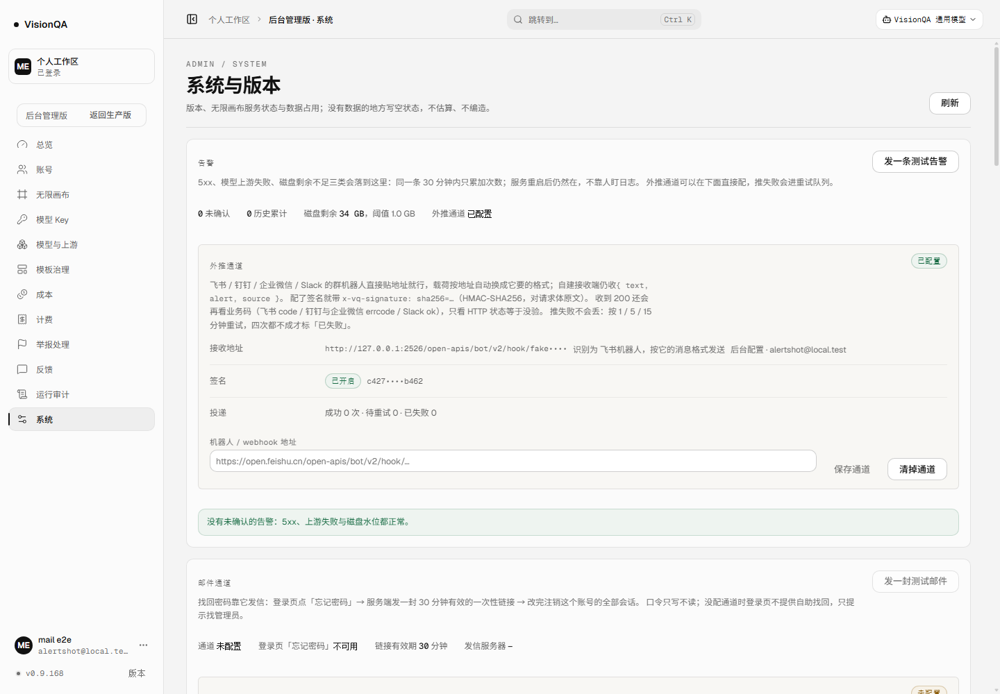
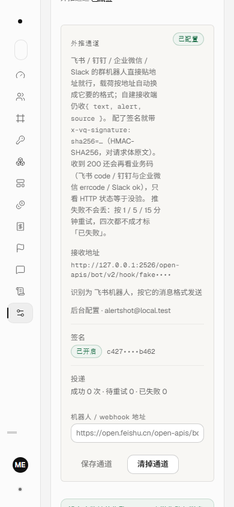

# 告警载荷按机器人类型适配（r182，2026-11-17）

结论：**生产里「配了机器人地址却收不到」的那半个坑已经补上**。告警现在按地址认出飞书 / 钉钉 / 企业微信 / Slack 的群机器人，各自发它要的那份 JSON；并且回 HTTP 200 之后还要看业务码——飞书 / 钉钉 / 企微都会用 200 回错误码，只看状态码等于没验。

## 为什么做这个

上一轮（r181）把外推链路验通了，同时查出一个真问题：我们发的是通用 JSON `{ text, alert, source }`。

- 飞书自定义机器人要 `{ "msg_type": "text", "content": { "text": "…" } }`，直接喂通用 JSON 回 **400 / 19001**；
- 钉钉与企业微信要 `{ "msgtype": "text", "text": { "content": "…" } }`；
- 更坑的是**它们会用 HTTP 200 回业务错误码**（飞书 `code`、钉钉与企微 `errcode`）。旧实现按 `res.ok` 判成败，于是「关键词不匹配」这种会被记成「已发出」，队列里干干净净，群里一条没有。

## 怎么改的

新增 `server/alert-format.mjs`，三件事：

| 函数 | 干什么 |
| --- | --- |
| `detectProvider(url)` | 只看 host + path 认人：`/open-apis/bot/` → 飞书（Lark 同样路径）；`/robot/send` → 钉钉；`/cgi-bin/webhook/send` → 企业微信；`hooks.slack.com/services/` → Slack；其余 → 通用 webhook |
| `buildPayload(provider, { text, alert })` | 出对应载荷；认不出仍是原来的 `{ text, alert, source }`，自建接收端一个字都不用改 |
| `readVerdict(provider, status, raw)` | 200 之后再看业务码：飞书 `code`/`StatusCode` === 0、钉钉与企微 `errcode` === 0、Slack `ok`；正文里认不出字段也算失败 |

接进 `server/alerts.mjs` 的 `sendText`：签名仍是对**实际请求体原文**做 HMAC-SHA256（`x-vq-signature`），失败仍进重试队列、四次才 dead。`notify` 里多带 `provider` / `providerLabel`，后台提示能说清是谁收下了。

后台「系统 → 告警 → 外推通道」的接收地址下面多一行「识别为 飞书机器人，按它的消息格式发送」，说明文案同步改成现在的真实行为。

## 验过的

**单测**（新增 `test/alert-format.test.mjs`，5 条，全绿）：五家识别、五种载荷形状、业务码判定（含 `19024` / `310000` / `93000` 与非 JSON 200），以及两条真起 HTTP 服务的用例——假飞书回 `200 + code 19024` 时必须进队列且 `sentCount` 不动，假钉钉回 `errcode 0` 时必须按钉钉格式发出并记成功。

**整条链路**：服务器上从 GitHub **全新 clone 到 `/tmp/alert-src`**（`HEAD=1369e75`），临时实例 `8803` + 本地假接收端 `2526`，全走真实后台接口。20 步里与本轮相关的：

- `PUT channel (fake feishu)` → `provider=feishu/飞书机器人`
- `POST alerts/test` → `ok=true provider=飞书机器人`，接收端收到 `msg_type,content` 两字段的载荷，**签名对得上**
- 指向「关键词不匹配」的假路径（回 200 + `code:19024`）→ `ok=false`、`error=飞书拒收（code 19024）：Key Words Not Found`，这条**进队列 `pending`**，`sentCount` 没有跟着加
- 收尾 `DELETE channel` → `configured=false`

完整 20 步（通用 webhook 的老路径也在里面，含失败排队、热改地址、手动重试、验签）：`E2E_EXIT=0`。

**门禁**：`npm test -- --test-concurrency=1` **1288/1288**（新增 5 条）；lint **0 error / 16 warning**；`tsc -b` + `vite build` 干净。

**截图**（真实实例，1440 与 390 各一张）：

接收地址下面那行「识别为 飞书机器人，按它的消息格式发送」就是本轮新增的判断结果展示。

## 生产现状（一处更正）

查文件时发现生产 `/var/lib/visionqa/alert-outbox.json` **是存在的**（2026-11-13 18:43，114 字节）：`items: 0`、`sent: { count: 1, lastAt: 2026-11-13T10:43:46Z, lastStatus: 200 }`。

也就是说 **11-13 那天确实有一条告警成功推出去过一次**（对端 HTTP 200）。但那之后通道就没了：现在既没有 `alert-channel.json`，也没有 `VQ_ALERT_WEBHOOK`，所以**今天线上 5xx / 额度打满 / 磁盘不足仍然只会落进后台列表，不会有人被通知**。

本轮改动已在 master（`1369e75`），**生产仍跑 0.9.168、未部署这一轮**——反正通道空着，部署与否都不改变「没人被通知」这件事；等你的机器人地址给过来，发版时一起上，配完点一次「发一条测试告警」就能当场看到谁收下了。

## 边界

- **没有对真实的飞书 / 钉钉 / 企业微信 / Slack 发过一条消息**（没有它们的机器人地址，也不该拿你的群做实验）。验的是「载荷形状 + 业务码判定」，这两件是对端文档写死的部分；真机上还可能撞到机器人的安全设置（飞书关键词 / 钉钉加签 / 企微 IP 白名单）。
- 钉钉「加签」是机器人自己的 `timestamp&sign` 查询参数，与我们这把 `x-vq-signature` 是两回事，**没做**。如果你的钉钉机器人开了加签，得先在那边关掉，或者告诉我，我按它文档补。
- 只发文本消息，没做 markdown 卡片 / @人。
- 生产未部署本轮代码。
