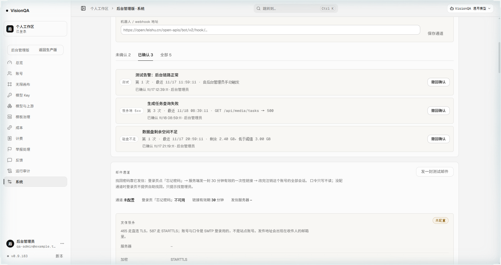
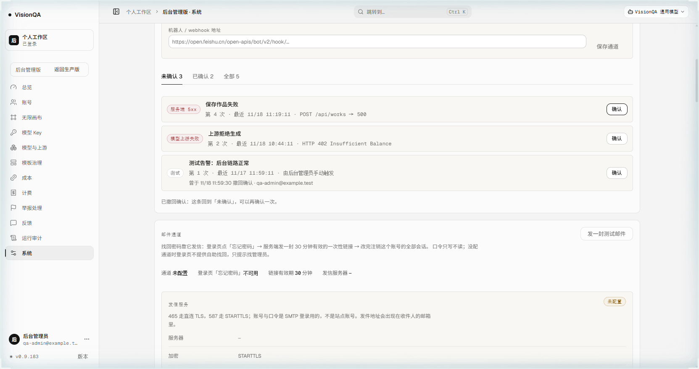
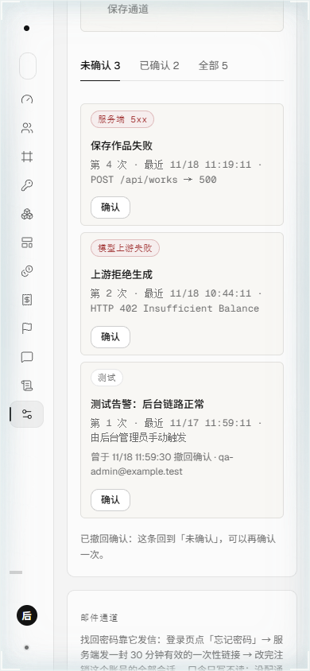

# 告警「撤回确认」：点错了要能改回来（2026-11-18，0.9.183）

上一轮把告警分成「未确认 / 已确认 / 全部」之后，暴露出一条单行道：**确认只能往前，不能往回**。点错一条 5xx 的「确认」，它就从待办里消失，只能在「已确认」里看着、改不回去；要恢复唯一的办法是登服务器改 `alerts.json`。

这一轮把它补成双向的。

## 一、接口：确认的双向操作

```
POST   /api/admin/alerts/:id/ack    确认（原有）
DELETE /api/admin/alerts/:id/ack    撤回确认（新增）
```

撤回不是删除——告警本身一条不动，只把 `ackAt` / `ackBy` 退回，另记 `unackAt` / `unackBy`：

| 字段 | 确认时 | 撤回时 |
| --- | --- | --- |
| `ackAt` / `ackBy` | 写入当前时间与管理员 | 清空 |
| `unackAt` / `unackBy` | 清空（重新确认不留上一轮的撤回痕迹） | 写入当前时间与管理员 |

两种失败分开报，不糊成一句话：

- 告警不存在 → **404**「没有这条告警」；
- 告警还没被确认 → **409**「这条告警还没被确认，没有可撤回的确认」（不改任何字段，不会把时间戳越改越新）。

`server/alerts.mjs` 的 `unackAlert(id, by)` 回 `{ ok, reason, alert? }`，`reason` 只可能是 `not-found` / `not-acked`。两个动作都写操作日志（`alert.ack` / `alert.unack`，带 `kind` 与次数），审计页那句说明也补上了「确认、撤回了告警」。

## 二、界面：确认过的行上多一个「撤回确认」



已确认的行原来只有一个中性徽标与两行灰字，现在右侧是「撤回确认」；未确认的行仍是「确认」。撤回成功后**自动切回「未确认」**——因为这条已经不在「已确认」这个视图里了，停在原地会让人以为又删掉了：



回到未确认的行多一行痕迹：「曾于 11/18 11:59:30 撤回确认 · 谁」。390 宽下单列排布，按钮跟着内容走：



按钮用的是小档 ghost（`.vq-button--sm`）而不是方形图标按钮（`.vq-button--icon`）——后者固定为方形宽，四个字的「撤回确认」会被裁掉，这是第一版截图里抓到的。

## 三、验收

服务端 6 条单测（`test/admin-alert-unack.test.mjs`）：

1. 撤回把 `ackAt`/`ackBy` 清空、写 `unackAt`/`unackBy`，计数从「已确认」回到「未确认」，**盘上也是这个状态**；
2. 没确认过的不能撤回（`not-acked`），一个字段都不改；
3. 撤回不存在的 id 是 `not-found`，不凭空造一条；
4. 撤回不动告警内容：标题、说明、次数、首次与最近时间全不变，总数不变；
5. 撤回后再确认，上一轮的撤回痕迹清空，确认人是这一次的；
6. 连续撤回第二次是 `not-acked`，撤回时间不会被改新。

界面端到端（本机临时实例 + 同一份 `dist` + 无头 Chrome，5 条样例告警 2 未确认 / 3 已确认）：

```
未确认 2 · 已确认 3 · 全部 5
切「已确认」：3 行，3 个「撤回确认」
点第一条「撤回确认」→ 未确认 3 · 已确认 2 · 全部 5，自动停在「未确认」
该行多一行「曾于 11/18 11:59:30 撤回确认 · …」
提示：「已撤回确认：这条回到「未确认」，可以再确认一次。」
390 宽：innerWidth 390 / scrollWidth 390，行宽 256 单列
```

截图里没有任何鼠标光标残影：这一轮的点击走 CDP 原生鼠标事件，不是扩展的虚拟光标。

## 四、边界

- 撤回不删数据，告警最多留 200 条（`alerts.json`），撤回只是把确认状态退回去；
- 撤回后「已确认」视图里就没有这条了（它确实不是已确认状态），所以点了自动切视图，不留在原地；
- 没有「批量撤回」、没有「按类型撤回」；
- `unackBy` 记的是撤回时登录的管理员邮箱；文档截图里的样例账号是临时实例造的假邮箱；
- 审计里能看到每一次确认 / 撤回，但告警行上只保留最近一次撤回的痕迹（反复确认、撤回，行上不会堆历史）。
