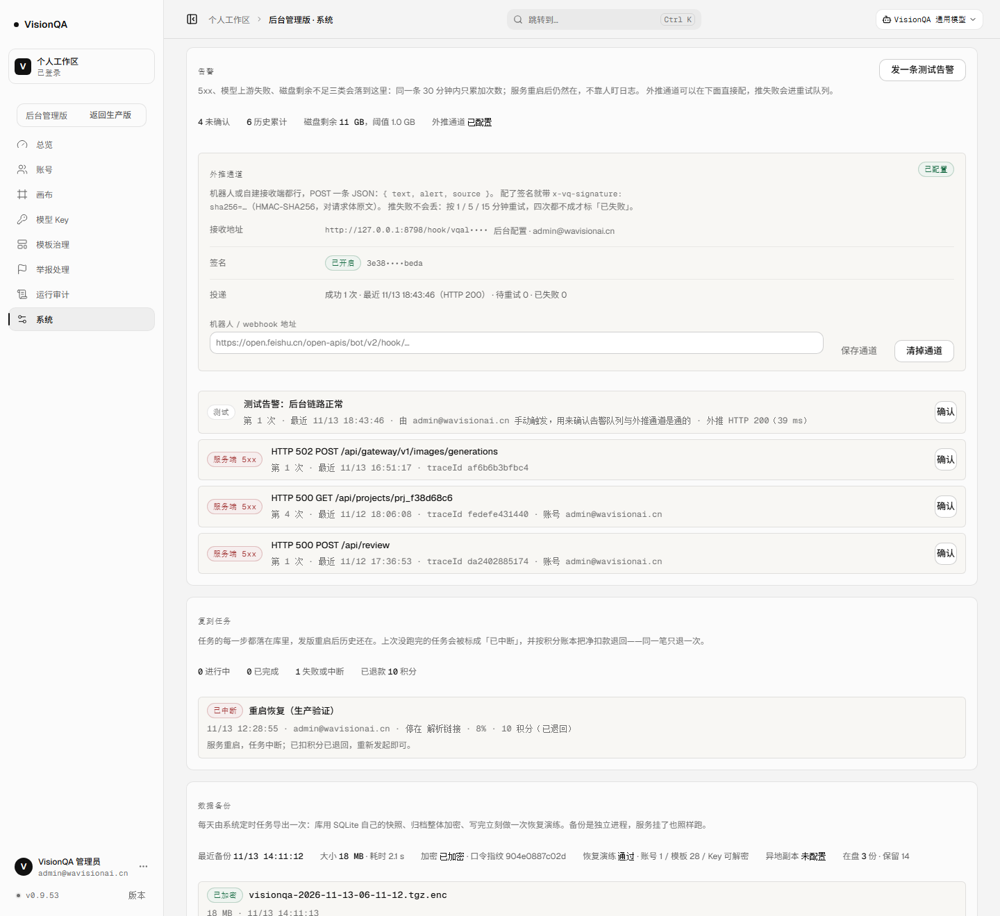

# 告警外推：能配、能重试、不阻塞（v0.9.53）

结论先行：**告警以前只能"记在后台"，现在能主动叫你。** 通道可以在后台直接配（不用登服务器改 `.env`、不用重启），发不出去不丢（1 / 5 / 15 分钟退避重试，四次才判死），并且**绝不等网络**——告警是 5xx 处理器调的，等 5 秒超时等于把一次故障放大成一片慢请求。

## 缺口在哪

上线缺口清单里 A6 一直写着"外部告警缺失，只写 alerts.json"。翻代码发现不只是"没配地址"，是三层问题叠在一起：

| # | 以前 | 为什么不行 |
| --- | --- | --- |
| 1 | 通道只能靠环境变量 `VQ_ALERT_WEBHOOK` | 换地址要登服务器改 `.env` + 重启 `visionqa`；机器人地址本身就是凭证，写在 `.env` 里也没法在后台看一眼状态 |
| 2 | `recordAlert()` 里 `await dispatch()`，5 秒超时 | 告警由 5xx 中间件调用，接收端慢一点就把**每个请求**拖慢 5 秒；上游抖动时等于自我放大 |
| 3 | 推失败只写进 `alert.notify` | 接收端跟着一起挂是最常见的情况，那一条刚好就丢了，事后没人知道漏了哪条 |

## 改法

**通道存储**（`server/alert-channel.mjs`）

- 存 `DATA_DIR/alert-channel.json`，写入即 `chmod 0600`（Linux 上只有服务账号能读）。
- 接口一律只回掩码：`https://open.feishu.cn/open-apis/bot/v2/hook/abcd••••`、密钥 `3e38••••beda`；**明文只在保存那一刻回一次**。
- 校验只收 `http(s)`、拒绝把账号口令写进 URL、上限 500 字符。
- 优先级：后台配置 > 环境变量 `VQ_ALERT_WEBHOOK` > 没有通道。老部署不改也照样能推；后台清掉就回到环境变量。
- 签名：`x-vq-signature: sha256=<HMAC-SHA256(密钥, 请求体原文)>`。飞书 / 钉钉会忽略这个头，自建接收端能验。

**投递队列**（`server/alerts.mjs`）

- `recordAlert()` 只做两件事：落盘、把投递排进链。**不 await 网络**（有测试盯着：接收端慢 1 秒，`recordAlert` 仍立刻返回）。
- 首次成功 → 记 `alert.notify`（状态码、耗时）、清队列；失败 → 进 `alert-outbox.json`，按 **1 / 5 / 15 分钟**退避重试，第 4 次仍失败标 `dead`，不再无限重试。
- 每 30 秒排一次到期项；进程启动时也补排一次（重启前没发出去的那几条，不能等下一次事故才想起）。定时器 `unref()`，不拦进程退出。
- 后台能看到：`待重试 N · 已失败 M`、最近一次尝试的状态码与错误、每条的"下次时间"，`dead` 的可以手动补发。

**接口**

| 方法 | 路径 | 说明 |
| --- | --- | --- |
| GET | `/api/admin/alerts` | 增加 `channel`（掩码视图）、`outbox`（计数与最近一次）、`outboxItems`（前 10 条） |
| PUT | `/api/admin/alerts/channel` | `{ url, enabled }`；首次生成签名密钥并回明文一次，`rotate:true` 换密钥 |
| DELETE | `/api/admin/alerts/channel` | 清掉后台通道，退回环境变量 |
| POST | `/api/admin/alerts/outbox/:id/retry` | 手动补发一条，立刻推一次 |
| POST | `/api/admin/alerts/test` | 记一条测试告警并**等这次外推的结果**（以前只写"已发送"，等于没验） |

审计只记掩码地址，不记明文 URL（`alert.channel.save` / `alert.channel.clear` / `alert.retry`）。

## 生产证据

在生产上起一个本机临时接收端（`127.0.0.1:8798`，接收即落日志），走完整链路：

1. `PUT /api/admin/alerts/channel` → 返回 `configured:true, source:"admin", urlMasked:"http://127.0.0.1:8798/hook/vqal••••", signed:true`，签名密钥只这一次回明文；
2. `POST /api/admin/alerts/test` → `notify: { ok:true, status:200, ms:39 }`；
3. 接收端日志里是**真的那条 JSON**：460 字节，`text` 为「[测试告警] 测试告警：后台链路正常 · …（第 1 次，2026-11-13T10:43:46.823Z）」，带 `x-vq-signature`；
4. 用数据目录里的密钥**独立重算** HMAC：`signatureOk: true`（脚本不打印密钥）；
5. 验证完立刻 `DELETE` 通道、停掉接收端——**生产现在没有配外部地址**，后台显示"未配置"，等真正要用的机器人地址。

测试告警那条随后已"确认"归档，队列里剩下的是真实 5xx（其中一条正是 16:51 出图 502 的记录）。

## 边界

- **没有外部通道仍然不会主动叫你**：代码把"能配、可靠、可验"做完了，还差一个真实的机器人地址（飞书 / 钉钉 / Slack / 自建）。给了地址后台一贴就通，不需要再发版。
- 只支持 `POST` 一条 JSON（`{ text, alert, source }`），不实现各家机器人的专有格式（签名版钉钉需要加 `sign` 参数那种）；要接的话在接收端或再加一层适配。
- 重试上限 4 次；`dead` 之后只留记录 + 手动补发，不做指数无限重试（避免接收端长期 500 时把队列变成噪音源）。
- 队列文件上限 100 条，超出丢最旧的；通道状态与投递结果都落在数据目录，不依赖外部数据库。
- 告警去重规则没变：同一条 30 分钟内只累加次数。

## 回滚

- 后台清掉通道即回到环境变量；要彻底停外推：`DELETE /api/admin/alerts/channel` 且 `.env` 里不写 `VQ_ALERT_WEBHOOK`。
- 版本回滚：`bash /opt/visionqa/ops/rollback.sh`（上一版 v0.9.52）。
- 新增两个数据文件都是可丢的：`alert-channel.json`（通道）、`alert-outbox.json`（未送达队列），删掉即回到"没有通道、没有待重试"。
