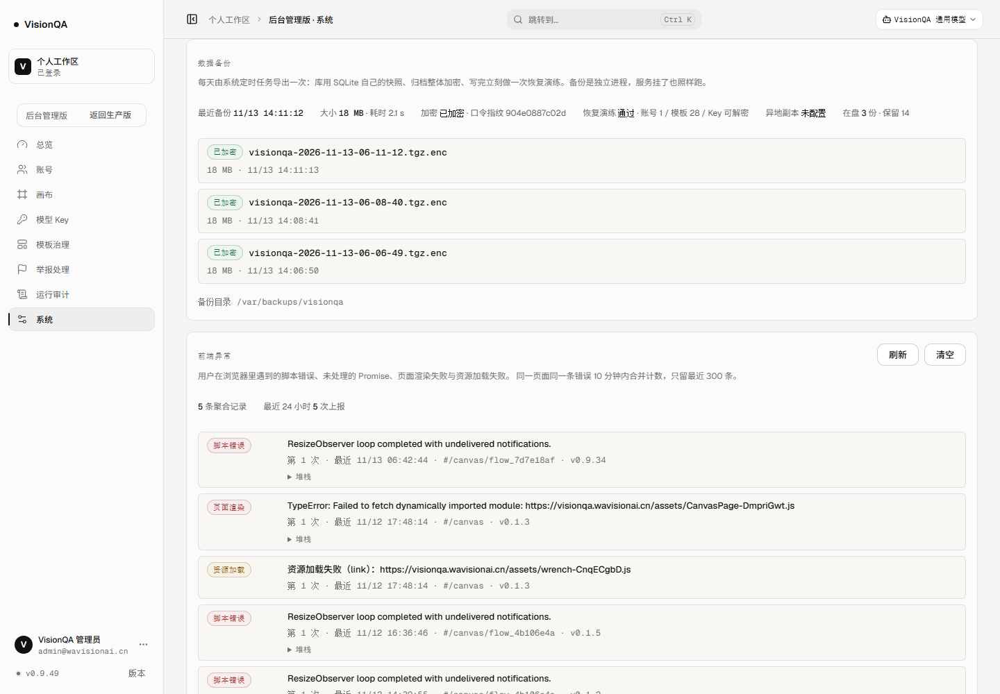
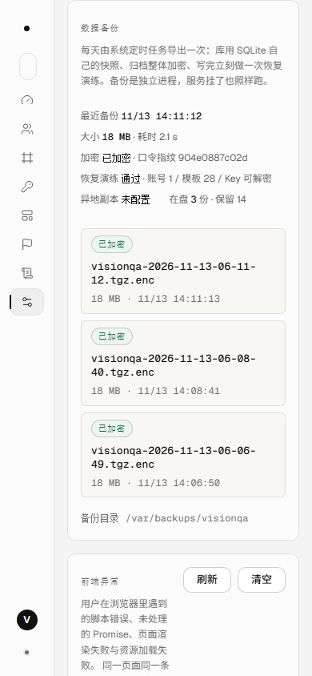

# 备份一致性、加密与可恢复性（A2，v0.9.49）

上一轮修的是「发一次版可能漏一次钱」（A1）。这一轮修「机器没了，数据也跟着没」——
上线差距清单里的 A2。它不是新功能，但它是唯一一条能让人「一觉醒来全部归零」的项。

## 一、先说结论

| | 之前（v0.9.48） | 现在（v0.9.49） |
| --- | --- | --- |
| 库快照 | `tar` 直接打活的 `auth.db` + `-wal` + `-shm` | 每个 `*.db` 用 SQLite 自己的 `VACUUM INTO` 生成单文件快照，归档里没有运行态文件 |
| 归档内容 | 明文 `.tgz`，里面含 `.model-keys.secret`（Key 池钥匙）与 `model-keys.json` | 整体加密 `.tgz.enc`（scrypt + AES-256-GCM），口令只在 `/etc/visionqa/backup.key`，状态里只有指纹 |
| 备份位置 | `/var/backups/visionqa`，和数据库同一块盘（`/dev/vda3`） | 同一块盘，**但已支持异地副本**（`VQ_BACKUP_OFFSITE`，复制后按 sha256 校验）；线上还没配目的地 |
| 自检 | `tar -tzf` 能列出文件名就算成功 | 每次写完立刻解密 + 解包 + `PRAGMA integrity_check` + 核对账号/模板条数 + 真解一把 Key，失败退出码 5 |
| 定时任务 | 只在服务器上手工装过一份，内容和仓库不一致 | unit 进了仓库（`deploy/production/`），`deploy.sh` 幂等安装 |
| 后台可见性 | 没有 | 「系统与版本 → 数据备份」显示最近一次时间/大小/耗时/是否加密/演练结果/异地副本 |

## 二、三个真实缺陷（不是「最佳实践建议」）

### 1. 活库 tar：读文件顺序中间只要有一次 checkpoint 就丢数据

`server/auth.mjs` 打开库就 `PRAGMA journal_mode = WAL`。v1 的 `tar` 按目录顺序读
`auth.db` → `auth.db-shm` → `auth.db-wal`。如果两次读之间发生一次 checkpoint
（正常写入负载下随时可能），就会拿到「主库副本停在旧页 + `-wal` 已被截断」的组合，
最近提交的账号与积分记录直接消失。

这一条有确定性测试复现（`test/backup.test.mjs`）：3 条已提交记录，
按 v1 顺序「拷主库 → checkpoint → 拷 wal」，恢复出来的库数到 0 条；同一份数据
用新备份恢复，3 条都在。

### 2. 备份和数据库同盘

`df -h /var/lib/visionqa /var/backups/visionqa` → 都是 `/dev/vda3`（40G，71% 已用）。
磁盘坏掉、分区被误格式化、云主机整机挂掉，备份和源数据一起没。

### 3. 加密？不存在的：v1 备份里就躺着 Key 池的钥匙

v1 的 19,434,691 字节归档里同时有：

- `model-keys.json`（2 把上游 Key 的密文）
- `.model-keys.secret`（解开它们的对称密钥）

也就是说任何拿到这份备份文件的人都能解出上游 Key 明文。备份文件比数据库更容易被带走
（下载、同步盘、误传、异地副本）。

## 三、改法

1. **一致性快照**：逐个 `*.db` 用 `VACUUM INTO` 复制到暂存目录，同时记下
   `integrity_check` 结果与每张表的行数写进 `manifest.json`；归档里明确不含
   `*.db-wal` / `*.db-shm`（它们是运行态，不是数据）。恢复时不需要重放，打开就是一致的库。
2. **整体加密**：`scripts/backup-crypto.mjs`，文件头 `VQBACK1`，`scrypt(N=2^15, r=8, p=1)`
   派生 32 字节密钥，AES-256-GCM；口令从 `--passphrase-file` 或
   `VQ_BACKUP_PASSPHRASE` 读，不写进备份目录、不写进状态文件。口令太短（<16）直接拒绝。
3. **每次备份都做恢复演练**：解密 → 解包 → 打开 `auth.db` 跑 `PRAGMA integrity_check` →
   对比 manifest 里的 `users` 行数与 `templates` 条数 → 从 `.model-keys.secret` 解一把 Key
   （只看解出来非空，不打印）。任何一项不过：退出码 5，systemd 把服务标红，后台卡片也亮失败。
4. **异地副本**：`--offsite DIR` / `VQ_BACKUP_OFFSITE`，复制后校验 sha256，副本自己有保留份数；
   写不进去退出码 4，但本地归档保留（失败的是副本，不是整次备份）。
5. **保留与清理**：默认保留 14 份（约 265 MB）；这次把 5 份旧的明文归档删掉了（见下）。
6. **unit 进仓库**：`deploy/production/visionqa-backup.service` / `.timer` /
   `install-backup.sh`；`deploy.sh` 部署时幂等同步，unit 不再只活在服务器上。
   prod 的 `/usr/bin/node` 不带 `node:sqlite`，unit 用服务的运行时 `/usr/local/bin/node`。

## 四、生产实测（2026-11-13）

安装与口令：

```
已生成备份口令：/etc/visionqa/backup.key
口令指纹（sha256 前 12 位）：904e0887c02d
-rw-r----- root visionqa  /etc/visionqa/backup.key
drwxr-x--- root visionqa  /etc/visionqa
```

一次真实备份（`systemctl start visionqa-backup.service`，耗时 2.0 秒）：

```json
{ "ok": true, "format": 2,
  "file": "visionqa-2026-11-13-06-11-12.tgz.enc",
  "bytes": 18918389,
  "encrypted": true,
  "passphraseFingerprint": "904e0887c02d",
  "verify": { "ok": true, "ms": 9, "integrityCheck": "ok",
              "users": 1, "templates": 28, "keys": 2, "keyDecrypt": "ok", "errors": [] } }
```

`manifest.json`（归档内）记录的快照：`auth.db` 163,840 字节、`integrity: ok`、
`users 1 / sessions 168 / credit_ledger 109 / admin_audit 81 / replicate_jobs 1`。

独立恢复演练（不是备份进程自己说好，是另起一条命令把归档还原到 `/tmp`）：

```
$ node --experimental-sqlite scripts/restore-backup.mjs \
    /var/backups/visionqa/visionqa-2026-11-13-06-11-12.tgz.enc \
    --target /tmp/vq-restore-drill --passphrase-file /etc/visionqa/backup.key
{ "ok": true, "encrypted": true,
  "drill": { "ok": true, "integrityCheck": "ok", "users": 1, "templates": 28,
             "keys": 2, "keyDecrypt": "ok", "errors": [] } }
DRILL_EXIT=0
```

口令错时（GCM 认证失败，不是「给你一半内容」）：

```
[restore] 失败：Unsupported state or unable to authenticate data
WRONG_EXIT=6
```

清理旧明文归档（新归档已恢复演练通过之后）：

```
rm visionqa-2026-11-11-10-42-53.tgz       703,768
rm visionqa-2026-11-11-10-43-42.tgz       703,768
rm visionqa-2026-11-11-11-49-37.tgz    19,227,719
rm visionqa-2026-11-11-19-32-11.tgz    19,227,728
rm visionqa-2026-11-12-19-32-05.tgz    19,434,691
```

现在 `/var/backups/visionqa` 里：3 份加密归档（每份 18 MB，含 sha256 sidecar）+
2 份 2026-11-10/11 的旧 `data-*.tar.gz`（当时还没有 Key 池，不含钥匙，留作历史）。
定时任务下次 03:31 自动跑。

后台「数据备份」卡片在生产 1440 / 390 宽实测：





## 五、验收

- `npm test` **442/442**，新增 `test/backup.test.mjs` 12 条：WAL 未 checkpoint 的数据完整入备份、
  归档里没有 `-wal`/`-shm`、v1 读序确实会丢数据（对照组）、无口令拒绝、短口令拒绝、
  改一个字节被 GCM 拒绝、保留份数、异地副本校验、异地副本失败退出码 4、
  没有 `auth.db` 拒绝、`--verify-only` 通过、后台状态（含缺失状态文件与跟随 `dir`）。
- oxlint **0 error / 6 warning**（既有），`tsc -b` 干净，构建通过。
- 生产 **v0.9.49**，入口 `index-D69VFl_B.js`，`/api/version` 0.9.49，两服务 active，
  release `20261113-061108-20261113-v0.9.49-backup5.tar.gz`。
- 提交与 CI 号见 README 第一百一十八节。

## 六、边界与没做的事

- **异地副本还没有目的地**：代码路径、校验、保留都通了，但线上 `VQ_BACKUP_OFFSITE` 为空，
  整机故障仍会丢全部备份。需要有第二块盘 / 另一台机器 / 对象存储中的任意一个，再打开一行环境变量。
- **口令托管还在「两份文件」阶段**：服务器 `/etc/visionqa/backup.key` + 本机
  `.tmp-qa/backup-key-prod.txt`。两处都丢 = 备份永远打不开。这两份都不能进仓库。
- **不是跨文件时间点一致**：SQLite 是一致的；JSON 存储是逐个文件复制的，彼此可能差几毫秒。
  对当前产品（单实例、低频写入）够用，不冒充数据库级快照。
- 备份排除 `jobs/`（复刻任务的临时目录，启动时会被清理）、`*.log`、`*.pid`、`*.tmp`。
- 恢复演练只验证 `auth.db` 可打开、账号/模板条数对、Key 可解；没有把整个服务在恢复数据上启动一遍。
- 没有增量/去重：每天约 18 MB，保留 14 份约 265 MB（当前盘 12 GB 可用）。
- `data-*.tar.gz` 历史归档不在新的保留策略里（文件名不匹配），会一直留着；它们不含 Key 池钥匙。
