# B/C/D 缺口修复记录（2026-11-12 起）

目标：按 [ui-polish-and-gap-audit-2026-11-12.md](ui-polish-and-gap-audit-2026-11-12.md) 审计出的 B（产品）、C（工程）、D（合规）三类缺口顺序补齐并上线生产。
明确不做：A 类外部输入（ICP 备案号、客服邮箱、支付定价、告警 webhook、备份异地）、真实模型校验（出图出视频 / 多供应商回退 / 权重比例）、单机扩容、团队协作成员邀请（依赖邮件验证）。

| 编号 | 条目 | 状态 |
| --- | --- | --- |
| B1 | 模板导出：Markdown 文件 + 打印 / 存 PDF | 已上线 2026-11-12 |
| B2 | 雷达检索历史与关键词收藏 | 已上线 2026-11-12 |
| B3 | 模板回收站（软删除 / 恢复 / 彻底删除） | 已上线 2026-11-12 |
| B4 | 模板编辑版本历史（快照 / 回看 / 回滚） | 已上线 2026-11-12 |
| B5 | 模板只读分享链接 | 已上线 2026-11-12 |
| C1 | GitHub Actions CI（类型检查 / 构建 / 代码检查 / 单测） | 已上线 2026-11-12 |
| C2 | 回归测试入库、可离线跑 | 已完成 2026-11-12 |
| C3 | 前端异常上报 + 后台可见 | 已上线 2026-11-12 |
| C4 | 日志保留策略（轮转 + 保留天数） | 已上线 2026-11-12 |
| C5 | 部署回滚（保留多个 release + 一键回滚） | 已上线 2026-11-12 |
| D1 | 注册「已读条款」留痕 | 已上线 2026-11-12 |
| D2 | TOTP 双因素 | 已上线 2026-11-12 |
| D3 | 自助数据导出 + 注销账号 | 已上线 2026-11-12 |
| D4 | 公共模板来源署名 + 侵权举报通道 | 已上线 2026-11-12 |
| D5 | UGC 举报后台审核队列 | 已上线 2026-11-12 |

---

## B1 模板导出：Markdown + 打印 / 存 PDF

### 问题
模板详情只能在工作台里看：编导要交给剪辑、贴进飞书、归档给客户时没有任何出口，全站唯一能导出的是后台审计页的 CSV。这是「拆完的剧本走不出系统」的最后一公里。

### 做法
1. 纯函数导出模块 src/lib/templateExport.ts：把模板转成 Markdown（互动数据表、开头钩子、时长对账、脚本结构表、分镜逐镜清单、爆款分析、来源与用途声明），文件名带标题与日期，非法字符替换为 -。
2. 抽屉底部新增「导出」区：下载 Markdown / 打印或存 PDF 两个按钮，附一句说明（Markdown 给协作，打印给纸质归档）。
3. 打印：抽屉改为 React portal 直挂 document.body，打印时只留抽屉这一层（body 下其它节点 display:none），白底、深墨、A4 页边距 14mm；屏幕上的淡紫底色标签改成细线框，按钮与页脚不上纸。
4. 按钮在未解析的模板上也保留：只有链接与互动数据的条目同样能导出，内容自动降级为「还没解析」说明。

### 验证（生产 https://visionqa.wavisionai.cn，入口 index-C0wexkdI.js）
- 抽屉里点「下载 Markdown」真的落盘：VisionQA-兔兔那么可爱…真香-20261112.md，2390 字节，7 个二级标题（互动数据 / 开头钩子 / 时长对账 / 脚本结构 / 分镜表 / 爆款分析 / 来源与用途）。
- 打印媒体下 .template-drawer 成为 body 直接子节点，根节点 display:none，页脚与导出区 display:none，底色 rgb(255,255,255)。
- 794 宽（A4 内容宽）量：scrollWidth 794 = innerWidth，抽屉右边界 794，各分节标题右边界都在 794 以内，无横向溢出。
- Chrome printToPDF：3 页、634843 字节，不是空白一页。
- 未解析模板与画布工作流模板走各自的降级分支（节点清单 / 链接与互动数据）。

### 产物
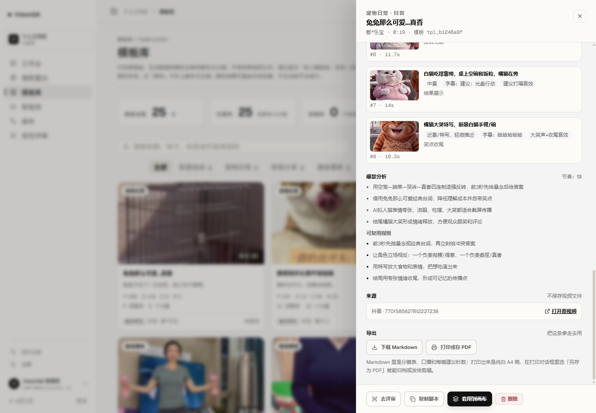

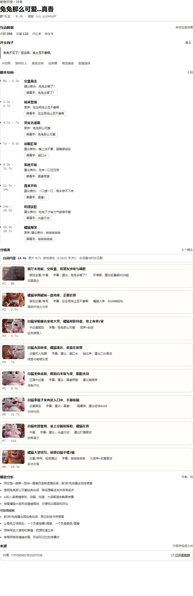

截图：docs/screenshot-template-export-2026-11-12.png、docs/screenshot-template-print-2026-11-12.png。样例 Markdown 见 .tmp-qa/audit/export-sample.md（临时目录，未入库）。

---

## B2 雷达检索历史与关键词收藏

### 问题
雷达每次检索花 2 积分，但条件不落任何地方：关掉页面就没了，想回看上次搜过的关键词只能重打一遍、再花一次钱。审计里「每次重搜花 2 积分」说的就是这件事。

### 做法
1. 服务端 server/search-history.mjs：按账号记「平台 + 关键词 + 时间档 + 排序 + 结果条数 + 时间」。同一个人用完全相同的条件再搜，只更新时间不新增；每账号最多留 40 条没收藏的记录，收藏的永不被裁剪。
2. 三个接口：GET /api/search/history（收藏在前、其余按时间倒序，最多 14 条）、POST /api/search/history/:id/favorite（切换收藏）、DELETE /api/search/history（清空，但保留收藏）。检索成功时只在第 1 页落一条，翻页不重复记——否则一页一条会把历史刷满。
3. 界面：工具栏下方一条「检索历史」，每条是一枚 chip（平台 · 关键词 · 条数）+ 星标 + 右侧「清空」。点 chip 只把条件填回表单并提示「已填回……确认后点检索」，**不自动检索**：自动重搜等于替用户扣 2 积分。

### 验证（生产，入口 index-BO7gWWNc.js）
- 历史为空时这一条不显示，首屏只有工具栏与空态引导。
- 真检索一次「猫咪」：74 条已加载 / 共 127.2 万条，历史条随即出现「全部 猫咪 127.2万 条」，0 JS 异常。
- 点星 → class 变 is-favorite、图标变金；整页 reload 后仍在，且仍是收藏态。
- 服务端落盘：{ platform: all, keyword: 猫咪, range: "", sort: likes, total: 1272310, favorite: true }，按 userId 隔离。
- 清空语义：有收藏时 DELETE 返回 removed 0、记录还在；取消收藏后再 DELETE 返回 removed 1、列表为空。
- 390 宽：scrollWidth 390 = 视口，历史 chip 换行不撑破页面。

### 产物
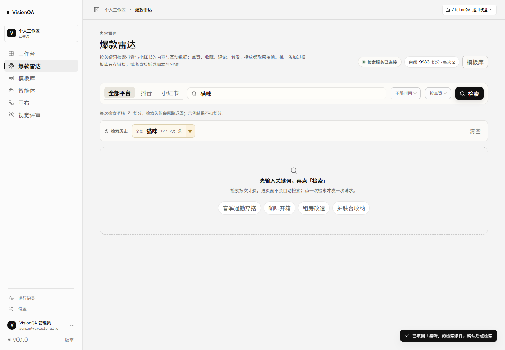

---

## B3 模板回收站

### 问题
删除是硬删：一条解析过的模板要花 10 积分才拆得出来，点错一次就永久消失，连抽好的帧一起清掉。列表里没有任何「找回」的可能。

### 做法
1. 删除改成软删除：条目打上 deletedAt / deletedBy，列表与统计都过滤掉回收站里的条目（模板总数、已解析、待解析、工作流计数同步不再算它们）。
2. 三个接口：GET /api/templates/trash（按删除时间倒序，附 days=30）、POST /api/templates/:id/restore、POST /api/templates/:id/purge。彻底删除才清 frames 目录。
3. 30 天自动清空不靠定时任务：列回收站时顺手把过期条目连同抽帧一起清掉，所以只要有人打开就生效。
4. 顺手补了一个越权口子：DELETE 之前先用 getTemplate(id, user) 校验归属，别的账号的模板不能删（原来只按 id 删）。
5. 界面：模板库页头加「回收站」按钮，弹窗列出条目（标题、平台 · 类型、删于时间、还剩几天），每条「恢复」「彻底删除」，彻底删除要二次确认；删模板的提示改成「已移到回收站，30 天内可以恢复」。

### 验证（生产，入口 index-CTNNSt46.js）
- 用两条自测条目跑完整链路：创建 → 删除返回 {ok, trashed:true} → 列表里查不到（total 仍是 25）→ 回收站 2 条、days=30。
- 弹窗实测：2 行，文案「删除的模板在这里留 30 天……不能撤销」，每行「恢复 / 彻底删除」。
- 点「彻底删除」先出现「彻底删除后不能恢复 + 确认删除 / 取消」，点取消不改状态。
- 点「恢复」：行消失，toast「已恢复「回收站自测 B」，回到模板库」，接口列表随即能查到这条。
- 彻底删除后回收站清零、列表清零；全程 0 JS 异常。自测数据已全部清掉，没有留在库里。

### 产物
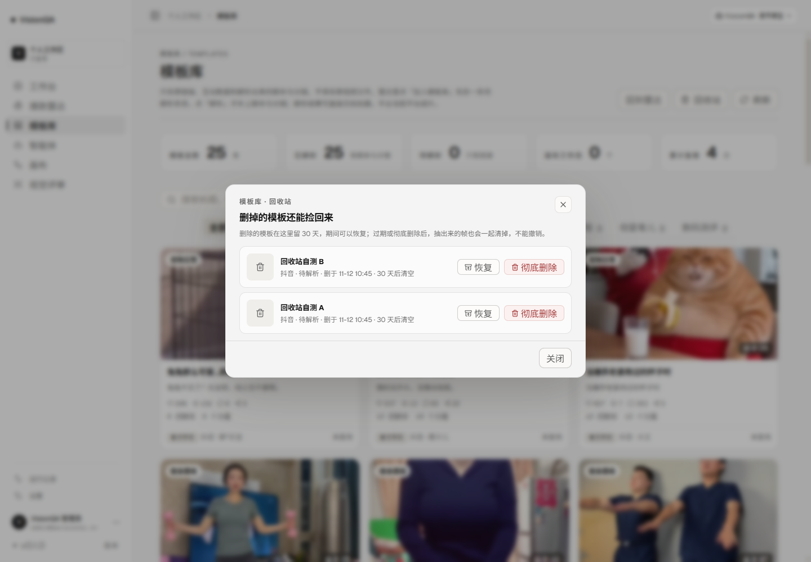

---

## B4 模板编辑版本历史

### 问题
后台改模板（标题 / 类型 / 标签 / 原链接）是就地覆盖：改错了只能凭记忆改回去，没有「上一版长什么样」。模板是花 10 积分解析出来的资产，编辑却不留痕。

### 做法
1. updateTemplate 在应用补丁前留一版快照（标题、类型、标签、原链接 + 时间 + 操作者），最多留 10 版；**只有受管字段真的变了才留**，保存一次没改内容不会在历史里多一条。
2. 两个接口：GET /api/templates/:id/versions、POST /api/templates/:id/versions/:versionId/restore。回滚走的是同一条 updateTemplate，所以回滚本身也会留一版——回滚错了还能再退回。
3. 后台模板治理的编辑卡里加「历史版本」：展开列出每一版的时间与「标题 · 类型」，每条一个「回滚到这一版」，并说明回滚会先把当前内容存成一版。

### 验证（生产，入口 index-CMMKHX9z.js）
- 建一条自测模板「第一版」→ 改「第二版」（历史 1 版）→ 改「第三版」（历史 2 版），列表为 [第二版, 第一版]——留的是「改之前」的样子。
- 回滚到最早那版：标题回到「第一版」，历史变 3 版（回滚前的第三版也存了一版）。
- 后台界面实测：搜「版本自测」→ 编辑 → 历史版本，3 行、时间 + 标题·类型 + 回滚按钮，提示文案「每次保存前留一版（最多 10 版）」。
- 全程 0 JS 异常；自测条目已删除并彻底清理，库里没留垃圾。

### 产物
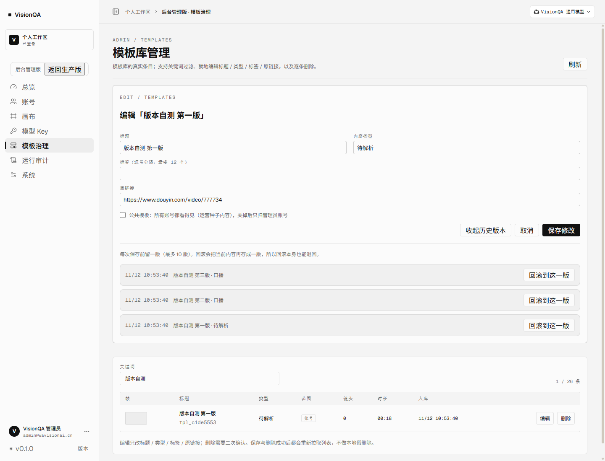

---

## B5 模板只读分享链接

### 问题
拆解结果只能给「有账号的人」看：编导要把脚本分镜发给剪辑、客户或甲方时，只能截图，或者让对方注册一个账号。审计里「分享」这一项是空的。

### 做法
1. 链接就是凭证：POST /api/templates/:id/share 生成 18 字节随机 token（base64url，24 字符）存在模板记录上；DELETE 同一路径把 token 清掉，旧链接当场失效；重新开启换一个新 token，不复用旧地址。
2. 公开读接口进 PUBLIC_API：GET /api/share/:token 返回白名单视图，帧图走 /api/share/:token/frame/:index、封面走 /api/share/:token/cover——/media/frames 与 /api/cover 都要登录，分享页不能借那两个口子。停止分享、进回收站或彻底删除之后，这三个地址一起 404。
3. 公开视图逐字段挑（publicTemplateView），不做「整条对象删几个 key」：ownerId、versions、deletedAt、shareToken、blueprint 这些内部字段不在白名单里，以后新加的内部字段也不会自动漏出去。
4. 前端新路由 #/share/:token：在 App 根部整屏渲染、不经过 RequireSession（否则打开就先跳登录页），单独拆包（SharePage 9.44 kB / gzip 3.38 kB）。页面是一张纸：品牌行 + 只读徽标、标题、类型/平台/作者/时长/分享日期、标签，然后是互动数据、开头钩子、脚本结构、分镜表（带帧图与时长对账）、爆款分析、来源；页脚写明「只读、不能改也不能套用」，并给「下载 Markdown」「打印」两个出口。只存链接的条目显示「还没解析」，画布工作流显示节点清单。
5. 模板抽屉里加「分享」区：没有链接时一个「生成只读链接」；有链接时只读输入框 + 复制 + 停止分享，附一句「拿到链接的人不用登录就能看，只能看不能改，停止分享后旧链接立即失效」。
6. 打印：App.css 的打印规则只保留抽屉，分享页在这里把 #root 放回来、隐藏工具栏，导出的就是这份文档本身。

### 验证（生产 https://visionqa.wavisionai.cn，入口 index-Lx5AM7-3.js）
- 真实模板「兔兔那么可爱…真香」（8 分镜 / 8 帧）开分享：token 24 字符；不带任何 cookie 请求 GET /api/share/<token> → 200，字段只有 id、kind、title、contentType、tags、platform、platformLabel、sourceUrl、author、publishedAt、stats、durationSec、hook、hookType、structure、storyboard、timing、analysis、frames、cover、video、reuseCount、flowNodes、sharedAt。
- 泄漏检查：ownerId / versions / blueprint / shareToken / deletedAt 五项全部 false。
- 匿名取帧图 GET /api/share/<token>/frame/0 → 200 image/jpeg 33317 字节。
- 匿名打开 #/share/<token>：h1「兔兔那么可爱…真香」，元信息「宠物日常 / 抖音 / 郡*乐宝 / 0:19 / 分享于 2026-11-12」，6 个分节、8 行分镜、8/8 帧图真的解码出来（naturalWidth > 0），页面上没有登录表单、没有侧栏。
- 390 宽：scrollWidth 390 = 视口，无横向溢出；1440 宽：正文 880px 居中（x=275，两侧各 275）。
- 只存链接的条目：分节只有「互动数据 / 还没解析 / 来源」，说明文案指向「由账号主人跑一次解析」。
- 停止分享：DELETE → 200；随后匿名 GET 同一地址 → 404 SHARE_NOT_FOUND；新开页面显示「这个分享链接已经失效」，没有登录框；模板记录里 shareToken 已清空。自测条目已删除并彻底清理，模板总数回到 25。
- 全程 0 未捕获异常（唯一一条 401 是匿名访问 /api/auth/me 的正常探针）。

### 已知边界
- /media/frames 与 /api/cover 本身不校验登录（历史实现只挡了 /api/*），所以抽帧图片按模板 id 可匿名猜取。分享页没有依赖这个口子，但它是既有状况，本次不动（改了会影响画布与其它服务的取图），记在这里待办。
- 已经打开的分享页在停止分享后仍显示已下发的内容（内容已经到浏览器了），重新加载即失效；要更强就得做短时签名 URL，本次不做。

### 产物
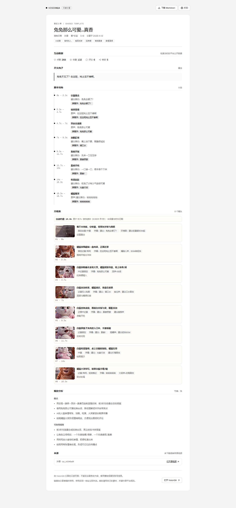

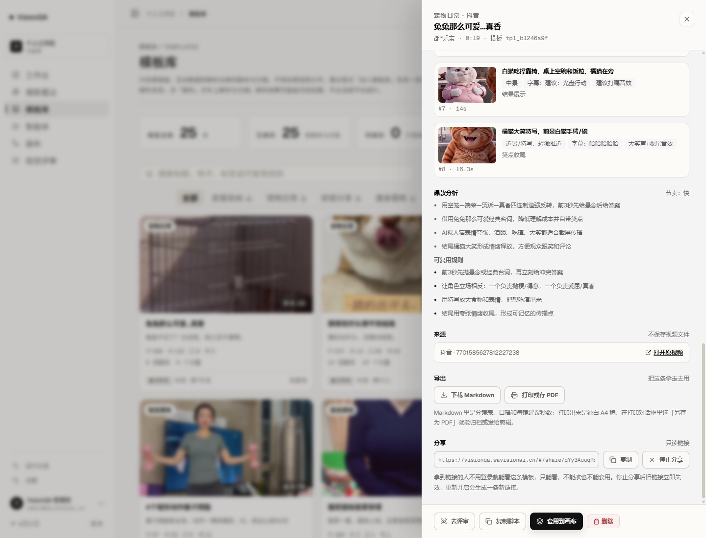
---

## C1 GitHub Actions CI

### 问题
仓库此前没有任何自动检查：类型、构建、代码检查、测试全靠上线前在本地手工跑。推错一行就到部署那一刻才发现，没有回退余地。

### 做法
1. .github/workflows/ci.yml：push 到 master 与所有 PR 都触发，concurrency 按 ref 取消同分支旧任务，超时 15 分钟。
2. 步骤顺序：checkout → setup-node 22（带 npm 缓存）→ npm ci --ignore-scripts → npx tsc -b → npm run lint → npm test → npm run build。任何一步非零，这个 run 就是红的。
3. npm ci 用 --ignore-scripts：ffmpeg-static / ffprobe-static 的 postinstall 会去 GitHub 下载二进制，CI 的静态检查与单测都用不到，跳过少一个失败面。
4. 不跑联网、不跑要花积分的东西：整套单测在临时 DATA_DIR 里跑，不碰生产数据。
5. checkout / setup-node 用 v7：v4 会触发 Node 20 弃用告警（被强制跑在 Node 24 上）。

### 验证
- 923bba1 首次运行：success；安装依赖 / 类型检查 / 代码检查 / 单元测试 / 构建 五个业务步骤全部 success。
- d87ea0d 升级 action 版本后再跑：success，全程 22 秒（03:16:19 → 03:16:41），注解里不再有 Node 20 弃用那一条。
- 剩下的是既有的 6 条 lint warning：oxlint 退出码 0，不挡合并，但都会打在 CI 注解里，改一处就少一条。

---

## C2 回归测试入库、可离线跑

### 问题
原来只有 scripts/test-*.mjs 这类脚本：要服务在跑、要配 Key、有的还会花积分（检索 2 分、评审 10 分）。没有一条能进 CI、能离线跑、能在回退时报警。而这一轮改的恰恰都是「丢了数据才发现」的逻辑——软删除、快照、分享白名单、检索历史裁剪。

### 做法
1. test/ 下用 node:test + node:assert/strict 写单测，package.json 加 npm test（node --test "test/*.test.mjs"）。不需要网络、不需要 Key、不碰生产。
2. 隔离靠临时目录：每个测试文件在 import 服务端模块之前把 DATA_DIR 指到 os.tmpdir() 下的新目录，config 就按它落 templates.json / search-history.json。
3. 覆盖这轮改动的不变量：
   - server/speech.mjs：语速表必须与 hypit 口径一致（zh 4.2 / 5.25 / 6.5625，en 4.2 / 4.6 / 5.6），单位换算（汉字 / 假名 / 英文音节）、0.8–60 秒钳制、1.2 与 0.55 两个阈值、缺结束时间时按台词补齐。
   - server/owner.mjs：归属矩阵——未登录不隔离、他人不可见、公共（无 ownerId）可看、管理员全看。
   - server/templates.mjs：软删过滤与回收站、彻底删除、编辑快照（没改内容不留、最多 10 版、回滚本身也留一版）、分享 token 生命周期（生成 / 查到 / 撤销 / 换新 / 进回收站即失效）与公开视图白名单（ownerId / versions / deletedAt / shareToken / blueprint 都不在）。
   - 回收站 30 天过期清理单独一个测试文件跑：模块有内存缓存，必须让新进程从磁盘读到那条 31 天前的记录，才能验证「列的时候顺手清掉条目与抽帧」。
   - server/search-history.mjs：相同条件重搜只更新时间、账号隔离、收藏不被清空带走、非收藏 40 条上限、界面 14 条分页。

### 验证
- node --test "test/*.test.mjs"：29 个测试全过，1.3 秒；npm test 同样 29/29。
- 断言写的是确切数字（例如「今天我们来拆这条爆款」= 10 个汉字、「用 VisionQA 拆解」= 3 个汉字 + 音节），不是「大概多少」——语速表被改回 4.5 字/秒这类回退会直接红。
- 全程不读 data/、不连 8799、不花积分；CI 里也就是这条命令。
---

## C3 前端异常上报与后台可见

### 问题
页面在用户浏览器里炸了，只有当事人看得见：脚本报错、Promise 没接住、图片挂了，全都没有落地的地方。用户能提供的信息通常只有一句「点不动」；服务端日志里什么都没有，因为请求根本没发出去。

### 做法
1. 服务端 server/client-errors.mjs：落 data/client-errors.json，封顶 300 条；同一条错误（同页面 + 同 message）10 分钟内只累加次数（updatedAt + count），超过 300 条丢最旧的。上报内容单行化 + 截断 + 抹掉 URL 里的 token / ticket / key / session / share / code 参数。
2. 公开接口 POST /api/client-errors（进 PUBLIC_API，登录页与分享页炸了也能报）：只取白名单字段，体积封顶 16KB（超了 413），按 IP 每分钟 30 条限流，跨域那种只有一句「Script error.」的不入库存。
3. 前端 src/lib/clientErrors.ts：捕获阶段监听 error（含 img/script 资源加载失败）、unhandledrejection，ErrorBoundary.componentDidCatch 额外报渲染错误。一次页面加载最多发 8 条、同一条 30 秒内只发一次；用 sendBeacon 发（页面崩了、要卸载了也能发出去），上报自身失败一律吞掉。
4. 后台「系统」页新增「前端异常」卡片：4 类（脚本错误 / 未处理 Promise / 页面渲染 / 资源加载）、条数、最近 24 小时上报次数、聚合记录列表（第几次、最近时间、页面、版本）、可展开看堆栈；带刷新与清空（清空记一条管理审计）。

### 验证（生产，入口 index-Cdfjf5bD.js）
- 未登录 POST /api/client-errors → 202 {ok:true, stored:true}；同一条再报 → 202，**返回同一个 id**（10 分钟内合并计数）。
- 20KB 的包 → 413；「Script error.」→ 202 {stored:false}，不入库。
- 带 token 的上报落库后是 `fetch failed /api/share/abc?token=***&x=1`，页面 `#/share/abc?token=***`——参数被抹掉。
- 未登录 GET /api/admin/client-errors → 401；限流：同一分钟连续上报，13 条通过后其余 27 条全部 429。
- 浏览器里造三条真实异常（未捕获 TypeError、未处理的 Promise、图片 404）：后台立刻出现三行，页面都记成 #/templates、版本 v0.1.0，其中未处理 Promise 那条展开能看到真实调用栈。
- 清空后 total 归零；自测数据没有留在生产里。

### 产物
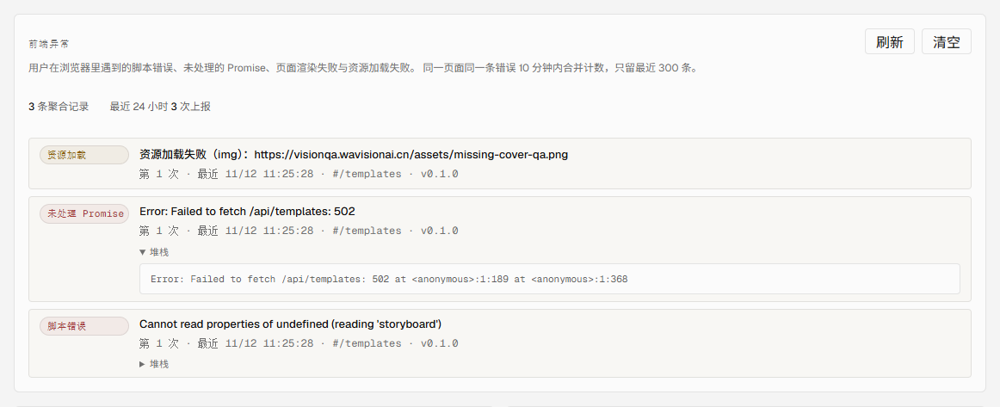

### 边界
- 只收「浏览器里发生的」：服务端 5xx / 上游失败 / 磁盘水位仍然走「告警」那条线，两边不混。
- 不做 sourcemap 还原：生产堆栈是压缩后的位置，能看到是哪个页面、哪条错误、第几次，定位到函数需要结合本地复现。要还原映射得在发布时上传 sourcemap，本次不做。
---

## C4 日志保留策略（轮转 + 保留天数）

### 问题
日志此前只往 stdout 走，进的是 systemd journal：能看，但项目自己没有口径——查「最近 14 天的访问日志」只能 ssh 上去 journalctl；journal 也没有项目级上限，长期跑会慢慢把磁盘吃掉。data/logs 这条项目自己的日志线根本不存在。

### 做法
1. server/log-files.mjs：按天写 data/logs/{access,error,app}-YYYY-MM-DD.log，每行一条 JSON（与 stdout 同格式，journalctl 与 grep 都能直接用）。写盘走一条队列，避免并发 append 抢同一个文件。
2. 保留策略：默认 14 天（VQ_LOG_RETENTION_DAYS）、总量上限 200MB（VQ_LOG_MAX_MB）。先按天数删过期文件，再按总量从最旧的删；每小时最多清一次，进程启动时也清一次。只删整文件，不截断当天的日志。
3. 接入 log.mjs：访问日志（健康检查与静态资源按原策略不记，避免一天几千行噪音）、5xx 与进程级异常的错误日志（保留完整堆栈，内存环形缓冲才截到 1200 字）、启动/迁移/告警这类事件日志。
4. 后台「系统」页新增「服务端日志」卡片：保留策略、文件数、总占用、最早与最新日期、文件列表（类型 / 日期 / 大小），可「立即清理」（写管理审计）。
5. systemd journal 另给一个硬上限：deploy/journald-visionqa.conf（SystemMaxUse=500M、SystemKeepFree=1G、SystemMaxFileSize=50M），装到 /etc/systemd/journald.conf.d/visionqa.conf 后重启 journald。

### 验证（生产，入口 index-gSJGxnIY.js）
- 打真实请求之后 data/logs 出现 app-2026-11-12.log（启动 listen 事件）与 access-2026-11-12.log：6 行访问日志里 /api/health 一条都没有（按设计不记），路径分布 /api/admin/logs ×2、/api/templates、/api/search/history、/api/auth/login、/api/admin/logs/prune。
- GET /api/admin/logs → 200，retention 14 天、上限 200MB、文件列表带大小；后台卡片显示「2 个文件 · 7.2 KB，最早/最新 2026-11-12，保留 14 天 / 上限 200 MB」。
- 手工在服务器放一个 access-2026-09-01.log（31 天前）：POST /api/admin/logs/prune → `{removed:["access-2026-09-01.log"], bytesFreed:37, kept:2}`；再查列表只剩当天两个文件。
- 单测 test/log-files.test.mjs：按天文件名、写入落当天文件、未知类型忽略、按天数删过期、按总量从旧删（上限调到 1KB 时只留 1 个文件）、列表统计；全库 34 个单测通过。
- journald：drop-in 安装后 `journalctl --disk-usage` 仍是 416.9M（低于 500M 上限，不触发删除），`journalctl -u visionqa` 正常可读。

### 产物
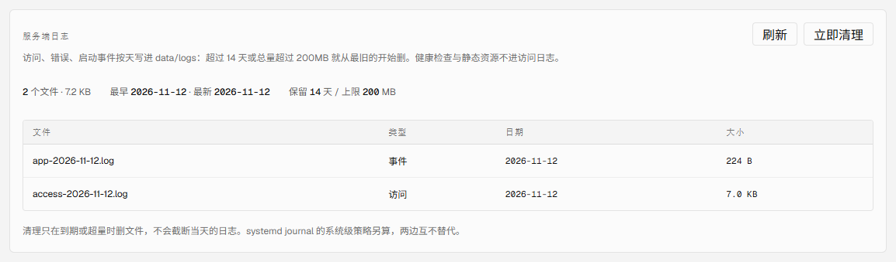
---

## C5 部署回滚（保留 N 个 release + 一键回滚）

### 问题
部署一直是「scp 一个包 → rm -rf dist → 解包 → 重启」：服务器上不留上一版的副本。新版本一出问题只能靠本地重新打包上传，而本地那份包可能已经不是当时那一版（工作区在动、依赖在变）。回退窗口实质上取决于「你还记不记得当时发了什么」。

### 做法
1. scripts/release.sh：把当前 dist / server / scripts / package.json 打成一个带 UTC 时间戳的快照，同时写同名 .json 元数据（时间、标签、入口 index-*.js、大小）。默认保留最近 5 个，超出的连元数据一起删。data（模板、账号、日志）不打包——回滚版本不该回滚数据。
2. scripts/rollback.sh：`--list` 列快照（序号 / UTC 时间 / 大小 / 入口文件）；默认回到第 1 个，`--to N` 指定。回滚前先给「现在这一版」也打一个快照，所以滚错了能滚回来；还原后重启两个服务、自检健康、打印入口文件。
3. scripts/deploy.sh：一个发布包一次落盘——解开到临时目录 → 先打快照 → 替换 dist/server/scripts/package.json（data 不动）→ 重启 → 健康自检。脚本从临时目录执行，替换 scripts/ 时不会把自己删掉。
4. 运维脚本另放 /opt/visionqa/ops/：scripts/ 属于版本内容，回滚会被旧版本覆盖；ops/ 每次部署同步一次，回滚不会把回滚工具自己删掉（第一版放 scripts/ 下，实测被回滚删掉，已改）。

### 验证（生产）
```
$ bash /opt/visionqa/scripts/release.sh list
1   20261112-033954    528K     index-gSJGxnIY.js

$ bash /opt/visionqa/ops/rollback.sh --to 1
回滚目标：20261112-034101-v0.1.1.tar.gz
已为当前版本留档：20261112-034117-before-rollback.tar.gz
active / active
入口：index-gSJGxnIY.js
$ curl .../api/version → {"version":"0.1.0"}

$ bash /opt/visionqa/ops/rollback.sh --to 1        # 滚回来
回滚目标：20261112-034117-before-rollback.tar.gz
入口：index-Slf2XRR5.js
$ curl .../api/version → {"version":"0.1.1"}
```
- 版本号随这次发布从 0.1.0 升到 0.1.1，回滚后 /api/version 真的回到 0.1.0，再滚回来又是 0.1.1。
- 两次回滚之间 /opt/visionqa/ops/ 三个脚本都在（deploy.sh / release.sh / rollback.sh）。
- 每次回滚都重启两个服务并自检：两个 active、/api/health ok、templates 25、入口文件与快照元数据一致。
- 保留策略实测：KEEP_RELEASES=2 连打 4 个快照 → 目录里只剩 2 个 .tar.gz + 2 个 .json；生产保留最近 5 个（当前 5 个）。
- 回滚只还原程序：data/logs、templates.json、auth.db 全程未动，健康检查里 templates 一直是 25。

### 产物
- scripts/release.sh、scripts/rollback.sh、scripts/deploy.sh（部署时同步到 /opt/visionqa/ops/）
- 生产 /opt/visionqa/releases/ 保留最近 5 个快照
---

## D1 注册「已读条款」留痕

### 问题
注册只要邮箱和密码：没有任何地方记录用户同意过服务条款，更没记下同意的是哪一版。条款改版后，「这个账号同意过什么」无法追溯，只能指着页面说「上面有链接」。

### 做法
1. 条款版本由服务端配置：VQ_TERMS_VERSION / VQ_TERMS_UPDATED_AT（默认 2026-11-12），走 /api/app 的 terms 字段下发；登录页、条款页、注册接口用同一份，改条款只改一处。
2. 注册必须真的勾选：服务端校验 acceptedTerms === true 且 termsVersion 等于当前版本，否则 400（field=terms）。版本不一致时提示「条款已更新，请刷新页面后重新阅读并确认」，而不是笼统的失败。
3. 留痕落库：users 表新增 terms_version / terms_accepted_at（老库启动自动补列）。自助注册写「同意的版本 + 时间」；管理员开通的账号记为 admin-created——不假称用户同意过。
4. 界面：注册表单加必勾的「我已阅读并同意《服务条款》与《隐私说明》」并显示当前版本；条款页显示「最后更新 / 版本」；后台账号表新增「条款同意」列（时间 + 版本 / 管理员开通 / 未留痕），并在表下写清楚口径。

### 验证（生产，入口 index-CUhTFkEM.js）
- 不勾同意直接调注册接口 → 400 `{field:"terms", error:"请先阅读并勾选同意服务条款与隐私说明"}`。
- 勾了但版本写成 2026-01-01 → 400「服务条款已更新，请刷新页面后重新阅读并确认」。
- 正确版本注册 → 201；后台账号表该行「11/12 11:45:39 / v2026-11-12」，接口返回 termsVersion=2026-11-12、termsAcceptedAt=2026-11-12T03:45:39Z。
- 管理员账号显示「未留痕」（早于该功能，不补造同意记录）。
- 生产注册默认关闭；本次为验证临时置 VQ_REGISTRATION=1，验证完恢复关闭并删掉自测账号，账号表回到 1 个。
- 34 个单测、tsc、lint、build 全过。

### 产物
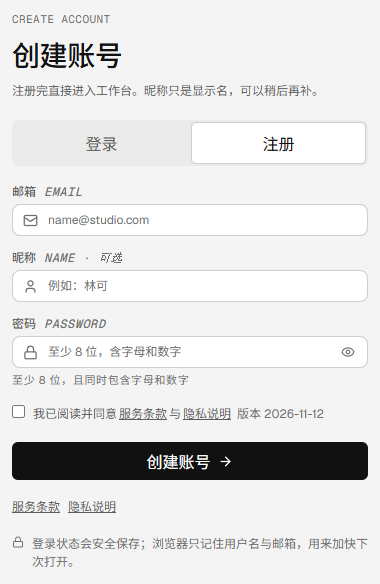

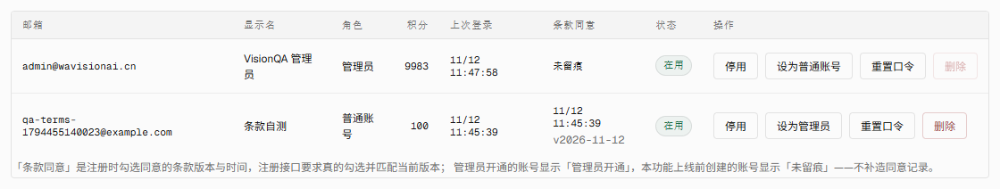
---

## D2 两步验证（TOTP）

### 问题
登录只有口令一道门：口令复用、钓鱼或共享账号泄露，就等于账号被接管——而账号里存着模板、画布、导出文件和积分。审计里 TOTP 这一项是空的。

### 做法
1. 自己实现 TOTP（server/totp.mjs）：base32、HMAC-SHA1、30 秒步长、6 位，与 Google Authenticator / 1Password / Authy 默认口径一致；验码允许前后各一个步长，并记录最后用过的步长防重放。单测直接钉 RFC 6238 附录 B 的向量。
2. 开启分三步：生成 secret + 10 枚一次性备用码（只在开启时显示一次，落库只存哈希）→ 用户把它加进认证器 → 输入当前 6 位确认后才生效（确认前存在 pending 列，不影响登录）。
3. 登录分两步：口令正确但开了 2FA 时只返回 5 分钟有效、HMAC 签名的 challenge（remember 一起签进去，第二步改不了会话时长），验证码或备用码验过才建会话；验证码错误走同一套登录限流。
4. secret 用 Key 池那把 AES-256-GCM 密钥封存后落库（VQ_KEY_SECRET 或数据目录里的 secret 文件），接口只回「是否开启 / 开启时间 / 剩余备用码」，响应与日志里都没有明文。
5. 关闭要口令 + 验证码双要素；关闭后重新开启会生成新的 secret 与备用码。
6. 界面：设置页「两步验证」卡片（开启时显示密钥、备用码、确认框；已开启显示开启时间与剩余备用码；关闭要二次确认）；登录页第二步独立一屏，6 位数字或备用码都收。

### 验证（生产，入口 index-B-5BX_u1.js）
- setup → secret 32 位 base32、备用码 10 枚；错误码确认 → 400（field=code）；正确码 → enabled:true。
- 登录：口令通过后返回 `{twoFactorRequired:true, expiresInSec:300}` 且**没有下发任何 cookie**；错误码 401；正确码 200 + 会话 cookie。
- 重放：同一 challenge 配同一个码再提交 → 401（步长已记录）。
- 备用码：用它登录成功（backupCodeUsed:true），剩余从 10 降到 9；同一枚再用会失败。
- /api/auth/me 只回 twoFactor:true，不带 secret；后台账号接口也没有密钥字段。
- 关闭：口令 + 验证码 → enabled:false，登录回到单步。
- 实测修掉两处：①开启时把「确认用的步长」记成已用，导致 30 秒内第一次登录被当重放（改成确认不占步长）；②关闭同理被自己的码挡住（关闭已有会话 + 口令两道，不再套重放规则）。
- 42 个单测全过（新增 8 个 TOTP：RFC 向量、前后窗口、重放、base32 编解码、备用码一次性）。
- 验证完已把生产账号的两步验证关掉，恢复单步登录。

### 产物
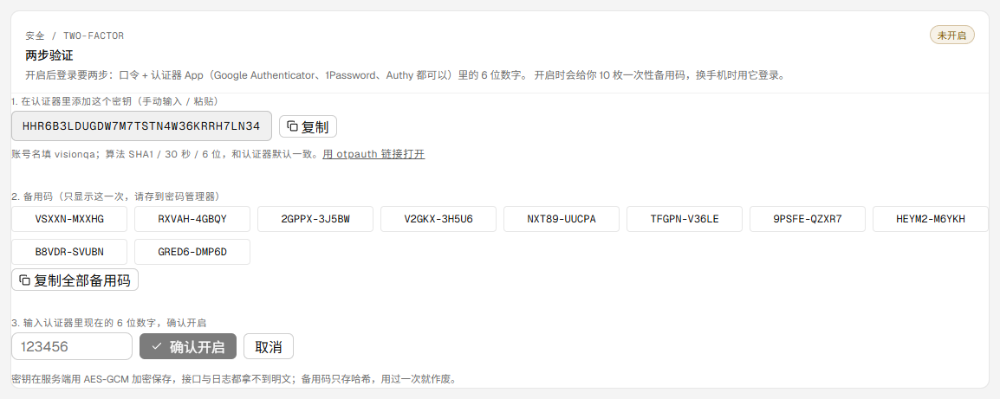

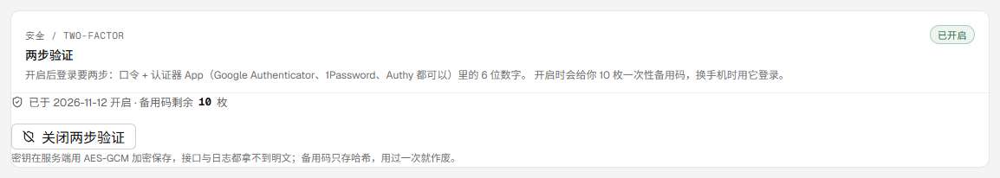

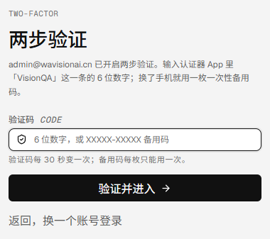
---

## D3 自助数据导出 + 注销账号

### 问题
数据只能进不能出：用户想带走自己的模板、画布、评审记录没有任何出口；想让账号消失也只能找管理员。导出与注销都是合规上必须有的自助能力。

### 做法
1. GET /api/account/export：一份 JSON 附件，含账号资料（id / 邮箱 / 显示名 / 角色 / 积分 / 创建时间 / 最后登录 / 条款同意 / 2FA 状态，**不含口令哈希、TOTP secret、备用码、会话 token**）、积分流水、偏好、模板（含回收站里的）、画布流程与运行记录、智能体、评审历史。只导出「属于这个账号」的条目，共享示例与别人的数据不会混进来。
2. POST /api/account/delete：口令 + 手输「注销」两个字；`deleteContent` 默认 true——勾了就把他名下的模板（连抽帧）、画布流程、智能体、评审记录一起删；不勾则按旧策略保留内容、只删账号。删完清 cookie 并记日志。
3. 守卫：最后一个管理员不能自助注销（否则后台锁死）；账号不存在返回 404。
4. 界面：设置页「导出与注销」卡片——导出按钮 + 危险区（确认邮箱、当前口令、手输注销、是否连内容一起删的勾选、确认按钮）。

### 验证（生产，入口 index-GK2F3RBT.js）
- 管理员账号导出：200、Content-Disposition 附件、27KB、12 个顶层键；泄漏检查 password_hash / totp_secret / vq_session 全为 false。
- 最后一个管理员注销 → 400 `{code:"LAST_ADMIN"}`，账号未动。
- 自测账号：建号 → 登录 → 存一条模板（ownerId 归属正确）→ 导出（模板 1 条）→ 注销（deleteContent:true）→ `removed.templates=1`，模板总数 25 → 25，旧会话 /api/auth/me 401，账号从管理列表消失。

### 事故与修正（如实记录）
这次部署把生产打断了约 2 分钟：account.mjs 引用了不存在的导出（listTemplateTrash），ESM 链接期直接抛错、进程起不来；`node --check` 只查语法，查不出「导入了不存在的名字」。当时 deploy.sh 的启动自检又把「activating + curl 失败」吞成成功，所以脚本报的是部署成功。
恢复：立刻把导入改成 listTrash 重新部署。两个防复发动作一起补上：
- test/modules-import.test.mjs：逐个 import 服务端模块并断言关键导出存在——这类错误现在会在 CI 的链接期就红。
- scripts/deploy.sh：重启后最多等 16 秒 /api/health，没就绪就打印最近 30 行日志并以非 0 退出，不再用 `|| true` 吞掉失败。

### 产物
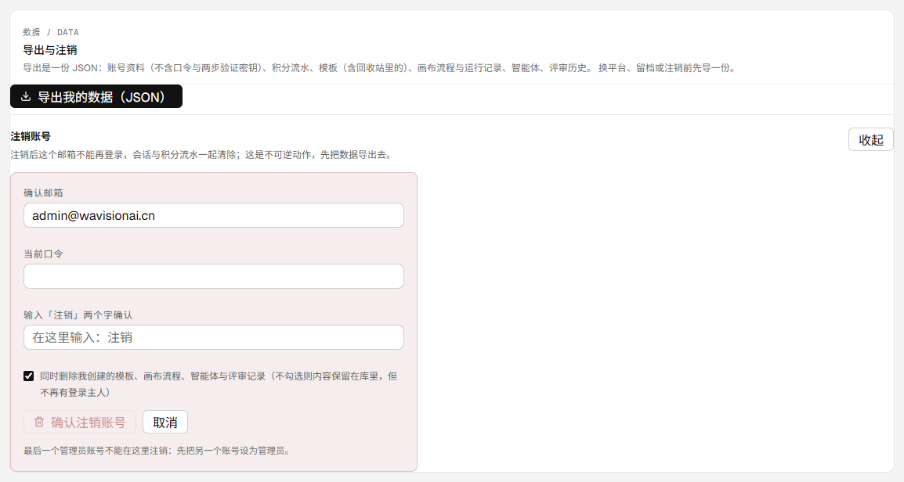
---

## D4 公共模板来源署名 + 侵权举报通道

### 问题
分享出去的页面与公共模板只有「抖音 · tpl_xxx」，没有作者署名；被侵权的一方也没有任何入口能找过来——生产连客服邮箱都还没配。

### 做法
1. 署名：分享页与模板抽屉的「来源」区补上平台 + 作者，原视频链接保留；分享页页脚写明「复刻请用自己的素材，遵守原平台规则」。
2. 举报通道：POST /api/reports（进 PUBLIC_API，不要求登录——被侵权的人不一定有账号）。白名单字段、8KB 体积上限、按 IP 每分钟 5 条限流；同一 IP 对同一条模板 10 分钟内合并计数。
3. 落库 server/reports.mjs（data/reports.json，500 条封顶）：类型（版权 / 肖像 / 不当内容 / 其他）、具体情况（必填 ≥5 字）、联系方式（可选）、目标（kind / id / title / url）、提交 IP 与账号。
4. 入口：分享页页脚「举报侵权」、模板抽屉「来源」区的「举报」（公共模板）。
5. 弹窗：类型下拉 + 具体情况 + 联系方式 + 受理编号回执。

### 验证（生产，入口 index-Bkrw0c8w.js）
- 匿名（无 cookie）提交 → 201 + 受理编号；同一 IP 重复提交同一对象 → 合并（duplicate:true）。
- 队列两条：一条来自分享链接、一条来自模板，open=2。
- 分享页弹窗实测：类型、具体情况、联系方式都能填，提交后显示「已收到受理编号」。

### 产物
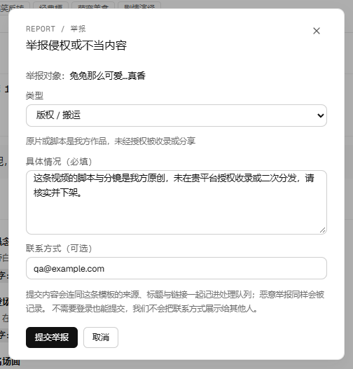

---

## D5 UGC 举报后台审核队列

### 做法
1. 后台新增「举报处理」区块（导航里排在工作台「模板治理」之后）：待处理 / 已驳回 / 已下架 / 全部四个筛选；每条列出类型、目标与编号、第几次、时间、具体情况、联系方式与来源链接。
2. 处理动作两个：驳回（保留内容）与下架——下架把模板从公共模板收回（shared=false）并停掉分享链接（token 清空），不物理删除（证据留着）；处理说明记进管理审计 report.resolve。
3. 抬头显示计数：待处理 / 已驳回 / 已下架 / 累计。

### 验证（生产，入口 index-Bkrw0c8w.js）
- 队列 2 条、计数 open=2，截图见下。
- 驳回真实模板那条 → 状态 dismissed，模板内容不变。
- 下架自测模板那条 → takedown 返回 {templateId, title}；该模板 shared=false、shareToken=null（分享链接同时失效）。
- 处理后计数 open=0 / dismissed=1 / takedown=1；自测模板随后删除并彻底清理，举报记录也清掉（生产队列回到 0），健康检查 templates=25。

### 产物
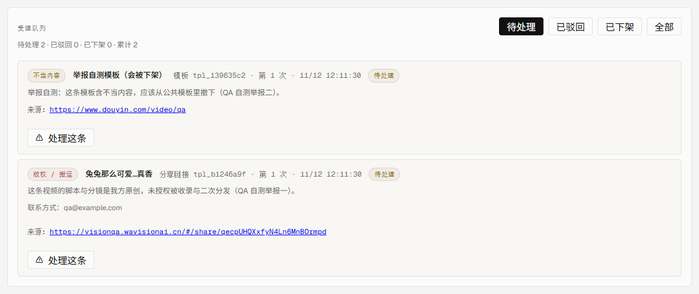
