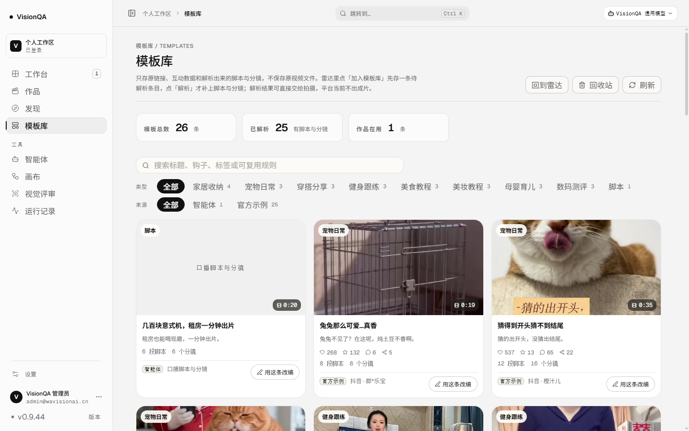
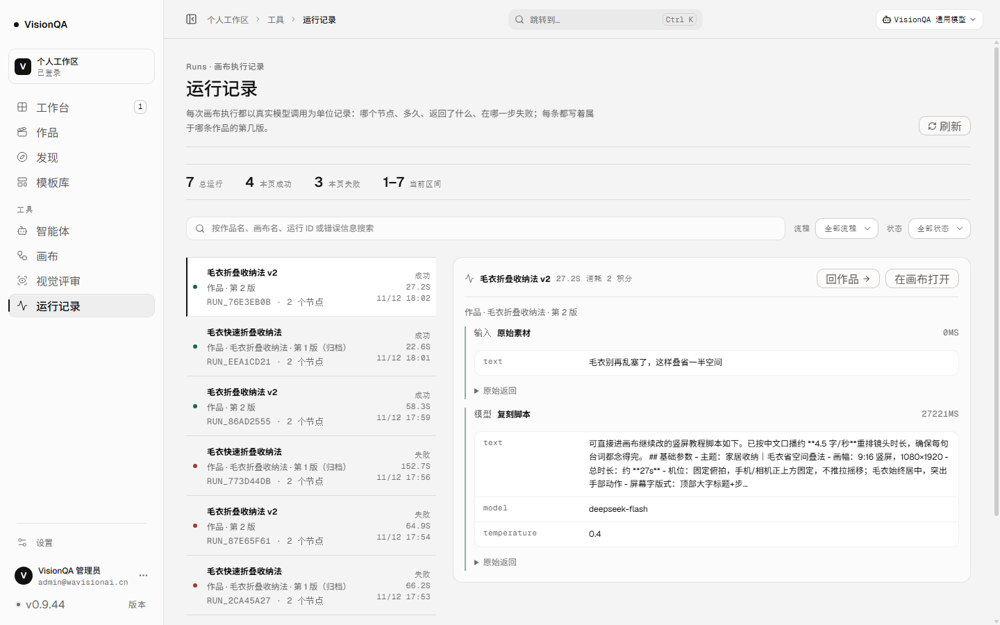
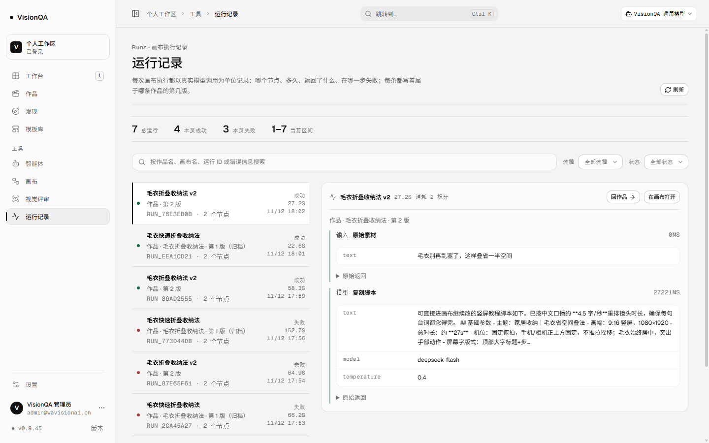
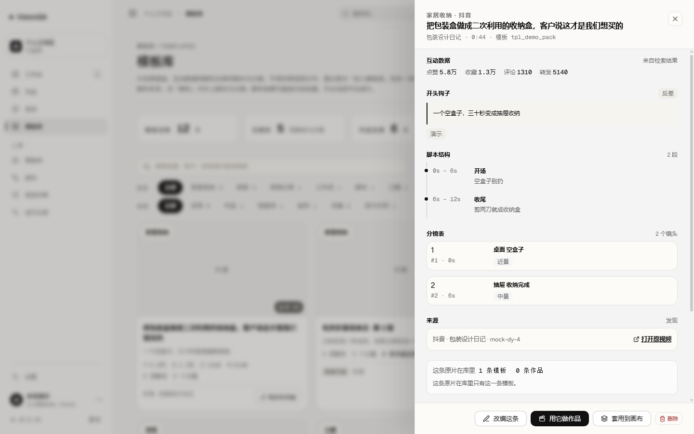
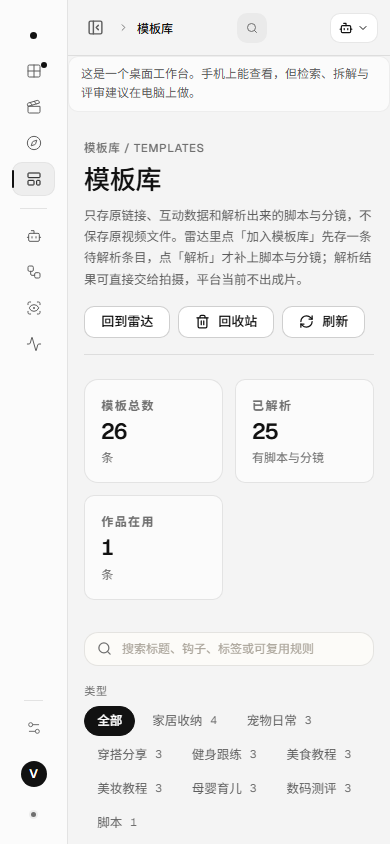

# 按钮归队：字号回到 11/12/13 阶（v0.9.45，2026-11-13）

## 一、问题：全站按钮只剩一个字号

上线前在生产（v0.9.44，1440）量可见按钮的**计算字号**，结果不是一个设计系统，而是一档：

| 页面 | 可见按钮 | 渲染成 16px | 26–28px 高的小按钮里塞 16px 字 |
| --- | --- | --- | --- |
| 模板库 | 56 | 29 | 1 |
| 运行记录 | 28 | 25 | 6 |
| 视觉评审 | 20 | 19 | 1 |
| 工作台（本地演示，同版本） | 42 | 38 | 7 |

也就是说：设计里写好的 11 / 12 / 13px 三个档位，一个都没生效；`.button--tiny` 写的是 28px 高、12px 字，实际是 28px 高的盒子里装 16px 字；`.vq-button` 写的是 13px / 500，实际 16px / 400。整站按钮看起来像「默认浏览器按钮」，层次只剩大小写和颜色。

**根因是一行 reset 的选择器权重**（`src/styles/shell.css`）：

    .vq-scope button,
    .vq-scope input { font: inherit; }   /* 0-1-1 */

它比 `.vq-button`（0-1-0）、`.button`（0-1-0）、`.vq-button--tiny`（0-1-0）都高一级，于是所有按钮的字号、字重被 `font: inherit` 顶回父级的 16px / 400。项目里其实早就撞见过：`src/styles/overview.css` 有两处注释写着「全局 .vq-scope button { font: inherit } 会把字号顶回 16px，这里压回 11px」——那是局部打补丁，没动根因。

## 二、改了什么

1. **reset 降权**：`.vq-scope button / input` 改成 `:where(.vq-scope) button / input`。`:where()` 权重为 0，选择器整体只剩 0-0-1，仍然能压过浏览器默认（按钮不会变回 Arial），但让 `.vq-button`、`.button`、`.vq-button--tiny` 这些类重新说话。
2. **四个页面换到同一套按钮**：模板库、发现、视觉评审、运行记录共 46 处旧的 `button / button--ghost / button--primary / button--tiny / button--danger` 换成 `vq-button…`，包括两处动态拼类名（模板库抽屉底栏、发现页历史行）。旧的 `.button` 是 36px 高 / 12px / 700 并带暖色阴影，和主线页的 32px / 13px / 500 并排就是两个系统。
3. **13 条页面级选择器跟着改**：`.radar-actions .button`、`.drawer-foot .button`、`.review-scope-bar .button`、`.runs-adopt-row .button` 等改成 `:is(.button,.vq-button)`，布局规则（宽度、换行、移动端 flex）不会因为换类名失配。

## 三、判断

- **不在组件里补 font-size**：全站按钮几百个，逐个加内联字号是拿补丁当修复；一行 reset 的权重就是根因。
- **不用 `!important`**：那会把「页面按场景覆盖字号」的路也堵死，而且下一个组件还得再写一个 important。
- **为什么只换四个页面**：后台管理版（console.css）与本地工作区是维护者 / 桌面端自己的样式体系，这一轮先让用户日常走的那条线（模板库 → 作品 → 评审 → 运行）用同一套按钮；剩下的不装作已经统一。
- **输入框一起修**：同一条 reset 也压着 `.vq-scope input`，模板库与发现页的搜索框、账号页的输入框原来是 16px，现在是 12–12.5px，和所在页的元数据同级。
- **不引入字号 token 的大重构**：11 / 11.5 / 12 / 12.5 / 13 目前仍散在各文件里，统一到 `--fs-*` 是下一步，这一轮先把「写了不生效」这件事解决。

## 四、实测与验收

生产（v0.9.45，入口 `index-BLX4ZMUw.js`，512,784 字节，release `20261113-021050-buttons.tar.gz`）：

| | 改之前（v0.9.44） | 现在（v0.9.45） |
| --- | --- | --- |
| 模板库 16px 按钮 | 29 / 56 | 3（都是整张卡片当按钮的行，字由子元素定） |
| 运行记录 16px 按钮 | 25 / 28 | 10（同上，行容器） |
| 视觉评审 16px 按钮 | 19 / 20 | 7（同上，行容器） |
| 小按钮里 16px 字 | 模板库 1 · 运行 6 · 评审 1 | 0 / 0 / 0 |
| 旧的 `.button` 类（本地演示同版本） | 模板库 3 · 运行 5 | 0 / 0 |
| 1440 / 390 横向溢出 | 无 | 无（1194/1194、322/322） |

本地演示账号（7 条作品 / 12 条模板 / 3 块画布）量抽屉：12 个按钮全部落在 32px 与 26px 两档；「待解析」抽屉里那颗隐藏按钮的规则（`.drawer-section--pending`）也一起换了选择器。

测试 415/415（`npm test`，含新增的 `test/button-system.test.mjs` 4 条：reset 权重、组件字号、四页类名、页面级选择器）、oxlint 0 error / 6 warning、`tsc -b` 干净、构建通过。提交 `8781813`（代码 + 测试）+ `2071ba0`（文档 + 6 截图），CI 43350775569 success。生产只发只读 GET，截图前后六路快照 `identical: true`（作品 1 · 模板 26 · 画布 7 · 原片 25（1 已开成作品 / 24 没开成）· 交付 0 · 余额 9954）。

## 五、边界

- 没改任何业务逻辑、接口、计费表；这一轮没跑检索、解析、评审，**0 积分**。
- 没动后台管理版与本地工作区的按钮（它们仍用 `.button` 与 `console.css`），下一轮可以把它们也收进来。
- 没做字号 token 化（`--fs-*`）；11 / 11.5 / 12 / 12.5 / 13 仍是各处字面量。
- 没改按钮高度阶梯（主线 32 / 小按钮 26）；页头大 CTA 仍按原尺寸。
