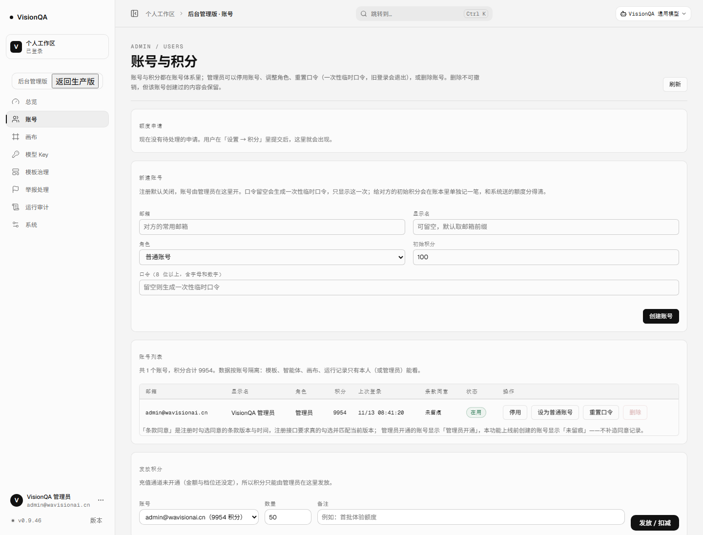
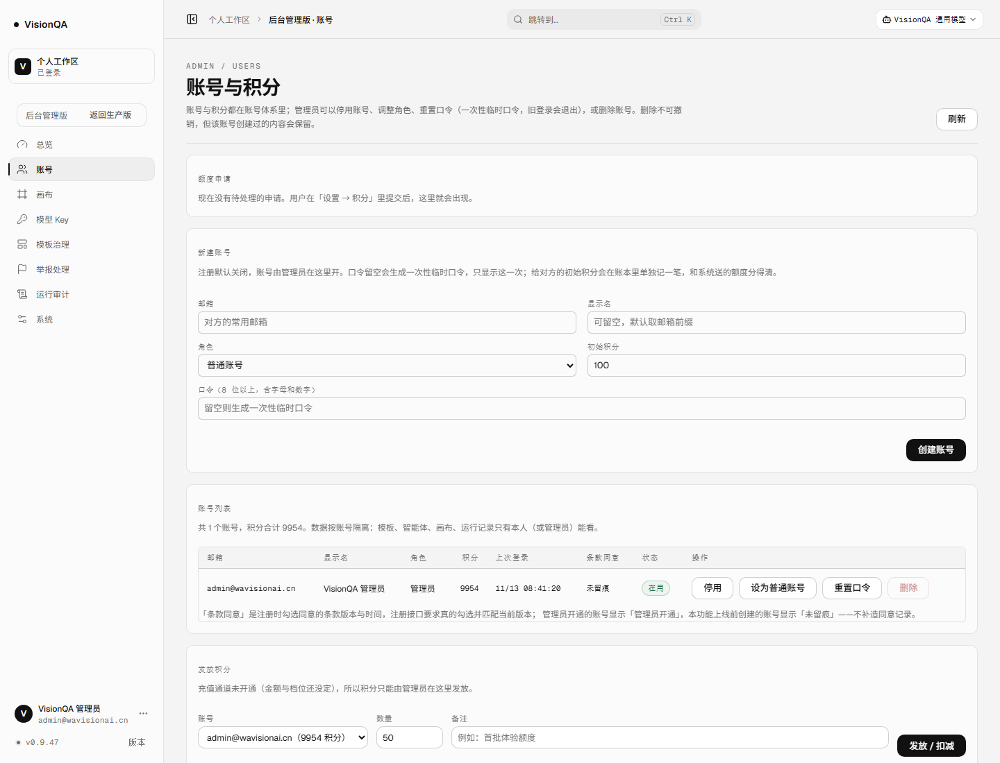
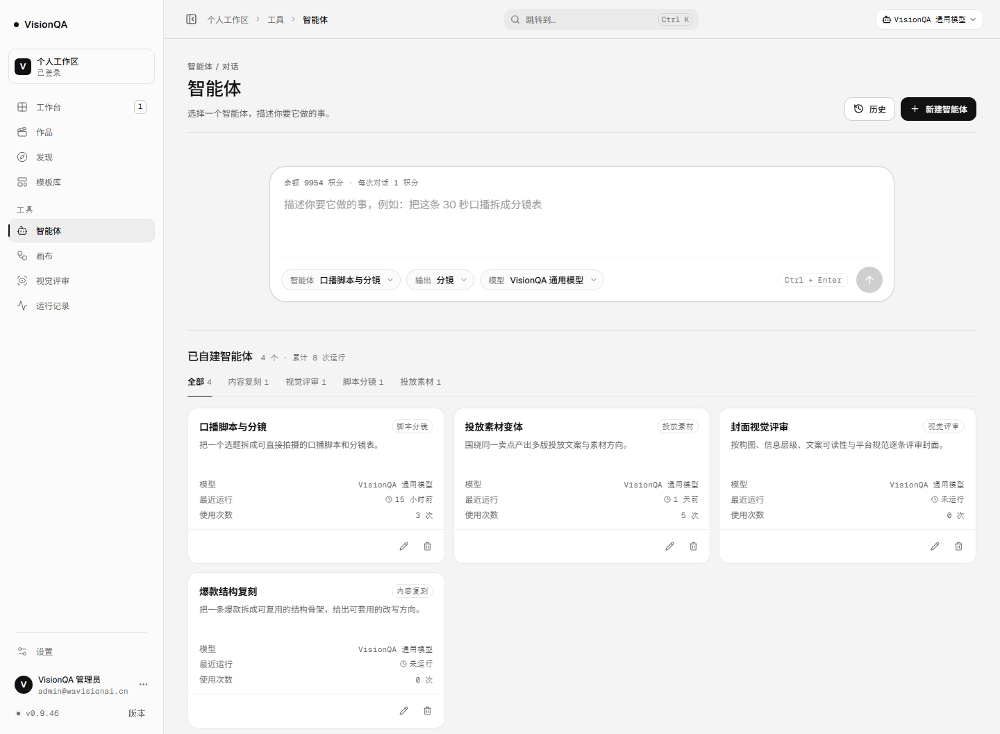
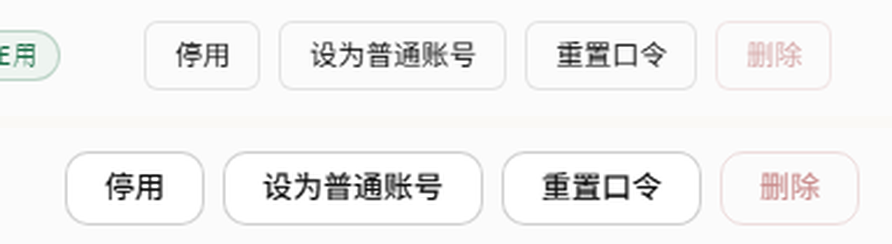
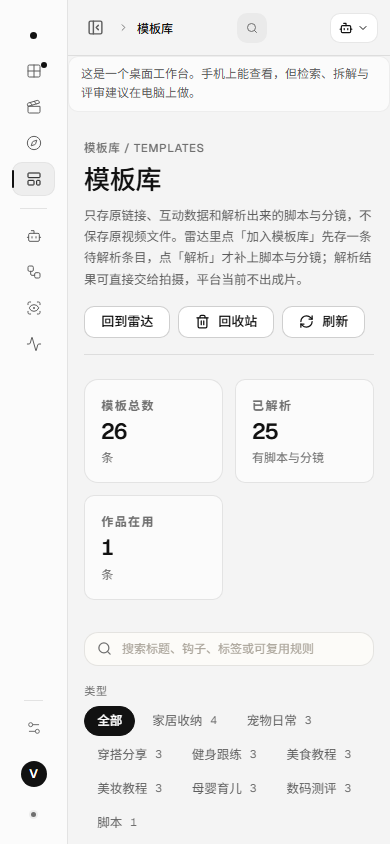
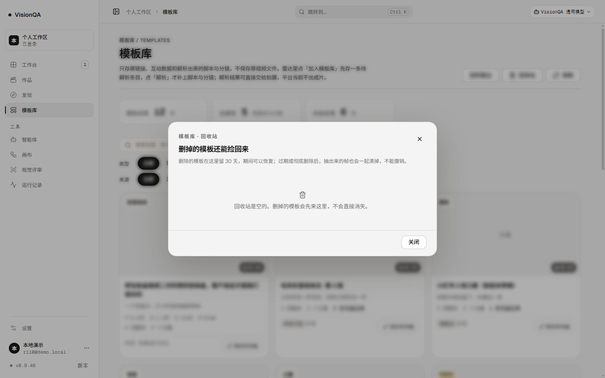

# 按钮归一：九个家族收回一个（v0.9.47）

日期：2026-11-13　版本：v0.9.47　生产：https://visionqa.wavisionai.cn

## 一、起因：同一个动作，四种按钮

上一轮把 13 种「长得像胶囊」的东西收回三档（v0.9.46），这一轮处理同一个毛病的另一半：**矩形动作按钮有九个家族**。

生产 v0.9.46 实测（1440）把它们量出来：

| 家族 | 出现位置 | 高 | 圆角 | 字号 | 横向内边距 |
| --- | --- | --- | --- | --- | --- |
| `.vq-button` | 工作台 / 作品 / 发现 / 模板库 / 设置 | 32px | 10px | 13px | 16px |
| `.vq-button--tiny` | 列表行里的次要动作 | 26px | 10px | 11px | 8px |
| `.admin-btn` | 后台管理版全部 | 30px | **6px** | 12px | 12px |
| `.agx-btn` | 智能体 | **34px** | 10px | 12px | 12px |
| `.cv-btn` | 画布 | 32px | 10px | 12px | 12px |
| `.lw-btn` | 本地工作区 | 32px | 10px | 12px | 12px |
| `.button` | 复刻 / 回收站 / 评审历史三个弹窗 | **36px** | 10px | 12px | 12px |
| `.vq-icon-button` | 顶栏、弹窗关闭 | 30×30 | 10px | 16px | 0 |
| `.icon-button` | 抽屉、弹窗关闭（v1 遗留） | 30×30 | 10px | 16px | 0 |

九种家族 × 六种高度（26 / 30 / 32 / 34 / 36 / 38）× 两种圆角（6 / 10）× 三种字号（11 / 12 / 13）。
最刺眼的两条：**后台那 55 枚按钮的圆角是 6px**，与全站 10px 不是一套；**同一个「关闭」**在弹窗里 36px、在抽屉里 30px、在页面里 32px。

还有一枚从没进过体系的按钮：后台形态条上的「返回生产版」是**浏览器原生按钮**（2px outset 边框、16px 字、96px 宽），全站唯一的例外。

## 二、改法：一个家族、三档高度、两档字号、一个圆角

尺寸进 `--btn-*` token（`src/styles/tokens.css`）：

```css
--btn-h-sm: 28px;  --btn-h: 32px;  --btn-h-lg: 40px;
--btn-pad-sm: 12px;  --btn-pad: 16px;
--btn-font: 13px;  --btn-font-sm: 12px;
--btn-gap: 8px;  --btn-gap-sm: 4px;
```

`shell.css` 里的 `.vq-button` 成为唯一定义：

- 基类：`height: var(--btn-h)`、`padding: 0 var(--btn-pad)`、`font-size: var(--btn-font)`、`border-radius: var(--radius-sm)`、`gap: var(--btn-gap)`、`white-space: nowrap`。
- `--sm` 28px / 12px 内边距 / 12px 字：列表行、密集工具条、弹窗次要动作。
- `--lg` 40px + 整宽：登录 / 注册表单。
- `--icon` 宽高同取一档：顶栏与弹窗关闭。
- 语气 `primary / ghost / quiet / danger` **只换颜色**，不写任何尺寸。
- 反馈只一处：`:active` 下落 1px、`:focus-visible` 一圈 3px 柔光、`:disabled` 0.55 透明度 + `not-allowed`。

## 三、迁移了什么

| 旧写法 | 新写法 |
| --- | --- |
| `admin-btn admin-btn--ghost` | `vq-button vq-button--ghost` |
| `admin-btn admin-btn--primary` | `vq-button vq-button--primary` |
| `admin-btn admin-btn--danger` / `--icon` | `vq-button--danger` / `vq-button--icon` |
| `agx-btn` / `agx-btn--ink` | `vq-button vq-button--ghost` / `vq-button--primary` |
| `agx-btn--quiet` / `agx-btn--danger` | `vq-button--quiet` / `vq-button--danger` |
| `agx-icon-btn` / `cv-icon-btn` / `lw-icon-btn` / `icon-button` | `vq-button vq-button--icon` |
| `cv-btn` / `cv-btn--primary` / `cv-btn--danger` | `vq-button--ghost` / `--primary` / `--danger` |
| `lw-btn` / `lw-btn--primary` / `lw-btn--quiet` | `vq-button--ghost` / `--primary` / `--quiet --sm` |
| `button button--ghost button--tiny` | `vq-button vq-button--ghost vq-button--sm` |
| `vq-button--tiny` | `vq-button--sm` |
| `vq-button--block` | `vq-button--lg` |
| `vq-icon-button` | `vq-button vq-button--icon` |
| `vq-edition-exit`（原生按钮） | `vq-button vq-button--quiet vq-button--sm` |

**调用处 165 个 className**（31 个文件里 152 处自动替换 + 13 处动态拼类名手工改）。
其中 5 处是 `className={'…' + 条件}` 写法，正则碰不到，单独改：`ReportsSection`、`LocalWorkspacePage`、`AgentEditorPage`、`AgentsPage`、`RadarPage`。

**删掉的 CSS 段落**：`console.css` 9 条 `.admin-btn*`、`local-workspace.css` 10 条 `.lw-*`、`canvas.css` 9 条 `.cv-*`、`agents.css` 13 条 `.agx-*`、`shell.css` 2 条 `.vq-icon-button` + 1 条后置的 `--tiny` 覆盖、`App.css` 里 `.button*` 与 `.icon-button` 整套。

页面级的**布局**规则保留，但选择器改到 `.vq-button`、尺寸改回 token（例如画布 `.cv-project-actions` 与智能体 `.agx-draft-actions` 的 28px 小按钮 → `var(--btn-h-sm)` / `var(--btn-font-sm)`）。
顺手删掉两处「更具体的选择器压字号」的补丁（工作台的「已看过」「交付稿」原来写死 11px），现在由 `--sm` 的 12px 统一说话。

## 四、生产实测（v0.9.46 → v0.9.47，抽样 5 条路由：工作台 / 模板库 / 智能体 / 画布 / 后台账号）

| 尺寸 | 改之前 | 现在 |
| --- | --- | --- |
| 1440 动作按钮几何 | **5 种**（32/13、30/6/12、30/10/16、34/12、26/11） | **2 种**（32/10/13 ×32、28/10/12 ×2） |
| 390 动作按钮几何 | 5 种 | 2 种 |
| 横向溢出 | 1440 / 390 均无 | 无 |

本地 13 条路由（含后台审计、作品详情）1440 与 390 各量一遍：

| 视口 | 改之前 | 现在 |
| --- | --- | --- |
| 1440 | 8 种几何 | **2 种** |
| 390 | 9 种几何 | **2 种** |

剩下的第三种高度 40px 只出现在登录 / 注册的整宽主按钮上（未登录才可见），属于设计内的表单档。

## 五、边界

- 只动样式与组件类，**没动**接口、计费、评审口径与任何业务逻辑。
- **可点的胶囊按钮**没并进来：`vq-filter-chip`（30px / 999 / 12.5px 筛选器）、`template-adapt`（32 / 999 / 11.5）、`review-picker-toggle`（22 / 999 / 11）、`radar-taken-work`（26 / 10 / 11）。它们是「能点的胶囊」，该和状态胶囊一起定，不该混进矩形按钮。
- **工具栏开关** `cv-tool`（27px、带 `is-active`）是分段开关不是动作按钮，留原样。
- **圆形发送键** `agx-send`（38 / 999）与工作台的 `vq-next-cta`（36 / 13，自带箭头位移动效）是单例组合件，没拆。
- `App.css` 里仍有约 260 个类名在 `src` 里没有任何引用（v1 侧栏 / 顶栏 / 画布 / 资产栏整套），本轮没动。
- `--lg` 只在登录页可见，本轮没截到它的生产截图（需要未登录态），验收以 1440 / 390 的登录页本地渲染与 tsc/测试为准。

## 六、截图

生产 1440：后台账号页改前 / 改后；生产 1440：智能体页改前 / 改后；后台行内动作 3 倍放大对比；生产 390 模板库；本地回收站弹窗（`.button` 家族改后）。














## 七、验收

- 生产 **v0.9.47**，入口 `index-azz8GptM.js`，release `20261113-032639-v0.9.47-buttons2.tar.gz`，`/api/version` 0.9.47，health ok（templates 26），`visionqa` 与 `visionqa-internal` 都 active。
- 生产只发只读 GET：截图前后两次快照逐字段一致，且与上一轮（v0.9.46）快照**完全相同**——作品 1 · 模板 26 · 画布 7 · 原片 25（1 已开成作品 / 24 没开成）· 交付 0 · 余额 9954，**0 积分**。
- `npm test` **422/422**（`test/button-system.test.mjs` 重写为 6 条：reset 降权、三档只走 token、语气不写尺寸、九个旧家族在 src 归零、反馈只有一处、页面级规则不再兼容 `.button`）。
- `npx oxlint src server test` **0 error / 6 warning**、`tsc -b` 干净、构建通过。
- 生产样式 `index-*.css` 250,089 → **246,961 字节**（少 3,128 字节）；`App.css` 81,465 → 79,358 字节。
- 提交 `5726616`（代码 + 测试）+ `5e012db`（文档 + 7 张截图），已推 `origin/master`；CI **43359481970 success**（两个提交一起推送，CI 跑在分支头上）。

## 八、下一轮候选

1. **可点胶囊定规范**：`vq-filter-chip` / `template-adapt` / `review-picker-toggle` / `radar-taken-work` 四种能点的胶囊收成一档（30px / 999 / 12px，选中态只换底色）。
2. **圆角与间距 token 全站扫尾**：卡片仍是 6 / 10 / 14 / 20 / 24 五档混用，页面里还留着 13、17 这类随手数。
3. **App.css 死类退役**：约 260 个类名无人引用（v1 侧栏 / 顶栏 / 画布 / 资产栏），删掉可再省一截样式，但需要逐屏像素比对确认。