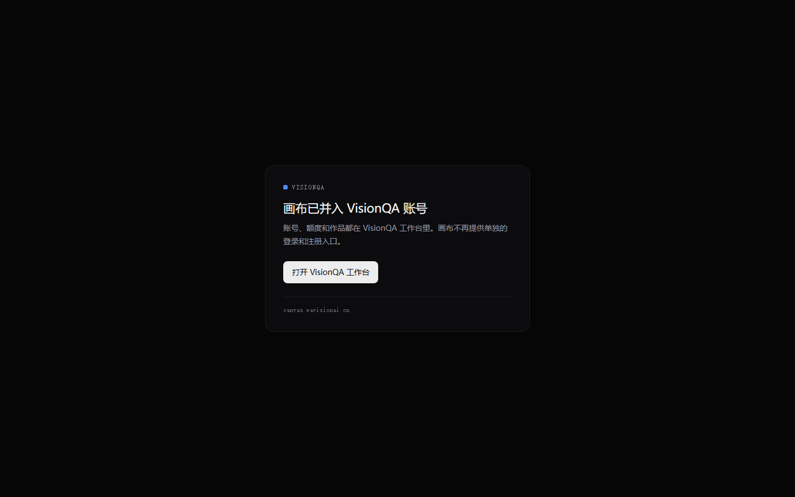
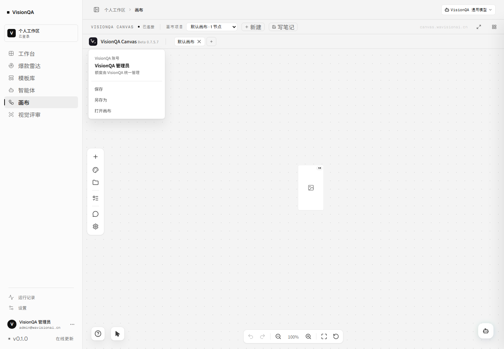

# 画布账号入口下线（B 方案）：2026-11-11

VisionQA 是唯一身份源。画布既不显示登录/注册，服务端也不再接受画布自己的账号操作；独立打开画布时只给一条回 VisionQA 的入口。

## 一、服务端（`enterprise_server`）

| 接口 | 互通开启后 |
| --- | --- |
| `POST /enterprise/api/auth/login` | 403 `TRUST_ONLY`：画布账号由 VisionQA 统一管理，登录请回到 VisionQA 工作台操作 |
| `POST /enterprise/api/auth/register` | 403 `TRUST_ONLY`（同样文案） |
| `PUT /enterprise/api/auth/profile` | 403 `TRUST_ONLY`（资料在 VisionQA 改） |
| `POST /enterprise/api/auth/avatar` | 403 `TRUST_ONLY` |
| `PUT /enterprise/api/auth/password` | 403 `TRUST_ONLY` |
| `GET /enterprise/api/auth/mode` | 200 `{trust:true, managed_by:"visionqa", host:"https://visionqa.wavisionai.cn/#/canvas"}`，不泄露密钥 |
| `POST /enterprise/api/auth/exchange` | 200，继续用 VisionQA 票据换画布会话 |
| `POST /enterprise/api/admin/auth/login` | 保留：画布运维台自己的账号，不面向普通用户 |

实现落点：`visionqa_trust.py` 增加 `host_url()`；`auth.py` 增加 `_trust_only()`、`auth_mode()` 并在 login/register/update_profile/upload_avatar/change_password 入口拦截；`app.py` 注册 `/auth/mode`。

## 二、前端

启动时读一次 `/enterprise/api/auth/mode`：互通开启、且当前页面不是被 VisionQA 嵌在 iframe 里时，压一层入口门（近黑底、单卡片、一个按钮回工作台），并给 `<html>` 打 `data-visionqa-trust="1"`。嵌入场景完全不出现这层门。

另外把头像菜单里的影子用户名（`vq_…`）隐藏，额度文案在托管模式改成「额度由 VisionQA 统一管理」。

## 三、线上实测（2026-11-11 13:0x，直连生产）

| 检查 | 结果 |
| --- | --- |
| VisionQA 登录 → 取票据 | 200，TTL 120 秒 |
| 票据换画布会话 | 200，`trust_mode:true`，影子用户 `vq_vqusr_DHZnmjNxrF0e` 与上次同一条（幂等） |
| iframe 内 `/auth/me` | 200，`display_name` 是 VisionQA 账号名 |
| `/auth/mode` | 200，`trust:true`，host 指向 `#/canvas` |
| 画布账号密码登录 | 403 `TRUST_ONLY` |
| 画布自助注册 | 403 `TRUST_ONLY` |
| 无票据访问 `/auth/me` | 401 |
| 独立打开画布 | 入口门出现，页面无登录弹窗（无头 Chrome 1440×900 实拍） |
| 从 VisionQA 进入 | 菜单只有 VisionQA 账号 / 账号名 / 额度由 VisionQA 统一管理 / 保存 / 另存为 / 打开画布，不再显示 `vq_` 影子用户名 |

## 四、密钥与回退

这一批把 `VQ_CANVAS_SHARED_SECRET`（VisionQA）与 `VISIONQA_TRUST_SECRET`（画布）一起轮换成新值，两边重启后交换链路复验通过；密钥只存在两台机器的 .env 里，不进仓库。

回退：画布侧删掉 `VISIONQA_TRUST_SECRET` 或 `VISIONQA_HOST_URL` 并重启 `bdc-enterprise`，`/auth/mode` 立刻返回 `trust:false`，画布恢复自己的登录；VisionQA 侧删 `VQ_CANVAS_SHARED_SECRET` 则票据接口 503，画布安静回落到个人模式。

## 五、部署清单

画布（`/opt/bdcanvas`）：`enterprise_server/visionqa_trust.py`、`enterprise_server/auth.py`、`enterprise_server/app.py`、`src/main.ts`、`src/features/enterprise/enterprise.ts`、`src/ui/styles/index.css`、`src/ui/styles/visionqaGate.css`；`enterprise_server/.env.wechat-pay` 追加 `VISIONQA_HOST_URL`。

重启：`systemctl restart bdc-enterprise`（Python 改动）+ `systemctl restart bdc-web`（vite 缓存里存过中途上传的坏模块，必须重启一次，否则嵌入画布白屏）。
