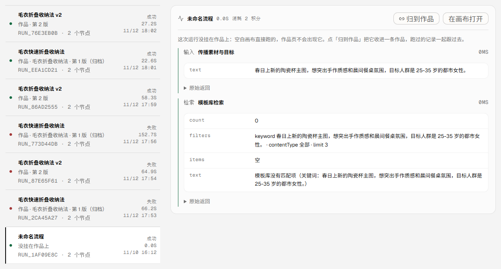
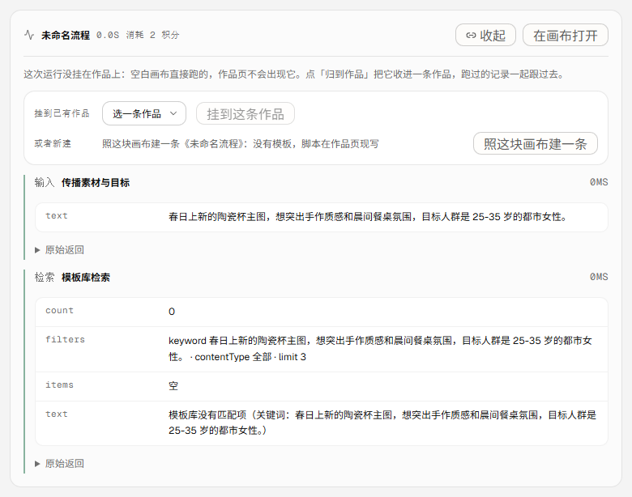
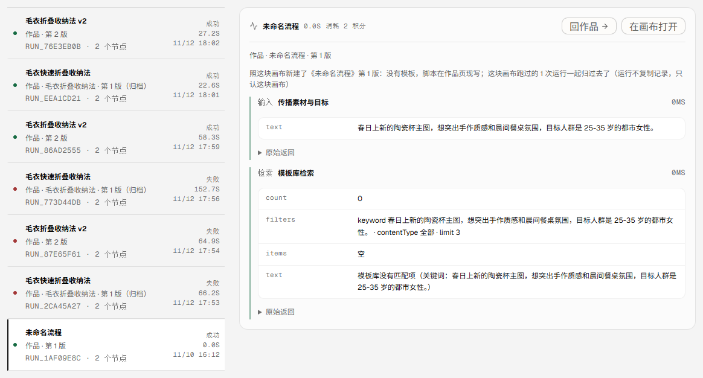
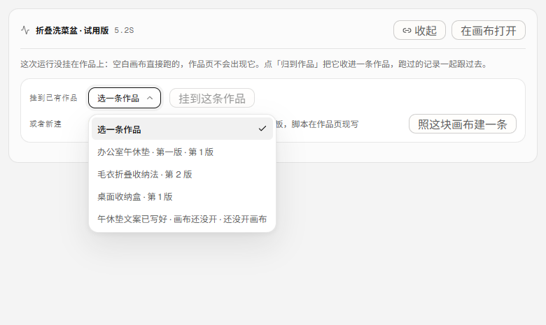
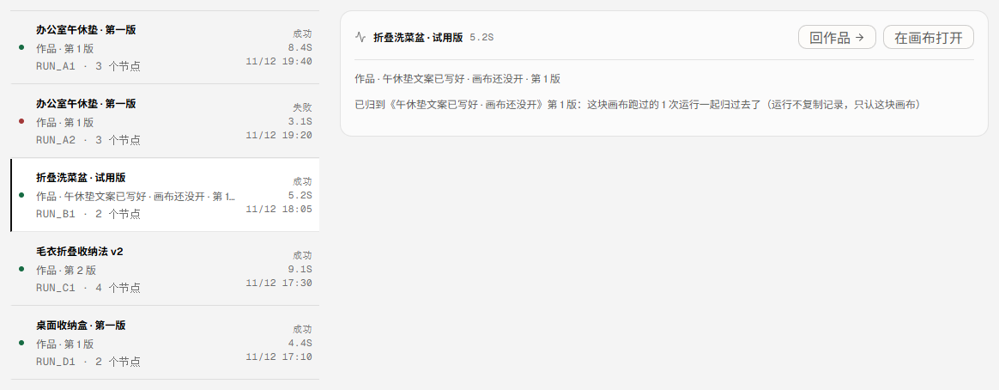
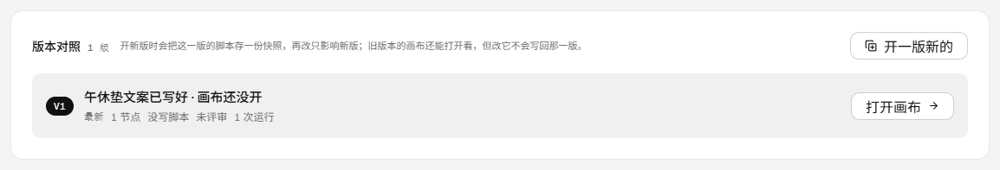
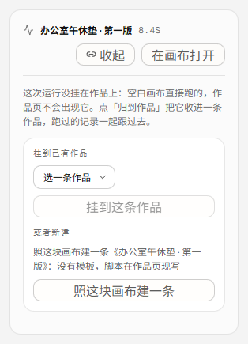

# 这次运行归到作品：没挂在作品上的，就地能收进一条作品（v0.9.29）

版本 0.9.29 / 发布包 `20261112-204501-v0.9.29-canvas-adopt.tar.gz` / 入口 `index-CDIG32-Q.js`（481,252 字节）
提交：`9d6d6cc`（代码）+ `df0c43d`（文档）；CI run `43303696543` success；测试 `302/302`，oxlint `0 error / 6 warning`，`tsc -b` 干净，构建通过。

## 一、这一轮补的是哪块空

运行记录页一直有一句老实话：「这次运行没挂在作品上：空白画布直接跑的，作品页不会出现它」。
话说清楚了，但没有下一步——空白画布跑出来的东西想变成一条作品，只能回模板库从头套一条模板，
亲手把画布再搭一遍；而那块画布上跑过的运行、之后要送的评审，哪儿都落不住。

这一轮把这块接口补上：**画布归作品**。两条路，同一个判据。

- **归到已有作品**：运行记录里点「归到作品」，从下拉里选一条作品（包括还没开画布的那种），
  这块画布就变成它的当前版——作品从 v0 变 v1，画布上跑过的运行当场变成「作品 · 第 1 版」。
- **照画布建一条作品**：没有合适的作品，就照这块画布新建一条。没有模板，脚本在作品页现写，
  画布已经在了所以一出生就是 v1；下一步直接是「画布有了，送一次评审」。

两条路都**不复制任何运行记录**：运行只认 flowId，作品那侧记着画布指针，一接上两边就对上了。
所以归过去之后，以前跑过的运行也都在这条作品里，不是从归的那一天才开始算。

## 二、三个决定

1. **一块画布只归一条作品。** 运行与评审都按 flowId 反查作品（`projectsByFlow`），
   画布要是归了两条，同一次运行的「作品 · 第几版」就有两个答案。归到已有作品时如果这块画布
   已经属于别的作品，接口回 409 `FLOW_BOUND`，把那条作品是哪条写清楚。
2. **一条作品只有一块当前画布。** 直接换画布会让旧版的运行与评审对不上号，
   所以已经有画布的作品再挂另一块，回 409 `CANVAS_TAKEN`，并说「要换先开一版新的」。
   同一块画布重复点一下不算冲突：回 `changed: false`，连 `updatedAt` 都不动。
3. **从画布建的作品没有模板，不编一条出来。** `templateId` 留空，作品页脚本区直接可写；
   建作品的接口不再只认模板——「要么从一条模板开始，要么从一块画布开始」，
   两个都不给才回 `TEMPLATE_REQUIRED`。

还有一处口径收拢：作品简报（不带脚本、不带分享 token）原来只写在 `routes/projects.mjs` 里，
这一轮的接口回执也要用，就搬进 `server/project-briefs.mjs`，两条路共用一份。

## 三、界面

| 位置 | 之前 | 现在 |
| --- | --- | --- |
| 运行行 | 「没挂在作品上」 | 归过去之后写「作品 · 第 1 版」，与别的运行同一列 |
| 运行详情 | 一句说明，没有出口 | 说明后面给出下一步；行里多一个「归到作品」 |
| 归到作品面板 | 无 | 两行：挂到已有作品（下拉 + 按钮）/ 照这块画布建一条 |
| 归完之后 | 无 | 一行如实记账：「这块画布跑过的 N 次运行一起归过去了（运行不复制记录，只认这块画布）」 |
| 作品页 | 无 | 归过去的作品第一步就是「画布有了，送一次评审」，运行数当场是 1 |

同一块画布上的**其他运行**也一起改口：归的是整块画布，不是选中那一条，
只改当前这一行会让旁边几行继续写着「没挂在作品上」——那是假话。

## 四、生产实测（一次写入并当场撤销）

前提：生产上正好有一条没挂在作品上的运行（`run_1af09e8c` / `flow_4b106e4a` / 未命名流程）。

1. 归之前：运行 7 条、作品 1 条（`prj_f38d68c6` v2）；那条运行写着「没挂在作品上」，详情里有「归到作品」。
2. 点「归到作品」→ 面板；点「照这块画布建一条」→ 行变成「作品 · 第 1 版」，
   记账写「照这块画布新建了《未命名流程》第 1 版：没有模板，脚本在作品页现写；这块画布跑过的 1 次运行一起归过去了」。
3. 服务端核对：新作品 `prj_aee0d0ef`「未命名流程」v1、`flowId=flow_4b106e4a`；
   `GET /api/runs?flowId=flow_4b106e4a` → 1 条，`project` 是这条作品 v1；
   作品详情 `runTotal 1`，`runs[0] = run_1af09e8c`；作品页首屏「下一步 · 送评审 / 画布有了，送一次评审」，运行 1。
4. 撤销：`DELETE /api/projects/prj_aee0d0ef` → 200（解绑评审 0 / 便利贴 0 / 拍板 0）；
   作品回到 1 条，那条运行回到「没挂在作品上」。生产数据与归之前一致。

## 五、本地演示（多作品、窄屏、两条路都走一遍）

`.tmp-qa/r100data`：3 条作品（含一条还没开画布）、4 块画布（两块没人认领）、5 条运行。

- 未归：3 条运行写着「没挂在作品上」，另外两条是「作品 · 第 2 版 / 作品 · 第 1 版」。
- 走「照画布新建」：`flow_free1` → 新作品《办公室午休垫 · 第一版》第 1 版；
  **同一块画布上的两条运行同时改口**（一条成功、一条失败都在里面），记账写 2 次。
- 走「挂到已有作品」：`flow_free2` → 下拉选中《午休垫文案已写好 · 画布还没开》（v0），
  归过去之后它变成 v1，记账写 1 次；作品页首屏「画布有了，送一次评审」，运行 1。
- 下拉里四条作品都带版次：`第 1 版 / 第 2 版 / 还没开画布`——选之前就知道会挂到哪一版。
- 390：面板改成「标签 / 下拉 / 按钮」各占一行、同一宽度，页面 390px 宽、`scrollWidth == clientWidth`，无横向滚动。

## 六、验收清单

- [x] 空白画布跑出来的运行，在运行记录里就能归到作品（两条路）。
- [x] 归过去不复制运行：以前跑过的运行当场显示「作品 · 第几版」。
- [x] 一块画布只归一条作品；一条作品只有一块当前画布；重复归不报错也不改时间。
- [x] 别人的作品 / 别人的画布 404，管理员照旧全通（`canAccess`）。
- [x] 从画布建的作品没有模板、一出生就是 v1，作品页第一步是「送评审」。
- [x] 生产一次可逆写入并当场撤销，数据回到原样。
- [x] 1440 / 390 均无横向滚动。
- [x] `302/302` 测试、oxlint 0 error、`tsc -b` 干净、构建通过。

## 七、边界

- 不自动归：空白画布跑完之后不会自己建作品，要人点一下——画布可以只是试一下，不该悄悄变成一条作品。
- 不换画布：已经有画布的作品要换，走「开一版新的」；这条不开口子。
- 不复制画布：一块画布只归一条作品，没有「复制一份再归」的按钮，要做是另一件事。
- 不改运行记录：运行仍只存 flowId，作品那侧记指针；删作品只解绑，运行记录留着。

## 八、复现

```
# 本地演示数据（3 条作品 / 4 块画布 / 5 条运行，其中 3 条没挂在作品上）
node .tmp-qa/r100-seed.mjs
$env:DATA_DIR='.tmp-qa/r100data'; $env:API_PORT='8898'; $env:VQ_REQUIRE_AUTH='0'; $env:VQ_REGISTRATION='1'; node server/index.mjs
node .tmp-qa/r100-login.mjs      # 本地演示要一个登录态（注册接口默认关闭，所以带 VQ_REGISTRATION=1）
node .tmp-qa/r100-shot.mjs       # 1440 + 390 截图与量宽
```

## 九、改动文件

- `server/project-canvas.mjs`（新增）：归画布与从画布建作品的判断与写入（纯判断 + 两个 async）。
- `server/project-briefs.mjs`（新增）：`projectBrief` / `flowBrief`，作品那条线的回执共用一份。
- `server/routes/projects.mjs`：`PUT /api/projects/:id/canvas`（归画布）、`POST /api/projects {flowId}`（从画布建）。
- `server/projects.mjs`：`createProject` 带 flowId 时一出生就是 v1。
- `src/api/projects.ts`、`src/pages/RunsPage.tsx`、`src/styles/runs.css`：归到作品的面板与记账。
- `test/project-canvas.test.mjs`（新增 8 条）：索引、两道判断、两条写路、归属、幂等、路由与运行反查。

## 十、截图

生产（真实渲染）：





本地演示（非生产）：




