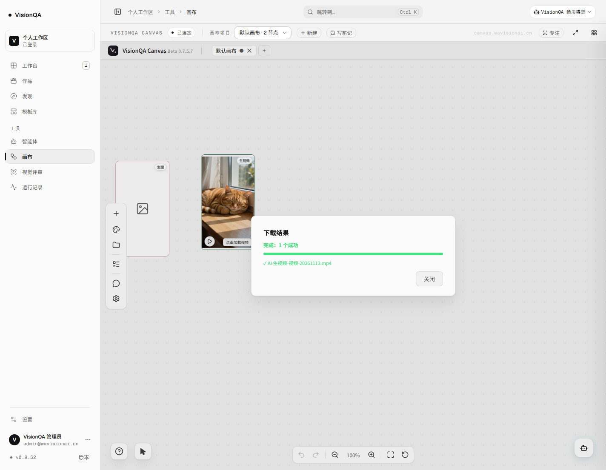

# 画布「下载」为什么点了没反应：文件被存到服务器（2026-11-13）

日期：2026-11-13 · 生产 v0.9.52 · 画布 canvas.wavisionai.cn

## 一、现象

用户在画布生成视频成功（16:55 的 Seedance 2.0 任务 `job_uLJeeH8T6ZGKZNbr`，后端记录
`media_backups.id=9`，973,822 字节）后点「下载」，没有任何文件落到自己的电脑上。

## 二、根因（两处叠加，都在画布侧）

### 1. trusted host 被当成「本机安装」，下载存到了服务器

`src/features/startup/runtimeMode.ts`：

```ts
// 自建部署的域名：这些 Host 按「本机安装」对待（画布数据走服务端 workspace）
const TRUSTED_HOSTS = new Set(['canvas.wavisionai.cn'])
export function isPublicWebClient(location = window.location) {
  ...
  return !TRUSTED_HOSTS.has(hostname)
}
```

所以画布在 `canvas.wavisionai.cn` 上 `isPublicWebClient() === false`，下载走桌面分支：

```ts
fetch('/api/workspace/download-asset', { body: JSON.stringify({ url, filename }) })
```

实测：下载后的文件在**服务器**的
`/root/AppData/Roaming/BD Canvas/workspace/downloads/AI 生视频-视频-20261113-170416.mp4`，
浏览器这边一个字节都没有；「打开本地位置」打开的也是服务器目录。

### 2. 浏览器下载分支的 fetch 主动丢了登录态

真正走浏览器分支时，代码是 `fetch(url, { credentials: 'omit' })`。而 nginx 给画布加了一道
Basic Auth 门（`/__auth` 种 `bdc_auth` cookie，见 `/etc/nginx/conf.d/canvas.wavisionai.cn.conf`）：

```nginx
map $cookie_bdc_auth $bdc_realm { default "BD Canvas"; "<bdc_auth 的固定值>" "off"; }
...
location / { auth_basic $bdc_realm; auth_basic_user_file /etc/htpasswd-canvas; proxy_pass http://127.0.0.1:6677; }
```

`credentials: 'omit'` 把 cookie 丢了，nginx 直接 401。生产实测同一 URL：

| 请求方式 | 结果 |
| --- | --- |
| `fetch(url, { credentials: 'omit' })` | **401 text/html**（nginx Basic Auth） |
| `fetch(url, { credentials: 'include' })` | **200 video/mp4** |

企业媒体的受保护地址（`/enterprise/api/media/<id>/preview|download`）还需要 Bearer 令牌，
仅靠 cookie 也不够。

## 三、修了什么

补丁三处（脚本 `deploy/bd-canvas/patch-download-credentials.mjs`，幂等、CRLF 安全）：

| # | 位置 | 改动 |
| --- | --- | --- |
| A | `_downloadUrlSilent` 的 fetch | `credentials: 'omit'` → `'include'`，并带 `Authorization: Bearer <bd-enterprise-token>`（有才带） |
| B | `_downloadUrlSilent` 分支判断 | `if (isPublicWebClient())` → `if (isPublicWebClient() \|\| location.protocol === 'https:')`：https 页面一律走浏览器下载，不再把文件存服务器 |
| C | 进度框按钮 | https 页面不显示「打开本地位置」（那是服务器目录） |

桌面版（`http://127.0.0.1` / Electron）行为不变：仍走服务端 workspace 保存。

## 四、生产验证（2026-11-13）

1. 打补丁：`node patch-download-credentials.mjs --root /opt/bdcanvas --write`
   → `A/B/C` 写入，原文件备份 `/opt/bdcanvas/src/main.ts.bak-vq-download`；
   画布由 Vite dev 直接读源码，刷新页面即生效（不需要重新构建）。
2. 在真实浏览器（headless Chrome，带 `bdc_auth` 与真实企业令牌）里调用画布同一个下载函数：
   - 返回 `{ ok: true, path: '', error: '' }`（path 为空 = 走浏览器下载，不再落服务器）；
   - 下载目录出现 `probe-video.mp4`，**973,822 字节**，与源文件一致。
3. 走画布自己的下载框（`_downloadWithProgress`）：
   文案「完成：1 个成功 ✓ AI 生视频-视频-20261113.mp4」，
   下载目录里同名文件 **973,822 字节**。


4. 仓库回归：`test/patch-bd-canvas-download.test.mjs` 6 条（检查/写入/幂等/CRLF/源码变了要报错/目录不对要报错）。

## 五、边界

- 这是对**第三方源码**（BD Canvas，Source-Available）的最小补丁，不改它的 dist；画布升级覆盖
  `src/main.ts` 后要重跑脚本（`--check` 会以退出码 1 告诉你没打）。
- nginx 的 Basic Auth 门没动，仍是这道门在挡公网未授权访问；补丁只是让下载请求带上它需要的 cookie。
- 令牌只放 `Authorization` 头，不写进 URL（避免进历史记录与 Referer）。
- 只改「下载」这一条路径与「打开本地位置」按钮显隐，不动画布存储与生成逻辑。

## 六、回滚

```bash
cp /opt/bdcanvas/src/main.ts.bak-vq-download /opt/bdcanvas/src/main.ts
# 刷新画布页面即可
```
