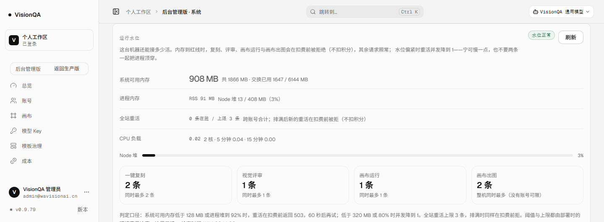

# 画布出图通道也要过全站名额（v0.9.79，2026-11-14）

## 一、问题：最花钱的一条路没有闸门

画布的出图节点不走用户会话，走的是平台给它开的服务间通道：`POST /api/gateway/v1/images/generations`
（异步出图与出视频是同一组入口）。鉴权是一把服务令牌，请求里**没有账号**。

v0.9.78 之前这条通道上没有任何一层闸：

| 检查项 | 有账号的入口（检索 / 复刻 / 评审 / 画布运行） | 平台出图通道 |
| --- | --- | --- |
| 登录门 | 有 | 不需要（令牌） |
| 积分 | 扣费前扣，失败退 | 不扣（平台额度） |
| 每分钟限流（`server/ratelimit.mjs`） | 每个入口一条桶 | **没有这条规则** |
| 运行水位（内存红线 / 偏紧降并发） | `waterline.admit` 在扣费前拦 | **不经过** |
| 全站重活名额 3 条 | 占一条租约 | **不占** |

两个直接的后果：

1. **机器**：画布点「批量出图」会连发。8 张同时进来就是 8 个请求同时等上游、同时把响应读进
   内存。这张机器只有 2 核 / 1866 MB，「全站重活最多 3 条」在这条路上是句空话。
2. **钱**：这是**唯一**一条每一次请求都要上游付费的入口（v0.9.56 已经为它踩过幂等键的坑：
   同步出图不带幂等键，上游 400 再被包成 502）。令牌泄露、或画布侧一个重试死循环，
   没有任何东西限制「一分钟能花多少」。

为什么以前没补：v0.9.69~78 的闸门全是照着「有账号的入口」写的——扣费、每账号并发、带
`beforeCharge` 的请求路径；服务令牌这条路绕过了整套账号体系，也就一起绕过了闸门。

## 二、现成件与放弃的路

**现成件**（没有新依赖）：

- 按 IP + 桶的滑动窗口限流表：加一条规则就行；
- `waterline.admit`：v0.9.78 起已经既是「数名额」也是「占名额」（跨进程租约）；
- `capacityFor`：按水位把并发上限折算（偏紧降到 1、红线回 0），正好可以给没有账号的通道做整机口径；
- 后台「运行水位」卡与只读预检接口：多一类重活就自动多一行、多一个 `?kind=`。

**放弃的三条路**：

| 路 | 为什么不选 |
| --- | --- |
| 画布侧自己限并发 | 画布是另一个服务、另一份部署。它漏一版就等于没有；平台这侧的保护不该依赖调用方的自觉 |
| 网关里放一个进程内信号量 | 生产是两个实例（对外 8799 + 内部版 8800），进程内计数只能管住一半——v0.9.78 刚把这个坑填掉 |
| 引一个队列（Redis / 任务服务） | 为「同时最多 2 张图」再加一个常驻组件与它的故障面，不划算；排队还要在画布侧做等待语义，属于产品决定，先给「立刻说不行」 |

## 三、做法

1. **新重活类型 `canvas_gen`**：同步出图、异步建任务、出视频建任务三条 POST 入口都先
   `admit('canvas_gen')`，占不到就在**调上游之前**回 503；占到的名额在 `finally` 里还
   （上游报错、超时、4xx/5xx 一样还）。
2. **两层名额**：
   - 整机总名额仍是 3 条（`VQ_GLOBAL_HEAVY`），画布出图也占其中之一；
   - 这一类的整机上限 `VQ_CONCURRENCY_CANVAS_GEN`（默认 2）：一次批量出图最多 2 张在生成，
     剩下立刻拒，**不会把 3 条名额全吃掉、把评审饿死**。
   - 两种「满」分开回：`kindFull = true`（同类排满，少发几张就好）与整机满（等一分钟）。
3. **入口限流**：`POST /api/gateway/*` 每分钟 20 次（第 21 次 `429 RATE_LIMITED`，
   `bucket = gateway`，`Retry-After: 60`）。名额管「同时几张」，限流管「一分钟几次」——
   令牌泄露时决定账单的是后一条。GET（探活 `/v1/models`、轮询任务）不限：它们不花上游的钱。
4. **可观测**：后台运行水位卡多一行「画布出图 · 2 条 · 整机同时最多（没有账号可限）」；
   `/api/admin/waterline` 的 `heavy.kindLimits`；预检 `?kind=canvas_gen` 回
   `kindFull / kindActive / kindLimit`；租约统计多了 `kindRefused`（总名额还有、只是同类排满的次数）。
5. **可回退**：`VQ_WATER_GUARD=0` 只量不拦、`VQ_GLOBAL_HEAVY=0` 关掉整机名额、
   `VQ_CONCURRENCY_CANVAS_GEN=0` 关掉同类上限；限流是代码里的规则，回退靠回滚版本
   （或轮换 `VQ_GATEWAY_TOKEN`）。

## 四、验收（本机）

- `npm test` **699/699**（+6）：名额排满时 503 且**上游调用数 = 0**；还回后能正常生成并立刻归还；
  整机满与同类满分开报；跨进程（真子进程占 2 条）照样拒；限流第 21 次 429；令牌不对仍先 401。
- 本地压测（`--kind=canvas --n=6`，假上游 1.5 s）：200×2 / 503×4、上游被调用 2 次、峰值并发 2、判定通过。
- oxlint 0 error / 7 warning（`src server test`，与上一轮同数）、`tsc -b` 干净、构建通过、
  密钥扫描 571 文件 0 命中。

## 五、生产实测（release `20261114-060800-r90-canvas`）

都在生产机上跑一次性实例（假上游、独立数据目录与名额目录、端口 8798），**零扣费调用**，余额 9950 未变。

**A/B：10 并发出图**

| 臂 | 结果 | 上游被调用 | 上游并发峰值 | 进程树峰值 | V8 堆峰值 | 健康探针 |
| --- | --- | --- | --- | --- | --- | --- |
| 闸门开（生产默认） | 200×**2** / 503×**8**（全是 `SERVER_BUSY`） | **2 次** | **2** | 86 MB（基线 83） | 14 / 408 MB（3%） | p50 2 ms / p95 111 ms / 0 失败 |
| 闸门关（`VQ_WATER_GUARD=0` + 无整机上限，即旧行为） | 200×10 | **10 次** | **10** | 102 MB | 16 / 408 MB（4%） | p50 3 ms / p95 78 ms / 0 失败 |

这就是这轮要回答的问题：**旧行为下 10 张图会真的并发打到上游 10 次**（10 次计费、10 条上游连接），
现在只发 2 次，其余 8 次在 1–3 ms 内被拒、根本没出这台机器。注意内存这一栏两臂都很低——
出图通道的大头不是本机内存（它只是转发 HTTP），而是**上游并发与钱**；所以这一轮的护栏重心是名额与限流。

**生产实例上的证据链**（只读 + 一个由 root 起的占位进程，不调生成接口）：

| 观测 | 结果 |
| --- | --- |
| 后台报告 | `heavyKinds` 四项含 `canvas_gen`；`capacity.canvas_gen = 2`、`kindLimits.canvas_gen = 2`；`heavy.scope = lease`、`lease.dir = /tmp/visionqa-heavy-leases-v1`、空闲 `total = 0` |
| 预算 `?kind=canvas_gen`（空闲） | `ok: true`、`kindLimit 2`、3 ms |
| root 另起进程占 2 条 `canvas_gen` | 预检 `canvas_gen` → **503 `SERVER_BUSY`、`kindFull: true`、`kindActive 2 / kindLimit 2`**（3 ms）；同时 `review` 预检仍是 `ok`（整机只占 2 条）——两层确实是分开的 |
| 再占 1 条 `flow_run`（整机 3 条满） | 预检 `canvas_gen` → 503、`kindFull: false`、`active 3 / limit 3`；`review` 也 503；报告 `active 3`、`full true`、`byKind {canvas_gen: 2, flow_run: 1}` |
| `kill -9` 两个占位进程 | 0.6 秒后预检回到 `ok`、租约目录 **0 个文件**（按 pid 回收，没等 30 分钟 TTL） |
| 限流（真实例，21 次 POST，带假令牌） | 前 20 次 `401 GATEWAY_UNAUTHORIZED`，**第 21 次 `429 RATE_LIMITED`、`bucket: gateway`、`retryAfterSec: 60`**——请求在鉴权前就被限流挡住，上游一次都没被碰 |

后台运行水位卡（生产真渲染，v0.9.79，四类重活排成一行）：



## 六、踩到的坑（如实记）

1. **假上游的计数写在了错误的位置**：它把 `stats.calls += 1` 放在 `req.on('end')` 里，而图片分支
   在它之前就 `return` 了。第一次跑出来是「放行 2 张、上游被调用 **0** 次」——只看「放行几张」
   会当成通过，其实是假通过。是压测自判里那条「上游调用数必须等于放行数」把它抓出来的。
   修正后两臂才有意义（2 次 / 10 次）。
2. **固定的三列栅格在第四类时留孤儿块**：加了「画布出图」后正好四类，三列会让第四块单独占一行。
   真截了一张图才看出来（DOM 断言看不出来）。改成 `auto-fit minmax(220px, 1fr)`，并在
   980 px / 720 px 折成 2×2 与单列，不留孤儿。
3. **顺手修了一条脆测试**：告警投递那条「1 秒慢接收端、断言 < 500 ms」在并行跑全量测试时偶发
   > 500 ms（这轮本地命中一次）。改成让接收端**压着响应不回**、由用例放行：断言变成
   「recordAlert 5 秒内返回」+「返回时接收端还没回包」，不再拿秒表赌调度。

## 七、边界

- **令牌泄露仍能每分钟刷 20 次**：限流是「花钱速度的上限」，不是身份与授权的上限。出了事要
  轮换 `VQ_GATEWAY_TOKEN`（平台与画布两边同时改）。
- 异步出图与出视频只在**建任务那一下**占名额：任务在上游排队时不占本机名额（本机也确实没在跑），
  轮询同样不占。想「同一时刻最多几个上游任务在跑」得另外记任务台账，没做。
- 画布侧收到 503 现在会把这句原样显示在节点上（「这条任务没有开始（没有产生费用）」）。
  **批量 8 张会 2 张放行、6 张失败**：「排队」需要画布侧有队列与重试，这轮没做，属于产品决定。
- 名额只在同一台机器上互认（沿用 v0.9.78 的共享目录）；多机部署仍需真正的协调者。
- 同类上限 2 是经验值（2 核 / 1.86 GB，出图是 I/O 等待型）：真按画布用量调，改
  `VQ_CONCURRENCY_CANVAS_GEN` 即可，不用发版。

## 八、回滚

```bash
# 只关这一层（不用回滚版本）
VQ_CONCURRENCY_CANVAS_GEN=0   # 同类上限关掉，只留整机 3 条
VQ_GLOBAL_HEAVY=0             # 整机名额也关掉
VQ_WATER_GUARD=0              # 只量不拦
# 整套回滚
bash /opt/visionqa/ops/rollback.sh 20261113-213240-r89-lease2
```
