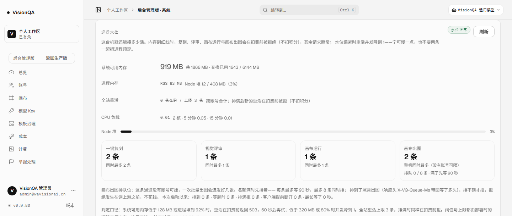

# 画布出图名额满了先排队（v0.9.80，2026-11-14）

## 一、问题：v0.9.79 只解决了「不花钱」，副作用是整批失败

v0.9.79 把画布出图（`POST /api/gateway/v1/images/generations`）也纳入了整机名额：
同时最多 2 张在生成，第 3 张起**立刻** 503。这一层保住的是钱（拒绝发生在调上游之前），
但画布上看到的是另一件事：点一次「批量出图」，**2 张成功、6 张失败**。

失败的原因不是资源不够，而是**没有人等**：

| 角色 | 行为 |
| --- | --- |
| 画布（另一个服务） | 一次批量把 8 个请求并发发出去；收到 503 就把错误显示在节点上，**不重试** |
| 平台通道 | 名额满 → 立刻 503，连 100 毫秒都不等 |
| 实际上 | 上游只是**忙**，2 张跑完（十几秒）后名额就空出来了 |

而画布其实等得起——它的同步出图超时是 **1800 秒**（`enterprise_server/generation_image2.py:72`），
异步建任务的超时是 **120 秒**（`:245`）。所以「等一会儿」对调用方是完全可以接受的，
缺的只是平台这侧的一个等待位。

## 二、现成件与放弃的路

**现成件**（零新依赖）：

- `admit()` 本身就是「判一次 + 占一个名额」的同步函数，失败时不留下任何状态——直接拿来轮询就行；
- `kindLimitFor` / `capacityFor` 已经算出「这一类现在能放几条」（默认 2，偏紧时 1，红线 0）；
- v0.9.78 的跨进程租约：排队期间每次重试都是**真实的占租约**，两个实例不会合起来超放；
- 压测脚本已有 `--kind=canvas` 臂（假上游、真请求、自判「上游调用数 = 放行数」）。

**放弃的路**：

| 路 | 为什么不选 |
| --- | --- |
| 画布侧自己排队 / 重试 | 画布是另一个仓库、另一份部署，改它要另发一版；而且平台这侧的保护不该依赖调用方的自觉 |
| 引 Redis / 任务队列服务 | 为「等几十秒」再加一个常驻组件与它的故障面，不划算 |
| 把同类上限从 2 调到 8 | 只是把并发打回旧样子：2 核机器上 8 张同时等上游，内存与上游连接照旧，且把评审饿死 |
| 让画布客户端重试 503 | 它现在不重试；即使重试也是「立刻再撞一次墙」，没有节流 |

## 三、做法

1. **排队位**（`waterline.admitWaiting`）：先试一次 `admit`；满了、且这一类允许排队时，
   进入排队，每 ~350 ms（带 0–120 ms 抖动，避免一批请求同刻撞租约锁）再试一次，
   直到名额空出或到达等待上限。排到之后照常占租约、照常调上游、照常在 `finally` 还名额。
2. **等待上限** `VQ_CANVAS_QUEUE_MS`（默认 **90000** ms）：写 0 = 关掉排队，退回 v0.9.79 的立刻拒。
   90 秒这个数是从调用方超时倒推的：异步建任务只有 120 秒，不能把它的提交拖到超时。
3. **排队位本身也有上限** `VQ_CANVAS_QUEUE_MAX`（默认 **8**）：正在等的条数到顶就立刻 503
   （`queueFull: true`）——不把连接堆在这台机器上。
4. **内存到红线不排队**：等一分钟也不会变好，直接拒（`admit` 已经记过告警）；
   排队期间水位掉到红线也立刻收手，把红线那条原样回给调用方。
5. **客户端断开就退出排队**：`res.on('close')` + `destroyed` 判断；这时**不写响应、不调上游**，
   排队位立刻收回来。否则排到最后才发现没人要，钱已经花了。
6. **排过队的请求带 `X-VQ-Queue-Ms`**：把「等了多久」告诉画布（节点上能显示，排障时也能对账）。
7. **只有画布出图这一类排队**：其余重活（复刻 / 评审 / 画布运行）有账号、有用户界面，
   客户端重试与提示更合适；给它们加服务端排队只会把「等」藏起来。
8. **可观测**：`/api/admin/waterline` 的 `heavy.queue`：

   ```json
   { "kind": "canvas_gen", "waitMs": 90000, "maxWaiting": 8, "waiting": 0,
     "entered": 0, "served": 0, "timedOut": 0, "full": 0, "abandoned": 0,
     "maxWaitMs": 0, "since": "2026-11-13T22:24:44.463Z" }
   ```

   后台「运行水位」卡在「画布出图」那一块多一行「排队 0 / 8 条 · 满了先等 90 秒」，
   卡片底部一段说明写清「排到了照常出图、排不到才拒、拒绝发生在调上游之前」。

## 四、验收（本机）

- `npm test` **706/706**（+7）：① 名额满时排队、名额一空就出图（响应头带回等待时长）；
  ② 排队位满了立刻拒且说清「没有产生费用」；③ 等超时 503 `timedOut` 且全程不碰上游；
  ④ 客户端提前断开 → 不写响应、不调上游、排队位收回；⑤ `waitMs=0` 退回立刻拒；
  ⑥ 只有画布出图排队、报告字段对；⑦ 压测判定：排队臂「放行数可以超过同时上限」。
- 本机压测（8 并发，假上游 1.5 s，同一台机器）：
  - 排队开：**8 × 200**、6 条排过队、最长等 **5.3 s**、上游被调用 8 次、并发峰值 2、判定通过；
  - 排队关：**2 × 200 / 6 × 503**、上游被调用 2 次、并发峰值 2、判定通过。
- oxlint 0 error / 15 warning（仓库既有）、`tsc -b` 干净、构建通过、密钥扫描 573 文件 0 命中。

## 五、生产实测

生产机上跑一次性实例（假上游、独立数据目录与名额目录、端口 8798、`systemd-run --scope -p MemoryMax=1300M`），
**零扣费调用**，管理员积分余额 9950 未变。生产版本 **0.9.80**，release
`20261113-222442-r91-queue` → `20261113-222744-r91-queue2`（入口 `index-DsA0BU0f.js`）。

**四臂：同样是 8 张一批**（假上游 1.5 s / 3 s）

| 臂 | 设置 | 结果 | 上游被调用 | 并发峰值 | 进程树峰值 | V8 堆峰值 | 健康探针 |
| --- | --- | --- | --- | --- | --- | --- | --- |
| A 排队开（生产默认） | `--queue=90000` | 200×**8** · 6 条排过队 · 最长等 **4867 ms** | **8 次** | **2** | 102 MB（基线 83） | 17 / 408 MB（4%） | p50 2 / p95 4 / 最慢 99 ms，0 失败 |
| B 排队关（v0.9.79 行为） | 不传 `--queue` | 200×**2** / 503×**6** | **2 次** | 2 | 87 MB（基线 83） | 13 / 408 MB（3%） | p50 3 / p95 102 / 最慢 102 ms，0 失败 |
| C 等待上限太短 | `--queue=400`，上游 1.5 s | 200×2 / 503×6（全 `timedOut`） | **2 次** | 2 | — | — | p95 73 ms，0 失败 |
| D 排队位太小 | `VQ_CANVAS_QUEUE_MAX=2`，上游 3 s | 200×4（2 条排了 3379 ms）/ 503×4（全 `queueFull`，119–135 ms 内拒） | **4 次** | 2 | — | — | p95 6 ms，0 失败 |

A 与 B 是这轮要回答的问题：**同一批 8 张，旧行为是 2 过 6 败；现在 8 张全出，只是最后几张多等 5 秒**，
而且上游调用数仍然等于放行数（8 = 8、2 = 2）——被拒的、等超时的、排队位排满的，一次上游都没碰。

C 与 D 是刻意把这层安全网拆掉的边界臂（压测自判因此**不通过**，这是预期的）：
排队不是无限等，等超时或排队位满，仍然在调上游之前拒。

等待超时的文案（C 臂改前 / 改后）：

```
改前：排队等了 0 秒还没轮到（同时最多 2 条），这次生成没有开始（没有产生费用）。
改后：排队等了 1.2 秒还没轮到（同时最多 2 条），这次生成没有开始（没有产生费用）。
```

**生产实例上的证据**（只读 GET）：

| 观测 | 结果 |
| --- | --- |
| `/api/version`（8799 / 8800） | 都是 **0.9.80**；health ok（模板 26）；三个 unit active；journal 无 error |
| `/api/admin/waterline` 的 `heavy.queue` | `waitMs 90000`、`maxWaiting 8`、`waiting 0`、`entered/served/timedOut/full/abandoned` 全 0、`since` = 本次发布时刻 |
| `heavy.kindLimits.canvas_gen` | 2（两层名额没变）；`heavy.scope = lease` |
| 名额目录 | `/tmp/visionqa-heavy-leases-v1` **0 个文件** |
| 管理员积分余额 | **9950**（未变；本轮所有生成都打在假上游上） |

后台运行水位卡（生产真渲染，v0.9.80）：



## 六、踩到的坑（如实记）

1. **「排队等了 0 秒」**：400 ms 的等待被 `Math.round(ms/1000)` 写成 0 秒——真实例上的边界臂才显示出来。
   改成「小于 10 秒保留一位小数（0.4 秒 / 1.2 秒），否则取整（90 秒）」，并补了一条断言。
2. **`systemd-run --scope --wait` 不允许组合**（`--wait may not be combined with --scope`）：
   去掉 `--wait`，scope 本身就是前台执行。
3. **ssh 里嵌 `node -e` 的引号会被 PowerShell 吃掉**：改成把整段 bash 写成脚本、base64 后
   `ssh ... "echo <b64> | base64 -d | bash"`。
4. **压测判定一开始会把这轮判成失败**：排队臂里「放行 8 条 > 同时上限 2 条」是合法的——
   多出来的在服务端排着。判定里加了「排队臂」这个前提，并给它补了单测；否则真跑出来会误导人。

## 七、边界

- **排队位是本进程的**：两个实例各排各的（各 8 条），整机最多 16 条在等；占名额仍走共享租约，
  所以不会超放。要「两个实例合计最多 8 条在等」得把排队位也放进共享目录，没做。
- **90 秒不是万能**：8 张 × 上游 40 秒时，最后两张要等 ~2 分钟，会等超时（这时仍然不花钱）。
  真按画布用量调 `VQ_CANVAS_QUEUE_MS`，但**别超过 120 秒**——异步建任务的上游超时是 120 秒。
- **排队不省钱、也不提速**：它把「立刻失败」换成「等一会儿再花钱」，上游并发仍是 2 条；
  每分钟 20 次的入口限流照旧，决定账单上限的还是那一条。
- 画布侧看不到「前面还有几张」：它只看到响应变慢。要显示「排队第 3/6 位」得改画布（没做）。
- 名额与排队位仍只在同一台机器上互认；多机部署要真正的协调者。

## 八、回滚

```bash
# 只关排队这一层（不用回滚版本）：名额满时退回 v0.9.79 的「立刻拒」
VQ_CANVAS_QUEUE_MS=0        # 或 VQ_CANVAS_QUEUE_MAX=0
# 连名额一起关
VQ_CONCURRENCY_CANVAS_GEN=0
VQ_GLOBAL_HEAVY=0
# 整套回滚（当前快照列表里第 3 个 = r90-canvas2）
bash /opt/visionqa/ops/rollback.sh --to 3
```
