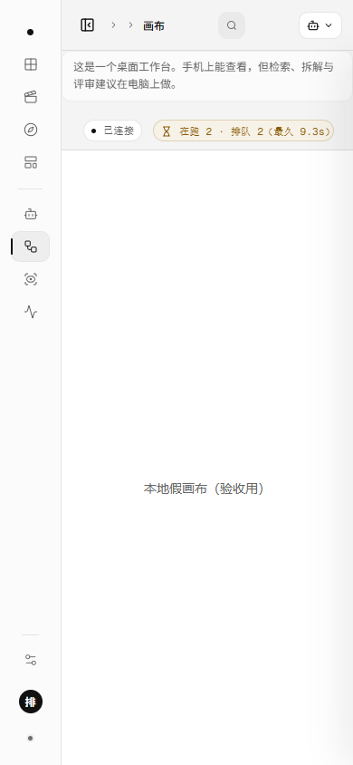
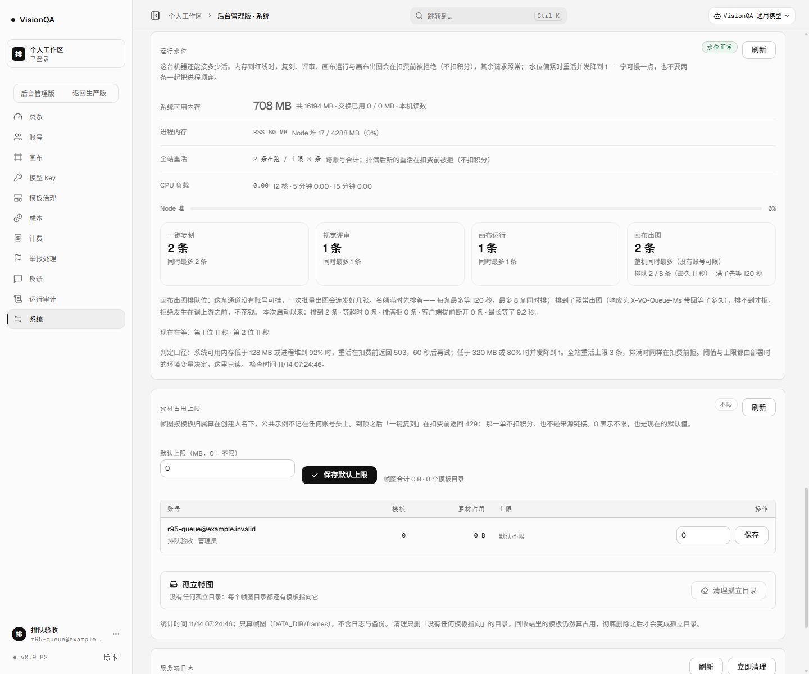

# 画布出图的排队位：等的时候知道自己第几（v0.9.83）

> 口径：这篇讲「名额满时排队」这件事**看得见**的那一半。v0.9.80 只做了「排一会儿再拒」，
> 排队位只数「几条在等」；这一版把每张的入场顺序记下来，画布页、后台和画布服务读同一份。
> 生产数字全部来自 2026-11-14 的实测；这一次验收**没有真实上游调用**（假上游 + 一次性实例）。

## 一、问题：排队本身对用户是隐形的

v0.9.80 起，画布一次「批量出图」8 张，整机只放 2 张，其余排着（默认 90 秒）。
但排队对用户是**隐形的**：

- 画布上那 4 张就是「转圈」，既不知道在等什么，也不知道还要等多久；
- 后台只有一行「排队 3 / 8 条」，看不出谁最先来、最久等了多久；
- 画布服务自己也没有地方问「我这张排第几」——它在等一个 HTTP 响应，响应头只在**结束时**才到。

看不见的排队会让人做出最差的动作：反复点、刷新、或者干脆把整批都关掉重来——
而这些动作只会让队列更长。

## 二、三条路，选了最不打扰调用方的那条

| 方案 | 为什么没选 |
| --- | --- |
| 让画布（BDC）自己实现轮询与重试 | 那是另一个仓库、另一份部署；而且平台这一层不该依赖调用方的自觉 |
| 在阻塞的 POST 上早点发响应头 / 用 SSE 推位置 | POST 的响应体必须还是那张图的 JSON（画布按方舟协议解析），提前 flush 就不能再改状态码；为一个只读进度改协议不划算 |
| **服务端登记排队票 + 一个只读接口 + 两个界面读它** | 选它：POST 的契约一个字没改，进度走旁路；画布页、后台、画布服务共用同一份数字 |

放弃的是「实时推送」：位置靠轮询（画布页 3 秒一问），不是 WebSocket。90 秒的等待里差 3 秒无所谓，
而引入一条长连接要处理断线重连、鉴权、心跳——为了一个几十秒的进度不值得。

## 三、做了什么

1. **排队位从「计数」改成「登记」**（`server/waterline.mjs`）：每条一个票号 + 入场时间，FIFO 名次。
   `admissionQueueReport()` 多回 `oldestWaitMs` 与逐位等待时长；新增 `queuePositionFor(kind, ticket)`
   与 `canvasQueueView()`（聚合视图：在跑 / 排队 / 最久 / 上限 / 排满，可点名票号回自己的名次）。
2. **票号由调用方带**：`X-VQ-Queue-Ticket` 请求头（画布可以用自己的节点 id 或已有的幂等键）；
   没带就服务端自己发一张，随响应头 `X-VQ-Queue-Ticket` 还回去，并附 `X-VQ-Queue-Position`（入场名次）。
   老响应头 `X-VQ-Queue-Ms` 保持不变。
3. **两条只读接口**：
   - `GET /api/gateway/v1/queue`（平台令牌）：给画布服务问「我排第几」，`?ticket=` 可选；
   - `GET /api/canvas/queue`（登录会话）：给画布页读聚合数，**不含票号**。
   两条都不占名额、不扣积分、不调上游。
4. **画布页状态条**：忙的时候出现胶囊「在跑 2 · 排队 4（最久 6.3s）」；排队位满了换成
   「· 排队位已满」的失败色；页面可见时 3 秒一问、切后台就停；刚忙完 8 秒内显示一次
   「刚刚那批出完了」再自己消失。空闲时整个不渲染，不在顶栏挂一个常驻的 0。
5. **后台「运行水位」卡**：画布出图那行多「（最久 11 秒）」，下面多一行
   「现在在等：第 1 位 11 秒 · 第 2 位 10 秒」。

## 四、本地验收（真请求 + 真渲染，零扣费）

一次性实例（8907）+ 假上游（9 秒才回图）+ 假画布服务（6677，让画布页挂上 iframe），
整机名额 2、排队位 8、最多等 120 秒，连发 6 张：

| 检查 | 结果 |
| --- | --- |
| 画布页状态条 | 「在跑 2 · 排队 4（最久 6.8s）」，胶囊与「已连接」同一套发丝线 + 等宽微字 |
| 390 小屏 | 页面 390 宽不横向滚（`docSW 390`）；胶囊 200px 完整可读，署名与地址在 720 以下先让位 |
| 后台水位卡 | 「排队 2 / 8 条（最久 11 秒）· 满了先等 120 秒」+「现在在等：第 1 位 11 秒 · 第 2 位 10 秒」 |
| 6 张的结局 | 6/6 都是 200；4 条排过队，响应头带回票号与入场名次（node-3 第 1 位 18.4 秒、node-4 第 2 位 9.2 秒、node-5 第 3 位 18.2 秒、node-6 第 4 位 9.2 秒） |
| 上游 | 被调用 **6** 次，正好等于张数——排队这一层没多花一次钱 |

## 五、生产实测（v0.9.83，release `20261113-232719-20261114-r95-queue-visib`）

**真数据、只读（8799，管理员会话 + 平台令牌）**：

| 接口 | 结果 |
| --- | --- |
| `GET /api/canvas/queue`（管理员会话） | 200 · `active 0 · limit 2 · slots 2 · waiting 0 · waitMs 90000 · maxWaiting 8 · scope lease · queueScope process` |
| `GET /api/gateway/v1/queue`（平台令牌） | 200 · 同一份数（这时队列是空的，照实回 0） |
| 匿名读两条 | **401**（都不是公开接口） |

**一次性实例（8788 + 假上游 8098，生产机上，零扣费）**：

| 检查 | 结果 |
| --- | --- |
| 排队位（`/api/canvas/queue`） | `active 2 · slots 0 · waiting 4`，四条名次 1/2/3/4，最久的已等 1924 ms |
| 点名（`/api/gateway/v1/queue?ticket=prod-node-3`） | `mine: { position: 2, ahead: 1, waiting: 4, waitedMs: 1936 }` |
| 后台水位卡的排队位 | 与上面同一份：`waiting 4 · oldestWaitMs 1967 · queue[1..4]` |
| 6 张的结局 | 6/6 **200**；2 张直接跑（9.1 秒、无排队头），4 张排过队：入场名次 1/2/3/4，等 9.1–18.5 秒，响应头都带回票号与名次 |
| 假上游 | 被调用 **6** 次（真上游一次没碰） |
| 收尾 | 队列回到 0，`served 4 · maxWaitMs 18466`，服务与端口都清掉 |

## 六、踩到的坑（如实记）

1. **bash 的 `wait` 会连假上游一起等**：假上游是常驻进程，`wait` 无参数永远不返回，
   生产验收脚本卡在第 40 秒。改成只 `wait` 这 6 个 curl 的 pid。
2. **`pkill -f r95up.mjs` 把自己那条 shell 也杀了**：远端 `bash -c` 的命令行里就含着这个字符串，
   pkill 一执行就把自己干掉，表现为「ssh 退出码 1、一句输出都没有」。改成 `pkill -f '[r]95up.mjs'`。
3. **PowerShell 会把双引号里的 `$(...)` 当成自己的子表达式**：远端的 `pid=$(ss ...)` 在本地就被展开，
   报 `ss : 无法识别`。改成把 bash 写进文件、scp 过去再 `bash /tmp/r95.sh`。
4. **小屏被裁的是胶囊**：状态条是桌面工具条（`white-space: nowrap`），390 宽下排队胶囊被切掉半句。
   720 以下先收起「VISIONQA CANVAS」署名与地址（面包屑与「新窗口」里都有），把位置留给排队位。
5. **本地截图前忘了重新构建**：改的是 `canvas.css`，一次性实例读的是 `dist`，第一版 390 截图还是旧样式。
   改完样式必须 `npm run build` 再截。
6. **渲染里读 `Date.now()` 被 React 编译器记了一条警告**：把「忙完 8 秒内显示」改成轮询里起一个
   `setTimeout` 清标记，渲染保持纯函数。

## 七、边界

- **排队位仍是本进程的**：两个实例各 8 条在等（整机最多 16），但「在跑几条」走共享租约、是整机口径。
  跨进程（更别说跨机）的排队位要一个真正的协调者，不在这一版。
- **画布（BDC）自己还没有显示它**：这一版把数字与接口都备齐了（`/api/gateway/v1/queue` + 两个响应头），
  画布要显示「前面还有几张」仍需它那边改一行轮询——我们这边已经不需要再动。
- **排队不等于更快**：上游并发仍是 2，排队只是把「立刻失败」换成「等一会儿」；等超时仍然不花钱。
- **不写 SLA**：90 秒是默认等待上限（`VQ_CANVAS_QUEUE_MS`），不是承诺的完成时间。
- 票号可被调用方指定，但**聚合视图永远不回票号**；点名查询只回名次与等待时长，不回别人的。

## 八、回退

```
bash /opt/visionqa/ops/rollback.sh --to 2      # 回到 v0.9.82 的快照
```

没有开关：新增的是两条只读接口、几个响应头与界面上的胶囊，旧链路（排队、判名额、拒绝时机）一行没改。
真要立刻退回 v0.9.80 的行为（名额满就拒），把 `VQ_CANVAS_QUEUE_MS=0` 即可，不用回滚版本。





