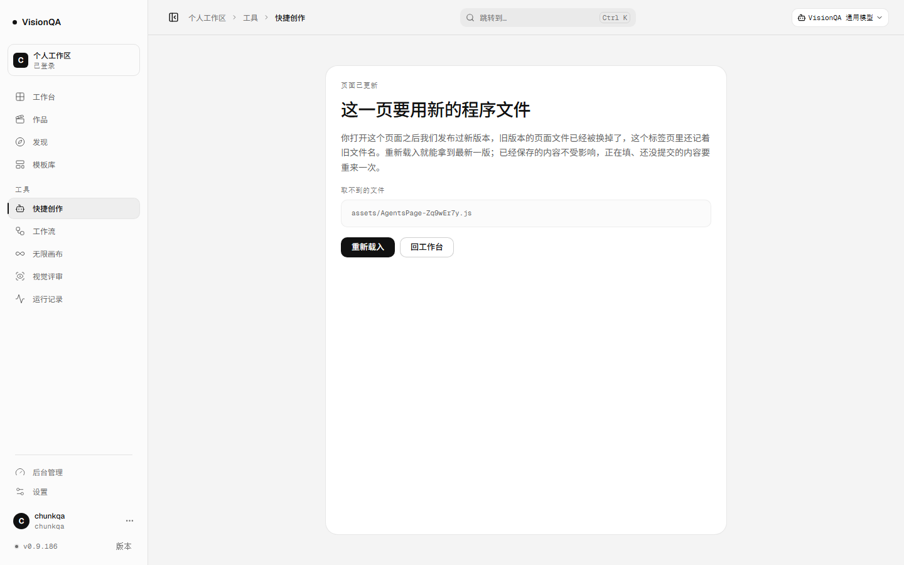
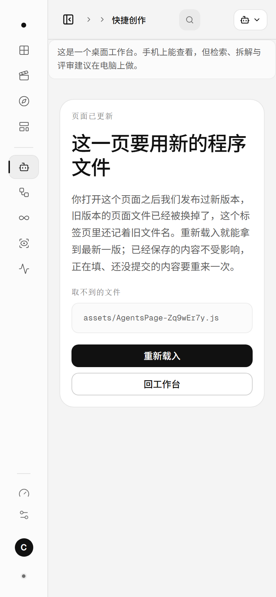

# 发版后旧标签页不再白屏（r205 / 0.9.187）

## 现象与依据

生产 `/var/lib/visionqa/client-errors.json` 里 11-12 留下了三条同一类前端异常：

```
TypeError: Failed to fetch dynamically imported module:
  https://visionqa.wavisionai.cn/assets/CanvasPage-0jg1TZvw.js
```

我们每次发版都是整包替换 `dist`：文件名带内容哈希，旧文件直接被删。已经打开的标签页里，
入口包记着的还是旧哈希，点进「智能体」「工作流」「后台」这些懒加载页时请求的 `.js` 已经不存在，
`/assets/` 下缺失文件由 nginx 回 404（`location /assets/` 没有 try_files，不会落回 index.html），
动态 import 失败，页面白屏，用户只能自己按 F5。

这不是偶发：发一次版就会重现一次。11-12 那三条只是恰好被上报系统记下来的。

## 改了什么

| 文件 | 作用 |
| --- | --- |
| `src/domain/chunk-reload.ts`（新） | 纯判定：`isChunkLoadFailure` / `decideChunkReload` / `readChunkReloadState` / `chunkFailureFile` |
| `src/lib/chunkReload.ts`（新） | 接 `vite:preloadError` 与 `unhandledrejection`，按判定重载一次 |
| `src/main.tsx` | `installChunkReloadGuard()` 在 render 之前装上 |
| `src/components/ErrorBoundary.tsx` | 「取不到页面文件」不再显示「重试」，改成说明 + 「重新载入」 |
| `test/chunk-reload.test.mjs`（新） | 8 条单测 |

判定规则（`decideChunkReload`）：

- 断网不重载（`offline`）；
- 同一波 20 秒内最多重载 2 次，第 3 次停手（`loop`），绝不在 20 秒里无限刷新；
- 超过 20 秒或时钟回拨，按新的一波重新计数；
- `sessionStorage` 读不到 / 写不进（隐私模式）也不影响：最多退化成「这一页最多重载一次」。

Vite 侧确认过实现（`node_modules/vite/dist/node/chunks/node.js`）：`handlePreloadError` 派发
`vite:preloadError`（`e.payload = err`，`cancelable: true`），只有 `preventDefault()` 才会拦住 rethrow，
我们的处理函数正是在决定重载时才 `preventDefault()`。

## 验收

用临时实例 + 无头 Chrome 真跑三个场景（造两份等价的 dist：B 把懒加载包与入口包改名，模拟「发过一次版，旧文件名没了」；
静态服务器对 `/assets/` 缺失文件真回 404）：

| 场景 | 结果 |
| --- | --- |
| 没发版，点进还没加载过的懒加载页 | 正常打开，重载 0 次，没留下重载记录 |
| 发版了、新文件都在，点「快捷创作」 | 旧包 404 → 自动重载 1 次 → 页面正常打开，`attempts=1`，不出现卡片 |
| 文件真的没了（重载也 404） | 重载 2 次后停手，出现「页面已更新」卡片，`attempts=2`，0 条未捕获异常 |





## 边界

- 只覆盖懒加载 chunk 取不到；入口包本身取不到时，靠卡片上的「重新载入」按钮；
- 重载会丢掉「正在填、还没提交」的内容，卡片文案已经说清；
- 两份 dist 是改名 + 改引用造出来的，不是两次真实构建：本项目压缩会把注释与未被引用的字面量去掉，两次构建哈希完全一样；
- 真实证据只有本地无头 Chrome 的三个场景，没有在生产发版时抓现场。
