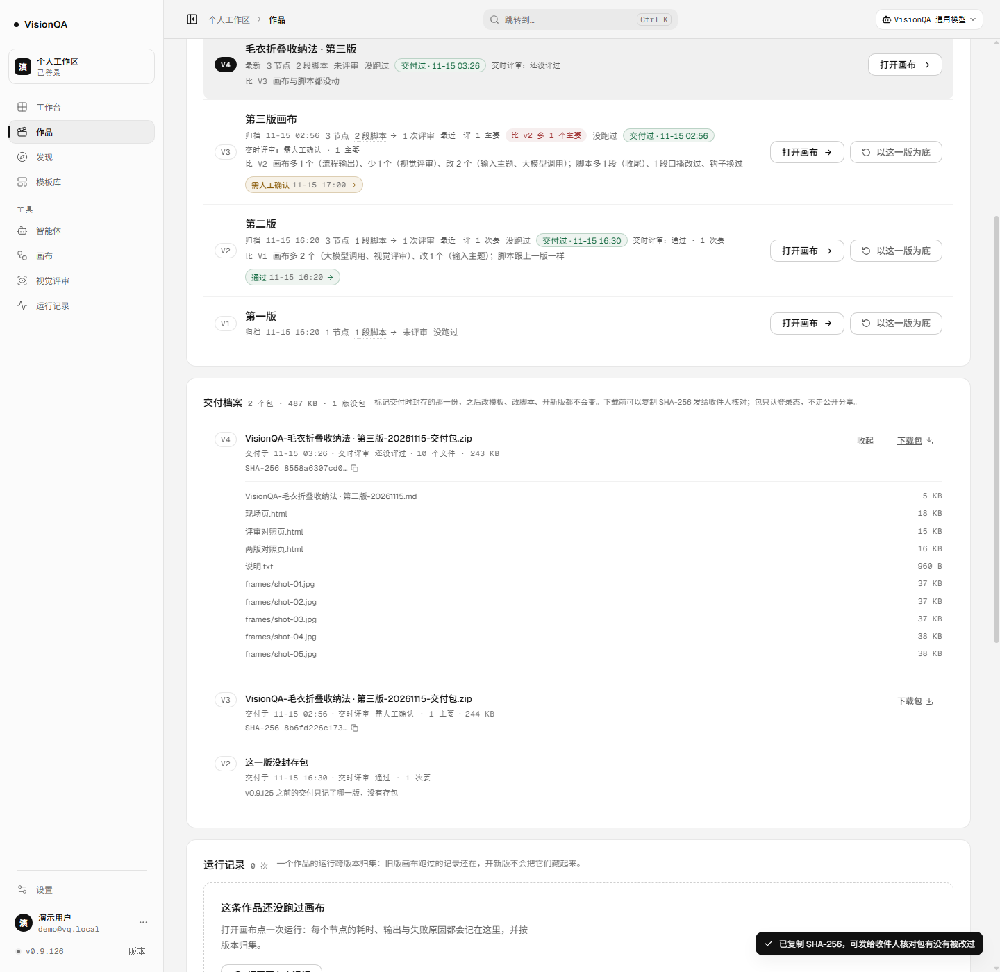
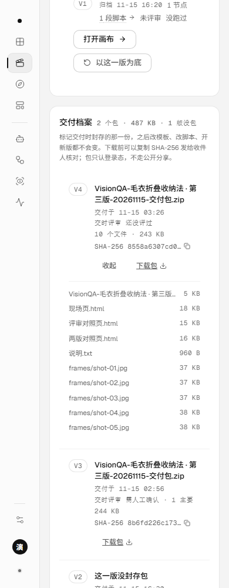

# 交付档案：封存的包能取、能核对、能看清单（v0.9.126，2026-11-15）

v0.9.125 把「标记交付」变成了封存：那一刻的整套 zip 留在服务器上，之后改模板、开新版，旧包仍能按编号取回。但入口只开了工作台「交出去的」一行，作品页里看不到；包也只有一个大小与一个下载按钮——取得到，却说不清里面有什么，也没法把哈希发给收件人核对。这一版把封存包变成一份可查阅的交付档案。

## 一、问题

上一轮留下三处缺口：

1. **作品页没有交付档案**。作品页是交付发生的地方，版本表只写「交付过」，要拿包还得回工作台。
2. **包是黑盒**。界面上只有一个「交付包」按钮；要确认评审对照页有没有打进去、帧图带了几张，只能先下载再解压。
3. **SHA-256 只在响应头与记录里**。收件人拿到 zip 想核对「是不是当初那一份」，没有可复制的值；界面上那一串 64 位也不该整行铺开。

另外核对旧代码时发现一个回归：deliveryOf() 只返回 version / at / review，把 id / package 吞掉了。标记交付后的提示里那句「交付包已封存」判断的是 delivery.package，因此**永远不会出现**——包确实封了，界面没说。这一版一并修掉。

## 二、做法

### 封存时顺手记下包内清单

saveDeliveryPackage() 增加可选的 files：每条只记文件名与字节数，不记内容、不记磁盘路径。上限 60 条；超过时 fileCount 仍记总数，名单只留前 60 条。名字走 safeEntryName，并去掉控制字符，避免清单与 zip 里的条目对不上。

交付记录里的 package 变成：

    {
      "bytes": 248643,
      "sha256": "8558a6307cd0afd31e50222a1c9061f65883ffcaad…",
      "fileName": "VisionQA-毛衣折叠收纳法 · 第三版-20261115-交付包.zip",
      "savedAt": "2026-11-14T19:26:31.000Z",
      "fileCount": 10,
      "files": [
        { "name": "VisionQA-毛衣折叠收纳法 · 第三版-20261115.md", "bytes": 4867 },
        { "name": "现场页.html", "bytes": 18468 }
      ]
    }

清单来自**封存那一刻**同一份打包条目，不按今天的模板重算；老包（v0.9.125 封的）没有 fileCount / files，界面只显示大小与 SHA，不摆一个点开是空的「清单」。

### 作品页新增「交付档案」

放在版本表下面，按交付记录倒序：

- 每一版一行；有包的显示文件名、交付时间、交时评审、文件数、大小、SHA-256 前 12 位。
- 「清单 N」展开包内文件与各自大小；超过 60 条时写「还有 N 个文件没列，包里都在」。
- 「下载包」仍走登录态地址 GET /api/projects/<id>/delivery-packages/<16hex>；不新增公开路由，也不进只读分享页。
- 点 SHA 那一行复制**完整** 64 位，提示「可发给收件人核对」；界面上只露前 12 位。
- 升级前交的版本也列出来：写「这一版没封存包」和一句原因，不假装能下载。

顶部汇总回答「这条作品交过几版、几个包、合计多大」：例如 2 个包 · 487 KB · 1 版没包。

### 修 deliveryOf

把 id 与 package 一起返回。标记交付后的提示现在会写：

> 已标记交付：v4 · 11-15 03:26 · 交时评审 还没评过 · 交付包已封存

## 三、本地实测

本地 8954，数据目录 .tmp-qa/r135data，真 Chrome；评审与交付记录由脚本/页面操作产生，没有调用生成或评审上游。

| 检查 | 读数 |
| --- | --- |
| 作品 | prj_r134demo；v4 重新打开后再标记交付，v3 保持旧包 |
| 档案汇总 | **2 个包 · 487 KB · 1 版没包** |
| v4 封存包 | **248,643 B**；SHA-256 前缀 8558a6307cd0；**10 个文件** |
| v3 旧包 | 250,142 B；SHA-256 前缀 8b6fd226c173；没有清单（v0.9.125 封的） |
| 包内清单 | 交付稿 5 KB、现场页 18 KB、评审对照 15 KB、两版对照 16 KB、说明 960 B、frames 5 张（37–38 KB） |
| 下载 | v4 / v3 都 200；字节数与 SHA-256 与记录一致；ZIP 头 0x04034b50；响应带 X-VQ-Package-SHA256 |
| 复制 SHA | 剪贴板得到 64 位完整值；提示「已复制 SHA-256…」；下载前后 projects.json mtime 不变（2 次下载 0 写） |
| 标记后的提示 | 出现「交付包已封存」（上一轮被 deliveryOf 吞掉的那个字段） |
| 1440 宽 | 档案卡片 1130、行宽 1080；清单展开后高 270（上限 280，无内部滚动）；页面 scrollWidth 1440 |
| 390 宽 | 档案卡片 290、行宽 256、动作区 180、清单 224；文件名折两行，元信息换行不带行首「·」；scrollWidth 390 |
| 坏地址 / 非 GET | 不存在的 16 位编号 404；POST 405 |
| 上游 | 0 次生成 / 评审 |

## 四、生产实况

部署 20261114-193601-r136archive（部署前快照 **1,069,920 B**；上传包 1,206,949 B）。

| 检查 | 读数 |
| --- | --- |
| 版本 / 健康 | 8799 / 8800 / 公网都 **0.9.126**；health ok（模板 26，部署后 uptime 15s）；四个 unit active |
| 资源 | 入口 index-CuF-2IWS.js **623,666 B**；画布 242,019 B；后台 201,074 B；主样式 303,566 B；画布样式 28,926 B；分享页 11,110 B |
| 哈希 | 本地与生产一致：projects c7a504e8 / routes projects 0014aa8e / delivery-packages ba58396b / delivery-ledger e7e06c55 / 入口 db9cd14b / 画布 be0c05cd / 后台 794a8612 / 主样式 82520c68 / 画布样式 b49e8586 / 分享页 b8fa2e57 |
| 标记 | fileCount 在 delivery-packages 1 处、projects 3 处；入口与样式里各有 vq-project-archive |
| 权限 | 未登录封存包 / 列表 / 交付包都是 **401**；公网 / 200 · 729 B、入口 200 · 623,666 B |
| 运行 | 心跳 1498494 / 1498492，beatAt 19:36:24Z；盘 72%；/tmp 391M；日志无业务 error |
| 数据 | 1 条作品、3 条评审、9 条运行、0 条 graph、**0 条交付、0 条封存包、0 条分享** |

生产仍然没有真实交付记录，所以「标记交付 → 清单 → 复制 SHA → 下载」只在本机真 Chrome + 本地服务上验过；生产验到部署、版本、路由、未登录 401 与资源哈希。零真实上游。

## 五、踩到的坑

- **deliveryOf 吞字段**：只返回三个字段，提示里的 package 永远是 undefined。包封了、界面没说，用户无从知道。修完补了专门的用例。
- **清单必须跟封存同一刻**：不能按今天的模板现算。清单在打包条目上顺手记，老包没有就是没有，不补、不猜。
- **清单不能无限大**：记录在 projects.json 里，60 条封顶；fileCount 记总数，界面照实说「还有 N 个没列」。
- **名清控制字符**：文件名里的换行/控制字符用 Unicode 类别 \p{Cc} 清掉，不把裸控制字符写进正则（静态检查会判可疑）。
- **窄屏分隔点会跑到行首**：元信息用 ::before 加「·」，一换行就变成行首一个点；720 以下改段落间距，不加分隔符。
- **flex 会把大小列挤没**：清单行原本用 flex + space-between，窄屏下文件名占满，右侧大小被推出可视区；改成 grid-template-columns: minmax(0, 1fr) auto 才稳定。
- **头文件不缓存、带 hash 的长缓存**：本地验收要强制 reload，否则 8954 还在跑上一份 bundle；这不是线上问题，但截图会骗人。
- **无头浏览器剪贴板**：要授权并模拟焦点，否则 clipboard.writeText 失败，只能拍到「复制失败」。
- **包仍是登录态产物**：不因为「能看清单」就多给公开入口；分享页没有包，也没有 SHA。

## 六、发现但没做

- 没有「上传文件反查 SHA」的核对器，只能复制哈希给收件人手动比。
- 没有下载次数 / 访问记录 / 保留期 / 异地备份；包仍跟着数据目录走。
- 清单不能搜索、不能导出 CSV，也不能按文件单独下载。
- v0.9.124 及更早的交付没有包，只能看记录，不能追溯封存。
- 生产 0 条交付记录，没有真实账号下的封存 / 清单 / 下载数据。
- 作品页的「交付」菜单仍可现打一份当前包；封存档案是另一条路，两者没有合并。

## 七、回退

    bash /opt/visionqa/ops/rollback.sh --to 1   # v0.9.125
    bash /opt/visionqa/ops/rollback.sh --to 2   # v0.9.124

这一版只加了一个可选字段（package.fileCount / package.files）、一段作品页区块与一个客户端派生函数；不改交付记录结构的主字段、不改路由、不改分享、不改评审与画布。回退后旧版忽略新字段，数据和磁盘上的包都还在。细节与「发现但没做」见本文；生产与本地证据见上表。

提交 ca22f12；CI 43633269768 三个 job 全 success（安全扫描 15s、Node 22.12.0 2m40s、Node 24 2m41s）。
