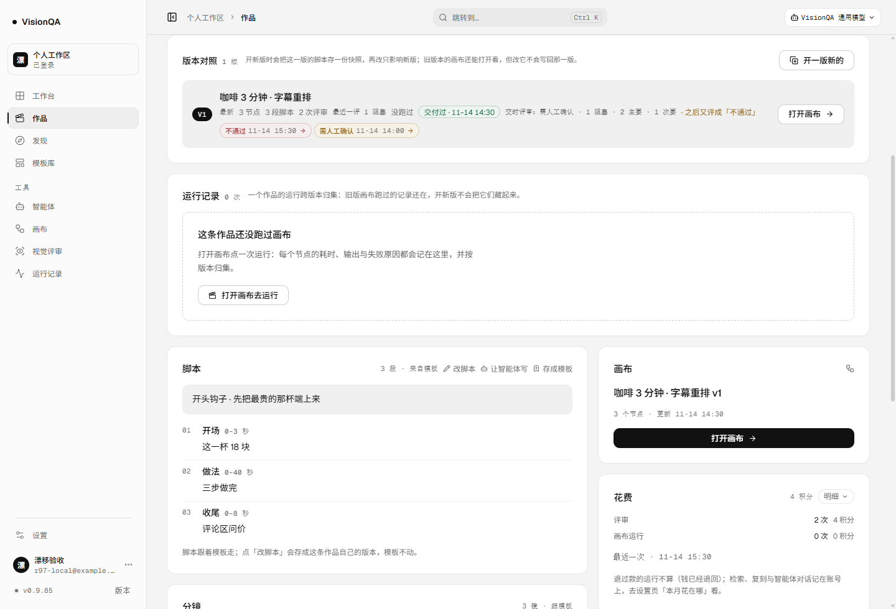
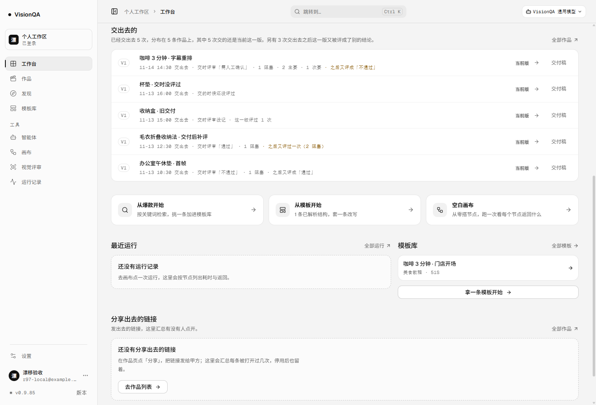
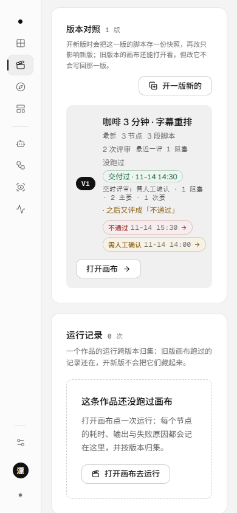

# 交付之后的漂移：交时照写当初，后来变了就说（v0.9.86）

## 起因

上一版（v0.9.85）把交付这一刻的评审存成快照：交出去的时候评成什么，之后重评不改。但「之后」发生了什么，页面上一个字都没有。

真实的场景：v3 交付时评成「需人工确认」，交完之后不放心，又评了一次——这次「不通过」。版本行仍然写着
`交时评审：需人工确认 · 1 阻塞 · 2 主要 · 1 次要`，工作台流水仍然写着 `交时评审「需人工确认」`，看起来一切照旧；
真正需要人看一眼的变化，只藏在旁边「最近一评」那一列里。工作台「交出去的」小节也只数「交了多少次」，
不数「其中几次交出去之后又被评成了别的结论」。

这一轮补的是同一件事的另一半：**交时是当初，后来变了也要说**——两句并排，谁也不改写谁。

## 规则

- **比什么**：交时快照（结论 + 问题数）与这一版**最近一次**评审（同一份 `versionCounts`，与作品页「版本对照」同源）。
- **结论变了**（通过 / 需人工确认 / 不通过之间）→ `之后又评成「不通过」`；变差琥珀色、变好灰色。
- **结论没变、前三档问题数变了** → `之后又评过一次（2 阻塞）`。
- **信息级不参与**：信息级是「看到但不确定算不算问题」，多两条信息级不该让每一行都亮起来。
- **两边都得记着认得出的结论才算**：快照为 `null`（交时一版都没评过）、没有 `review` 键（升级前老记录）、
  结论认不出（坏盘）——一律不开口，不编「变了」。
- **同一版重新标记交付会写一份新快照**，比对上漂移自己消失；不需要额外的「清除」按钮。

客户端与服务端各一份实现（页面用「阻塞 / 主要 / 次要」，交付稿用「阻断 / 重要 / 轻微」），
同一组 9 条用例逐个对照，防止一处说变了、一处说没变。

## 界面（三处，同一句）

- **作品页版本行**：`交时评审：需人工确认 · 1 阻塞 · 2 主要 · 1 次要` 后面跟琥珀色的 `· 之后又评成「不通过」`；变好是灰的。
- **工作台「交出去的」**：每行 `交时评审「需人工确认」· 1 阻塞 · 2 主要 · 1 次要 · 之后又评成「不通过」`；
  小节多一句 `另有 3 次交出去之后这一版又被评成了别的结论。`
- **交付稿**：交付小节与逐版记录都是 `- 交时评审：通过 · 1 个轻微 · 之后又评成「不通过」`——
  纸被转发给客户时，交时那半句与后来那半句都在。
- **接口**：`/api/deliveries` 每行多 `issues`（这一版最近一评的问题数），整份多 `drifted`（按交付记录数，不按作品数）。

## 本地验收（一次性实例 8907，五条作品 / 七条评审，零上游调用）

| 检查 | 结果 |
| --- | --- |
| 版本行（A，交时需人工确认 → 后来不通过） | `交付过 · 11-14 14:30 交时评审：需人工确认 · 1 阻塞 · 2 主要 · 1 次要 · 之后又评成「不通过」` |
| 流水小节 | `已经交出去 5 次，分布在 5 条作品上，其中 5 次交的还是当前这一版。另有 3 次交出去之后这一版又被评成了别的结论。` |
| 流水（A，结论变差） | `交时评审「需人工确认」· 1 阻塞 · 2 主要 · 1 次要 · 之后又评成「不通过」` |
| 流水（C，结论没变、问题数变多） | `交时评审「通过」· 1 阻塞 · 之后又评过一次（2 阻塞）` |
| 流水（B，变好） | `交时评审「不通过」· 1 阻塞 · 之后又评成「通过」`（灰色） |
| 流水（D，升级前老记录） | `交时评审没记 · 这一版评过 1 次`，不编漂移 |
| 流水（E，交时没评过） | `交的时候还没评过`，之后评成不通过也不编「之后又评成」 |
| 接口 | `total 5 / drifted 3`；A 行 `issues` 是最近一评的 `1 阻塞`，而 `review.verdict` 仍是 `pass` |
| 交付稿 | `- 交时评审：需人工确认 · 1 个阻断 · 2 个重要 · 1 个轻微 · 之后又评成「不通过」`；逐版记录同句 |
| 真点「重新打开 → 标记交付」 | 提示 `已标记交付：v1 · 11-14 08:38 · 交时评审 不通过 · 1 阻塞`；重交付后页面漂移 **0** 条 |
| 390 宽 | `docSW 390`；版本行 `scrollWidth 240`、漂移段宽 125（不横向溢出） |
| 规则对照 | 客户端与服务端两份实现，9 条用例逐个 `deepEqual` |

## 生产实测（v0.9.86，零上游调用）

- 发布：`/api/version` **0.9.86**、入口 `index-BeK48REa.js`、快照 `releases/20261114-004105-v0.9.86.tar.gz`；
  四个 unit（visionqa / visionqa-internal / visionqa.socket / bdc-web）active，`journalctl -p warning --since '-5 min'` 无条目，盘 72%。
- 匿名访问：`/api/projects` 与 `/api/deliveries` 都是 **401**。
- 线上 bundle 五个标记各出现 1 次：`vq-version-drift`、`vq-delivery-drift`、`之后又评成`、`之后又评过一次`、`drifted`。
- 生产机一次性实例（8786、`/tmp/r97data`、部署后的代码，种三条作品三条评审）：**8 / 8 条断言通过**——
  标记交付写入交时评审；**停实例 → 盘上多一条「不通过」重评 → 再起**，快照仍是 pass、`versionCounts` 已是 fail；
  流水行带这一版最近一评的 `1 阻塞`；`drifted=1 total=3`；交付稿写「交时通过 · 之后又评成「不通过」」；
  老记录与「交时没评过」都不编漂移；同一版重新交付后 `drifted=0`。
  跑完实例、临时目录、上传包全部清掉（`/tmp/r97*` 0 个）。
- 真实数据：生产现在 **1 条作品、0 次交付**——线上仍看不到这一行。等第一次真实交付，它才会带着那一刻的评审出现；
  之后若再评一次，就会多出「之后又评成 …」这半句。不为截图往生产塞假数据。

## 踩到的坑

1. **接口用的那份计数根本没有 `issues`**：`/api/deliveries` 读的是 `reviewCountsByProject`，它的版本桶只有
   `count / lastVerdict / lastAt`；单元测试自己造的计数带了 `issues`，所以测试是绿的、页面与交付稿也算得对，
   但线上流水行永远是 `issues: null`——「结论没变、问题数变多」那种漂移在生产上永远不出现。一次性实例第一次跑就露出
   `issues: null`。把 `issues` 补进同一个计数函数，并在测试里从 `reviewCountsByProject` 直接断言。
   **教训：测了规则，不等于测了接口这条路。**
2. **两份实现必须同答案**：页面说「之后又评成」、纸面说「没变」是最难解释的 bug。用同一组用例（结论变差 / 变好 /
   没变 / 问题变多 / 变少 / 只有信息级 / 快照 null / 最近一评没结论 / 快照结论认不出）逐个对照。
3. **信息级不参与**：否则「多两条信息级」也会亮，提醒一多就没人看；与版本对照「只比前三档」同一套。
4. **重新交付写新快照就够了**：不用另做「清除漂移」入口；同一版再交一次，快照按新结论写，比对上自然没有漂移。
5. **截图前忘了展开**：工作台首屏只排 3 条，第一版图里只有一行漂移；点「看这 5 条」之后才是五行三条漂移，重截。

## 边界

- 只回答「后来变了没有」，不替人决定「要不要补一版」；补不补仍由人拍板、开新版。
- 「之后又评过一次」是数据推出来的：快照存的是交付那一刻的最近一评，若最近一评与快照不同，必是交付之后评的；
  盘上被手改乱时可能误报（注释里写明这个前提）。
- 交时没评过（`null`）、升级前没记（没有 `review` 键）的交付，永远看不出漂移——当时没记就是没记，不补算。
- 变好也照说（灰色），不因为是好消息就藏起来：交付记录与现状不一致，两边都得知道。
- 生产 1 条作品、0 次交付，线上仍未出现这一行；不为截图塞假数据。

## 回退

`bash /opt/visionqa/ops/rollback.sh --to 2`（回到 v0.9.85 快照；`--list` 里第 1 个是刚发的 v0.9.86）。
纯加法：接口多字段、页面多一条客户端规则；老前端不读 `drifted` / `issues`，旧代码不读也不影响，回退安全。

## 测试

`npm test` **755 / 755**：新增 `test/delivery-drift.test.mjs` 12 条（规则两种、信息级不参与、老数据/坏数据、两侧对照、
两种文案、快照不被重评改写、流水字段与 drifted 计数（含接口那份计数）、交付稿两处、归档版本、两种比不了的状态、重新交付清零）。
oxlint 0 error / 15 warning、`tsc -b` 干净、构建通过、密钥扫描 592 个文件 0 命中。
