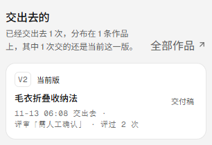
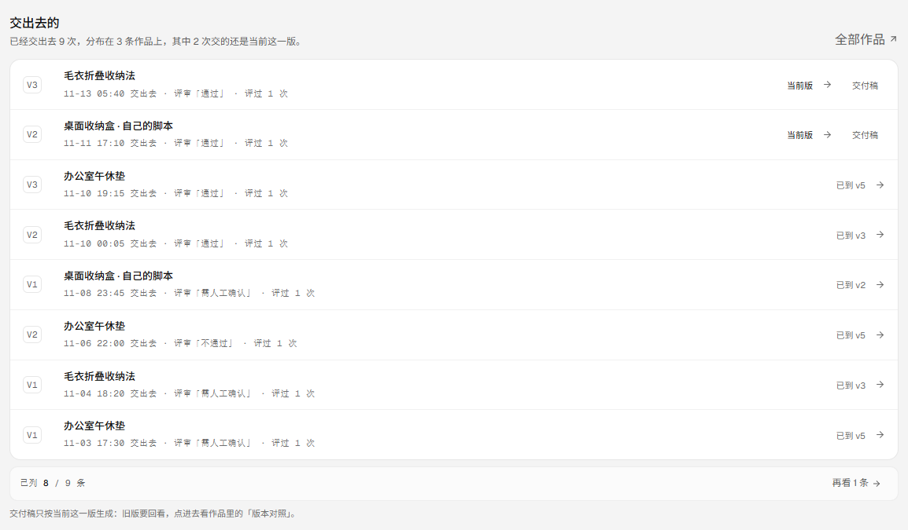
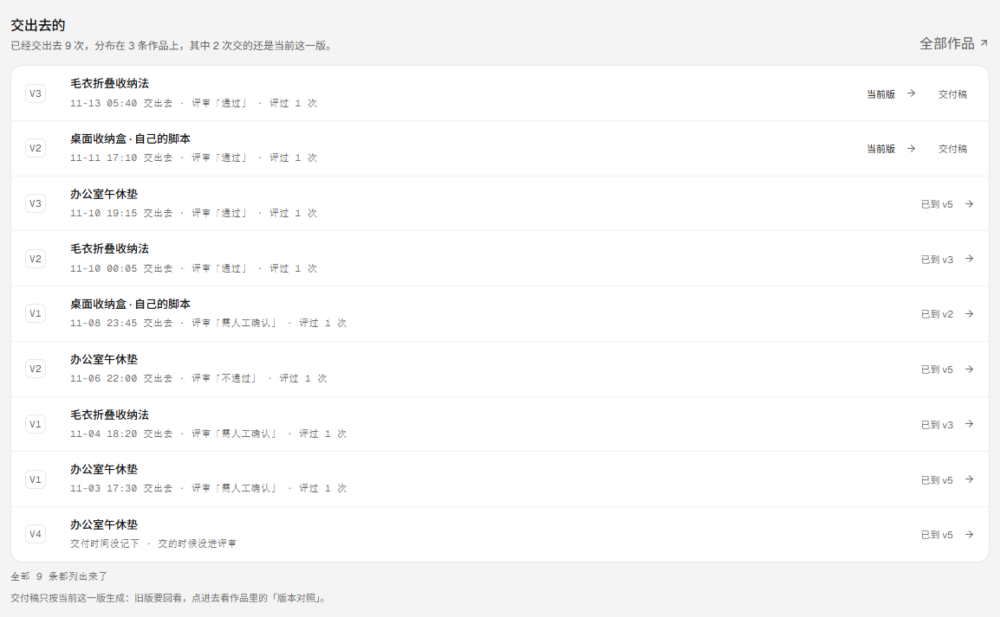
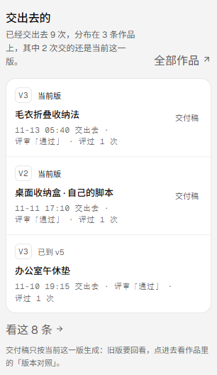

# 交出去的：交付流水（v0.9.32）

- 版本：**0.9.32**
- 发布包：`20261112-220754-2026-11-13-delivery-ledg.tar.gz`
- 前端入口：`index-D8DqNqEd.js`（491,290 字节，含「交出去的」「交付稿只按当前这一版生成」「全部 9 条都列出来了」）
- 提交：`0fcdef4`（代码）+ `TBD-DOCS`（文档）；CI run **TBD-CI success**
- 生产：`https://visionqa.wavisionai.cn`，两服务 active，`/api/health` ok（templates 26）

## 一、为什么要做

工作台一直是「下一步点哪里」，但到这一轮为止，它没有一处回答**「我交出去过什么」**。
交付记录 v0.9.22 起就已经落库了——每次「标记交付」写一条 `{ version, at }`，同一版重复标记只更新时间，
开新版时上一版补一条（老数据没有时间）、作品回到在做——可这些记录只在作品页自己那一格里看得见。
于是「上礼拜交给客户的那一版是什么时候交的、当时评成什么、还能不能把交付稿再发一次」要一条一条点进作品才拼得出来。

闭环的最后一格上一轮补上了（做完的作品能沉淀回模板库），这一轮补的是另一头：**交出去的东西去哪找**。

## 二、现在能做什么

| 之前 | 现在 |
| --- | --- |
| 交付记录只在作品页那一格里看得见 | 工作台多一块「交出去的」：跨作品把每一次交付按时间倒序摊成一条线 |
| 不知道一共交出去几次、在几条作品上 | 一句话写清「已经交出去 N 次，分布在 M 条作品上，其中 K 次交的还是当前这一版」 |
| 交付过的版本混在一起，分不清哪次是现状 | 一行一次交付：版次 + 作品名 + 时间 + 那一版的结论（评审「通过 / 需人工确认 / 不通过」· 评过几次） |
| 开过新版之后旧交付容易被当成现在的状态 | 行尾只写版次事实：`当前版` / `已到 v5`；「这一版还是不是当前版」与「这条作品还在不在交付状态」是两个数，不合成一句「已交付」 |
| 交出去的交付稿要再发一次，得先找到那条作品 | 当前版的每一行行尾直接给「交付稿」：新标签打开那张 A4 纸，可存 PDF |
| 记录多了只能看到最近几条 | 首屏 3 条 → 点开一页 8 条 → 「再看 N 条」接着取，翻到底写「全部 N 条都列出来了」 |
| 时间没记下的老记录会被当成刚交的 | 如实写「交付时间没记下」，排在最后；不拿作品更新时间冒充 |

## 三、四个口径决定

1. **一次交付一行**（作品 × 版次）。同一版重复标记只更新时间（v0.9.22 的口径），所以一个版次在一行上只出现一次；
   不同版次各留各的行。新的在前，时间没记下的排最后。
2. **三个事实分开说，不合成一句「已交付」**：
   `current`（交的是不是当前这一版）、`deliveredNow`（这条作品现在还在不在交付状态，读 `deliveredCurrent`）、
   `atKnown`（时间到底记下来没有）。交付过 v2 又开了 v3 的作品，v2 那行 `current=false`，
   但它当时确实交出去了——这两件事都得说，混成一句就会把旧交付说成现状。
3. **结论跟着版本走**。一行上的「评审「不通过」· 评过 2 次」是**那一版**的最后一次结论，
   不是作品现在的结论（作品现在的结论在状态胶囊里，在作品页）。没进过评审的那一行写「交的时候没进评审」，
   不写「未记结论」——它本来就没有结论可记。
4. **数字按全部记录算**。`total` / `projects` / `currentTotal` / `lastAt` 都按整份交付记录算，
   翻页只换这一页的行，不会让「共 9 次」变成「共 8 次」。

接口：`GET /api/deliveries?offset=0&limit=8`

- `200` `{ items, total, projects, currentTotal, lastAt, offset, hasMore }`
  - `items[]`：`{ projectId, title, version, at, atKnown, currentVersion, current, deliveredNow, reviews, verdict }`
  - `limit` 上限 20；`offset` 越过总数就是空的一页，`total` 照旧
- `405`：只读接口，不是 GET 就明确拒绝
- 归属沿用 `listProjects` 的同一套规则：谁能看这条作品，谁就能看它的交付记录；接口只回记录与那一版的评审计数，
  不回脚本、不回分享 token、不回交付稿全文

## 四、交付稿只按当前这一版生成

交付稿与交付包走的是 `projectDetailView`，读的是**当前这一版**。所以旧版那一行不给「交付稿」按钮——
点下去拿到的会是 v3 的稿子，而那条记录写的是 v2。清单下面用一句话把这件事说清：
「交付稿只按当前这一版生成：旧版要回看，点进去看作品里的「版本对照」。」
旧版要的是那次评审的证据，而评审记录是按版本存的（v0.9.17 起版本对照里每一版都列着评过的那几次），点进作品就找得到。

## 五、顺手修的三处

1. **窄屏把「通过」劈成两行**。390 宽下那行元信息是「11-13 05:40 交出去 · 评审「通 / 过」· 评过 1 次」——
   中文可以在任意两字之间断行。改成时间 / 结论 / 次数各自成段、段内 `white-space: nowrap`，换行只发生在「·」处。
2. **「评审「未记结论」· 这条没进评审」自相矛盾**。没有评审计数的那一行不写结论段，只写「交的时候没进评审」。
3. **翻到底之后翻页行悄悄消失**。取完最后一页时那一行原本整个不见了，现在留一句「全部 N 条都列出来了」。
   顺带：版次小标签的内边距原本写 6px，不在 4/8 栅格上，`test/design-grid.test.mjs` 直接把它拦下来了，改成 4px。

## 六、验收

**生产**（v0.9.32、入口 `index-D8DqNqEd.js` 491,290 字节、release `20261112-220754-2026-11-13-delivery-ledg.tar.gz`、
`/api/version` 0.9.32、`/api/health` ok templates 26、两服务 active）：

先只读核对：`/api/deliveries` 返回 `total 0 / projects 0`（这一轮上线前后这条作品从没标记过交付），
工作台上写的是「还没交出去过」。
然后一次可逆写入并当场撤销：写前作品 1 条 / 模板 26 条 / 智能体 4 个 / 运行 7 条 / 评审 3 条 / 队列 1 条；
`PATCH /api/projects/prj_f38d68c6 { status: 'done' }` → 作品 v2 落一条 `{ version: 2, at: 2026-11-12T22:08:29.933Z }`，
`/api/deliveries` 变成 `total 1 / projects 1 / currentTotal 1`，那一行 `current=true`、`deliveredNow=true`、
`reviews=2`、`verdict=needs_review`，工作台写成「已经交出去 1 次，分布在 1 条作品上，其中 1 次交的还是当前这一版」；
（队列同时从 1 变 0——已交付的不再催，这是 v0.9.19 起的老口径）
撤销 `PATCH … { status: 'active' }` → 交付记录回到 `[]`，`/api/deliveries` 回到 `total 0`，
作品 1、模板 26、智能体 4、运行 7、评审 3、队列 1，逐项与写前一致。

**本地演示数据**（`.tmp-qa/r112data`：4 条作品，其中 3 条交过 9 次）：
首屏 3 条 + 「看这 8 条」；点开排到一页 8 条、翻页行写「已列 8 / 9 条 · 再看 1 条」；再点一次取到第 9 条、
翻页行换成「全部 9 条都列出来了」。1440 与 390 的 `scrollWidth == clientWidth`（1440 / 390，页面高度 1400 / 2588）。

**测试与检查**：`npm test` **325/325**（新增 6 条 `test/delivery-ledger.test.mjs`：一行一次交付与排序 /
当前版与还在交付状态两个事实 / 结论跟着版本走 / 数字按全部算且翻页不重不漏 / 空流水 / 路由 200 与分页与 405），
oxlint **0 error / 6 warning**、`tsc -b` 干净、`npm run build` 通过。这一轮不调模型、不扣积分。

## 七、边界

- **只读**：交付流水不改任何数据；这一轮唯一一次生产写入是上面那次可逆验证，已经撤销回写前状态。
- **不替人标记交付**：标记与撤销仍然只在作品页由人点；工作台不出现「一键交付」。
- **不改评审、不改作品**：那一版的结论是照抄评审库的计数，不是重新算出来的结论。
- **不生成旧版交付稿**：交付稿只按当前这一版生成；旧版不给假入口，只把话写清并指到版本对照。
- **不新建页面**：产品结构锁定四项导航，这一块挂在工作台里，不另开「交付」页。
