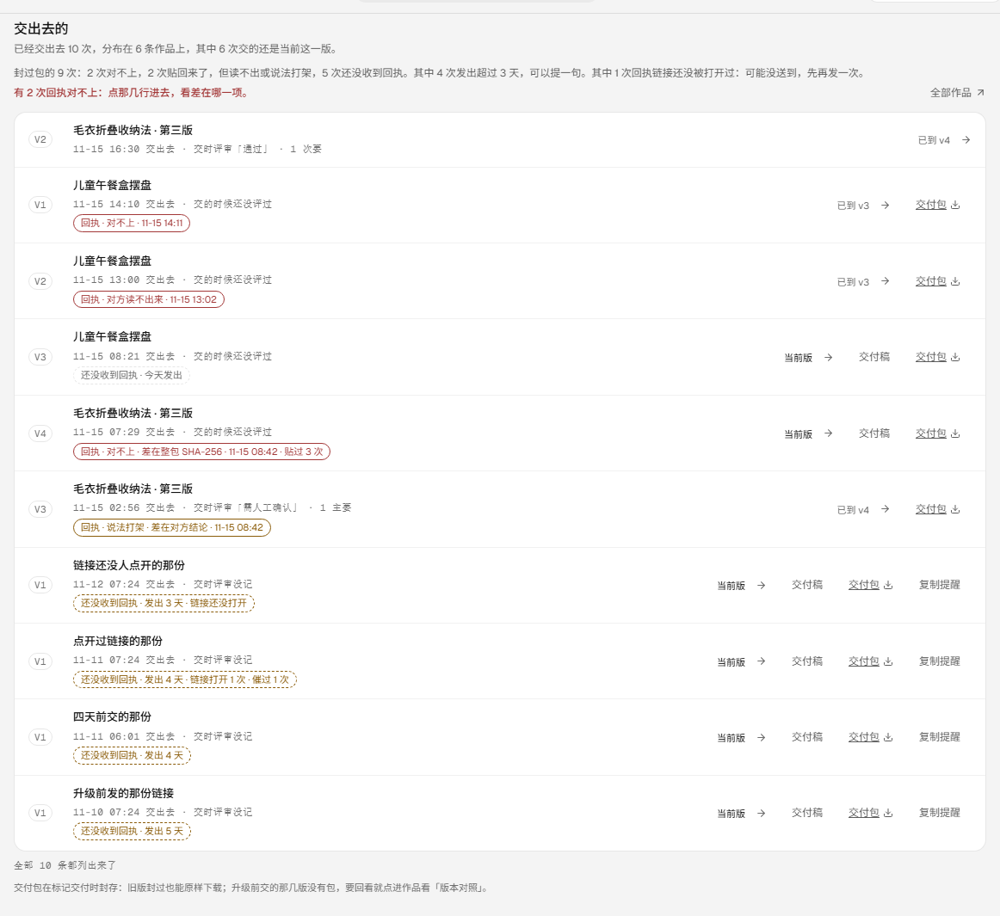
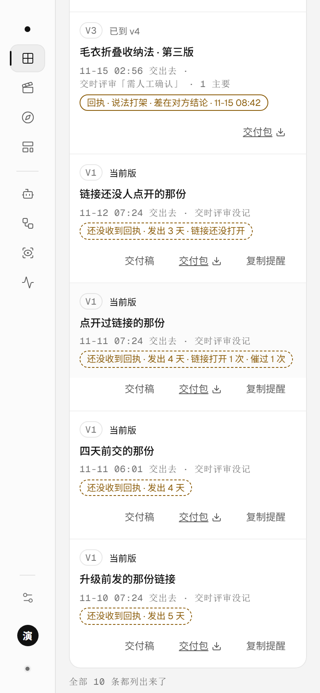

# 交出去的那一份：这条链接到底送到没有（v0.9.145，2026-11-15）

上一版那一行已经写清「发出 4 天、超过三天该提一句、点一下复制提醒」。但一份包发出去三四天没回音，真正要分的是两件事：**他根本没点开这条回执链接**，和**他点开了、收据还没贴回来**。前者该先把链接再发一次（也许根本没送到），后者该催他验完。只看天数分不出来，两边都得靠猜。

这一版在收包人那一侧记下一件事——这条地址被打开过几次——然后把这句话摆回工作台那一行。

**一句话在前：还没回来的那一行现在写「链接打开 1 次」或「链接还没打开」；一次都没被打开的那几行，title 里写「可能没送到，先把链接再发他一次」，清单顶上另起一句数一遍；作品页的交付档案里写清「打开过几次、最近一次什么时候」。**

## 那一行上多了什么

| 位置 | 之前 | 现在 |
| --- | --- | --- |
| 点开过的那一行 | 「还没收到回执 · 发出 4 天」 | 「还没收到回执 · 发出 4 天 · **链接打开 1 次**」 |
| 一次都没点开的那一行 | 同上 | 「还没收到回执 · 发出 3 天 · **链接还没打开**」，title 补「可能没送到，先把链接再发他一次」 |
| 升级前发的链接 | 同上 | 什么都不加——那时候还没开始记，写「还没被打开」就是瞎猜 |
| 清单顶上 | 「…其中 1 次发出超过 3 天，可以提一句。」 | 后面再一句「其中 1 次回执链接还没被打开过：可能没送到，先再发一次。」 |
| 作品页的交付档案 | 只有回执结论那一枚胶囊 | 下面多一行灰字：「回执链接打开过 1 次 · 最近 11-15 09:21」；没被打开过是「回执链接发出后还没被打开过」 |

打开情况与「催过几次」并存：催完之后那一行是「还没收到回执 · 发出 4 天 · 链接打开 1 次 · 催过 1 次」。

## 记的是什么、不记什么

- **开机器的只有一件事**：收包人打开那条回执地址时，页面要取一次数据，那一次就记一次。
- **只存哈希前缀**：记录落在 `receipt-visits.json`，键是 token 的 SHA-256 前 16 位——记录文件被看到也拿不到能打开作品的链接。
- **不存 IP、不存原始 UA**：客户端只分「微信 / 手机或平板 / 电脑 / 未知」四类，与分享链接同一套规则（抽成了 `server/visit-log.mjs`，两份记录共用）。
- **一分钟内的刷新算一次**：收包人一刷新页面就会再请求一次数据，不设窗口能刷出假次数。
- **只留最近 1000 条**：回执链接比分享链接稀疏，留宽一些——一条还在等回执的链接被挤出记录文件之后，界面会重新说「还没被打开」，那对一份其实有人验过的包是一句假话。
- **不知道就不说**：交付记录上多一个 `receiptLinkAt`（这条链接发出去的时间）。升级前发的链接没有这一项，那时候还没开始记——那些行一个字都不提打开情况，不写「还没被打开」。换一条链接＝新 token＝从零开始记；旧链接的次数留在它自己的键下。

## 收包人那一侧一个字都不提

公开的 `GET /api/receipts/<token>` 照旧只回「这是哪一份、之前贴过没有」，不出现任何统计（验收里断言了这一条）。记一次打开不等于告诉对方「你被看了」——被统计这件事只回到发件人自己的档案里。

## 本地实测（真服务 + 真数据 + 真 Chrome）

| 检查 | 读数 |
| --- | --- |
| 收包人真打开一次那条链接（手机 UA） | 200，页面写着是哪一份；再打开一次仍然只记 1 次 |
| 接口给的数 | 打开过的那条 `visits.opens = 1`；没点开的是 0；升级前发的是 `null`（不知道）；`pendingUnopened = 1` |
| 打开过的那一行 | 「还没收到回执 · 发出 4 天 · 链接打开 1 次」，title「…链接是送到了，等他贴回收据」 |
| 一次都没点开的那一行 | 「还没收到回执 · 发出 3 天 · 链接还没打开」，class 里有 `is-late`，title「…可能没送到，先把链接再发他一次」 |
| 升级前发的链接 | 「还没收到回执 · 发出 5 天」——一个字都没多说 |
| 顶上那两句 | 「…5 次还没收到回执。其中 4 次发出超过 3 天，可以提一句。其中 1 次回执链接还没被打开过：可能没送到，先再发一次。」 |
| 催一句之后 | 「还没收到回执 · 发出 4 天 · 链接打开 1 次 · 催过 1 次」，剪贴板里带 `/#/receipt/2222222222222222` |
| 真刷新 | 打开 1 次、催过 1 次都还在（写进档案与记录文件，不是页面上的一口气） |
| 作品页档案 | 「回执链接打开过 1 次 · 最近 11-15 09:21」；没人点开的那版写「回执链接发出后还没被打开过」；升级前那版没有这一行 |
| 390 | `clientWidth 390 = scrollWidth 390`；九枚胶囊没有一枚被行尾裁掉；那一行 288 宽，最长的一枚 260×21 |
| 上游调用 | 0 |

## 坑

- **不知道与「0 次」必须分开**：老链接没有 `receiptLinkAt`，如果照旧按「0 次」渲染，工作台会把一份早就有人验过的包说成「还没被打开」。规矩是「没有发出时间就一个字都不说」，接口层也真的不给这一项。
- **记录被挤出文件之后会说假话**：分享链接那份留 200 条够用，回执这一份留 1000 条，并在注释里写清原因——界面上的「还没被打开」是从「没有记录」推出来的，前提是记录没被挤掉。
- **测试里的时间不能写死成 UTC**：这一层按本地时间读，第一次跑就差了 8 小时。改成用本地时间构造 ISO 再断言，换一台机器也照样对。
- **验收脚本按第 8 条截断**：清单现在有 10 条交付，点开「看这 N 条」只到 8 条，后面还要点「再看 N 条」；不翻到底，断言的那两行根本不在 DOM 里。
- **窄屏只改 hash 不会重新排版**：从作品页跳回 `#/overview` 是同一页内的跳转，390 的排版没生效，等不到清单。改成带 query 的整页导航（`/?r155narrow=1#/overview`）再量。
- **回执记录会跨轮污染**：上一轮点过「复制提醒」，这一轮的夹具里已经写着「催过 1 次」，严格相等的断言当场失败。夹具每次都把 `reminders` 清掉、把 `receipt-visits.json` 删掉重铺。

## 发现但没做

- 只知道「这条地址被点开过几次」，不知道是谁点的：同一个链接被转发出去、被聊天软件预览抓取，都会算一次。所以文案只说链接，不说人。
- 没有「他上次点开是什么时候」之外的线索：看不到他停在收据页多久、有没有试过贴一张没贴成。
- 收包人那一侧还是不知道自己在等什么（也看不到自己被催过）。
- 没有真正的发送（要真发得先有 SMTP，仍在等授权）；提醒仍然只有次数，没有「下次该催」的时间。
- 没被打开的那几行，还没有一键「把链接再发一次」——现在仍要回作品页复制链接，或者点「复制提醒」拿那段带链接的话。

## 回退

`bash /opt/visionqa/ops/rollback.sh --to 1` → v0.9.144；`--to 2` → v0.9.143。新字段 `receiptLinkAt` 是可选的，记录文件也是新的一个文件：旧版本读 projects.json 会忽略它，不报错、不丢别的字段，只是不再显示打开情况。
