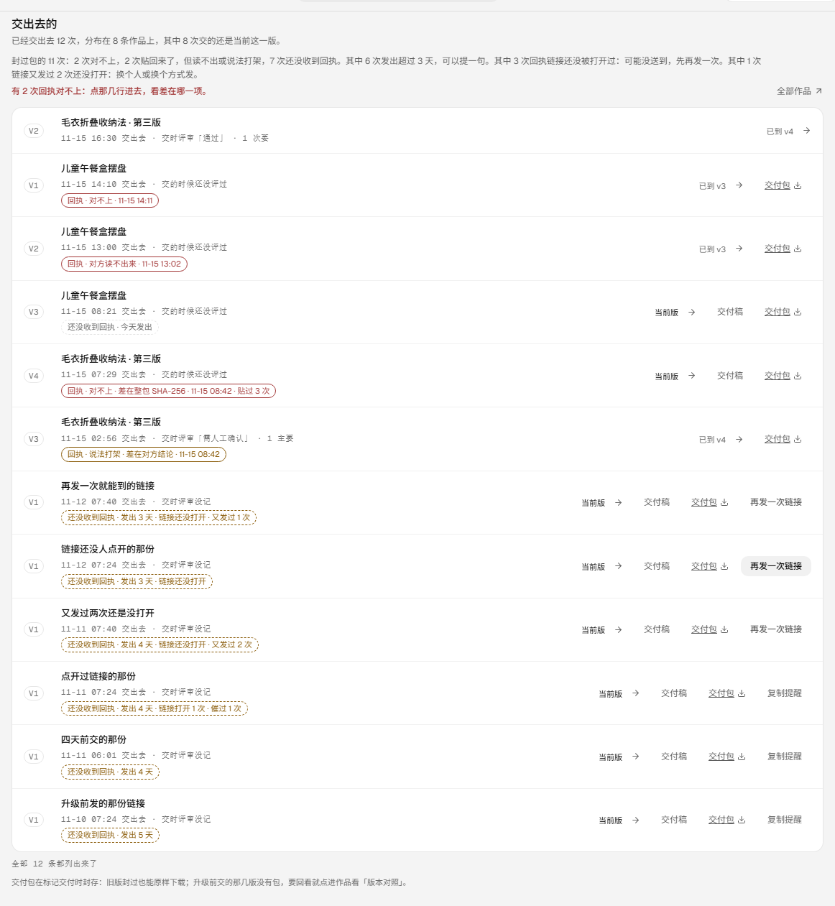
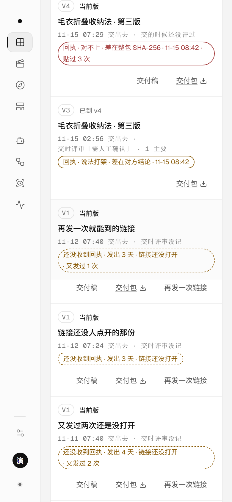

# 链接没送到：就地把这一份再发一次（v0.9.146，2026-11-15）

上一版让工作台那一行说得出「这条回执链接到底送到没有」：行上写「链接打开 1 次」或者「链接还没打开」。可知道之后还差一步——**那一行说「可能没送到，先把链接再发一次」，但手上没有「再发一次」这个动作**，得回作品页翻出那一版，复制链接，再自己拼一段话。

这一版把这一步接到同一行上。

**一句话在前：链接一次都没被打开过的那几行，行上多一个「再发一次链接」——点一下就把「哪一份、哪个包、多少字节、哪天发的、同一条回执链接」写成一段能直接发的话；发了几次另记一个数，写在行上，发到两次还没打开就直接说「换个方式」。**

## 那一行上多了什么

| 位置 | 之前 | 现在 |
| --- | --- | --- |
| 链接一次都没被打开过的那一行 | 只有「复制提醒」 | 按钮换成「**再发一次链接**」（催验那句话假设他收到了，这一句是把地址重新给一次） |
| 点过链接、还没贴收据的那一行 | 「复制提醒」 | 不变——那种情况该催他验，不是重发 |
| 升级前发的链接（不知道有没有人点开过） | 「复制提醒」 | 不变，也不给重发按钮：判断不了结果的动作不做 |
| 重发过之后 | 行上只有打开情况 | 末尾多一段「· **又发过 1 次**」，与「催过 N 次」并存、分开算 |
| 重发过两次还没打开 | — | title 换成「同一条再发也没用了，换个方式发（邮件 / 换个人），或者换一条新链接」 |
| 清单顶上 | 「其中 3 次回执链接还没被打开过：可能没送到，先再发一次。」 | 后面再一句「其中 1 次链接又发过 2 次还没打开：换个人或换个方式发。」 |
| 作品页的交付档案 | 「回执链接发出后还没被打开过」 | 「回执链接发出后还没被打开过 · **又发过 1 次**」，合成一句灰字，不并成两行 |

## 为什么单独记一个数，而不是加在「催过几次」上

催与重发回答的是两个问题：**催**是「我猜你收到了，只是还没验」；**重发**是「我担心你根本没收到」。下一步也不同——催完还是没动静该换人盯，重发两次还是没打开该换渠道。混成一个「联系过 3 次」的数字，两个判断都说不清。

两处上限都是 5 次：自己催到第六次还没动静、或把同一条地址发到第六遍，改变不了什么，只会让人觉得自己在被打扰。

## 发出去的那一段话长什么样

> 再发一次就能到的链接 第 v1 版那份包（VisionQA-再发一次就能到的链接-v1-交付包.zip，250,004 B）我 11-12 发你的，那条回执链接你那边可能没收到，这里再发一次：
> http://…/#/receipt/5555555555555555
> 打开这一页，把收到的 zip 拖进包里的「校验.html」对一遍，验完点「带走这份结论」，把收据贴回这条链接就行。
> 要是这条也打不开，跟我说一声，我换个方式发给你。

最后一句是关键：下一次该换渠道还是换人，全靠这一句回来的答案。所以这一段**不说**「他看过了」，**不说**「可能发错了」，也不替人道歉或承诺换包——只说档案里记着的事实（哪一版、哪个包、多少字节、哪天发的、哪条链接），再把「打不开就说一声」留在末尾。

## 服务端只做两件事

- `POST /api/projects/<id>/delivery-packages/<deliveryId>/resend`：与「催一句」分开的一个端点，把这一次落在 `projects.json` 那条交付记录的 `resends` 里（只存时间，不存那段话——话随时能按现在的事实现拼，存下来只会变成第二份会过期的东西），并把同一条 token 还回来拼地址。三种情况如实退回：没有封存包 404、已经贴过回执 409、还没有回执链接 409。
- 台账那一行多两个字段：`resend`（又发过几次、最近一次）与 `resendable`（现在能不能重发）。`resendable` 只在**确知这条地址一次都没被打开过**时为真；顶上多一个数 `receipts.pendingStuck`（又发过两次以上、还是没打开的那几条）——它是 `pendingUnopened` 的子集，所以 `sealed = 对得上 + 对不上 + 读不出 + 还没回` 仍然成立。

## 本地实测（真服务 + 真数据 + 真 Chrome）

| 检查 | 读数 |
| --- | --- |
| 接口 | 从零开始的那条 `resendable = true`、`resend = null`；又发过两次的那条 `resend.count = 2`；打开过的、升级前发的那两条 `resendable = false` |
| 那一行（没打开过的） | 「还没收到回执 · 发出 3 天 · 链接还没打开」，按钮是「再发一次链接」 |
| 那一行（又发过两次） | 「还没收到回执 · 发出 4 天 · 链接还没打开 · 又发过 2 次」，title 说「同一条再发也没用了」 |
| 点「再发一次链接」 | 剪贴板里是同一条地址的一段话（含 `/#/receipt/5555555555555555`、包名、字节、发出那天、「要是这条也打不开，跟我说一声」） |
| 点完之后 | 那一行变成「…链接还没打开 · **又发过 1 次**」，没有混进「催过」里去；toast「已复制：再发一次回执链接的那一段，带回了同一条链接」 |
| 催一句 | 另一条照旧「还没收到回执 · 发出 4 天 · 链接打开 1 次 · 催过 1 次」——两种话术、两个数各归各位 |
| 真刷新 | 「又发过 1 次」「又发过 2 次」都还在（写进 `projects.json`，不是页面上的一口气） |
| 顶上那句 | 「封过包的 11 次：2 次对不上，2 次贴回来了，但读不出或说法打架，7 次还没收到回执。其中 6 次发出超过 3 天，可以提一句。其中 3 次回执链接还没被打开过：可能没送到，先再发一次。其中 1 次链接又发过 2 次还没打开：换个人或换个方式发。」 |
| 作品页档案 | 「回执链接发出后还没被打开过 · 又发过 1 次」（灰字、标成没人打开）／「… · 又发过 2 次」（title 说换方式或换一条新链接）／升级前那版仍然一个字都没有 |
| 390 | `clientWidth 390 = scrollWidth 390`，十一枚胶囊 0 枚被行尾裁掉；每一段整体换行，不再出现「链接还没打 / 开」「又发过 1 / 次」这种从词中间断行 |
| 上游调用 | 0 |

## 坑

- **不要给「不知道」的行配重发按钮**：升级前发的链接不知道有没有人点开过，这时重发是盲发——发出去也判断不了结果。`resendable` 只在 `opens === 0` 时为真。
- **重发不等于送到**：重发一次之后仍然是「链接还没打开」。界面不改口，也不把重发当成「这次应该收到了」。
- **两个计数不能合并**：合并之后既看不出「他可能没收到」，也看不出「催了几次还是没验」。
- **把时间写死成 UTC 的断言会差 8 小时**：这一段读的是本地时间，测试按本地构造再断言。
- **窄屏只改 hash 不重排**：从作品页跳回 `#/overview` 是页内跳转，390 的排版没生效——要带 query 的整页导航再量。
- **夹具跨轮污染**：上一轮点过「复制提醒」、这一轮又点了「再发一次」，`reminders` 与 `resends` 每轮都清掉重铺，不然严格相等的断言第二遍就红。
- **一段话里从词中间断行看着像排版事故**：胶囊里每一段改成整体换行（`white-space: nowrap`），只在「·」处断。

## 发现但没做

- 仍然不知道**是谁**点开的（转发、聊天软件预览都会算一次），所以只说链接、不说人。
- 看不到他停在收据页多久、有没有试过贴一张没贴成。
- 收包人那一侧不知道自己在被等（也看不见被催、被重发）。
- 没有真正的发送：要真发得先有 SMTP，仍在等授权；现在的「再发一次」是把话复制走，发还是发件人自己发。
- 重发到两次之后没有一键「换一条新链接」——那条路要回作品页点「换一条」（新 token 从零开始记）。
- 「又发过几次」只在一个地方记，没有「下次该哪天再发」的时间。

## 回退

`bash /opt/visionqa/ops/rollback.sh --to 1` → v0.9.145；`--to 2` → v0.9.144。新的 `resends` 是可选字段、只挂在有封存包的记录上：旧版本读 `projects.json` 会忽略它，不报错、不丢别的字段，只是不再显示重发次数。
