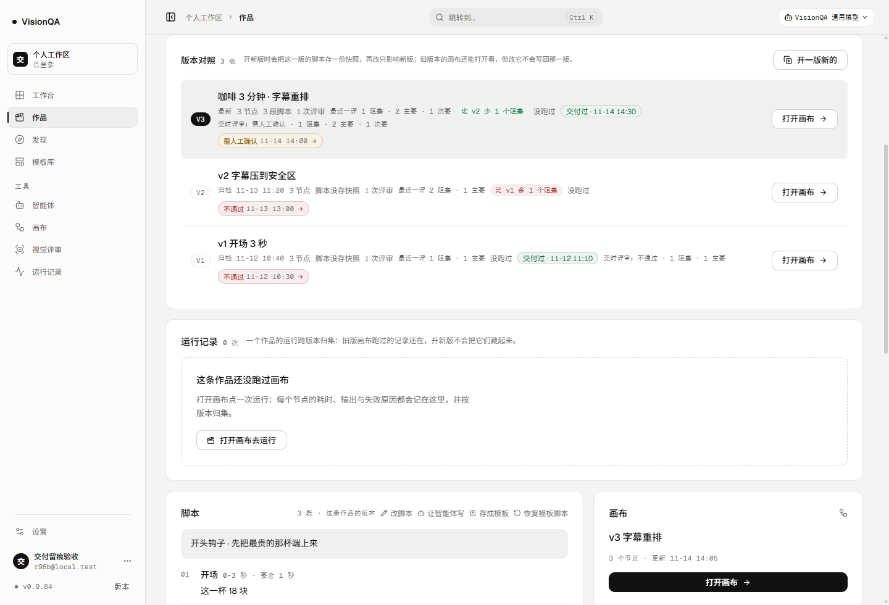
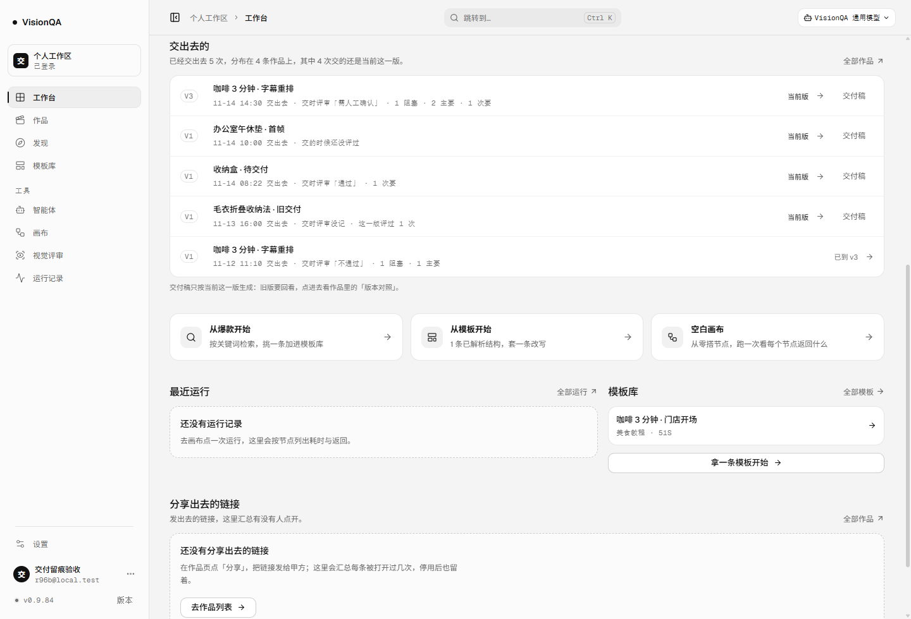
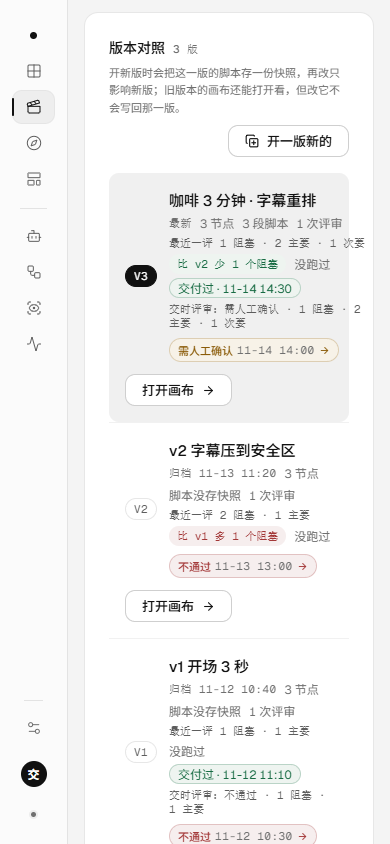

# 交付时评审快照：交出去那一刻评审怎么说，之后重评不改（v0.9.85）

## 起因

工作台「交出去的」每一行，写的是「同一版 + 时间 + 评审「通过」」。服务端 `delivery-ledger.mjs` 的注释也写着
「这一行写的是交出去时评审给的结论」——但那一行结论并不是交付时存下来的，而是**这一版最近一次评审**现算的。

于是有一个真实的谎言：v3 评审通过 → 标记交付；过两天觉得不放心，把 v3 又评了一次，这次不通过。
工作台那一行立刻从「评审「通过」」变成「评审「不通过」」，时间还是当初交付的时间。
**每重评一次，就改写一次历史。** 谁在什么时候、抱着什么结论把这一版交出去的，查不回来了。

作品页的情况更少：版本对照里只有「交付过 · 11-14 14:30」——交的时候评成什么样，一个字都没有。

这一轮把「交付」这件事的两半合上：它不只是「哪一版、什么时候」，还包括**那一刻的评审结论与问题数**。

## 三条被否掉的路

| 方案 | 为什么不用 |
| --- | --- |
| 读的时候现算（当时就是这样） | 就是上面这个 bug：交付之后再评一次，历史跟着改口 |
| 交付记录里存评审记录的 id，看的时候再读 | 评审库只留最近 200 条，翻页挤掉之后交付记录指着一个不存在的 id；「当时的结论」不该依赖另一份存储还在不在 |
| 存一个 0–100 的综合质量分 | 权重只能由我们拍，上线后没法对账；上一轮已经明确不编分数 |

选的是第三条路：**交付那一刻把结论与问题数算一次，存进这条交付记录**。一枚快照，几十个字节。

## 口径

- **什么时候算**：两个时刻都写快照——
  1. 点「标记交付」：算的是这一刻这一版最近一次评审；
  2. 开新版给上一版收尾（补那条没有时间的交付记录）：算的是收尾那一刻这一版的最近一次评审。
- **跟谁同一套口径**：与作品页「版本对照」同源（`reviewSummaryByVersion` + `reviewsForVersion`）：
  同一版重评取最近一次、不相加；版本划分之前的评审（version 0）折进 v1；问题数只数认得严重度的。
- **存什么**：结论（pass / needs_review / fail / 空）、那次评审的时间、按严重度的问题数。
  不存整份问题正文——正文在评审记录里，点一行就能看。
- **三种状态必须分开**（这是这一轮最容易被写错的地方）：

| 状态 | 数据 | 界面 |
| --- | --- | --- |
| 交的时候评过 | `review: { verdict, at, issues }` | 交时评审：需人工确认 · 1 阻塞 · 2 主要 |
| 交的时候查过、确实没评过 | `review: null` | 交的时候还没评过 |
| 升级前的交付记录（当时没这个字段） | 没有 `review` 键 | 交时评审没记 |

「没记」不等于「没评过」，更不等于「0 个阻塞」——这三种话必须能分辨，不然数字一空就变成一句好话。

## 接口形状

```json
{
  "version": 3,
  "at": "2026-11-14T06:30:00.000Z",
  "review": {
    "verdict": "needs_review",
    "at": "2026-11-14T06:00:00.000Z",
    "issues": { "blocker": 1, "major": 2, "minor": 1, "info": 0, "counted": 4, "observations": 4 }
  }
}
```

`review` 是新增字段，纯加法：老前端不读它；老数据读出来就是「没有这个键」。

## 界面（五处，一份数据）

- **作品页版本行**：`交付过 · 11-14 14:30` 胶囊后面跟一句 `交时评审：需人工确认 · 1 阻塞 · 2 主要 · 1 次要`；
  鼠标悬停写明「之后这一版重评，这条记录也不会被改写」。
- **交付菜单**：交付前先说清楚会记下什么——「交时评审会记为「需人工确认」· 1 阻塞 · 2 主要 · 1 次要，之后重评不改这条记录」。
- **交付后的提示**：`已标记交付：v3 · 11-14 08:22 · 交时评审 需人工确认 · 1 阻塞 · 2 主要 · 1 次要`。
- **工作台「交出去的」**：每行 `11-14 14:30 交出去 · 交时评审「需人工确认」· 1 阻塞 · 2 主要 · 1 次要`；
  老记录写 `交时评审没记 · 这一版评过 1 次`（把版本级事实与交时结论分开说，不拿后者冒充前者）。
- **交付稿**：交付小节多一行 `- 交时评审：需人工确认 · 1 个阻断 · 2 个重要 · 1 个轻微`，
  逐版记录也带上；纸面上的「交时评审」与页面同一份快照。

## 本地验收（一次性实例 8906，零上游调用）

种三条交付过的作品 + 一条截图外的作品（D，用来验「重新标记」）：

| 检查 | 结果 |
| --- | --- |
| 版本行（v3） | `交付过 · 11-14 14:30` + `交时评审：需人工确认 · 1 阻塞 · 2 主要 · 1 次要` |
| 版本行（v1，旧版交过） | `交付过 · 11-12 11:10` + `交时评审：不通过 · 1 阻塞 · 1 主要` |
| 工作台流水（5 行，三种状态各出现） | 需人工确认 / 交的时候还没评过 / 交时评审「通过」· 1 次要 / 交时评审没记 · 这一版评过 1 次 / 交时评审「不通过」 |
| 「重新打开 → 标记交付」真点一次 | 提示：`已标记交付：v3 · 11-14 08:22 · 交时评审 需人工确认 · 1 阻塞 · 2 主要 · 1 次要` |
| 同一版再评一次（pass）之后 | 交付记录仍是 needs_review；版本对照的「最近一评」变成 pass ——历史没被改写 |
| 交付稿 | `- 交时评审：需人工确认 · 1 个阻断 · 2 个重要 · 1 个轻微`、`- 交付记录：v3 …；v1 …` |
| 390 宽 | `docSW 390`；版本行 `scrollWidth` 256 / 240 / 240（不横向溢出）；「交时评审」两段宽 196 / 164 |
| 服务端归一化 | 认不出的结论写空、`issues` 里的负数与乱码归零、`review` 不是对象退回 null（坏盘不把 NaN 带上页面） |

## 生产实测（v0.9.85，零上游调用）

- 发布：`/api/version` **0.9.85**、入口 `index-C686K8s4.js`、快照 `releases/20261114-002516-v0.9.85.tar.gz`；
  四个 unit（visionqa / visionqa-internal / visionqa.socket / bdc-web）active，`journalctl -p warning --since '-5 min'` 无条目，盘 72%。
- 匿名访问：`/api/projects` 与 `/api/deliveries` 都是 **401**（新增读取面没漏进公开白名单）。
- 线上 bundle 四个标记各出现 1 次：`vq-version-delivered-review`、`交时评审`、`交的时候还没评过`、`没记（升级前的交付记录）`。
- 生产机一次性实例（8785、`/tmp/r96bdata`、部署后的代码，种三条作品 + 一条评审，零上游调用）：**8 / 8 条断言通过**——
  标记交付写入快照；**停实例 → 盘上多一条「不通过」重评 → 再起实例读**，交付快照仍是 pass，而 `versionCounts` 已经是 fail；
  `review: null` 与「没有 review 键」两种状态分得清；交付流水带快照、不被最近一评覆盖；交付稿两处文案都对。跑完实例、临时目录、上传包全部清掉（`/tmp/r96b*` 0 个）。
- 真实数据：生产现在 **1 条作品、0 次交付**——所以线上还看不到这一行。等第一次真实交付，它才会带着那一刻的评审出现；
  不为截图往生产塞假数据。







## 踩到的坑

1. **Node 的 `--experimental-strip-types` 不会补相对导入的 `.ts`**：一开始把 `deliveryReviewText` 写在 `src/domain/project.ts` 并
   `import { issueLine } from './review'`，整个 `project-version-issues.test.mjs` 直接 `ERR_MODULE_NOT_FOUND`（类型导入会被擦掉，值导入不会）。
   把 helper 挪进 `review.ts`，反过来用 `import type { ProjectDeliveryReview } from './project'`（擦除后不留引用）才对。
2. **生产一次性实例里「脚本进程写盘」与「服务器进程缓存」是两份内存**：验收脚本调 `saveReview` 往 `reviews.json` 追加，
   但服务器启动时已经把评审读进内存，`GET /api/projects/:id` 还是旧结论——两条断言假失败。改成「停实例 → 写盘 → 再起 → 再读」，
   顺带把「重启之后历史仍然是交付那一刻」也验了真。
3. **`undefined` 与 `null` 在 JSON 里不是一回事**：老记录没有 `review` 键，序列化后这个键直接消失；断言要按 `'review' in entry` 判断，
   界面也要靠「键在不在」分第三个分支。写成 `entry.review == null` 会把「没记」和「没评过」混成一句。
4. **快照与「最近一评」内容相同时会显得像重复渲染**：v3 交出去之后没再评过，版本行两段数字一模一样。这是实情（交的时候就是现在这样），
   不是重复；真要说「变了」的场景，是交付后重评——那时两段才会分叉，也正是这一轮要留住的东西。
5. **交付菜单的说明一行写不下**：第一版塞成一句长句，在 300px 的菜单里折成四行。拆成两句——一句说「导出不改状态」，
   一句说「会记下什么」，扫一眼就懂。

## 边界

- 快照记的是**模型当时给的结论**。模型把问题分错级、结论判错，快照跟着错——这一轮只保证「后来发生了什么不会改写当初」，不保证当初判得对。
- 同一版「重新打开 → 再标记交付」会写一份**新快照**（人明确又交了一次），不是追加一条；同版只留一条交付记录。
- 只存结论与问题数，不存整份问题正文；要看具体的几条，点进评审记录。
- 开新版补的那条记录本来就没有交付时间（上一轮的口径），现在补上的是收尾那一刻的评审；时间仍然如实写「没记录」。
- 生产目前没有真实交付记录，线上尚未出现这一行；第一次真实交付后才会看到——届时它记的是那一刻，不是后来重评的结果。

## 回退

`bash /opt/visionqa/ops/rollback.sh --to 2`（回到 v0.9.84 快照；`--list` 里第 1 个是刚发的 v0.9.85）。
数据层只有新增字段，旧代码读 `deliveries[].review` 会直接忽略，回退安全。

## 测试

`npm test` **743 / 743**：新增 `test/delivery-review-snapshot.test.mjs` 9 条（标记交付写快照、重评不改、version 0 折进 v1、
null 与「没有字段」分得清、开新版收尾带快照、流水不被最近一评覆盖、坏数据归一化、三种说法、助手函数），
另改 `test/project-delivery.test.mjs` 两处既有期望（收尾补的记录现在带 `review`）。
oxlint 0 error / 15 warning、`tsc -b` 干净、构建通过、密钥扫描 590 个文件 0 命中。
