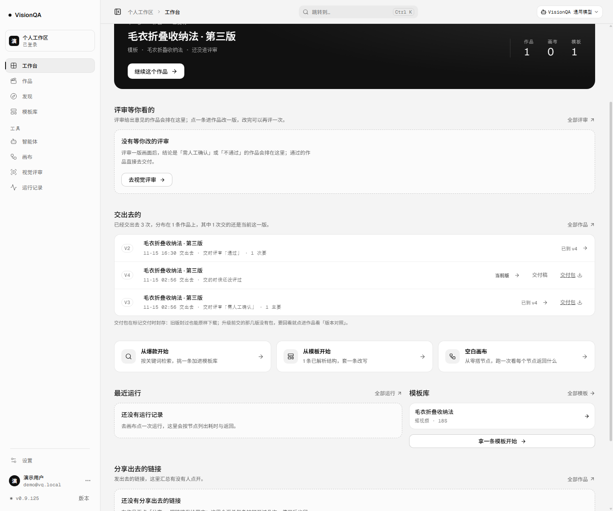
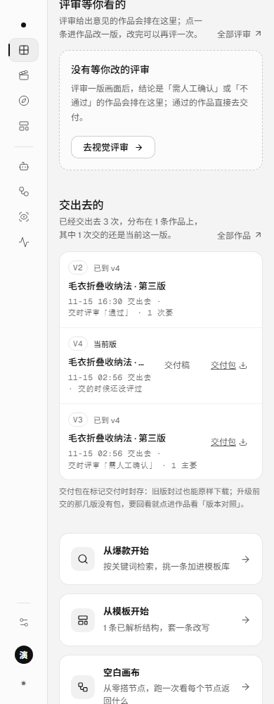

# 交出去的那一版，半年后还能原样取回：标记交付时把整套包封存（v0.9.125，2026-11-15）

## 一、问题

v0.9.122 让交付包带上两版对照，v0.9.124 让分享页能带走离线包。两件都在解决「把这一版交给没有账号的人」，但**交付包一直是现打的**：

- 标记交付只落一条记录：哪一版、什么时候、交时评审怎么说；
- 点「交付包」时，服务端按**今天**的模板、脚本、帧图重新打一份；
- 开新版、改模板、清帧图之后，当初交出去的那一份就再也拿不回来了。

交付是事实，应该能复核。只记录「交过 v2」不够，还要能回答「v2 交出去时到底是什么样」。

## 二、这一版的做法

**标记交付的那一刻，把整套 zip 当场封存。**

- 服务端在「标记交付」的 PATCH 请求里先打一次包，再落交付记录；记录里只存编号、字节数、SHA-256 与下载名，不存磁盘路径。
- 下载地址是 `GET /api/projects/<id>/delivery-packages/<deliveryId>`，要作品登录态；封存包不是公开链接，也不随只读分享页暴露。
- 工作台「交出去的」每一行，只要这一条交付封过包，就多一个「交付包」按钮；旧版、当前版都能下载。
- 重新打开这一版，记录与包一起收回，地址 404；作品删掉，整个封存目录一起清掉。
- 同一版重新标记交付会换一个新包；旧包被清掉，只留还挂着的交付记录。
- 升级前的老交付记录没有 `id`/`package`：界面不给按钮，地址 404，明确说「这一条交付没有封存包」。

**封存失败不挡交付。** 打包发生在标记交付的请求里，但异常会被接住：交付记录照落，只是这一条没有包。界面不拿空包冒充成功。

## 三、数据形状

```json
{
  "version": 3,
  "at": "2026-11-15T10:56:00.000Z",
  "review": { "verdict": "needs_review", "at": "...", "issues": {} },
  "id": "0c29800292484f9d",
  "package": {
    "bytes": 250142,
    "sha256": "8b6fd226...",
    "fileName": "VisionQA-毛衣折叠收纳法-第三版-交付包.zip",
    "savedAt": "2026-11-15T10:56:00.000Z"
  }
}
```

- `id`：16 位十六进制，仅用于寻址这一份包；不暴露磁盘路径。
- `package`：没有这个字段就是「没封存」；不是「旧版没有包」也不是「包坏了」。
- 磁盘位置：`DATA_DIR/delivery-packages/<projectId>/<deliveryId>.zip`，项目编号和包编号都过白名单正则，不接受外部路径。
- 下载响应带 `X-VQ-Package-SHA256`，解压前可以先核对「还是不是当初那一份」。

## 四、本地实测

本地 8954，数据目录 `.tmp-qa/r135data`，真 Chrome。评审记录由脚本直接写入，没有调用生成 / 评审上游。

| 检查 | 读数 |
| --- | --- |
| 作品 | `prj_r134demo`；v3 标记交付 → 开 v4 → v4 标记交付 |
| v3 封存包 | 250,142 B；SHA-256 前缀 `8b6fd226c1730828` |
| v4 封存包 | 248,643 B；SHA-256 前缀 `0dfbe76b9eb88e3c` |
| 工作台 | 1440 宽 3 行：v2 老交付无包、v4 当前版「交付稿 + 交付包」、v3 旧版「交付包」 |
| 1440 尺寸 | 行宽 1128；`scrollWidth 1440`；页面无横向溢出 |
| 390 尺寸 | 行宽 288；`innerWidth 390` / `clientWidth 390` / `scrollWidth 390`；按钮不折行 |
| 下载 | 两个包都 200，字节数与记录一致，SHA-256 与记录一致，ZIP 头 `0x04034b50` |
| 改模板 / 脚本后 | 再下载 v3，字节与封存时完全相同；不是今天现打 |
| 重新打开 v4 | 记录归零，v4 包 404；v3 旧包仍 200 |
| 重新标记 v4 | 新包 200，旧 v4 包 404；磁盘只剩 v3 与新 v4 两个 zip |
| 老记录 / 非 GET | 16 位不存在的编号 404；POST 405 |
| 上游 | 0 次生成 / 评审；0 次真实调用 |





## 五、测试

新增 `test/delivery-package.test.mjs` 7 条：

1. 标记交付落包：编号、字节数、SHA-256、下载名都在记录里，磁盘文件大小一致；
2. 下载封存包：登录态 200、ZIP 头、中文文件名、SHA 响应头；POST 405；
3. 改模板与脚本后再下载，字节与封存时完全一致；
4. 交付流水带包编号与元数据；
5. 重新打开这一版：记录与包一起收回，地址 404；
6. 作品删掉：封存目录一起清掉；
7. 存储层：坏路径不写、空包不写、只保留还挂着的包。

全仓 **978/978**（上轮 971 + 7），oxlint **0 error / 15 warning**，`tsc -b` 与 build 干净，官方密钥扫描 **691 文件 / 0**。

## 六、生产实况

部署 `20261114-190648-r135seal`（release tar **1,068,420 B**）。

| 检查 | 读数 |
| --- | --- |
| 版本 / 健康 | 8799 / 8800 / 公网都 **0.9.125**；health ok（模板 26，检查时 uptime 18s）；四个 unit active |
| 资源 | 入口 `index-Bu_5XVwI.js` **619,918 B**；画布 242,019 B；后台 201,074 B；主样式 300,653 B；画布样式 28,926 B；分享页 chunk 11,110 B |
| 哈希 | 本地与生产一致：`projects d1aa4212` / `routes projects 7cddbde3` / `delivery-packages f0b48653` / `delivery-ledger e7e06c55` / 入口 `f57ba264` / 画布 `6b468ddf` / 后台 `cfb316c8` / 主样式 `6adc45ae` / 画布样式 `b49e8586` / 分享页 `132bed20` |
| 标记 | `saveDeliveryPackage` 2 处、`buildProjectDeliveryArchive` 3 处、`DELIVERY_PACKAGE` 2 处、`normalizeDeliveryPackage` 2 处、`pruneDeliveryPackages` 3 处 |
| 权限 | 未登录封存包 / 交付包 / 对照接口都是 **401**；公网 `/` 200 · 729 B、入口 200 · 619,918 B |
| 运行 | 心跳 1497796 / 1497794，beatAt 19:07:00Z；盘 72%；`/tmp` 386M；日志无业务 error |
| 数据 | 1 条作品、3 条评审、9 条运行、0 条 graph、**0 条交付、0 条封存包、0 条分享** |

生产没有真实交付记录，所以「标记交付 → 封存 → 下载」只能在本机真 Chrome + 本地服务上验；生产只验到路由已部署、未登录 401、健康与资源哈希。没有真实甲方下载记录，零真实上游。

## 七、踩到的坑

- **不要存磁盘路径**：交付记录里只放编号和元数据，下载时按编号拼路径；否则改一次数据目录就多一批死链。
- **重新打开必须删文件**：只删记录不删包，地址仍然能下载，等于「收回交付」没收回。反过来，作品删掉也要带走整个目录。
- **同一版重新交付会换包**：旧包要清掉，否则磁盘上会堆着几个同版 zip，分不清哪个是记录挂着的。
- **封存失败不能把交付也弄失败**：打包异常要接住，记录照落；界面不能给出一个 404 的「已封存」。
- **老记录不能补包**：没有 `id` 就没有可寻址的包，界面不摆按钮；不能拿今天现打的包冒充。
- **包是登录态产物，不是分享产物**：没有新增公开路由，也没有把封存包放进只读分享页。
- **中文文件名走 RFC 5987**：ASCII 兜底用项目编号 + 版次，中文名放 `filename*`；否则某些浏览器会拿到空文件名。
- **清理只清「还挂着的」**：交付记录有 20 条上限，被挤掉的记录对应的包要跟着清；清理失败只占盘，不会让记录变得可下载。

## 八、发现但没做

- 升级前（v0.9.124 及更早）的交付记录没有包，不能追溯封存；
- 作品页的「交付」菜单仍可按今天的样子现打一份，封存包目前只在工作台「交出去的」里给入口；
- 没有交付包大小上限 / 保留期 / 异地备份，包跟着数据目录走；
- 没有交付包下载次数与访问记录；
- 没有把 SHA-256 显示在界面上（只放在响应头，记录里也有）；
- 生产没有真实交付记录，未验真实账号下的封存与下载；零真实上游。

## 九、回退

```bash
bash /opt/visionqa/ops/rollback.sh --to 1   # v0.9.124
bash /opt/visionqa/ops/rollback.sh --to 2   # v0.9.123
```

这一版新增一个纯服务端存储模块、一个只读下载路由、交付记录上的可选 `id`/`package` 字段，以及工作台行尾一个按钮。不改评审、画布、运行记录；不改分享入口；不新增公开路由；回退不需要改数据。回退后新封存的包文件留在数据目录里但不再有下载入口，清理时按目录处理即可。
