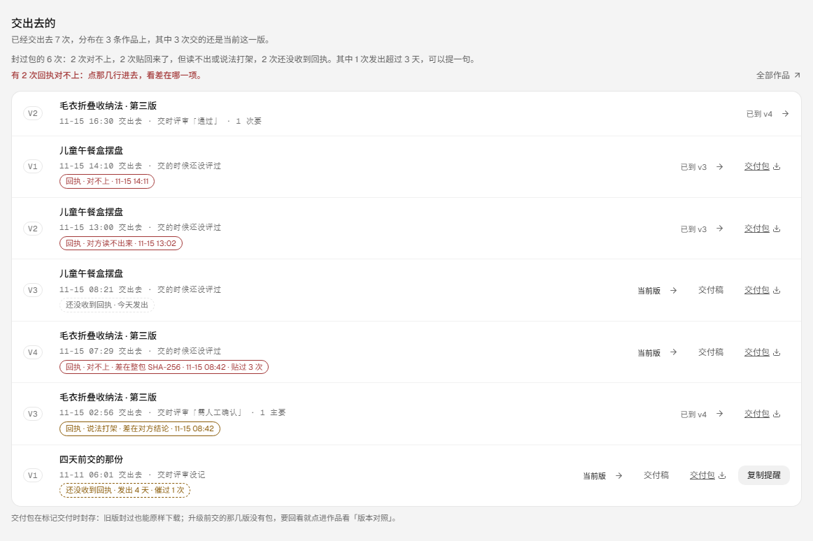
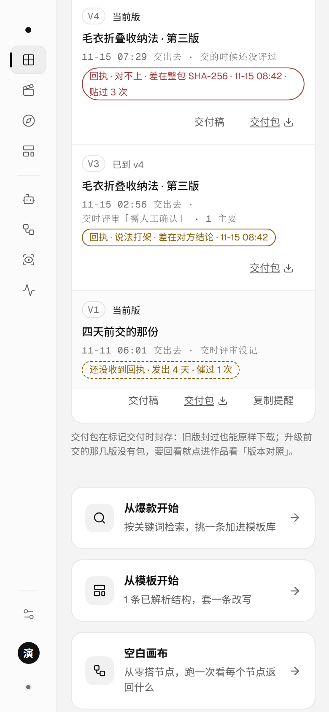

# 交出去的那一份：等了几天、差哪一项、该催了（v0.9.144，2026-11-15）

回执清单到上一版已经能说清「他验了没有、这次比上次变了哪一项、他读不出来该怎么办」。但有一件事一直没人说：**还没回来的那一份，到底等了几天**。包发出去三天没人验、跟发出去十分钟，是一回事还是两回事，全凭自己记；「差在哪一项」也要点进作品页才看得见。

这一版在工作台那一行上把这三件事说完，并把「催一句」做成一个动作。

**一句话在前：还没回来的那一行现在写「还没收到回执 · 发出 4 天」，过了第三天换成警示色、行尾多一个「复制提醒」；点一下剪贴板里就是一段带回收据链接的话，档案里记下这一次。**

## 那一行上多了什么

| 位置 | 之前 | 现在 |
| --- | --- | --- |
| 还没回来的行 | 「还没收到回执」 | 「还没收到回执 · 发出 4 天」；不到一天写「今天发出」，不写「发出 0 天」；交付时间没记下的老记录不写天数 |
| 超过三天的行 | 与别的行一样是灰的 | 虚线框换成警示色，title 里写「可以提一句」；没到第三天的仍然是灰的 |
| 催过的行 | 没有这一项 | 「· 催过 1 次」，日期放在 title 里；刷新之后还在 |
| 对不上的行 | 「回执 · 对不上 · 11-15 08:42」 | 「回执 · 对不上 · **差在整包 SHA-256** · 11-15 08:42」；几项一起不对就按固定顺序列 |
| 顶上那句话 | 「…2 次还没收到回执。」 | 后面多一句「其中 1 次发出超过 3 天，可以提一句。」 |
| 行尾动作 | 交付稿 / 交付包 | 还没回来、又有回执链接的，再多一个「复制提醒」 |

## 复制出来的那段话

> 四天前交的那份 第 v1 版那份包（VisionQA-四天前交的那份-v1-交付包.zip，250,004 B）我 11-11 发你的，还等你验一下：打开里面的「校验.html」，把收到的 zip 拖进去对一遍；对得上就点「带走这份结论」，把收据贴回这条链接：
> http://…/#/receipt/1111111111111111
> 哪一项不一样，把那一项告诉我就行。

只写档案里记着的东西：哪一版、哪个包、多少字节、哪天发的、收据贴回哪条链接。交付时间没记下就说「我上次发你的」；回执链接拿不到就退成「把收据发我就行」——不让人去找一条不存在的链接。不写「已读请回复」，不替发件人答应重发，也不提赔偿。

## 三种情况不给这个按钮

- **已经贴过回执**：那不是「还没回来」，催一个已经验完的人只会尴尬。接口层也会拒（409 `RECEIPT_ALREADY`），不写记录。
- **这一版还没生成回执链接**：没有地方贴收据，催了也没用（409 `NO_RECEIPT_LINK`）。
- **没封过包的老交付**：那时候还没有可比的包，不算「没回来」，也就不催。

## 写进去的是什么

一条交付记录上多一个 `reminders` 数组，只存**时间**，最多 5 条。不存发出去的那段话原文——那段话是照着档案里的现拼的（哪一版、哪个包、多少字节、链接），存下来只会变成第二份会过期的话。包、交付时间、回执、评审快照一个字段都不动。

## 本地实测（真服务 + 真数据 + 真 Chrome）

| 检查 | 读数 |
| --- | --- |
| 四天前交的那一份 | 「还没收到回执 · 发出 4 天」，class 里有 `is-late`，行尾有「复制提醒」74×28 |
| 今天交的那一份 | 「还没收到回执 · 今天发出」，**没有** `is-late`，也没有复制按钮（这一版还没生成回执链接） |
| 只换过哈希的那一条 | 胶囊写「回执 · 对不上 · 差在整包 SHA-256 · 11-15 08:42 · 贴过 3 次」 |
| 说法打架的那一条 | 胶囊写「回执 · 说法打架 · 差在对方结论 · …」 |
| 顶上那句话 | 「封过包的 6 次：2 次对不上，2 次贴回来了，但读不出或说法打架，2 次还没收到回执。其中 1 次发出超过 3 天，可以提一句。」 |
| 点「复制提醒」 | 剪贴板里是上面那段（含包名、250,004 B、「校验.html」、收据、回执链接、我 11-11 发你的）；提示「已复制：提醒他验包的那一段，带回收据链接」 |
| 点完之后那一行 | 「还没收到回执 · 发出 4 天 · 催过 1 次」 |
| 真刷新 | 展开清单后仍然是「· 催过 1 次」——写进档案的，不是页面上的一口气 |
| 接口层 | 已经贴过回执的 409 `RECEIPT_ALREADY`；没有回执链接的 409 `NO_RECEIPT_LINK` |
| 390 | `clientWidth 390 = scrollWidth 390`；按钮 74×28，left 287 / right 361，行宽 288；六枚胶囊没有一枚被行尾裁掉 |
| 上游调用 | 0 |

## 坑

- **390 上「差在哪一项」把胶囊撑出了行尾**：胶囊原来是 `white-space: nowrap`，长一点的「对不上 · 差在整包 SHA-256 · 时间 · 贴过 3 次」在 288 宽的行里被裁掉半截——页面上没横向滚动条，`scrollWidth === clientWidth` 照样成立，因为被祖先裁了。看截图才发现。改成 `max-width: 100%` + 换行 + `overflow-wrap: break-word`，并在验收里加一条「每枚胶囊的右边都不许越过行右边」。
- **「超过三天」不能拿今天的日期算**：验收数据的交付时间是写死的，测试跑过三天就自己红了。台账的 `deliveryLedger` 多收一个 `now`，测试传固定时刻；界面上仍用真时间。
- **数据里手写的 SHA-256 拼错了长度**：用 `16 + 56` 拼了 72 位，归一化直接当「没有包」，那一行连「复制提醒」都不出现——看起来像功能没做，其实是夹具坏了。补一条夹具自检（pkg=yes / token）再跑。
- **同一份夹具跑第二遍就不对了**：上一次点过「复制提醒」，第二次进来那一行已经写着「催过 1 次」，严格相等的断言当场失败。验收脚本每次都从 `r153data` 重铺一份。
- **窄屏必须按 390 重新载入**：从 1440 缩到 390 那一帧里清单还是展开状态，「看这 N 条」根本不出现；改成 `Page.reload` 之后再量。

## 发现但没做

- 没有真正的发送：复制完还是要自己粘到微信 / 邮件里（要真发得先有 SMTP，这一项仍在等授权）。
- 提醒只有次数，没有「下次该催他」的时间；也不会自动提醒。
- 只按「交付时间」算天数，不看对方是不是刚打开过回执链接。
- 收包人那一侧还是只说这一次，看不到自己被催过。
- 「差在哪一项」只在工作台那一行给项名，两边的值仍然要进作品页看。

## 回退

`bash /opt/visionqa/ops/rollback.sh --to 1` → v0.9.143；`--to 2` → v0.9.142。新字段 `reminders` 是可选的：旧版本读 projects.json 会忽略它，不报错、不丢别的字段；回退之后只是不再显示天数与催过几次。
