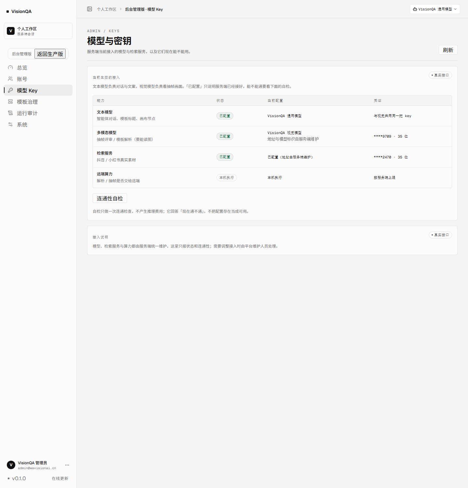
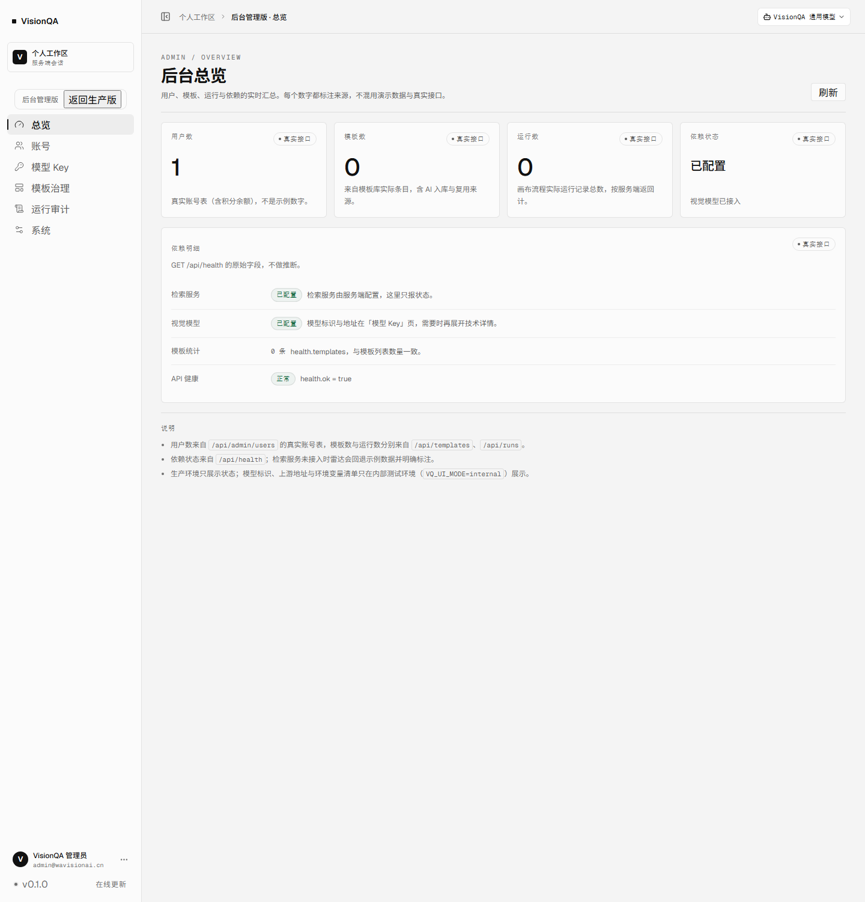
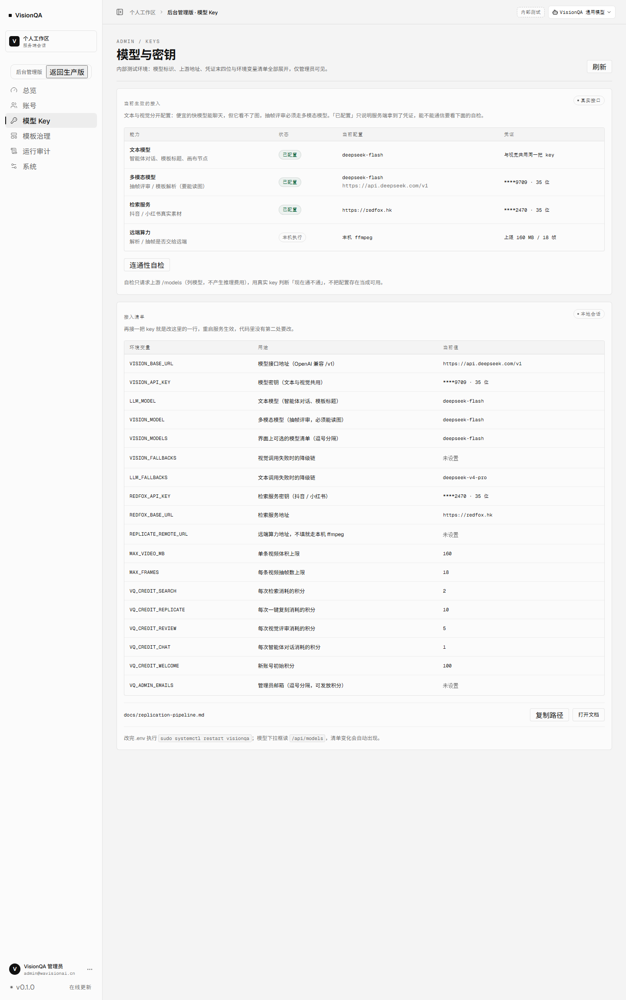
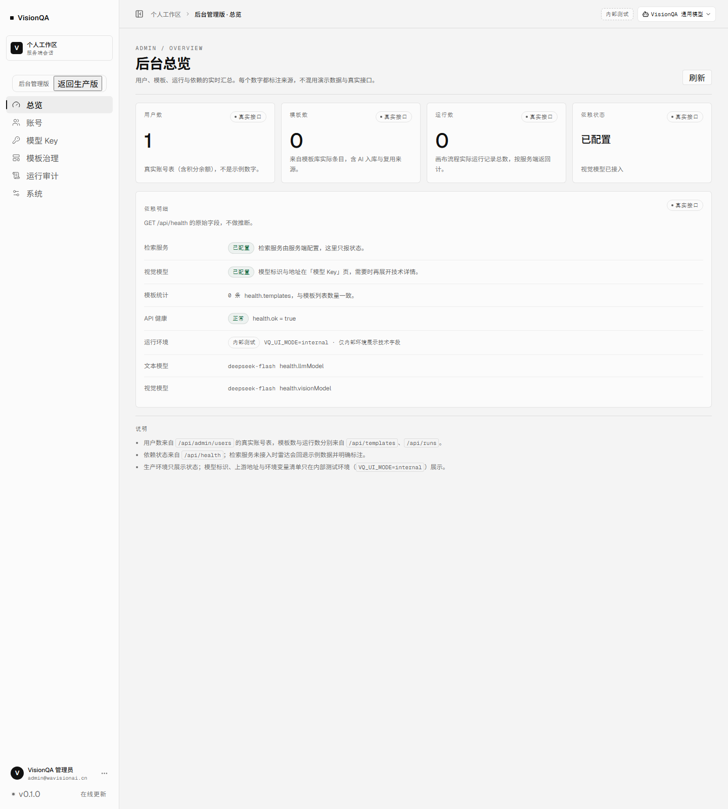

# 生产环境与内部测试环境

> 2026-11-10 起，同一份代码跑两套环境：**生产环境只讲产品语言，内部测试环境保留排障信息**。
> 两套环境共用 `dist`、`server` 与 `/opt/visionqa/.env`，差异只来自服务端环境变量 `VQ_UI_MODE`。

## 一、怎么区分

| 项 | 生产环境（默认） | 内部测试环境（`VQ_UI_MODE=internal`） |
| --- | --- | --- |
| 前台/设置页 | 只出现「VisionQA 通用模型 / 视觉模型 / 检索服务」等产品口径 | 与生产一致（内部标识只出现在顶栏与后台） |
| 顶栏 | 无额外标识 | 右侧多一枚「内部测试」虚线胶囊 |
| 后台「模型 Key」 | 只报能力、状态、凭证末四位；不出现模型 ID、上游地址、环境变量清单 | 直接展开模型 ID、上游地址、环境变量清单与当前值（凭证仍脱敏） |
| 后台「总览」 | 只报状态 | 多一块「运行环境 / 文本模型 / 视觉模型」技术字段 |
| 后台「系统与版本」 | 只有版本、画布状态与数据占用 | 底部多一块「排查信息」：进程 / 内存、模型与检索是否就绪、最近请求与错误；生产访问 `/api/admin/diagnostics` 返回 404 |
| `/api/app` | `{ mode: "prod", internal: false }` | `{ mode: "internal", internal: true }` |

生产环境的判断是 **fail-closed**：只有显式写 `VQ_UI_MODE=internal` 才进内部口径，漏配、拼错都按生产处理。

## 二、线上两套服务

| 服务 | 端口 | 数据目录 | 说明 |
| --- | --- | --- | --- |
| `visionqa` | 127.0.0.1:8799 | `/var/lib/visionqa` | 生产：Caddy 反代到 `https://visionqa.wavisionai.cn` |
| `visionqa-internal` | 127.0.0.1:8800 | `/var/lib/visionqa-internal` | 内部测试：只绑本机，不对外暴露，通过 SSH 隧道访问 |

内部服务的 unit：`/etc/systemd/system/visionqa-internal.service`；覆盖变量：`/etc/visionqa-internal.env`（在 `/opt/visionqa/.env` **之后**加载，因此能覆盖生产配置）。它复用生产 `.env` 里的模型与检索凭证，但账号库、积分、模板库都是独立的。

### 2.1 访问内部环境

```bash
ssh -L 8801:127.0.0.1:8800 root@<服务器>
# 然后浏览器打开 http://127.0.0.1:8801
```

首次启动时，内部库会用 `.env` 里的 `VQ_SEED_EMAIL / VQ_SEED_PASSWORD` 建一个管理员账号（与生产引导账号相同）。它不会暴露到公网：unit 里绑定的是 `127.0.0.1`，隧道断开即不可访问。

排障入口在「后台 → 系统与版本 → 排查信息」：进程、运行时长、内存、模型与检索是否就绪、最近 400 条请求与 60 条错误；错误里包含请求 ID，可与「运行审计 → 操作日志」的来源列对照。这块只存在于内部环境，生产环境不会返回该接口。

### 2.2 发布时要一起重启

`dist` 是两套服务共享的，所以发布新构建后要重启两个单元：

```bash
sudo systemctl restart visionqa
sudo systemctl restart visionqa-internal
```

只重启生产时，内部环境会继续用旧进程（它读的是启动时加载的 `dist` 文件，页面入口可能已更新而 API 还是旧代码），排查问题会得出错误结论。

## 三、以后要加一套环境

- 只改口径：`VQ_UI_MODE=internal` 就够，不需要重新构建。
- 换库：`DATA_DIR=/var/lib/visionqa-<name>`；换端口：`API_PORT`。
- 想临时验证内部口径，不必动线上：本地 `DATA_DIR=./.tmp-data VQ_UI_MODE=internal API_PORT=8798 node --experimental-sqlite server/index.mjs`，配合 `VQ_SEED_EMAIL / VQ_SEED_PASSWORD` 即可登录。

## 四、截图（2026-11-10 实测）

生产（无技术详情、无内部标识）：





内部测试（顶栏「内部测试」、模型 ID、上游地址、环境变量清单）：



