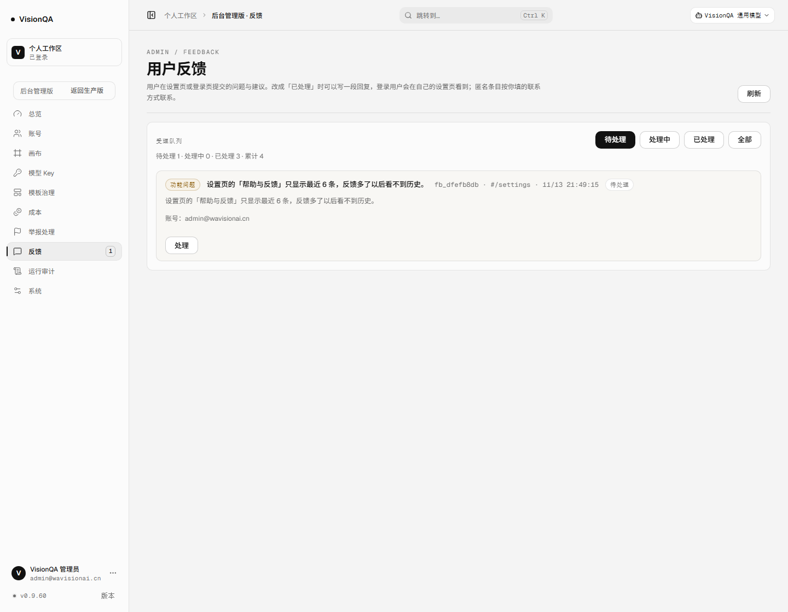
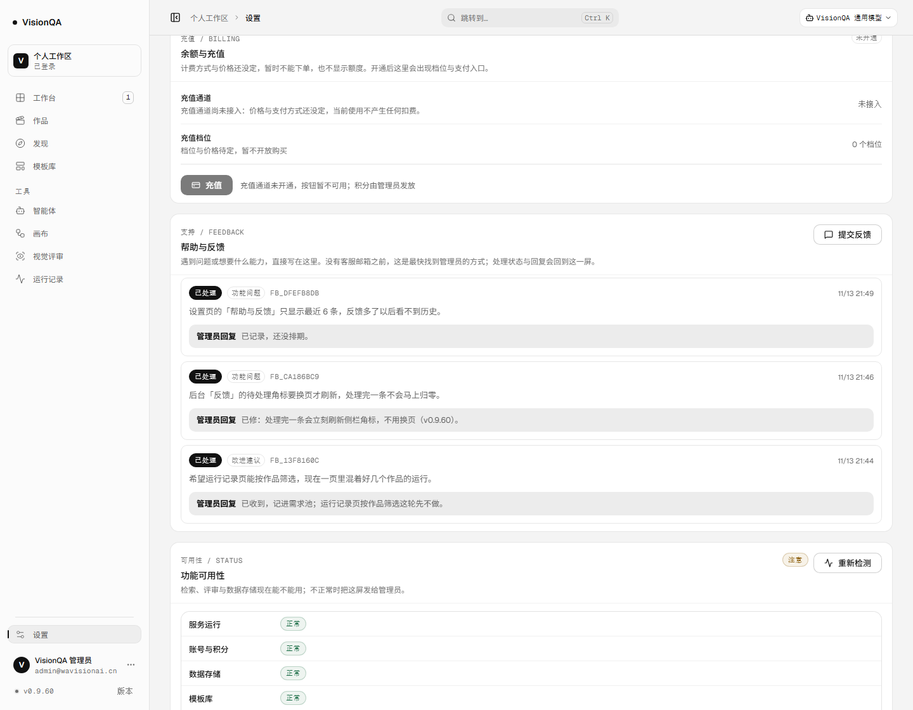

# 应用内反馈：没有客服邮箱，用户也能找到人（v0.9.60）

> 2026-11-13。这一版补的是上线清单里的 B5「客服与反馈入口」。
> 背景：A5 的 SMTP 凭据与 A7 的客服邮箱都还没到位，页脚与登录页只能写「联系工作区管理员」；
> 登录进不来的人连账号都没有，等于没有任何对外求助路径。反馈入口不依赖这两样外部输入。

## 一、为什么现在做

- 上线前必答的一句是「用户遇到问题找谁」。没有客服邮箱、没有邮件通道时，答案只能是「找管理员」，而管理员没有收件箱。
- 邀请内测最先暴露的往往不是功能缺失，而是「卡在某一步又说不清」。一条能带上页面地址与浏览器信息的反馈，比让用户在微信里描述「就那个页面点不动」有用得多。
- 登录失败恰恰是最需要求助的场景。如果反馈也必须登录，最该被听到的人永远交不上来。

## 二、做了什么

1. **两个入口，一个弹窗**
   - 登录页页脚「反馈问题」：匿名可提交，类型（功能问题 / 改进建议 / 其他）+ 具体情况 + 联系方式（匿名必填）。
   - 设置页「帮助与反馈」：登录态提交，默认带上账号邮箱；下方直接列出自己最近的反馈、处理状态与管理员回复。
2. **服务端一处收口**：`server/feedback.mjs` 落 `DATA_DIR/feedback.json`（原子写、队列封顶 1000 条），提交校验 5–2000 字、类型白名单、匿名必须留联系方式；同一账号 / 同一 IP 十分钟内提交一模一样的文字只算一条，双击与网络重试不会刷队列。
3. **公开但有限流**：`POST /api/feedback` 在 PUBLIC_API 里（登录页可用），按 IP 每分钟 3 条；`GET /api/feedback/mine` 要登录，只回本账号的条目，且只下发展示需要的字段（IP / UA / 处理人不外发）。
4. **后台「反馈」**：待处理 / 处理中 / 已处理 / 全部四档，计数、提交人（账号或匿名）、联系方式、页面、时间、正文；「处理」里可写回复并标状态，回复随条目回到提交者的设置页；处理动作进审计（`feedback.update`）。侧栏「反馈」角标显示待处理数，处理完一条在同一页面立刻归零（`vq:feedback-changed` 事件），不用换页。

## 三、生产实测（v0.9.60）

| 动作 | 结果 |
| --- | --- |
| 无 cookie 匿名提交 | `201`，`fb_7485a7f0`，`status=new` |
| 匿名但不留联系方式 | `400` `{"field":"contact"}`，不入库 |
| 登录态提交（cURL 带会话） | `201`，`fb_13f8160c` |
| 后台队列 | `counts {new:2, reading:0, done:0, total:2}`，账号 / 匿名两类都在 |
| `systemctl restart visionqa` | `feedback.json` 996 字节，两条 id 都在，重启不丢 |
| 管理员写回复并标已处理 | 该条目 `done`、`handledBy` 有值；`GET /api/feedback/mine` 读到同一条回复 |
| 处理一条后侧栏角标 | 同一页面内 `1 → 空`（不导航，派发事件后刷新） |

- `/api/version` **0.9.60**；health `{ok:true, redfox:true, vision:true, llm:true, templates:26}`。
- 两张截图都是生产真实渲染：

- 演示数据留在生产：匿名通道验证 `fb_7485a7f0`（已处理）、角标修复 `fb_ca186bc9`（已处理）、列表只显示最近 6 条 `fb_dfefb8db`（已处理、注明「已记录，还没排期」），都是本轮真实提交，没有伪造。

## 四、验收与测试

- `npm test` **535/535**；新增 `test/feedback.test.mjs` 7 条：匿名必填联系方式与体长边界、落盘与计数、重复提交合并、我的反馈隔离与回复回流、路由层匿名提交 / 未登录 401 / 管理员 403、限流规则存在。
- oxlint 0 error / 7 warning（新增 1 条 `react(set-state-in-effect)`，与举报页同一写法，属既有模式）；`tsc -b` 干净、构建通过。

## 五、边界（如实记）

- **没有邮件通知**：A5 的 SMTP 凭据还没配，回复只在站内可见，平台不会主动发信。
- **匿名用户看不到回复**：匿名条目没有账号可回，管理员只能按 `contact` 字段人工联系；这是本期最实际的限制，等邮件通道或「凭编号查询」再做。
- **只显示最近 6 条**：自己的反馈列表没有分页，多了会看不到历史（已作为一条待处理反馈留在后台）。
- **没有附件 / 截图上传**：靠文字 + 自动带的页面地址；浏览器信息只记录 UA，不采集画面。
- **反馈不进外部告警**：A6 通道未配，后台靠侧栏角标与队列页。
- 匿名提交按 IP 限流 3 条/分钟；换 IP 仍可提交，这是公开入口的固有代价，内容侧靠长度与类型约束。

## 六、回滚

- 代码回滚到 v0.9.59 即可：路由与后台入口消失，`DATA_DIR/feedback.json` 保留（升级回来还能读到）。
- 数据只增不删；队列封顶 1000 条，超出丢最旧的。
