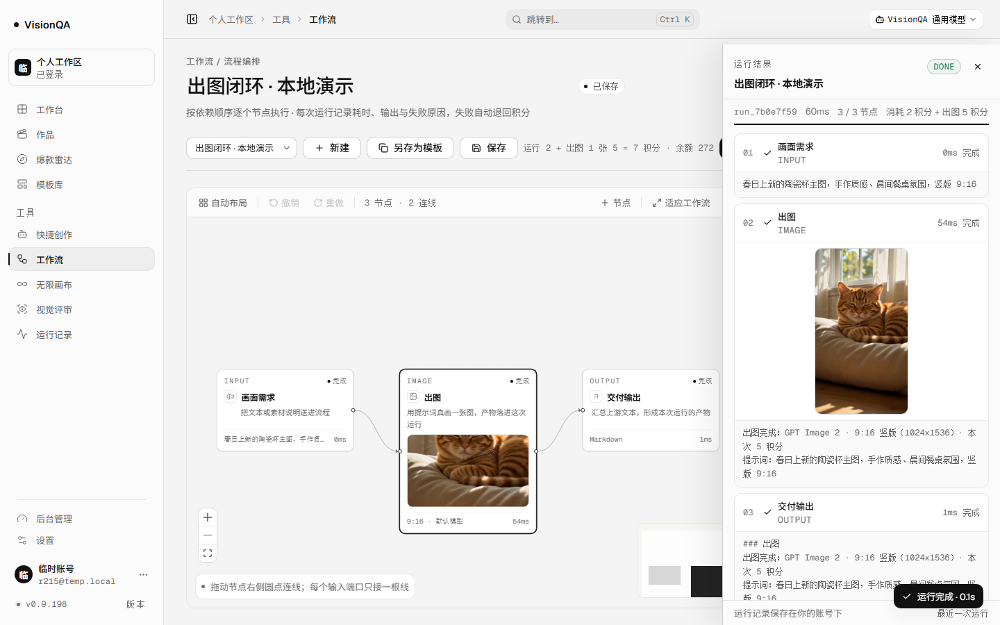
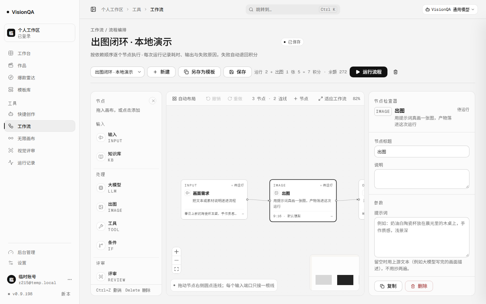
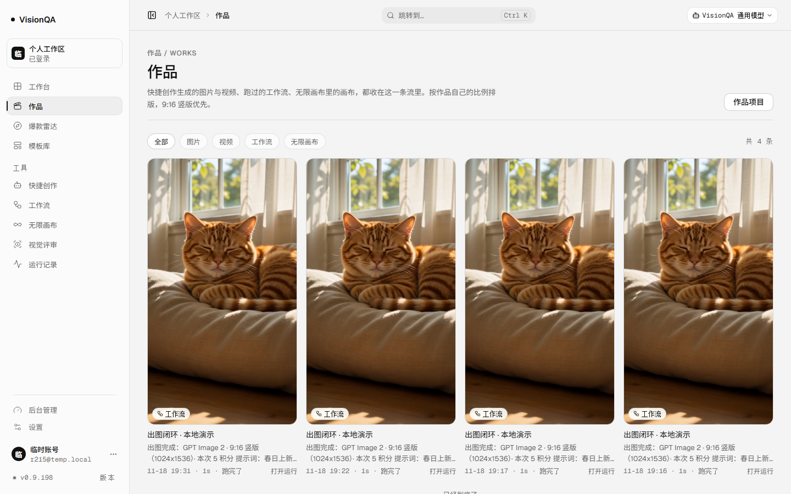
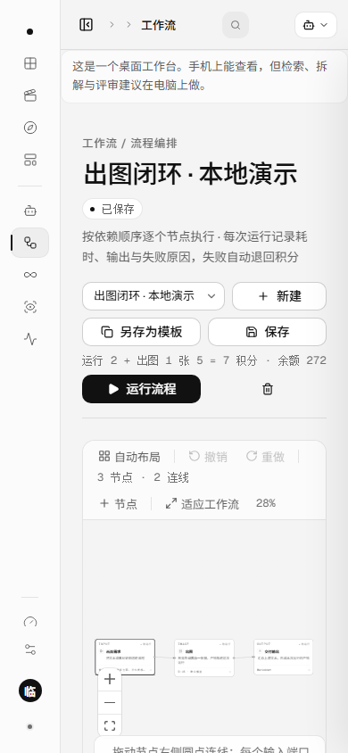

# 工作流能真出图了：出图节点 + 评审节点回归（v0.9.199，2026-11-18）

## 为什么改

用户在 r214 的反馈是「工作流这个页面有点鸡肋」。翻代码确认根因不在文案、也不在入口：
`server/flows.mjs` 的节点只有 input / llm / kb / tool / condition / output，全是文本类；
`review`（视觉评审）在后端还在，但前端 `serialize.ts` 加载时会把它**直接丢弃**，调色板里也没有。
也就是说这条流水线最多只能「写一段话」，最后一公里（出图、看图、交付）全在外面。

这一版把最后一段接上：**大模型写完画面描述 → 出图节点真画一张 → 评审节点看这张图 → 输出汇总**，
一次运行跑完，产物直接进作品流。

## 做了什么

### 1. 出图节点（新）

- 服务端 `server/flow-image.mjs`：一次运行里同步出一张图。先按所选模型的积分价扣费（`image_gen`，
  单据 `ref = run:<runId>:<nodeId>`），再调平台出图通道；下载后写到 `DATA_DIR/runs/<runId>/<nodeId>.png`
  （0600）。任何一步失败按账本净额**全额退回**，重复调用不会多退。
- 提示词：节点上填了就用节点上的；留空就用上游文本（大模型写的画面描述），不用抄两遍。
- 比例：`1:1 / 9:16 / 16:9`，尺寸取 `server/media-models.mjs` 的 `IMAGE_SIZES`（唯一真源，
  前端不写死尺寸）。默认 9:16，与「发现 / 模板库优先 9:16」一致。
- 产物地址：`/api/runs/<runId>/assets/<文件名>`。**必须登录 + 是这条运行的主人**才读得到
  （别人的运行一律 404，不泄露是否存在）；缓存头复用帧图那套 `private, no-cache` + ETag。
- 节点卡：跑完直接把图贴在卡片上；运行抽屉里也是图而不是一行路径。

### 2. 评审节点回归

- `src/canvas/serialize.ts` 的已知类型加上 `review`（以前明确丢弃），调色板新增「评审」组。
- 图片字段**留空 = 用上游出图那张**（以前必须手填 `frames/...` 路径，等于逼用户先自己去出图）。
  参考图解析逻辑抽成 `pickReviewReference(configImage, ctxImagePath)` 并有单测。

### 3. 钱要说全

出图每张另扣一次积分，不在工作流「按次」那笔里。如果只报 `credits.cost`，用户看到「消耗 2 积分」、
余额却少了 7——这一版把两个数分开记并加在一起说：

- 运行记录新增 `imageCredits`（只算画成了的那几张，失败那张已退）与 `spentTotal`；
- 运行抽屉 / 运行记录页 / 只读运行视图统一由 `runCreditsText()` 出文案：
  「消耗 2 积分 + 出图 5 积分」；运行失败全额退时写「已退回 2 积分；出图 5 积分不退」。
- 运行前顶栏直接算总价：「运行 2 + 出图 1 张 5 = 7 积分 · 余额 …」，余额不够时不让人点运行。
- 作品页的「这条作品花了多少」也把出图那几张算进去。

### 4. 作品流里的工作流卡片

有出图节点的运行，作品流卡片用这张图作封面（`/api/runs/...` 自带鉴权，不跨站直连），
比例按图的 `ratio` 排；摘要优先用出图节点的说明，并去掉 markdown 记号与纯地址行
（否则卡片上会出现一串 `###` 和 `/api/runs/...`）。
点卡片仍然进这次运行的只读视图（深链 `#/canvas/<flowId>/run/<runId>`），不是只给一张图。

## 验收

环境：本机临时实例（临时 `DATA_DIR`、`API_PORT=8811`），出图走 **本机假上游**
（`127.0.0.1:8899`，回一张自己的真实帧图），**0 次真实上游调用、0 元**。

- 单测 `test/flow-image-node.test.mjs` 7 条：扣 5 积分 / 落盘 `runs/<runId>/image-1.png` / 运行输出带图地址；
  上游失败节点记失败且余额不变；积分不足时一次上游都不打；`pickReviewReference` 三态；
  产物接口：主人 200 拿回原图、别人 404、未登录 401、`..` 与不存在的文件都被挡。
- 单测 `test/run-credits-text.test.mjs` 5 条：出图单独算、退款只退运行那笔、停止按已跑部分写、没扣费不写。
- 端到端（临时实例）：`POST /api/flows/<id>/run` 返回 success，出图节点 27–54ms（假上游），
  `GET /api/runs/<runId>/assets/image-1.png` → 200 `image/png` 1,150,193 B、`cache-control: private, no-cache`；
  不带 cookie → 401。
- 出图 → 评审串联：review 节点已经能拿到上游那张图去调视觉通道（不再报「没有配置评审图片」）。
- 门禁：`npm test` 1417/1417、`tsc -b` 干净、`npm run build` 通过、lint 0 error。

## 边界（照实说）

- **没有真调上游出图**：所有验收都走本机假上游。真实链路（GPT Image 2 真画一张 9:16）需要在用户同意后
  从用户端发起一次，才能证明耗时与成图质量；价格与扣费逻辑与快捷创作共用同一套。
- **评审节点没有拿到真实结论**：临时实例里它真的向视觉通道发了请求，被本机模型代理以 403 拒绝
  （错误原话写进了节点结果，0 费用）。要拿到评审结论，需要有可用的视觉 Key 后真跑一次。
- **出视频节点没做**：视频是异步任务 + 轮询，语义与同步出图不同，这一版只做图。
- 出图节点一次运行只画一张（没有 n 张 / 批量）；不支持参考图（参考图出图仍在快捷创作）。
- 工作流运行的中断语义没变：出图请求本身不可中途 abort，停止运行会等这张图落盘后按已开始节点结算。
- 截图全部来自本机临时实例（假上游），不是生产运行；界面本身与生产同一份 `dist`。

## 界面证据

