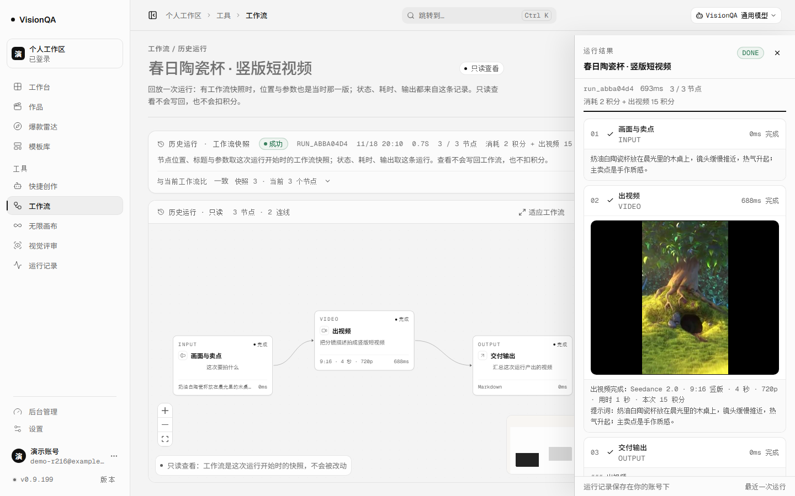
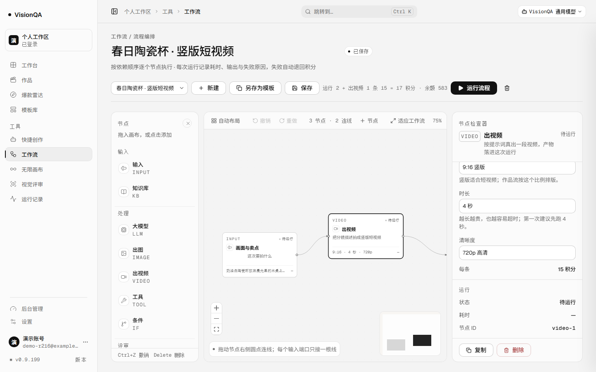
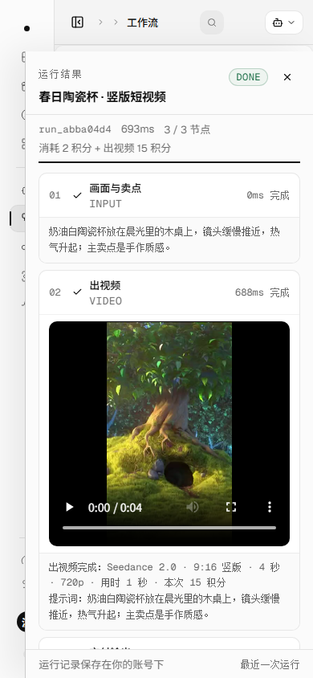
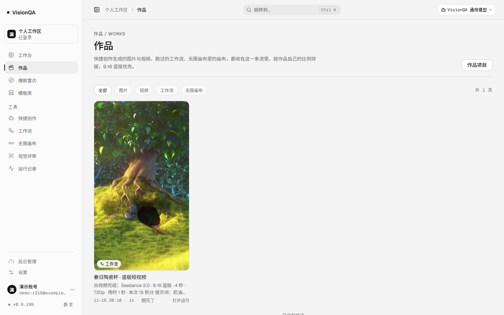

# 工作流能真出视频了：出视频节点 + 作品流视频封面（r216 / v0.9.200）

一句话：从这一版起，工作流不只是「写一段话、画一张图」，它能把分镜描述**真拍成一条视频**，
跑完就出现在作品流里；失败 / 超时按账本全额退回，不重复收费。

## 为什么做这件事

上一版（r215）给出图节点，工作流终于能产出图。但短视频产品的成品是视频：
跑完一次只有文字和一张图，用户还得再回快捷创作重做一遍——这就是「工作流有点鸡肋」的根因。
这一版把视频补进同一条链：输入 → 大模型 → 出图 → **出视频** → 评审 → 输出，
产物落进这次运行自己的目录，作品流直接当封面用。

## 契约（用户能看到的）

| 项 | 口径 |
| --- | --- |
| 模型 | 默认 Seedance 2.0（Seedance 2.0 · 极速可选）；下拉内容来自 `server/media-models.mjs`，界面不写死 |
| 比例 / 时长 / 清晰度 | 9:16 · 16:9 · 1:1；4 秒 / 8 秒；720p / 480p |
| 价格 | 运行 2 积分 + 每条视频 15 积分（`config.credits.prices.video_gen`）；运行前顶栏就报总价，余额不够不让点 |
| 扣费与退款 | 先扣后做；失败 / 超时 / 被停止都按账本净额**全额退回**，重复收尾不会多退 |
| 超时 | 默认 12 分钟（`VQ_FLOW_VIDEO_TIMEOUT_MS`），轮询 4 秒（`VQ_FLOW_VIDEO_POLL_MS`）；超时只退不换任务重跑，避免同一段视频付两次钱 |
| 进度 | 每轮推一条 `node-progress`：节点卡写「已等 45s · 40%」，同时把长连接保活（否则 nginx 读超时会先掐断一次正常出片） |
| 产物 | `DATA_DIR/runs/<runId>/<nodeId>.mp4`（0600）；读取走 `GET /api/runs/<id>/assets/<file>`，必须登录且是这条运行的主人 |
| 视频播放 | 产物接口支持 Range（206 / 416），抽屉里能拖动进度条；未登录 401、别人的运行 404 |
| 作品流 | 运行卡优先用出图做封面，没有图就用这段视频的第一帧（`mediaKind: video`），点开仍是那次运行的只读视图 |

## 顺手修掉的一个越界写

节点的 id 是用户能随口起的名字（例如 `video-1`，也可能是 `../auth`）。
上一版的出图落盘直接拿 id 拼文件名，理论上能把文件写到 `runs/` 之外。
这一版加了 `safeNodeId()`：落盘前把非法字符统一换成 `_`，读取侧 `runAssetPath()` 另有更严的白名单
（只认图与视频扩展名，路径穿越一律不认）。测试里有一条专门跑「节点 id = `../evil`」。

## 证据

| 项 | 结果 |
| --- | --- |
| 测试 | **1430/1430**（新增 8 条：出视频 7 + 花费文案 1） |
| 类型 / lint / 构建 | `tsc -b` 干净、lint 0 error（23 warning 仍是既有项）、`npm run build` 通过 |
| 端到端（临时实例 + 本机假上游） | `run_abba04d4` 成功：693ms、3/3 节点、`消耗 2 积分 + 出视频 15 积分`；产物 360×642、4.0 秒、`video/mp4` |
| 计费 | 余额按 17 扣（2 + 15）；失败用例余额一分不少；超时用例只建一次任务 |
| 鉴权 / Range | 主人 200、Range `bytes=0-3` → 206 + `Content-Range`、越界 Range → 416、别人 404、未登录 401 |
| 390 宽 | `innerWidth = scrollWidth = 390`，抽屉不横向溢出 |
| 真实上游调用 | **0 次、0 费用** |

## 边界（照实说）

- 截图里的视频是本机一段样例素材横转竖后由**假上游**返回的，不是平台真出的片。
  真实出片仍需用户在端上授权一次（一条约 15 积分 / ¥1.4），届时才能验证真实耗时与成片质量。
- 出视频节点一次一条，不支持参考图 / 首帧 / 批量；参考素材生视频仍在快捷创作。
- 节点内轮询意味着一次运行请求最长挂 12 分钟。公网链路上我们靠每 4 秒一条进度保活，
  但如果中间层更早断开，这条运行会被判中断并按已跑节点结算、全额退没跑的部分，可续跑。
- 评审节点只吃图，不能评审视频。
- 作品流里的视频封面要浏览器解码 metadata，弱网首帧可能慢一拍。
- 本轮 0 次真实上游调用；生产能力一上线就是这份代码。

## 改了哪些文件

- 新增 `server/flow-video.mjs`（建任务、轮询、进度、退款、落盘）、`test/flow-video-node.test.mjs`。
- `server/flows.mjs`：`video` 节点类型、配置归一化、上下文与输出带上视频地址、`videoCredits` 计费口径、`node-progress` 事件。
- `server/routes/flows.mjs`：`/api/flows/meta` 回 `video` 选项；运行产物支持视频扩展名与 Range。
- `server/image-response.mjs`：`sendAuthMedia`（Range）、`parseByteRange`。
- `server/media-fetch.mjs`：`extractVideoUrl` / `progressOf` 抽成共用（快捷创作与工作流同一套）。
- `server/works-feed.mjs`、`src/components/WorksWall.tsx`：运行卡用视频当封面（`mediaKind`）。
- `src/canvas/*`、`src/pages/CanvasPage.tsx`、`src/domain/run.ts`、`src/styles/canvas.css`：节点、检查器、抽屉播放器、进度文案、总价文案。
