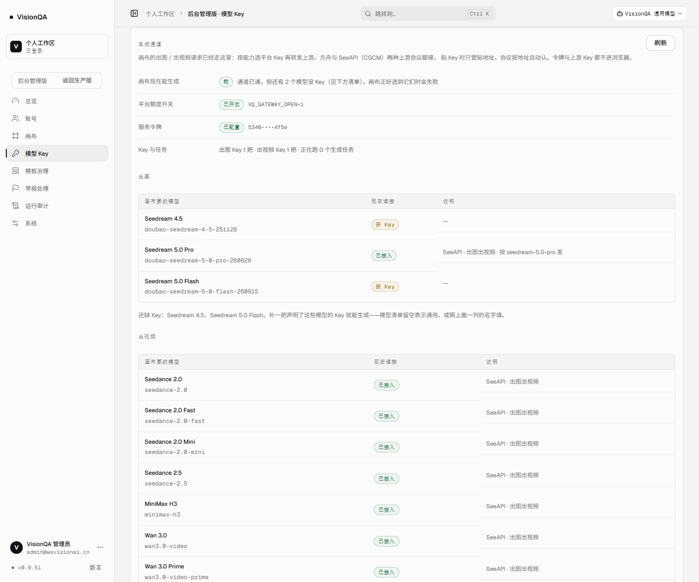
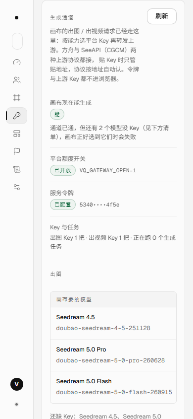

# 生成通道的两层开关：配了令牌不等于能生成（v0.9.51）

日期：2026-11-13 · 生产 v0.9.51（入口 `index-CralKgkB.js`）

## 一、起因

2026-11-13，画布出图报错：

> 企业 image2 生成失败：生成能力暂未开放；平台接口额度还没开通

这句话是通道自己回的 `503 GATEWAY_NOT_OPEN`（`server/routes/gateway.mjs`），不是上游报错。
当时生产 `/opt/visionqa/.env` 里 `VQ_GATEWAY_OPEN` 没写，生成请求被平台主动挡在门口。

按用户要求把开关打开（写 `VQ_GATEWAY_OPEN=1`、重启 `visionqa` 与 `visionqa-internal`）之后，
通道已经能转发。但后台「生成通道」卡片仍然写着「通道已开启」——它只看 `VQ_GATEWAY_TOKEN` 配没配，
**额度开关关着时也这么写**。这意味着下一次换 Key、关额度、删 Key，管理员还是会先看到「已开启」，
再去画布上撞一次 503。

这轮不改能力，只把「能不能生成」这一件事说准。

## 二、判断口径

画布现在能不能生成 = 三样同时成立：

| 条件 | 在哪配 | 不满足时画布收到 |
| --- | --- | --- |
| 平台额度开关 | 服务器 `.env` 的 `VQ_GATEWAY_OPEN=1` | `503 GATEWAY_NOT_OPEN`「生成能力暂未开放」 |
| 服务令牌 | `VQ_GATEWAY_TOKEN`（画布侧用 Bearer 调） | `503 GATEWAY_NOT_CONFIGURED`，所有请求都挡 |
| 至少一把 Key | 后台「模型 Key」里声明 `image` / `video` 能力 | `503 NO_IMAGE_KEY` / `NO_VIDEO_KEY` |

顺序就是修复顺序：先开额度，再配令牌，最后补 Key。
实现只有一处：`server/gateway.mjs` 的 `gatewayReadiness()`，后台接口与卡片都读它，不各自猜。

## 三、改了什么

| 文件 | 改动 |
| --- | --- |
| `server/gateway.mjs` | 新增 `gatewayReadiness({ open, configured, image, video })` → `{ ready, missing: ['open'\|'token'\|'keys'] }` |
| `server/routes/admin.mjs` | `GET /api/admin/gateway` 增加 `userOpen` 与 `readiness`；Key 计数先算一次再复用 |
| `src/api/gateway.ts` | `GatewayStatus` 增加 `userOpen`、`readiness` 与 `GatewayBlocker` 类型 |
| `src/pages/admin/GatewaySection.tsx` | 四行状态（能不能生成 / 额度开关 / 服务令牌 / Key 与任务）；缺什么写清怎么修；模型缺 Key 时不再写「点哪个都能生成」；补一句开关是全局的 |
| `test/gateway-readiness.test.mjs` | 8 条：三样在位、缺任一样、只有一种 Key 也算通、三样全缺的顺序、参数缺省不抛错 |

界面口径的两处细节：

- 「画布现在能生成」的说明会带上「还有 2 个模型没 Key」：通道通了不等于每个模型都有人接，
  画布点名要 `doubao-seedream-4-5-251128` / `doubao-seedream-5-0-flash-260915` 时照样会失败。
- 出图 / 出视频分组的结尾从「还不通」改成「还缺 Key」，跟顶部的「通道已通」不再互相打架。

## 四、生产证据（2026-11-13，v0.9.51）

`GET /api/admin/gateway`（管理员会话，生产）：

```json
{
  "configured": true,
  "userOpen": true,
  "readiness": { "ready": true, "missing": [] },
  "tokenMasked": "5340••••4f5e",
  "keys": { "image": 1, "video": 1 },
  "baseUrl": "https://visionqa.wavisionai.cn/api/gateway/v1"
}
```

后台「模型 Key → 生成通道」实际渲染（1440 / 390，真实生产、登录态下截）：





- 1440：卡片宽 1140，无横向溢出；390：卡片宽 290、文档宽 390，无横向溢出，四行自动堆叠。
- 顶部「能 · 通道已通，但还有 2 个模型没 Key」与下方「还缺 Key：Seedream 4.5、Seedream 5.0 Flash」一致。
- **这轮没有发起任何出图 / 出视频生成调用**（按用户要求不消耗上游额度）。
  因此「上游余额够不够」仍未验证：如果画布报 402 / 余额不足，那是 SeeAPI 侧的事，不是这个开关。

## 五、验收

- `npm test`：**464 / 464** 通过（新增 8 条）。
- `npx oxlint src server test scripts`：**0 error / 6 warning**（既有 Fast Refresh 提示，未新增）。
- `npx tsc -b`：干净；`npm run build`：通过。
- 生产：两个服务 active，`/api/health` ok（templates 26），入口 `index-CralKgkB.js`。

## 六、没做 / 边界

1. **后台不能一键开关**：`VQ_GATEWAY_OPEN` 仍在服务器 `.env`。额度是外部事实，
   后台给按钮会让人误以为点一下就能生成；现在只在卡片上显示真实状态与改法。
2. **开关是全局的**：一开，画布服务里所有账号（`ops_…`、`bdadmin`、`vq_…`）与出视频一起生效。
   要按账号收紧，得去画布侧收 `generate` 授权，不在这张卡片范围里。
3. **readiness 只看配置，不探上游**：令牌配了、Key 在池里就算通；上游余额、Key 是否过期要真跑一次才知道，
   而这轮明确不跑生成。后台的「模型 Key → 最近路由」仍是判断上游健康的入口。
4. **模型覆盖不完整**：出图只接了 Seedream 5.0 Pro；Seedream 4.5 / 5.0 Flash 缺 Key，
   画布如果发这两个模型名仍会失败，卡片已如实标出。
5. **与计费无关**：通道不扣积分，画布自己计费；这轮不动。

## 七、运维：怎么开 / 怎么关

```bash
ssh root@139.196.123.28
grep -n '^VQ_GATEWAY_OPEN' /opt/visionqa/.env    # 现在是什么
sed -i 's/^VQ_GATEWAY_OPEN=.*/VQ_GATEWAY_OPEN=1/' /opt/visionqa/.env   # 开；关就是 =0
systemctl restart visionqa visionqa-internal
```

改完在后台「模型 Key → 生成通道」刷新：额度开关应为「已开放」，画布现在能生成应为「能」；
关掉后立刻变成「未开放 / 不能」，画布生成回到 503，且不会产生任何上游调用。
