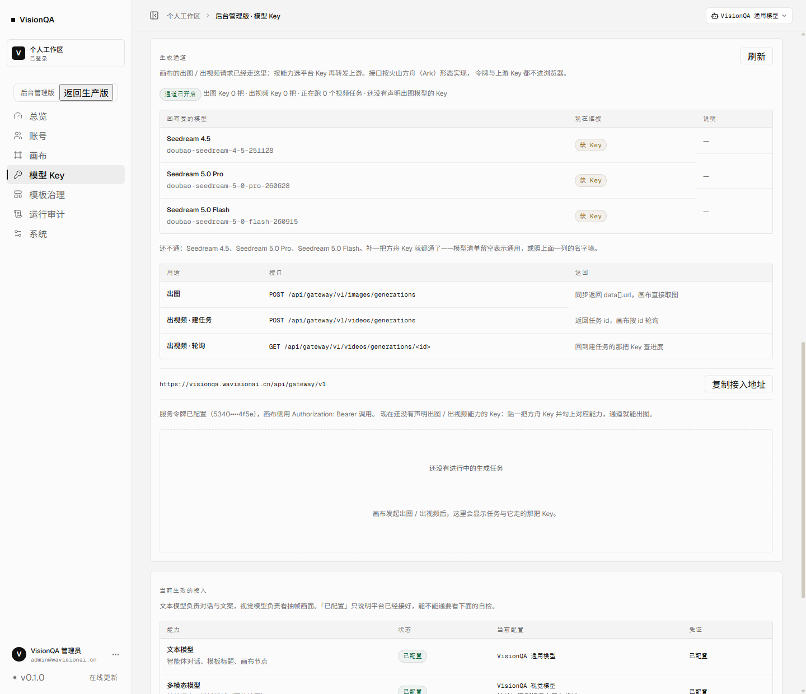

# 平台生成通道：出图 / 出视频也走平台 Key

这份文档说明 VisionQA 的出图 / 出视频通道（`/api/gateway/v1/*`）：它解决什么问题、
接口长什么样、怎么鉴权、怎么选 Key、失败了怎么排查，以及画布侧怎么接（已接通，见第七节）。

适用代码：`server/gateway.mjs`（转发与任务登记）、`server/routes/gateway.mjs`（HTTP）、
`server/config.mjs` 的 `gateway` 段、后台「模型 Key → 生成通道」卡片。

## 一、解决什么问题

Key 池以前只服务文本与视觉（对话、评审）。出图 / 出视频这条路原来是断开的两截：

- 画布的出图 / 出视频节点用它自己的密钥表，跟平台 Key 池没有关系；
- 平台 Key 池里能声明「出图 / 出视频」能力，但没有任何调用路径。

通道补上中间那段：**调用方把生成请求发给 VisionQA，VisionQA 按平台 Key 池选一把上游 Key 转发**。
以后加一把出图 Key 只改后台，不动画布。

## 二、接口

协议按火山方舟（Ark）的公开形态实现，因为画布的出图 / 出视频节点用的就是这一套。

| 用途 | 方法与路径 | 关键请求字段 | 返回 |
| --- | --- | --- | --- |
| 出图 | `POST /api/gateway/v1/images/generations` | `model` `prompt` `size` 等原样转发 | 上游 `data[]`，另附 `urls[]` |
| 出视频 · 建任务 | `POST /api/gateway/v1/videos/generations` | `model` `content[]` `ratio` 等原样转发 | 上游 `id`（任务 id） |
| 出视频 · 轮询 | `GET /api/gateway/v1/videos/generations/<id>` | — | 上游任务状态，含 `content.video_url` |

三层路径都另有一套方舟原样写法，等价指向同一段逻辑，**按方舟协议写死的客户端只改 base URL 就能接**：

| 方舟写法（画布用的就是这套） | 等价于 |
| --- | --- |
| `POST /api/gateway/v1/images/generations` | 出图 |
| `POST /api/gateway/v1/contents/generations/tasks` | 出视频 · 建任务 |
| `GET /api/gateway/v1/contents/generations/tasks/<id>` | 出视频 · 轮询 |

返回体是**上游原始 body**（`data[]`、`id`、`status`、`content` 都在顶层），平台自己的
`urls` / `key` / `ms` 附加在同一层。这一点不能改：调用方就是按 `data[].url` 取图的，
包一层 `{ data: {...} }` 会让它「成功但 0 张图」（联调时真踩到过，见第八节）。
出图是同步的：一次请求等到图。出视频是异步的：建任务拿 id，然后按 id 轮询。
**轮询必须回到建任务的那把 Key**，所以服务端记住「任务 id → Key」的对应关系。

## 三、鉴权

调用方是画布服务端，不是浏览器，所以不用用户会话，用平台服务令牌：

```http
POST /api/gateway/v1/images/generations
Authorization: Bearer <VQ_GATEWAY_TOKEN>
Content-Type: application/json
```

- 令牌存在服务端 `.env` 的 `VQ_GATEWAY_TOKEN`，用常量时间比较，长度不同直接拒。
- **没配令牌时通道整体回 503**，不会退化成匿名可用。
- 令牌与画布账号互通的共享密钥分开两把：一把泄露只轮换一把。
- 令牌明文不进浏览器、不进日志；后台只显示前后各四位（如 `5340••••4f5e`）。

## 四、怎么选 Key

与聊天链路同一套规则（`resolveKey`）：启用的 Key → 声明了本次能力（`image` / `video`）→
模型白名单匹配 → 跳过冷却中的 → 取优先级最小的一组 → 组内按权重随机。
池里没有可用 Key 时**不回落环境变量**（生成类调用没有历史凭证可退），直接回
`503 NO_IMAGE_KEY` / `503 NO_VIDEO_KEY`，并说清「去后台加一把声明了对应能力的 Key」。

### 故障回退：一把失败就换下一把

出图与「建视频任务」都是一次请求定生死，所以两处都按 `resolveKeyCandidates()` 排出的候选表逐个试
（最多 3 把）：

1. `planRoute` 先算出这次有哪些 Key 可选（启用 / 有能力 / 模型匹配 / 不在冷却）；
2. 候选顺序：优先级小的先试，同优先级按权重随机且不放回，最后才用更低优先级的 Key 兜底；
3. 任何失败都换下一把：连不上、上游 4xx / 5xx、返回 200 但没有图片地址 / 任务 id；
4. 全部失败时按最后一把的结论回错误，但文案会带「连续试了 N 把 Key 都没成」，并在响应里带 `attempts`；
5. **轮询不换把**：视频任务挂在某把 Key 的账号下，轮询必须回到建任务的那把（任务 id → Key 记在进程内）。

每次**尝试**都会写一条路由记录（能力 / 模型 / Key / 理由 / 第几把 / 耗时 / 成败），
后台「最近路由」能看出「第 1 把 500、第 2 把接住」，统计行还有「换 Key 成功 N 次」。
轮询的中间态不单独记日志，只在任务到终态（成功 / 失败）时补一条，避免每 5 秒刷一行。

## 五、失败口径

| 情况 | 返回 |
| --- | --- |
| 没有令牌 / 令牌不对 | `401 GATEWAY_UNAUTHORIZED` |
| 通道未配置 | `503 GATEWAY_NOT_CONFIGURED` |
| 没有对应能力的 Key | `503 NO_IMAGE_KEY` / `503 NO_VIDEO_KEY` |
| 上游 4xx / 5xx（所有候选都失败） | `502 UPSTREAM_REJECTED` + 人话说明 + `upstreamStatus`，文案带「连续试了 N 把 Key」、响应带 `attempts` |
| 连不上上游 / 超时 | `502 UPSTREAM_UNREACHABLE` |
| 上游 200 但没有图片地址 / 任务 id | `502 UPSTREAM_EMPTY` |
| 轮询未知任务（服务重启） | `404 TASK_NOT_FOUND`，提示重新发起 |

上游失败会计入该 Key 的失败次数，连续 3 次冷却 60 秒 —— 和聊天链路共用同一份健康度。

## 六、后台能看到什么

「模型 Key」页最下面「生成通道」卡片：

- 通道开没开（令牌是否配置，只显示前后四位）；
- 出图 / 出视频 Key 各几把、可用的模型有哪些；
- 三个接口的路径与用途；
- 接入地址（一键复制，给画布侧填）；
- 正在跑的视频任务与它走的那把 Key；
- **「画布要的模型 → 现在谁接」对账表**：画布出图节点会发三个方舟真实模型名
  （`doubao-seedream-4-5-251128` / `…-5-0-pro-260628` / `…-5-0-flash-260915`），
  每一行标「已接入 / 通用 Key 接 / 缺 Key」。加完 Key 不用等画布报错，就知道还差哪个。



## 七、画布侧怎么接（已接通，2026-11-11）

画布原本把方舟地址写死在代码里，密钥来自它自己的 `enterprise_api_keys` 表。现在改成：
地址读环境变量、密钥表里只放一把「平台生成通道」的 Key（值就是平台服务令牌）。

### 1. 改代码：地址改读环境变量（幂等补丁）

```bash
python3 deploy/bd-canvas/wire_gateway.py --root /opt/bdcanvas --dry-run   # 先看会改什么
python3 deploy/bd-canvas/wire_gateway.py --root /opt/bdcanvas
```

它给 `generation_seedream.py` 加一个 `_gateway_endpoint()`，把三款 Seedream 的端点改成：

```text
模型级环境变量 → BD_IMAGE_GATEWAY_ENDPOINT → 方舟官方地址
```

并把 `generation_seedance.py` 的 `SEEDANCE_BASE_URL` 改成读 `BD_SEEDANCE_BASE_URL`。
**不设环境变量时行为完全不变**，所以补丁本身不会改变线上行为。

### 2. 配地址：画布走本机回环，不出公网

`/etc/systemd/system/bdc-enterprise.service`：

```ini
Environment=BD_IMAGE_GATEWAY_ENDPOINT=http://127.0.0.1:8799/api/gateway/v1/images/generations
Environment=BD_SEEDANCE_BASE_URL=http://127.0.0.1:8799/api/gateway/v1
```

然后 `systemctl daemon-reload && systemctl restart bdc-enterprise`。用回环而不是公网域名：画布与 VisionQA 同机，
服务令牌不必出网卡，也不依赖 nginx 与证书。画布搬到别的机器时把这两行换成公网地址即可。

### 3. 建 Key、写指针、给现有用户补授权

```bash
/opt/bdcanvas/.venv/bin/python deploy/bd-canvas/setup_gateway_key.py --dry-run
/opt/bdcanvas/.venv/bin/python deploy/bd-canvas/setup_gateway_key.py
```

它从 `/opt/visionqa/.env` 读平台令牌（不打印），调画布管理员接口建一把名为
「VisionQA 平台生成通道」的 Key（`provider=volcengine`，模型不限），把 Key id 写进
`system_settings` 的 `visionqa.gateway_key_id`，再给现有账号补 5 个模型授权。

### 4. 新用户首次进画布自动授权

```bash
/opt/bdcanvas/.venv/bin/python deploy/bd-canvas/grant_models.py --root /opt/bdcanvas
```

VisionQA 票据换画布会话时（`enterprise_server/auth.py` 的 `exchange()`），如果这个影子用户
**一条模型授权都没有**，就按 `visionqa.gateway_key_id` 补上 5 个平台模型：
Seedream 4.5 / 5.0 Pro / 5.0 Flash，Seedance 2.0 / 2.0 Fast。
只在「一条都没有」时补，管理员之后单独收回某个模型不会被下次登录覆盖。

### 5. 验收

- 画布后台「Key 管理」能看到这把 Key（[截图](screenshot-canvas-gateway-key-2026-11-11.png)）；
- 画布后台点这把 Key 的「测试」：返回里 `base_url` 是 `http://127.0.0.1:8799/api/gateway/v1`、
  `status_code` 是 404（本通道对未知任务的回答），说明**画布进程确实在读新地址、令牌也过了鉴权**；
- 池里放一把临时出图 Key（指向本地假上游）→ 画布调 `/enterprise/api/generate/seedream45`
  → 返回 200、`generated_images: 1`、图片落进画布媒体备份，平台「最近路由」记一条成功。

## 八、验证情况

已验证（生产，2026-11-11）：

- 通道未带令牌 → `401 GATEWAY_UNAUTHORIZED`；带上令牌但池里没有出图 Key → `503 NO_IMAGE_KEY`
  （出视频同理 `NO_VIDEO_KEY`）；公网入口与回环行为一致；
- 后台「生成通道」读到真实状态：通道已开启、令牌前后四位、Key 计数与模型清单；
- **画布→通道→平台 Key→上游→回画布** 全链联调（临时假上游，跑完即删）：
  画布 `/enterprise/api/generate/seedream45` 回 200、`generated_images: 1`、媒体备份 id 2，
  路由日志 35 ms 一条成功，模型名 `doubao-seedream-4-5-251128` 原样透传；
- **故障回退**（池里两把演练 Key：P5 永远 500、P10 正常）：一次调用 `attempt: 2`、
  `key.name` 是第二把，路由日志两条（第 1 把失败 / 第 2 把成功）、统计「换 Key 成功 2 次」；
  只剩坏 Key 时回 `502 UPSTREAM_REJECTED`；演练 Key 与假上游跑完即删；
- 联调时发现并修掉一个真问题：通道原来把上游 body 包成 `{ data: {...} }`，
  画布按 `data[].url` 取图，于是「200 但 0 张图」。现在改为上游 body 原样平铺，
  并加了断言 `image.data` 必须等于上游的 `data[]`。

尚未验证：**真实出视频**（要一把方舟出视频 Key，等业务给；真实出图已在 2026-11-11 补验，见第十节）；
画布出视频链路的真实建任务与轮询（通道侧已由 `scripts/test-gateway.mjs` 的假上游覆盖）。
## 九、还没做

- **计费**：通道不在积分链上扣费。画布自己有免费额度与计费，平台侧暂不重复收费。
- **按用户配额**：现在只认服务令牌，不认「谁在生成」；要按账号计量得让画布带上用户身份。
- **任务持久化**：视频任务与 Key 的对应关系在进程内存里，重启后旧任务查不到（画布会重新发起）。
- **多进程**：如果以后 Node 起多实例，任务登记要挪到共享存储。
- **非方舟供应商**：OpenAI 系 `/images/generations` 形态可用；百炼的异步出图协议不同，没接。
- **画布出视频真联调**：通道侧已用假上游覆盖建任务 + 轮询；画布侧要等一把出视频 Key 才能跑真实任务。
- **新模型要同步两处**：画布前端的模型目录（`modelCatalog.ts`）与授权脚本里的 `VISIONQA_GATEWAY_MODELS` /
  `MODELS` 常量。现在固定 5 个平台模型，加模型时两个脚本的列表一起改。

## 十、真实上游联调：用一把真的出图 Key 出一张真图（2026-11-11）

前面几轮的出图验证都用本地假上游，只证明「通道自己的逻辑对」。真正不确定的是
**请求形态对着真方舟对不对、返回的图片能不能用**。这一轮把池里的 Key 换成真实上游跑了一次。

做法：本地起一个实例（临时数据目录、端口 8901、服务令牌另配），池里放两把出图 Key：

| Key | 优先级 | 地址 | 声明模型 |
| --- | --- | --- | --- |
| 坏 Key（演示回退） | P1 | 一个没人监听的端口 | `doubao-seedream-5-0-260128` |
| 真实方舟出图 | P10 | 方舟兼容地址 | `doubao-seedream-5-0-260128` |

请求体按画布出图节点的真实形态发：`{model, prompt, size:"2048x2048", response_format:"url",
watermark:false, sequential_image_generation:"disabled"}`。

一次请求同时验两件事，结果 HTTP 200：

| 观察 | 值 |
| --- | --- |
| `attempt` | `2` —— 第 1 把连不上，自动换到第 2 把 |
| `key.name` | 火山方舟出图（真实上游） |
| `ms` | 43796 |
| `urls[0]` | `https://ark-acg-cn-beijing.tos-cn-beijing.volces.com/doubao-seedream-5-0/…jpeg`（带签名，24 小时有效） |
| `usage` | `generated_images: 1`、`output_tokens: 16384` |

把 `urls[0]` 下回来是 332 KB 的真 JPEG：


失败路径同样真跑过（不产生费用）：

| 场景 | 返回 |
| --- | --- |
| 出视频、池里没有视频 Key | `503 NO_VIDEO_KEY`「平台还没接入出视频模型，请联系管理员补一把出视频 Key」 |
| 出图、没有任何 Key 声明请求的模型 | `503 NO_IMAGE_KEY`，调用方看到人话；`detail` 写清「池里没有声明模型 X 的出图 Key；现有 Key 声明的模型：…」 |
| 两把出图 Key 都连不上 | `502 UPSTREAM_UNREACHABLE`「连续试了 2 把 Key 都没成，最后一把说 连不上出图上游：网络不通或地址填错了」 |

### 这一轮顺手修的两处

1. **模型名对不上时别说成「一把 Key 都没有」**：画布发的是方舟真实模型名
   （`doubao-seedream-4-5-251128`），管理员照产品名填 `doubao-seedream-4.5` 就匹配不上。
   现在调用方看到的还是人话，具体「哪个模型没被任何 Key 声明、现有 Key 声明了哪些」
   写进响应的 `detail` 与后台路由日志，管理员一看就知道差在哪。
2. **网络错误翻成人话**：`fetch failed` / `ENOTFOUND` / 超时不再原样抛出来，
   统一说「网络不通或地址填错了」或「上游超时」。


---

## 十一、接第二种上游：SeeAPI（CGCM）

画布不止有火山方舟的通道。2026-11-11 又接了一把 SeeAPI（CGCM）的 Key，
协议形态与方舟完全不同，所以通道现在按 **Key 的 baseUrl 自动认协议**——
管理员贴 Key 时只管贴地址，不用再选一个「协议」字段。

| 动作 | 方舟（ark） | SeeAPI（cgcm） |
| --- | --- | --- |
| 同步出图 | `POST {base}/images/generations` | `POST {base}/v1/images/generations` |
| 异步出图 | — | `POST {base}/v1/images/generations/async` → `GET {base}/v1/tasks/<id>` |
| 建视频任务 | `POST {base}/contents/generations/tasks` | `POST {base}/v1/video/generations` |
| 查任务 | `GET {base}/contents/generations/tasks/<id>` | `GET {base}/v1/tasks/<id>` |

判定只看域名特征（`cgcm` / `seeapi`），地址写成 `https://api.cgcm-api.com` 或
`https://api.cgcm-api.com/v1` 都认。

### 同一个模型两个名字

画布的出图节点按方舟的真实模型名发请求（`doubao-seedream-5-0-pro-260628`），
SeeAPI 只认自己的叫法（`seedream-5.0-pro`）。通道里维护一张别名表：

```js
export const MODEL_ALIASES = {
  'doubao-seedream-5-0-pro-260628': 'seedream-5.0-pro',
}
```

- 选 Key 时「原名与别名」都算命中，所以声明了 `seedream-5.0-pro` 的 Key 能接住画布的 5.0 Pro；
- 真正的请求体里换成上游叫法再发（方舟 Key 不动，原名照发）；
- 后台对账表在这一行标「按 seedream-5.0-pro 发」，避免管理员误以为模型名已经填对。

### 请求形态差异

- SeeAPI 同步出图默认回 `b64_json`（一张图几 MB），通道在调用方没指定时按
  `response_format: "url"` 要地址，画布按 `data[].url` 取图；
- SeeAPI 的异步出图强制要 `Idempotency-Key`，调用方没给时通道按本次请求生成一个；
- SeeAPI 的任务终态比方舟多两个：`refunded`（失败已退款）、`canceled`，都按「没出片」记路由日志。

### 模型目录接口

`GET /api/gateway/v1/models` 返回池里已声明的模型（OpenAI 形态）。
画布后台「测试 Key」会先探这个地址判活，所以把画布指向通道后，
那把 `provider=cgcm` 的平台令牌 Key 在画布后台点「测试」是 200，而不是 401。
