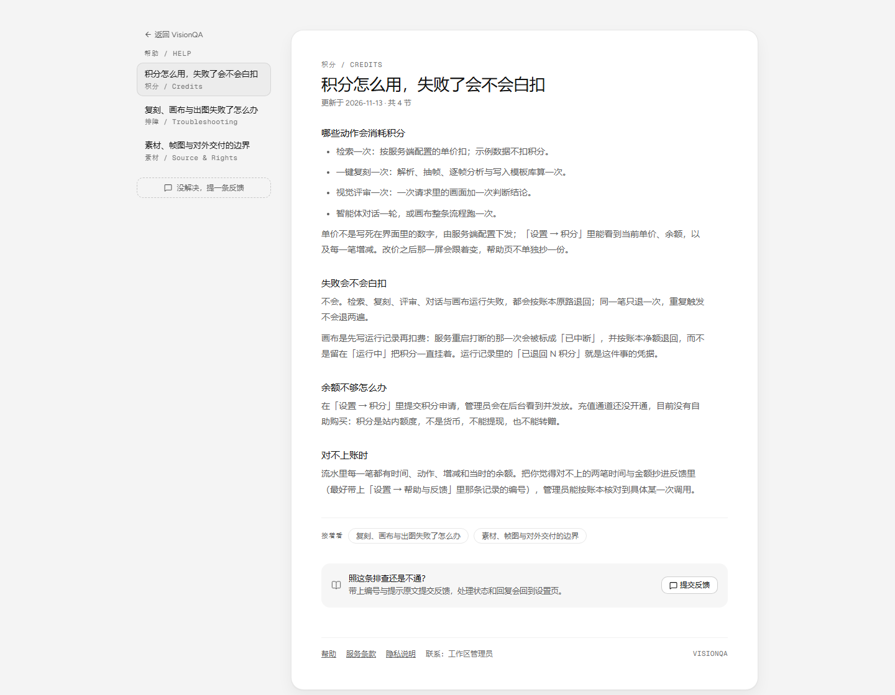
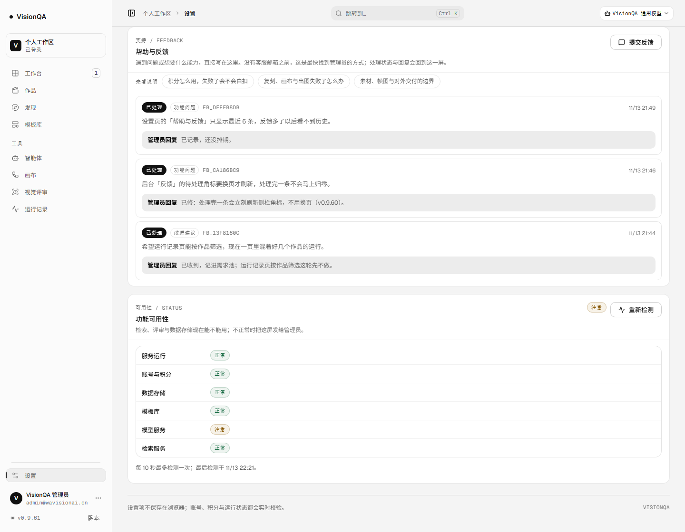

# 帮助中心：没有客服邮箱时，先让人自己找到答案（v0.9.61）

## 为什么做这一篇

B5 的应用内反馈解决了「找不到人」的问题（v0.9.60），但它解决不了「不想问人」的问题。三件被问得最多的事——积分怎么扣、复刻为什么失败、素材能不能用——此前只散落在条款页、弹窗文案和报错里：用户得先失败一次，才看得到对应的解释；而失败时的 402 / 502 文案只会说「失败了」，不会说下一步。

客服邮箱还没到位（等用户给），帮助中心是不依赖任何外部输入的自助路径：不登录能读，读完还不行就地提交反馈。

## 做了什么

- **三篇公开说明**（`src/domain/help.ts`）：积分与退回、复刻/画布/出图失败排查、素材与帧图边界。内容只写产品真的怎么做，单价不写死（指向「设置 → 积分」的实时值），失败原因对得上服务端的真实步骤（获取视频与抽帧 → 读取视频信息 → 抽帧 → 逐帧分析 → 写入模板库）。
- **独立地址**：`#/help` 是目录，`#/help/<slug>` 是单篇；与条款页同一条「不登录也能打开」的路径，走 `isBareRoute`，不进工作台外壳。认不出的 slug 落回目录并把地址规范化成 `#/help`，坏链接不挡人。
- **入口接到真实卡点，不止页脚**：登录页页脚与条款页页脚有「帮助」；设置页「帮助与反馈」顶上一排三篇入口；**复刻失败弹窗**与**运行记录失败详情**直接链到排查那篇；命令面板 Ctrl K 里也能搜到「帮助中心」。
- **帮助页自己就是反馈入口**：侧栏与页尾都有「提交反馈」，复用 B5 的弹窗；不登录也能提交（联系方式必填），提交后处理结果回到设置页。
- **左目录右正文**：桌面 216px 目录 + 正文卡，窄屏目录折成竖排；正文 14px / 1.8，行宽 620px，间距只用 4 的倍数。

## 生产验收（v0.9.61）

| 动作 | 结果 |
| --- | --- |
| `/api/version` | `0.9.61`，`startedAt 2026-11-13T14:21:04Z` |
| 不登录打开 `#/help/credits` | 标题「积分怎么用，失败了会不会白扣」，4 节、目录 3 条 |
| 不登录打开 `#/help/nonsense` | 地址规范化成 `#/help`，落在目录页「先在这里找答案」 |
| 登录页页脚（无 cookie） | `帮助=#/help` / 服务条款 / 隐私说明 / 反馈问题 |
| 设置页（登录态） | 三篇入口 href 分别为 `#/help/credits`、`#/help/replicate-failed`、`#/help/copyright` |
| 不登录点帮助页「提交反馈」 | 弹窗打开，3 个类型按钮，POST 走公开接口（v0.9.60 已验） |
| 控制台报错 | 0 |
| health | `{ok:true, redfox:true, vision:true, llm:true, templates:26}`；模型服务检查为 `warn`，原因仍是「待首次生成验证」，与本轮无关 |

## 测试

新增 `test/help-center.test.mjs` 8 条：三篇字段与节数、每节非空且标题不重复、slug 白名单与坏链接回落、相关文章解析且不指向自己、内容与产品行为对得上（退回/直链/不保存原视频）、路由与页面接线、五处入口真实存在、帮助页自带反馈与条款链接。

全套 **543/543** 通过；`npx oxlint src server test scripts deploy` 0 error / 7 warning（均为既有规则，本轮未新增）；`tsc -b` 干净；构建通过（入口 `index-Dc9MbDj0.js`）。

## 边界

- 三篇是**说明**不是**教程**：没有图、没有视频，也不覆盖账号与登录问题（那类问题仍要找管理员）。
- 内容随产品改；单价与失败文案都在各自界面里，帮助页不抄第二份，避免两处漂移。
- 帮助页的反馈入口不登录可用，但**匿名用户仍看不到回复**（B5 的已知边界，等 SMTP 凭据）。
- 没有站内搜索与「这篇有用吗」统计；三篇之外的新问题先靠反馈收集。

## 回滚

`bash /opt/visionqa/ops/rollback.sh` 回到上一版；前端改动无数据迁移，帮助页无服务端状态。
