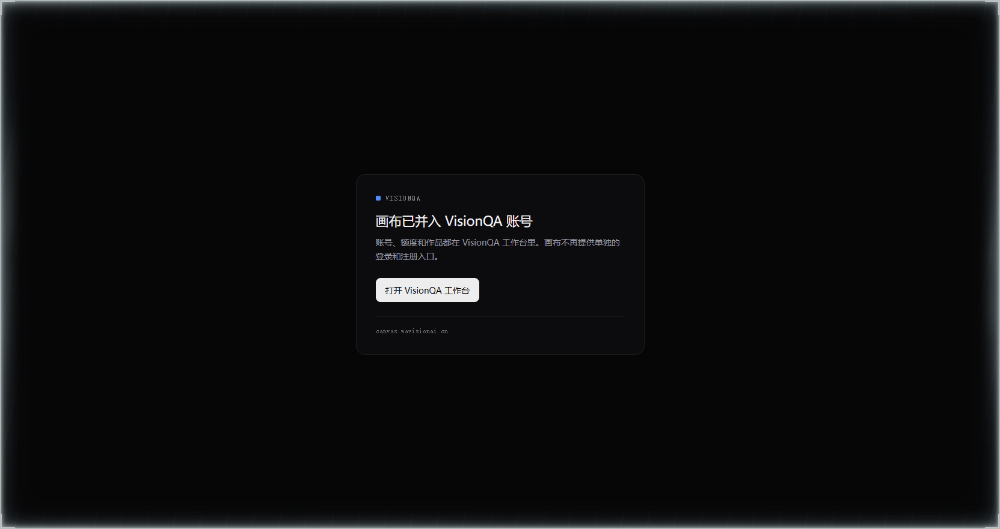
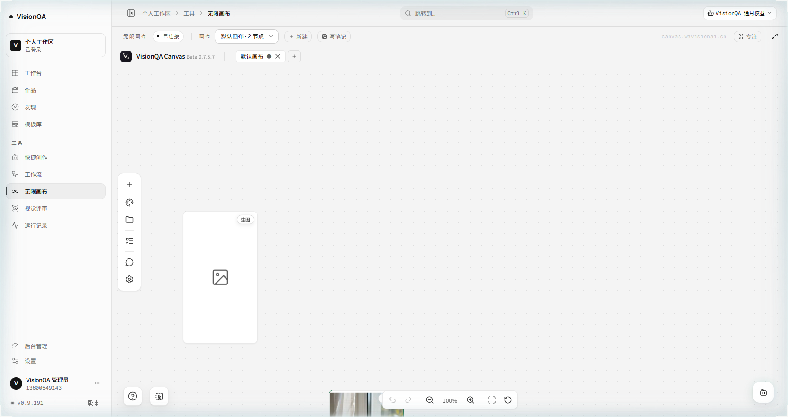
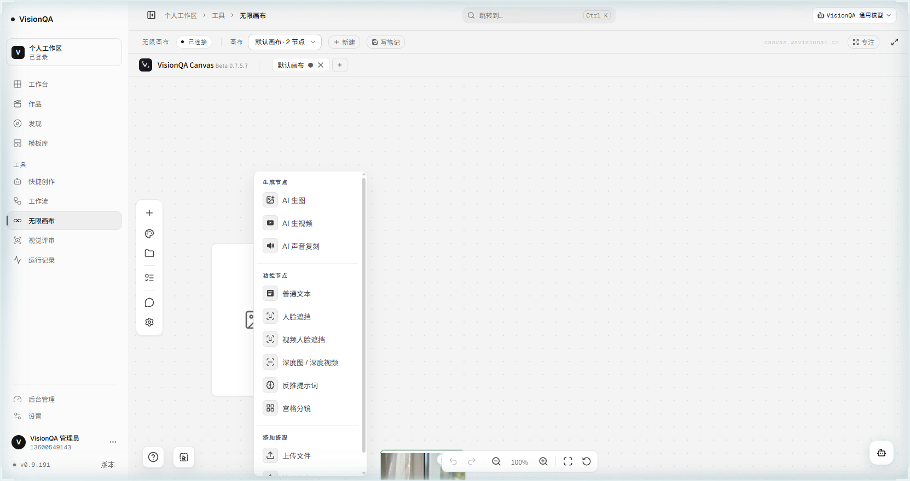

# 无限画布换品牌并切生产（2026-11-18，0.9.191 同期）

## 做了什么

用户 2026-11-18 明确两句：**「水印 / canary 一起删掉，我确定没问题」**、**「切生产，同步上生产环境」**。于是把分支 `rebrand-visionqa`（`8d97da1`，607 文件）真的切到了生产 `/opt/bdcanvas`。

## 生产原本不是干净分支

切之前先看清现场：`/opt/bdcanvas` 在 `master @ c5eaa1e`，但工作区有 **11 个未提交改动**，而且都是线上正在用的东西：

| 文件 | 是什么 |
| --- | --- |
| `public/vq-theme.css`（+364 行） | 我们自己的视觉主题 |
| `public/assets/bd-canvas-app-icon.png` | 我们的图标 |
| `src/ui/styles/index.css` | 多一行 `@import './visionqaGate.css'` |
| `enterprise_server/generation_*.py` | 出图 / 出视频地址改走 `BD_*_BASE_URL` 环境变量（指向我们自己的网关） |
| `enterprise_server/db.py` / `models.py` | `enterprise_users.external_id`（VisionQA 账号的影子用户映射） |
| `enterprise_server/admin_diagnostics.py` | 诊断页的 CGCM 地址也走环境变量 |
| `enterprise_server/data/enterprise.db` | 线上用户与画布数据 |
| `enterprise_server/.env.wechat-pay` | 支付配置（**仓库里已跟踪，属于该清理的历史债**） |

直接把分支 checkout 过去会被这些改动挡住，硬来就是丢主题、丢用户映射。所以走的是**合并**：

```
git switch -c prod-rebrand-20261118          # 带着现场改动切分支，master 不动
git add -u && git commit                     # 「换品牌前的生产现场」ff7eb55
git fetch origin rebrand-visionqa            # 8d97da1
git merge origin/rebrand-visionqa            # 只有 src/features/startup/runtimeMode.ts 冲突（CRLF vs 头注释）
git checkout --theirs src/features/startup/runtimeMode.ts   # 取分支那份（功能一样，头注释已换）
git commit                                   # 146ebea
```

合并后与 `rebrand-visionqa` 的差异**只剩**那 11 个本地补丁（`git diff --name-only origin/rebrand-visionqa HEAD` 逐条核过），一个都没丢。

## 快照与回滚

- 快照：`/var/backups/bdcanvas/bdcanvas-pre-rebrand-20261118-1456.tgz`（6.9 MB，排除 `node_modules` / `.venv` / `.git`）
- 分支：`prod-rebrand-20261118`（合并后 146ebea）；`master` 仍停在 `c5eaa1e`，没有动
- 回滚两条路：`git switch prod-rebrand-20261118~1`（回到「现场」提交 ff7eb55）后重启服务；或者直接解上面那个 tgz 覆盖回来

`package.json` 的改动只有名字 / 作者 / 元信息，**依赖没变**，`node_modules` 不用重装。

## 重启与验收（都是生产）

```
systemctl restart bdc-web bdc-api bdc-enterprise
bdc-web active / bdc-api active / bdc-enterprise active
GET http://127.0.0.1:6677/        200  370,523 B
GET http://127.0.0.1:5312/api/health  200
GET http://127.0.0.1:5313/        302
GET /src/main.ts（vite 转译）      200  3,048,613 B   ← 前端真编译得过，不是只有外壳 200
```

文案核对（生产、走 vite 渲染出来的真文件）：

- `index.html`：`<title>VisionQA Canvas Beta 0.7.5.7 - 视频生成编辑器</title>`，`晨羽` **0** 处，`VisionQA` 4 处
- `src/features/generate/modelCatalog.ts`：`晨羽` **0** 处；`cgcm` 125 处**全是内部 ID**（`cgcm-seedance-2-0` 这类，不能动，动了已保存节点和历史项目就断）
- 用户能看到的模型名全是中性的：`Image 2 Pro`、`Image 2.5`、`Nano Banana 2`、`GPT Image 2`、`Seedance 2.0`、`Seedance 2.0 Fast`、`Doubao Seedream 5.0 Pro`
- `src` / `public` / `index.html` 里 `bdCanvasWatermark`、`BD_CANVAS_CANARY` **0 命中**（按用户授权删掉）

## 真实渲染截图（生产，不是本地实例）







三张图都是在本机 Chrome（用户已登录 VisionQA）里打 `https://visionqa.wavisionai.cn/#/board` 截的：一张画布根地址（并入 VisionQA 账号的门）、一张嵌入后的画布本体（顶栏 `VisionQA Canvas Beta 0.7.5.7`、左栏 v0.9.191、状态条「已连接」）、一张双击画布弹出的节点菜单（AI 生图 / AI 生视频 / AI 声音复刻 / 普通文本 / 人脸遮挡 / 视频人脸遮挡 / 深度图 / 反推提示词 / 宫格分镜 / 上传文件，**没有一个带 CGCM 或第三方品牌**）。

## 还留着的（没有假装做完）

1. **后端与管理后台仍是第三方的名字**：`enterprise_server/` 约 300 处、`server_v2.py` 50 处、`admin/js/` 96 处 `CGCM` —— 这轮按「用户可见」划界，管理员后台那一层没动。要全链路无痕得另开一轮。
2. **水印没了，但 LICENSE 文件还在**：删水印是用户明确授权的，仓库根目录的上游许可文本保留着，第三方归属收在 `THIRD-PARTY-NOTICES.md`。这是「保留归属、去掉界面痕迹」的折中。
3. **这两个提交只在服务器上**：`prod-rebrand-20261118` 分支带着线上数据（`enterprise.db`）与支付配置，**没有推到远端**。要长期可复现，得先把数据文件从仓库里摘出去再推。
4. `scripts/check-workspace-release-artifacts.js` 里按 `ai-canvas-pro*` 前缀找产物，包名改成 `visionqa-canvas` 之后会漏检——已记在待办里。
