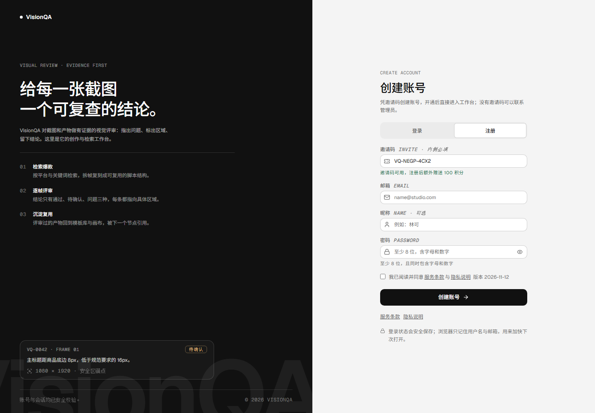
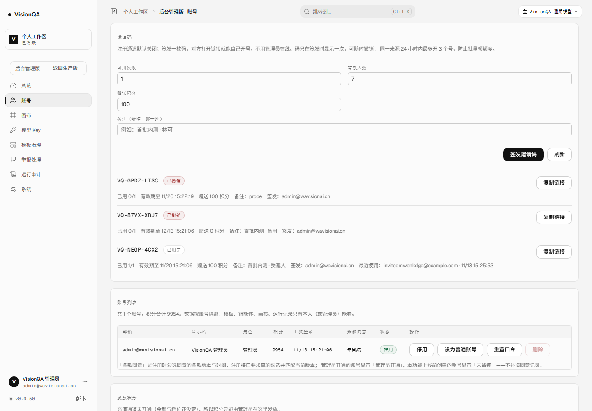
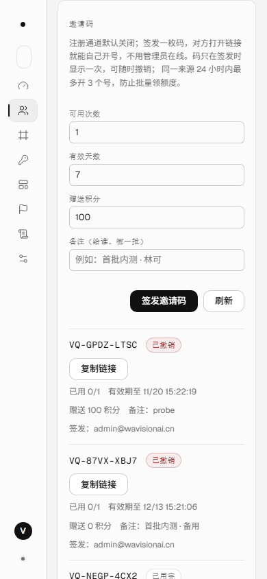

# 邀请制闭环：内测开号不用管理员在线（v0.9.50，2026-11-13）

## 起因

A3 的现状是：注册全局关闭，开号只有一条路——管理员在后台「新建账号」，生成一次性临时口令，再私下发给对方。10–30 人内测能顶住，但每来一个人都要管理员在线；而且看不出这个号是谁带来的、送了多少积分，事后也没法追。

这一轮把它补成闭环：管理员签发邀请码 → 对方打开链接自己注册 → 码用掉/撤销立即失效 → 后台能看见谁用了、还剩几次。

## 改了什么

| 部分 | 之前 | 现在 |
| --- | --- | --- |
| 开号入口 | 只有后台建号 + 一次性临时口令 | 注册关闭时，有效邀请码也能自助开号（`#/register?code=…`） |
| 码的形态 | 无 | `VQ-XXXX-XXXX`，字母表去掉 0/O/1/I；小写、空格、缺前缀都能认 |
| 次数控制 | 无 | 条件占用：`UPDATE … WHERE used < max_uses AND revoked_at IS NULL AND expires_at > now`，并发只有一个能成功 |
| 失效 | 无 | 撤销立即失效（410）；用完、过期也各自有明确提示 |
| 赠送额度 | 只能管理员手工发 | 按码配置（默认 100），账本单独记 `kind=invite`，和「管理员发放」「欢迎额度」分得清 |
| 后台可见 | 无 | 已用/上限、有效期、备注、签发人、最近一次使用者与时间；可复制链接、可撤销 |
| 反滥用 | 无 | 同一来源 24 小时最多 3 个邀请号（`VQ_INVITE_IP_LIMIT`）；公开验码接口 10 分钟 20 次尝试限流，IP 只存哈希 |
| 条款留痕 | 已有 | 复用注册校验：必须勾选且版本匹配，账号上记 `terms_version` / `terms_accepted_at` |

### 数据

`invites`（在 `auth.db`）：`id / code / created_by / max_uses / used / credits / note / expires_at / revoked_at / created_at`。

`invite_uses`：每占用一次记一行，带 `user_id / email / ip_hash / created_at`。状态不落库，由 `used / expires_at / revoked_at` 推导，避免「status 列和事实对不上」。

### 接口

- `POST /api/admin/invites`：签发（默认 1 次 / 7 天 / 100 积分，可传 `maxUses/days/credits/note`）
- `GET /api/admin/invites`：列表 + 汇总 + 最近使用
- `POST /api/admin/invites/:id/revoke`：撤销，幂等
- `GET /api/auth/invite?code=…`：注册页公开验码，只回能不能用、还剩几次、送多少积分
- `POST /api/auth/register`：新增可选 `inviteCode`；注册关闭时它就是通行证

### 界面

- 登录页：`#/register?code=…` 直达注册态并预填邀请码，450ms 防抖实时核验，可用时直接说「注册后额外赠送 100 积分」；注册关闭时不显示注册入口，但邀请码字段与说明照常给。
- 后台「账号」页新增「邀请码」卡片：可用次数 / 有效天数 / 赠送积分 / 备注 → 签发；签完当场显示码与 `#/register?code=…` 链接，一键复制；列表按码 + 状态 + 事实 + 操作排，390 宽压成一列，不横向滚动。
- 注册成功后地址栏从 `#/register?code=…` 收回 `#/overview`，不把邀请码留在地址栏里。

## 生产实测（2026-11-13，v0.9.50）

1. 管理员在后台签发 1 枚「首批内测 · 受邀人」：1 次 / 7 天 / 100 积分。
2. 无痕窗口打开 `/#/register?code=VQ-NEGP-4CX2`：标题「创建账号」，邀请码已预填，提示「邀请码可用，注册后额外赠送 100 积分」。
3. 填邮箱/昵称/口令、勾选条款提交：直接进工作台（`#/overview`），无需管理员介入。
4. 服务端核对新账号：余额 **200**（欢迎额度 100 + 邀请赠送 100），账本 `welcome:100, invite:100`；条款同意版本 `2026-11-12`；`invite_uses` 恰好 1 行且邮箱与账号一致。
5. 同一枚码换邮箱再注册：**410**「这枚邀请码已经用完了」；撤销另一枚未使用的码后再注册：**410**「已被撤销」。
6. 事后清理：删除测试账号（用户数回到 1）；3 枚邀请码最终状态 0 可用 / 1 已用完 / 2 已撤销，没有留下可用的码。

## 验收

- 生产 v0.9.50，入口 `index-MWQwm5Bc.js`，`/api/version` 0.9.50，两服务 active，健康检查 templates 26
- `npm test` **456/456**（新增 `test/invites.test.mjs` 14 条：规范化、状态优先级、1 次码不可复用、多次码、撤销、过期、来源计数与 IP 哈希、公开验码 200/410、注册关闭 403/格式错 400、真实路由注册 201 + 账本、撤销后不建号、注册开着时可选码、同来源第 4 个 429、验码限流、后台汇总）
提交 `b07a0cb`（代码 + 测试 + 文档 + 3 张截图），CI 43388564753 success。
- oxlint **0 error / 6 warning**、`tsc -b` 干净、构建通过
- 邀请码相关文件：`server/invites.mjs`、`server/routes/auth.mjs`、`server/routes/admin.mjs`、`src/pages/LoginPage.tsx`、`src/pages/admin/UsersSection.tsx`、`src/api/auth.ts`、`src/auth/session.ts`、`src/router.ts`

## 边界（别当成做完了）

- **码就是凭证**：谁拿到谁都能用，所以默认一人一码、少用多码；后台列表里显示明文是给管理员的，不要把截图里的可用码发到公开频道。
- **没有邮件通道**：现在只能复制链接/码，通过 IM 或邮件手动发给对方；「注册后自动发确认信」要等 A5（SMTP）。
- **反滥用只到来源计数**：同一出口 NAT 下的同事会共享 3 个名额（`VQ_INVITE_IP_LIMIT` 可调）；没有手机号/图形验证码。
- **赠送在注册时到账**：没有做「首次成功任务后解锁」，也没做新账号前 24h 复刻并发 1；批量注册仍能拿到 100 积分 × 3/IP/天。
- **没有来源归因报表**：`note` 字段和 `invite_uses` 能查到人，但没有「哪个渠道带来多少注册」的统计页。
- 邀请码可以多次使用（`maxUses`）时，所有使用者共用同一枚码；想一人一码就签 `maxUses: 1`。
