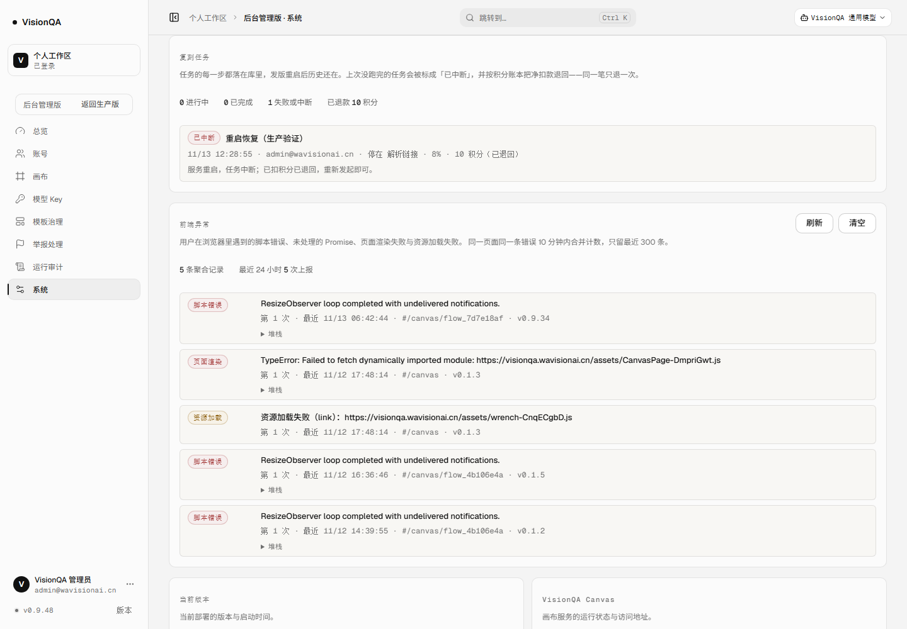
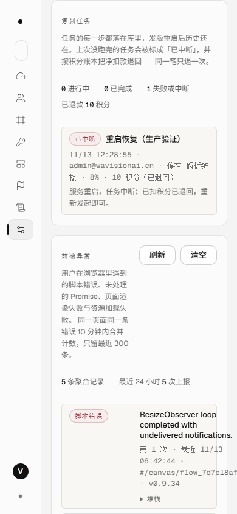
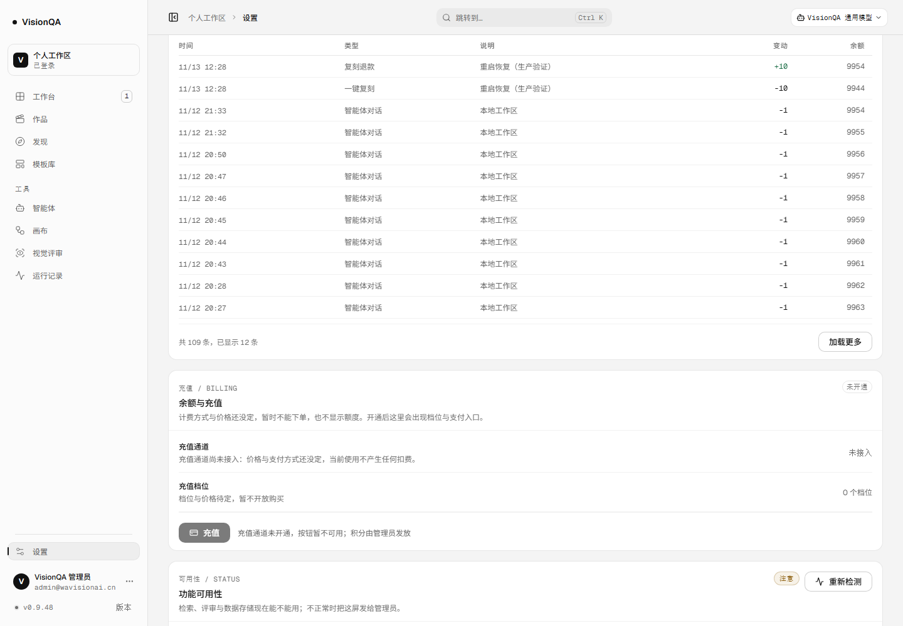

# 复刻任务落库与扣费一致（A1，v0.9.48）

> 第 60 轮（2026-11-13）。修的是[上线差距清单](launch-readiness-2026-11-12.md)里的 A1：
> 复刻任务只活在进程内存里，发版 / OOM 一杀进程，任务消失、已扣的 10 积分不退。
> 本文所有数字来自生产实测（`/api/version`、`/api/jobs/:id`、`/api/credits`、`journalctl`），不是本地推断。

## 一、漏在哪

| 环节 | 修之前 | 后果 |
| --- | --- | --- |
| 任务状态 | `server/jobs.mjs` 里一个进程内 `Map`（最多 40 条） | 进程退出，任务全部消失 |
| 扣费 | 路由先扣 10 积分，再起任务；退款挂在 `startReplicate` 的 `onSettled` 回调 | 进程被杀，回调永不执行，钱留在平台账上 |
| 重启 | `scripts/deploy.sh` 每次都 `systemctl restart`；全仓没有 SIGTERM/SIGINT 处理 | 发一次版就可能断一次任务 |
| 用户视角 | `GET /api/jobs/:id` 直接 404 | 用户只看到「任务不存在」，不知道钱去哪了 |
| 后台视角 | 没有任何任务列表 | 运营无法回答「昨晚那条为什么没跑完、退没退」 |

## 二、改成什么

1. **任务落库**：新建 SQLite 表 `replicate_jobs`（与账号、积分同一个库），一行记 id / 账号 / 状态 / 步骤 / 进度 / 日志 / 错误 / 模板 / 说明 / 积分 / 是否已退 / 时间。内存只留正在跑的和最近 60 条，重启后的真源是表。
2. **先落草稿、再扣费**：路由先生成 jobId、写一条 `queued` 草稿，再扣积分（账本 `ref` = jobId）。并发闸门或积分不足时把草稿撤掉；万一进程死在「已扣费、还没开始跑」之间，重启恢复也能把这笔算出来退掉。
3. **退款以账本为准**：新增 `outstandingCharge(userId, kind, ref)`，把同一 ref 的扣费与退款求和，还欠多少就退多少。重启恢复、停机收尾、路由兜底三条路径都调同一条幂等退款——跑第二遍算出 0，不会多退。
4. **启动恢复**：`recoverInterruptedJobs()` 把上次留下的 `queued` / `running` 一律标成失败，失败原因写「服务重启，任务中断；已扣积分已退回」，并按账本退款，顺手删掉崩溃时没清的任务临时目录（以前失败会清，崩溃没人清）。
5. **停机收尾**：`SIGTERM` / `SIGINT` 先调 `interruptRunningJobs()`（标中断 + 退款 + 落库），再关服务、1.5 秒后退出；流水线里加了 `aborted` 守卫，已经退款的任务不会再凭空建出一份模板。
6. **说明列不丢**：账本 `ref` 是 jobId（唯一、可对账），用户看到的「说明」改成从任务标题来（`meta.label`），退款行也带上同一个标题。

## 三、界面上的样子

后台「系统与版本 → 复刻任务」是新的运维视角：状态、停在哪个步骤、进度、积分与「已退回」、失败原因都在一行里；后台「告警」那套行样式复用，390 宽只换行、不横向滚。





用户侧两处：复刻弹窗失败时多一句「本次 10 积分已原样退回」；设置页积分流水的说明列显示这条复刻的标题（退款行同一标题），并在 390 宽把「余额」让位给说明，避免五列挤成一字一行。




## 四、生产实测（2026-11-13）

在生产的真账号上发起一条复刻（指向一个会一直连不上的公网地址，任务停在「解析链接」），中途重启服务：

```
# /api/jobs/job_3cced49f（重启前）
{ "status": "running", "step": "resolve", "progress": 8 }

# systemctl restart visionqa 时服务自己的日志
{"t":"shutdown","signal":"SIGTERM","interrupted":1}

# /api/jobs/job_3cced49f（重启后）
{ "status": "error", "step": "resolve", "refunded": true,
  "error": "服务重启，任务中断；已扣积分已退回，重新发起即可。", "cost": 10 }

# /api/credits：余额回到 9954，流水一扣一退，ref 都是 job_3cced49f
[{"kind":"replicate-refund","delta":10,"ref":"job_3cced49f"},
 {"kind":"replicate","delta":-10,"ref":"job_3cced49f"}]
```

| 检查项 | 结果 |
| --- | --- |
| 重启前任务状态 | `running` / 解析链接 |
| 停机日志 | `shutdown SIGTERM interrupted:1` |
| 重启后任务 | `error` + `refunded:true`，说明写清中断原因 |
| 余额 | 9954 → 9954（本次净扣 0） |
| 流水 | 一扣一退，净额 0；连续重启不会多退（单测覆盖） |
| 后台列表 | 1 条「已中断」，10 积分（已退回） |

本地也验证了更狠的一路：直接强杀进程（Windows 上 `child.kill()` 等价 TerminateProcess，来不及走收尾），重启后同一条任务被标中断、余额原样退回、`jobs.recovered` 事件落日志。

## 五、验收

- 测试：**430 / 430**（新增 `test/replicate-jobs.test.mjs` 8 条：落库可查、重启恢复退款、扣费后断电按净扣款退、已完成不退款、草稿撤销、后台列表、停机收尾、无链接立刻失败并退款）。
- 静态：`npx oxlint src server test` **0 error / 6 warning**（既有）；`npx tsc -b` 干净；`npm run build` 通过。
- 生产：v0.9.48，入口 `index-C686z1TW.js`，`/api/version` 0.9.48，health ok（templates 26），`visionqa` / `visionqa-internal` 都 active；release `20261113-052226-20261113-v0.9.48-jobs6.tar.gz`。
- 提交：`c0d5b8a`（代码 + 测试）+`7f4de59`（文档 + 4 张截图），CI 43372307894 success。
- 数据：发版与验证过程中生产的作品 / 模板 / 画布 / 原片 / 交付没有变化（templates 26），余额 9954；验证用的 2 条流水净额为 0。

## 六、边界（这轮没做的）

- 只覆盖「服务重启 / 进程崩溃」这一次性中断；跑得久的任务没有断点续跑，重启后要重新发起（但不再扣钱）。
- 流程运行（`/api/flows/:id/run`）仍用进程内回调退款，A1 只修了复刻这一条；同一套 `outstandingCharge` 可以直接复用。
- 没有加 systemd `MemoryMax`：OOM 仍可能发生，但现在重启后能自动退款，不再是静默扣钱。
- 没动备份（A2）：任务临时目录仍然随任务结束删除，不参与备份。
