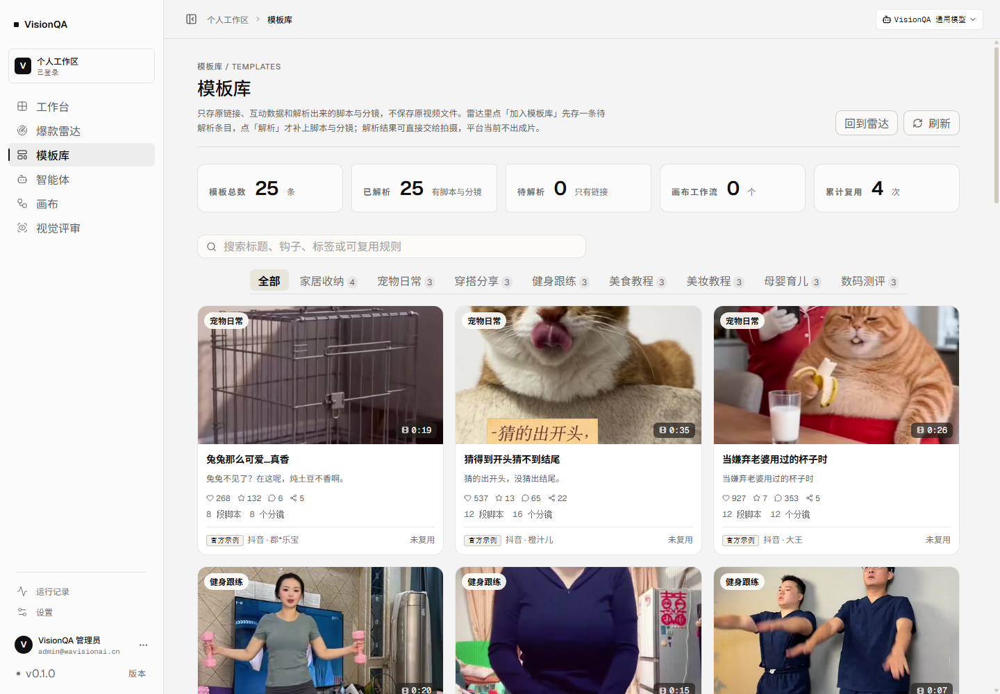
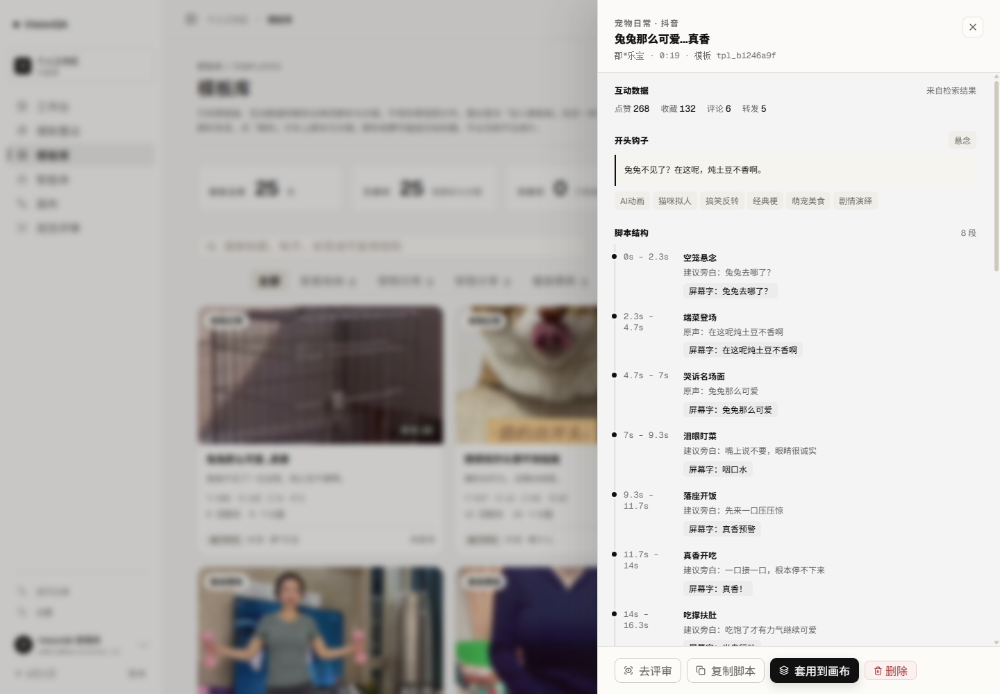
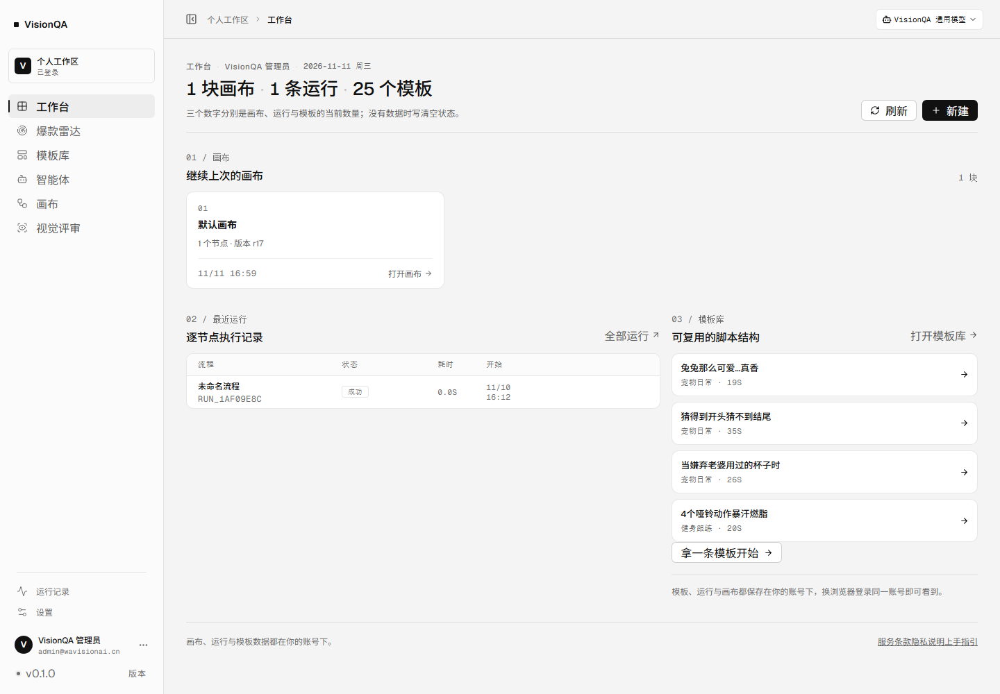
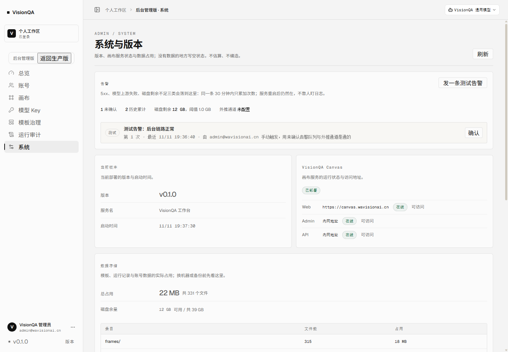
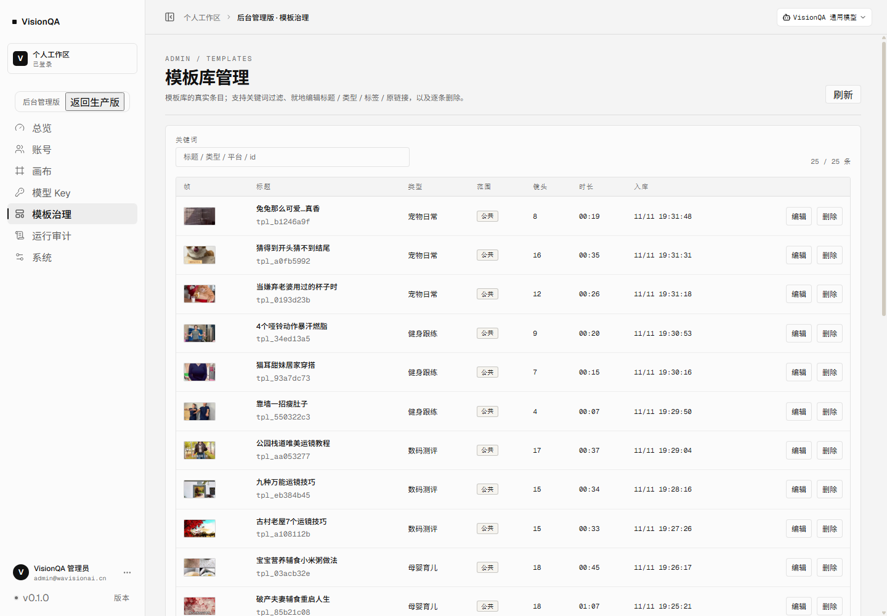

# 内容冷启动与告警：P0-7、P1-8 落地（2026-11-11，第三十四批）

结论先行：**审计里最后两条也落了。** 模板库从 1 条真实模板变成 **25 条已解析模板、8 个内容类型**，全部是雷达检索 + 一键复刻跑出来的，且标记为「公共模板」——任何新账号登录就看得见；告警做了 **5xx / 模型上游失败 / 磁盘不足** 三类，落盘、去重、后台可确认，配了 webhook 才外推。全部已上生产。

## 一、P0-7 内容冷启动

### 怎么做的

没有手工编造模板，全程走真实链路：

1. 生产站用管理员账号跑爆款雷达（`GET /api/search`，抖音，每类一页 24 条，按点赞排序）；
2. 每条先落「待解析」条目（`POST /api/templates/from-radar`，只存链接 + 作者 + 互动数据）；
3. 再跑一键复刻（`POST /api/replicate`）：下载 → 抽帧 → 视觉模型逐帧拆脚本与分镜，解析成功后**同一条**从「待解析」升级成「已解析」，不会占两格；
4. 全部以 `shared: true` 落库 → `ownerId` 为空 → 按 `server/owner.mjs` 规则「没有归属 = 公共」，所有账号可见。

关键词与产出（每类 3 条）：

| 类型 | 关键词 | 成片模板 |
| --- | --- | --- |
| 穿搭分享 | 秋冬穿搭 | 3 |
| 美食教程 | 一人食晚餐 | 3 |
| 家居收纳 | 小户型收纳 | 4（含原有一条毛衣折叠） |
| 美妆教程 | 新手化妆教程 | 3 |
| 母婴育儿 | 宝宝辅食 | 3 |
| 数码测评 | 手机摄影技巧 | 3 |
| 健身跟练 | 居家燃脂 | 3 |
| 宠物日常 | 猫咪搞笑日常 | 3 |

### 数字

- 检索 **8 次**（16 积分），复刻 **23 次成功**（230 积分），失败 1 次已原路退回 → **净花 244 积分**，余额 10247 → 9987（含我前期验证用的 16 积分）。
- 单条复刻耗时 **24–255 秒**（同一账号最多 2 个并发，等上游模型排队时最久约 4 分钟），24 条约 **16 分钟**跑完。
- 结果：**25 条 / 已解析 25 / 待解析 0 / 类型 8 种**；数据目录从 3.9 MB 涨到 **23.5 MB / 331 文件**（新增 315 张分镜帧，18.8 MB）。
- 失败那条是**原链接已下架**（上游明确回报），删除死链后库里不留空壳。

### 「公共模板」这个开关是新加的

以前所有模板都归创建人，管理员种进去的内容普通账号根本看不见——那就等于没种。这一批加了 `shared` 口径：

- `POST /api/templates/from-radar`、`POST /api/replicate` 收 `shared: true`（**仅管理员**，普通账号传了也无效）；
- 公共模板 `ownerId` 为空，`owner.mjs` 判为公共，所有账号可见、可读详情、可套用；
- 普通账号改模板仍然 403 `NOT_ADMIN`（实测）；
- 启动迁移 `adoptUnowned` 会跳过 `shared`，不会第二天一重启就把公共模板认领成管理员私有（这是最容易踩的坑，已加判断）；
- 后台「模板治理」新增 **范围** 列（公共 / 账号），编辑面板里有「公共模板」勾选，可随时收回。

### 可见性验证（不是只看管理员视角）

| 动作 | 结果 |
| --- | --- |
| 后台建一个普通账号并登录 | 201 / 200 |
| 该账号 `GET /api/templates` | **25 条**，类型分布与管理员完全一致 |
| 该账号读一条详情 | 8 段脚本 / 8 个分镜可读，`shared: true` |
| 该账号改模板 | **403**「只有管理员可以改模板」 |
| 清理 | 测试账号已删除，生产仍 1 个账号 |

## 二、P1-8 告警

### 三类告警

| 类别 | 触发点 | 判据 |
| --- | --- | --- |
| 服务端 5xx | `server/log.mjs` 的响应结束钩子 | 状态码 ≥ 500 且 ≠ 503（503 是「能力未开通」这类预期状态，不算故障） |
| 模型上游失败 | `server/service-state.mjs` 的 `noteModelFailure` | 额度不足（402）与凭证失效（401/403）——这类不会自愈，等用户来报就晚了 |
| 磁盘剩余不足 | `server/alerts.mjs` 的 `checkDisk`，启动时 + 每 5 分钟 | `statfs` 剩余低于 `VQ_ALERT_DISK_FREE_MB`（默认 1024 MB） |

### 行为

- **落盘**：`data/alerts.json`（重启还在，实测重启后告警仍在队列里）；
- **去重**：同一条（类型 + 路径/模型 + 状态码）30 分钟内只累加次数，不刷屏；
- **不拖垮主流程**：记告警失败是吞掉的——它挂在 5xx 处理链路上，自己再抛异常会把错误处理打挂；
- **外推**：`VQ_ALERT_WEBHOOK` 配了才推送（JSON 体，5 秒超时），没配就只留在本站队列；
- **后台**：`GET /api/admin/alerts`（含未确认数、磁盘剩余与阈值、外推通道状态）、`POST /api/admin/alerts/:id/ack`、`POST /api/admin/alerts/test`；「系统」页顶部就是这块卡片，可以直接「发一条测试告警」确认链路。

### 验证

| 验证 | 结果 |
| --- | --- |
| 生产发一条测试告警 | 201，卡片出现「测试告警：后台链路正常」，未确认 1 条 |
| 生产确认该告警 | 200，未确认归 0，历史累计保留 |
| 重启服务后再看 | 告警仍在（落盘生效） |
| 5xx 钩子（生产同版本代码） | 起最小 HTTP 服务发真请求：500 → 入队 1 条、重复 500 累加为 2；**503 不入队**（PASS） |
| 磁盘阈值 | 阈值 1 MB 判正常；阈值抬到 1 PB 必然触发并产生 `disk-low` 告警（PASS） |

说明：生产上**没有可安全制造的 5xx**（能触发的输入都会先被参数校验挡成 4xx），所以 5xx 这条用「真实 `startAccess` + 真实告警存储」的 HTTP 自测覆盖，生产侧验证的是同一套代码的队列、落盘、确认与通道状态。

## 三、顺手修掉的三处

1. **模板库类型标签写死**：原来是一份固定清单（口播干货 / 混剪卡点…），类型一改就出现「点了没结果」的空标签。改成按 `byType` 真实数据生成，数量多的排前面；后台改名后自动回到「全部」。
2. **「屏幕字」标签重影**：模型返回的内容自带「建议屏幕字：…」，界面上又有「屏幕字：」前缀，显示成「屏幕字：建议屏幕字：兔兔去哪了？」。服务端落库前剥掉标签，前端渲染再兜一层（存量数据也干净了）。
3. **工作台多了「拿一条模板开始」**：模板库不再是空的时候，工作台右栏直接给一个入口，不用先去雷达。

## 四、复验

- 生产 10 屏巡检（工作台 / 雷达 / 模板库 / 智能体 / 运行记录 / 视觉评审 / 画布 / 设置 / 引导页 / 条款页 1440×1000）：**0 个 JS 异常、0 个 ≥400 响应、0 处横向溢出**；窄屏 390 宽四屏 `scrollWidth` 均 390。
- `npx tsc -b` 通过、`npm run build` 通过、部署后两服务 active、`/api/health` 正常（`templates: 25`）。
- 告警模块单测：去重累加、确认、`open` 列表、阈值、落盘、无 webhook 不报错（PASS）。
- 数据涨到 23.5 MB 后**重做了一次备份 + 恢复演练**：新档案 **19.2 MB / 331 文件**（`/var/backups/visionqa/visionqa-2026-11-11-11-49-37.tgz`），解包后 `verify-restore` 读出 **users 1、admins 1、keys 2（两把 Key 名字都能解出来）、templates 25**，还原目录 20 MB。
  注意：生产 Node 是 v22.12.0，恢复校验要用与启动一致的参数（`/usr/local/bin/node --experimental-sqlite scripts/verify-restore.mjs`），否则会报 `ERR_UNKNOWN_BUILTIN_MODULE`。

## 五、证据截图（生产真实渲染 1440×1000）

## 六、还差的外部输入（没给就不做，不编造）

| 缺口 | 需要什么 | 现状 |
| --- | --- | --- |
| 备案号 / 客服邮箱 | `VQ_ICP`、`VQ_SUPPORT_EMAIL` 的值 | 代码与位置就绪，未配置时页脚不显示 |
| 邮件找回口令 | SMTP | 现在是「联系管理员重置」的可执行路径 |
| 支付与定价 | 档位与价格 | 额度闭环走「申请 → 管理员发放」 |
| 外部告警通道 | 一个 webhook 地址（飞书/钉钉/Slack 机器人或自建） | 现在告警只在后台队列，坏了不会主动通知你 |
| 模型真实校验 | 出图/出视频额度、第二家文本供应商 | 按你的要求仍暂缓；出图出视频仍是 503 明示未开通 |
