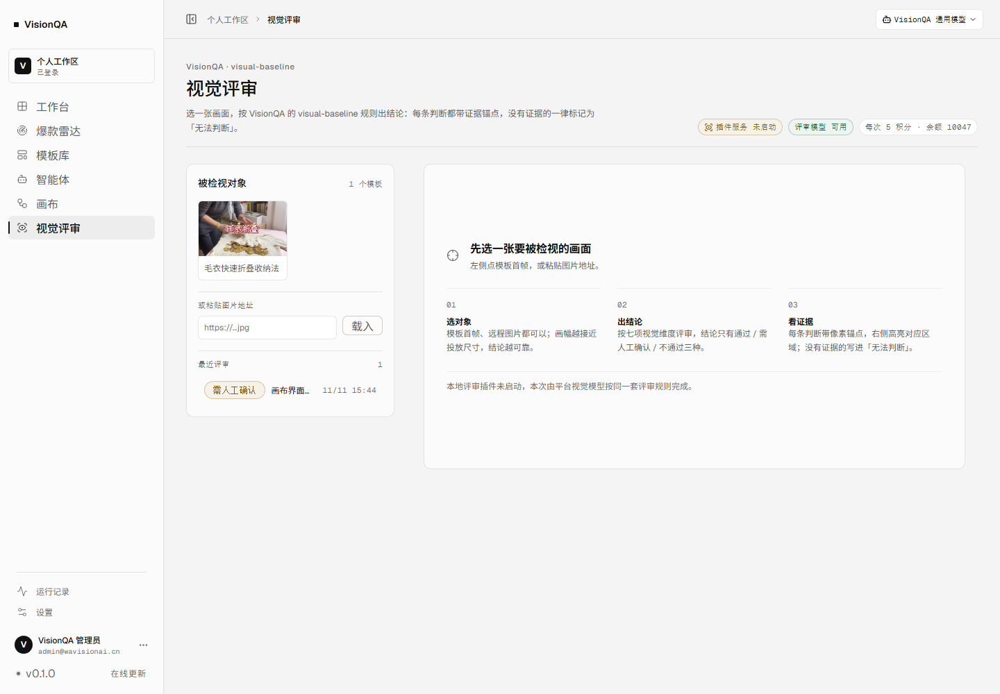
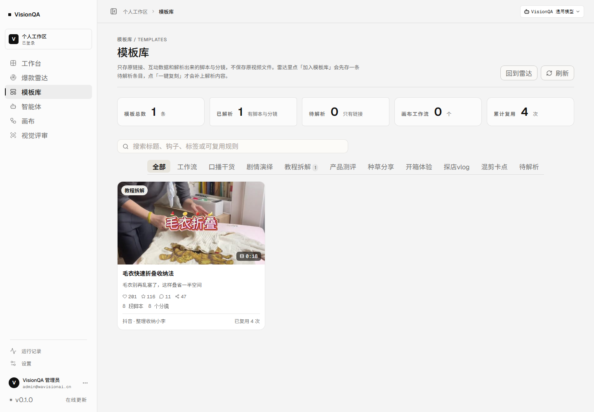

# VisionQA 上线差距审计（2026-11-11）

> 状态（2026-11-11 晚）：本文的 P0 除「内容冷启动」外已全部落地，P1 完成 7 条，并新增引导页。
> 逐条证据见 [launch-remediation-2026-11-11.md](launch-remediation-2026-11-11.md)。本文保留当时的审计结论，作为对照。

结论先行：**功能主干已经能真跑，卡上线的不是技术债，而是「人进不来、额度用完就死、坏了没人知道、合规页缺失」这四件事。**

- 内部邀请制试用（10–30 人、免费）：只差 **4 件**，都在 P0，约 3–5 个工作日。
- 对外公开 + 收费：还要补支付、合规、找回密码、客服与滥用防护，约 3–4 周。
- 本轮按要求**没做**任何模型真实校验（出图/出视频、多供应商回退、权重真实比例），相关条目在清单里标为「暂缓」。

---

## 一、这次怎么审的（可复现）

| 手段 | 具体做法 | 结果 |
| --- | --- | --- |
| 真实页面巡检 | 生产站 8 个用户页逐个打开（1440×1000），抓控制台异常、≥400 响应、横向溢出、坏图、正文文本 | 8 屏 **0 个 JS 异常、0 个 ≥400 响应、0 张坏图、0 处横向溢出** |
| 首屏性能 | 同一次巡检读 navigation timing | DOMContentLoaded **362ms**（headless，缓存状态未区分） |
| 窄屏 | 390×844 打开工作台 / 雷达 / 模板库 / 设置 | 4 屏 **scrollWidth 均 390**，无横向溢出 |
| 生产接口 | 管理员会话直连 /api/health、/api/admin/gateway、/api/admin/model-keys、/api/review/health、/api/admin/users、/api/admin/storage | 见第二节；数据基本是「刚够跑通」的量 |
| 代码侧 | 扫 src 与 server：TODO / 占位文案 / alert / mock / 隐私条款 / 备份 / 监控 / 注册开关 | 见第三节每条的证据 |

证据脚本：`.tmp-qa/round23-ux-audit.mjs`（页面巡检）、`.tmp-qa/round23-prod-api.mjs`（接口）、`.tmp-qa/round23-storage.mjs`（存储）。
巡检截图在 `.tmp-qa/audit/*.png`，其中两张与本文结论直接相关的已归档到 docs（见文末）。

---

## 二、能力现状：哪些是真能用

| 功能 | 状态 | 线上证据（2026-11-11） |
| --- | --- | --- |
| 爆款雷达 | 真能用 | 检索服务已连接；红狐返回真实互动数；当日 15:54、15:57 两次真实检索各扣 2 积分 |
| 模板库 | 真能用，但**只有 1 条** | 抖音「毛衣快速折叠收纳法」，8 段脚本 + 8 分镜，累计复用 4 次 |
| 一键复刻 | **半成品** | 能解析出脚本/分镜/提示词并入库（扣 10 积分），但**不出成片**；真出片依赖 hypit CLI，未接 |
| 智能体 | 真能用 | 4 个内置智能体，当日 2 次真实对话（各 1 积分），失败那两次已原路退回 |
| 画布 | 真能用 | 内嵌 VisionQA Canvas，VisionQA 账号免登；4 个流程、1 条运行记录 |
| 画布出图 / 出视频 | **未验证，且有额度风险** | 网关 models 显示 ready；但 SeeAPI 那把 Key 额度 0（先前实测 HTTP 402），真实出图会失败 |
| 视觉评审 | 真能用 | 判断层 deepseek-flash 已接，当日 2 次真实评审（各 5 积分），结论「需人工确认」；本地插件服务 false |
| 运行记录 | 真能用 | 1 条真实运行，逐节点耗时与输出 |
| 设置 / 积分 | 真能用，充值占位 | 余额 10047，流水 40 条；充值卡明确写「未接入」 |
| 账号 | **只有 1 个账号** | 用户总数 1（管理员本人）；注册默认关闭；加账号要 SSH 跑 adduser |
| 后台 | 真能用 | Key 池 2 把（DeepSeek P100·W100 文本/视觉/判断，SeeAPI P10·W100 出图/出视频） |

一句话：**「能跑通一条链」已经成立，「能给别人用」还没成立。**

---

## 三、待做清单

### P0 · 不上线就会出事（7 条）

#### P0-1 新用户进不来：没有建号入口
- 现状：`/api/auth/config` 返回 `registrationEnabled: false`；注册页即使有也发不出去；后台账号页只有「停用/改角色/重置口令/删除」，**没有新建账号**；唯一通路是 SSH 到服务器跑 `npm run adduser`。
- 为什么挡上线：你自己能建号 ≠ 运营能建号。给 10 个同事开号要找你、要登服务器。
- 验收：后台账号页有「新建账号」（邮箱 + 初始积分 + 角色），创建后对方能立即登录；或改造成邀请码注册，且 `VQ_REGISTRATION` 不必全局打开。

#### P0-2 额度用完就死：没有充值，也没有「要额度」的出口
- 现状：计费完整（检索 2 / 复刻 10 / 评审 5 / 对话 1 / 画布流程 2，失败退款），新账号送 100；但 `/api/billing` 只有占位，充值卡写「通道未接入」，用完只能找管理员手工发放。
- 为什么挡上线：陌生用户走到第 11 次复刻就再也动不了，且页面上没有任何「怎么办」。
- 验收：额度为 0 时，被挡的操作给出可执行的下一步（申请额度 / 联系管理员 / 管理员一键发放），而不是只有一句「积分不足」；后台能批量发放。

#### P0-3 忘记密码只能登服务器
- 现状：登录页写明「忘记密码请联系工作区管理员重置，平台不通过邮件找回」；`/api/auth` 没有找回路由；重置口令只有管理员能发。
- 为什么挡上线：对外用户丢口令 = 找客服 = 找你就是找人肉运维。
- 验收：至少给出一条不依赖你的路径（管理员在后台重置 + 明确的联系入口；最好加邮件重置）。

#### P0-4 合规三件套缺失
- 现状：仓库里没有服务条款、隐私政策、ICP 备案号展示（全仓 grep 无命中）。登录页与页脚只有产品名。
- 为什么挡上线：国内公开运营要求备案号展示；收集账号与图片必须有隐私说明。
- 验收：页脚有备案号；`/terms`、`/privacy` 两页可访问；说明「图片/视频怎么处理、存哪里、多久删」。

#### P0-5 数据只有一份，且没有备份
- 现状：全部状态在单机 `/var/lib/visionqa`，22 个文件共 3.9MB，含 `auth.db`、`templates.json`、`model-keys.json` 与 **`.model-keys.secret`**；仓库与服务器都没有备份脚本，也没有恢复流程。
- 关键坑：`model-keys.json` 必须和 `.model-keys.secret` **成对备份**，单独恢复前者，后台所有 Key 都解不开。
- 验收：每日自动备份到异地（或至少本机另一目录 + 定期下载），并**真做一次恢复演练**：删库→从备份恢复→登录、模板、Key 池全部回得来。

#### P0-6 出图/出视频真实可用性未验证（额度 0）
- 现状：网关配置层显示 image/video 各 1 把 Key 就绪；实际 SeeAPI 额度 0，真实生成会 402。
- 为什么挡上线：画布里凡是要出图的节点都会失败，用户在画布上先撞墙。
- 验收：要么充值后跑通一张图、一条视频；要么在画布与网关里明确标注「生成能力未开通」并禁用相关节点。**模型真实校验按你的要求暂缓**，但「禁用 or 明示」这件事不能拖。

#### P0-7 内容冷启动：模板 1 条、画布 1 块
- 现状：模板总数 1、画布 1 块、运行 1 条。模板库页面上只有一张卡片，右侧大片空白。
- 为什么挡上线：这是「抄爆款结构」的工具，没内容就没有价值；新用户第一次进来会以为是空壳。
- 验收：至少 15–30 条真实模板，覆盖 5 个以上内容类型；首进工作台能看到「拿一条模板开始」的入口。

### P1 · 上线首月必须处理（8 条）

| 编号 | 问题 | 证据 | 验收 |
| --- | --- | --- | --- |
| P1-1 | 「一键复刻」名不副实：只出脚本/分镜/提示词，不出片 | 模板库文案「点一键复刻才会补上解析内容」；hypit CLI 未接 | 要么改名（拆解/复用方案），要么真出片 |
| P1-2 | 评审页露出内部概念「插件服务 未启动」 | 生产评审页顶部状态条；`/api/review/health` service=false | 用户语言表述，或只留「评审模型 可用」 |
| P1-3 | 设置页是内部诊断面板 | 「模型服务 注意 · 接口已连通 · 待首次生成验证」「数据存储 剩余 13GB」 | 用户只看「哪些功能可用」，细节收回后台系统页 |
| P1-4 | 用户端「在线更新」对 SaaS 无意义 | 侧栏版本行文案；弹窗三行全是站点/环境信息 | 改成版本说明或去掉 |
| P1-5 | 「多工作区切换暂未开放」常驻 | 设置页工作区卡片 | 隐藏未开放项，不摆「暂未开放」 |
| P1-6 | 移动端只有「不溢出」，没有可用性验证 | 390 宽实测无横向溢出，但侧栏/表格未逐屏点测 | 明确桌面优先并在窄屏给出提示，或补齐窄屏布局 |
| P1-7 | 滥用防护只有登录限流 | 检索/评审/对话按积分扣、有同账号并发限制，但无 IP 级限流 | 关键接口加 IP+账号双维度限流，保护上游额度 |
| P1-8 | 无错误上报与报警 | 全仓无 sentry / metrics，只有 console.error 与 journald | 至少「5xx / 上游失败 / 磁盘不足」三类有告警 |

### P2 · 体验优化（6 条）

| 编号 | 优化点 | 现状 |
| --- | --- | --- |
| P2-1 | 模板库单条时版面空旷 | 1 条卡片占据左侧，右侧全空；补密度或空状态引导 |
| P2-2 | 新账号首进引导 | 100 积分怎么花没有提示；四个智能体卡片信息量大但无推荐路径 |
| P2-3 | 方案导出 | 模板的脚本/分镜只能在页面上看，编导要复制得手动抄 |
| P2-4 | 画布与模板库联动 | 模板库显示「画布工作流 0 个」，套用链路没跑起来 |
| P2-5 | 评审历史无筛选 | 只有 1 条；条数上来后需要按结论/时间筛 |
| P2-6 | 运行记录空态 | 只有 1 条运行，列表筛选控件多于数据 |

---

## 四、两种「上线」的距离

| 口径 | 还差什么 | 估算 |
| --- | --- | --- |
| A. 邀请制内测（10–30 人，免费，同事） | P0-1 建号入口、P0-5 备份与恢复演练、P0-7 种子内容，加 P1-1/2/3 三处文案 | 3–5 个工作日 |
| B. 对外公开 + 收费 | A 的全部 + P0-2 额度闭环、P0-3 找回密码、P0-4 合规三页、P1-7 滥用防护、P1-8 可观测性 + 支付接入与定价 | 3–4 周（不含有赞/微信支付等外部审核周期） |

估算只算工程与内容工作量，不含外部审批与你的定价决策。

---

## 五、建议先做哪三件

1. **P0-1 管理员建号**：一个接口 + 后台一个表单，解除「人进不来」这个最硬的锁。
2. **P0-5 备份 + 一次恢复演练**：其余所有工作都建在这 3.9MB 数据上，`.model-keys.secret` 成对备份是硬要求。
3. **P0-7 种子模板**：模板库从 1 条到 20 条，用户端才第一次「看起来像个产品」。

理由：这三件都不依赖外部决策（不用定价、不用买额度、不用等 provider），做完就能拉真实用户进来试用。

---

## 六、按你要求暂缓的

- 出图 / 出视频的真实生成校验（P0-6 只做「禁用或明示」）。
- 多供应商故障回退的真实演练（当前只有 DeepSeek 一把文本 Key 能真调用）。
- 权重真实命中比例（只在本地采过 2000 次，25.3% / 74.7%）。

---

## 七、证据截图

以上两张为 2026-11-11 生产站真实渲染，1440×1000。
