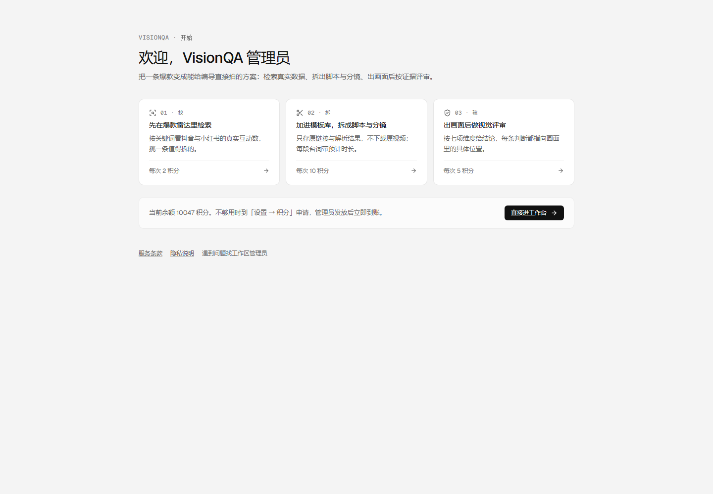
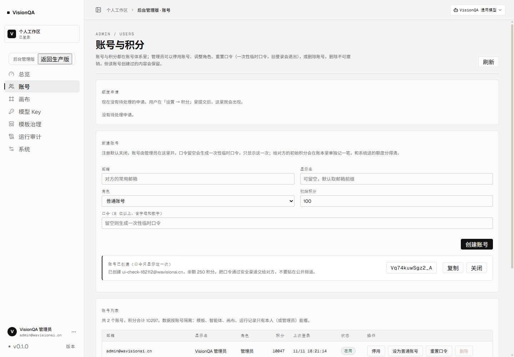
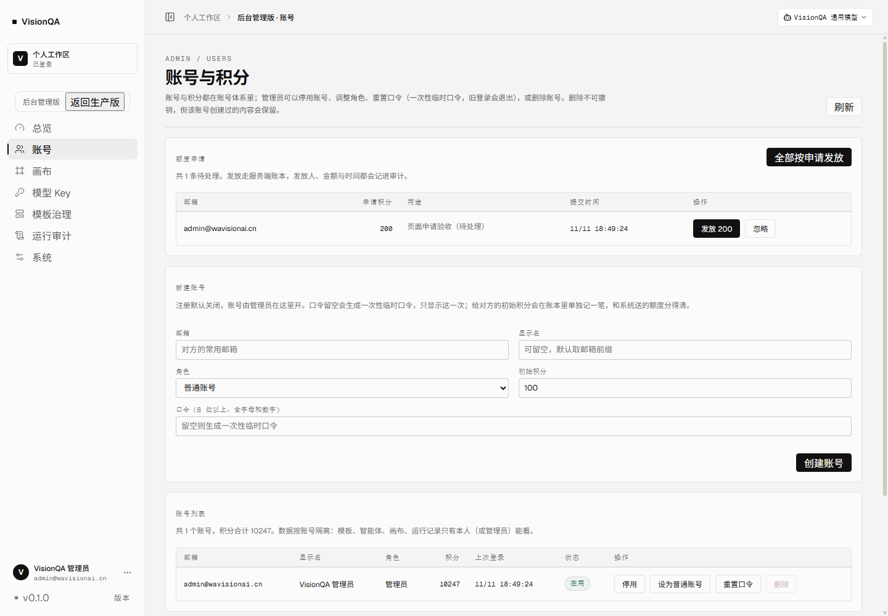
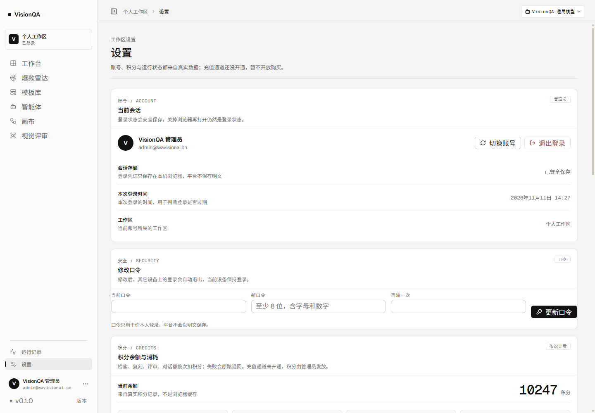
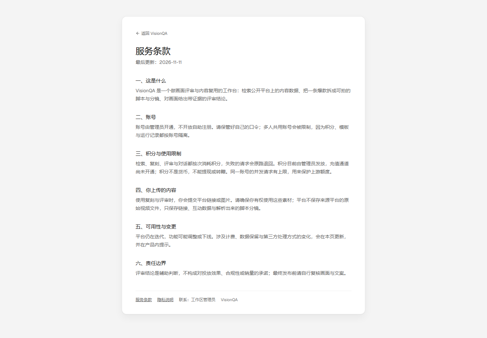

# VisionQA 上线差距修复（第一批：P0 与 P1）

审计见 [launch-gap-audit-2026-11-11.md](launch-gap-audit-2026-11-11.md)。本文只记**这一批真的做完了什么**、线上证据是什么、还剩什么卡在外部输入。

结论先行：**「人进不来、额度用完就死、数据没有备份、评审页露内部名词」这四件已经解决并上了生产。**
仍缺：备案号与客服邮箱（需要你给值）、邮件找回口令（需要 SMTP）、支付与定价、外部告警通道。
种子模板与三类告警已在收尾批次做完，见 [launch-coldstart-alerts-2026-11-11.md](launch-coldstart-alerts-2026-11-11.md)。

## 一、这一批做了什么

| 项 | 实现 | 生产证据（2026-11-11） |
| --- | --- | --- |
| P0-1 建号入口 | 后台账号页「新建账号」：邮箱 / 显示名 / 角色 / 初始积分 / 口令（留空自动生成一次性临时口令，只显示一次） | `POST /api/admin/users` → 201；页面建号后账号立即能登录；账本两笔（welcome 100 + grant） |
| P0-2 额度闭环 | 用户端「设置 → 积分 → 申请额度」提交申请；后台「额度申请」队列可单条发放 / 全部按申请发放 / 忽略 | 申请 201、重复提交不重复建单；后台 `pending` 1 条；发放后余额 120 → 420；重复处理 409 |
| P0-3 找回口令 | 登录页「忘记密码？」给出可直接执行的联系路径；配了客服邮箱就显示邮箱 | 文案不再只写「联系管理员」；未登录也能看到同一句 |
| P0-4 合规两页 | `/#/legal/terms`、`/#/legal/privacy`：账号、图片与帧图、第三方模型、保存期限、删号后保留范围都写清 | 清掉 cookie 后仍可打开条款页（不登录可读） |
| P0-5 备份与恢复 | `scripts/backup.mjs`（整目录 tar.gz + 关键文件校验 + 按份数清理）、`scripts/verify-restore.mjs`（把解包目录当真数据目录打开）、systemd 每日 03:30 | 生产真跑：704 KB / 23 文件；解包后读出 users 1、keys 2（含两把 Key 名字）、templates 1；timer `NEXT 2026-11-12 03:32` |
| P0-6 出图出视频 | `VQ_GATEWAY_OPEN` 开关，默认关闭：生成请求直接 503「生成能力暂未开放：平台渠道额度还没开通」，不再让上游 402 以「生成失败」出现 | 后台 gateway `userOpen=false`；买了额度写 `VQ_GATEWAY_OPEN=1` 即可开 |
| P1-1 复刻口径 | 模板库文案改为「点解析才补上脚本与分镜；解析结果可直接交给拍摄，平台当前不出成片」 | 文案与真实能力一致 |
| P1-2 评审页 | 「插件服务 未启动」→「评审引擎 平台模型 / 本地服务」；去掉 127.0.0.1 与「插件」这类内部词 | 生产评审页头部 |
| P1-3 设置页 | 「健康检查」→「功能可用性」；非内部环境不再显示「接口已连通 · 待首次生成验证」「剩余 13GB」这类诊断串 | 生产设置页 |
| P1-4 版本入口 | 侧栏「在线更新」→「版本」；弹窗标题「版本信息」 | 生产侧栏 |
| P1-5 多工作区 | 去掉「暂未开放」字样，只写「当前账号所属的工作区」 | 生产设置页 |
| P1-6 窄屏 | 900px 以下显示一条提示：桌面工作台，手机可查看但不建议在此操作 | 390 宽实测无横向溢出 + 提示可见 |
| P1-7 限流 | `server/ratelimit.mjs`：按 IP + 桶限速（检索 20、复刻 6、评审 10、对话 30、画布运行 6、额度申请 3，每分钟） | 连发 4 次额度申请：第 4 次 429 + `Retry-After: 60` |
| 新用户引导 | `/#/welcome`：三步（找 → 拆 → 验）卡片带真实单价、当前余额、申请额度提示；首次进工作台自动打开，看过一次按账号记住 | 首次进 `#/overview` 自动跳 `#/welcome`；点「直接进工作台」后写入标记；可随时从工作台页脚「上手指引」回看。**2026-11-12 起已改为工作台内弹窗、删除该路由，见 [ui-polish-and-gap-audit-2026-11-12.md](ui-polish-and-gap-audit-2026-11-12.md)** |

## 二、界面截图（生产，1440×1000）











## 三、备份与恢复演练（真的跑过）

```
sudo -u visionqa DATA_DIR=/var/lib/visionqa node scripts/backup.mjs --out /var/backups/visionqa --keep 14
tar -xzf <archive> -C /tmp/vq-restore-drill
sudo -u visionqa DATA_DIR=/tmp/vq-restore-drill node --experimental-sqlite scripts/verify-restore.mjs
```

产出：704 KB / 23 个文件；解包后 `users 1、admins 1、keys 2（enabled 2）、templates 1`。
这条命令同时证明了**Key 能用备份里的 `.model-keys.secret` 解密**——单独备份 `model-keys.json` 是不够的。

定时任务：`visionqa-backup.timer`（OnCalendar 03:30，Persistent，份数保留 14），`systemctl list-timers` 显示下次 2026-11-12 03:32。

## 四、还差什么（都卡在外部输入，不是工程没做）

| 项 | 卡在哪 | 我要的输入 |
| --- | --- | --- |
| 备案号 + 页脚展示 | 不能编造 ICP 号 | 备案号（`VQ_ICP`），给了我就填进环境变量，页脚与合规页自动显示 |
| 客服邮箱 | 同上 | 一个对外邮箱（`VQ_SUPPORT_EMAIL`） |
| 邮件找回口令 | 没有 SMTP 凭据 | 发件 SMTP（或改用企业邮箱服务），给了就接重置邮件 |
| 支付/充值 | 定价未定 | 档位与价格；不接支付前，走「申请 → 管理员发放」 |
| ~~种子模板~~ | **已做**：25 条真实模板 / 8 个类型 | 见 [launch-coldstart-alerts-2026-11-11.md](launch-coldstart-alerts-2026-11-11.md) |
| 外部告警 | 没有告警通道 | webhook / 邮箱；现在三类告警会进后台队列并可确认，配了 `VQ_ALERT_WEBHOOK` 才主动外推 |

## 五、上线口径（更新）

| 口径 | 状态 | 还差 |
| --- | --- | --- |
| A. 邀请制内测 | **可以开始** | 种子模板已就位（25 条公共模板）；只差「坏了主动喊人」的告警通道 |
| B. 对外公开收费 | 差 3 件工程 + 1 个决策 | 邮件找回、支付接入、外部告警；决策是定价 |

## 六、自测

- `npx tsc -b` 通过；`npm run build` 通过（入口 index-D0MUruUq.js）。
- 生产两服务 active，`/api/health` 正常。
- 建号 / 登录 / 申请 / 发放 / 重复处理拦截 / 限流 / 删号清理 全部在生产用真实请求跑过。
