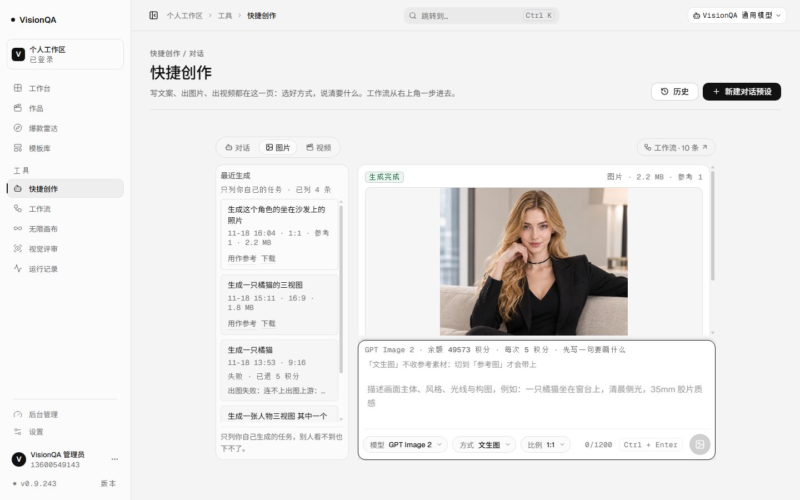
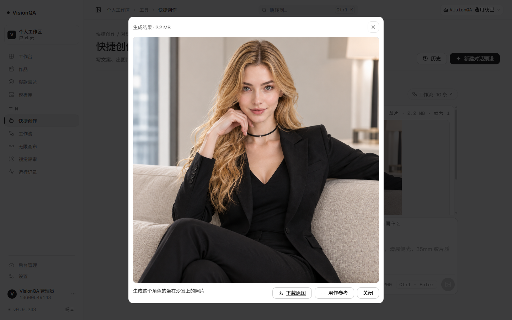
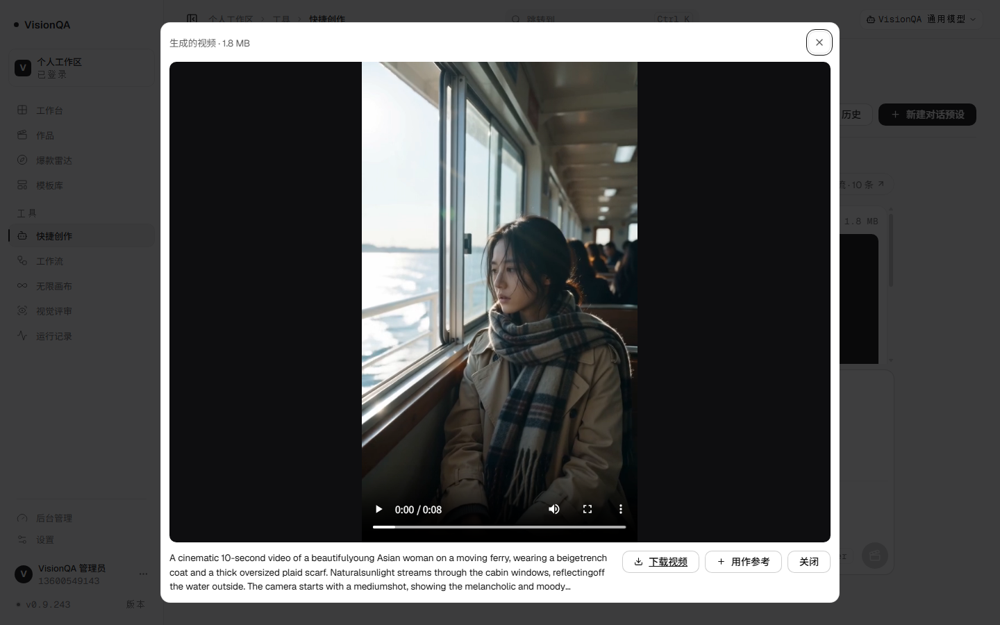
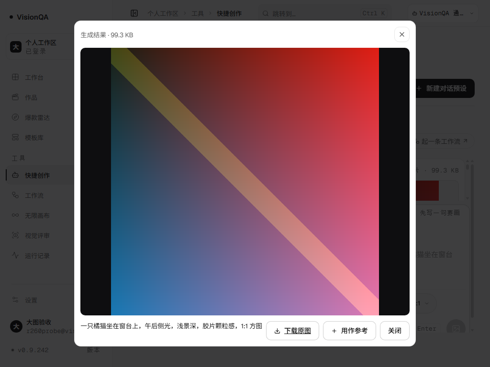
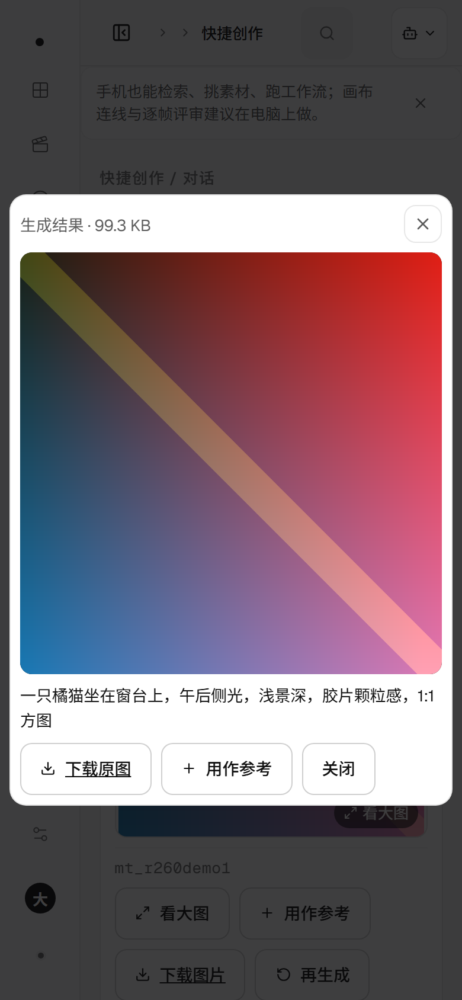
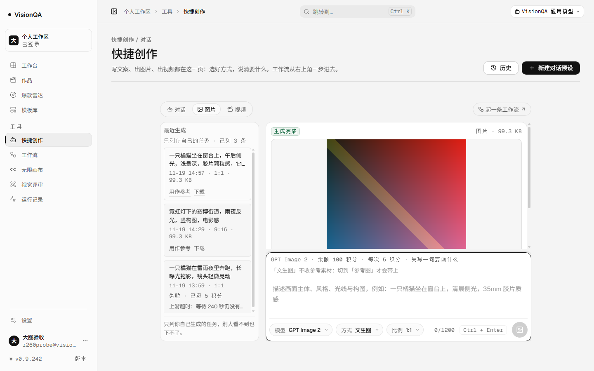
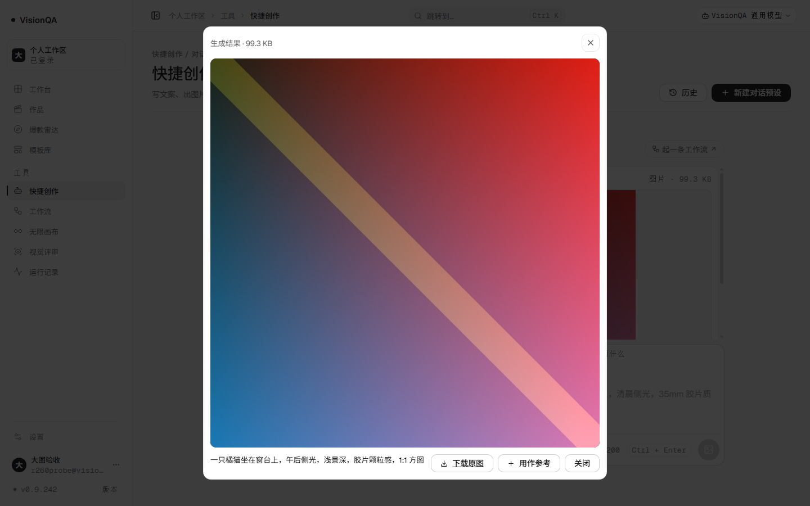
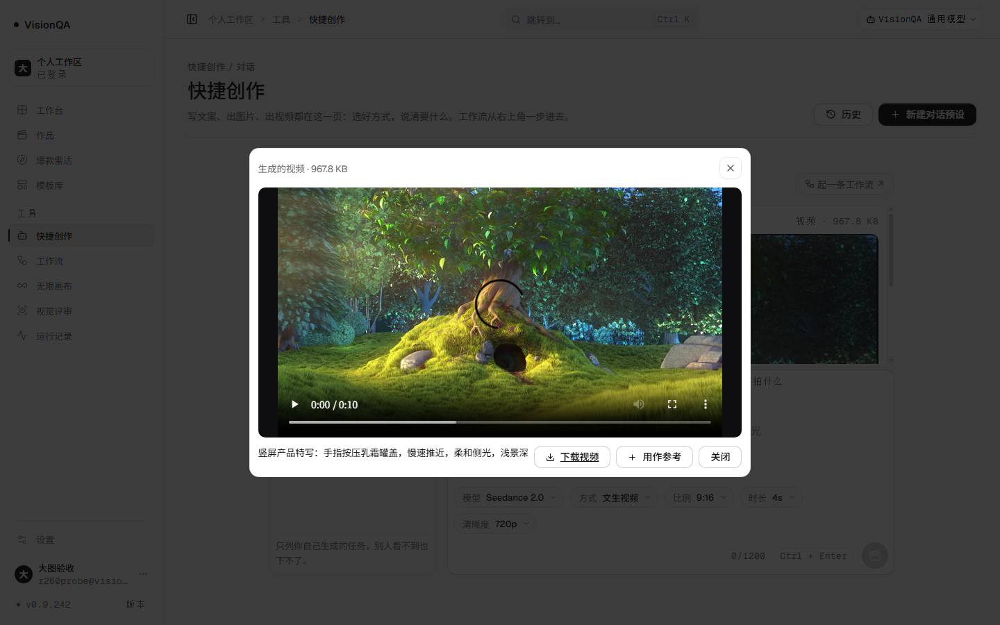

# 结果区「点开看大图」（r260 / v0.9.243）

上一轮把图片 / 视频页签收进一屏，顺手记下一条边界：**1024×768 这种矮屏上结果区只剩 88px，
1:1 的图只能看见中间一条**，想看清只有先下载。这一轮把「看清楚」这件事补上。

## 一、交互

| 入口 | 长什么样 | 行为 |
| --- | --- | --- |
| 缩略图本身 | 整张图就是按钮，鼠标变放大镜，右下角一枚「看大图」胶囊 | 点开整页浮层 |
| 结果卡动作栏 | 「看大图」（图片）/「放大看」（视频） | 同上 |
| 浮层里 | 头行「生成结果 · 2.2 MB」+ 叉；底部提示词 + 下载 / 用作参考 / 关闭 | — |
| 关闭方式 | Esc、右上角叉、底部「关闭」、点浮层空白处 | 四种都能关 |
| 键盘 | 打开后焦点落在「关闭」 | Tab 不进门后 |

浮层是固定在整页之上的一层（`position: fixed; inset: 0; z-index: 70`），压过窄屏历史弹层（60）。
图片 / 视频两个面板都挂着只隐藏，所以被隐藏的那一个**不许把自己的浮层留在屏幕上**——
渲染条件写成 `lightbox && !hidden && task?.status === 'succeeded'`。

## 二、量出来的数

| 视口 | 缩略图 | 浮层里 | 卡片 | 备注 |
| --- | --- | --- | --- | --- |
| 1440×900 | 608×340（卡 340px 上限） | **692×692**（原图 1024²） | 718×806 | 卡片跟着图收窄，左右没有黑边 |
| 1024×768 | 422×340 | **560×560** | — | 768−208=560，整张在屏幕里 |
| 390×844 | — | **356×356** | 卡片贴边 8px | `scrollWidth 390 = innerWidth`，三个按钮都在屏内 |
| 生产 1440×900 | 608×340 | **692×692**（原图 **1254²**） | 718×806 | 真实账号的真实作品，2.2 MB |
| 生产视频 1440×900 | 608×340 | **397×692**（原片 496×864） | — | 9:16，8.1 秒，真解出一帧 |

尺寸是 `max-height: calc(100vh - 208px)`（208 = 上下遮罩 48 + 卡片内边距 24 + 头行 32 + 两个间隙 24 +
提示词三行 ≈ 68 + 余量），宽度 `max-width: 100%`；小图不上采样，按原尺寸显示（视频自然尺寸 640×360
时就是 640×360）。

## 三、两个坑

1. **百分比 `max-height` 在弹性盒里会失效。** 第一版写 `max-height: 100%`，卡片是
   `flex-direction: column`、舞台 `flex: 1 1 auto`，舞台高度由内容决定 →
   图片的 100% 解析成 `none`，1024 的图把卡片顶到 **1138px**，超出 900 高的窗口，
   底部按钮在屏幕外。改成具体数值 `calc(100vh - 208px)` 才稳。
2. **固定 1120px 宽的卡片会给 1:1 的图配两条黑边。** 先按 `width: min(1120px, 100%)` 做，
   图 692 宽、卡片 1120，左右各 288px 黑带，看着像没加载完。改成 `width: auto`（居中的
   grid 里按内容收缩）+ 舞台 `width: 100%`，卡片就收到 **718px**。

## 四、门禁与上线

- 测试 **1712 / 1712**（`test/quick-composer-unified.test.mjs` 7 → 8 条：浮层结构、Esc、
  「关掉浮层也清结果」、固定层与 z-index、缩略图仍卡 340px 而浮层不被它限制）；
  lint **0 error / 25 warning**（626 文件）、`tsc -b` 干净、`npm run build` 通过
  （入口 `index-f4l8ajRv.js`）、密钥扫描 **999 文件无命中**。
- 生产 **0.9.243**：`/api/version` 本地与公网一致、health ok、templates 26、6 个服务 active、
  磁盘 73%；发布标签 `20261119-074204-20261119-1540-v0.9.243-l`，`rollback.sh --to 1` 回 0.9.242。
- 生产截图用的是临时管理员会话：截完 **revoked 1 / left 0**，服务端 `/tmp` 下的临时脚本与
  token 文件已删。
- **0 次真实上游调用、0 费用**：浮层只是把已有的结果文件放大显示，不走网关。

## 五、边界

- 只覆盖「这次的结果」那张卡。左边「最近生成」的行仍只有文字（提示词 / 时间 / 大小），
  不能缩略图预览、也不能点开看大图——那是下一轮的事。
- 没有缩放、拖动、左右翻页、键盘 ←→；浮层不锁背景滚动（页面本身是一屏的，没有可滚的地方）。
- 作品流页（`#/works`）的封面还没接同一个浮层，点开仍是进作品详情。
- 视频在无头 Chrome 的后台标签页里不解帧（第一版截图整块黑），要用 `Page.bringToFront`
  再让视频真的走到 `readyState 4`——这是浏览器行为，不是产品 bug，但说明「黑屏截图」
  不能当失败证据。
