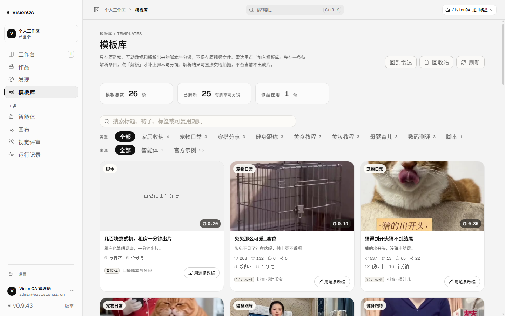
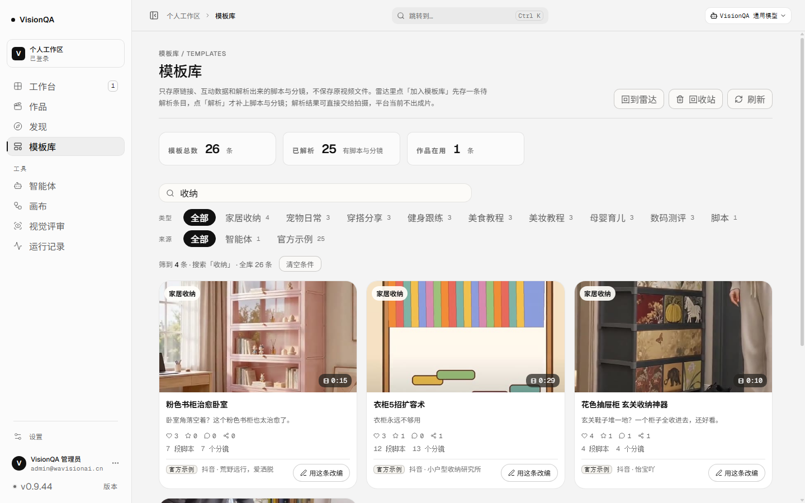
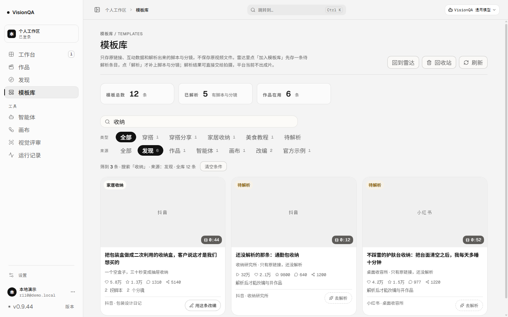
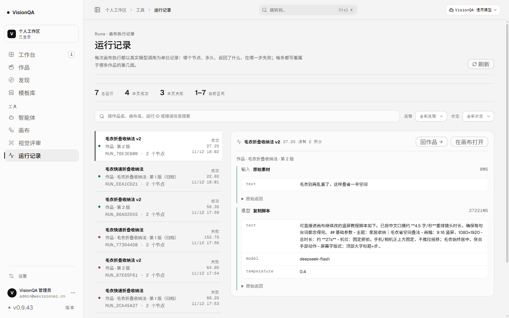
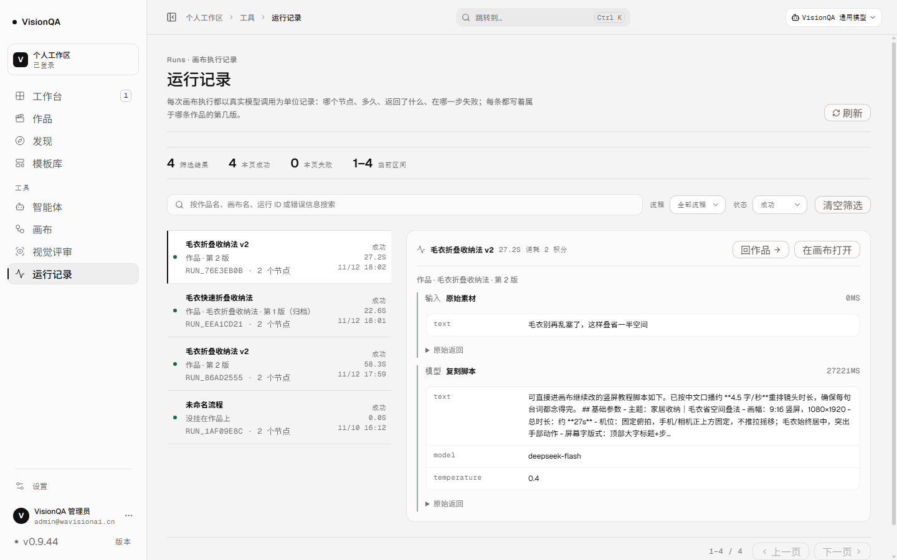

# 筛过的条件，回来还在（v0.9.44，2026-11-13）

结论先行：**上一版让「换页面回页头」和作品列表的筛选不再丢；这一版把同一件事补齐到模板库与运行记录。**
筛「收纳」+ 来源「发现」得 3 条，点进作品看一眼再回来，条件还在；运行记录筛「毛衣 + 成功」，
去作品再回，也还在。三张列表共用一个模块（`src/domain/list-view.ts`），各存各的键，
读出来的东西一律当不可信。**没有接口改动、没有写入路径、本轮生产零写入。**

## 一、问题（实测，不是猜）

| 场景 | 改之前（v0.9.43） | 现在（v0.9.44） |
| --- | --- | --- |
| 模板库搜「收纳」+ 来源「发现」→ 去作品 → 回模板库（生产 26 条） | 搜索框空、26 条、无记录 | 搜索框「收纳」、4 条、来源胶囊仍选中 |
| 同上，本地演示账号（12 条模板） | 12 条、搜索框空、`sessionStorage` 无键 | 3 条、「筛到 3 条 · 搜索「收纳」· 来源：发现 · 全库 12 条」 |
| 运行记录搜「毛衣」+ 状态「成功」→ 去作品 → 回运行记录 | 状态回「全部状态」、7 条 | 状态仍是「成功」、4 条（本地演示 2 条） |
| 清空条件 / 清空筛选 | —（没有键可删） | 键被删掉，列表回到全部 |

数字来源：生产 `/api/templates?q=收纳` 4 条 / 全库 26 条、`/api/runs` 7 条（状态=成功 4 条）；
本地演示数据目录 `.tmp-qa/r50data`（7 条作品 / 12 条模板 / 3 块画布）。

## 二、改了什么

1. **一份共用的记忆**（`src/domain/list-view.ts`，仍然不 import 任何 React / DOM 类型，Node 里直接可测）：
   存储读写、字段校验、空条件删键三件小事收在一起，三份视图各自只声明自己的形状与键。

   | 列表 | 键 | 记什么 |
   | --- | --- | --- |
   | 作品列表（v0.9.43） | `vq_projects_view:v1` | 搜索词 + 在做 / 已交付 |
   | 模板库（本版） | `vq_templates_view:v1` | 搜索词 + 类型 + 来源 |
   | 运行记录（本版） | `vq_runs_view:v1` | 搜索词 + 流程 + 状态 |

2. **模板库**：首屏从存储初始化搜索词 / 类型 / 来源，条件一变就写回；「清空条件」把键删掉。
   类型与来源仍然由服务端给的清单兜底（分类被改名、来源被删光时退回「全部」），
   所以存储里留着一个旧分类也不会卡住页面。

3. **运行记录**：同样是首屏读、变了写；另外 `resolveFlowFilter(flowId, flowIds, listLoaded)`
   判断「记住的那块画布还算不算数」——流程清单读成功、里面没有它（画布删了 / 换了账号）就按
   「全部流程」算；清单还没读到（或读失败）时先信记住的那个，不为一次网络抖动把好筛选抹掉。

4. **只有搜索词也算筛选**（顺手修）：以前「筛到 N 条 · … · 清空条件」这一行只在选了类型 / 来源时出现，
   搜完想清掉只能手动删字。现在只有搜索词也出现那一行，且写明「搜索「收纳」」——
   恢复的条件在页面上看得见、一键可清。

## 三、三个判断

- **为什么是 sessionStorage 而不是 localStorage**：筛选是「这一会儿在干什么」，不是长期偏好。
  同一个标签页里进出还在，关掉标签页就忘，下次打开不会看到一份不知从哪儿来的条件
  （与 v0.9.43 作品列表同一个理由）。
- **为什么工作台「评审等你看的」故意不记**：那是一张待办清单。留着昨天的范围或关键词，
  等于把等你改的作品藏起来——「看起来没有待办」比「要多筛一次」贵得多。测试里钉住了这一条
  （OverviewPage 不 import 这套模块，也没有队列的存储键）。
- **为什么不存 activeType 而存原始值**：首屏数据还没到、类型清单只有一个「全部」时，
  写派生值会把刚读出来的类型当场抹掉。所以写的是三个原始值，界面上的兜底仍在渲染里做。

## 四、实测与验收

本地（`.tmp-qa/r50data`，1440）：模板库搜「收纳」+ 来源「发现」→ 3 条；点「作品」再点「模板库」→
搜索框「收纳」、来源胶囊「发现 6」仍选中、「筛到 3 条 · 搜索「收纳」· 来源：发现 · 全库 12 条」；
「清空条件」→ 12 条、键为 `null`。运行记录搜「毛衣」+ 状态「成功」→ 2 条；去作品再回来仍是
「毛衣 + 成功」2 条，「清空筛选」→ 键 `null`、列表回到 7 条。

生产（`https://visionqa.wavisionai.cn`，只发只读 GET）：模板库搜「收纳」→ 4 条；点「作品」再回
「模板库」→ 搜索框「收纳」、4 条、`筛到 4 条 · 搜索「收纳」· 全库 26 条`、清空条件在；点清空 → 26 条、
键为空。运行记录按状态「成功」→ 4 条；去作品再回 → 仍是「成功」4 条；清空筛选 → 全部状态 7 条、键为空。
390 宽：关键词与筛出的 4 条都在，`scrollWidth 390 == clientWidth 390`；1440 同。

- 版本 **0.9.44**，入口 `index-9xtxvngg.js`（512,562 字节），release
  `20261113-015258-20261113-0.9.44-filter-n.tar.gz`，`/api/version` 0.9.44，`/api/health` ok（templates 26），
  两服务 active。
- **本轮生产零写入**：截图前后各取一次快照，六路逐字段 `identical: true`
  （作品 1 · 模板 26 · 画布 7 · 原片 25（1 已开成作品 / 24 没开成）· 交付 0 · 余额 9954）。
- 提交 **a2d8b49**（代码 + 测试）+ **b2e3167**（文档 + 6 张截图），CI **43348582366 success**。
- `npm test` **411/411**（`test/list-view.test.mjs` 5 → 11 条），`npx oxlint src server test` **0 error / 6 warning**，
  `npx tsc -b` 干净，构建通过。

## 五、边界（没做的事）

- 没改接口：三张列表仍然用原来的 `GET /api/projects`、`/api/templates`、`/api/runs`，筛选仍在服务端。
- 没做「后退恢复列表滚动位置」：列表首屏是异步取的，高度还没长出来就设 `scrollTop` 会被夹回 0，
  要做得多留一套「等渲染完再恢复」的机制（v0.9.43 记下的同一条边界，这一版仍未动）。
- 没记分页位置：运行记录翻到第 3 页再离开、回来是第 1 页。分页位置比条件更容易让人误解
  （「怎么只有这几条」），先不记。
- 模板库的「类型 / 来源」如果被后台删掉，存储里的旧值会一直躺着（界面按「全部」渲染），
  下一次动条件时自然被覆盖；没有为此加一次清理请求。
