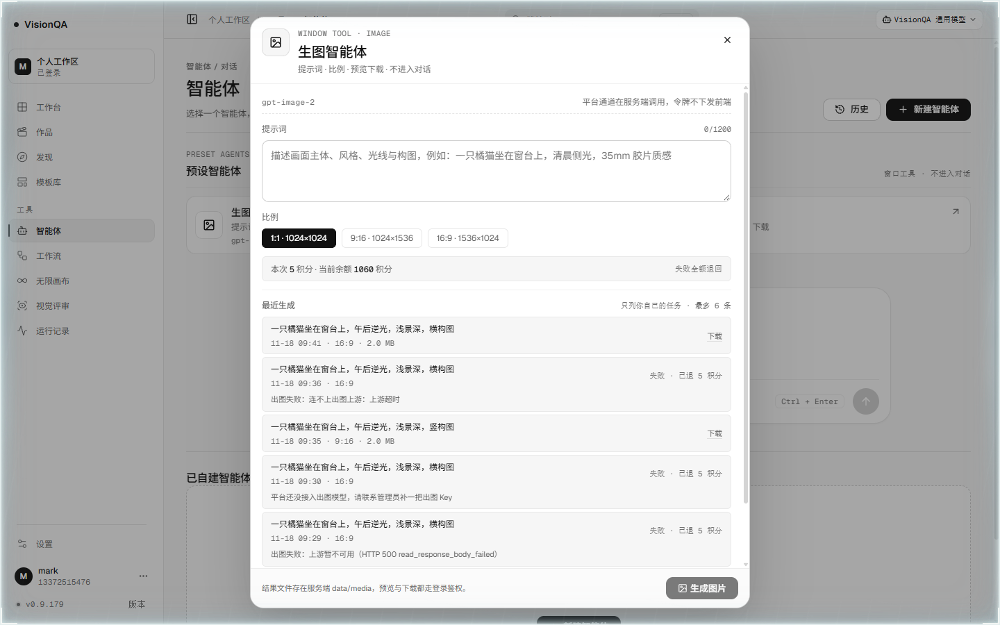
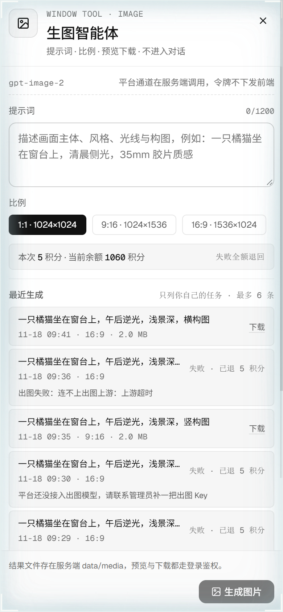

# 失败要说清为什么，进度要自己跟上：生图 / 生视频清单补完（0.9.179）

## 结论

上一轮把「最近生成」做出来，但它有两块是半成品：

1. **失败的那一条只说「失败 · 已退 5 积分」**——人不知道是上游超时、被上游拒、还是当时 Key 在冷却，退分明明到位了，原因却没写。
2. **清单只在「提交完」或「轮询到终点」那一刻刷新一次**——刷新过页面、或在另一个标签页提交过任务时，那一行会一直挂在「进行中」，看起来像卡死。

这一轮把这两件事补上：失败那一条把上游原话写在下面；清单里有任务在跑时，每 5 秒自己重取一次（只读元数据，不打上游、不扣一分钱）。服务端一行没改——原因本来就在清单里，缺的是界面。

## 为什么这不是细节（生产真数据）

0.9.179 上线后在生产按正常账号打开生图窗口，6 条里有 4 条是失败的，四条原因是四种完全不同的事：

| 时间 | 比例 | 状态 | 原因（界面上现在看到的） |
| --- | --- | --- | --- |
| 11-18 09:41 | 16:9 · 2.0 MB | 成功 | — |
| 11-18 09:36 | 16:9 | 失败 · 已退 5 积分 | 出图失败：连不上出图上游：上游超时 |
| 11-18 09:35 | 9:16 · 2.0 MB | 成功 | — |
| 11-18 09:30 | 16:9 | 失败 · 已退 5 积分 | 平台还没接入出图模型，请联系管理员补一把出图 Key |
| 11-18 09:29 | 16:9 | 失败 · 已退 5 积分 | 出图失败：上游暂不可用（HTTP 500 read_response_body_failed） |
| 11-18 09:29 | 9:16 | 失败 · 已退 5 积分 | 出图失败：上游暂不可用（HTTP 500 read_response_body_failed） |

不改之前这六行里只能看到三行「失败 · 已退 5 积分」，人无法判断该重试、该换比例、还是该找管理员——**同一句「失败」盖住了三种处置方式**。

（09:30 那条「补一把出图 Key」是 0.9.176 冷却提示修复**之前**留下的旧记录，不是现在的文案；修复后的冷却提示是「刚被上游拒过，正在冷却，约 N 秒后再点一次」。历史记录按当时的原文留档，不改写。）

## 改了什么

服务端：无。`publicTask()` 一直带着 `error`（`server/routes/media-gen.mjs:108`），清单接口原样透传，只是前端没渲染。

前端 `src/pages/AgentsPage.tsx`：

- 失败行的 prompt 下面多一行原因（`.agx-media-recent-why`），CSS 截断、完整原因放 `title`；
- 元信息前面补时间：`11-18 09:41 · 16:9 · 2.0 MB`——同一句提示词跑过好几次时，只有时间能分辨是哪一条；
- 自动刷新：`recent.some(t => t.status === 'processing')` 为真时起一个 5 秒的 interval 递增 `recentToken`，清单重新取数；没有在跑的任务就不起定时器。

`src/styles/agents.css`：`.agx-media-recent-row` 允许换行，新增 `.agx-media-recent-why`（`flex: 1 0 100%`，所以原因独占一行，不会把右侧的「下载 / 失败」挤走）。

## 验收

自动刷新是**端到端真验的**，不是只看代码：本机临时实例（`DATA_DIR` 临时目录 + 一条手写的 `processing` 任务元数据），无头浏览器打开生图窗口，然后在服务端把那条元数据改成 `succeeded`，**界面上不做任何操作**：

```
BEFORE: QA：一条还在跑的任务 11-18 11:06 · 16:9 进行中
      ||| QA：一条失败的任务 11-18 11:04 · 9:16 失败 · 已退 5 积分 出图失败：上游超时（QA 样例，不花一分钱）
AFTER : QA：一条还在跑的任务 11-18 11:06 · 16:9 · 68 B 下载
      ||| QA：一条失败的任务 11-18 11:04 · 9:16 失败 · 已退 5 积分 出图失败：上游超时（QA 样例，不花一分钱）
```

6.5 秒后再读页面：那条自己从「进行中」变成「68 B 下载」，失败那一条的原因全程在原位。全程 0 次上游调用、0 积分。

生产真实界面（0.9.179，正常账号，1440）：



390 宽（`scrollWidth == 390`，无横向滚动）：



门禁：

| 项 | 结果 |
| --- | --- |
| `npm test` | **1344 / 1344**（新增 1 条：失败那一条必须带着原因回清单，且不给一个点了 404 的下载链接） |
| `npm run lint` | 0 error / 16 warning（556 文件，与上一轮一致） |
| `npx tsc -b` | 干净 |
| `node scripts/scan-secrets.mjs` | 840 文件无命中 |
| `npm run build` | 通过，入口 `index-bsxYx7Jj.js` |

## 部署

| 项 | 值 |
| --- | --- |
| 版本 | **0.9.179** |
| 入口 | `index-bsxYx7Jj.js`（公网同文件 200） |
| 健康 | `{"ok":true,"redfox":true,"vision":true,"llm":true,"templates":26}` |
| 回滚点 | `20261118-030400-20261118-1105-r196mediaw`（`ops/rollback.sh --to 1` 回 0.9.178） |

截图用的临时会话在生产侧签发、拍完即撤销（会话行已删），token 只在本地临时文件里存在过，没有进仓库、文档或截图。

## 边界

- **原因取的是上游原文**，最多 500 字（服务端 `clip`），界面按行截断、完整内容在 `title`；它不翻译、不归类，也不判断该不该重试。
- **自动刷新只在窗口打开时**：关掉对话框就没有任何后台轮询；窗口里也不轮询上游，只重取清单。
- **仍然只列 6 条**，没有分页、没有搜索、没有删除入口（上一轮的边界不变）。
- 失败行不给下载链接（`downloadUrl` 为空），点了不会 404——这条有测试钉住。
- 本轮**没有真实调用上游**：没有新增 5 积分或 ¥1.4 的花费；自动刷新用的是本地临时实例 + 手写元数据。

细节与门禁同 `README.md` 第二百五十七节。
