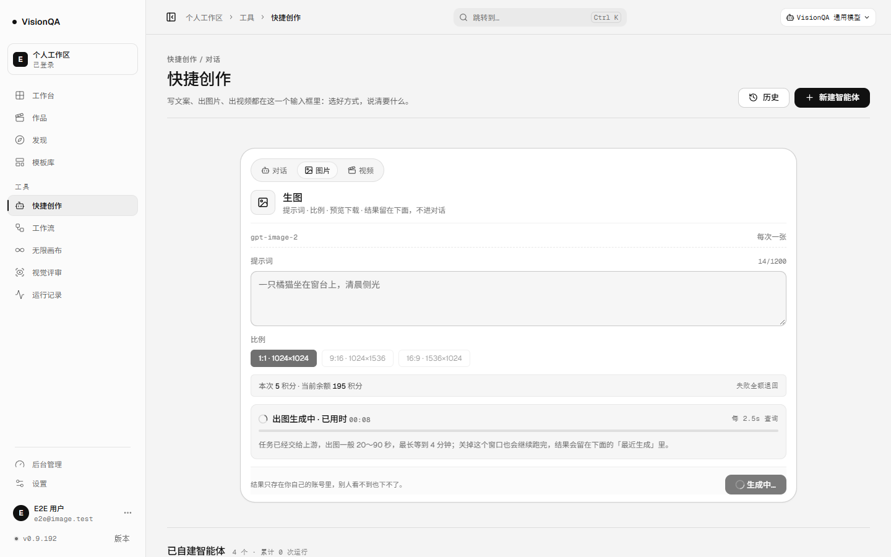

# 出图不再挂在 HTTP 请求上：120 秒上限把人等没了（2026-11-18，0.9.191）

## 事故现场

2026-11-18 13:53，用户在生产「快捷创作 → 图片」里出图，等了两分钟拿到：

> 出图失败：连不上出图上游：上游超时
> 已全额退还 5 积分（任务号 \`mgen_3Jlen_dyYvps\`）

生产日志对得上，一行都没多余：

```
13:53:28 POST /api/media/generate  13:53:28 起
13:55:28 {"t":"media.generate","kind":"image","id":"mgen_3Jlen_dyYvps","status":"failed","cost":5,"refunded":true}
13:55:28 POST /api/media/generate  s:200  ms:120034.8
```

`120034.8 ms` —— 这不是上游报错，是**我们自己 120 秒的 `AbortSignal.timeout` 先掐断**。掐断之后 `attemptImage` 的 catch 把 `TimeoutError` 交给 `friendlyNetwork`，翻成「上游超时」，再包一层「连不上出图上游」——于是界面上出现了两个都不对的词：既不是连不上，也不是上游说超时。

只读探活（不发一次生成、不花钱）当时是这样：出图 Key 一把，`GET https://www.geteapi.com/v1/models` **200**、30 个模型、4.7 秒。也就是说 Key 是活的、网络是通的、余额还有 ¥19.64，**唯一的问题是我们等不住**。

## 三个改动

### 1. 出图改成后台任务（不再挂在 POST 上）

以前 `POST /api/media/generate` 里同步等上游出图，一张图要 19～82 秒，慢的时候两三分钟。挂在一次 HTTP 请求上有三个连带问题：浏览器切后台或关标签页就断、nginx `proxy_read_timeout` 随时先断、超过我们自己设的上限就白等。

现在和生视频一个形态：

```
POST /api/media/generate  → 扣积分 → 落一条 processing 的任务 → 立刻返回任务号（毫秒级）
后台 finishImageTask()    → 调上游 → 下载文件 → 落盘 → 写 succeeded / failed（失败全额退回）
GET  /api/media/tasks/:id → 界面每 2.5 秒问一次，非 processing 就停
```

界面前端本来就为生视频写好了这套轮询（`pollTaskId` + 「进行中」自动重取 + r198 的合并逻辑），所以**前端一行没改**，关掉窗口结果也还在「最近生成」里。

进程重启会把后台任务带走，元数据停在 processing —— 这条早就有兜底，但这轮把阈值从写死的 5 分钟改成 `上游超时 + 下载超时 + 60 秒`（现在 390 秒），并用 `runningImages` 排除「进程活着只是慢」的情况，避免好任务被判死退了款、过一会儿又写回成功（等于白送一张图）。

### 2. 出图超时 120 秒 → 240 秒

`config.gateway.imageTimeoutMs` 默认 `240000`（`VQ_GATEWAY_IMAGE_TIMEOUT_MS` 可覆盖）。nginx 的 `/api/` 是 `proxy_read_timeout 300s`，240 秒留了余量；出图已经不在请求里等，所以这个上限只影响后台任务最长跑多久。

### 3. 超时的话术与「不许换 Key 重打」

- 超时单独成一种错：`504 UPSTREAM_TIMEOUT`，文案「上游 240 秒没回，这次按超时退回积分，稍后再点一次；上游可能已经接单，别连点」。不再复用「连不上出图上游」。
- **超时不换 Key**：超时是「我们等不住」，不是「上游没收」。换一把 Key 再提交一次，就是让用户为同一张图付两次钱。所以 `generateImage` 遇到 `UPSTREAM_TIMEOUT` 与 `UPSTREAM_OUTCOME_UNKNOWN` 一样直接抛出，只记一条用量台账「超时：上游可能已接单，等对账」。

### 4. 界面文案跟着改：生图不再说成「视频生成中」

那条进度块原来写死「视频生成中」——出图改成后台任务后，图片页签会看到「视频生成中」，这是行为改了文案没改的老毛病。现在按页签分开：

- 图片：**出图生成中 · 已用时 00:08**，下面一句「任务已经交给上游，出图一般 20～90 秒，最长等到 4 分钟；关掉这个窗口也会继续跑完，结果会留在下面的「最近生成」里。」
- 视频：保持原样，上游给百分比就显示百分比，没给就说没给。



这张图是**本机临时实例 + 假上游**截的（假上游固定 25 秒才回，所以「已用时 00:08」时还在跑），不是生产真实出图——按约定真实上游调用只能用户发起。图里能看清的是：POST 已经返回、面板进入「出图生成中」、进度条是不确定态、底下写着「结果只存在你自己的账号里」。

## 验收

| 项 | 结果 |
| --- | --- |
| 媒体生成单测 | 14 / 14（新增「POST 不挂在请求上」与「超时说 N 秒没回、不换 Key」两条） |
| 全量测试 | **1386 / 1386** |
| lint / tsc / build | 0 error / 19 warning；tsc 干净；入口 `index-DaZMP-AY.js` |
| 生产 | **0.9.192**，`/api/version` 与公网一致，health `{"ok":true,…,"templates":26}`，6 个服务 active |
| 生产配置核对 | `/opt/visionqa/server/config.mjs` 里 `imageTimeoutMs` = 240000 |
| 回滚点 | `20261118-1522-r209imgcop`（`ops/rollback.sh --to 1` 回 0.9.191） |

**没做的事（诚实边界）**：这轮没有发起任何一次真实出图（按用户 2026-11-18 的约定，真实上游调用只能用户在用户端发起）。所以「240 秒够不够」目前只有依据、没有实测：历史上成功的三张分别是 19.2 秒、51.6 秒、81.3 秒，失败那张卡到 120 秒。下次用户出图时会看到 `media.generate` 的耗时，够不够一看就知道。

## 一句话

不是上游挂了，是我们自己定了个 120 秒的闹钟，还把这个闹钟响说成「连不上上游」。